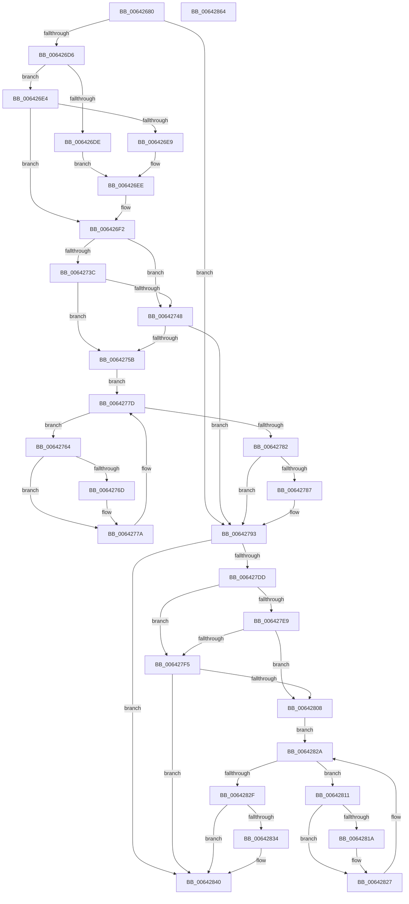

# DifZwFsControlFileWrapper

- RVA: `0x00642680`–`0x00642865` (길이 `485` bytes)
- VA: `0x0000000140642680`
- 실행 섹션: `.text`
- PDB 이름 있음: `예`; PDB Function 태그: `아니요`
- unwind 정보 RVA: `0x000D2BDC`
- 디코드: `136`개 명령, `485/485` bytes 표시
- 미해석 바이트: `0` (있으면 어셈블리에 `.byte`로 보존)

> 이 문서는 커널 이미지의 기계어와 PDB 기호를 분석해 생성했습니다. 4번과 5번은 함수 원형과 자료형을 바이너리 사용 방식에서 추정한 C 해석이며 원본 소스 복구 결과는 아닙니다.

## 1. Dependencies

- 직접 호출 지점: **10**; 고유 호출 대상: **7**
- 직접 호출자로 확인된 함수: **0**
- RIP 상대 이미지 참조: **3**

### Outgoing calls
- `0x006426BE` → [memset](../6C/memset_function_006C6C40.md) (function, `0x006C6C40`)
- `0x006426C5` → [DifGetAPIThunkContextById](../49/DifGetAPIThunkContextById_function_00495A34.md) (function, `0x00495A34`)
- `0x006426E9` → [DifGetReturnAddressForWrappers](../4D/DifGetReturnAddressForWrappers_function_004D3C08.md) (function, `0x004D3C08`)
- `0x0064274F` → [ExAcquireRundownProtection](../21/ExAcquireRundownProtection_function_00216620.md) (function, `0x00216620`)
- `0x00642775` → [guard_dispatch_icall](../6B/guard_dispatch_icall_function_006BAAD0.md) (function, `0x006BAAD0`)
- `0x0064278E` → [ExReleaseRundownProtection](../34/ExReleaseRundownProtection_function_00349E80.md) (function, `0x00349E80`)
- `0x006427D0` → [ZwFsControlFile](../6A/ZwFsControlFile_function_006AD7F0.md) (function, `0x006AD7F0`)
- `0x006427FC` → [ExAcquireRundownProtection](../21/ExAcquireRundownProtection_function_00216620.md) (function, `0x00216620`)
- `0x00642822` → [guard_dispatch_icall](../6B/guard_dispatch_icall_function_006BAAD0.md) (function, `0x006BAAD0`)
- `0x0064283B` → [ExReleaseRundownProtection](../34/ExReleaseRundownProtection_function_00349E80.md) (function, `0x00349E80`)

### Direct callers
- 이 함수 시작 RVA로 연결되는 직접 call은 확인되지 않았습니다. 간접 호출은 완전히 역산할 수 없습니다.

### Static image references
- `0x006426F9` → RVA `0x00F048B8` (`.data`; read)
- `0x0064273C` → RVA `0x00F04980` (`.data`; read)
- `0x00642748` → RVA `0x00F03E80` (`.data`; read)

## 2. Other-region calls and transfers

- 다른 실행 섹션으로 향하는 call: **0**
- 별도 외부 분기/꼬리 이동을 확인하지 못했습니다.

## 3. Assembly (complete function range)

```asm
00642680  48 8B C4                        mov rax, rsp
00642683  48 89 58 10                     mov qword ptr [rax + 0x10], rbx
00642687  48 89 70 18                     mov qword ptr [rax + 0x18], rsi
0064268B  48 89 78 20                     mov qword ptr [rax + 0x20], rdi
0064268F  48 89 48 08                     mov qword ptr [rax + 8], rcx
00642693  55                              push rbp
00642694  41 54                           push r12
00642696  41 55                           push r13
00642698  41 56                           push r14
0064269A  41 57                           push r15
0064269C  48 8D 68 D1                     lea rbp, [rax - 0x2f]
006426A0  48 81 EC B0 00 00 00            sub rsp, 0xb0
006426A7  4D 8B E0                        mov r12, r8
006426AA  48 8D 4D A7                     lea rcx, [rbp - 0x59]
006426AE  4C 8B EA                        mov r13, rdx
006426B1  BB 60 00 00 00                  mov ebx, 0x60
006426B6  44 8B C3                        mov r8d, ebx
006426B9  33 D2                           xor edx, edx
006426BB  4D 8B F9                        mov r15, r9
006426BE  E8 7D 45 08 00                  call 0x1406c6c40
006426C3  8B CB                           mov ecx, ebx
006426C5  E8 6A 33 E5 FF                  call 0x140495a34
006426CA  48 8B F0                        mov rsi, rax
006426CD  48 85 C0                        test rax, rax
006426D0  0F 84 BD 00 00 00               je 0x140642793
006426D6  8B 48 0C                        mov ecx, dword ptr [rax + 0xc]
006426D9  F6 C1 18                        test cl, 0x18
006426DC  74 06                           je 0x1406426e4
006426DE  48 8B 45 2F                     mov rax, qword ptr [rbp + 0x2f]
006426E2  EB 0A                           jmp 0x1406426ee
006426E4  F6 C1 04                        test cl, 4
006426E7  74 09                           je 0x1406426f2
006426E9  E8 1A 15 E9 FF                  call 0x1404d3c08
006426EE  48 89 45 A7                     mov qword ptr [rbp - 0x59], rax
006426F2  48 8B 45 37                     mov rax, qword ptr [rbp + 0x37]
006426F6  45 32 F6                        xor r14b, r14b
006426F9  44 38 35 B8 21 8C 00            cmp byte ptr [rip + 0x8c21b8], r14b
00642700  48 89 45 F7                     mov qword ptr [rbp - 9], rax
00642704  48 8B 45 57                     mov rax, qword ptr [rbp + 0x57]
00642708  48 89 45 D7                     mov qword ptr [rbp - 0x29], rax
0064270C  8B 45 5F                        mov eax, dword ptr [rbp + 0x5f]
0064270F  89 45 CF                        mov dword ptr [rbp - 0x31], eax
00642712  48 8B 45 67                     mov rax, qword ptr [rbp + 0x67]
00642716  48 89 45 C7                     mov qword ptr [rbp - 0x39], rax
0064271A  8B 45 6F                        mov eax, dword ptr [rbp + 0x6f]
0064271D  89 45 BF                        mov dword ptr [rbp - 0x41], eax
00642720  48 8B 45 77                     mov rax, qword ptr [rbp + 0x77]
00642724  48 89 45 B7                     mov qword ptr [rbp - 0x49], rax
00642728  8B 45 7F                        mov eax, dword ptr [rbp + 0x7f]
0064272B  89 45 AF                        mov dword ptr [rbp - 0x51], eax
0064272E  4C 89 6D EF                     mov qword ptr [rbp - 0x11], r13
00642732  4C 89 65 E7                     mov qword ptr [rbp - 0x19], r12
00642736  4C 89 7D DF                     mov qword ptr [rbp - 0x21], r15
0064273A  75 0C                           jne 0x140642748
0064273C  F7 05 3A 22 8C 00 00 08 00 00   test dword ptr [rip + 0x8c223a], 0x800
00642746  74 13                           je 0x14064275b
00642748  48 8D 0D 31 17 8C 00            lea rcx, [rip + 0x8c1731]
0064274F  E8 CC 3E BD FF                  call 0x140216620
00642754  44 8A F0                        mov r14b, al
00642757  84 C0                           test al, al
00642759  74 38                           je 0x140642793
0064275B  48 8D 7E 20                     lea rdi, [rsi + 0x20]
0064275F  48 8B 1F                        mov rbx, qword ptr [rdi]
00642762  EB 19                           jmp 0x14064277d
00642764  48 8D 43 F0                     lea rax, [rbx - 0x10]
00642768  48 85 C0                        test rax, rax
0064276B  74 0D                           je 0x14064277a
0064276D  48 8B 40 08                     mov rax, qword ptr [rax + 8]
00642771  48 8D 4D A7                     lea rcx, [rbp - 0x59]
00642775  E8 56 83 07 00                  call 0x1406baad0
0064277A  48 8B 1B                        mov rbx, qword ptr [rbx]
0064277D  48 3B DF                        cmp rbx, rdi
00642780  75 E2                           jne 0x140642764
00642782  45 84 F6                        test r14b, r14b
00642785  74 0C                           je 0x140642793
00642787  48 8D 0D F2 16 8C 00            lea rcx, [rip + 0x8c16f2]
0064278E  E8 ED 76 D0 FF                  call 0x140349e80
00642793  8B 45 7F                        mov eax, dword ptr [rbp + 0x7f]
00642796  4D 8B CF                        mov r9, r15
00642799  48 8B 4D 37                     mov rcx, qword ptr [rbp + 0x37]
0064279D  4D 8B C4                        mov r8, r12
006427A0  89 44 24 48                     mov dword ptr [rsp + 0x48], eax
006427A4  49 8B D5                        mov rdx, r13
006427A7  48 8B 45 77                     mov rax, qword ptr [rbp + 0x77]
006427AB  48 89 44 24 40                  mov qword ptr [rsp + 0x40], rax
006427B0  8B 45 6F                        mov eax, dword ptr [rbp + 0x6f]
006427B3  89 44 24 38                     mov dword ptr [rsp + 0x38], eax
006427B7  48 8B 45 67                     mov rax, qword ptr [rbp + 0x67]
006427BB  48 89 44 24 30                  mov qword ptr [rsp + 0x30], rax
006427C0  8B 45 5F                        mov eax, dword ptr [rbp + 0x5f]
006427C3  89 44 24 28                     mov dword ptr [rsp + 0x28], eax
006427C7  48 8B 45 57                     mov rax, qword ptr [rbp + 0x57]
006427CB  48 89 44 24 20                  mov qword ptr [rsp + 0x20], rax
006427D0  E8 1B B0 06 00                  call 0x1406ad7f0
006427D5  89 45 FF                        mov dword ptr [rbp - 1], eax
006427D8  48 85 F6                        test rsi, rsi
006427DB  74 63                           je 0x140642840
006427DD  40 32 FF                        xor dil, dil
006427E0  40 38 3D D1 20 8C 00            cmp byte ptr [rip + 0x8c20d1], dil
006427E7  75 0C                           jne 0x1406427f5
006427E9  F7 05 8D 21 8C 00 00 08 00 00   test dword ptr [rip + 0x8c218d], 0x800
006427F3  74 13                           je 0x140642808
006427F5  48 8D 0D 84 16 8C 00            lea rcx, [rip + 0x8c1684]
006427FC  E8 1F 3E BD FF                  call 0x140216620
00642801  40 8A F8                        mov dil, al
00642804  84 C0                           test al, al
00642806  74 38                           je 0x140642840
00642808  48 83 C6 30                     add rsi, 0x30
0064280C  48 8B 1E                        mov rbx, qword ptr [rsi]
0064280F  EB 19                           jmp 0x14064282a
00642811  48 8D 43 F0                     lea rax, [rbx - 0x10]
00642815  48 85 C0                        test rax, rax
00642818  74 0D                           je 0x140642827
0064281A  48 8B 40 08                     mov rax, qword ptr [rax + 8]
0064281E  48 8D 4D A7                     lea rcx, [rbp - 0x59]
00642822  E8 A9 82 07 00                  call 0x1406baad0
00642827  48 8B 1B                        mov rbx, qword ptr [rbx]
0064282A  48 3B DE                        cmp rbx, rsi
0064282D  75 E2                           jne 0x140642811
0064282F  40 84 FF                        test dil, dil
00642832  74 0C                           je 0x140642840
00642834  48 8D 0D 45 16 8C 00            lea rcx, [rip + 0x8c1645]
0064283B  E8 40 76 D0 FF                  call 0x140349e80
00642840  8B 45 FF                        mov eax, dword ptr [rbp - 1]
00642843  4C 8D 9C 24 B0 00 00 00         lea r11, [rsp + 0xb0]
0064284B  49 8B 5B 38                     mov rbx, qword ptr [r11 + 0x38]
0064284F  49 8B 73 40                     mov rsi, qword ptr [r11 + 0x40]
00642853  49 8B 7B 48                     mov rdi, qword ptr [r11 + 0x48]
00642857  49 8B E3                        mov rsp, r11
0064285A  41 5F                           pop r15
0064285C  41 5E                           pop r14
0064285E  41 5D                           pop r13
00642860  41 5C                           pop r12
00642862  5D                              pop rbp
00642863  C3                              ret
00642864  CC                              int3
```

## 4. C-style interpretation (structured pseudocode)

```c
__int64 __fastcall DifZwFsControlFileWrapper(__int64 a1, __int64 a2, __int64 a3, __int64 a4)
{
    __int64 result;
    __int64 v_r14;
    __int64 v_rdi;
    __int64 v_rsi;
    __int64 v_rsp;
    unsigned __int64 v_stack_m28;
    unsigned int v_stack_m90;
    unsigned __int64 v_stack_m98;
    unsigned int v_stack_mA0;
    unsigned __int64 v_stack_mA8;
    unsigned int v_stack_mB0;
    unsigned __int64 v_stack_mB8;

    *(unsigned __int64 *)(v_rsp + 16) = v_rbx;
    *(unsigned __int64 *)(v_rsp + 24) = v_rsi;
    *(unsigned __int64 *)(v_rsp + 32) = v_rdi;
    *(unsigned __int64 *)(v_rsp + 8) = a1;
    v_rsp = (v_rsp) - (176);
    a2 = 0;
    result = memset(v_rsp - 47 - 89, a2, 96, a4);
    result = DifGetAPIThunkContextById(96, a2, 96, a4);
    if (result == 0) goto loc_00642793;
    if ((((unsigned __int8)((unsigned int)(*(unsigned int *)(result + 12)))) & (24)) == 0) goto loc_006426E4;
    goto loc_006426EE;
loc_006426E4:
    if ((((unsigned __int8)((unsigned int)(*(unsigned int *)(result + 12)))) & (4)) == 0) goto loc_006426F2;
    result = DifGetReturnAddressForWrappers((unsigned int)(*(unsigned int *)(result + 12)), a2, 96, a4);
loc_006426EE:
    *(unsigned __int64 *)(v_rsp - 47 - 89) = result;
loc_006426F2:
    v_r14 = 0;
    *(unsigned __int64 *)(v_rsp - 47 - 9) = *(unsigned __int64 *)(v_rsp - 47 + 55);
    *(unsigned __int64 *)(v_rsp - 47 - 41) = *(unsigned __int64 *)(v_rsp - 47 + 87);
    *(unsigned int *)(v_rsp - 47 - 49) = (unsigned int)((unsigned int)(*(unsigned int *)(v_rsp - 47 + 95)));
    *(unsigned __int64 *)(v_rsp - 47 - 57) = *(unsigned __int64 *)(v_rsp - 47 + 103);
    *(unsigned int *)(v_rsp - 47 - 65) = (unsigned int)((unsigned int)(*(unsigned int *)(v_rsp - 47 + 111)));
    *(unsigned __int64 *)(v_rsp - 47 - 73) = *(unsigned __int64 *)(v_rsp - 47 + 119);
    *(unsigned int *)(v_rsp - 47 - 81) = (unsigned int)((unsigned int)(*(unsigned int *)(v_rsp - 47 + 127)));
    *(unsigned __int64 *)(v_rsp - 47 - 17) = 0;
    *(unsigned __int64 *)(v_rsp - 47 - 25) = a3;
    *(unsigned __int64 *)(v_rsp - 47 - 33) = a4;
    if ((*(unsigned __int8 *)(v_rip + 9183672)) != 0) goto loc_00642748;
    if (((*(unsigned int *)(v_rip + 9183802)) & (0x800ULL)) == 0) goto loc_0064275B;
loc_00642748:
    result = ExAcquireRundownProtection(v_rip + 9180977, a2, 96, a4);
    if ((unsigned __int8)(result) == 0) goto loc_00642793;
loc_0064275B:
    goto loc_0064277D;
loc_00642764:
    result = *(unsigned __int64 *)(result + 32) - 16;
    if (*(unsigned __int64 *)(result + 32) - 16 != 0) {
        result = *(unsigned __int64 *)(*(unsigned __int64 *)(result + 32) - 16 + 8);
        a1 = v_rsp - 47 - 89;
        result = guard_dispatch_icall(a1, a2, 96, a4);
    }
loc_0064277D:
    if ((*(unsigned __int64 *)(*(unsigned __int64 *)(result + 32))) != (result + 32)) goto loc_00642764;
    if ((unsigned __int8)((unsigned __int8)(result)) != 0) {
        a1 = v_rip + 9180914;
        result = ExReleaseRundownProtection(a1, a2, 96, a4);
    }
    v_stack_m90 = (unsigned int)((unsigned int)(*(unsigned int *)(v_rsp - 47 + 127)));
    v_stack_m98 = *(unsigned __int64 *)(v_rsp - 47 + 119);
    v_stack_mA0 = (unsigned int)((unsigned int)(*(unsigned int *)(v_rsp - 47 + 111)));
    v_stack_mA8 = *(unsigned __int64 *)(v_rsp - 47 + 103);
    v_stack_mB0 = (unsigned int)((unsigned int)(*(unsigned int *)(v_rsp - 47 + 95)));
    v_stack_mB8 = *(unsigned __int64 *)(v_rsp - 47 + 87);
    result = ZwFsControlFile(*(unsigned __int64 *)(v_rsp - 47 + 55), 0, a3, a4);
    *(unsigned int *)(v_rsp - 47 - 1) = (unsigned int)(result);
    if (result == 0) goto loc_00642840;
    v_rdi = 0;
    if ((*(unsigned __int8 *)(v_rip + 9183441)) != 0) goto loc_006427F5;
    if (((*(unsigned int *)(v_rip + 9183629)) & (0x800ULL)) == 0) goto loc_00642808;
loc_006427F5:
    result = ExAcquireRundownProtection(v_rip + 9180804, 0, a3, a4);
    if ((unsigned __int8)(result) == 0) goto loc_00642840;
loc_00642808:
    v_rsi = (result) + (48);
    goto loc_0064282A;
loc_00642811:
    result = *(unsigned __int64 *)(v_rsi) - 16;
    if (*(unsigned __int64 *)(v_rsi) - 16 != 0) {
        result = *(unsigned __int64 *)(*(unsigned __int64 *)(v_rsi) - 16 + 8);
        a1 = v_rsp - 47 - 89;
        result = guard_dispatch_icall(a1, 0, a3, a4);
    }
loc_0064282A:
    if ((*(unsigned __int64 *)(*(unsigned __int64 *)(v_rsi))) != v_rsi) goto loc_00642811;
    if ((unsigned __int8)((unsigned __int8)(result)) != 0) {
        a1 = v_rip + 9180741;
        result = ExReleaseRundownProtection(a1, 0, a3, a4);
    }
    return (unsigned int)(*(unsigned int *)(v_rsp - 47 - 1));
}
```

## 5. (Beta) C Style

```c
int64_t DifZwFsControlFileWrapper(int64_t Arg1, int64_t Arg2, int64_t Arg3, int64_t Arg4)
{
    int64_t result;
    int64_t local_r14;
    int64_t local_rdi;
    int64_t local_rsi;
    int64_t local_rsp;
    uint64_t v_stack_m28;
    uint32_t v_stack_m90;
    uint64_t v_stack_m98;
    uint32_t v_stack_mA0;
    uint64_t v_stack_mA8;
    uint32_t v_stack_mB0;
    uint64_t v_stack_mB8;

    *(uint64_t *)(local_rsp + 0x10) = local_rbx;
    *(uint64_t *)(local_rsp + 0x18) = local_rsi;
    *(uint64_t *)(local_rsp + 0x20) = local_rdi;
    *(uint64_t *)(local_rsp + 0x8) = Arg1;
    local_rsp = (local_rsp) - (176);
    Arg2 = 0;
    result = memset(local_rsp - 47 - 89, Arg2, 96, Arg4);
    result = DifGetAPIThunkContextById(96, Arg2, 96, Arg4);
    if (result == 0) goto loc_00642793;
    if ((((uint8_t)((uint32_t)(*(uint32_t *)(result + 0xC)))) & (24)) == 0) goto loc_006426E4;
    goto loc_006426EE;
loc_006426E4:
    if ((((uint8_t)((uint32_t)(*(uint32_t *)(result + 0xC)))) & (4)) == 0) goto loc_006426F2;
    result = DifGetReturnAddressForWrappers((uint32_t)(*(uint32_t *)(result + 0xC)), Arg2, 96, Arg4);
loc_006426EE:
    *(uint64_t *)(local_rsp - 0x2F - 0x59) = result;
loc_006426F2:
    local_r14 = 0;
    *(uint64_t *)(local_rsp - 0x2F - 0x9) = *(uint64_t *)(local_rsp - 0x2F + 0x37);
    *(uint64_t *)(local_rsp - 0x2F - 0x29) = *(uint64_t *)(local_rsp - 0x2F + 0x57);
    *(uint32_t *)(local_rsp - 0x2F - 0x31) = (uint32_t)((uint32_t)(*(uint32_t *)(local_rsp - 0x2F + 0x5F)));
    *(uint64_t *)(local_rsp - 0x2F - 0x39) = *(uint64_t *)(local_rsp - 0x2F + 0x67);
    *(uint32_t *)(local_rsp - 0x2F - 0x41) = (uint32_t)((uint32_t)(*(uint32_t *)(local_rsp - 0x2F + 0x6F)));
    *(uint64_t *)(local_rsp - 0x2F - 0x49) = *(uint64_t *)(local_rsp - 0x2F + 0x77);
    *(uint32_t *)(local_rsp - 0x2F - 0x51) = (uint32_t)((uint32_t)(*(uint32_t *)(local_rsp - 0x2F + 0x7F)));
    *(uint64_t *)(local_rsp - 0x2F - 0x11) = 0;
    *(uint64_t *)(local_rsp - 0x2F - 0x19) = Arg3;
    *(uint64_t *)(local_rsp - 0x2F - 0x21) = Arg4;
    if ((*(uint8_t *)(v_rip + 0x8C21B8)) != 0) goto loc_00642748;
    if (((*(uint32_t *)(v_rip + 0x8C223A)) & (0x800ULL)) == 0) goto loc_0064275B;
loc_00642748:
    result = ExAcquireRundownProtection(v_rip + 9180977, Arg2, 96, Arg4);
    if ((uint8_t)(result) == 0) goto loc_00642793;
loc_0064275B:
    goto loc_0064277D;
loc_00642764:
    result = *(uint64_t *)(result + 0x20) - 16;
    if (*(uint64_t *)(result + 0x20) - 16 != 0) {
        result = *(uint64_t *)(*(uint64_t *)(result + 0x20) - 0x10 + 0x8);
        Arg1 = local_rsp - 47 - 89;
        result = guard_dispatch_icall(Arg1, Arg2, 96, Arg4);
    }
loc_0064277D:
    if ((*(uint64_t *)(*(uint64_t *)(result + 0x20))) != (result + 32)) goto loc_00642764;
    if ((uint8_t)((uint8_t)(result)) != 0) {
        Arg1 = v_rip + 9180914;
        result = ExReleaseRundownProtection(Arg1, Arg2, 96, Arg4);
    }
    v_stack_m90 = (uint32_t)((uint32_t)(*(uint32_t *)(local_rsp - 0x2F + 0x7F)));
    v_stack_m98 = *(uint64_t *)(local_rsp - 0x2F + 0x77);
    v_stack_mA0 = (uint32_t)((uint32_t)(*(uint32_t *)(local_rsp - 0x2F + 0x6F)));
    v_stack_mA8 = *(uint64_t *)(local_rsp - 0x2F + 0x67);
    v_stack_mB0 = (uint32_t)((uint32_t)(*(uint32_t *)(local_rsp - 0x2F + 0x5F)));
    v_stack_mB8 = *(uint64_t *)(local_rsp - 0x2F + 0x57);
    result = ZwFsControlFile(*(uint64_t *)(local_rsp - 0x2F + 0x37), 0, Arg3, Arg4);
    *(uint32_t *)(local_rsp - 0x2F - 0x1) = (uint32_t)(result);
    if (result == 0) goto loc_00642840;
    local_rdi = 0;
    if ((*(uint8_t *)(v_rip + 0x8C20D1)) != 0) goto loc_006427F5;
    if (((*(uint32_t *)(v_rip + 0x8C218D)) & (0x800ULL)) == 0) goto loc_00642808;
loc_006427F5:
    result = ExAcquireRundownProtection(v_rip + 9180804, 0, Arg3, Arg4);
    if ((uint8_t)(result) == 0) goto loc_00642840;
loc_00642808:
    local_rsi = (result) + (48);
    goto loc_0064282A;
loc_00642811:
    result = *(uint64_t *)(local_rsi) - 16;
    if (*(uint64_t *)(local_rsi) - 16 != 0) {
        result = *(uint64_t *)(*(uint64_t *)(local_rsi) - 0x10 + 0x8);
        Arg1 = local_rsp - 47 - 89;
        result = guard_dispatch_icall(Arg1, 0, Arg3, Arg4);
    }
loc_0064282A:
    if ((*(uint64_t *)(*(uint64_t *)(local_rsi))) != local_rsi) goto loc_00642811;
    if ((uint8_t)((uint8_t)(result)) != 0) {
        Arg1 = v_rip + 9180741;
        result = ExReleaseRundownProtection(Arg1, 0, Arg3, Arg4);
    }
    return (uint32_t)(*(uint32_t *)(local_rsp - 0x2F - 0x1));
}
```

## 6. Execution-region graph

[열기: 2D/3D 그래프와 함수 탐색 컨트롤 패널](../../../control-panel.html?section=text&rva=0x00642680&view=graph)

- 2D 그래프는 위에서 아래로 흐르고, 3D 그래프는 빈 공간을 드래그해 회전합니다. Shift+드래그는 이동, 휠은 확대·축소, 함수 노드 선택은 대상 보고서 이동입니다.

### Static fallback


