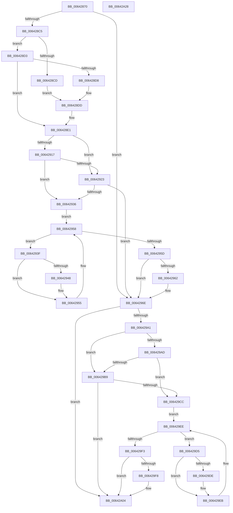

# DifZwGetNotificationResourceManagerWrapper

- RVA: `0x00642870`–`0x00642A29` (길이 `441` bytes)
- VA: `0x0000000140642870`
- 실행 섹션: `.text`
- PDB 이름 있음: `예`; PDB Function 태그: `아니요`
- unwind 정보 RVA: `0x000D2C00`
- 디코드: `123`개 명령, `441/441` bytes 표시
- 미해석 바이트: `0` (있으면 어셈블리에 `.byte`로 보존)

> 이 문서는 커널 이미지의 기계어와 PDB 기호를 분석해 생성했습니다. 4번과 5번은 함수 원형과 자료형을 바이너리 사용 방식에서 추정한 C 해석이며 원본 소스 복구 결과는 아닙니다.

## 1. Dependencies

- 직접 호출 지점: **10**; 고유 호출 대상: **7**
- 직접 호출자로 확인된 함수: **0**
- RIP 상대 이미지 참조: **3**

### Outgoing calls
- `0x006428AA` → [memset](../6C/memset_function_006C6C40.md) (function, `0x006C6C40`)
- `0x006428B4` → [DifGetAPIThunkContextById](../49/DifGetAPIThunkContextById_function_00495A34.md) (function, `0x00495A34`)
- `0x006428D8` → [DifGetReturnAddressForWrappers](../4D/DifGetReturnAddressForWrappers_function_004D3C08.md) (function, `0x004D3C08`)
- `0x0064292A` → [ExAcquireRundownProtection](../21/ExAcquireRundownProtection_function_00216620.md) (function, `0x00216620`)
- `0x00642950` → [guard_dispatch_icall](../6B/guard_dispatch_icall_function_006BAAD0.md) (function, `0x006BAAD0`)
- `0x00642969` → [ExReleaseRundownProtection](../34/ExReleaseRundownProtection_function_00349E80.md) (function, `0x00349E80`)
- `0x00642994` → [ZwGetNotificationResourceManager](../6A/ZwGetNotificationResourceManager_function_006AF130.md) (function, `0x006AF130`)
- `0x006429C0` → [ExAcquireRundownProtection](../21/ExAcquireRundownProtection_function_00216620.md) (function, `0x00216620`)
- `0x006429E6` → [guard_dispatch_icall](../6B/guard_dispatch_icall_function_006BAAD0.md) (function, `0x006BAAD0`)
- `0x006429FF` → [ExReleaseRundownProtection](../34/ExReleaseRundownProtection_function_00349E80.md) (function, `0x00349E80`)

### Direct callers
- 이 함수 시작 RVA로 연결되는 직접 call은 확인되지 않았습니다. 간접 호출은 완전히 역산할 수 없습니다.

### Static image references
- `0x006428E8` → RVA `0x00F048B8` (`.data`; read)
- `0x00642917` → RVA `0x00F04980` (`.data`; read)
- `0x00642923` → RVA `0x00F03E80` (`.data`; read)

## 2. Other-region calls and transfers

- 다른 실행 섹션으로 향하는 call: **0**
- 별도 외부 분기/꼬리 이동을 확인하지 못했습니다.

## 3. Assembly (complete function range)

```asm
00642870  48 8B C4                        mov rax, rsp
00642873  48 89 58 10                     mov qword ptr [rax + 0x10], rbx
00642877  48 89 70 18                     mov qword ptr [rax + 0x18], rsi
0064287B  48 89 78 20                     mov qword ptr [rax + 0x20], rdi
0064287F  48 89 48 08                     mov qword ptr [rax + 8], rcx
00642883  55                              push rbp
00642884  41 54                           push r12
00642886  41 55                           push r13
00642888  41 56                           push r14
0064288A  41 57                           push r15
0064288C  48 8D 68 B9                     lea rbp, [rax - 0x47]
00642890  48 81 EC 90 00 00 00            sub rsp, 0x90
00642897  4C 8B EA                        mov r13, rdx
0064289A  48 8D 4D CF                     lea rcx, [rbp - 0x31]
0064289E  33 D2                           xor edx, edx
006428A0  45 8B E0                        mov r12d, r8d
006428A3  4D 8B F9                        mov r15, r9
006428A6  44 8D 42 48                     lea r8d, [rdx + 0x48]
006428AA  E8 91 43 08 00                  call 0x1406c6c40
006428AF  B9 5F 00 00 00                  mov ecx, 0x5f
006428B4  E8 7B 31 E5 FF                  call 0x140495a34
006428B9  4C 8B F0                        mov r14, rax
006428BC  48 85 C0                        test rax, rax
006428BF  0F 84 A9 00 00 00               je 0x14064296e
006428C5  8B 48 0C                        mov ecx, dword ptr [rax + 0xc]
006428C8  F6 C1 18                        test cl, 0x18
006428CB  74 06                           je 0x1406428d3
006428CD  48 8B 45 47                     mov rax, qword ptr [rbp + 0x47]
006428D1  EB 0A                           jmp 0x1406428dd
006428D3  F6 C1 04                        test cl, 4
006428D6  74 09                           je 0x1406428e1
006428D8  E8 2B 13 E9 FF                  call 0x1404d3c08
006428DD  48 89 45 CF                     mov qword ptr [rbp - 0x31], rax
006428E1  48 8B 45 4F                     mov rax, qword ptr [rbp + 0x4f]
006428E5  40 32 F6                        xor sil, sil
006428E8  40 38 35 C9 1F 8C 00            cmp byte ptr [rip + 0x8c1fc9], sil
006428EF  48 89 45 07                     mov qword ptr [rbp + 7], rax
006428F3  48 8B 45 6F                     mov rax, qword ptr [rbp + 0x6f]
006428F7  48 89 45 E7                     mov qword ptr [rbp - 0x19], rax
006428FB  8B 45 77                        mov eax, dword ptr [rbp + 0x77]
006428FE  89 45 DF                        mov dword ptr [rbp - 0x21], eax
00642901  48 8B 45 7F                     mov rax, qword ptr [rbp + 0x7f]
00642905  48 89 45 D7                     mov qword ptr [rbp - 0x29], rax
00642909  4C 89 6D FF                     mov qword ptr [rbp - 1], r13
0064290D  44 89 65 F7                     mov dword ptr [rbp - 9], r12d
00642911  4C 89 7D EF                     mov qword ptr [rbp - 0x11], r15
00642915  75 0C                           jne 0x140642923
00642917  F7 05 5F 20 8C 00 00 08 00 00   test dword ptr [rip + 0x8c205f], 0x800
00642921  74 13                           je 0x140642936
00642923  48 8D 0D 56 15 8C 00            lea rcx, [rip + 0x8c1556]
0064292A  E8 F1 3C BD FF                  call 0x140216620
0064292F  40 8A F0                        mov sil, al
00642932  84 C0                           test al, al
00642934  74 38                           je 0x14064296e
00642936  49 8D 7E 20                     lea rdi, [r14 + 0x20]
0064293A  48 8B 1F                        mov rbx, qword ptr [rdi]
0064293D  EB 19                           jmp 0x140642958
0064293F  48 8D 43 F0                     lea rax, [rbx - 0x10]
00642943  48 85 C0                        test rax, rax
00642946  74 0D                           je 0x140642955
00642948  48 8B 40 08                     mov rax, qword ptr [rax + 8]
0064294C  48 8D 4D CF                     lea rcx, [rbp - 0x31]
00642950  E8 7B 81 07 00                  call 0x1406baad0
00642955  48 8B 1B                        mov rbx, qword ptr [rbx]
00642958  48 3B DF                        cmp rbx, rdi
0064295B  75 E2                           jne 0x14064293f
0064295D  40 84 F6                        test sil, sil
00642960  74 0C                           je 0x14064296e
00642962  48 8D 0D 17 15 8C 00            lea rcx, [rip + 0x8c1517]
00642969  E8 12 75 D0 FF                  call 0x140349e80
0064296E  48 8B 45 7F                     mov rax, qword ptr [rbp + 0x7f]
00642972  4D 8B CF                        mov r9, r15
00642975  48 8B 4D 4F                     mov rcx, qword ptr [rbp + 0x4f]
00642979  45 8B C4                        mov r8d, r12d
0064297C  48 89 44 24 30                  mov qword ptr [rsp + 0x30], rax
00642981  49 8B D5                        mov rdx, r13
00642984  8B 45 77                        mov eax, dword ptr [rbp + 0x77]
00642987  89 44 24 28                     mov dword ptr [rsp + 0x28], eax
0064298B  48 8B 45 6F                     mov rax, qword ptr [rbp + 0x6f]
0064298F  48 89 44 24 20                  mov qword ptr [rsp + 0x20], rax
00642994  E8 97 C7 06 00                  call 0x1406af130
00642999  89 45 0F                        mov dword ptr [rbp + 0xf], eax
0064299C  4D 85 F6                        test r14, r14
0064299F  74 63                           je 0x140642a04
006429A1  40 32 FF                        xor dil, dil
006429A4  40 38 3D 0D 1F 8C 00            cmp byte ptr [rip + 0x8c1f0d], dil
006429AB  75 0C                           jne 0x1406429b9
006429AD  F7 05 C9 1F 8C 00 00 08 00 00   test dword ptr [rip + 0x8c1fc9], 0x800
006429B7  74 13                           je 0x1406429cc
006429B9  48 8D 0D C0 14 8C 00            lea rcx, [rip + 0x8c14c0]
006429C0  E8 5B 3C BD FF                  call 0x140216620
006429C5  40 8A F8                        mov dil, al
006429C8  84 C0                           test al, al
006429CA  74 38                           je 0x140642a04
006429CC  49 8D 76 30                     lea rsi, [r14 + 0x30]
006429D0  48 8B 1E                        mov rbx, qword ptr [rsi]
006429D3  EB 19                           jmp 0x1406429ee
006429D5  48 8D 43 F0                     lea rax, [rbx - 0x10]
006429D9  48 85 C0                        test rax, rax
006429DC  74 0D                           je 0x1406429eb
006429DE  48 8B 40 08                     mov rax, qword ptr [rax + 8]
006429E2  48 8D 4D CF                     lea rcx, [rbp - 0x31]
006429E6  E8 E5 80 07 00                  call 0x1406baad0
006429EB  48 8B 1B                        mov rbx, qword ptr [rbx]
006429EE  48 3B DE                        cmp rbx, rsi
006429F1  75 E2                           jne 0x1406429d5
006429F3  40 84 FF                        test dil, dil
006429F6  74 0C                           je 0x140642a04
006429F8  48 8D 0D 81 14 8C 00            lea rcx, [rip + 0x8c1481]
006429FF  E8 7C 74 D0 FF                  call 0x140349e80
00642A04  8B 45 0F                        mov eax, dword ptr [rbp + 0xf]
00642A07  4C 8D 9C 24 90 00 00 00         lea r11, [rsp + 0x90]
00642A0F  49 8B 5B 38                     mov rbx, qword ptr [r11 + 0x38]
00642A13  49 8B 73 40                     mov rsi, qword ptr [r11 + 0x40]
00642A17  49 8B 7B 48                     mov rdi, qword ptr [r11 + 0x48]
00642A1B  49 8B E3                        mov rsp, r11
00642A1E  41 5F                           pop r15
00642A20  41 5E                           pop r14
00642A22  41 5D                           pop r13
00642A24  41 5C                           pop r12
00642A26  5D                              pop rbp
00642A27  C3                              ret
00642A28  CC                              int3
```

## 4. C-style interpretation (structured pseudocode)

```c
__int64 __fastcall DifZwGetNotificationResourceManagerWrapper(__int64 a1, __int64 a2, int a3, __int64 a4)
{
    __int64 result;
    __int64 v_rdi;
    __int64 v_rsi;
    __int64 v_rsp;
    unsigned __int64 v_stack_m28;
    unsigned __int64 v_stack_m88;
    unsigned int v_stack_m90;
    unsigned __int64 v_stack_m98;

    *(unsigned __int64 *)(v_rsp + 16) = v_rbx;
    *(unsigned __int64 *)(v_rsp + 24) = v_rsi;
    *(unsigned __int64 *)(v_rsp + 32) = v_rdi;
    *(unsigned __int64 *)(v_rsp + 8) = a1;
    v_rsp = (v_rsp) - (144);
    a2 = 0;
    result = memset(v_rsp - 71 - 49, a2, a2 + 72, a4);
    result = DifGetAPIThunkContextById(95, a2, a2 + 72, a4);
    if (result == 0) goto loc_0064296E;
    if ((((unsigned __int8)((unsigned int)(*(unsigned int *)(result + 12)))) & (24)) == 0) goto loc_006428D3;
    goto loc_006428DD;
loc_006428D3:
    if ((((unsigned __int8)((unsigned int)(*(unsigned int *)(result + 12)))) & (4)) == 0) goto loc_006428E1;
    result = DifGetReturnAddressForWrappers((unsigned int)(*(unsigned int *)(result + 12)), a2, a2 + 72, a4);
loc_006428DD:
    *(unsigned __int64 *)(v_rsp - 71 - 49) = result;
loc_006428E1:
    v_rsi = 0;
    *(unsigned __int64 *)(v_rsp - 71 + 7) = *(unsigned __int64 *)(v_rsp - 71 + 79);
    *(unsigned __int64 *)(v_rsp - 71 - 25) = *(unsigned __int64 *)(v_rsp - 71 + 111);
    *(unsigned int *)(v_rsp - 71 - 33) = (unsigned int)((unsigned int)(*(unsigned int *)(v_rsp - 71 + 119)));
    *(unsigned __int64 *)(v_rsp - 71 - 41) = *(unsigned __int64 *)(v_rsp - 71 + 127);
    *(unsigned __int64 *)(v_rsp - 71 - 1) = 0;
    *(unsigned int *)(v_rsp - 71 - 9) = (unsigned int)((unsigned int)(a3));
    *(unsigned __int64 *)(v_rsp - 71 - 17) = a4;
    if ((*(unsigned __int8 *)(v_rip + 9183177)) != 0) goto loc_00642923;
    if (((*(unsigned int *)(v_rip + 9183327)) & (0x800ULL)) == 0) goto loc_00642936;
loc_00642923:
    result = ExAcquireRundownProtection(v_rip + 9180502, a2, a2 + 72, a4);
    if ((unsigned __int8)(result) == 0) goto loc_0064296E;
loc_00642936:
    goto loc_00642958;
loc_0064293F:
    result = *(unsigned __int64 *)(result + 32) - 16;
    if (*(unsigned __int64 *)(result + 32) - 16 != 0) {
        result = *(unsigned __int64 *)(*(unsigned __int64 *)(result + 32) - 16 + 8);
        a1 = v_rsp - 71 - 49;
        result = guard_dispatch_icall(a1, a2, a2 + 72, a4);
    }
loc_00642958:
    if ((*(unsigned __int64 *)(*(unsigned __int64 *)(result + 32))) != (result + 32)) goto loc_0064293F;
    if ((unsigned __int8)((unsigned __int8)(result)) != 0) {
        a1 = v_rip + 9180439;
        result = ExReleaseRundownProtection(a1, a2, a2 + 72, a4);
    }
    v_stack_m88 = *(unsigned __int64 *)(v_rsp - 71 + 127);
    v_stack_m90 = (unsigned int)((unsigned int)(*(unsigned int *)(v_rsp - 71 + 119)));
    v_stack_m98 = *(unsigned __int64 *)(v_rsp - 71 + 111);
    result = ZwGetNotificationResourceManager(*(unsigned __int64 *)(v_rsp - 71 + 79), 0, (unsigned int)((unsigned int)((unsigned int)(a3))), a4);
    *(unsigned int *)(v_rsp - 71 + 15) = (unsigned int)(result);
    if (result == 0) goto loc_00642A04;
    v_rdi = 0;
    if ((*(unsigned __int8 *)(v_rip + 9182989)) != 0) goto loc_006429B9;
    if (((*(unsigned int *)(v_rip + 9183177)) & (0x800ULL)) == 0) goto loc_006429CC;
loc_006429B9:
    result = ExAcquireRundownProtection(v_rip + 9180352, 0, (unsigned int)((unsigned int)((unsigned int)(a3))), a4);
    if ((unsigned __int8)(result) == 0) goto loc_00642A04;
loc_006429CC:
    goto loc_006429EE;
loc_006429D5:
    result = *(unsigned __int64 *)(result + 48) - 16;
    if (*(unsigned __int64 *)(result + 48) - 16 != 0) {
        result = *(unsigned __int64 *)(*(unsigned __int64 *)(result + 48) - 16 + 8);
        a1 = v_rsp - 71 - 49;
        result = guard_dispatch_icall(a1, 0, (unsigned int)((unsigned int)((unsigned int)(a3))), a4);
    }
loc_006429EE:
    if ((*(unsigned __int64 *)(*(unsigned __int64 *)(result + 48))) != (result + 48)) goto loc_006429D5;
    if ((unsigned __int8)((unsigned __int8)(result)) != 0) {
        a1 = v_rip + 9180289;
        result = ExReleaseRundownProtection(a1, 0, (unsigned int)((unsigned int)((unsigned int)(a3))), a4);
    }
    return (unsigned int)(*(unsigned int *)(v_rsp - 71 + 15));
}
```

## 5. (Beta) C Style

```c
int64_t DifZwGetNotificationResourceManagerWrapper(int64_t Arg1, int64_t Arg2, int32_t Arg3, int64_t Arg4)
{
    int64_t result;
    int64_t local_rdi;
    int64_t local_rsi;
    int64_t local_rsp;
    uint64_t v_stack_m28;
    uint64_t v_stack_m88;
    uint32_t v_stack_m90;
    uint64_t v_stack_m98;

    *(uint64_t *)(local_rsp + 0x10) = local_rbx;
    *(uint64_t *)(local_rsp + 0x18) = local_rsi;
    *(uint64_t *)(local_rsp + 0x20) = local_rdi;
    *(uint64_t *)(local_rsp + 0x8) = Arg1;
    local_rsp = (local_rsp) - (144);
    Arg2 = 0;
    result = memset(local_rsp - 71 - 49, Arg2, Arg2 + 72, Arg4);
    result = DifGetAPIThunkContextById(95, Arg2, Arg2 + 72, Arg4);
    if (result == 0) goto loc_0064296E;
    if ((((uint8_t)((uint32_t)(*(uint32_t *)(result + 0xC)))) & (24)) == 0) goto loc_006428D3;
    goto loc_006428DD;
loc_006428D3:
    if ((((uint8_t)((uint32_t)(*(uint32_t *)(result + 0xC)))) & (4)) == 0) goto loc_006428E1;
    result = DifGetReturnAddressForWrappers((uint32_t)(*(uint32_t *)(result + 0xC)), Arg2, Arg2 + 72, Arg4);
loc_006428DD:
    *(uint64_t *)(local_rsp - 0x47 - 0x31) = result;
loc_006428E1:
    local_rsi = 0;
    *(uint64_t *)(local_rsp - 0x47 + 0x7) = *(uint64_t *)(local_rsp - 0x47 + 0x4F);
    *(uint64_t *)(local_rsp - 0x47 - 0x19) = *(uint64_t *)(local_rsp - 0x47 + 0x6F);
    *(uint32_t *)(local_rsp - 0x47 - 0x21) = (uint32_t)((uint32_t)(*(uint32_t *)(local_rsp - 0x47 + 0x77)));
    *(uint64_t *)(local_rsp - 0x47 - 0x29) = *(uint64_t *)(local_rsp - 0x47 + 0x7F);
    *(uint64_t *)(local_rsp - 0x47 - 0x1) = 0;
    *(uint32_t *)(local_rsp - 0x47 - 0x9) = (uint32_t)((uint32_t)(Arg3));
    *(uint64_t *)(local_rsp - 0x47 - 0x11) = Arg4;
    if ((*(uint8_t *)(v_rip + 0x8C1FC9)) != 0) goto loc_00642923;
    if (((*(uint32_t *)(v_rip + 0x8C205F)) & (0x800ULL)) == 0) goto loc_00642936;
loc_00642923:
    result = ExAcquireRundownProtection(v_rip + 9180502, Arg2, Arg2 + 72, Arg4);
    if ((uint8_t)(result) == 0) goto loc_0064296E;
loc_00642936:
    goto loc_00642958;
loc_0064293F:
    result = *(uint64_t *)(result + 0x20) - 16;
    if (*(uint64_t *)(result + 0x20) - 16 != 0) {
        result = *(uint64_t *)(*(uint64_t *)(result + 0x20) - 0x10 + 0x8);
        Arg1 = local_rsp - 71 - 49;
        result = guard_dispatch_icall(Arg1, Arg2, Arg2 + 72, Arg4);
    }
loc_00642958:
    if ((*(uint64_t *)(*(uint64_t *)(result + 0x20))) != (result + 32)) goto loc_0064293F;
    if ((uint8_t)((uint8_t)(result)) != 0) {
        Arg1 = v_rip + 9180439;
        result = ExReleaseRundownProtection(Arg1, Arg2, Arg2 + 72, Arg4);
    }
    v_stack_m88 = *(uint64_t *)(local_rsp - 0x47 + 0x7F);
    v_stack_m90 = (uint32_t)((uint32_t)(*(uint32_t *)(local_rsp - 0x47 + 0x77)));
    v_stack_m98 = *(uint64_t *)(local_rsp - 0x47 + 0x6F);
    result = ZwGetNotificationResourceManager(*(uint64_t *)(local_rsp - 0x47 + 0x4F), 0, (uint32_t)((uint32_t)((uint32_t)(Arg3))), Arg4);
    *(uint32_t *)(local_rsp - 0x47 + 0xF) = (uint32_t)(result);
    if (result == 0) goto loc_00642A04;
    local_rdi = 0;
    if ((*(uint8_t *)(v_rip + 0x8C1F0D)) != 0) goto loc_006429B9;
    if (((*(uint32_t *)(v_rip + 0x8C1FC9)) & (0x800ULL)) == 0) goto loc_006429CC;
loc_006429B9:
    result = ExAcquireRundownProtection(v_rip + 9180352, 0, (uint32_t)((uint32_t)((uint32_t)(Arg3))), Arg4);
    if ((uint8_t)(result) == 0) goto loc_00642A04;
loc_006429CC:
    goto loc_006429EE;
loc_006429D5:
    result = *(uint64_t *)(result + 0x30) - 16;
    if (*(uint64_t *)(result + 0x30) - 16 != 0) {
        result = *(uint64_t *)(*(uint64_t *)(result + 0x30) - 0x10 + 0x8);
        Arg1 = local_rsp - 71 - 49;
        result = guard_dispatch_icall(Arg1, 0, (uint32_t)((uint32_t)((uint32_t)(Arg3))), Arg4);
    }
loc_006429EE:
    if ((*(uint64_t *)(*(uint64_t *)(result + 0x30))) != (result + 48)) goto loc_006429D5;
    if ((uint8_t)((uint8_t)(result)) != 0) {
        Arg1 = v_rip + 9180289;
        result = ExReleaseRundownProtection(Arg1, 0, (uint32_t)((uint32_t)((uint32_t)(Arg3))), Arg4);
    }
    return (uint32_t)(*(uint32_t *)(local_rsp - 0x47 + 0xF));
}
```

## 6. Execution-region graph

[열기: 2D/3D 그래프와 함수 탐색 컨트롤 패널](../../../control-panel.html?section=text&rva=0x00642870&view=graph)

- 2D 그래프는 위에서 아래로 흐르고, 3D 그래프는 빈 공간을 드래그해 회전합니다. Shift+드래그는 이동, 휠은 확대·축소, 함수 노드 선택은 대상 보고서 이동입니다.

### Static fallback


