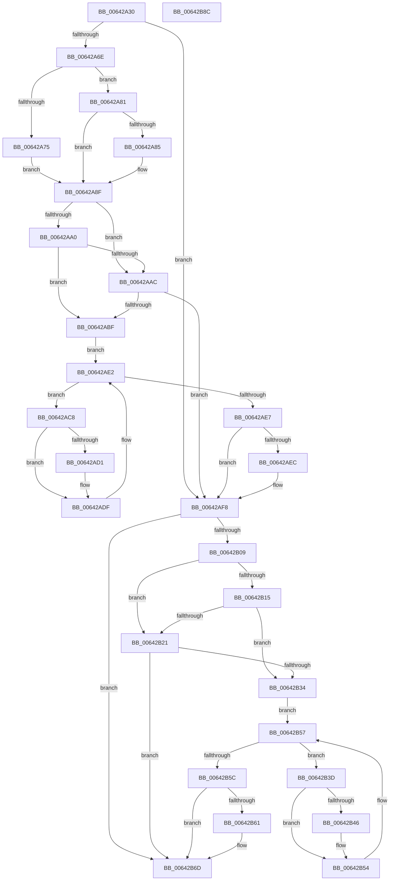

# DifZwLoadDriverWrapper

- RVA: `0x00642A30`–`0x00642B8D` (길이 `349` bytes)
- VA: `0x0000000140642A30`
- 실행 섹션: `.text`
- PDB 이름 있음: `예`; PDB Function 태그: `아니요`
- unwind 정보 RVA: `0x00060130`
- 디코드: `94`개 명령, `349/349` bytes 표시
- 미해석 바이트: `0` (있으면 어셈블리에 `.byte`로 보존)

> 이 문서는 커널 이미지의 기계어와 PDB 기호를 분석해 생성했습니다. 4번과 5번은 함수 원형과 자료형을 바이너리 사용 방식에서 추정한 C 해석이며 원본 소스 복구 결과는 아닙니다.

## 1. Dependencies

- 직접 호출 지점: **9**; 고유 호출 대상: **6**
- 직접 호출자로 확인된 함수: **0**
- RIP 상대 이미지 참조: **3**

### Outgoing calls
- `0x00642A5D` → [DifGetAPIThunkContextById](../49/DifGetAPIThunkContextById_function_00495A34.md) (function, `0x00495A34`)
- `0x00642A85` → [DifGetReturnAddressForWrappers](../4D/DifGetReturnAddressForWrappers_function_004D3C08.md) (function, `0x004D3C08`)
- `0x00642AB3` → [ExAcquireRundownProtection](../21/ExAcquireRundownProtection_function_00216620.md) (function, `0x00216620`)
- `0x00642ADA` → [guard_dispatch_icall](../6B/guard_dispatch_icall_function_006BAAD0.md) (function, `0x006BAAD0`)
- `0x00642AF3` → [ExReleaseRundownProtection](../34/ExReleaseRundownProtection_function_00349E80.md) (function, `0x00349E80`)
- `0x00642AFB` → [ZwLoadDriver](../6A/ZwLoadDriver_function_006AF290.md) (function, `0x006AF290`)
- `0x00642B28` → [ExAcquireRundownProtection](../21/ExAcquireRundownProtection_function_00216620.md) (function, `0x00216620`)
- `0x00642B4F` → [guard_dispatch_icall](../6B/guard_dispatch_icall_function_006BAAD0.md) (function, `0x006BAAD0`)
- `0x00642B68` → [ExReleaseRundownProtection](../34/ExReleaseRundownProtection_function_00349E80.md) (function, `0x00349E80`)

### Direct callers
- 이 함수 시작 RVA로 연결되는 직접 call은 확인되지 않았습니다. 간접 호출은 완전히 역산할 수 없습니다.

### Static image references
- `0x00642A97` → RVA `0x00F048B8` (`.data`; read)
- `0x00642AA0` → RVA `0x00F04980` (`.data`; read)
- `0x00642AAC` → RVA `0x00F03E80` (`.data`; read)

## 2. Other-region calls and transfers

- 다른 실행 섹션으로 향하는 call: **0**
- 별도 외부 분기/꼬리 이동을 확인하지 못했습니다.

## 3. Assembly (complete function range)

```asm
00642A30  4C 8B DC                        mov r11, rsp
00642A33  49 89 5B 08                     mov qword ptr [r11 + 8], rbx
00642A37  49 89 6B 10                     mov qword ptr [r11 + 0x10], rbp
00642A3B  49 89 73 18                     mov qword ptr [r11 + 0x18], rsi
00642A3F  49 89 7B 20                     mov qword ptr [r11 + 0x20], rdi
00642A43  41 56                           push r14
00642A45  48 83 EC 40                     sub rsp, 0x40
00642A49  33 C0                           xor eax, eax
00642A4B  0F 57 C0                        xorps xmm0, xmm0
00642A4E  0F 11 44 24 20                  movups xmmword ptr [rsp + 0x20], xmm0
00642A53  48 8B E9                        mov rbp, rcx
00642A56  49 89 43 E8                     mov qword ptr [r11 - 0x18], rax
00642A5A  8D 48 5E                        lea ecx, [rax + 0x5e]
00642A5D  E8 D2 2F E5 FF                  call 0x140495a34
00642A62  48 8B F0                        mov rsi, rax
00642A65  48 85 C0                        test rax, rax
00642A68  0F 84 8A 00 00 00               je 0x140642af8
00642A6E  8B 40 0C                        mov eax, dword ptr [rax + 0xc]
00642A71  A8 18                           test al, 0x18
00642A73  74 0C                           je 0x140642a81
00642A75  48 8B 4C 24 48                  mov rcx, qword ptr [rsp + 0x48]
00642A7A  48 89 4C 24 20                  mov qword ptr [rsp + 0x20], rcx
00642A7F  EB 0E                           jmp 0x140642a8f
00642A81  A8 04                           test al, 4
00642A83  74 0A                           je 0x140642a8f
00642A85  E8 7E 11 E9 FF                  call 0x1404d3c08
00642A8A  48 89 44 24 20                  mov qword ptr [rsp + 0x20], rax
00642A8F  40 32 FF                        xor dil, dil
00642A92  48 89 6C 24 28                  mov qword ptr [rsp + 0x28], rbp
00642A97  40 38 3D 1A 1E 8C 00            cmp byte ptr [rip + 0x8c1e1a], dil
00642A9E  75 0C                           jne 0x140642aac
00642AA0  F7 05 D6 1E 8C 00 00 08 00 00   test dword ptr [rip + 0x8c1ed6], 0x800
00642AAA  74 13                           je 0x140642abf
00642AAC  48 8D 0D CD 13 8C 00            lea rcx, [rip + 0x8c13cd]
00642AB3  E8 68 3B BD FF                  call 0x140216620
00642AB8  40 8A F8                        mov dil, al
00642ABB  84 C0                           test al, al
00642ABD  74 39                           je 0x140642af8
00642ABF  4C 8D 76 20                     lea r14, [rsi + 0x20]
00642AC3  49 8B 1E                        mov rbx, qword ptr [r14]
00642AC6  EB 1A                           jmp 0x140642ae2
00642AC8  48 8D 43 F0                     lea rax, [rbx - 0x10]
00642ACC  48 85 C0                        test rax, rax
00642ACF  74 0E                           je 0x140642adf
00642AD1  48 8B 40 08                     mov rax, qword ptr [rax + 8]
00642AD5  48 8D 4C 24 20                  lea rcx, [rsp + 0x20]
00642ADA  E8 F1 7F 07 00                  call 0x1406baad0
00642ADF  48 8B 1B                        mov rbx, qword ptr [rbx]
00642AE2  49 3B DE                        cmp rbx, r14
00642AE5  75 E1                           jne 0x140642ac8
00642AE7  40 84 FF                        test dil, dil
00642AEA  74 0C                           je 0x140642af8
00642AEC  48 8D 0D 8D 13 8C 00            lea rcx, [rip + 0x8c138d]
00642AF3  E8 88 73 D0 FF                  call 0x140349e80
00642AF8  48 8B CD                        mov rcx, rbp
00642AFB  E8 90 C7 06 00                  call 0x1406af290
00642B00  89 44 24 30                     mov dword ptr [rsp + 0x30], eax
00642B04  48 85 F6                        test rsi, rsi
00642B07  74 64                           je 0x140642b6d
00642B09  40 32 FF                        xor dil, dil
00642B0C  40 38 3D A5 1D 8C 00            cmp byte ptr [rip + 0x8c1da5], dil
00642B13  75 0C                           jne 0x140642b21
00642B15  F7 05 61 1E 8C 00 00 08 00 00   test dword ptr [rip + 0x8c1e61], 0x800
00642B1F  74 13                           je 0x140642b34
00642B21  48 8D 0D 58 13 8C 00            lea rcx, [rip + 0x8c1358]
00642B28  E8 F3 3A BD FF                  call 0x140216620
00642B2D  40 8A F8                        mov dil, al
00642B30  84 C0                           test al, al
00642B32  74 39                           je 0x140642b6d
00642B34  48 83 C6 30                     add rsi, 0x30
00642B38  48 8B 1E                        mov rbx, qword ptr [rsi]
00642B3B  EB 1A                           jmp 0x140642b57
00642B3D  48 8D 43 F0                     lea rax, [rbx - 0x10]
00642B41  48 85 C0                        test rax, rax
00642B44  74 0E                           je 0x140642b54
00642B46  48 8B 40 08                     mov rax, qword ptr [rax + 8]
00642B4A  48 8D 4C 24 20                  lea rcx, [rsp + 0x20]
00642B4F  E8 7C 7F 07 00                  call 0x1406baad0
00642B54  48 8B 1B                        mov rbx, qword ptr [rbx]
00642B57  48 3B DE                        cmp rbx, rsi
00642B5A  75 E1                           jne 0x140642b3d
00642B5C  40 84 FF                        test dil, dil
00642B5F  74 0C                           je 0x140642b6d
00642B61  48 8D 0D 18 13 8C 00            lea rcx, [rip + 0x8c1318]
00642B68  E8 13 73 D0 FF                  call 0x140349e80
00642B6D  8B 44 24 30                     mov eax, dword ptr [rsp + 0x30]
00642B71  48 8B 5C 24 50                  mov rbx, qword ptr [rsp + 0x50]
00642B76  48 8B 6C 24 58                  mov rbp, qword ptr [rsp + 0x58]
00642B7B  48 8B 74 24 60                  mov rsi, qword ptr [rsp + 0x60]
00642B80  48 8B 7C 24 68                  mov rdi, qword ptr [rsp + 0x68]
00642B85  48 83 C4 40                     add rsp, 0x40
00642B89  41 5E                           pop r14
00642B8B  C3                              ret
00642B8C  CC                              int3
```

## 4. C-style interpretation (structured pseudocode)

```c
__int64 __fastcall DifZwLoadDriverWrapper(__int64 a1)
{
    __int64 result;
    __int64 v_rdi;
    __int64 v_rsi;
    __int64 v_rsp;
    unsigned int v_stack_m18;
    unsigned __int64 v_stack_m20;
    unsigned __int64 v_stack_m28;
    unsigned __int64 v_stack_p0;
    unsigned __int64 v_stack_p10;
    unsigned __int64 v_stack_p18;
    unsigned __int64 v_stack_p20;
    unsigned __int64 v_stack_p8;

    *(unsigned __int64 *)(v_rsp + 8) = v_rbx;
    *(unsigned __int64 *)(v_rsp + 16) = v_rbp;
    *(unsigned __int64 *)(v_rsp + 24) = v_rsi;
    *(unsigned __int64 *)(v_rsp + 32) = v_rdi;
    v_rsp = (v_rsp) - (64);
    result = 0;
    v_stack_m28 = v_xmm0;
    *(unsigned __int64 *)(v_rsp - 24) = 0;
    result = DifGetAPIThunkContextById(result + 94, a2, a3, a4);
    if (result == 0) goto loc_00642AF8;
    if ((((unsigned __int8)((unsigned int)(*(unsigned int *)(result + 12)))) & (24)) == 0) goto loc_00642A81;
    v_stack_m28 = v_stack_p0;
    goto loc_00642A8F;
loc_00642A81:
    result = (unsigned int)(*(unsigned int *)(result + 12));
    if ((((unsigned __int8)((unsigned int)(*(unsigned int *)(result + 12)))) & (4)) != 0) {
        result = DifGetReturnAddressForWrappers(v_stack_p0, a2, a3, a4);
        v_stack_m28 = result;
    }
    v_rdi = 0;
    v_stack_m20 = a1;
    if ((*(unsigned __int8 *)(v_rip + 9182746)) != 0) goto loc_00642AAC;
    if (((*(unsigned int *)(v_rip + 9182934)) & (0x800ULL)) == 0) goto loc_00642ABF;
loc_00642AAC:
    result = ExAcquireRundownProtection(v_rip + 9180109, a2, a3, a4);
    if ((unsigned __int8)(result) == 0) goto loc_00642AF8;
loc_00642ABF:
    goto loc_00642AE2;
loc_00642AC8:
    result = *(unsigned __int64 *)(result + 32) - 16;
    if (*(unsigned __int64 *)(result + 32) - 16 != 0) {
        result = *(unsigned __int64 *)(*(unsigned __int64 *)(result + 32) - 16 + 8);
        a1 = v_stack_m28;
        result = guard_dispatch_icall(a1, a2, a3, a4);
    }
loc_00642AE2:
    if ((*(unsigned __int64 *)(*(unsigned __int64 *)(result + 32))) != (result + 32)) goto loc_00642AC8;
    if ((unsigned __int8)((unsigned __int8)(result)) != 0) {
        a1 = v_rip + 9180045;
        result = ExReleaseRundownProtection(a1, a2, a3, a4);
    }
    result = ZwLoadDriver(a1, a2, a3, a4);
    v_stack_m18 = (unsigned int)(result);
    if (result == 0) goto loc_00642B6D;
    v_rdi = 0;
    if ((*(unsigned __int8 *)(v_rip + 9182629)) != 0) goto loc_00642B21;
    if (((*(unsigned int *)(v_rip + 9182817)) & (0x800ULL)) == 0) goto loc_00642B34;
loc_00642B21:
    result = ExAcquireRundownProtection(v_rip + 9179992, a2, a3, a4);
    if ((unsigned __int8)(result) == 0) goto loc_00642B6D;
loc_00642B34:
    v_rsi = (result) + (48);
    goto loc_00642B57;
loc_00642B3D:
    result = *(unsigned __int64 *)(v_rsi) - 16;
    if (*(unsigned __int64 *)(v_rsi) - 16 != 0) {
        result = *(unsigned __int64 *)(*(unsigned __int64 *)(v_rsi) - 16 + 8);
        a1 = v_stack_m28;
        result = guard_dispatch_icall(a1, a2, a3, a4);
    }
loc_00642B57:
    if ((*(unsigned __int64 *)(*(unsigned __int64 *)(v_rsi))) != v_rsi) goto loc_00642B3D;
    if ((unsigned __int8)((unsigned __int8)(result)) != 0) {
        a1 = v_rip + 9179928;
        result = ExReleaseRundownProtection(a1, a2, a3, a4);
    }
    v_rsp = (v_rsp) + (64);
    return (unsigned int)(v_stack_m18);
}
```

## 5. (Beta) C Style

```c
int64_t DifZwLoadDriverWrapper(int64_t Arg1)
{
    int64_t result;
    int64_t local_rdi;
    int64_t local_rsi;
    int64_t local_rsp;
    uint32_t v_stack_m18;
    uint64_t v_stack_m20;
    uint64_t v_stack_m28;
    uint64_t v_stack_p0;
    uint64_t v_stack_p10;
    uint64_t v_stack_p18;
    uint64_t v_stack_p20;
    uint64_t v_stack_p8;

    *(uint64_t *)(local_rsp + 0x8) = local_rbx;
    *(uint64_t *)(local_rsp + 0x10) = local_rbp;
    *(uint64_t *)(local_rsp + 0x18) = local_rsi;
    *(uint64_t *)(local_rsp + 0x20) = local_rdi;
    local_rsp = (local_rsp) - (64);
    result = 0;
    v_stack_m28 = v_xmm0;
    *(uint64_t *)(local_rsp - 0x18) = 0;
    result = DifGetAPIThunkContextById(result + 94, a2, a3, a4);
    if (result == 0) goto loc_00642AF8;
    if ((((uint8_t)((uint32_t)(*(uint32_t *)(result + 0xC)))) & (24)) == 0) goto loc_00642A81;
    v_stack_m28 = v_stack_p0;
    goto loc_00642A8F;
loc_00642A81:
    result = (uint32_t)(*(uint32_t *)(result + 0xC));
    if ((((uint8_t)((uint32_t)(*(uint32_t *)(result + 0xC)))) & (4)) != 0) {
        result = DifGetReturnAddressForWrappers(v_stack_p0, a2, a3, a4);
        v_stack_m28 = result;
    }
    local_rdi = 0;
    v_stack_m20 = Arg1;
    if ((*(uint8_t *)(v_rip + 0x8C1E1A)) != 0) goto loc_00642AAC;
    if (((*(uint32_t *)(v_rip + 0x8C1ED6)) & (0x800ULL)) == 0) goto loc_00642ABF;
loc_00642AAC:
    result = ExAcquireRundownProtection(v_rip + 9180109, a2, a3, a4);
    if ((uint8_t)(result) == 0) goto loc_00642AF8;
loc_00642ABF:
    goto loc_00642AE2;
loc_00642AC8:
    result = *(uint64_t *)(result + 0x20) - 16;
    if (*(uint64_t *)(result + 0x20) - 16 != 0) {
        result = *(uint64_t *)(*(uint64_t *)(result + 0x20) - 0x10 + 0x8);
        Arg1 = v_stack_m28;
        result = guard_dispatch_icall(Arg1, a2, a3, a4);
    }
loc_00642AE2:
    if ((*(uint64_t *)(*(uint64_t *)(result + 0x20))) != (result + 32)) goto loc_00642AC8;
    if ((uint8_t)((uint8_t)(result)) != 0) {
        Arg1 = v_rip + 9180045;
        result = ExReleaseRundownProtection(Arg1, a2, a3, a4);
    }
    result = ZwLoadDriver(Arg1, a2, a3, a4);
    v_stack_m18 = (uint32_t)(result);
    if (result == 0) goto loc_00642B6D;
    local_rdi = 0;
    if ((*(uint8_t *)(v_rip + 0x8C1DA5)) != 0) goto loc_00642B21;
    if (((*(uint32_t *)(v_rip + 0x8C1E61)) & (0x800ULL)) == 0) goto loc_00642B34;
loc_00642B21:
    result = ExAcquireRundownProtection(v_rip + 9179992, a2, a3, a4);
    if ((uint8_t)(result) == 0) goto loc_00642B6D;
loc_00642B34:
    local_rsi = (result) + (48);
    goto loc_00642B57;
loc_00642B3D:
    result = *(uint64_t *)(local_rsi) - 16;
    if (*(uint64_t *)(local_rsi) - 16 != 0) {
        result = *(uint64_t *)(*(uint64_t *)(local_rsi) - 0x10 + 0x8);
        Arg1 = v_stack_m28;
        result = guard_dispatch_icall(Arg1, a2, a3, a4);
    }
loc_00642B57:
    if ((*(uint64_t *)(*(uint64_t *)(local_rsi))) != local_rsi) goto loc_00642B3D;
    if ((uint8_t)((uint8_t)(result)) != 0) {
        Arg1 = v_rip + 9179928;
        result = ExReleaseRundownProtection(Arg1, a2, a3, a4);
    }
    local_rsp = (local_rsp) + (64);
    return (uint32_t)(v_stack_m18);
}
```

## 6. Execution-region graph

[열기: 2D/3D 그래프와 함수 탐색 컨트롤 패널](../../../control-panel.html?section=text&rva=0x00642A30&view=graph)

- 2D 그래프는 위에서 아래로 흐르고, 3D 그래프는 빈 공간을 드래그해 회전합니다. Shift+드래그는 이동, 휠은 확대·축소, 함수 노드 선택은 대상 보고서 이동입니다.

### Static fallback


