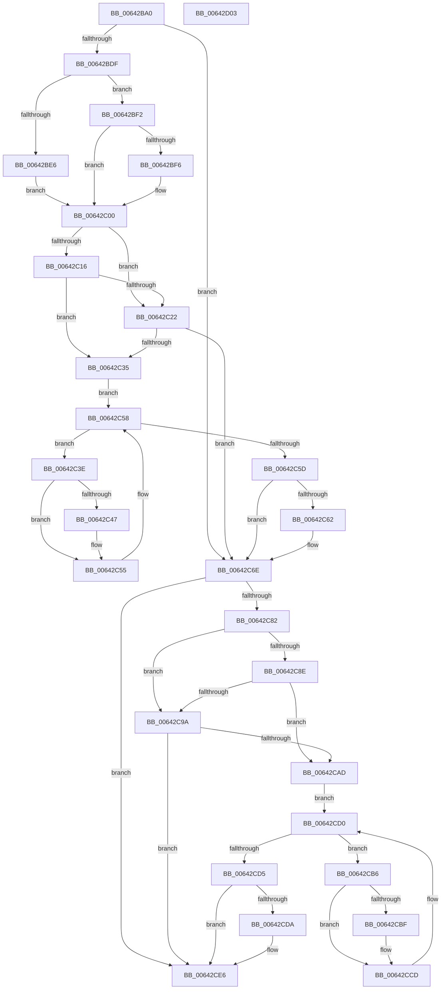

# DifZwLoadKeyWrapper

- RVA: `0x00642BA0`–`0x00642D04` (길이 `356` bytes)
- VA: `0x0000000140642BA0`
- 실행 섹션: `.text`
- PDB 이름 있음: `예`; PDB Function 태그: `아니요`
- unwind 정보 RVA: `0x00093E28`
- 디코드: `98`개 명령, `356/356` bytes 표시
- 미해석 바이트: `0` (있으면 어셈블리에 `.byte`로 보존)

> 이 문서는 커널 이미지의 기계어와 PDB 기호를 분석해 생성했습니다. 4번과 5번은 함수 원형과 자료형을 바이너리 사용 방식에서 추정한 C 해석이며 원본 소스 복구 결과는 아닙니다.

## 1. Dependencies

- 직접 호출 지점: **9**; 고유 호출 대상: **6**
- 직접 호출자로 확인된 함수: **0**
- RIP 상대 이미지 참조: **3**

### Outgoing calls
- `0x00642BCE` → [DifGetAPIThunkContextById](../49/DifGetAPIThunkContextById_function_00495A34.md) (function, `0x00495A34`)
- `0x00642BF6` → [DifGetReturnAddressForWrappers](../4D/DifGetReturnAddressForWrappers_function_004D3C08.md) (function, `0x004D3C08`)
- `0x00642C29` → [ExAcquireRundownProtection](../21/ExAcquireRundownProtection_function_00216620.md) (function, `0x00216620`)
- `0x00642C50` → [guard_dispatch_icall](../6B/guard_dispatch_icall_function_006BAAD0.md) (function, `0x006BAAD0`)
- `0x00642C69` → [ExReleaseRundownProtection](../34/ExReleaseRundownProtection_function_00349E80.md) (function, `0x00349E80`)
- `0x00642C74` → [ZwLoadKey](../6A/ZwLoadKey_function_006AF2D0.md) (function, `0x006AF2D0`)
- `0x00642CA1` → [ExAcquireRundownProtection](../21/ExAcquireRundownProtection_function_00216620.md) (function, `0x00216620`)
- `0x00642CC8` → [guard_dispatch_icall](../6B/guard_dispatch_icall_function_006BAAD0.md) (function, `0x006BAAD0`)
- `0x00642CE1` → [ExReleaseRundownProtection](../34/ExReleaseRundownProtection_function_00349E80.md) (function, `0x00349E80`)

### Direct callers
- 이 함수 시작 RVA로 연결되는 직접 call은 확인되지 않았습니다. 간접 호출은 완전히 역산할 수 없습니다.

### Static image references
- `0x00642C08` → RVA `0x00F048B8` (`.data`; read)
- `0x00642C16` → RVA `0x00F04980` (`.data`; read)
- `0x00642C22` → RVA `0x00F03E80` (`.data`; read)

## 2. Other-region calls and transfers

- 다른 실행 섹션으로 향하는 call: **0**
- 별도 외부 분기/꼬리 이동을 확인하지 못했습니다.

## 3. Assembly (complete function range)

```asm
00642BA0  48 8B C4                        mov rax, rsp
00642BA3  48 89 58 08                     mov qword ptr [rax + 8], rbx
00642BA7  48 89 68 10                     mov qword ptr [rax + 0x10], rbp
00642BAB  48 89 70 18                     mov qword ptr [rax + 0x18], rsi
00642BAF  57                              push rdi
00642BB0  41 56                           push r14
00642BB2  41 57                           push r15
00642BB4  48 83 EC 40                     sub rsp, 0x40
00642BB8  0F 57 C0                        xorps xmm0, xmm0
00642BBB  4C 8B F9                        mov r15, rcx
00642BBE  B9 5D 00 00 00                  mov ecx, 0x5d
00642BC3  4C 8B F2                        mov r14, rdx
00642BC6  0F 11 40 C8                     movups xmmword ptr [rax - 0x38], xmm0
00642BCA  0F 11 40 D8                     movups xmmword ptr [rax - 0x28], xmm0
00642BCE  E8 61 2E E5 FF                  call 0x140495a34
00642BD3  48 8B F0                        mov rsi, rax
00642BD6  48 85 C0                        test rax, rax
00642BD9  0F 84 8F 00 00 00               je 0x140642c6e
00642BDF  8B 40 0C                        mov eax, dword ptr [rax + 0xc]
00642BE2  A8 18                           test al, 0x18
00642BE4  74 0C                           je 0x140642bf2
00642BE6  48 8B 4C 24 58                  mov rcx, qword ptr [rsp + 0x58]
00642BEB  48 89 4C 24 20                  mov qword ptr [rsp + 0x20], rcx
00642BF0  EB 0E                           jmp 0x140642c00
00642BF2  A8 04                           test al, 4
00642BF4  74 0A                           je 0x140642c00
00642BF6  E8 0D 10 E9 FF                  call 0x1404d3c08
00642BFB  48 89 44 24 20                  mov qword ptr [rsp + 0x20], rax
00642C00  40 32 ED                        xor bpl, bpl
00642C03  4C 89 7C 24 30                  mov qword ptr [rsp + 0x30], r15
00642C08  40 38 2D A9 1C 8C 00            cmp byte ptr [rip + 0x8c1ca9], bpl
00642C0F  4C 89 74 24 28                  mov qword ptr [rsp + 0x28], r14
00642C14  75 0C                           jne 0x140642c22
00642C16  F7 05 60 1D 8C 00 00 08 00 00   test dword ptr [rip + 0x8c1d60], 0x800
00642C20  74 13                           je 0x140642c35
00642C22  48 8D 0D 57 12 8C 00            lea rcx, [rip + 0x8c1257]
00642C29  E8 F2 39 BD FF                  call 0x140216620
00642C2E  40 8A E8                        mov bpl, al
00642C31  84 C0                           test al, al
00642C33  74 39                           je 0x140642c6e
00642C35  48 8D 7E 20                     lea rdi, [rsi + 0x20]
00642C39  48 8B 1F                        mov rbx, qword ptr [rdi]
00642C3C  EB 1A                           jmp 0x140642c58
00642C3E  48 8D 43 F0                     lea rax, [rbx - 0x10]
00642C42  48 85 C0                        test rax, rax
00642C45  74 0E                           je 0x140642c55
00642C47  48 8B 40 08                     mov rax, qword ptr [rax + 8]
00642C4B  48 8D 4C 24 20                  lea rcx, [rsp + 0x20]
00642C50  E8 7B 7E 07 00                  call 0x1406baad0
00642C55  48 8B 1B                        mov rbx, qword ptr [rbx]
00642C58  48 3B DF                        cmp rbx, rdi
00642C5B  75 E1                           jne 0x140642c3e
00642C5D  40 84 ED                        test bpl, bpl
00642C60  74 0C                           je 0x140642c6e
00642C62  48 8D 0D 17 12 8C 00            lea rcx, [rip + 0x8c1217]
00642C69  E8 12 72 D0 FF                  call 0x140349e80
00642C6E  49 8B D6                        mov rdx, r14
00642C71  49 8B CF                        mov rcx, r15
00642C74  E8 57 C6 06 00                  call 0x1406af2d0
00642C79  89 44 24 38                     mov dword ptr [rsp + 0x38], eax
00642C7D  48 85 F6                        test rsi, rsi
00642C80  74 64                           je 0x140642ce6
00642C82  40 32 FF                        xor dil, dil
00642C85  40 38 3D 2C 1C 8C 00            cmp byte ptr [rip + 0x8c1c2c], dil
00642C8C  75 0C                           jne 0x140642c9a
00642C8E  F7 05 E8 1C 8C 00 00 08 00 00   test dword ptr [rip + 0x8c1ce8], 0x800
00642C98  74 13                           je 0x140642cad
00642C9A  48 8D 0D DF 11 8C 00            lea rcx, [rip + 0x8c11df]
00642CA1  E8 7A 39 BD FF                  call 0x140216620
00642CA6  40 8A F8                        mov dil, al
00642CA9  84 C0                           test al, al
00642CAB  74 39                           je 0x140642ce6
00642CAD  48 83 C6 30                     add rsi, 0x30
00642CB1  48 8B 1E                        mov rbx, qword ptr [rsi]
00642CB4  EB 1A                           jmp 0x140642cd0
00642CB6  48 8D 43 F0                     lea rax, [rbx - 0x10]
00642CBA  48 85 C0                        test rax, rax
00642CBD  74 0E                           je 0x140642ccd
00642CBF  48 8B 40 08                     mov rax, qword ptr [rax + 8]
00642CC3  48 8D 4C 24 20                  lea rcx, [rsp + 0x20]
00642CC8  E8 03 7E 07 00                  call 0x1406baad0
00642CCD  48 8B 1B                        mov rbx, qword ptr [rbx]
00642CD0  48 3B DE                        cmp rbx, rsi
00642CD3  75 E1                           jne 0x140642cb6
00642CD5  40 84 FF                        test dil, dil
00642CD8  74 0C                           je 0x140642ce6
00642CDA  48 8D 0D 9F 11 8C 00            lea rcx, [rip + 0x8c119f]
00642CE1  E8 9A 71 D0 FF                  call 0x140349e80
00642CE6  8B 44 24 38                     mov eax, dword ptr [rsp + 0x38]
00642CEA  48 8B 5C 24 60                  mov rbx, qword ptr [rsp + 0x60]
00642CEF  48 8B 6C 24 68                  mov rbp, qword ptr [rsp + 0x68]
00642CF4  48 8B 74 24 70                  mov rsi, qword ptr [rsp + 0x70]
00642CF9  48 83 C4 40                     add rsp, 0x40
00642CFD  41 5F                           pop r15
00642CFF  41 5E                           pop r14
00642D01  5F                              pop rdi
00642D02  C3                              ret
00642D03  CC                              int3
```

## 4. C-style interpretation (structured pseudocode)

```c
__int64 __fastcall DifZwLoadKeyWrapper(__int64 a1, __int64 a2)
{
    __int64 result;
    __int64 v_rbp;
    __int64 v_rdi;
    __int64 v_rsi;
    __int64 v_rsp;
    unsigned int v_stack_m20;
    unsigned __int64 v_stack_m28;
    unsigned __int64 v_stack_m30;
    unsigned __int64 v_stack_m38;
    unsigned __int64 v_stack_p0;
    unsigned __int64 v_stack_p10;
    unsigned __int64 v_stack_p18;
    unsigned __int64 v_stack_p8;

    *(unsigned __int64 *)(v_rsp + 8) = v_rbx;
    *(unsigned __int64 *)(v_rsp + 16) = v_rbp;
    *(unsigned __int64 *)(v_rsp + 24) = v_rsi;
    v_rsp = (v_rsp) - (64);
    *(unsigned __int64 *)(v_rsp - 56) = v_xmm0;
    *(unsigned __int64 *)(v_rsp - 40) = v_xmm0;
    result = DifGetAPIThunkContextById(93, a2, a3, a4);
    if (result == 0) goto loc_00642C6E;
    if ((((unsigned __int8)((unsigned int)(*(unsigned int *)(result + 12)))) & (24)) == 0) goto loc_00642BF2;
    v_stack_m38 = v_stack_p0;
    goto loc_00642C00;
loc_00642BF2:
    result = (unsigned int)(*(unsigned int *)(result + 12));
    if ((((unsigned __int8)((unsigned int)(*(unsigned int *)(result + 12)))) & (4)) != 0) {
        result = DifGetReturnAddressForWrappers(v_stack_p0, a2, a3, a4);
        v_stack_m38 = result;
    }
    v_rbp = 0;
    v_stack_m28 = a1;
    v_stack_m30 = a2;
    if ((*(unsigned __int8 *)(v_rip + 9182377)) != 0) goto loc_00642C22;
    if (((*(unsigned int *)(v_rip + 9182560)) & (0x800ULL)) == 0) goto loc_00642C35;
loc_00642C22:
    result = ExAcquireRundownProtection(v_rip + 9179735, a2, a3, a4);
    if ((unsigned __int8)(result) == 0) goto loc_00642C6E;
loc_00642C35:
    goto loc_00642C58;
loc_00642C3E:
    result = *(unsigned __int64 *)(result + 32) - 16;
    if (*(unsigned __int64 *)(result + 32) - 16 != 0) {
        result = *(unsigned __int64 *)(*(unsigned __int64 *)(result + 32) - 16 + 8);
        a1 = v_stack_m38;
        result = guard_dispatch_icall(a1, a2, a3, a4);
    }
loc_00642C58:
    if ((*(unsigned __int64 *)(*(unsigned __int64 *)(result + 32))) != (result + 32)) goto loc_00642C3E;
    if ((unsigned __int8)((unsigned __int8)(result)) != 0) {
        a1 = v_rip + 9179671;
        result = ExReleaseRundownProtection(a1, a2, a3, a4);
    }
    result = ZwLoadKey(a1, a2, a3, a4);
    v_stack_m20 = (unsigned int)(result);
    if (result == 0) goto loc_00642CE6;
    v_rdi = 0;
    if ((*(unsigned __int8 *)(v_rip + 9182252)) != 0) goto loc_00642C9A;
    if (((*(unsigned int *)(v_rip + 9182440)) & (0x800ULL)) == 0) goto loc_00642CAD;
loc_00642C9A:
    result = ExAcquireRundownProtection(v_rip + 9179615, a2, a3, a4);
    if ((unsigned __int8)(result) == 0) goto loc_00642CE6;
loc_00642CAD:
    v_rsi = (result) + (48);
    goto loc_00642CD0;
loc_00642CB6:
    result = *(unsigned __int64 *)(v_rsi) - 16;
    if (*(unsigned __int64 *)(v_rsi) - 16 != 0) {
        result = *(unsigned __int64 *)(*(unsigned __int64 *)(v_rsi) - 16 + 8);
        a1 = v_stack_m38;
        result = guard_dispatch_icall(a1, a2, a3, a4);
    }
loc_00642CD0:
    if ((*(unsigned __int64 *)(*(unsigned __int64 *)(v_rsi))) != v_rsi) goto loc_00642CB6;
    if ((unsigned __int8)((unsigned __int8)(result)) != 0) {
        a1 = v_rip + 9179551;
        result = ExReleaseRundownProtection(a1, a2, a3, a4);
    }
    v_rsp = (v_rsp) + (64);
    return (unsigned int)(v_stack_m20);
}
```

## 5. (Beta) C Style

```c
int64_t DifZwLoadKeyWrapper(int64_t Arg1, int64_t Arg2)
{
    int64_t result;
    int64_t local_rbp;
    int64_t local_rdi;
    int64_t local_rsi;
    int64_t local_rsp;
    uint32_t v_stack_m20;
    uint64_t v_stack_m28;
    uint64_t v_stack_m30;
    uint64_t v_stack_m38;
    uint64_t v_stack_p0;
    uint64_t v_stack_p10;
    uint64_t v_stack_p18;
    uint64_t v_stack_p8;

    *(uint64_t *)(local_rsp + 0x8) = local_rbx;
    *(uint64_t *)(local_rsp + 0x10) = local_rbp;
    *(uint64_t *)(local_rsp + 0x18) = local_rsi;
    local_rsp = (local_rsp) - (64);
    *(uint64_t *)(local_rsp - 0x38) = v_xmm0;
    *(uint64_t *)(local_rsp - 0x28) = v_xmm0;
    result = DifGetAPIThunkContextById(93, Arg2, a3, a4);
    if (result == 0) goto loc_00642C6E;
    if ((((uint8_t)((uint32_t)(*(uint32_t *)(result + 0xC)))) & (24)) == 0) goto loc_00642BF2;
    v_stack_m38 = v_stack_p0;
    goto loc_00642C00;
loc_00642BF2:
    result = (uint32_t)(*(uint32_t *)(result + 0xC));
    if ((((uint8_t)((uint32_t)(*(uint32_t *)(result + 0xC)))) & (4)) != 0) {
        result = DifGetReturnAddressForWrappers(v_stack_p0, Arg2, a3, a4);
        v_stack_m38 = result;
    }
    local_rbp = 0;
    v_stack_m28 = Arg1;
    v_stack_m30 = Arg2;
    if ((*(uint8_t *)(v_rip + 0x8C1CA9)) != 0) goto loc_00642C22;
    if (((*(uint32_t *)(v_rip + 0x8C1D60)) & (0x800ULL)) == 0) goto loc_00642C35;
loc_00642C22:
    result = ExAcquireRundownProtection(v_rip + 9179735, Arg2, a3, a4);
    if ((uint8_t)(result) == 0) goto loc_00642C6E;
loc_00642C35:
    goto loc_00642C58;
loc_00642C3E:
    result = *(uint64_t *)(result + 0x20) - 16;
    if (*(uint64_t *)(result + 0x20) - 16 != 0) {
        result = *(uint64_t *)(*(uint64_t *)(result + 0x20) - 0x10 + 0x8);
        Arg1 = v_stack_m38;
        result = guard_dispatch_icall(Arg1, Arg2, a3, a4);
    }
loc_00642C58:
    if ((*(uint64_t *)(*(uint64_t *)(result + 0x20))) != (result + 32)) goto loc_00642C3E;
    if ((uint8_t)((uint8_t)(result)) != 0) {
        Arg1 = v_rip + 9179671;
        result = ExReleaseRundownProtection(Arg1, Arg2, a3, a4);
    }
    result = ZwLoadKey(Arg1, Arg2, a3, a4);
    v_stack_m20 = (uint32_t)(result);
    if (result == 0) goto loc_00642CE6;
    local_rdi = 0;
    if ((*(uint8_t *)(v_rip + 0x8C1C2C)) != 0) goto loc_00642C9A;
    if (((*(uint32_t *)(v_rip + 0x8C1CE8)) & (0x800ULL)) == 0) goto loc_00642CAD;
loc_00642C9A:
    result = ExAcquireRundownProtection(v_rip + 9179615, Arg2, a3, a4);
    if ((uint8_t)(result) == 0) goto loc_00642CE6;
loc_00642CAD:
    local_rsi = (result) + (48);
    goto loc_00642CD0;
loc_00642CB6:
    result = *(uint64_t *)(local_rsi) - 16;
    if (*(uint64_t *)(local_rsi) - 16 != 0) {
        result = *(uint64_t *)(*(uint64_t *)(local_rsi) - 0x10 + 0x8);
        Arg1 = v_stack_m38;
        result = guard_dispatch_icall(Arg1, Arg2, a3, a4);
    }
loc_00642CD0:
    if ((*(uint64_t *)(*(uint64_t *)(local_rsi))) != local_rsi) goto loc_00642CB6;
    if ((uint8_t)((uint8_t)(result)) != 0) {
        Arg1 = v_rip + 9179551;
        result = ExReleaseRundownProtection(Arg1, Arg2, a3, a4);
    }
    local_rsp = (local_rsp) + (64);
    return (uint32_t)(v_stack_m20);
}
```

## 6. Execution-region graph

[열기: 2D/3D 그래프와 함수 탐색 컨트롤 패널](../../../control-panel.html?section=text&rva=0x00642BA0&view=graph)

- 2D 그래프는 위에서 아래로 흐르고, 3D 그래프는 빈 공간을 드래그해 회전합니다. Shift+드래그는 이동, 휠은 확대·축소, 함수 노드 선택은 대상 보고서 이동입니다.

### Static fallback


