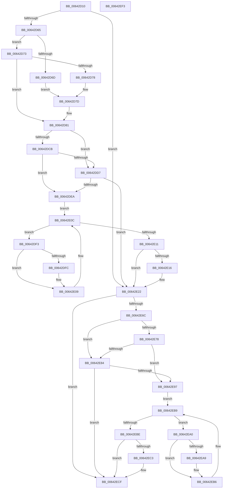

# DifZwMapViewOfSectionWrapper

- RVA: `0x00642D10`–`0x00642EF4` (길이 `484` bytes)
- VA: `0x0000000140642D10`
- 실행 섹션: `.text`
- PDB 이름 있음: `예`; PDB Function 태그: `아니요`
- unwind 정보 RVA: `0x000D2BDC`
- 디코드: `135`개 명령, `484/484` bytes 표시
- 미해석 바이트: `0` (있으면 어셈블리에 `.byte`로 보존)

> 이 문서는 커널 이미지의 기계어와 PDB 기호를 분석해 생성했습니다. 4번과 5번은 함수 원형과 자료형을 바이너리 사용 방식에서 추정한 C 해석이며 원본 소스 복구 결과는 아닙니다.

## 1. Dependencies

- 직접 호출 지점: **10**; 고유 호출 대상: **7**
- 직접 호출자로 확인된 함수: **0**
- RIP 상대 이미지 참조: **3**

### Outgoing calls
- `0x00642D4A` → [memset](../6C/memset_function_006C6C40.md) (function, `0x006C6C40`)
- `0x00642D54` → [DifGetAPIThunkContextById](../49/DifGetAPIThunkContextById_function_00495A34.md) (function, `0x00495A34`)
- `0x00642D78` → [DifGetReturnAddressForWrappers](../4D/DifGetReturnAddressForWrappers_function_004D3C08.md) (function, `0x004D3C08`)
- `0x00642DDE` → [ExAcquireRundownProtection](../21/ExAcquireRundownProtection_function_00216620.md) (function, `0x00216620`)
- `0x00642E04` → [guard_dispatch_icall](../6B/guard_dispatch_icall_function_006BAAD0.md) (function, `0x006BAAD0`)
- `0x00642E1D` → [ExReleaseRundownProtection](../34/ExReleaseRundownProtection_function_00349E80.md) (function, `0x00349E80`)
- `0x00642E5F` → [ZwMapViewOfSection](../6A/ZwMapViewOfSection_function_006AD5D0.md) (function, `0x006AD5D0`)
- `0x00642E8B` → [ExAcquireRundownProtection](../21/ExAcquireRundownProtection_function_00216620.md) (function, `0x00216620`)
- `0x00642EB1` → [guard_dispatch_icall](../6B/guard_dispatch_icall_function_006BAAD0.md) (function, `0x006BAAD0`)
- `0x00642ECA` → [ExReleaseRundownProtection](../34/ExReleaseRundownProtection_function_00349E80.md) (function, `0x00349E80`)

### Direct callers
- 이 함수 시작 RVA로 연결되는 직접 call은 확인되지 않았습니다. 간접 호출은 완전히 역산할 수 없습니다.

### Static image references
- `0x00642D88` → RVA `0x00F048B8` (`.data`; read)
- `0x00642DCB` → RVA `0x00F04980` (`.data`; read)
- `0x00642DD7` → RVA `0x00F03E80` (`.data`; read)

## 2. Other-region calls and transfers

- 다른 실행 섹션으로 향하는 call: **0**
- 별도 외부 분기/꼬리 이동을 확인하지 못했습니다.

## 3. Assembly (complete function range)

```asm
00642D10  48 8B C4                        mov rax, rsp
00642D13  48 89 58 10                     mov qword ptr [rax + 0x10], rbx
00642D17  48 89 70 18                     mov qword ptr [rax + 0x18], rsi
00642D1B  48 89 78 20                     mov qword ptr [rax + 0x20], rdi
00642D1F  48 89 48 08                     mov qword ptr [rax + 8], rcx
00642D23  55                              push rbp
00642D24  41 54                           push r12
00642D26  41 55                           push r13
00642D28  41 56                           push r14
00642D2A  41 57                           push r15
00642D2C  48 8D 68 D1                     lea rbp, [rax - 0x2f]
00642D30  48 81 EC B0 00 00 00            sub rsp, 0xb0
00642D37  4C 8B EA                        mov r13, rdx
00642D3A  48 8D 4D A7                     lea rcx, [rbp - 0x59]
00642D3E  33 D2                           xor edx, edx
00642D40  4D 8B E0                        mov r12, r8
00642D43  4D 8B F9                        mov r15, r9
00642D46  44 8D 42 58                     lea r8d, [rdx + 0x58]
00642D4A  E8 F1 3E 08 00                  call 0x1406c6c40
00642D4F  B9 5C 00 00 00                  mov ecx, 0x5c
00642D54  E8 DB 2C E5 FF                  call 0x140495a34
00642D59  48 8B F0                        mov rsi, rax
00642D5C  48 85 C0                        test rax, rax
00642D5F  0F 84 BD 00 00 00               je 0x140642e22
00642D65  8B 48 0C                        mov ecx, dword ptr [rax + 0xc]
00642D68  F6 C1 18                        test cl, 0x18
00642D6B  74 06                           je 0x140642d73
00642D6D  48 8B 45 2F                     mov rax, qword ptr [rbp + 0x2f]
00642D71  EB 0A                           jmp 0x140642d7d
00642D73  F6 C1 04                        test cl, 4
00642D76  74 09                           je 0x140642d81
00642D78  E8 8B 0E E9 FF                  call 0x1404d3c08
00642D7D  48 89 45 A7                     mov qword ptr [rbp - 0x59], rax
00642D81  48 8B 45 37                     mov rax, qword ptr [rbp + 0x37]
00642D85  45 32 F6                        xor r14b, r14b
00642D88  44 38 35 29 1B 8C 00            cmp byte ptr [rip + 0x8c1b29], r14b
00642D8F  48 89 45 EF                     mov qword ptr [rbp - 0x11], rax
00642D93  48 8B 45 57                     mov rax, qword ptr [rbp + 0x57]
00642D97  48 89 45 CF                     mov qword ptr [rbp - 0x31], rax
00642D9B  48 8B 45 5F                     mov rax, qword ptr [rbp + 0x5f]
00642D9F  48 89 45 C7                     mov qword ptr [rbp - 0x39], rax
00642DA3  48 8B 45 67                     mov rax, qword ptr [rbp + 0x67]
00642DA7  48 89 45 BF                     mov qword ptr [rbp - 0x41], rax
00642DAB  8B 45 6F                        mov eax, dword ptr [rbp + 0x6f]
00642DAE  89 45 B7                        mov dword ptr [rbp - 0x49], eax
00642DB1  8B 45 77                        mov eax, dword ptr [rbp + 0x77]
00642DB4  89 45 B3                        mov dword ptr [rbp - 0x4d], eax
00642DB7  8B 45 7F                        mov eax, dword ptr [rbp + 0x7f]
00642DBA  89 45 AF                        mov dword ptr [rbp - 0x51], eax
00642DBD  4C 89 6D E7                     mov qword ptr [rbp - 0x19], r13
00642DC1  4C 89 65 DF                     mov qword ptr [rbp - 0x21], r12
00642DC5  4C 89 7D D7                     mov qword ptr [rbp - 0x29], r15
00642DC9  75 0C                           jne 0x140642dd7
00642DCB  F7 05 AB 1B 8C 00 00 08 00 00   test dword ptr [rip + 0x8c1bab], 0x800
00642DD5  74 13                           je 0x140642dea
00642DD7  48 8D 0D A2 10 8C 00            lea rcx, [rip + 0x8c10a2]
00642DDE  E8 3D 38 BD FF                  call 0x140216620
00642DE3  44 8A F0                        mov r14b, al
00642DE6  84 C0                           test al, al
00642DE8  74 38                           je 0x140642e22
00642DEA  48 8D 7E 20                     lea rdi, [rsi + 0x20]
00642DEE  48 8B 1F                        mov rbx, qword ptr [rdi]
00642DF1  EB 19                           jmp 0x140642e0c
00642DF3  48 8D 43 F0                     lea rax, [rbx - 0x10]
00642DF7  48 85 C0                        test rax, rax
00642DFA  74 0D                           je 0x140642e09
00642DFC  48 8B 40 08                     mov rax, qword ptr [rax + 8]
00642E00  48 8D 4D A7                     lea rcx, [rbp - 0x59]
00642E04  E8 C7 7C 07 00                  call 0x1406baad0
00642E09  48 8B 1B                        mov rbx, qword ptr [rbx]
00642E0C  48 3B DF                        cmp rbx, rdi
00642E0F  75 E2                           jne 0x140642df3
00642E11  45 84 F6                        test r14b, r14b
00642E14  74 0C                           je 0x140642e22
00642E16  48 8D 0D 63 10 8C 00            lea rcx, [rip + 0x8c1063]
00642E1D  E8 5E 70 D0 FF                  call 0x140349e80
00642E22  8B 45 7F                        mov eax, dword ptr [rbp + 0x7f]
00642E25  4D 8B CF                        mov r9, r15
00642E28  48 8B 4D 37                     mov rcx, qword ptr [rbp + 0x37]
00642E2C  4D 8B C4                        mov r8, r12
00642E2F  89 44 24 48                     mov dword ptr [rsp + 0x48], eax
00642E33  49 8B D5                        mov rdx, r13
00642E36  8B 45 77                        mov eax, dword ptr [rbp + 0x77]
00642E39  89 44 24 40                     mov dword ptr [rsp + 0x40], eax
00642E3D  8B 45 6F                        mov eax, dword ptr [rbp + 0x6f]
00642E40  89 44 24 38                     mov dword ptr [rsp + 0x38], eax
00642E44  48 8B 45 67                     mov rax, qword ptr [rbp + 0x67]
00642E48  48 89 44 24 30                  mov qword ptr [rsp + 0x30], rax
00642E4D  48 8B 45 5F                     mov rax, qword ptr [rbp + 0x5f]
00642E51  48 89 44 24 28                  mov qword ptr [rsp + 0x28], rax
00642E56  48 8B 45 57                     mov rax, qword ptr [rbp + 0x57]
00642E5A  48 89 44 24 20                  mov qword ptr [rsp + 0x20], rax
00642E5F  E8 6C A7 06 00                  call 0x1406ad5d0
00642E64  89 45 F7                        mov dword ptr [rbp - 9], eax
00642E67  48 85 F6                        test rsi, rsi
00642E6A  74 63                           je 0x140642ecf
00642E6C  40 32 FF                        xor dil, dil
00642E6F  40 38 3D 42 1A 8C 00            cmp byte ptr [rip + 0x8c1a42], dil
00642E76  75 0C                           jne 0x140642e84
00642E78  F7 05 FE 1A 8C 00 00 08 00 00   test dword ptr [rip + 0x8c1afe], 0x800
00642E82  74 13                           je 0x140642e97
00642E84  48 8D 0D F5 0F 8C 00            lea rcx, [rip + 0x8c0ff5]
00642E8B  E8 90 37 BD FF                  call 0x140216620
00642E90  40 8A F8                        mov dil, al
00642E93  84 C0                           test al, al
00642E95  74 38                           je 0x140642ecf
00642E97  48 83 C6 30                     add rsi, 0x30
00642E9B  48 8B 1E                        mov rbx, qword ptr [rsi]
00642E9E  EB 19                           jmp 0x140642eb9
00642EA0  48 8D 43 F0                     lea rax, [rbx - 0x10]
00642EA4  48 85 C0                        test rax, rax
00642EA7  74 0D                           je 0x140642eb6
00642EA9  48 8B 40 08                     mov rax, qword ptr [rax + 8]
00642EAD  48 8D 4D A7                     lea rcx, [rbp - 0x59]
00642EB1  E8 1A 7C 07 00                  call 0x1406baad0
00642EB6  48 8B 1B                        mov rbx, qword ptr [rbx]
00642EB9  48 3B DE                        cmp rbx, rsi
00642EBC  75 E2                           jne 0x140642ea0
00642EBE  40 84 FF                        test dil, dil
00642EC1  74 0C                           je 0x140642ecf
00642EC3  48 8D 0D B6 0F 8C 00            lea rcx, [rip + 0x8c0fb6]
00642ECA  E8 B1 6F D0 FF                  call 0x140349e80
00642ECF  8B 45 F7                        mov eax, dword ptr [rbp - 9]
00642ED2  4C 8D 9C 24 B0 00 00 00         lea r11, [rsp + 0xb0]
00642EDA  49 8B 5B 38                     mov rbx, qword ptr [r11 + 0x38]
00642EDE  49 8B 73 40                     mov rsi, qword ptr [r11 + 0x40]
00642EE2  49 8B 7B 48                     mov rdi, qword ptr [r11 + 0x48]
00642EE6  49 8B E3                        mov rsp, r11
00642EE9  41 5F                           pop r15
00642EEB  41 5E                           pop r14
00642EED  41 5D                           pop r13
00642EEF  41 5C                           pop r12
00642EF1  5D                              pop rbp
00642EF2  C3                              ret
00642EF3  CC                              int3
```

## 4. C-style interpretation (structured pseudocode)

```c
__int64 __fastcall DifZwMapViewOfSectionWrapper(__int64 a1, __int64 a2, __int64 a3, __int64 a4)
{
    __int64 result;
    __int64 v_r14;
    __int64 v_rdi;
    __int64 v_rsi;
    __int64 v_rsp;
    unsigned __int64 v_stack_m28;
    unsigned int v_stack_m90;
    unsigned int v_stack_m98;
    unsigned int v_stack_mA0;
    unsigned __int64 v_stack_mA8;
    unsigned __int64 v_stack_mB0;
    unsigned __int64 v_stack_mB8;

    *(unsigned __int64 *)(v_rsp + 16) = v_rbx;
    *(unsigned __int64 *)(v_rsp + 24) = v_rsi;
    *(unsigned __int64 *)(v_rsp + 32) = v_rdi;
    *(unsigned __int64 *)(v_rsp + 8) = a1;
    v_rsp = (v_rsp) - (176);
    a2 = 0;
    result = memset(v_rsp - 47 - 89, a2, a2 + 88, a4);
    result = DifGetAPIThunkContextById(92, a2, a2 + 88, a4);
    if (result == 0) goto loc_00642E22;
    if ((((unsigned __int8)((unsigned int)(*(unsigned int *)(result + 12)))) & (24)) == 0) goto loc_00642D73;
    goto loc_00642D7D;
loc_00642D73:
    if ((((unsigned __int8)((unsigned int)(*(unsigned int *)(result + 12)))) & (4)) == 0) goto loc_00642D81;
    result = DifGetReturnAddressForWrappers((unsigned int)(*(unsigned int *)(result + 12)), a2, a2 + 88, a4);
loc_00642D7D:
    *(unsigned __int64 *)(v_rsp - 47 - 89) = result;
loc_00642D81:
    v_r14 = 0;
    *(unsigned __int64 *)(v_rsp - 47 - 17) = *(unsigned __int64 *)(v_rsp - 47 + 55);
    *(unsigned __int64 *)(v_rsp - 47 - 49) = *(unsigned __int64 *)(v_rsp - 47 + 87);
    *(unsigned __int64 *)(v_rsp - 47 - 57) = *(unsigned __int64 *)(v_rsp - 47 + 95);
    *(unsigned __int64 *)(v_rsp - 47 - 65) = *(unsigned __int64 *)(v_rsp - 47 + 103);
    *(unsigned int *)(v_rsp - 47 - 73) = (unsigned int)((unsigned int)(*(unsigned int *)(v_rsp - 47 + 111)));
    *(unsigned int *)(v_rsp - 47 - 77) = (unsigned int)((unsigned int)(*(unsigned int *)(v_rsp - 47 + 119)));
    *(unsigned int *)(v_rsp - 47 - 81) = (unsigned int)((unsigned int)(*(unsigned int *)(v_rsp - 47 + 127)));
    *(unsigned __int64 *)(v_rsp - 47 - 25) = 0;
    *(unsigned __int64 *)(v_rsp - 47 - 33) = a3;
    *(unsigned __int64 *)(v_rsp - 47 - 41) = a4;
    if ((*(unsigned __int8 *)(v_rip + 9181993)) != 0) goto loc_00642DD7;
    if (((*(unsigned int *)(v_rip + 9182123)) & (0x800ULL)) == 0) goto loc_00642DEA;
loc_00642DD7:
    result = ExAcquireRundownProtection(v_rip + 9179298, a2, a2 + 88, a4);
    if ((unsigned __int8)(result) == 0) goto loc_00642E22;
loc_00642DEA:
    goto loc_00642E0C;
loc_00642DF3:
    result = *(unsigned __int64 *)(result + 32) - 16;
    if (*(unsigned __int64 *)(result + 32) - 16 != 0) {
        result = *(unsigned __int64 *)(*(unsigned __int64 *)(result + 32) - 16 + 8);
        a1 = v_rsp - 47 - 89;
        result = guard_dispatch_icall(a1, a2, a2 + 88, a4);
    }
loc_00642E0C:
    if ((*(unsigned __int64 *)(*(unsigned __int64 *)(result + 32))) != (result + 32)) goto loc_00642DF3;
    if ((unsigned __int8)((unsigned __int8)(result)) != 0) {
        a1 = v_rip + 9179235;
        result = ExReleaseRundownProtection(a1, a2, a2 + 88, a4);
    }
    v_stack_m90 = (unsigned int)((unsigned int)(*(unsigned int *)(v_rsp - 47 + 127)));
    v_stack_m98 = (unsigned int)((unsigned int)(*(unsigned int *)(v_rsp - 47 + 119)));
    v_stack_mA0 = (unsigned int)((unsigned int)(*(unsigned int *)(v_rsp - 47 + 111)));
    v_stack_mA8 = *(unsigned __int64 *)(v_rsp - 47 + 103);
    v_stack_mB0 = *(unsigned __int64 *)(v_rsp - 47 + 95);
    v_stack_mB8 = *(unsigned __int64 *)(v_rsp - 47 + 87);
    result = ZwMapViewOfSection(*(unsigned __int64 *)(v_rsp - 47 + 55), 0, a3, a4);
    *(unsigned int *)(v_rsp - 47 - 9) = (unsigned int)(result);
    if (result == 0) goto loc_00642ECF;
    v_rdi = 0;
    if ((*(unsigned __int8 *)(v_rip + 9181762)) != 0) goto loc_00642E84;
    if (((*(unsigned int *)(v_rip + 9181950)) & (0x800ULL)) == 0) goto loc_00642E97;
loc_00642E84:
    result = ExAcquireRundownProtection(v_rip + 9179125, 0, a3, a4);
    if ((unsigned __int8)(result) == 0) goto loc_00642ECF;
loc_00642E97:
    v_rsi = (result) + (48);
    goto loc_00642EB9;
loc_00642EA0:
    result = *(unsigned __int64 *)(v_rsi) - 16;
    if (*(unsigned __int64 *)(v_rsi) - 16 != 0) {
        result = *(unsigned __int64 *)(*(unsigned __int64 *)(v_rsi) - 16 + 8);
        a1 = v_rsp - 47 - 89;
        result = guard_dispatch_icall(a1, 0, a3, a4);
    }
loc_00642EB9:
    if ((*(unsigned __int64 *)(*(unsigned __int64 *)(v_rsi))) != v_rsi) goto loc_00642EA0;
    if ((unsigned __int8)((unsigned __int8)(result)) != 0) {
        a1 = v_rip + 9179062;
        result = ExReleaseRundownProtection(a1, 0, a3, a4);
    }
    return (unsigned int)(*(unsigned int *)(v_rsp - 47 - 9));
}
```

## 5. (Beta) C Style

```c
int64_t DifZwMapViewOfSectionWrapper(int64_t Arg1, int64_t Arg2, int64_t Arg3, int64_t Arg4)
{
    int64_t result;
    int64_t local_r14;
    int64_t local_rdi;
    int64_t local_rsi;
    int64_t local_rsp;
    uint64_t v_stack_m28;
    uint32_t v_stack_m90;
    uint32_t v_stack_m98;
    uint32_t v_stack_mA0;
    uint64_t v_stack_mA8;
    uint64_t v_stack_mB0;
    uint64_t v_stack_mB8;

    *(uint64_t *)(local_rsp + 0x10) = local_rbx;
    *(uint64_t *)(local_rsp + 0x18) = local_rsi;
    *(uint64_t *)(local_rsp + 0x20) = local_rdi;
    *(uint64_t *)(local_rsp + 0x8) = Arg1;
    local_rsp = (local_rsp) - (176);
    Arg2 = 0;
    result = memset(local_rsp - 47 - 89, Arg2, Arg2 + 88, Arg4);
    result = DifGetAPIThunkContextById(92, Arg2, Arg2 + 88, Arg4);
    if (result == 0) goto loc_00642E22;
    if ((((uint8_t)((uint32_t)(*(uint32_t *)(result + 0xC)))) & (24)) == 0) goto loc_00642D73;
    goto loc_00642D7D;
loc_00642D73:
    if ((((uint8_t)((uint32_t)(*(uint32_t *)(result + 0xC)))) & (4)) == 0) goto loc_00642D81;
    result = DifGetReturnAddressForWrappers((uint32_t)(*(uint32_t *)(result + 0xC)), Arg2, Arg2 + 88, Arg4);
loc_00642D7D:
    *(uint64_t *)(local_rsp - 0x2F - 0x59) = result;
loc_00642D81:
    local_r14 = 0;
    *(uint64_t *)(local_rsp - 0x2F - 0x11) = *(uint64_t *)(local_rsp - 0x2F + 0x37);
    *(uint64_t *)(local_rsp - 0x2F - 0x31) = *(uint64_t *)(local_rsp - 0x2F + 0x57);
    *(uint64_t *)(local_rsp - 0x2F - 0x39) = *(uint64_t *)(local_rsp - 0x2F + 0x5F);
    *(uint64_t *)(local_rsp - 0x2F - 0x41) = *(uint64_t *)(local_rsp - 0x2F + 0x67);
    *(uint32_t *)(local_rsp - 0x2F - 0x49) = (uint32_t)((uint32_t)(*(uint32_t *)(local_rsp - 0x2F + 0x6F)));
    *(uint32_t *)(local_rsp - 0x2F - 0x4D) = (uint32_t)((uint32_t)(*(uint32_t *)(local_rsp - 0x2F + 0x77)));
    *(uint32_t *)(local_rsp - 0x2F - 0x51) = (uint32_t)((uint32_t)(*(uint32_t *)(local_rsp - 0x2F + 0x7F)));
    *(uint64_t *)(local_rsp - 0x2F - 0x19) = 0;
    *(uint64_t *)(local_rsp - 0x2F - 0x21) = Arg3;
    *(uint64_t *)(local_rsp - 0x2F - 0x29) = Arg4;
    if ((*(uint8_t *)(v_rip + 0x8C1B29)) != 0) goto loc_00642DD7;
    if (((*(uint32_t *)(v_rip + 0x8C1BAB)) & (0x800ULL)) == 0) goto loc_00642DEA;
loc_00642DD7:
    result = ExAcquireRundownProtection(v_rip + 9179298, Arg2, Arg2 + 88, Arg4);
    if ((uint8_t)(result) == 0) goto loc_00642E22;
loc_00642DEA:
    goto loc_00642E0C;
loc_00642DF3:
    result = *(uint64_t *)(result + 0x20) - 16;
    if (*(uint64_t *)(result + 0x20) - 16 != 0) {
        result = *(uint64_t *)(*(uint64_t *)(result + 0x20) - 0x10 + 0x8);
        Arg1 = local_rsp - 47 - 89;
        result = guard_dispatch_icall(Arg1, Arg2, Arg2 + 88, Arg4);
    }
loc_00642E0C:
    if ((*(uint64_t *)(*(uint64_t *)(result + 0x20))) != (result + 32)) goto loc_00642DF3;
    if ((uint8_t)((uint8_t)(result)) != 0) {
        Arg1 = v_rip + 9179235;
        result = ExReleaseRundownProtection(Arg1, Arg2, Arg2 + 88, Arg4);
    }
    v_stack_m90 = (uint32_t)((uint32_t)(*(uint32_t *)(local_rsp - 0x2F + 0x7F)));
    v_stack_m98 = (uint32_t)((uint32_t)(*(uint32_t *)(local_rsp - 0x2F + 0x77)));
    v_stack_mA0 = (uint32_t)((uint32_t)(*(uint32_t *)(local_rsp - 0x2F + 0x6F)));
    v_stack_mA8 = *(uint64_t *)(local_rsp - 0x2F + 0x67);
    v_stack_mB0 = *(uint64_t *)(local_rsp - 0x2F + 0x5F);
    v_stack_mB8 = *(uint64_t *)(local_rsp - 0x2F + 0x57);
    result = ZwMapViewOfSection(*(uint64_t *)(local_rsp - 0x2F + 0x37), 0, Arg3, Arg4);
    *(uint32_t *)(local_rsp - 0x2F - 0x9) = (uint32_t)(result);
    if (result == 0) goto loc_00642ECF;
    local_rdi = 0;
    if ((*(uint8_t *)(v_rip + 0x8C1A42)) != 0) goto loc_00642E84;
    if (((*(uint32_t *)(v_rip + 0x8C1AFE)) & (0x800ULL)) == 0) goto loc_00642E97;
loc_00642E84:
    result = ExAcquireRundownProtection(v_rip + 9179125, 0, Arg3, Arg4);
    if ((uint8_t)(result) == 0) goto loc_00642ECF;
loc_00642E97:
    local_rsi = (result) + (48);
    goto loc_00642EB9;
loc_00642EA0:
    result = *(uint64_t *)(local_rsi) - 16;
    if (*(uint64_t *)(local_rsi) - 16 != 0) {
        result = *(uint64_t *)(*(uint64_t *)(local_rsi) - 0x10 + 0x8);
        Arg1 = local_rsp - 47 - 89;
        result = guard_dispatch_icall(Arg1, 0, Arg3, Arg4);
    }
loc_00642EB9:
    if ((*(uint64_t *)(*(uint64_t *)(local_rsi))) != local_rsi) goto loc_00642EA0;
    if ((uint8_t)((uint8_t)(result)) != 0) {
        Arg1 = v_rip + 9179062;
        result = ExReleaseRundownProtection(Arg1, 0, Arg3, Arg4);
    }
    return (uint32_t)(*(uint32_t *)(local_rsp - 0x2F - 0x9));
}
```

## 6. Execution-region graph

[열기: 2D/3D 그래프와 함수 탐색 컨트롤 패널](../../../control-panel.html?section=text&rva=0x00642D10&view=graph)

- 2D 그래프는 위에서 아래로 흐르고, 3D 그래프는 빈 공간을 드래그해 회전합니다. Shift+드래그는 이동, 휠은 확대·축소, 함수 노드 선택은 대상 보고서 이동입니다.

### Static fallback


