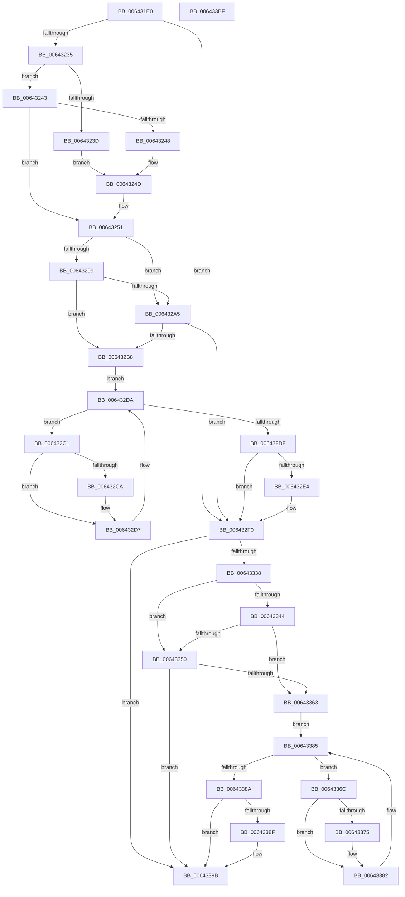

# DifZwNotifyChangeKeyWrapper

- RVA: `0x006431E0`–`0x006433C0` (길이 `480` bytes)
- VA: `0x00000001406431E0`
- 실행 섹션: `.text`
- PDB 이름 있음: `예`; PDB Function 태그: `아니요`
- unwind 정보 RVA: `0x000D2C98`
- 디코드: `135`개 명령, `480/480` bytes 표시
- 미해석 바이트: `0` (있으면 어셈블리에 `.byte`로 보존)

> 이 문서는 커널 이미지의 기계어와 PDB 기호를 분석해 생성했습니다. 4번과 5번은 함수 원형과 자료형을 바이너리 사용 방식에서 추정한 C 해석이며 원본 소스 복구 결과는 아닙니다.

## 1. Dependencies

- 직접 호출 지점: **10**; 고유 호출 대상: **7**
- 직접 호출자로 확인된 함수: **0**
- RIP 상대 이미지 참조: **3**

### Outgoing calls
- `0x0064321A` → [memset](../6C/memset_function_006C6C40.md) (function, `0x006C6C40`)
- `0x00643224` → [DifGetAPIThunkContextById](../49/DifGetAPIThunkContextById_function_00495A34.md) (function, `0x00495A34`)
- `0x00643248` → [DifGetReturnAddressForWrappers](../4D/DifGetReturnAddressForWrappers_function_004D3C08.md) (function, `0x004D3C08`)
- `0x006432AC` → [ExAcquireRundownProtection](../21/ExAcquireRundownProtection_function_00216620.md) (function, `0x00216620`)
- `0x006432D2` → [guard_dispatch_icall](../6B/guard_dispatch_icall_function_006BAAD0.md) (function, `0x006BAAD0`)
- `0x006432EB` → [ExReleaseRundownProtection](../34/ExReleaseRundownProtection_function_00349E80.md) (function, `0x00349E80`)
- `0x0064332B` → [ZwNotifyChangeKey](../6A/ZwNotifyChangeKey_function_006AF550.md) (function, `0x006AF550`)
- `0x00643357` → [ExAcquireRundownProtection](../21/ExAcquireRundownProtection_function_00216620.md) (function, `0x00216620`)
- `0x0064337D` → [guard_dispatch_icall](../6B/guard_dispatch_icall_function_006BAAD0.md) (function, `0x006BAAD0`)
- `0x00643396` → [ExReleaseRundownProtection](../34/ExReleaseRundownProtection_function_00349E80.md) (function, `0x00349E80`)

### Direct callers
- 이 함수 시작 RVA로 연결되는 직접 call은 확인되지 않았습니다. 간접 호출은 완전히 역산할 수 없습니다.

### Static image references
- `0x00643258` → RVA `0x00F048B8` (`.data`; read)
- `0x00643299` → RVA `0x00F04980` (`.data`; read)
- `0x006432A5` → RVA `0x00F03E80` (`.data`; read)

## 2. Other-region calls and transfers

- 다른 실행 섹션으로 향하는 call: **0**
- 별도 외부 분기/꼬리 이동을 확인하지 못했습니다.

## 3. Assembly (complete function range)

```asm
006431E0  48 8B C4                        mov rax, rsp
006431E3  48 89 58 10                     mov qword ptr [rax + 0x10], rbx
006431E7  48 89 70 18                     mov qword ptr [rax + 0x18], rsi
006431EB  48 89 78 20                     mov qword ptr [rax + 0x20], rdi
006431EF  48 89 48 08                     mov qword ptr [rax + 8], rcx
006431F3  55                              push rbp
006431F4  41 54                           push r12
006431F6  41 55                           push r13
006431F8  41 56                           push r14
006431FA  41 57                           push r15
006431FC  48 8D 68 D1                     lea rbp, [rax - 0x2f]
00643200  48 81 EC A0 00 00 00            sub rsp, 0xa0
00643207  4C 8B EA                        mov r13, rdx
0064320A  48 8D 4D B7                     lea rcx, [rbp - 0x49]
0064320E  33 D2                           xor edx, edx
00643210  4D 8B E0                        mov r12, r8
00643213  4D 8B F9                        mov r15, r9
00643216  44 8D 42 50                     lea r8d, [rdx + 0x50]
0064321A  E8 21 3A 08 00                  call 0x1406c6c40
0064321F  B9 59 00 00 00                  mov ecx, 0x59
00643224  E8 0B 28 E5 FF                  call 0x140495a34
00643229  48 8B F0                        mov rsi, rax
0064322C  48 85 C0                        test rax, rax
0064322F  0F 84 BB 00 00 00               je 0x1406432f0
00643235  8B 48 0C                        mov ecx, dword ptr [rax + 0xc]
00643238  F6 C1 18                        test cl, 0x18
0064323B  74 06                           je 0x140643243
0064323D  48 8B 45 2F                     mov rax, qword ptr [rbp + 0x2f]
00643241  EB 0A                           jmp 0x14064324d
00643243  F6 C1 04                        test cl, 4
00643246  74 09                           je 0x140643251
00643248  E8 BB 09 E9 FF                  call 0x1404d3c08
0064324D  48 89 45 B7                     mov qword ptr [rbp - 0x49], rax
00643251  48 8B 45 37                     mov rax, qword ptr [rbp + 0x37]
00643255  45 32 F6                        xor r14b, r14b
00643258  44 38 35 59 16 8C 00            cmp byte ptr [rip + 0x8c1659], r14b
0064325F  48 89 45 F7                     mov qword ptr [rbp - 9], rax
00643263  48 8B 45 57                     mov rax, qword ptr [rbp + 0x57]
00643267  48 89 45 D7                     mov qword ptr [rbp - 0x29], rax
0064326B  8B 45 5F                        mov eax, dword ptr [rbp + 0x5f]
0064326E  89 45 D3                        mov dword ptr [rbp - 0x2d], eax
00643271  8A 45 67                        mov al, byte ptr [rbp + 0x67]
00643274  88 45 CF                        mov byte ptr [rbp - 0x31], al
00643277  48 8B 45 6F                     mov rax, qword ptr [rbp + 0x6f]
0064327B  48 89 45 C7                     mov qword ptr [rbp - 0x39], rax
0064327F  8B 45 77                        mov eax, dword ptr [rbp + 0x77]
00643282  89 45 C3                        mov dword ptr [rbp - 0x3d], eax
00643285  8A 45 7F                        mov al, byte ptr [rbp + 0x7f]
00643288  88 45 BF                        mov byte ptr [rbp - 0x41], al
0064328B  4C 89 6D EF                     mov qword ptr [rbp - 0x11], r13
0064328F  4C 89 65 E7                     mov qword ptr [rbp - 0x19], r12
00643293  4C 89 7D DF                     mov qword ptr [rbp - 0x21], r15
00643297  75 0C                           jne 0x1406432a5
00643299  F7 05 DD 16 8C 00 00 08 00 00   test dword ptr [rip + 0x8c16dd], 0x800
006432A3  74 13                           je 0x1406432b8
006432A5  48 8D 0D D4 0B 8C 00            lea rcx, [rip + 0x8c0bd4]
006432AC  E8 6F 33 BD FF                  call 0x140216620
006432B1  44 8A F0                        mov r14b, al
006432B4  84 C0                           test al, al
006432B6  74 38                           je 0x1406432f0
006432B8  48 8D 7E 20                     lea rdi, [rsi + 0x20]
006432BC  48 8B 1F                        mov rbx, qword ptr [rdi]
006432BF  EB 19                           jmp 0x1406432da
006432C1  48 8D 43 F0                     lea rax, [rbx - 0x10]
006432C5  48 85 C0                        test rax, rax
006432C8  74 0D                           je 0x1406432d7
006432CA  48 8B 40 08                     mov rax, qword ptr [rax + 8]
006432CE  48 8D 4D B7                     lea rcx, [rbp - 0x49]
006432D2  E8 F9 77 07 00                  call 0x1406baad0
006432D7  48 8B 1B                        mov rbx, qword ptr [rbx]
006432DA  48 3B DF                        cmp rbx, rdi
006432DD  75 E2                           jne 0x1406432c1
006432DF  45 84 F6                        test r14b, r14b
006432E2  74 0C                           je 0x1406432f0
006432E4  48 8D 0D 95 0B 8C 00            lea rcx, [rip + 0x8c0b95]
006432EB  E8 90 6B D0 FF                  call 0x140349e80
006432F0  8A 45 7F                        mov al, byte ptr [rbp + 0x7f]
006432F3  4D 8B CF                        mov r9, r15
006432F6  48 8B 4D 37                     mov rcx, qword ptr [rbp + 0x37]
006432FA  4D 8B C4                        mov r8, r12
006432FD  88 44 24 48                     mov byte ptr [rsp + 0x48], al
00643301  49 8B D5                        mov rdx, r13
00643304  8B 45 77                        mov eax, dword ptr [rbp + 0x77]
00643307  89 44 24 40                     mov dword ptr [rsp + 0x40], eax
0064330B  48 8B 45 6F                     mov rax, qword ptr [rbp + 0x6f]
0064330F  48 89 44 24 38                  mov qword ptr [rsp + 0x38], rax
00643314  8A 45 67                        mov al, byte ptr [rbp + 0x67]
00643317  88 44 24 30                     mov byte ptr [rsp + 0x30], al
0064331B  8B 45 5F                        mov eax, dword ptr [rbp + 0x5f]
0064331E  89 44 24 28                     mov dword ptr [rsp + 0x28], eax
00643322  48 8B 45 57                     mov rax, qword ptr [rbp + 0x57]
00643326  48 89 44 24 20                  mov qword ptr [rsp + 0x20], rax
0064332B  E8 20 C2 06 00                  call 0x1406af550
00643330  89 45 FF                        mov dword ptr [rbp - 1], eax
00643333  48 85 F6                        test rsi, rsi
00643336  74 63                           je 0x14064339b
00643338  40 32 FF                        xor dil, dil
0064333B  40 38 3D 76 15 8C 00            cmp byte ptr [rip + 0x8c1576], dil
00643342  75 0C                           jne 0x140643350
00643344  F7 05 32 16 8C 00 00 08 00 00   test dword ptr [rip + 0x8c1632], 0x800
0064334E  74 13                           je 0x140643363
00643350  48 8D 0D 29 0B 8C 00            lea rcx, [rip + 0x8c0b29]
00643357  E8 C4 32 BD FF                  call 0x140216620
0064335C  40 8A F8                        mov dil, al
0064335F  84 C0                           test al, al
00643361  74 38                           je 0x14064339b
00643363  48 83 C6 30                     add rsi, 0x30
00643367  48 8B 1E                        mov rbx, qword ptr [rsi]
0064336A  EB 19                           jmp 0x140643385
0064336C  48 8D 43 F0                     lea rax, [rbx - 0x10]
00643370  48 85 C0                        test rax, rax
00643373  74 0D                           je 0x140643382
00643375  48 8B 40 08                     mov rax, qword ptr [rax + 8]
00643379  48 8D 4D B7                     lea rcx, [rbp - 0x49]
0064337D  E8 4E 77 07 00                  call 0x1406baad0
00643382  48 8B 1B                        mov rbx, qword ptr [rbx]
00643385  48 3B DE                        cmp rbx, rsi
00643388  75 E2                           jne 0x14064336c
0064338A  40 84 FF                        test dil, dil
0064338D  74 0C                           je 0x14064339b
0064338F  48 8D 0D EA 0A 8C 00            lea rcx, [rip + 0x8c0aea]
00643396  E8 E5 6A D0 FF                  call 0x140349e80
0064339B  8B 45 FF                        mov eax, dword ptr [rbp - 1]
0064339E  4C 8D 9C 24 A0 00 00 00         lea r11, [rsp + 0xa0]
006433A6  49 8B 5B 38                     mov rbx, qword ptr [r11 + 0x38]
006433AA  49 8B 73 40                     mov rsi, qword ptr [r11 + 0x40]
006433AE  49 8B 7B 48                     mov rdi, qword ptr [r11 + 0x48]
006433B2  49 8B E3                        mov rsp, r11
006433B5  41 5F                           pop r15
006433B7  41 5E                           pop r14
006433B9  41 5D                           pop r13
006433BB  41 5C                           pop r12
006433BD  5D                              pop rbp
006433BE  C3                              ret
006433BF  CC                              int3
```

## 4. C-style interpretation (structured pseudocode)

```c
__int64 __fastcall DifZwNotifyChangeKeyWrapper(__int64 a1, __int64 a2, __int64 a3, __int64 a4)
{
    __int64 result;
    __int64 v_r14;
    __int64 v_rdi;
    __int64 v_rsi;
    __int64 v_rsp;
    unsigned __int64 v_stack_m28;
    unsigned __int8 v_stack_m80;
    unsigned int v_stack_m88;
    unsigned __int64 v_stack_m90;
    unsigned __int8 v_stack_m98;
    unsigned int v_stack_mA0;
    unsigned __int64 v_stack_mA8;

    *(unsigned __int64 *)(v_rsp + 16) = v_rbx;
    *(unsigned __int64 *)(v_rsp + 24) = v_rsi;
    *(unsigned __int64 *)(v_rsp + 32) = v_rdi;
    *(unsigned __int64 *)(v_rsp + 8) = a1;
    v_rsp = (v_rsp) - (160);
    a2 = 0;
    result = memset(v_rsp - 47 - 73, a2, a2 + 80, a4);
    result = DifGetAPIThunkContextById(89, a2, a2 + 80, a4);
    if (result == 0) goto loc_006432F0;
    if ((((unsigned __int8)((unsigned int)(*(unsigned int *)(result + 12)))) & (24)) == 0) goto loc_00643243;
    goto loc_0064324D;
loc_00643243:
    if ((((unsigned __int8)((unsigned int)(*(unsigned int *)(result + 12)))) & (4)) == 0) goto loc_00643251;
    result = DifGetReturnAddressForWrappers((unsigned int)(*(unsigned int *)(result + 12)), a2, a2 + 80, a4);
loc_0064324D:
    *(unsigned __int64 *)(v_rsp - 47 - 73) = result;
loc_00643251:
    v_r14 = 0;
    *(unsigned __int64 *)(v_rsp - 47 - 9) = *(unsigned __int64 *)(v_rsp - 47 + 55);
    *(unsigned __int64 *)(v_rsp - 47 - 41) = *(unsigned __int64 *)(v_rsp - 47 + 87);
    *(unsigned int *)(v_rsp - 47 - 45) = (unsigned int)((unsigned int)(*(unsigned int *)(v_rsp - 47 + 95)));
    *(unsigned __int8 *)(v_rsp - 47 - 49) = (unsigned __int8)(*(unsigned __int8 *)(v_rsp - 47 + 103));
    *(unsigned __int64 *)(v_rsp - 47 - 57) = *(unsigned __int64 *)(v_rsp - 47 + 111);
    *(unsigned int *)(v_rsp - 47 - 61) = (unsigned int)((unsigned int)(*(unsigned int *)(v_rsp - 47 + 119)));
    *(unsigned __int8 *)(v_rsp - 47 - 65) = (unsigned __int8)(*(unsigned __int8 *)(v_rsp - 47 + 127));
    *(unsigned __int64 *)(v_rsp - 47 - 17) = 0;
    *(unsigned __int64 *)(v_rsp - 47 - 25) = a3;
    *(unsigned __int64 *)(v_rsp - 47 - 33) = a4;
    if ((*(unsigned __int8 *)(v_rip + 9180761)) != 0) goto loc_006432A5;
    if (((*(unsigned int *)(v_rip + 9180893)) & (0x800ULL)) == 0) goto loc_006432B8;
loc_006432A5:
    result = ExAcquireRundownProtection(v_rip + 9178068, a2, a2 + 80, a4);
    if ((unsigned __int8)(result) == 0) goto loc_006432F0;
loc_006432B8:
    goto loc_006432DA;
loc_006432C1:
    result = *(unsigned __int64 *)(result + 32) - 16;
    if (*(unsigned __int64 *)(result + 32) - 16 != 0) {
        result = *(unsigned __int64 *)(*(unsigned __int64 *)(result + 32) - 16 + 8);
        a1 = v_rsp - 47 - 73;
        result = guard_dispatch_icall(a1, a2, a2 + 80, a4);
    }
loc_006432DA:
    if ((*(unsigned __int64 *)(*(unsigned __int64 *)(result + 32))) != (result + 32)) goto loc_006432C1;
    if ((unsigned __int8)((unsigned __int8)(result)) != 0) {
        a1 = v_rip + 9178005;
        result = ExReleaseRundownProtection(a1, a2, a2 + 80, a4);
    }
    v_stack_m80 = (unsigned __int8)(*(unsigned __int8 *)(v_rsp - 47 + 127));
    v_stack_m88 = (unsigned int)((unsigned int)(*(unsigned int *)(v_rsp - 47 + 119)));
    v_stack_m90 = *(unsigned __int64 *)(v_rsp - 47 + 111);
    v_stack_m98 = (unsigned __int8)(*(unsigned __int8 *)(v_rsp - 47 + 103));
    v_stack_mA0 = (unsigned int)((unsigned int)(*(unsigned int *)(v_rsp - 47 + 95)));
    v_stack_mA8 = *(unsigned __int64 *)(v_rsp - 47 + 87);
    result = ZwNotifyChangeKey(*(unsigned __int64 *)(v_rsp - 47 + 55), 0, a3, a4);
    *(unsigned int *)(v_rsp - 47 - 1) = (unsigned int)(result);
    if (result == 0) goto loc_0064339B;
    v_rdi = 0;
    if ((*(unsigned __int8 *)(v_rip + 9180534)) != 0) goto loc_00643350;
    if (((*(unsigned int *)(v_rip + 9180722)) & (0x800ULL)) == 0) goto loc_00643363;
loc_00643350:
    result = ExAcquireRundownProtection(v_rip + 9177897, 0, a3, a4);
    if ((unsigned __int8)(result) == 0) goto loc_0064339B;
loc_00643363:
    v_rsi = (result) + (48);
    goto loc_00643385;
loc_0064336C:
    result = *(unsigned __int64 *)(v_rsi) - 16;
    if (*(unsigned __int64 *)(v_rsi) - 16 != 0) {
        result = *(unsigned __int64 *)(*(unsigned __int64 *)(v_rsi) - 16 + 8);
        a1 = v_rsp - 47 - 73;
        result = guard_dispatch_icall(a1, 0, a3, a4);
    }
loc_00643385:
    if ((*(unsigned __int64 *)(*(unsigned __int64 *)(v_rsi))) != v_rsi) goto loc_0064336C;
    if ((unsigned __int8)((unsigned __int8)(result)) != 0) {
        a1 = v_rip + 9177834;
        result = ExReleaseRundownProtection(a1, 0, a3, a4);
    }
    return (unsigned int)(*(unsigned int *)(v_rsp - 47 - 1));
}
```

## 5. (Beta) C Style

```c
int64_t DifZwNotifyChangeKeyWrapper(int64_t Arg1, int64_t Arg2, int64_t Arg3, int64_t Arg4)
{
    int64_t result;
    int64_t local_r14;
    int64_t local_rdi;
    int64_t local_rsi;
    int64_t local_rsp;
    uint64_t v_stack_m28;
    uint8_t v_stack_m80;
    uint32_t v_stack_m88;
    uint64_t v_stack_m90;
    uint8_t v_stack_m98;
    uint32_t v_stack_mA0;
    uint64_t v_stack_mA8;

    *(uint64_t *)(local_rsp + 0x10) = local_rbx;
    *(uint64_t *)(local_rsp + 0x18) = local_rsi;
    *(uint64_t *)(local_rsp + 0x20) = local_rdi;
    *(uint64_t *)(local_rsp + 0x8) = Arg1;
    local_rsp = (local_rsp) - (160);
    Arg2 = 0;
    result = memset(local_rsp - 47 - 73, Arg2, Arg2 + 80, Arg4);
    result = DifGetAPIThunkContextById(89, Arg2, Arg2 + 80, Arg4);
    if (result == 0) goto loc_006432F0;
    if ((((uint8_t)((uint32_t)(*(uint32_t *)(result + 0xC)))) & (24)) == 0) goto loc_00643243;
    goto loc_0064324D;
loc_00643243:
    if ((((uint8_t)((uint32_t)(*(uint32_t *)(result + 0xC)))) & (4)) == 0) goto loc_00643251;
    result = DifGetReturnAddressForWrappers((uint32_t)(*(uint32_t *)(result + 0xC)), Arg2, Arg2 + 80, Arg4);
loc_0064324D:
    *(uint64_t *)(local_rsp - 0x2F - 0x49) = result;
loc_00643251:
    local_r14 = 0;
    *(uint64_t *)(local_rsp - 0x2F - 0x9) = *(uint64_t *)(local_rsp - 0x2F + 0x37);
    *(uint64_t *)(local_rsp - 0x2F - 0x29) = *(uint64_t *)(local_rsp - 0x2F + 0x57);
    *(uint32_t *)(local_rsp - 0x2F - 0x2D) = (uint32_t)((uint32_t)(*(uint32_t *)(local_rsp - 0x2F + 0x5F)));
    *(uint8_t *)(local_rsp - 0x2F - 0x31) = (uint8_t)(*(uint8_t *)(local_rsp - 0x2F + 0x67));
    *(uint64_t *)(local_rsp - 0x2F - 0x39) = *(uint64_t *)(local_rsp - 0x2F + 0x6F);
    *(uint32_t *)(local_rsp - 0x2F - 0x3D) = (uint32_t)((uint32_t)(*(uint32_t *)(local_rsp - 0x2F + 0x77)));
    *(uint8_t *)(local_rsp - 0x2F - 0x41) = (uint8_t)(*(uint8_t *)(local_rsp - 0x2F + 0x7F));
    *(uint64_t *)(local_rsp - 0x2F - 0x11) = 0;
    *(uint64_t *)(local_rsp - 0x2F - 0x19) = Arg3;
    *(uint64_t *)(local_rsp - 0x2F - 0x21) = Arg4;
    if ((*(uint8_t *)(v_rip + 0x8C1659)) != 0) goto loc_006432A5;
    if (((*(uint32_t *)(v_rip + 0x8C16DD)) & (0x800ULL)) == 0) goto loc_006432B8;
loc_006432A5:
    result = ExAcquireRundownProtection(v_rip + 9178068, Arg2, Arg2 + 80, Arg4);
    if ((uint8_t)(result) == 0) goto loc_006432F0;
loc_006432B8:
    goto loc_006432DA;
loc_006432C1:
    result = *(uint64_t *)(result + 0x20) - 16;
    if (*(uint64_t *)(result + 0x20) - 16 != 0) {
        result = *(uint64_t *)(*(uint64_t *)(result + 0x20) - 0x10 + 0x8);
        Arg1 = local_rsp - 47 - 73;
        result = guard_dispatch_icall(Arg1, Arg2, Arg2 + 80, Arg4);
    }
loc_006432DA:
    if ((*(uint64_t *)(*(uint64_t *)(result + 0x20))) != (result + 32)) goto loc_006432C1;
    if ((uint8_t)((uint8_t)(result)) != 0) {
        Arg1 = v_rip + 9178005;
        result = ExReleaseRundownProtection(Arg1, Arg2, Arg2 + 80, Arg4);
    }
    v_stack_m80 = (uint8_t)(*(uint8_t *)(local_rsp - 0x2F + 0x7F));
    v_stack_m88 = (uint32_t)((uint32_t)(*(uint32_t *)(local_rsp - 0x2F + 0x77)));
    v_stack_m90 = *(uint64_t *)(local_rsp - 0x2F + 0x6F);
    v_stack_m98 = (uint8_t)(*(uint8_t *)(local_rsp - 0x2F + 0x67));
    v_stack_mA0 = (uint32_t)((uint32_t)(*(uint32_t *)(local_rsp - 0x2F + 0x5F)));
    v_stack_mA8 = *(uint64_t *)(local_rsp - 0x2F + 0x57);
    result = ZwNotifyChangeKey(*(uint64_t *)(local_rsp - 0x2F + 0x37), 0, Arg3, Arg4);
    *(uint32_t *)(local_rsp - 0x2F - 0x1) = (uint32_t)(result);
    if (result == 0) goto loc_0064339B;
    local_rdi = 0;
    if ((*(uint8_t *)(v_rip + 0x8C1576)) != 0) goto loc_00643350;
    if (((*(uint32_t *)(v_rip + 0x8C1632)) & (0x800ULL)) == 0) goto loc_00643363;
loc_00643350:
    result = ExAcquireRundownProtection(v_rip + 9177897, 0, Arg3, Arg4);
    if ((uint8_t)(result) == 0) goto loc_0064339B;
loc_00643363:
    local_rsi = (result) + (48);
    goto loc_00643385;
loc_0064336C:
    result = *(uint64_t *)(local_rsi) - 16;
    if (*(uint64_t *)(local_rsi) - 16 != 0) {
        result = *(uint64_t *)(*(uint64_t *)(local_rsi) - 0x10 + 0x8);
        Arg1 = local_rsp - 47 - 73;
        result = guard_dispatch_icall(Arg1, 0, Arg3, Arg4);
    }
loc_00643385:
    if ((*(uint64_t *)(*(uint64_t *)(local_rsi))) != local_rsi) goto loc_0064336C;
    if ((uint8_t)((uint8_t)(result)) != 0) {
        Arg1 = v_rip + 9177834;
        result = ExReleaseRundownProtection(Arg1, 0, Arg3, Arg4);
    }
    return (uint32_t)(*(uint32_t *)(local_rsp - 0x2F - 0x1));
}
```

## 6. Execution-region graph

[열기: 2D/3D 그래프와 함수 탐색 컨트롤 패널](../../../control-panel.html?section=text&rva=0x006431E0&view=graph)

- 2D 그래프는 위에서 아래로 흐르고, 3D 그래프는 빈 공간을 드래그해 회전합니다. Shift+드래그는 이동, 휠은 확대·축소, 함수 노드 선택은 대상 보고서 이동입니다.

### Static fallback


