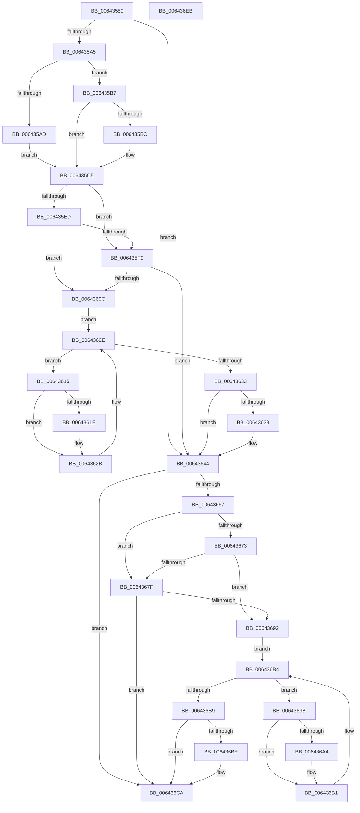

# DifZwOpenEnlistmentWrapper

- RVA: `0x00643550`–`0x006436EC` (길이 `412` bytes)
- VA: `0x0000000140643550`
- 실행 섹션: `.text`
- PDB 이름 있음: `예`; PDB Function 태그: `아니요`
- unwind 정보 RVA: `0x000BD780`
- 디코드: `118`개 명령, `412/412` bytes 표시
- 미해석 바이트: `0` (있으면 어셈블리에 `.byte`로 보존)

> 이 문서는 커널 이미지의 기계어와 PDB 기호를 분석해 생성했습니다. 4번과 5번은 함수 원형과 자료형을 바이너리 사용 방식에서 추정한 C 해석이며 원본 소스 복구 결과는 아닙니다.

## 1. Dependencies

- 직접 호출 지점: **9**; 고유 호출 대상: **6**
- 직접 호출자로 확인된 함수: **0**
- RIP 상대 이미지 참조: **3**

### Outgoing calls
- `0x00643594` → [DifGetAPIThunkContextById](../49/DifGetAPIThunkContextById_function_00495A34.md) (function, `0x00495A34`)
- `0x006435BC` → [DifGetReturnAddressForWrappers](../4D/DifGetReturnAddressForWrappers_function_004D3C08.md) (function, `0x004D3C08`)
- `0x00643600` → [ExAcquireRundownProtection](../21/ExAcquireRundownProtection_function_00216620.md) (function, `0x00216620`)
- `0x00643626` → [guard_dispatch_icall](../6B/guard_dispatch_icall_function_006BAAD0.md) (function, `0x006BAAD0`)
- `0x0064363F` → [ExReleaseRundownProtection](../34/ExReleaseRundownProtection_function_00349E80.md) (function, `0x00349E80`)
- `0x0064365A` → [ZwOpenEnlistment](../6A/ZwOpenEnlistment_function_006AF5D0.md) (function, `0x006AF5D0`)
- `0x00643686` → [ExAcquireRundownProtection](../21/ExAcquireRundownProtection_function_00216620.md) (function, `0x00216620`)
- `0x006436AC` → [guard_dispatch_icall](../6B/guard_dispatch_icall_function_006BAAD0.md) (function, `0x006BAAD0`)
- `0x006436C5` → [ExReleaseRundownProtection](../34/ExReleaseRundownProtection_function_00349E80.md) (function, `0x00349E80`)

### Direct callers
- 이 함수 시작 RVA로 연결되는 직접 call은 확인되지 않았습니다. 간접 호출은 완전히 역산할 수 없습니다.

### Static image references
- `0x006435CC` → RVA `0x00F048B8` (`.data`; read)
- `0x006435ED` → RVA `0x00F04980` (`.data`; read)
- `0x006435F9` → RVA `0x00F03E80` (`.data`; read)

## 2. Other-region calls and transfers

- 다른 실행 섹션으로 향하는 call: **0**
- 별도 외부 분기/꼬리 이동을 확인하지 못했습니다.

## 3. Assembly (complete function range)

```asm
00643550  48 8B C4                        mov rax, rsp
00643553  48 89 58 10                     mov qword ptr [rax + 0x10], rbx
00643557  48 89 70 18                     mov qword ptr [rax + 0x18], rsi
0064355B  48 89 78 20                     mov qword ptr [rax + 0x20], rdi
0064355F  48 89 48 08                     mov qword ptr [rax + 8], rcx
00643563  55                              push rbp
00643564  41 54                           push r12
00643566  41 55                           push r13
00643568  41 56                           push r14
0064356A  41 57                           push r15
0064356C  48 8B EC                        mov rbp, rsp
0064356F  48 83 EC 70                     sub rsp, 0x70
00643573  33 C0                           xor eax, eax
00643575  0F 57 C0                        xorps xmm0, xmm0
00643578  4D 8B F9                        mov r15, r9
0064357B  48 89 45 F0                     mov qword ptr [rbp - 0x10], rax
0064357F  4D 8B E0                        mov r12, r8
00643582  44 8B EA                        mov r13d, edx
00643585  0F 11 45 C0                     movups xmmword ptr [rbp - 0x40], xmm0
00643589  8D 48 57                        lea ecx, [rax + 0x57]
0064358C  0F 11 45 D0                     movups xmmword ptr [rbp - 0x30], xmm0
00643590  0F 11 45 E0                     movups xmmword ptr [rbp - 0x20], xmm0
00643594  E8 9B 24 E5 FF                  call 0x140495a34
00643599  4C 8B F0                        mov r14, rax
0064359C  48 85 C0                        test rax, rax
0064359F  0F 84 9F 00 00 00               je 0x140643644
006435A5  8B 48 0C                        mov ecx, dword ptr [rax + 0xc]
006435A8  F6 C1 18                        test cl, 0x18
006435AB  74 0A                           je 0x1406435b7
006435AD  48 8B 4D 28                     mov rcx, qword ptr [rbp + 0x28]
006435B1  48 89 4D C0                     mov qword ptr [rbp - 0x40], rcx
006435B5  EB 0E                           jmp 0x1406435c5
006435B7  F6 C1 04                        test cl, 4
006435BA  74 09                           je 0x1406435c5
006435BC  E8 47 06 E9 FF                  call 0x1404d3c08
006435C1  48 89 45 C0                     mov qword ptr [rbp - 0x40], rax
006435C5  48 8B 45 30                     mov rax, qword ptr [rbp + 0x30]
006435C9  40 32 F6                        xor sil, sil
006435CC  40 38 35 E5 12 8C 00            cmp byte ptr [rip + 0x8c12e5], sil
006435D3  48 89 45 E8                     mov qword ptr [rbp - 0x18], rax
006435D7  48 8B 45 50                     mov rax, qword ptr [rbp + 0x50]
006435DB  48 89 45 C8                     mov qword ptr [rbp - 0x38], rax
006435DF  44 89 6D E0                     mov dword ptr [rbp - 0x20], r13d
006435E3  4C 89 65 D8                     mov qword ptr [rbp - 0x28], r12
006435E7  4C 89 7D D0                     mov qword ptr [rbp - 0x30], r15
006435EB  75 0C                           jne 0x1406435f9
006435ED  F7 05 89 13 8C 00 00 08 00 00   test dword ptr [rip + 0x8c1389], 0x800
006435F7  74 13                           je 0x14064360c
006435F9  48 8D 0D 80 08 8C 00            lea rcx, [rip + 0x8c0880]
00643600  E8 1B 30 BD FF                  call 0x140216620
00643605  40 8A F0                        mov sil, al
00643608  84 C0                           test al, al
0064360A  74 38                           je 0x140643644
0064360C  49 8D 7E 20                     lea rdi, [r14 + 0x20]
00643610  48 8B 1F                        mov rbx, qword ptr [rdi]
00643613  EB 19                           jmp 0x14064362e
00643615  48 8D 43 F0                     lea rax, [rbx - 0x10]
00643619  48 85 C0                        test rax, rax
0064361C  74 0D                           je 0x14064362b
0064361E  48 8B 40 08                     mov rax, qword ptr [rax + 8]
00643622  48 8D 4D C0                     lea rcx, [rbp - 0x40]
00643626  E8 A5 74 07 00                  call 0x1406baad0
0064362B  48 8B 1B                        mov rbx, qword ptr [rbx]
0064362E  48 3B DF                        cmp rbx, rdi
00643631  75 E2                           jne 0x140643615
00643633  40 84 F6                        test sil, sil
00643636  74 0C                           je 0x140643644
00643638  48 8D 0D 41 08 8C 00            lea rcx, [rip + 0x8c0841]
0064363F  E8 3C 68 D0 FF                  call 0x140349e80
00643644  48 8B 45 50                     mov rax, qword ptr [rbp + 0x50]
00643648  4D 8B CF                        mov r9, r15
0064364B  48 8B 4D 30                     mov rcx, qword ptr [rbp + 0x30]
0064364F  4D 8B C4                        mov r8, r12
00643652  41 8B D5                        mov edx, r13d
00643655  48 89 44 24 20                  mov qword ptr [rsp + 0x20], rax
0064365A  E8 71 BF 06 00                  call 0x1406af5d0
0064365F  89 45 F0                        mov dword ptr [rbp - 0x10], eax
00643662  4D 85 F6                        test r14, r14
00643665  74 63                           je 0x1406436ca
00643667  40 32 FF                        xor dil, dil
0064366A  40 38 3D 47 12 8C 00            cmp byte ptr [rip + 0x8c1247], dil
00643671  75 0C                           jne 0x14064367f
00643673  F7 05 03 13 8C 00 00 08 00 00   test dword ptr [rip + 0x8c1303], 0x800
0064367D  74 13                           je 0x140643692
0064367F  48 8D 0D FA 07 8C 00            lea rcx, [rip + 0x8c07fa]
00643686  E8 95 2F BD FF                  call 0x140216620
0064368B  40 8A F8                        mov dil, al
0064368E  84 C0                           test al, al
00643690  74 38                           je 0x1406436ca
00643692  49 8D 76 30                     lea rsi, [r14 + 0x30]
00643696  48 8B 1E                        mov rbx, qword ptr [rsi]
00643699  EB 19                           jmp 0x1406436b4
0064369B  48 8D 43 F0                     lea rax, [rbx - 0x10]
0064369F  48 85 C0                        test rax, rax
006436A2  74 0D                           je 0x1406436b1
006436A4  48 8B 40 08                     mov rax, qword ptr [rax + 8]
006436A8  48 8D 4D C0                     lea rcx, [rbp - 0x40]
006436AC  E8 1F 74 07 00                  call 0x1406baad0
006436B1  48 8B 1B                        mov rbx, qword ptr [rbx]
006436B4  48 3B DE                        cmp rbx, rsi
006436B7  75 E2                           jne 0x14064369b
006436B9  40 84 FF                        test dil, dil
006436BC  74 0C                           je 0x1406436ca
006436BE  48 8D 0D BB 07 8C 00            lea rcx, [rip + 0x8c07bb]
006436C5  E8 B6 67 D0 FF                  call 0x140349e80
006436CA  8B 45 F0                        mov eax, dword ptr [rbp - 0x10]
006436CD  4C 8D 5C 24 70                  lea r11, [rsp + 0x70]
006436D2  49 8B 5B 38                     mov rbx, qword ptr [r11 + 0x38]
006436D6  49 8B 73 40                     mov rsi, qword ptr [r11 + 0x40]
006436DA  49 8B 7B 48                     mov rdi, qword ptr [r11 + 0x48]
006436DE  49 8B E3                        mov rsp, r11
006436E1  41 5F                           pop r15
006436E3  41 5E                           pop r14
006436E5  41 5D                           pop r13
006436E7  41 5C                           pop r12
006436E9  5D                              pop rbp
006436EA  C3                              ret
006436EB  CC                              int3
```

## 4. C-style interpretation (structured pseudocode)

```c
__int64 __fastcall DifZwOpenEnlistmentWrapper(__int64 a1, int a2, __int64 a3, __int64 a4, __int64 a5)
{
    __int64 result;
    __int64 v_rdi;
    __int64 v_rsi;
    __int64 v_rsp;
    unsigned __int64 v_stack_m28;
    unsigned __int64 v_stack_m38;
    unsigned __int64 v_stack_m40;
    unsigned __int64 v_stack_m48;
    unsigned __int64 v_stack_m50;
    unsigned __int64 v_stack_m58;
    unsigned __int64 v_stack_m60;
    unsigned __int64 v_stack_m68;
    unsigned __int64 v_stack_m78;
    unsigned __int64 v_stack_p0;
    unsigned __int64 v_stack_p8;

    *(unsigned __int64 *)(v_rsp + 16) = v_rbx;
    *(unsigned __int64 *)(v_rsp + 24) = v_rsi;
    *(unsigned __int64 *)(v_rsp + 32) = v_rdi;
    *(unsigned __int64 *)(v_rsp + 8) = a1;
    v_rsp = (v_rsp) - (112);
    result = 0;
    v_stack_m38 = 0;
    v_stack_m68 = v_xmm0;
    v_stack_m58 = v_xmm0;
    v_stack_m48 = v_xmm0;
    result = DifGetAPIThunkContextById(result + 87, a2, a3, a4);
    if (result == 0) goto loc_00643644;
    if ((((unsigned __int8)((unsigned int)(*(unsigned int *)(result + 12)))) & (24)) == 0) goto loc_006435B7;
    v_stack_m68 = v_stack_p0;
    goto loc_006435C5;
loc_006435B7:
    if ((((unsigned __int8)(v_stack_p0)) & (4)) != 0) {
        result = DifGetReturnAddressForWrappers(v_stack_p0, a2, a3, a4);
        v_stack_m68 = result;
    }
    v_rsi = 0;
    v_stack_m40 = v_stack_p8;
    v_stack_m60 = a5;
    v_stack_m48 = (unsigned int)((unsigned int)(a2));
    v_stack_m50 = a3;
    v_stack_m58 = a4;
    if ((*(unsigned __int8 *)(v_rip + 9179877)) != 0) goto loc_006435F9;
    if (((*(unsigned int *)(v_rip + 9180041)) & (0x800ULL)) == 0) goto loc_0064360C;
loc_006435F9:
    result = ExAcquireRundownProtection(v_rip + 9177216, a2, a3, a4);
    if ((unsigned __int8)(result) == 0) goto loc_00643644;
loc_0064360C:
    goto loc_0064362E;
loc_00643615:
    result = *(unsigned __int64 *)(result + 32) - 16;
    if (*(unsigned __int64 *)(result + 32) - 16 != 0) {
        result = *(unsigned __int64 *)(*(unsigned __int64 *)(result + 32) - 16 + 8);
        a1 = v_stack_m68;
        result = guard_dispatch_icall(a1, a2, a3, a4);
    }
loc_0064362E:
    if ((*(unsigned __int64 *)(*(unsigned __int64 *)(result + 32))) != (result + 32)) goto loc_00643615;
    if ((unsigned __int8)((unsigned __int8)(result)) != 0) {
        a1 = v_rip + 9177153;
        result = ExReleaseRundownProtection(a1, a2, a3, a4);
    }
    v_stack_m78 = a5;
    result = ZwOpenEnlistment(v_stack_p8, (unsigned int)((unsigned int)((unsigned int)(a2))), a3, a4);
    v_stack_m38 = (unsigned int)(result);
    if (result == 0) goto loc_006436CA;
    v_rdi = 0;
    if ((*(unsigned __int8 *)(v_rip + 9179719)) != 0) goto loc_0064367F;
    if (((*(unsigned int *)(v_rip + 9179907)) & (0x800ULL)) == 0) goto loc_00643692;
loc_0064367F:
    result = ExAcquireRundownProtection(v_rip + 9177082, (unsigned int)((unsigned int)((unsigned int)(a2))), a3, a4);
    if ((unsigned __int8)(result) == 0) goto loc_006436CA;
loc_00643692:
    goto loc_006436B4;
loc_0064369B:
    result = *(unsigned __int64 *)(result + 48) - 16;
    if (*(unsigned __int64 *)(result + 48) - 16 != 0) {
        result = *(unsigned __int64 *)(*(unsigned __int64 *)(result + 48) - 16 + 8);
        a1 = v_stack_m68;
        result = guard_dispatch_icall(a1, (unsigned int)((unsigned int)((unsigned int)(a2))), a3, a4);
    }
loc_006436B4:
    if ((*(unsigned __int64 *)(*(unsigned __int64 *)(result + 48))) != (result + 48)) goto loc_0064369B;
    if ((unsigned __int8)((unsigned __int8)(result)) != 0) {
        a1 = v_rip + 9177019;
        result = ExReleaseRundownProtection(a1, (unsigned int)((unsigned int)((unsigned int)(a2))), a3, a4);
    }
    return (unsigned int)(v_stack_m38);
}
```

## 5. (Beta) C Style

```c
int64_t DifZwOpenEnlistmentWrapper(int64_t Arg1, int32_t Arg2, int64_t Arg3, int64_t Arg4, int64_t Arg5)
{
    int64_t result;
    int64_t local_rdi;
    int64_t local_rsi;
    int64_t local_rsp;
    uint64_t v_stack_m28;
    uint64_t v_stack_m38;
    uint64_t v_stack_m40;
    uint64_t v_stack_m48;
    uint64_t v_stack_m50;
    uint64_t v_stack_m58;
    uint64_t v_stack_m60;
    uint64_t v_stack_m68;
    uint64_t v_stack_m78;
    uint64_t v_stack_p0;
    uint64_t v_stack_p8;

    *(uint64_t *)(local_rsp + 0x10) = local_rbx;
    *(uint64_t *)(local_rsp + 0x18) = local_rsi;
    *(uint64_t *)(local_rsp + 0x20) = local_rdi;
    *(uint64_t *)(local_rsp + 0x8) = Arg1;
    local_rsp = (local_rsp) - (112);
    result = 0;
    v_stack_m38 = 0;
    v_stack_m68 = v_xmm0;
    v_stack_m58 = v_xmm0;
    v_stack_m48 = v_xmm0;
    result = DifGetAPIThunkContextById(result + 87, Arg2, Arg3, Arg4);
    if (result == 0) goto loc_00643644;
    if ((((uint8_t)((uint32_t)(*(uint32_t *)(result + 0xC)))) & (24)) == 0) goto loc_006435B7;
    v_stack_m68 = v_stack_p0;
    goto loc_006435C5;
loc_006435B7:
    if ((((uint8_t)(v_stack_p0)) & (4)) != 0) {
        result = DifGetReturnAddressForWrappers(v_stack_p0, Arg2, Arg3, Arg4);
        v_stack_m68 = result;
    }
    local_rsi = 0;
    v_stack_m40 = v_stack_p8;
    v_stack_m60 = Arg5;
    v_stack_m48 = (uint32_t)((uint32_t)(Arg2));
    v_stack_m50 = Arg3;
    v_stack_m58 = Arg4;
    if ((*(uint8_t *)(v_rip + 0x8C12E5)) != 0) goto loc_006435F9;
    if (((*(uint32_t *)(v_rip + 0x8C1389)) & (0x800ULL)) == 0) goto loc_0064360C;
loc_006435F9:
    result = ExAcquireRundownProtection(v_rip + 9177216, Arg2, Arg3, Arg4);
    if ((uint8_t)(result) == 0) goto loc_00643644;
loc_0064360C:
    goto loc_0064362E;
loc_00643615:
    result = *(uint64_t *)(result + 0x20) - 16;
    if (*(uint64_t *)(result + 0x20) - 16 != 0) {
        result = *(uint64_t *)(*(uint64_t *)(result + 0x20) - 0x10 + 0x8);
        Arg1 = v_stack_m68;
        result = guard_dispatch_icall(Arg1, Arg2, Arg3, Arg4);
    }
loc_0064362E:
    if ((*(uint64_t *)(*(uint64_t *)(result + 0x20))) != (result + 32)) goto loc_00643615;
    if ((uint8_t)((uint8_t)(result)) != 0) {
        Arg1 = v_rip + 9177153;
        result = ExReleaseRundownProtection(Arg1, Arg2, Arg3, Arg4);
    }
    v_stack_m78 = Arg5;
    result = ZwOpenEnlistment(v_stack_p8, (uint32_t)((uint32_t)((uint32_t)(Arg2))), Arg3, Arg4);
    v_stack_m38 = (uint32_t)(result);
    if (result == 0) goto loc_006436CA;
    local_rdi = 0;
    if ((*(uint8_t *)(v_rip + 0x8C1247)) != 0) goto loc_0064367F;
    if (((*(uint32_t *)(v_rip + 0x8C1303)) & (0x800ULL)) == 0) goto loc_00643692;
loc_0064367F:
    result = ExAcquireRundownProtection(v_rip + 9177082, (uint32_t)((uint32_t)((uint32_t)(Arg2))), Arg3, Arg4);
    if ((uint8_t)(result) == 0) goto loc_006436CA;
loc_00643692:
    goto loc_006436B4;
loc_0064369B:
    result = *(uint64_t *)(result + 0x30) - 16;
    if (*(uint64_t *)(result + 0x30) - 16 != 0) {
        result = *(uint64_t *)(*(uint64_t *)(result + 0x30) - 0x10 + 0x8);
        Arg1 = v_stack_m68;
        result = guard_dispatch_icall(Arg1, (uint32_t)((uint32_t)((uint32_t)(Arg2))), Arg3, Arg4);
    }
loc_006436B4:
    if ((*(uint64_t *)(*(uint64_t *)(result + 0x30))) != (result + 48)) goto loc_0064369B;
    if ((uint8_t)((uint8_t)(result)) != 0) {
        Arg1 = v_rip + 9177019;
        result = ExReleaseRundownProtection(Arg1, (uint32_t)((uint32_t)((uint32_t)(Arg2))), Arg3, Arg4);
    }
    return (uint32_t)(v_stack_m38);
}
```

## 6. Execution-region graph

[열기: 2D/3D 그래프와 함수 탐색 컨트롤 패널](../../../control-panel.html?section=text&rva=0x00643550&view=graph)

- 2D 그래프는 위에서 아래로 흐르고, 3D 그래프는 빈 공간을 드래그해 회전합니다. Shift+드래그는 이동, 휠은 확대·축소, 함수 노드 선택은 대상 보고서 이동입니다.

### Static fallback


