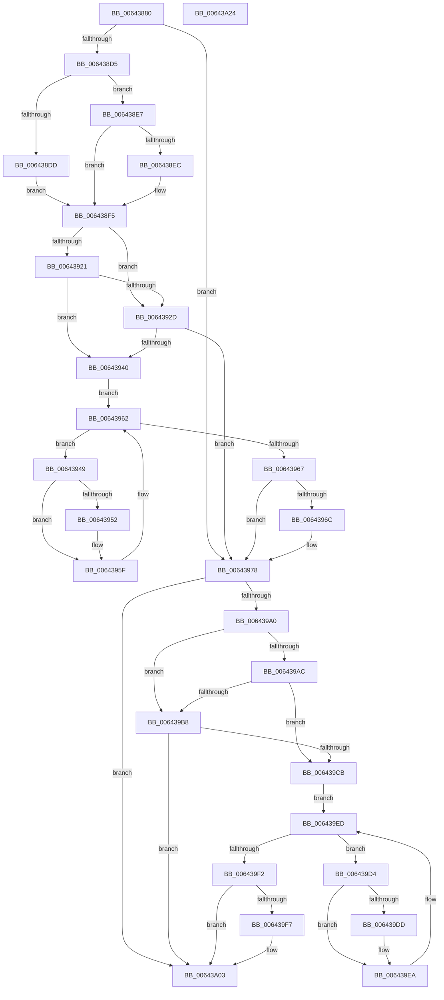

# DifZwOpenFileWrapper

- RVA: `0x00643880`–`0x00643A25` (길이 `421` bytes)
- VA: `0x0000000140643880`
- 실행 섹션: `.text`
- PDB 이름 있음: `예`; PDB Function 태그: `아니요`
- unwind 정보 RVA: `0x000BD780`
- 디코드: `122`개 명령, `421/421` bytes 표시
- 미해석 바이트: `0` (있으면 어셈블리에 `.byte`로 보존)

> 이 문서는 커널 이미지의 기계어와 PDB 기호를 분석해 생성했습니다. 4번과 5번은 함수 원형과 자료형을 바이너리 사용 방식에서 추정한 C 해석이며 원본 소스 복구 결과는 아닙니다.

## 1. Dependencies

- 직접 호출 지점: **9**; 고유 호출 대상: **6**
- 직접 호출자로 확인된 함수: **0**
- RIP 상대 이미지 참조: **3**

### Outgoing calls
- `0x006438C4` → [DifGetAPIThunkContextById](../49/DifGetAPIThunkContextById_function_00495A34.md) (function, `0x00495A34`)
- `0x006438EC` → [DifGetReturnAddressForWrappers](../4D/DifGetReturnAddressForWrappers_function_004D3C08.md) (function, `0x004D3C08`)
- `0x00643934` → [ExAcquireRundownProtection](../21/ExAcquireRundownProtection_function_00216620.md) (function, `0x00216620`)
- `0x0064395A` → [guard_dispatch_icall](../6B/guard_dispatch_icall_function_006BAAD0.md) (function, `0x006BAAD0`)
- `0x00643973` → [ExReleaseRundownProtection](../34/ExReleaseRundownProtection_function_00349E80.md) (function, `0x00349E80`)
- `0x00643993` → [ZwOpenFile](../6A/ZwOpenFile_function_006AD730.md) (function, `0x006AD730`)
- `0x006439BF` → [ExAcquireRundownProtection](../21/ExAcquireRundownProtection_function_00216620.md) (function, `0x00216620`)
- `0x006439E5` → [guard_dispatch_icall](../6B/guard_dispatch_icall_function_006BAAD0.md) (function, `0x006BAAD0`)
- `0x006439FE` → [ExReleaseRundownProtection](../34/ExReleaseRundownProtection_function_00349E80.md) (function, `0x00349E80`)

### Direct callers
- 이 함수 시작 RVA로 연결되는 직접 call은 확인되지 않았습니다. 간접 호출은 완전히 역산할 수 없습니다.

### Static image references
- `0x006438FC` → RVA `0x00F048B8` (`.data`; read)
- `0x00643921` → RVA `0x00F04980` (`.data`; read)
- `0x0064392D` → RVA `0x00F03E80` (`.data`; read)

## 2. Other-region calls and transfers

- 다른 실행 섹션으로 향하는 call: **0**
- 별도 외부 분기/꼬리 이동을 확인하지 못했습니다.

## 3. Assembly (complete function range)

```asm
00643880  48 8B C4                        mov rax, rsp
00643883  48 89 58 10                     mov qword ptr [rax + 0x10], rbx
00643887  48 89 70 18                     mov qword ptr [rax + 0x18], rsi
0064388B  48 89 78 20                     mov qword ptr [rax + 0x20], rdi
0064388F  48 89 48 08                     mov qword ptr [rax + 8], rcx
00643893  55                              push rbp
00643894  41 54                           push r12
00643896  41 55                           push r13
00643898  41 56                           push r14
0064389A  41 57                           push r15
0064389C  48 8B EC                        mov rbp, rsp
0064389F  48 83 EC 70                     sub rsp, 0x70
006438A3  33 C0                           xor eax, eax
006438A5  0F 57 C0                        xorps xmm0, xmm0
006438A8  4D 8B F9                        mov r15, r9
006438AB  48 89 45 F0                     mov qword ptr [rbp - 0x10], rax
006438AF  4D 8B E0                        mov r12, r8
006438B2  44 8B EA                        mov r13d, edx
006438B5  0F 11 45 C0                     movups xmmword ptr [rbp - 0x40], xmm0
006438B9  8D 48 55                        lea ecx, [rax + 0x55]
006438BC  0F 11 45 D0                     movups xmmword ptr [rbp - 0x30], xmm0
006438C0  0F 11 45 E0                     movups xmmword ptr [rbp - 0x20], xmm0
006438C4  E8 6B 21 E5 FF                  call 0x140495a34
006438C9  4C 8B F0                        mov r14, rax
006438CC  48 85 C0                        test rax, rax
006438CF  0F 84 A3 00 00 00               je 0x140643978
006438D5  8B 48 0C                        mov ecx, dword ptr [rax + 0xc]
006438D8  F6 C1 18                        test cl, 0x18
006438DB  74 0A                           je 0x1406438e7
006438DD  48 8B 4D 28                     mov rcx, qword ptr [rbp + 0x28]
006438E1  48 89 4D C0                     mov qword ptr [rbp - 0x40], rcx
006438E5  EB 0E                           jmp 0x1406438f5
006438E7  F6 C1 04                        test cl, 4
006438EA  74 09                           je 0x1406438f5
006438EC  E8 17 03 E9 FF                  call 0x1404d3c08
006438F1  48 89 45 C0                     mov qword ptr [rbp - 0x40], rax
006438F5  48 8B 45 30                     mov rax, qword ptr [rbp + 0x30]
006438F9  40 32 F6                        xor sil, sil
006438FC  40 38 35 B5 0F 8C 00            cmp byte ptr [rip + 0x8c0fb5], sil
00643903  48 89 45 E8                     mov qword ptr [rbp - 0x18], rax
00643907  8B 45 50                        mov eax, dword ptr [rbp + 0x50]
0064390A  89 45 CC                        mov dword ptr [rbp - 0x34], eax
0064390D  8B 45 58                        mov eax, dword ptr [rbp + 0x58]
00643910  89 45 C8                        mov dword ptr [rbp - 0x38], eax
00643913  44 89 6D E0                     mov dword ptr [rbp - 0x20], r13d
00643917  4C 89 65 D8                     mov qword ptr [rbp - 0x28], r12
0064391B  4C 89 7D D0                     mov qword ptr [rbp - 0x30], r15
0064391F  75 0C                           jne 0x14064392d
00643921  F7 05 55 10 8C 00 00 08 00 00   test dword ptr [rip + 0x8c1055], 0x800
0064392B  74 13                           je 0x140643940
0064392D  48 8D 0D 4C 05 8C 00            lea rcx, [rip + 0x8c054c]
00643934  E8 E7 2C BD FF                  call 0x140216620
00643939  40 8A F0                        mov sil, al
0064393C  84 C0                           test al, al
0064393E  74 38                           je 0x140643978
00643940  49 8D 7E 20                     lea rdi, [r14 + 0x20]
00643944  48 8B 1F                        mov rbx, qword ptr [rdi]
00643947  EB 19                           jmp 0x140643962
00643949  48 8D 43 F0                     lea rax, [rbx - 0x10]
0064394D  48 85 C0                        test rax, rax
00643950  74 0D                           je 0x14064395f
00643952  48 8B 40 08                     mov rax, qword ptr [rax + 8]
00643956  48 8D 4D C0                     lea rcx, [rbp - 0x40]
0064395A  E8 71 71 07 00                  call 0x1406baad0
0064395F  48 8B 1B                        mov rbx, qword ptr [rbx]
00643962  48 3B DF                        cmp rbx, rdi
00643965  75 E2                           jne 0x140643949
00643967  40 84 F6                        test sil, sil
0064396A  74 0C                           je 0x140643978
0064396C  48 8D 0D 0D 05 8C 00            lea rcx, [rip + 0x8c050d]
00643973  E8 08 65 D0 FF                  call 0x140349e80
00643978  8B 45 58                        mov eax, dword ptr [rbp + 0x58]
0064397B  4D 8B CF                        mov r9, r15
0064397E  48 8B 4D 30                     mov rcx, qword ptr [rbp + 0x30]
00643982  4D 8B C4                        mov r8, r12
00643985  89 44 24 28                     mov dword ptr [rsp + 0x28], eax
00643989  41 8B D5                        mov edx, r13d
0064398C  8B 45 50                        mov eax, dword ptr [rbp + 0x50]
0064398F  89 44 24 20                     mov dword ptr [rsp + 0x20], eax
00643993  E8 98 9D 06 00                  call 0x1406ad730
00643998  89 45 F0                        mov dword ptr [rbp - 0x10], eax
0064399B  4D 85 F6                        test r14, r14
0064399E  74 63                           je 0x140643a03
006439A0  40 32 FF                        xor dil, dil
006439A3  40 38 3D 0E 0F 8C 00            cmp byte ptr [rip + 0x8c0f0e], dil
006439AA  75 0C                           jne 0x1406439b8
006439AC  F7 05 CA 0F 8C 00 00 08 00 00   test dword ptr [rip + 0x8c0fca], 0x800
006439B6  74 13                           je 0x1406439cb
006439B8  48 8D 0D C1 04 8C 00            lea rcx, [rip + 0x8c04c1]
006439BF  E8 5C 2C BD FF                  call 0x140216620
006439C4  40 8A F8                        mov dil, al
006439C7  84 C0                           test al, al
006439C9  74 38                           je 0x140643a03
006439CB  49 8D 76 30                     lea rsi, [r14 + 0x30]
006439CF  48 8B 1E                        mov rbx, qword ptr [rsi]
006439D2  EB 19                           jmp 0x1406439ed
006439D4  48 8D 43 F0                     lea rax, [rbx - 0x10]
006439D8  48 85 C0                        test rax, rax
006439DB  74 0D                           je 0x1406439ea
006439DD  48 8B 40 08                     mov rax, qword ptr [rax + 8]
006439E1  48 8D 4D C0                     lea rcx, [rbp - 0x40]
006439E5  E8 E6 70 07 00                  call 0x1406baad0
006439EA  48 8B 1B                        mov rbx, qword ptr [rbx]
006439ED  48 3B DE                        cmp rbx, rsi
006439F0  75 E2                           jne 0x1406439d4
006439F2  40 84 FF                        test dil, dil
006439F5  74 0C                           je 0x140643a03
006439F7  48 8D 0D 82 04 8C 00            lea rcx, [rip + 0x8c0482]
006439FE  E8 7D 64 D0 FF                  call 0x140349e80
00643A03  8B 45 F0                        mov eax, dword ptr [rbp - 0x10]
00643A06  4C 8D 5C 24 70                  lea r11, [rsp + 0x70]
00643A0B  49 8B 5B 38                     mov rbx, qword ptr [r11 + 0x38]
00643A0F  49 8B 73 40                     mov rsi, qword ptr [r11 + 0x40]
00643A13  49 8B 7B 48                     mov rdi, qword ptr [r11 + 0x48]
00643A17  49 8B E3                        mov rsp, r11
00643A1A  41 5F                           pop r15
00643A1C  41 5E                           pop r14
00643A1E  41 5D                           pop r13
00643A20  41 5C                           pop r12
00643A22  5D                              pop rbp
00643A23  C3                              ret
00643A24  CC                              int3
```

## 4. C-style interpretation (structured pseudocode)

```c
__int64 __fastcall DifZwOpenFileWrapper(__int64 a1, int a2, __int64 a3, __int64 a4, unsigned int a5, unsigned int a6)
{
    __int64 result;
    __int64 v_rdi;
    __int64 v_rsi;
    __int64 v_rsp;
    unsigned __int64 v_stack_m28;
    unsigned __int64 v_stack_m38;
    unsigned __int64 v_stack_m40;
    unsigned __int64 v_stack_m48;
    unsigned __int64 v_stack_m50;
    unsigned __int64 v_stack_m58;
    unsigned int v_stack_m5C;
    unsigned int v_stack_m60;
    unsigned __int64 v_stack_m68;
    unsigned int v_stack_m70;
    unsigned int v_stack_m78;
    unsigned __int64 v_stack_p0;
    unsigned __int64 v_stack_p8;

    *(unsigned __int64 *)(v_rsp + 16) = v_rbx;
    *(unsigned __int64 *)(v_rsp + 24) = v_rsi;
    *(unsigned __int64 *)(v_rsp + 32) = v_rdi;
    *(unsigned __int64 *)(v_rsp + 8) = a1;
    v_rsp = (v_rsp) - (112);
    result = 0;
    v_stack_m38 = 0;
    v_stack_m68 = v_xmm0;
    v_stack_m58 = v_xmm0;
    v_stack_m48 = v_xmm0;
    result = DifGetAPIThunkContextById(result + 85, a2, a3, a4);
    if (result == 0) goto loc_00643978;
    if ((((unsigned __int8)((unsigned int)(*(unsigned int *)(result + 12)))) & (24)) == 0) goto loc_006438E7;
    v_stack_m68 = v_stack_p0;
    goto loc_006438F5;
loc_006438E7:
    if ((((unsigned __int8)(v_stack_p0)) & (4)) != 0) {
        result = DifGetReturnAddressForWrappers(v_stack_p0, a2, a3, a4);
        v_stack_m68 = result;
    }
    v_rsi = 0;
    v_stack_m40 = v_stack_p8;
    v_stack_m5C = (unsigned int)((unsigned int)(a5));
    v_stack_m60 = (unsigned int)((unsigned int)(a6));
    v_stack_m48 = (unsigned int)((unsigned int)(a2));
    v_stack_m50 = a3;
    v_stack_m58 = a4;
    if ((*(unsigned __int8 *)(v_rip + 9179061)) != 0) goto loc_0064392D;
    if (((*(unsigned int *)(v_rip + 9179221)) & (0x800ULL)) == 0) goto loc_00643940;
loc_0064392D:
    result = ExAcquireRundownProtection(v_rip + 9176396, a2, a3, a4);
    if ((unsigned __int8)(result) == 0) goto loc_00643978;
loc_00643940:
    goto loc_00643962;
loc_00643949:
    result = *(unsigned __int64 *)(result + 32) - 16;
    if (*(unsigned __int64 *)(result + 32) - 16 != 0) {
        result = *(unsigned __int64 *)(*(unsigned __int64 *)(result + 32) - 16 + 8);
        a1 = v_stack_m68;
        result = guard_dispatch_icall(a1, a2, a3, a4);
    }
loc_00643962:
    if ((*(unsigned __int64 *)(*(unsigned __int64 *)(result + 32))) != (result + 32)) goto loc_00643949;
    if ((unsigned __int8)((unsigned __int8)(result)) != 0) {
        a1 = v_rip + 9176333;
        result = ExReleaseRundownProtection(a1, a2, a3, a4);
    }
    v_stack_m70 = (unsigned int)((unsigned int)(a6));
    v_stack_m78 = (unsigned int)((unsigned int)(a5));
    result = ZwOpenFile(v_stack_p8, (unsigned int)((unsigned int)((unsigned int)(a2))), a3, a4);
    v_stack_m38 = (unsigned int)(result);
    if (result == 0) goto loc_00643A03;
    v_rdi = 0;
    if ((*(unsigned __int8 *)(v_rip + 9178894)) != 0) goto loc_006439B8;
    if (((*(unsigned int *)(v_rip + 9179082)) & (0x800ULL)) == 0) goto loc_006439CB;
loc_006439B8:
    result = ExAcquireRundownProtection(v_rip + 9176257, (unsigned int)((unsigned int)((unsigned int)(a2))), a3, a4);
    if ((unsigned __int8)(result) == 0) goto loc_00643A03;
loc_006439CB:
    goto loc_006439ED;
loc_006439D4:
    result = *(unsigned __int64 *)(result + 48) - 16;
    if (*(unsigned __int64 *)(result + 48) - 16 != 0) {
        result = *(unsigned __int64 *)(*(unsigned __int64 *)(result + 48) - 16 + 8);
        a1 = v_stack_m68;
        result = guard_dispatch_icall(a1, (unsigned int)((unsigned int)((unsigned int)(a2))), a3, a4);
    }
loc_006439ED:
    if ((*(unsigned __int64 *)(*(unsigned __int64 *)(result + 48))) != (result + 48)) goto loc_006439D4;
    if ((unsigned __int8)((unsigned __int8)(result)) != 0) {
        a1 = v_rip + 9176194;
        result = ExReleaseRundownProtection(a1, (unsigned int)((unsigned int)((unsigned int)(a2))), a3, a4);
    }
    return (unsigned int)(v_stack_m38);
}
```

## 5. (Beta) C Style

```c
int64_t DifZwOpenFileWrapper(int64_t Arg1, int32_t Arg2, int64_t Arg3, int64_t Arg4, uint32_t Arg5, uint32_t Arg6)
{
    int64_t result;
    int64_t local_rdi;
    int64_t local_rsi;
    int64_t local_rsp;
    uint64_t v_stack_m28;
    uint64_t v_stack_m38;
    uint64_t v_stack_m40;
    uint64_t v_stack_m48;
    uint64_t v_stack_m50;
    uint64_t v_stack_m58;
    uint32_t v_stack_m5C;
    uint32_t v_stack_m60;
    uint64_t v_stack_m68;
    uint32_t v_stack_m70;
    uint32_t v_stack_m78;
    uint64_t v_stack_p0;
    uint64_t v_stack_p8;

    *(uint64_t *)(local_rsp + 0x10) = local_rbx;
    *(uint64_t *)(local_rsp + 0x18) = local_rsi;
    *(uint64_t *)(local_rsp + 0x20) = local_rdi;
    *(uint64_t *)(local_rsp + 0x8) = Arg1;
    local_rsp = (local_rsp) - (112);
    result = 0;
    v_stack_m38 = 0;
    v_stack_m68 = v_xmm0;
    v_stack_m58 = v_xmm0;
    v_stack_m48 = v_xmm0;
    result = DifGetAPIThunkContextById(result + 85, Arg2, Arg3, Arg4);
    if (result == 0) goto loc_00643978;
    if ((((uint8_t)((uint32_t)(*(uint32_t *)(result + 0xC)))) & (24)) == 0) goto loc_006438E7;
    v_stack_m68 = v_stack_p0;
    goto loc_006438F5;
loc_006438E7:
    if ((((uint8_t)(v_stack_p0)) & (4)) != 0) {
        result = DifGetReturnAddressForWrappers(v_stack_p0, Arg2, Arg3, Arg4);
        v_stack_m68 = result;
    }
    local_rsi = 0;
    v_stack_m40 = v_stack_p8;
    v_stack_m5C = (uint32_t)((uint32_t)(Arg5));
    v_stack_m60 = (uint32_t)((uint32_t)(Arg6));
    v_stack_m48 = (uint32_t)((uint32_t)(Arg2));
    v_stack_m50 = Arg3;
    v_stack_m58 = Arg4;
    if ((*(uint8_t *)(v_rip + 0x8C0FB5)) != 0) goto loc_0064392D;
    if (((*(uint32_t *)(v_rip + 0x8C1055)) & (0x800ULL)) == 0) goto loc_00643940;
loc_0064392D:
    result = ExAcquireRundownProtection(v_rip + 9176396, Arg2, Arg3, Arg4);
    if ((uint8_t)(result) == 0) goto loc_00643978;
loc_00643940:
    goto loc_00643962;
loc_00643949:
    result = *(uint64_t *)(result + 0x20) - 16;
    if (*(uint64_t *)(result + 0x20) - 16 != 0) {
        result = *(uint64_t *)(*(uint64_t *)(result + 0x20) - 0x10 + 0x8);
        Arg1 = v_stack_m68;
        result = guard_dispatch_icall(Arg1, Arg2, Arg3, Arg4);
    }
loc_00643962:
    if ((*(uint64_t *)(*(uint64_t *)(result + 0x20))) != (result + 32)) goto loc_00643949;
    if ((uint8_t)((uint8_t)(result)) != 0) {
        Arg1 = v_rip + 9176333;
        result = ExReleaseRundownProtection(Arg1, Arg2, Arg3, Arg4);
    }
    v_stack_m70 = (uint32_t)((uint32_t)(Arg6));
    v_stack_m78 = (uint32_t)((uint32_t)(Arg5));
    result = ZwOpenFile(v_stack_p8, (uint32_t)((uint32_t)((uint32_t)(Arg2))), Arg3, Arg4);
    v_stack_m38 = (uint32_t)(result);
    if (result == 0) goto loc_00643A03;
    local_rdi = 0;
    if ((*(uint8_t *)(v_rip + 0x8C0F0E)) != 0) goto loc_006439B8;
    if (((*(uint32_t *)(v_rip + 0x8C0FCA)) & (0x800ULL)) == 0) goto loc_006439CB;
loc_006439B8:
    result = ExAcquireRundownProtection(v_rip + 9176257, (uint32_t)((uint32_t)((uint32_t)(Arg2))), Arg3, Arg4);
    if ((uint8_t)(result) == 0) goto loc_00643A03;
loc_006439CB:
    goto loc_006439ED;
loc_006439D4:
    result = *(uint64_t *)(result + 0x30) - 16;
    if (*(uint64_t *)(result + 0x30) - 16 != 0) {
        result = *(uint64_t *)(*(uint64_t *)(result + 0x30) - 0x10 + 0x8);
        Arg1 = v_stack_m68;
        result = guard_dispatch_icall(Arg1, (uint32_t)((uint32_t)((uint32_t)(Arg2))), Arg3, Arg4);
    }
loc_006439ED:
    if ((*(uint64_t *)(*(uint64_t *)(result + 0x30))) != (result + 48)) goto loc_006439D4;
    if ((uint8_t)((uint8_t)(result)) != 0) {
        Arg1 = v_rip + 9176194;
        result = ExReleaseRundownProtection(Arg1, (uint32_t)((uint32_t)((uint32_t)(Arg2))), Arg3, Arg4);
    }
    return (uint32_t)(v_stack_m38);
}
```

## 6. Execution-region graph

[열기: 2D/3D 그래프와 함수 탐색 컨트롤 패널](../../../control-panel.html?section=text&rva=0x00643880&view=graph)

- 2D 그래프는 위에서 아래로 흐르고, 3D 그래프는 빈 공간을 드래그해 회전합니다. Shift+드래그는 이동, 휠은 확대·축소, 함수 노드 선택은 대상 보고서 이동입니다.

### Static fallback


