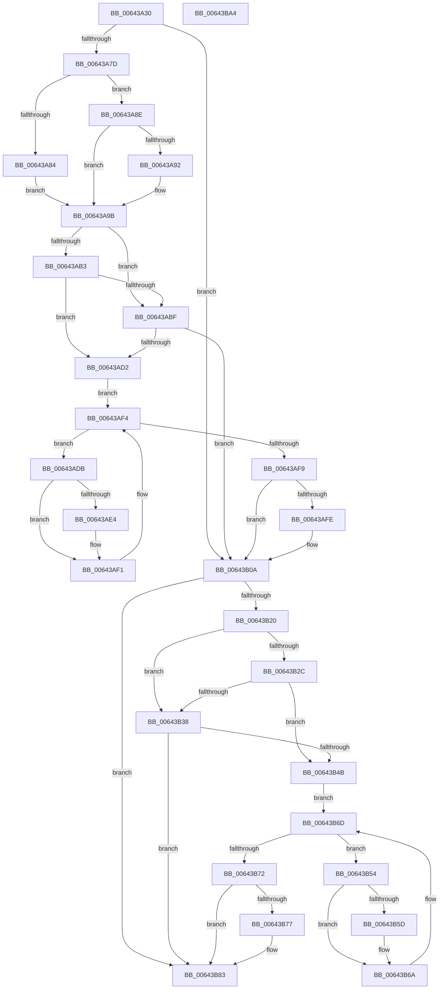

# DifZwOpenJobObjectWrapper

- RVA: `0x00643A30`–`0x00643BA5` (길이 `373` bytes)
- VA: `0x0000000140643A30`
- 실행 섹션: `.text`
- PDB 이름 있음: `예`; PDB Function 태그: `아니요`
- unwind 정보 RVA: `0x000A9A64`
- 디코드: `108`개 명령, `373/373` bytes 표시
- 미해석 바이트: `0` (있으면 어셈블리에 `.byte`로 보존)

> 이 문서는 커널 이미지의 기계어와 PDB 기호를 분석해 생성했습니다. 4번과 5번은 함수 원형과 자료형을 바이너리 사용 방식에서 추정한 C 해석이며 원본 소스 복구 결과는 아닙니다.

## 1. Dependencies

- 직접 호출 지점: **9**; 고유 호출 대상: **6**
- 직접 호출자로 확인된 함수: **0**
- RIP 상대 이미지 참조: **3**

### Outgoing calls
- `0x00643A6C` → [DifGetAPIThunkContextById](../49/DifGetAPIThunkContextById_function_00495A34.md) (function, `0x00495A34`)
- `0x00643A92` → [DifGetReturnAddressForWrappers](../4D/DifGetReturnAddressForWrappers_function_004D3C08.md) (function, `0x004D3C08`)
- `0x00643AC6` → [ExAcquireRundownProtection](../21/ExAcquireRundownProtection_function_00216620.md) (function, `0x00216620`)
- `0x00643AEC` → [guard_dispatch_icall](../6B/guard_dispatch_icall_function_006BAAD0.md) (function, `0x006BAAD0`)
- `0x00643B05` → [ExReleaseRundownProtection](../34/ExReleaseRundownProtection_function_00349E80.md) (function, `0x00349E80`)
- `0x00643B13` → [ZwOpenJobObject](../6A/ZwOpenJobObject_function_006AF630.md) (function, `0x006AF630`)
- `0x00643B3F` → [ExAcquireRundownProtection](../21/ExAcquireRundownProtection_function_00216620.md) (function, `0x00216620`)
- `0x00643B65` → [guard_dispatch_icall](../6B/guard_dispatch_icall_function_006BAAD0.md) (function, `0x006BAAD0`)
- `0x00643B7E` → [ExReleaseRundownProtection](../34/ExReleaseRundownProtection_function_00349E80.md) (function, `0x00349E80`)

### Direct callers
- 이 함수 시작 RVA로 연결되는 직접 call은 확인되지 않았습니다. 간접 호출은 완전히 역산할 수 없습니다.

### Static image references
- `0x00643AA2` → RVA `0x00F048B8` (`.data`; read)
- `0x00643AB3` → RVA `0x00F04980` (`.data`; read)
- `0x00643ABF` → RVA `0x00F03E80` (`.data`; read)

## 2. Other-region calls and transfers

- 다른 실행 섹션으로 향하는 call: **0**
- 별도 외부 분기/꼬리 이동을 확인하지 못했습니다.

## 3. Assembly (complete function range)

```asm
00643A30  48 89 5C 24 08                  mov qword ptr [rsp + 8], rbx
00643A35  48 89 74 24 10                  mov qword ptr [rsp + 0x10], rsi
00643A3A  48 89 7C 24 18                  mov qword ptr [rsp + 0x18], rdi
00643A3F  55                              push rbp
00643A40  41 54                           push r12
00643A42  41 55                           push r13
00643A44  41 56                           push r14
00643A46  41 57                           push r15
00643A48  48 8B EC                        mov rbp, rsp
00643A4B  48 83 EC 50                     sub rsp, 0x50
00643A4F  33 C0                           xor eax, eax
00643A51  0F 57 C0                        xorps xmm0, xmm0
00643A54  4C 8B E9                        mov r13, rcx
00643A57  48 89 45 F0                     mov qword ptr [rbp - 0x10], rax
00643A5B  4D 8B F8                        mov r15, r8
00643A5E  44 8B E2                        mov r12d, edx
00643A61  0F 11 45 D0                     movups xmmword ptr [rbp - 0x30], xmm0
00643A65  8D 48 54                        lea ecx, [rax + 0x54]
00643A68  0F 11 45 E0                     movups xmmword ptr [rbp - 0x20], xmm0
00643A6C  E8 C3 1F E5 FF                  call 0x140495a34
00643A71  48 8B F0                        mov rsi, rax
00643A74  48 85 C0                        test rax, rax
00643A77  0F 84 8D 00 00 00               je 0x140643b0a
00643A7D  8B 40 0C                        mov eax, dword ptr [rax + 0xc]
00643A80  A8 18                           test al, 0x18
00643A82  74 0A                           je 0x140643a8e
00643A84  48 8B 4D 28                     mov rcx, qword ptr [rbp + 0x28]
00643A88  48 89 4D D0                     mov qword ptr [rbp - 0x30], rcx
00643A8C  EB 0D                           jmp 0x140643a9b
00643A8E  A8 04                           test al, 4
00643A90  74 09                           je 0x140643a9b
00643A92  E8 71 01 E9 FF                  call 0x1404d3c08
00643A97  48 89 45 D0                     mov qword ptr [rbp - 0x30], rax
00643A9B  45 32 F6                        xor r14b, r14b
00643A9E  4C 89 6D E8                     mov qword ptr [rbp - 0x18], r13
00643AA2  44 38 35 0F 0E 8C 00            cmp byte ptr [rip + 0x8c0e0f], r14b
00643AA9  44 89 65 E0                     mov dword ptr [rbp - 0x20], r12d
00643AAD  4C 89 7D D8                     mov qword ptr [rbp - 0x28], r15
00643AB1  75 0C                           jne 0x140643abf
00643AB3  F7 05 C3 0E 8C 00 00 08 00 00   test dword ptr [rip + 0x8c0ec3], 0x800
00643ABD  74 13                           je 0x140643ad2
00643ABF  48 8D 0D BA 03 8C 00            lea rcx, [rip + 0x8c03ba]
00643AC6  E8 55 2B BD FF                  call 0x140216620
00643ACB  44 8A F0                        mov r14b, al
00643ACE  84 C0                           test al, al
00643AD0  74 38                           je 0x140643b0a
00643AD2  48 8D 7E 20                     lea rdi, [rsi + 0x20]
00643AD6  48 8B 1F                        mov rbx, qword ptr [rdi]
00643AD9  EB 19                           jmp 0x140643af4
00643ADB  48 8D 43 F0                     lea rax, [rbx - 0x10]
00643ADF  48 85 C0                        test rax, rax
00643AE2  74 0D                           je 0x140643af1
00643AE4  48 8B 40 08                     mov rax, qword ptr [rax + 8]
00643AE8  48 8D 4D D0                     lea rcx, [rbp - 0x30]
00643AEC  E8 DF 6F 07 00                  call 0x1406baad0
00643AF1  48 8B 1B                        mov rbx, qword ptr [rbx]
00643AF4  48 3B DF                        cmp rbx, rdi
00643AF7  75 E2                           jne 0x140643adb
00643AF9  45 84 F6                        test r14b, r14b
00643AFC  74 0C                           je 0x140643b0a
00643AFE  48 8D 0D 7B 03 8C 00            lea rcx, [rip + 0x8c037b]
00643B05  E8 76 63 D0 FF                  call 0x140349e80
00643B0A  4D 8B C7                        mov r8, r15
00643B0D  41 8B D4                        mov edx, r12d
00643B10  49 8B CD                        mov rcx, r13
00643B13  E8 18 BB 06 00                  call 0x1406af630
00643B18  89 45 F0                        mov dword ptr [rbp - 0x10], eax
00643B1B  48 85 F6                        test rsi, rsi
00643B1E  74 63                           je 0x140643b83
00643B20  40 32 FF                        xor dil, dil
00643B23  40 38 3D 8E 0D 8C 00            cmp byte ptr [rip + 0x8c0d8e], dil
00643B2A  75 0C                           jne 0x140643b38
00643B2C  F7 05 4A 0E 8C 00 00 08 00 00   test dword ptr [rip + 0x8c0e4a], 0x800
00643B36  74 13                           je 0x140643b4b
00643B38  48 8D 0D 41 03 8C 00            lea rcx, [rip + 0x8c0341]
00643B3F  E8 DC 2A BD FF                  call 0x140216620
00643B44  40 8A F8                        mov dil, al
00643B47  84 C0                           test al, al
00643B49  74 38                           je 0x140643b83
00643B4B  48 83 C6 30                     add rsi, 0x30
00643B4F  48 8B 1E                        mov rbx, qword ptr [rsi]
00643B52  EB 19                           jmp 0x140643b6d
00643B54  48 8D 43 F0                     lea rax, [rbx - 0x10]
00643B58  48 85 C0                        test rax, rax
00643B5B  74 0D                           je 0x140643b6a
00643B5D  48 8B 40 08                     mov rax, qword ptr [rax + 8]
00643B61  48 8D 4D D0                     lea rcx, [rbp - 0x30]
00643B65  E8 66 6F 07 00                  call 0x1406baad0
00643B6A  48 8B 1B                        mov rbx, qword ptr [rbx]
00643B6D  48 3B DE                        cmp rbx, rsi
00643B70  75 E2                           jne 0x140643b54
00643B72  40 84 FF                        test dil, dil
00643B75  74 0C                           je 0x140643b83
00643B77  48 8D 0D 02 03 8C 00            lea rcx, [rip + 0x8c0302]
00643B7E  E8 FD 62 D0 FF                  call 0x140349e80
00643B83  8B 45 F0                        mov eax, dword ptr [rbp - 0x10]
00643B86  4C 8D 5C 24 50                  lea r11, [rsp + 0x50]
00643B8B  49 8B 5B 30                     mov rbx, qword ptr [r11 + 0x30]
00643B8F  49 8B 73 38                     mov rsi, qword ptr [r11 + 0x38]
00643B93  49 8B 7B 40                     mov rdi, qword ptr [r11 + 0x40]
00643B97  49 8B E3                        mov rsp, r11
00643B9A  41 5F                           pop r15
00643B9C  41 5E                           pop r14
00643B9E  41 5D                           pop r13
00643BA0  41 5C                           pop r12
00643BA2  5D                              pop rbp
00643BA3  C3                              ret
00643BA4  CC                              int3
```

## 4. C-style interpretation (structured pseudocode)

```c
__int64 __fastcall DifZwOpenJobObjectWrapper(__int64 a1, int a2, __int64 a3)
{
    __int64 result;
    __int64 v_r14;
    __int64 v_rdi;
    __int64 v_rsi;
    __int64 v_rsp;
    unsigned __int64 v_stack_m28;
    unsigned __int64 v_stack_m38;
    unsigned __int64 v_stack_m40;
    unsigned __int64 v_stack_m48;
    unsigned __int64 v_stack_m50;
    unsigned __int64 v_stack_m58;
    unsigned __int64 v_stack_p0;
    unsigned __int64 v_stack_p10;
    unsigned __int64 v_stack_p18;
    unsigned __int64 v_stack_p8;

    v_stack_p8 = v_rbx;
    v_stack_p10 = v_rsi;
    v_stack_p18 = v_rdi;
    v_rsp = (v_rsp) - (80);
    result = 0;
    v_stack_m38 = 0;
    v_stack_m58 = v_xmm0;
    v_stack_m48 = v_xmm0;
    result = DifGetAPIThunkContextById(result + 84, a2, a3, a4);
    if (result == 0) goto loc_00643B0A;
    if ((((unsigned __int8)((unsigned int)(*(unsigned int *)(result + 12)))) & (24)) == 0) goto loc_00643A8E;
    v_stack_m58 = v_stack_p0;
    goto loc_00643A9B;
loc_00643A8E:
    result = (unsigned int)(*(unsigned int *)(result + 12));
    if ((((unsigned __int8)((unsigned int)(*(unsigned int *)(result + 12)))) & (4)) != 0) {
        result = DifGetReturnAddressForWrappers(v_stack_p0, a2, a3, a4);
        v_stack_m58 = result;
    }
    v_r14 = 0;
    v_stack_m40 = a1;
    v_stack_m48 = (unsigned int)((unsigned int)(a2));
    v_stack_m50 = a3;
    if ((*(unsigned __int8 *)(v_rip + 9178639)) != 0) goto loc_00643ABF;
    if (((*(unsigned int *)(v_rip + 9178819)) & (0x800ULL)) == 0) goto loc_00643AD2;
loc_00643ABF:
    result = ExAcquireRundownProtection(v_rip + 9175994, a2, a3, a4);
    if ((unsigned __int8)(result) == 0) goto loc_00643B0A;
loc_00643AD2:
    goto loc_00643AF4;
loc_00643ADB:
    result = *(unsigned __int64 *)(result + 32) - 16;
    if (*(unsigned __int64 *)(result + 32) - 16 != 0) {
        result = *(unsigned __int64 *)(*(unsigned __int64 *)(result + 32) - 16 + 8);
        a1 = v_stack_m58;
        result = guard_dispatch_icall(a1, a2, a3, a4);
    }
loc_00643AF4:
    if ((*(unsigned __int64 *)(*(unsigned __int64 *)(result + 32))) != (result + 32)) goto loc_00643ADB;
    if ((unsigned __int8)((unsigned __int8)(result)) != 0) {
        a1 = v_rip + 9175931;
        result = ExReleaseRundownProtection(a1, a2, a3, a4);
    }
    result = ZwOpenJobObject(a1, (unsigned int)((unsigned int)((unsigned int)(a2))), a3, a4);
    v_stack_m38 = (unsigned int)(result);
    if (result == 0) goto loc_00643B83;
    v_rdi = 0;
    if ((*(unsigned __int8 *)(v_rip + 9178510)) != 0) goto loc_00643B38;
    if (((*(unsigned int *)(v_rip + 9178698)) & (0x800ULL)) == 0) goto loc_00643B4B;
loc_00643B38:
    result = ExAcquireRundownProtection(v_rip + 9175873, (unsigned int)((unsigned int)((unsigned int)(a2))), a3, a4);
    if ((unsigned __int8)(result) == 0) goto loc_00643B83;
loc_00643B4B:
    v_rsi = (result) + (48);
    goto loc_00643B6D;
loc_00643B54:
    result = *(unsigned __int64 *)(v_rsi) - 16;
    if (*(unsigned __int64 *)(v_rsi) - 16 != 0) {
        result = *(unsigned __int64 *)(*(unsigned __int64 *)(v_rsi) - 16 + 8);
        a1 = v_stack_m58;
        result = guard_dispatch_icall(a1, (unsigned int)((unsigned int)((unsigned int)(a2))), a3, a4);
    }
loc_00643B6D:
    if ((*(unsigned __int64 *)(*(unsigned __int64 *)(v_rsi))) != v_rsi) goto loc_00643B54;
    if ((unsigned __int8)((unsigned __int8)(result)) != 0) {
        a1 = v_rip + 9175810;
        result = ExReleaseRundownProtection(a1, (unsigned int)((unsigned int)((unsigned int)(a2))), a3, a4);
    }
    return (unsigned int)(v_stack_m38);
}
```

## 5. (Beta) C Style

```c
int64_t DifZwOpenJobObjectWrapper(int64_t Arg1, int32_t Arg2, int64_t Arg3)
{
    int64_t result;
    int64_t local_r14;
    int64_t local_rdi;
    int64_t local_rsi;
    int64_t local_rsp;
    uint64_t v_stack_m28;
    uint64_t v_stack_m38;
    uint64_t v_stack_m40;
    uint64_t v_stack_m48;
    uint64_t v_stack_m50;
    uint64_t v_stack_m58;
    uint64_t v_stack_p0;
    uint64_t v_stack_p10;
    uint64_t v_stack_p18;
    uint64_t v_stack_p8;

    v_stack_p8 = local_rbx;
    v_stack_p10 = local_rsi;
    v_stack_p18 = local_rdi;
    local_rsp = (local_rsp) - (80);
    result = 0;
    v_stack_m38 = 0;
    v_stack_m58 = v_xmm0;
    v_stack_m48 = v_xmm0;
    result = DifGetAPIThunkContextById(result + 84, Arg2, Arg3, a4);
    if (result == 0) goto loc_00643B0A;
    if ((((uint8_t)((uint32_t)(*(uint32_t *)(result + 0xC)))) & (24)) == 0) goto loc_00643A8E;
    v_stack_m58 = v_stack_p0;
    goto loc_00643A9B;
loc_00643A8E:
    result = (uint32_t)(*(uint32_t *)(result + 0xC));
    if ((((uint8_t)((uint32_t)(*(uint32_t *)(result + 0xC)))) & (4)) != 0) {
        result = DifGetReturnAddressForWrappers(v_stack_p0, Arg2, Arg3, a4);
        v_stack_m58 = result;
    }
    local_r14 = 0;
    v_stack_m40 = Arg1;
    v_stack_m48 = (uint32_t)((uint32_t)(Arg2));
    v_stack_m50 = Arg3;
    if ((*(uint8_t *)(v_rip + 0x8C0E0F)) != 0) goto loc_00643ABF;
    if (((*(uint32_t *)(v_rip + 0x8C0EC3)) & (0x800ULL)) == 0) goto loc_00643AD2;
loc_00643ABF:
    result = ExAcquireRundownProtection(v_rip + 9175994, Arg2, Arg3, a4);
    if ((uint8_t)(result) == 0) goto loc_00643B0A;
loc_00643AD2:
    goto loc_00643AF4;
loc_00643ADB:
    result = *(uint64_t *)(result + 0x20) - 16;
    if (*(uint64_t *)(result + 0x20) - 16 != 0) {
        result = *(uint64_t *)(*(uint64_t *)(result + 0x20) - 0x10 + 0x8);
        Arg1 = v_stack_m58;
        result = guard_dispatch_icall(Arg1, Arg2, Arg3, a4);
    }
loc_00643AF4:
    if ((*(uint64_t *)(*(uint64_t *)(result + 0x20))) != (result + 32)) goto loc_00643ADB;
    if ((uint8_t)((uint8_t)(result)) != 0) {
        Arg1 = v_rip + 9175931;
        result = ExReleaseRundownProtection(Arg1, Arg2, Arg3, a4);
    }
    result = ZwOpenJobObject(Arg1, (uint32_t)((uint32_t)((uint32_t)(Arg2))), Arg3, a4);
    v_stack_m38 = (uint32_t)(result);
    if (result == 0) goto loc_00643B83;
    local_rdi = 0;
    if ((*(uint8_t *)(v_rip + 0x8C0D8E)) != 0) goto loc_00643B38;
    if (((*(uint32_t *)(v_rip + 0x8C0E4A)) & (0x800ULL)) == 0) goto loc_00643B4B;
loc_00643B38:
    result = ExAcquireRundownProtection(v_rip + 9175873, (uint32_t)((uint32_t)((uint32_t)(Arg2))), Arg3, a4);
    if ((uint8_t)(result) == 0) goto loc_00643B83;
loc_00643B4B:
    local_rsi = (result) + (48);
    goto loc_00643B6D;
loc_00643B54:
    result = *(uint64_t *)(local_rsi) - 16;
    if (*(uint64_t *)(local_rsi) - 16 != 0) {
        result = *(uint64_t *)(*(uint64_t *)(local_rsi) - 0x10 + 0x8);
        Arg1 = v_stack_m58;
        result = guard_dispatch_icall(Arg1, (uint32_t)((uint32_t)((uint32_t)(Arg2))), Arg3, a4);
    }
loc_00643B6D:
    if ((*(uint64_t *)(*(uint64_t *)(local_rsi))) != local_rsi) goto loc_00643B54;
    if ((uint8_t)((uint8_t)(result)) != 0) {
        Arg1 = v_rip + 9175810;
        result = ExReleaseRundownProtection(Arg1, (uint32_t)((uint32_t)((uint32_t)(Arg2))), Arg3, a4);
    }
    return (uint32_t)(v_stack_m38);
}
```

## 6. Execution-region graph

[열기: 2D/3D 그래프와 함수 탐색 컨트롤 패널](../../../control-panel.html?section=text&rva=0x00643A30&view=graph)

- 2D 그래프는 위에서 아래로 흐르고, 3D 그래프는 빈 공간을 드래그해 회전합니다. Shift+드래그는 이동, 휠은 확대·축소, 함수 노드 선택은 대상 보고서 이동입니다.

### Static fallback


