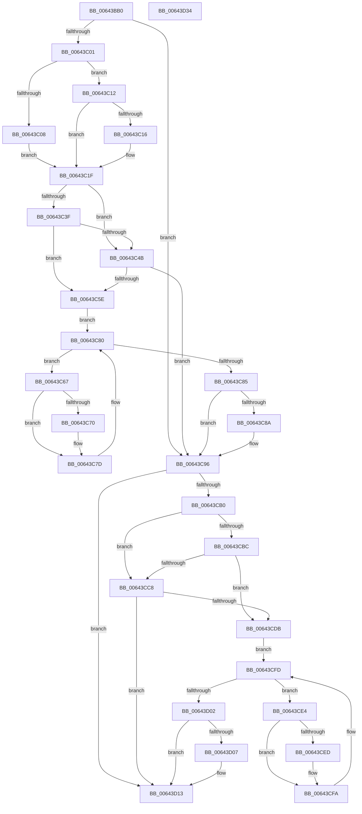

# DifZwOpenKeyExWrapper

- RVA: `0x00643BB0`–`0x00643D35` (길이 `389` bytes)
- VA: `0x0000000140643BB0`
- 실행 섹션: `.text`
- PDB 이름 있음: `예`; PDB Function 태그: `아니요`
- unwind 정보 RVA: `0x000D2B7C`
- 디코드: `112`개 명령, `389/389` bytes 표시
- 미해석 바이트: `0` (있으면 어셈블리에 `.byte`로 보존)

> 이 문서는 커널 이미지의 기계어와 PDB 기호를 분석해 생성했습니다. 4번과 5번은 함수 원형과 자료형을 바이너리 사용 방식에서 추정한 C 해석이며 원본 소스 복구 결과는 아닙니다.

## 1. Dependencies

- 직접 호출 지점: **9**; 고유 호출 대상: **6**
- 직접 호출자로 확인된 함수: **0**
- RIP 상대 이미지 참조: **3**

### Outgoing calls
- `0x00643BF0` → [DifGetAPIThunkContextById](../49/DifGetAPIThunkContextById_function_00495A34.md) (function, `0x00495A34`)
- `0x00643C16` → [DifGetReturnAddressForWrappers](../4D/DifGetReturnAddressForWrappers_function_004D3C08.md) (function, `0x004D3C08`)
- `0x00643C52` → [ExAcquireRundownProtection](../21/ExAcquireRundownProtection_function_00216620.md) (function, `0x00216620`)
- `0x00643C78` → [guard_dispatch_icall](../6B/guard_dispatch_icall_function_006BAAD0.md) (function, `0x006BAAD0`)
- `0x00643C91` → [ExReleaseRundownProtection](../34/ExReleaseRundownProtection_function_00349E80.md) (function, `0x00349E80`)
- `0x00643CA3` → [ZwOpenKeyEx](../6A/ZwOpenKeyEx_function_006AF650.md) (function, `0x006AF650`)
- `0x00643CCF` → [ExAcquireRundownProtection](../21/ExAcquireRundownProtection_function_00216620.md) (function, `0x00216620`)
- `0x00643CF5` → [guard_dispatch_icall](../6B/guard_dispatch_icall_function_006BAAD0.md) (function, `0x006BAAD0`)
- `0x00643D0E` → [ExReleaseRundownProtection](../34/ExReleaseRundownProtection_function_00349E80.md) (function, `0x00349E80`)

### Direct callers
- 이 함수 시작 RVA로 연결되는 직접 call은 확인되지 않았습니다. 간접 호출은 완전히 역산할 수 없습니다.

### Static image references
- `0x00643C26` → RVA `0x00F048B8` (`.data`; read)
- `0x00643C3F` → RVA `0x00F04980` (`.data`; read)
- `0x00643C4B` → RVA `0x00F03E80` (`.data`; read)

## 2. Other-region calls and transfers

- 다른 실행 섹션으로 향하는 call: **0**
- 별도 외부 분기/꼬리 이동을 확인하지 못했습니다.

## 3. Assembly (complete function range)

```asm
00643BB0  48 8B C4                        mov rax, rsp
00643BB3  48 89 58 10                     mov qword ptr [rax + 0x10], rbx
00643BB7  48 89 70 18                     mov qword ptr [rax + 0x18], rsi
00643BBB  48 89 78 20                     mov qword ptr [rax + 0x20], rdi
00643BBF  48 89 48 08                     mov qword ptr [rax + 8], rcx
00643BC3  55                              push rbp
00643BC4  41 54                           push r12
00643BC6  41 55                           push r13
00643BC8  41 56                           push r14
00643BCA  41 57                           push r15
00643BCC  48 8B EC                        mov rbp, rsp
00643BCF  48 83 EC 50                     sub rsp, 0x50
00643BD3  0F 57 C0                        xorps xmm0, xmm0
00643BD6  B9 52 00 00 00                  mov ecx, 0x52
00643BDB  0F 11 45 D0                     movups xmmword ptr [rbp - 0x30], xmm0
00643BDF  45 8B F9                        mov r15d, r9d
00643BE2  4D 8B E0                        mov r12, r8
00643BE5  0F 11 45 E0                     movups xmmword ptr [rbp - 0x20], xmm0
00643BE9  44 8B EA                        mov r13d, edx
00643BEC  0F 11 45 F0                     movups xmmword ptr [rbp - 0x10], xmm0
00643BF0  E8 3F 1E E5 FF                  call 0x140495a34
00643BF5  48 8B F0                        mov rsi, rax
00643BF8  48 85 C0                        test rax, rax
00643BFB  0F 84 95 00 00 00               je 0x140643c96
00643C01  8B 40 0C                        mov eax, dword ptr [rax + 0xc]
00643C04  A8 18                           test al, 0x18
00643C06  74 0A                           je 0x140643c12
00643C08  48 8B 4D 28                     mov rcx, qword ptr [rbp + 0x28]
00643C0C  48 89 4D D0                     mov qword ptr [rbp - 0x30], rcx
00643C10  EB 0D                           jmp 0x140643c1f
00643C12  A8 04                           test al, 4
00643C14  74 09                           je 0x140643c1f
00643C16  E8 ED FF E8 FF                  call 0x1404d3c08
00643C1B  48 89 45 D0                     mov qword ptr [rbp - 0x30], rax
00643C1F  48 8B 45 30                     mov rax, qword ptr [rbp + 0x30]
00643C23  45 32 F6                        xor r14b, r14b
00643C26  44 38 35 8B 0C 8C 00            cmp byte ptr [rip + 0x8c0c8b], r14b
00643C2D  48 89 45 F0                     mov qword ptr [rbp - 0x10], rax
00643C31  44 89 6D E8                     mov dword ptr [rbp - 0x18], r13d
00643C35  4C 89 65 E0                     mov qword ptr [rbp - 0x20], r12
00643C39  44 89 7D D8                     mov dword ptr [rbp - 0x28], r15d
00643C3D  75 0C                           jne 0x140643c4b
00643C3F  F7 05 37 0D 8C 00 00 08 00 00   test dword ptr [rip + 0x8c0d37], 0x800
00643C49  74 13                           je 0x140643c5e
00643C4B  48 8D 0D 2E 02 8C 00            lea rcx, [rip + 0x8c022e]
00643C52  E8 C9 29 BD FF                  call 0x140216620
00643C57  44 8A F0                        mov r14b, al
00643C5A  84 C0                           test al, al
00643C5C  74 38                           je 0x140643c96
00643C5E  48 8D 7E 20                     lea rdi, [rsi + 0x20]
00643C62  48 8B 1F                        mov rbx, qword ptr [rdi]
00643C65  EB 19                           jmp 0x140643c80
00643C67  48 8D 43 F0                     lea rax, [rbx - 0x10]
00643C6B  48 85 C0                        test rax, rax
00643C6E  74 0D                           je 0x140643c7d
00643C70  48 8B 40 08                     mov rax, qword ptr [rax + 8]
00643C74  48 8D 4D D0                     lea rcx, [rbp - 0x30]
00643C78  E8 53 6E 07 00                  call 0x1406baad0
00643C7D  48 8B 1B                        mov rbx, qword ptr [rbx]
00643C80  48 3B DF                        cmp rbx, rdi
00643C83  75 E2                           jne 0x140643c67
00643C85  45 84 F6                        test r14b, r14b
00643C88  74 0C                           je 0x140643c96
00643C8A  48 8D 0D EF 01 8C 00            lea rcx, [rip + 0x8c01ef]
00643C91  E8 EA 61 D0 FF                  call 0x140349e80
00643C96  48 8B 4D 30                     mov rcx, qword ptr [rbp + 0x30]
00643C9A  45 8B CF                        mov r9d, r15d
00643C9D  4D 8B C4                        mov r8, r12
00643CA0  41 8B D5                        mov edx, r13d
00643CA3  E8 A8 B9 06 00                  call 0x1406af650
00643CA8  89 45 F8                        mov dword ptr [rbp - 8], eax
00643CAB  48 85 F6                        test rsi, rsi
00643CAE  74 63                           je 0x140643d13
00643CB0  40 32 FF                        xor dil, dil
00643CB3  40 38 3D FE 0B 8C 00            cmp byte ptr [rip + 0x8c0bfe], dil
00643CBA  75 0C                           jne 0x140643cc8
00643CBC  F7 05 BA 0C 8C 00 00 08 00 00   test dword ptr [rip + 0x8c0cba], 0x800
00643CC6  74 13                           je 0x140643cdb
00643CC8  48 8D 0D B1 01 8C 00            lea rcx, [rip + 0x8c01b1]
00643CCF  E8 4C 29 BD FF                  call 0x140216620
00643CD4  40 8A F8                        mov dil, al
00643CD7  84 C0                           test al, al
00643CD9  74 38                           je 0x140643d13
00643CDB  48 83 C6 30                     add rsi, 0x30
00643CDF  48 8B 1E                        mov rbx, qword ptr [rsi]
00643CE2  EB 19                           jmp 0x140643cfd
00643CE4  48 8D 43 F0                     lea rax, [rbx - 0x10]
00643CE8  48 85 C0                        test rax, rax
00643CEB  74 0D                           je 0x140643cfa
00643CED  48 8B 40 08                     mov rax, qword ptr [rax + 8]
00643CF1  48 8D 4D D0                     lea rcx, [rbp - 0x30]
00643CF5  E8 D6 6D 07 00                  call 0x1406baad0
00643CFA  48 8B 1B                        mov rbx, qword ptr [rbx]
00643CFD  48 3B DE                        cmp rbx, rsi
00643D00  75 E2                           jne 0x140643ce4
00643D02  40 84 FF                        test dil, dil
00643D05  74 0C                           je 0x140643d13
00643D07  48 8D 0D 72 01 8C 00            lea rcx, [rip + 0x8c0172]
00643D0E  E8 6D 61 D0 FF                  call 0x140349e80
00643D13  8B 45 F8                        mov eax, dword ptr [rbp - 8]
00643D16  4C 8D 5C 24 50                  lea r11, [rsp + 0x50]
00643D1B  49 8B 5B 38                     mov rbx, qword ptr [r11 + 0x38]
00643D1F  49 8B 73 40                     mov rsi, qword ptr [r11 + 0x40]
00643D23  49 8B 7B 48                     mov rdi, qword ptr [r11 + 0x48]
00643D27  49 8B E3                        mov rsp, r11
00643D2A  41 5F                           pop r15
00643D2C  41 5E                           pop r14
00643D2E  41 5D                           pop r13
00643D30  41 5C                           pop r12
00643D32  5D                              pop rbp
00643D33  C3                              ret
00643D34  CC                              int3
```

## 4. C-style interpretation (structured pseudocode)

```c
__int64 __fastcall DifZwOpenKeyExWrapper(__int64 a1, int a2, __int64 a3, int a4)
{
    __int64 result;
    __int64 v_r14;
    __int64 v_rdi;
    __int64 v_rsi;
    __int64 v_rsp;
    unsigned __int64 v_stack_m28;
    unsigned int v_stack_m30;
    unsigned __int64 v_stack_m38;
    unsigned int v_stack_m40;
    unsigned __int64 v_stack_m48;
    unsigned int v_stack_m50;
    unsigned __int64 v_stack_m58;
    unsigned __int64 v_stack_p0;
    unsigned __int64 v_stack_p8;

    *(unsigned __int64 *)(v_rsp + 16) = v_rbx;
    *(unsigned __int64 *)(v_rsp + 24) = v_rsi;
    *(unsigned __int64 *)(v_rsp + 32) = v_rdi;
    *(unsigned __int64 *)(v_rsp + 8) = a1;
    v_rsp = (v_rsp) - (80);
    v_stack_m58 = v_xmm0;
    v_stack_m48 = v_xmm0;
    v_stack_m38 = v_xmm0;
    result = DifGetAPIThunkContextById(82, a2, a3, a4);
    if (result == 0) goto loc_00643C96;
    if ((((unsigned __int8)((unsigned int)(*(unsigned int *)(result + 12)))) & (24)) == 0) goto loc_00643C12;
    v_stack_m58 = v_stack_p0;
    goto loc_00643C1F;
loc_00643C12:
    result = (unsigned int)(*(unsigned int *)(result + 12));
    if ((((unsigned __int8)((unsigned int)(*(unsigned int *)(result + 12)))) & (4)) != 0) {
        result = DifGetReturnAddressForWrappers(v_stack_p0, a2, a3, a4);
        v_stack_m58 = result;
    }
    v_r14 = 0;
    v_stack_m38 = v_stack_p8;
    v_stack_m40 = (unsigned int)((unsigned int)(a2));
    v_stack_m48 = a3;
    v_stack_m50 = (unsigned int)((unsigned int)(a4));
    if ((*(unsigned __int8 *)(v_rip + 9178251)) != 0) goto loc_00643C4B;
    if (((*(unsigned int *)(v_rip + 9178423)) & (0x800ULL)) == 0) goto loc_00643C5E;
loc_00643C4B:
    result = ExAcquireRundownProtection(v_rip + 9175598, a2, a3, a4);
    if ((unsigned __int8)(result) == 0) goto loc_00643C96;
loc_00643C5E:
    goto loc_00643C80;
loc_00643C67:
    result = *(unsigned __int64 *)(result + 32) - 16;
    if (*(unsigned __int64 *)(result + 32) - 16 != 0) {
        result = *(unsigned __int64 *)(*(unsigned __int64 *)(result + 32) - 16 + 8);
        a1 = v_stack_m58;
        result = guard_dispatch_icall(a1, a2, a3, a4);
    }
loc_00643C80:
    if ((*(unsigned __int64 *)(*(unsigned __int64 *)(result + 32))) != (result + 32)) goto loc_00643C67;
    if ((unsigned __int8)((unsigned __int8)(result)) != 0) {
        a1 = v_rip + 9175535;
        result = ExReleaseRundownProtection(a1, a2, a3, a4);
    }
    result = ZwOpenKeyEx(v_stack_p8, (unsigned int)((unsigned int)((unsigned int)(a2))), a3, (unsigned int)((unsigned int)((unsigned int)(a4))));
    v_stack_m30 = (unsigned int)(result);
    if (result == 0) goto loc_00643D13;
    v_rdi = 0;
    if ((*(unsigned __int8 *)(v_rip + 9178110)) != 0) goto loc_00643CC8;
    if (((*(unsigned int *)(v_rip + 9178298)) & (0x800ULL)) == 0) goto loc_00643CDB;
loc_00643CC8:
    result = ExAcquireRundownProtection(v_rip + 9175473, (unsigned int)((unsigned int)((unsigned int)(a2))), a3, (unsigned int)((unsigned int)((unsigned int)(a4))));
    if ((unsigned __int8)(result) == 0) goto loc_00643D13;
loc_00643CDB:
    v_rsi = (result) + (48);
    goto loc_00643CFD;
loc_00643CE4:
    result = *(unsigned __int64 *)(v_rsi) - 16;
    if (*(unsigned __int64 *)(v_rsi) - 16 != 0) {
        result = *(unsigned __int64 *)(*(unsigned __int64 *)(v_rsi) - 16 + 8);
        a1 = v_stack_m58;
        result = guard_dispatch_icall(a1, (unsigned int)((unsigned int)((unsigned int)(a2))), a3, (unsigned int)((unsigned int)((unsigned int)(a4))));
    }
loc_00643CFD:
    if ((*(unsigned __int64 *)(*(unsigned __int64 *)(v_rsi))) != v_rsi) goto loc_00643CE4;
    if ((unsigned __int8)((unsigned __int8)(result)) != 0) {
        a1 = v_rip + 9175410;
        result = ExReleaseRundownProtection(a1, (unsigned int)((unsigned int)((unsigned int)(a2))), a3, (unsigned int)((unsigned int)((unsigned int)(a4))));
    }
    return (unsigned int)(v_stack_m30);
}
```

## 5. (Beta) C Style

```c
int64_t DifZwOpenKeyExWrapper(int64_t Arg1, int32_t Arg2, int64_t Arg3, int32_t Arg4)
{
    int64_t result;
    int64_t local_r14;
    int64_t local_rdi;
    int64_t local_rsi;
    int64_t local_rsp;
    uint64_t v_stack_m28;
    uint32_t v_stack_m30;
    uint64_t v_stack_m38;
    uint32_t v_stack_m40;
    uint64_t v_stack_m48;
    uint32_t v_stack_m50;
    uint64_t v_stack_m58;
    uint64_t v_stack_p0;
    uint64_t v_stack_p8;

    *(uint64_t *)(local_rsp + 0x10) = local_rbx;
    *(uint64_t *)(local_rsp + 0x18) = local_rsi;
    *(uint64_t *)(local_rsp + 0x20) = local_rdi;
    *(uint64_t *)(local_rsp + 0x8) = Arg1;
    local_rsp = (local_rsp) - (80);
    v_stack_m58 = v_xmm0;
    v_stack_m48 = v_xmm0;
    v_stack_m38 = v_xmm0;
    result = DifGetAPIThunkContextById(82, Arg2, Arg3, Arg4);
    if (result == 0) goto loc_00643C96;
    if ((((uint8_t)((uint32_t)(*(uint32_t *)(result + 0xC)))) & (24)) == 0) goto loc_00643C12;
    v_stack_m58 = v_stack_p0;
    goto loc_00643C1F;
loc_00643C12:
    result = (uint32_t)(*(uint32_t *)(result + 0xC));
    if ((((uint8_t)((uint32_t)(*(uint32_t *)(result + 0xC)))) & (4)) != 0) {
        result = DifGetReturnAddressForWrappers(v_stack_p0, Arg2, Arg3, Arg4);
        v_stack_m58 = result;
    }
    local_r14 = 0;
    v_stack_m38 = v_stack_p8;
    v_stack_m40 = (uint32_t)((uint32_t)(Arg2));
    v_stack_m48 = Arg3;
    v_stack_m50 = (uint32_t)((uint32_t)(Arg4));
    if ((*(uint8_t *)(v_rip + 0x8C0C8B)) != 0) goto loc_00643C4B;
    if (((*(uint32_t *)(v_rip + 0x8C0D37)) & (0x800ULL)) == 0) goto loc_00643C5E;
loc_00643C4B:
    result = ExAcquireRundownProtection(v_rip + 9175598, Arg2, Arg3, Arg4);
    if ((uint8_t)(result) == 0) goto loc_00643C96;
loc_00643C5E:
    goto loc_00643C80;
loc_00643C67:
    result = *(uint64_t *)(result + 0x20) - 16;
    if (*(uint64_t *)(result + 0x20) - 16 != 0) {
        result = *(uint64_t *)(*(uint64_t *)(result + 0x20) - 0x10 + 0x8);
        Arg1 = v_stack_m58;
        result = guard_dispatch_icall(Arg1, Arg2, Arg3, Arg4);
    }
loc_00643C80:
    if ((*(uint64_t *)(*(uint64_t *)(result + 0x20))) != (result + 32)) goto loc_00643C67;
    if ((uint8_t)((uint8_t)(result)) != 0) {
        Arg1 = v_rip + 9175535;
        result = ExReleaseRundownProtection(Arg1, Arg2, Arg3, Arg4);
    }
    result = ZwOpenKeyEx(v_stack_p8, (uint32_t)((uint32_t)((uint32_t)(Arg2))), Arg3, (uint32_t)((uint32_t)((uint32_t)(Arg4))));
    v_stack_m30 = (uint32_t)(result);
    if (result == 0) goto loc_00643D13;
    local_rdi = 0;
    if ((*(uint8_t *)(v_rip + 0x8C0BFE)) != 0) goto loc_00643CC8;
    if (((*(uint32_t *)(v_rip + 0x8C0CBA)) & (0x800ULL)) == 0) goto loc_00643CDB;
loc_00643CC8:
    result = ExAcquireRundownProtection(v_rip + 9175473, (uint32_t)((uint32_t)((uint32_t)(Arg2))), Arg3, (uint32_t)((uint32_t)((uint32_t)(Arg4))));
    if ((uint8_t)(result) == 0) goto loc_00643D13;
loc_00643CDB:
    local_rsi = (result) + (48);
    goto loc_00643CFD;
loc_00643CE4:
    result = *(uint64_t *)(local_rsi) - 16;
    if (*(uint64_t *)(local_rsi) - 16 != 0) {
        result = *(uint64_t *)(*(uint64_t *)(local_rsi) - 0x10 + 0x8);
        Arg1 = v_stack_m58;
        result = guard_dispatch_icall(Arg1, (uint32_t)((uint32_t)((uint32_t)(Arg2))), Arg3, (uint32_t)((uint32_t)((uint32_t)(Arg4))));
    }
loc_00643CFD:
    if ((*(uint64_t *)(*(uint64_t *)(local_rsi))) != local_rsi) goto loc_00643CE4;
    if ((uint8_t)((uint8_t)(result)) != 0) {
        Arg1 = v_rip + 9175410;
        result = ExReleaseRundownProtection(Arg1, (uint32_t)((uint32_t)((uint32_t)(Arg2))), Arg3, (uint32_t)((uint32_t)((uint32_t)(Arg4))));
    }
    return (uint32_t)(v_stack_m30);
}
```

## 6. Execution-region graph

[열기: 2D/3D 그래프와 함수 탐색 컨트롤 패널](../../../control-panel.html?section=text&rva=0x00643BB0&view=graph)

- 2D 그래프는 위에서 아래로 흐르고, 3D 그래프는 빈 공간을 드래그해 회전합니다. Shift+드래그는 이동, 휠은 확대·축소, 함수 노드 선택은 대상 보고서 이동입니다.

### Static fallback


