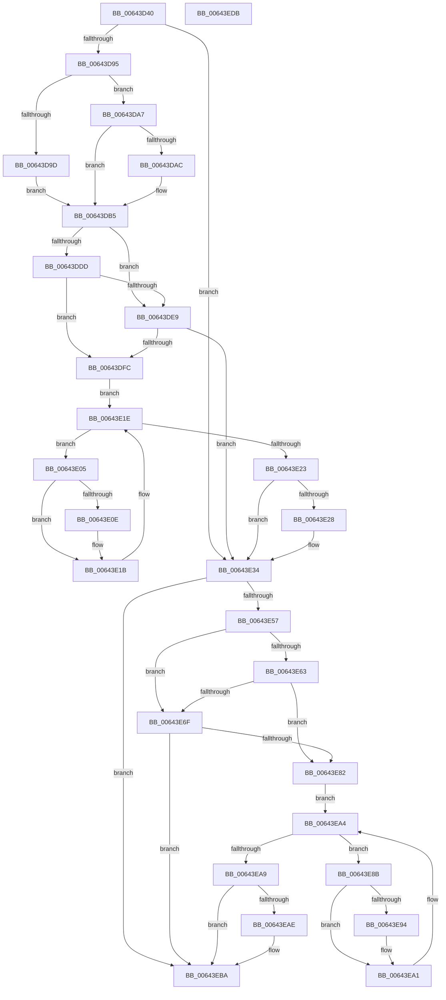

# DifZwOpenKeyTransactedExWrapper

- RVA: `0x00643D40`–`0x00643EDC` (길이 `412` bytes)
- VA: `0x0000000140643D40`
- 실행 섹션: `.text`
- PDB 이름 있음: `예`; PDB Function 태그: `아니요`
- unwind 정보 RVA: `0x000BD780`
- 디코드: `118`개 명령, `412/412` bytes 표시
- 미해석 바이트: `0` (있으면 어셈블리에 `.byte`로 보존)

> 이 문서는 커널 이미지의 기계어와 PDB 기호를 분석해 생성했습니다. 4번과 5번은 함수 원형과 자료형을 바이너리 사용 방식에서 추정한 C 해석이며 원본 소스 복구 결과는 아닙니다.

## 1. Dependencies

- 직접 호출 지점: **9**; 고유 호출 대상: **6**
- 직접 호출자로 확인된 함수: **0**
- RIP 상대 이미지 참조: **3**

### Outgoing calls
- `0x00643D84` → [DifGetAPIThunkContextById](../49/DifGetAPIThunkContextById_function_00495A34.md) (function, `0x00495A34`)
- `0x00643DAC` → [DifGetReturnAddressForWrappers](../4D/DifGetReturnAddressForWrappers_function_004D3C08.md) (function, `0x004D3C08`)
- `0x00643DF0` → [ExAcquireRundownProtection](../21/ExAcquireRundownProtection_function_00216620.md) (function, `0x00216620`)
- `0x00643E16` → [guard_dispatch_icall](../6B/guard_dispatch_icall_function_006BAAD0.md) (function, `0x006BAAD0`)
- `0x00643E2F` → [ExReleaseRundownProtection](../34/ExReleaseRundownProtection_function_00349E80.md) (function, `0x00349E80`)
- `0x00643E4A` → [ZwOpenKeyTransactedEx](../6A/ZwOpenKeyTransactedEx_function_006AF690.md) (function, `0x006AF690`)
- `0x00643E76` → [ExAcquireRundownProtection](../21/ExAcquireRundownProtection_function_00216620.md) (function, `0x00216620`)
- `0x00643E9C` → [guard_dispatch_icall](../6B/guard_dispatch_icall_function_006BAAD0.md) (function, `0x006BAAD0`)
- `0x00643EB5` → [ExReleaseRundownProtection](../34/ExReleaseRundownProtection_function_00349E80.md) (function, `0x00349E80`)

### Direct callers
- 이 함수 시작 RVA로 연결되는 직접 call은 확인되지 않았습니다. 간접 호출은 완전히 역산할 수 없습니다.

### Static image references
- `0x00643DBC` → RVA `0x00F048B8` (`.data`; read)
- `0x00643DDD` → RVA `0x00F04980` (`.data`; read)
- `0x00643DE9` → RVA `0x00F03E80` (`.data`; read)

## 2. Other-region calls and transfers

- 다른 실행 섹션으로 향하는 call: **0**
- 별도 외부 분기/꼬리 이동을 확인하지 못했습니다.

## 3. Assembly (complete function range)

```asm
00643D40  48 8B C4                        mov rax, rsp
00643D43  48 89 58 10                     mov qword ptr [rax + 0x10], rbx
00643D47  48 89 70 18                     mov qword ptr [rax + 0x18], rsi
00643D4B  48 89 78 20                     mov qword ptr [rax + 0x20], rdi
00643D4F  48 89 48 08                     mov qword ptr [rax + 8], rcx
00643D53  55                              push rbp
00643D54  41 54                           push r12
00643D56  41 55                           push r13
00643D58  41 56                           push r14
00643D5A  41 57                           push r15
00643D5C  48 8B EC                        mov rbp, rsp
00643D5F  48 83 EC 70                     sub rsp, 0x70
00643D63  33 C0                           xor eax, eax
00643D65  0F 57 C0                        xorps xmm0, xmm0
00643D68  45 8B F9                        mov r15d, r9d
00643D6B  48 89 45 F0                     mov qword ptr [rbp - 0x10], rax
00643D6F  4D 8B E0                        mov r12, r8
00643D72  44 8B EA                        mov r13d, edx
00643D75  0F 11 45 C0                     movups xmmword ptr [rbp - 0x40], xmm0
00643D79  8D 48 50                        lea ecx, [rax + 0x50]
00643D7C  0F 11 45 D0                     movups xmmword ptr [rbp - 0x30], xmm0
00643D80  0F 11 45 E0                     movups xmmword ptr [rbp - 0x20], xmm0
00643D84  E8 AB 1C E5 FF                  call 0x140495a34
00643D89  4C 8B F0                        mov r14, rax
00643D8C  48 85 C0                        test rax, rax
00643D8F  0F 84 9F 00 00 00               je 0x140643e34
00643D95  8B 48 0C                        mov ecx, dword ptr [rax + 0xc]
00643D98  F6 C1 18                        test cl, 0x18
00643D9B  74 0A                           je 0x140643da7
00643D9D  48 8B 4D 28                     mov rcx, qword ptr [rbp + 0x28]
00643DA1  48 89 4D C0                     mov qword ptr [rbp - 0x40], rcx
00643DA5  EB 0E                           jmp 0x140643db5
00643DA7  F6 C1 04                        test cl, 4
00643DAA  74 09                           je 0x140643db5
00643DAC  E8 57 FE E8 FF                  call 0x1404d3c08
00643DB1  48 89 45 C0                     mov qword ptr [rbp - 0x40], rax
00643DB5  48 8B 45 30                     mov rax, qword ptr [rbp + 0x30]
00643DB9  40 32 F6                        xor sil, sil
00643DBC  40 38 35 F5 0A 8C 00            cmp byte ptr [rip + 0x8c0af5], sil
00643DC3  48 89 45 E8                     mov qword ptr [rbp - 0x18], rax
00643DC7  48 8B 45 50                     mov rax, qword ptr [rbp + 0x50]
00643DCB  48 89 45 C8                     mov qword ptr [rbp - 0x38], rax
00643DCF  44 89 6D E0                     mov dword ptr [rbp - 0x20], r13d
00643DD3  4C 89 65 D8                     mov qword ptr [rbp - 0x28], r12
00643DD7  44 89 7D D0                     mov dword ptr [rbp - 0x30], r15d
00643DDB  75 0C                           jne 0x140643de9
00643DDD  F7 05 99 0B 8C 00 00 08 00 00   test dword ptr [rip + 0x8c0b99], 0x800
00643DE7  74 13                           je 0x140643dfc
00643DE9  48 8D 0D 90 00 8C 00            lea rcx, [rip + 0x8c0090]
00643DF0  E8 2B 28 BD FF                  call 0x140216620
00643DF5  40 8A F0                        mov sil, al
00643DF8  84 C0                           test al, al
00643DFA  74 38                           je 0x140643e34
00643DFC  49 8D 7E 20                     lea rdi, [r14 + 0x20]
00643E00  48 8B 1F                        mov rbx, qword ptr [rdi]
00643E03  EB 19                           jmp 0x140643e1e
00643E05  48 8D 43 F0                     lea rax, [rbx - 0x10]
00643E09  48 85 C0                        test rax, rax
00643E0C  74 0D                           je 0x140643e1b
00643E0E  48 8B 40 08                     mov rax, qword ptr [rax + 8]
00643E12  48 8D 4D C0                     lea rcx, [rbp - 0x40]
00643E16  E8 B5 6C 07 00                  call 0x1406baad0
00643E1B  48 8B 1B                        mov rbx, qword ptr [rbx]
00643E1E  48 3B DF                        cmp rbx, rdi
00643E21  75 E2                           jne 0x140643e05
00643E23  40 84 F6                        test sil, sil
00643E26  74 0C                           je 0x140643e34
00643E28  48 8D 0D 51 00 8C 00            lea rcx, [rip + 0x8c0051]
00643E2F  E8 4C 60 D0 FF                  call 0x140349e80
00643E34  48 8B 45 50                     mov rax, qword ptr [rbp + 0x50]
00643E38  45 8B CF                        mov r9d, r15d
00643E3B  48 8B 4D 30                     mov rcx, qword ptr [rbp + 0x30]
00643E3F  4D 8B C4                        mov r8, r12
00643E42  41 8B D5                        mov edx, r13d
00643E45  48 89 44 24 20                  mov qword ptr [rsp + 0x20], rax
00643E4A  E8 41 B8 06 00                  call 0x1406af690
00643E4F  89 45 F0                        mov dword ptr [rbp - 0x10], eax
00643E52  4D 85 F6                        test r14, r14
00643E55  74 63                           je 0x140643eba
00643E57  40 32 FF                        xor dil, dil
00643E5A  40 38 3D 57 0A 8C 00            cmp byte ptr [rip + 0x8c0a57], dil
00643E61  75 0C                           jne 0x140643e6f
00643E63  F7 05 13 0B 8C 00 00 08 00 00   test dword ptr [rip + 0x8c0b13], 0x800
00643E6D  74 13                           je 0x140643e82
00643E6F  48 8D 0D 0A 00 8C 00            lea rcx, [rip + 0x8c000a]
00643E76  E8 A5 27 BD FF                  call 0x140216620
00643E7B  40 8A F8                        mov dil, al
00643E7E  84 C0                           test al, al
00643E80  74 38                           je 0x140643eba
00643E82  49 8D 76 30                     lea rsi, [r14 + 0x30]
00643E86  48 8B 1E                        mov rbx, qword ptr [rsi]
00643E89  EB 19                           jmp 0x140643ea4
00643E8B  48 8D 43 F0                     lea rax, [rbx - 0x10]
00643E8F  48 85 C0                        test rax, rax
00643E92  74 0D                           je 0x140643ea1
00643E94  48 8B 40 08                     mov rax, qword ptr [rax + 8]
00643E98  48 8D 4D C0                     lea rcx, [rbp - 0x40]
00643E9C  E8 2F 6C 07 00                  call 0x1406baad0
00643EA1  48 8B 1B                        mov rbx, qword ptr [rbx]
00643EA4  48 3B DE                        cmp rbx, rsi
00643EA7  75 E2                           jne 0x140643e8b
00643EA9  40 84 FF                        test dil, dil
00643EAC  74 0C                           je 0x140643eba
00643EAE  48 8D 0D CB FF 8B 00            lea rcx, [rip + 0x8bffcb]
00643EB5  E8 C6 5F D0 FF                  call 0x140349e80
00643EBA  8B 45 F0                        mov eax, dword ptr [rbp - 0x10]
00643EBD  4C 8D 5C 24 70                  lea r11, [rsp + 0x70]
00643EC2  49 8B 5B 38                     mov rbx, qword ptr [r11 + 0x38]
00643EC6  49 8B 73 40                     mov rsi, qword ptr [r11 + 0x40]
00643ECA  49 8B 7B 48                     mov rdi, qword ptr [r11 + 0x48]
00643ECE  49 8B E3                        mov rsp, r11
00643ED1  41 5F                           pop r15
00643ED3  41 5E                           pop r14
00643ED5  41 5D                           pop r13
00643ED7  41 5C                           pop r12
00643ED9  5D                              pop rbp
00643EDA  C3                              ret
00643EDB  CC                              int3
```

## 4. C-style interpretation (structured pseudocode)

```c
__int64 __fastcall DifZwOpenKeyTransactedExWrapper(__int64 a1, int a2, __int64 a3, int a4, __int64 a5)
{
    __int64 result;
    __int64 v_rdi;
    __int64 v_rsi;
    __int64 v_rsp;
    unsigned __int64 v_stack_m28;
    unsigned __int64 v_stack_m38;
    unsigned __int64 v_stack_m40;
    unsigned __int64 v_stack_m48;
    unsigned __int64 v_stack_m50;
    unsigned __int64 v_stack_m58;
    unsigned __int64 v_stack_m60;
    unsigned __int64 v_stack_m68;
    unsigned __int64 v_stack_m78;
    unsigned __int64 v_stack_p0;
    unsigned __int64 v_stack_p8;

    *(unsigned __int64 *)(v_rsp + 16) = v_rbx;
    *(unsigned __int64 *)(v_rsp + 24) = v_rsi;
    *(unsigned __int64 *)(v_rsp + 32) = v_rdi;
    *(unsigned __int64 *)(v_rsp + 8) = a1;
    v_rsp = (v_rsp) - (112);
    result = 0;
    v_stack_m38 = 0;
    v_stack_m68 = v_xmm0;
    v_stack_m58 = v_xmm0;
    v_stack_m48 = v_xmm0;
    result = DifGetAPIThunkContextById(result + 80, a2, a3, a4);
    if (result == 0) goto loc_00643E34;
    if ((((unsigned __int8)((unsigned int)(*(unsigned int *)(result + 12)))) & (24)) == 0) goto loc_00643DA7;
    v_stack_m68 = v_stack_p0;
    goto loc_00643DB5;
loc_00643DA7:
    if ((((unsigned __int8)(v_stack_p0)) & (4)) != 0) {
        result = DifGetReturnAddressForWrappers(v_stack_p0, a2, a3, a4);
        v_stack_m68 = result;
    }
    v_rsi = 0;
    v_stack_m40 = v_stack_p8;
    v_stack_m60 = a5;
    v_stack_m48 = (unsigned int)((unsigned int)(a2));
    v_stack_m50 = a3;
    v_stack_m58 = (unsigned int)((unsigned int)(a4));
    if ((*(unsigned __int8 *)(v_rip + 9177845)) != 0) goto loc_00643DE9;
    if (((*(unsigned int *)(v_rip + 9178009)) & (0x800ULL)) == 0) goto loc_00643DFC;
loc_00643DE9:
    result = ExAcquireRundownProtection(v_rip + 9175184, a2, a3, a4);
    if ((unsigned __int8)(result) == 0) goto loc_00643E34;
loc_00643DFC:
    goto loc_00643E1E;
loc_00643E05:
    result = *(unsigned __int64 *)(result + 32) - 16;
    if (*(unsigned __int64 *)(result + 32) - 16 != 0) {
        result = *(unsigned __int64 *)(*(unsigned __int64 *)(result + 32) - 16 + 8);
        a1 = v_stack_m68;
        result = guard_dispatch_icall(a1, a2, a3, a4);
    }
loc_00643E1E:
    if ((*(unsigned __int64 *)(*(unsigned __int64 *)(result + 32))) != (result + 32)) goto loc_00643E05;
    if ((unsigned __int8)((unsigned __int8)(result)) != 0) {
        a1 = v_rip + 9175121;
        result = ExReleaseRundownProtection(a1, a2, a3, a4);
    }
    v_stack_m78 = a5;
    result = ZwOpenKeyTransactedEx(v_stack_p8, (unsigned int)((unsigned int)((unsigned int)(a2))), a3, (unsigned int)((unsigned int)((unsigned int)(a4))));
    v_stack_m38 = (unsigned int)(result);
    if (result == 0) goto loc_00643EBA;
    v_rdi = 0;
    if ((*(unsigned __int8 *)(v_rip + 9177687)) != 0) goto loc_00643E6F;
    if (((*(unsigned int *)(v_rip + 9177875)) & (0x800ULL)) == 0) goto loc_00643E82;
loc_00643E6F:
    result = ExAcquireRundownProtection(v_rip + 9175050, (unsigned int)((unsigned int)((unsigned int)(a2))), a3, (unsigned int)((unsigned int)((unsigned int)(a4))));
    if ((unsigned __int8)(result) == 0) goto loc_00643EBA;
loc_00643E82:
    goto loc_00643EA4;
loc_00643E8B:
    result = *(unsigned __int64 *)(result + 48) - 16;
    if (*(unsigned __int64 *)(result + 48) - 16 != 0) {
        result = *(unsigned __int64 *)(*(unsigned __int64 *)(result + 48) - 16 + 8);
        a1 = v_stack_m68;
        result = guard_dispatch_icall(a1, (unsigned int)((unsigned int)((unsigned int)(a2))), a3, (unsigned int)((unsigned int)((unsigned int)(a4))));
    }
loc_00643EA4:
    if ((*(unsigned __int64 *)(*(unsigned __int64 *)(result + 48))) != (result + 48)) goto loc_00643E8B;
    if ((unsigned __int8)((unsigned __int8)(result)) != 0) {
        a1 = v_rip + 9174987;
        result = ExReleaseRundownProtection(a1, (unsigned int)((unsigned int)((unsigned int)(a2))), a3, (unsigned int)((unsigned int)((unsigned int)(a4))));
    }
    return (unsigned int)(v_stack_m38);
}
```

## 5. (Beta) C Style

```c
int64_t DifZwOpenKeyTransactedExWrapper(int64_t Arg1, int32_t Arg2, int64_t Arg3, int32_t Arg4, int64_t Arg5)
{
    int64_t result;
    int64_t local_rdi;
    int64_t local_rsi;
    int64_t local_rsp;
    uint64_t v_stack_m28;
    uint64_t v_stack_m38;
    uint64_t v_stack_m40;
    uint64_t v_stack_m48;
    uint64_t v_stack_m50;
    uint64_t v_stack_m58;
    uint64_t v_stack_m60;
    uint64_t v_stack_m68;
    uint64_t v_stack_m78;
    uint64_t v_stack_p0;
    uint64_t v_stack_p8;

    *(uint64_t *)(local_rsp + 0x10) = local_rbx;
    *(uint64_t *)(local_rsp + 0x18) = local_rsi;
    *(uint64_t *)(local_rsp + 0x20) = local_rdi;
    *(uint64_t *)(local_rsp + 0x8) = Arg1;
    local_rsp = (local_rsp) - (112);
    result = 0;
    v_stack_m38 = 0;
    v_stack_m68 = v_xmm0;
    v_stack_m58 = v_xmm0;
    v_stack_m48 = v_xmm0;
    result = DifGetAPIThunkContextById(result + 80, Arg2, Arg3, Arg4);
    if (result == 0) goto loc_00643E34;
    if ((((uint8_t)((uint32_t)(*(uint32_t *)(result + 0xC)))) & (24)) == 0) goto loc_00643DA7;
    v_stack_m68 = v_stack_p0;
    goto loc_00643DB5;
loc_00643DA7:
    if ((((uint8_t)(v_stack_p0)) & (4)) != 0) {
        result = DifGetReturnAddressForWrappers(v_stack_p0, Arg2, Arg3, Arg4);
        v_stack_m68 = result;
    }
    local_rsi = 0;
    v_stack_m40 = v_stack_p8;
    v_stack_m60 = Arg5;
    v_stack_m48 = (uint32_t)((uint32_t)(Arg2));
    v_stack_m50 = Arg3;
    v_stack_m58 = (uint32_t)((uint32_t)(Arg4));
    if ((*(uint8_t *)(v_rip + 0x8C0AF5)) != 0) goto loc_00643DE9;
    if (((*(uint32_t *)(v_rip + 0x8C0B99)) & (0x800ULL)) == 0) goto loc_00643DFC;
loc_00643DE9:
    result = ExAcquireRundownProtection(v_rip + 9175184, Arg2, Arg3, Arg4);
    if ((uint8_t)(result) == 0) goto loc_00643E34;
loc_00643DFC:
    goto loc_00643E1E;
loc_00643E05:
    result = *(uint64_t *)(result + 0x20) - 16;
    if (*(uint64_t *)(result + 0x20) - 16 != 0) {
        result = *(uint64_t *)(*(uint64_t *)(result + 0x20) - 0x10 + 0x8);
        Arg1 = v_stack_m68;
        result = guard_dispatch_icall(Arg1, Arg2, Arg3, Arg4);
    }
loc_00643E1E:
    if ((*(uint64_t *)(*(uint64_t *)(result + 0x20))) != (result + 32)) goto loc_00643E05;
    if ((uint8_t)((uint8_t)(result)) != 0) {
        Arg1 = v_rip + 9175121;
        result = ExReleaseRundownProtection(Arg1, Arg2, Arg3, Arg4);
    }
    v_stack_m78 = Arg5;
    result = ZwOpenKeyTransactedEx(v_stack_p8, (uint32_t)((uint32_t)((uint32_t)(Arg2))), Arg3, (uint32_t)((uint32_t)((uint32_t)(Arg4))));
    v_stack_m38 = (uint32_t)(result);
    if (result == 0) goto loc_00643EBA;
    local_rdi = 0;
    if ((*(uint8_t *)(v_rip + 0x8C0A57)) != 0) goto loc_00643E6F;
    if (((*(uint32_t *)(v_rip + 0x8C0B13)) & (0x800ULL)) == 0) goto loc_00643E82;
loc_00643E6F:
    result = ExAcquireRundownProtection(v_rip + 9175050, (uint32_t)((uint32_t)((uint32_t)(Arg2))), Arg3, (uint32_t)((uint32_t)((uint32_t)(Arg4))));
    if ((uint8_t)(result) == 0) goto loc_00643EBA;
loc_00643E82:
    goto loc_00643EA4;
loc_00643E8B:
    result = *(uint64_t *)(result + 0x30) - 16;
    if (*(uint64_t *)(result + 0x30) - 16 != 0) {
        result = *(uint64_t *)(*(uint64_t *)(result + 0x30) - 0x10 + 0x8);
        Arg1 = v_stack_m68;
        result = guard_dispatch_icall(Arg1, (uint32_t)((uint32_t)((uint32_t)(Arg2))), Arg3, (uint32_t)((uint32_t)((uint32_t)(Arg4))));
    }
loc_00643EA4:
    if ((*(uint64_t *)(*(uint64_t *)(result + 0x30))) != (result + 48)) goto loc_00643E8B;
    if ((uint8_t)((uint8_t)(result)) != 0) {
        Arg1 = v_rip + 9174987;
        result = ExReleaseRundownProtection(Arg1, (uint32_t)((uint32_t)((uint32_t)(Arg2))), Arg3, (uint32_t)((uint32_t)((uint32_t)(Arg4))));
    }
    return (uint32_t)(v_stack_m38);
}
```

## 6. Execution-region graph

[열기: 2D/3D 그래프와 함수 탐색 컨트롤 패널](../../../control-panel.html?section=text&rva=0x00643D40&view=graph)

- 2D 그래프는 위에서 아래로 흐르고, 3D 그래프는 빈 공간을 드래그해 회전합니다. Shift+드래그는 이동, 휠은 확대·축소, 함수 노드 선택은 대상 보고서 이동입니다.

### Static fallback


