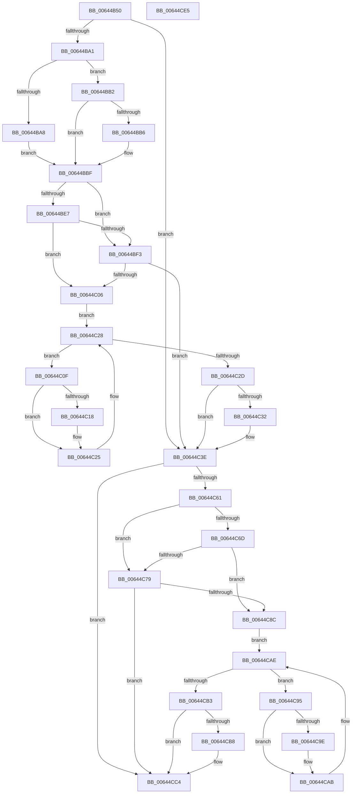

# DifZwOpenThreadTokenExWrapper

- RVA: `0x00644B50`–`0x00644CE6` (길이 `406` bytes)
- VA: `0x0000000140644B50`
- 실행 섹션: `.text`
- PDB 이름 있음: `예`; PDB Function 태그: `아니요`
- unwind 정보 RVA: `0x000D2BBC`
- 디코드: `116`개 명령, `406/406` bytes 표시
- 미해석 바이트: `0` (있으면 어셈블리에 `.byte`로 보존)

> 이 문서는 커널 이미지의 기계어와 PDB 기호를 분석해 생성했습니다. 4번과 5번은 함수 원형과 자료형을 바이너리 사용 방식에서 추정한 C 해석이며 원본 소스 복구 결과는 아닙니다.

## 1. Dependencies

- 직접 호출 지점: **9**; 고유 호출 대상: **6**
- 직접 호출자로 확인된 함수: **0**
- RIP 상대 이미지 참조: **3**

### Outgoing calls
- `0x00644B90` → [DifGetAPIThunkContextById](../49/DifGetAPIThunkContextById_function_00495A34.md) (function, `0x00495A34`)
- `0x00644BB6` → [DifGetReturnAddressForWrappers](../4D/DifGetReturnAddressForWrappers_function_004D3C08.md) (function, `0x004D3C08`)
- `0x00644BFA` → [ExAcquireRundownProtection](../21/ExAcquireRundownProtection_function_00216620.md) (function, `0x00216620`)
- `0x00644C20` → [guard_dispatch_icall](../6B/guard_dispatch_icall_function_006BAAD0.md) (function, `0x006BAAD0`)
- `0x00644C39` → [ExReleaseRundownProtection](../34/ExReleaseRundownProtection_function_00349E80.md) (function, `0x00349E80`)
- `0x00644C54` → [ZwOpenThreadTokenEx](../6A/ZwOpenThreadTokenEx_function_006AD6B0.md) (function, `0x006AD6B0`)
- `0x00644C80` → [ExAcquireRundownProtection](../21/ExAcquireRundownProtection_function_00216620.md) (function, `0x00216620`)
- `0x00644CA6` → [guard_dispatch_icall](../6B/guard_dispatch_icall_function_006BAAD0.md) (function, `0x006BAAD0`)
- `0x00644CBF` → [ExReleaseRundownProtection](../34/ExReleaseRundownProtection_function_00349E80.md) (function, `0x00349E80`)

### Direct callers
- 이 함수 시작 RVA로 연결되는 직접 call은 확인되지 않았습니다. 간접 호출은 완전히 역산할 수 없습니다.

### Static image references
- `0x00644BC6` → RVA `0x00F048B8` (`.data`; read)
- `0x00644BE7` → RVA `0x00F04980` (`.data`; read)
- `0x00644BF3` → RVA `0x00F03E80` (`.data`; read)

## 2. Other-region calls and transfers

- 다른 실행 섹션으로 향하는 call: **0**
- 별도 외부 분기/꼬리 이동을 확인하지 못했습니다.

## 3. Assembly (complete function range)

```asm
00644B50  48 8B C4                        mov rax, rsp
00644B53  48 89 58 10                     mov qword ptr [rax + 0x10], rbx
00644B57  48 89 70 18                     mov qword ptr [rax + 0x18], rsi
00644B5B  48 89 78 20                     mov qword ptr [rax + 0x20], rdi
00644B5F  48 89 48 08                     mov qword ptr [rax + 8], rcx
00644B63  55                              push rbp
00644B64  41 54                           push r12
00644B66  41 55                           push r13
00644B68  41 56                           push r14
00644B6A  41 57                           push r15
00644B6C  48 8B EC                        mov rbp, rsp
00644B6F  48 83 EC 60                     sub rsp, 0x60
00644B73  0F 57 C0                        xorps xmm0, xmm0
00644B76  B9 47 00 00 00                  mov ecx, 0x47
00644B7B  0F 11 45 D0                     movups xmmword ptr [rbp - 0x30], xmm0
00644B7F  45 8B F9                        mov r15d, r9d
00644B82  45 8A E0                        mov r12b, r8b
00644B85  0F 11 45 E0                     movups xmmword ptr [rbp - 0x20], xmm0
00644B89  44 8B EA                        mov r13d, edx
00644B8C  0F 11 45 F0                     movups xmmword ptr [rbp - 0x10], xmm0
00644B90  E8 9F 0E E5 FF                  call 0x140495a34
00644B95  48 8B F0                        mov rsi, rax
00644B98  48 85 C0                        test rax, rax
00644B9B  0F 84 9D 00 00 00               je 0x140644c3e
00644BA1  8B 40 0C                        mov eax, dword ptr [rax + 0xc]
00644BA4  A8 18                           test al, 0x18
00644BA6  74 0A                           je 0x140644bb2
00644BA8  48 8B 4D 28                     mov rcx, qword ptr [rbp + 0x28]
00644BAC  48 89 4D D0                     mov qword ptr [rbp - 0x30], rcx
00644BB0  EB 0D                           jmp 0x140644bbf
00644BB2  A8 04                           test al, 4
00644BB4  74 09                           je 0x140644bbf
00644BB6  E8 4D F0 E8 FF                  call 0x1404d3c08
00644BBB  48 89 45 D0                     mov qword ptr [rbp - 0x30], rax
00644BBF  48 8B 45 30                     mov rax, qword ptr [rbp + 0x30]
00644BC3  45 32 F6                        xor r14b, r14b
00644BC6  44 38 35 EB FC 8B 00            cmp byte ptr [rip + 0x8bfceb], r14b
00644BCD  48 89 45 F0                     mov qword ptr [rbp - 0x10], rax
00644BD1  48 8B 45 50                     mov rax, qword ptr [rbp + 0x50]
00644BD5  48 89 45 D8                     mov qword ptr [rbp - 0x28], rax
00644BD9  44 89 6D E8                     mov dword ptr [rbp - 0x18], r13d
00644BDD  44 88 65 E4                     mov byte ptr [rbp - 0x1c], r12b
00644BE1  44 89 7D E0                     mov dword ptr [rbp - 0x20], r15d
00644BE5  75 0C                           jne 0x140644bf3
00644BE7  F7 05 8F FD 8B 00 00 08 00 00   test dword ptr [rip + 0x8bfd8f], 0x800
00644BF1  74 13                           je 0x140644c06
00644BF3  48 8D 0D 86 F2 8B 00            lea rcx, [rip + 0x8bf286]
00644BFA  E8 21 1A BD FF                  call 0x140216620
00644BFF  44 8A F0                        mov r14b, al
00644C02  84 C0                           test al, al
00644C04  74 38                           je 0x140644c3e
00644C06  48 8D 7E 20                     lea rdi, [rsi + 0x20]
00644C0A  48 8B 1F                        mov rbx, qword ptr [rdi]
00644C0D  EB 19                           jmp 0x140644c28
00644C0F  48 8D 43 F0                     lea rax, [rbx - 0x10]
00644C13  48 85 C0                        test rax, rax
00644C16  74 0D                           je 0x140644c25
00644C18  48 8B 40 08                     mov rax, qword ptr [rax + 8]
00644C1C  48 8D 4D D0                     lea rcx, [rbp - 0x30]
00644C20  E8 AB 5E 07 00                  call 0x1406baad0
00644C25  48 8B 1B                        mov rbx, qword ptr [rbx]
00644C28  48 3B DF                        cmp rbx, rdi
00644C2B  75 E2                           jne 0x140644c0f
00644C2D  45 84 F6                        test r14b, r14b
00644C30  74 0C                           je 0x140644c3e
00644C32  48 8D 0D 47 F2 8B 00            lea rcx, [rip + 0x8bf247]
00644C39  E8 42 52 D0 FF                  call 0x140349e80
00644C3E  48 8B 45 50                     mov rax, qword ptr [rbp + 0x50]
00644C42  45 8B CF                        mov r9d, r15d
00644C45  48 8B 4D 30                     mov rcx, qword ptr [rbp + 0x30]
00644C49  45 8A C4                        mov r8b, r12b
00644C4C  41 8B D5                        mov edx, r13d
00644C4F  48 89 44 24 20                  mov qword ptr [rsp + 0x20], rax
00644C54  E8 57 8A 06 00                  call 0x1406ad6b0
00644C59  89 45 F8                        mov dword ptr [rbp - 8], eax
00644C5C  48 85 F6                        test rsi, rsi
00644C5F  74 63                           je 0x140644cc4
00644C61  40 32 FF                        xor dil, dil
00644C64  40 38 3D 4D FC 8B 00            cmp byte ptr [rip + 0x8bfc4d], dil
00644C6B  75 0C                           jne 0x140644c79
00644C6D  F7 05 09 FD 8B 00 00 08 00 00   test dword ptr [rip + 0x8bfd09], 0x800
00644C77  74 13                           je 0x140644c8c
00644C79  48 8D 0D 00 F2 8B 00            lea rcx, [rip + 0x8bf200]
00644C80  E8 9B 19 BD FF                  call 0x140216620
00644C85  40 8A F8                        mov dil, al
00644C88  84 C0                           test al, al
00644C8A  74 38                           je 0x140644cc4
00644C8C  48 83 C6 30                     add rsi, 0x30
00644C90  48 8B 1E                        mov rbx, qword ptr [rsi]
00644C93  EB 19                           jmp 0x140644cae
00644C95  48 8D 43 F0                     lea rax, [rbx - 0x10]
00644C99  48 85 C0                        test rax, rax
00644C9C  74 0D                           je 0x140644cab
00644C9E  48 8B 40 08                     mov rax, qword ptr [rax + 8]
00644CA2  48 8D 4D D0                     lea rcx, [rbp - 0x30]
00644CA6  E8 25 5E 07 00                  call 0x1406baad0
00644CAB  48 8B 1B                        mov rbx, qword ptr [rbx]
00644CAE  48 3B DE                        cmp rbx, rsi
00644CB1  75 E2                           jne 0x140644c95
00644CB3  40 84 FF                        test dil, dil
00644CB6  74 0C                           je 0x140644cc4
00644CB8  48 8D 0D C1 F1 8B 00            lea rcx, [rip + 0x8bf1c1]
00644CBF  E8 BC 51 D0 FF                  call 0x140349e80
00644CC4  8B 45 F8                        mov eax, dword ptr [rbp - 8]
00644CC7  4C 8D 5C 24 60                  lea r11, [rsp + 0x60]
00644CCC  49 8B 5B 38                     mov rbx, qword ptr [r11 + 0x38]
00644CD0  49 8B 73 40                     mov rsi, qword ptr [r11 + 0x40]
00644CD4  49 8B 7B 48                     mov rdi, qword ptr [r11 + 0x48]
00644CD8  49 8B E3                        mov rsp, r11
00644CDB  41 5F                           pop r15
00644CDD  41 5E                           pop r14
00644CDF  41 5D                           pop r13
00644CE1  41 5C                           pop r12
00644CE3  5D                              pop rbp
00644CE4  C3                              ret
00644CE5  CC                              int3
```

## 4. C-style interpretation (structured pseudocode)

```c
__int64 __fastcall DifZwOpenThreadTokenExWrapper(__int64 a1, int a2, unsigned __int8 a3, int a4, __int64 a5)
{
    __int64 result;
    __int64 v_r14;
    __int64 v_rdi;
    __int64 v_rsi;
    __int64 v_rsp;
    unsigned __int64 v_stack_m28;
    unsigned int v_stack_m30;
    unsigned __int64 v_stack_m38;
    unsigned int v_stack_m40;
    unsigned __int8 v_stack_m44;
    unsigned __int64 v_stack_m48;
    unsigned __int64 v_stack_m50;
    unsigned __int64 v_stack_m58;
    unsigned __int64 v_stack_m68;
    unsigned __int64 v_stack_p0;
    unsigned __int64 v_stack_p8;

    *(unsigned __int64 *)(v_rsp + 16) = v_rbx;
    *(unsigned __int64 *)(v_rsp + 24) = v_rsi;
    *(unsigned __int64 *)(v_rsp + 32) = v_rdi;
    *(unsigned __int64 *)(v_rsp + 8) = a1;
    v_rsp = (v_rsp) - (96);
    v_stack_m58 = v_xmm0;
    v_stack_m48 = v_xmm0;
    v_stack_m38 = v_xmm0;
    result = DifGetAPIThunkContextById(71, a2, a3, a4);
    if (result == 0) goto loc_00644C3E;
    if ((((unsigned __int8)((unsigned int)(*(unsigned int *)(result + 12)))) & (24)) == 0) goto loc_00644BB2;
    v_stack_m58 = v_stack_p0;
    goto loc_00644BBF;
loc_00644BB2:
    result = (unsigned int)(*(unsigned int *)(result + 12));
    if ((((unsigned __int8)((unsigned int)(*(unsigned int *)(result + 12)))) & (4)) != 0) {
        result = DifGetReturnAddressForWrappers(v_stack_p0, a2, a3, a4);
        v_stack_m58 = result;
    }
    v_r14 = 0;
    v_stack_m38 = v_stack_p8;
    v_stack_m50 = a5;
    v_stack_m40 = (unsigned int)((unsigned int)(a2));
    v_stack_m44 = a3;
    v_stack_m48 = (unsigned int)((unsigned int)(a4));
    if ((*(unsigned __int8 *)(v_rip + 9174251)) != 0) goto loc_00644BF3;
    if (((*(unsigned int *)(v_rip + 9174415)) & (0x800ULL)) == 0) goto loc_00644C06;
loc_00644BF3:
    result = ExAcquireRundownProtection(v_rip + 9171590, a2, a3, a4);
    if ((unsigned __int8)(result) == 0) goto loc_00644C3E;
loc_00644C06:
    goto loc_00644C28;
loc_00644C0F:
    result = *(unsigned __int64 *)(result + 32) - 16;
    if (*(unsigned __int64 *)(result + 32) - 16 != 0) {
        result = *(unsigned __int64 *)(*(unsigned __int64 *)(result + 32) - 16 + 8);
        a1 = v_stack_m58;
        result = guard_dispatch_icall(a1, a2, a3, a4);
    }
loc_00644C28:
    if ((*(unsigned __int64 *)(*(unsigned __int64 *)(result + 32))) != (result + 32)) goto loc_00644C0F;
    if ((unsigned __int8)((unsigned __int8)(result)) != 0) {
        a1 = v_rip + 9171527;
        result = ExReleaseRundownProtection(a1, a2, a3, a4);
    }
    v_stack_m68 = a5;
    result = ZwOpenThreadTokenEx(v_stack_p8, (unsigned int)((unsigned int)((unsigned int)(a2))), a3, (unsigned int)((unsigned int)((unsigned int)(a4))));
    v_stack_m30 = (unsigned int)(result);
    if (result == 0) goto loc_00644CC4;
    v_rdi = 0;
    if ((*(unsigned __int8 *)(v_rip + 9174093)) != 0) goto loc_00644C79;
    if (((*(unsigned int *)(v_rip + 9174281)) & (0x800ULL)) == 0) goto loc_00644C8C;
loc_00644C79:
    result = ExAcquireRundownProtection(v_rip + 9171456, (unsigned int)((unsigned int)((unsigned int)(a2))), a3, (unsigned int)((unsigned int)((unsigned int)(a4))));
    if ((unsigned __int8)(result) == 0) goto loc_00644CC4;
loc_00644C8C:
    v_rsi = (result) + (48);
    goto loc_00644CAE;
loc_00644C95:
    result = *(unsigned __int64 *)(v_rsi) - 16;
    if (*(unsigned __int64 *)(v_rsi) - 16 != 0) {
        result = *(unsigned __int64 *)(*(unsigned __int64 *)(v_rsi) - 16 + 8);
        a1 = v_stack_m58;
        result = guard_dispatch_icall(a1, (unsigned int)((unsigned int)((unsigned int)(a2))), a3, (unsigned int)((unsigned int)((unsigned int)(a4))));
    }
loc_00644CAE:
    if ((*(unsigned __int64 *)(*(unsigned __int64 *)(v_rsi))) != v_rsi) goto loc_00644C95;
    if ((unsigned __int8)((unsigned __int8)(result)) != 0) {
        a1 = v_rip + 9171393;
        result = ExReleaseRundownProtection(a1, (unsigned int)((unsigned int)((unsigned int)(a2))), a3, (unsigned int)((unsigned int)((unsigned int)(a4))));
    }
    return (unsigned int)(v_stack_m30);
}
```

## 5. (Beta) C Style

```c
int64_t DifZwOpenThreadTokenExWrapper(int64_t Arg1, int32_t Arg2, uint8_t Arg3, int32_t Arg4, int64_t Arg5)
{
    int64_t result;
    int64_t local_r14;
    int64_t local_rdi;
    int64_t local_rsi;
    int64_t local_rsp;
    uint64_t v_stack_m28;
    uint32_t v_stack_m30;
    uint64_t v_stack_m38;
    uint32_t v_stack_m40;
    uint8_t v_stack_m44;
    uint64_t v_stack_m48;
    uint64_t v_stack_m50;
    uint64_t v_stack_m58;
    uint64_t v_stack_m68;
    uint64_t v_stack_p0;
    uint64_t v_stack_p8;

    *(uint64_t *)(local_rsp + 0x10) = local_rbx;
    *(uint64_t *)(local_rsp + 0x18) = local_rsi;
    *(uint64_t *)(local_rsp + 0x20) = local_rdi;
    *(uint64_t *)(local_rsp + 0x8) = Arg1;
    local_rsp = (local_rsp) - (96);
    v_stack_m58 = v_xmm0;
    v_stack_m48 = v_xmm0;
    v_stack_m38 = v_xmm0;
    result = DifGetAPIThunkContextById(71, Arg2, Arg3, Arg4);
    if (result == 0) goto loc_00644C3E;
    if ((((uint8_t)((uint32_t)(*(uint32_t *)(result + 0xC)))) & (24)) == 0) goto loc_00644BB2;
    v_stack_m58 = v_stack_p0;
    goto loc_00644BBF;
loc_00644BB2:
    result = (uint32_t)(*(uint32_t *)(result + 0xC));
    if ((((uint8_t)((uint32_t)(*(uint32_t *)(result + 0xC)))) & (4)) != 0) {
        result = DifGetReturnAddressForWrappers(v_stack_p0, Arg2, Arg3, Arg4);
        v_stack_m58 = result;
    }
    local_r14 = 0;
    v_stack_m38 = v_stack_p8;
    v_stack_m50 = Arg5;
    v_stack_m40 = (uint32_t)((uint32_t)(Arg2));
    v_stack_m44 = Arg3;
    v_stack_m48 = (uint32_t)((uint32_t)(Arg4));
    if ((*(uint8_t *)(v_rip + 0x8BFCEB)) != 0) goto loc_00644BF3;
    if (((*(uint32_t *)(v_rip + 0x8BFD8F)) & (0x800ULL)) == 0) goto loc_00644C06;
loc_00644BF3:
    result = ExAcquireRundownProtection(v_rip + 9171590, Arg2, Arg3, Arg4);
    if ((uint8_t)(result) == 0) goto loc_00644C3E;
loc_00644C06:
    goto loc_00644C28;
loc_00644C0F:
    result = *(uint64_t *)(result + 0x20) - 16;
    if (*(uint64_t *)(result + 0x20) - 16 != 0) {
        result = *(uint64_t *)(*(uint64_t *)(result + 0x20) - 0x10 + 0x8);
        Arg1 = v_stack_m58;
        result = guard_dispatch_icall(Arg1, Arg2, Arg3, Arg4);
    }
loc_00644C28:
    if ((*(uint64_t *)(*(uint64_t *)(result + 0x20))) != (result + 32)) goto loc_00644C0F;
    if ((uint8_t)((uint8_t)(result)) != 0) {
        Arg1 = v_rip + 9171527;
        result = ExReleaseRundownProtection(Arg1, Arg2, Arg3, Arg4);
    }
    v_stack_m68 = Arg5;
    result = ZwOpenThreadTokenEx(v_stack_p8, (uint32_t)((uint32_t)((uint32_t)(Arg2))), Arg3, (uint32_t)((uint32_t)((uint32_t)(Arg4))));
    v_stack_m30 = (uint32_t)(result);
    if (result == 0) goto loc_00644CC4;
    local_rdi = 0;
    if ((*(uint8_t *)(v_rip + 0x8BFC4D)) != 0) goto loc_00644C79;
    if (((*(uint32_t *)(v_rip + 0x8BFD09)) & (0x800ULL)) == 0) goto loc_00644C8C;
loc_00644C79:
    result = ExAcquireRundownProtection(v_rip + 9171456, (uint32_t)((uint32_t)((uint32_t)(Arg2))), Arg3, (uint32_t)((uint32_t)((uint32_t)(Arg4))));
    if ((uint8_t)(result) == 0) goto loc_00644CC4;
loc_00644C8C:
    local_rsi = (result) + (48);
    goto loc_00644CAE;
loc_00644C95:
    result = *(uint64_t *)(local_rsi) - 16;
    if (*(uint64_t *)(local_rsi) - 16 != 0) {
        result = *(uint64_t *)(*(uint64_t *)(local_rsi) - 0x10 + 0x8);
        Arg1 = v_stack_m58;
        result = guard_dispatch_icall(Arg1, (uint32_t)((uint32_t)((uint32_t)(Arg2))), Arg3, (uint32_t)((uint32_t)((uint32_t)(Arg4))));
    }
loc_00644CAE:
    if ((*(uint64_t *)(*(uint64_t *)(local_rsi))) != local_rsi) goto loc_00644C95;
    if ((uint8_t)((uint8_t)(result)) != 0) {
        Arg1 = v_rip + 9171393;
        result = ExReleaseRundownProtection(Arg1, (uint32_t)((uint32_t)((uint32_t)(Arg2))), Arg3, (uint32_t)((uint32_t)((uint32_t)(Arg4))));
    }
    return (uint32_t)(v_stack_m30);
}
```

## 6. Execution-region graph

[열기: 2D/3D 그래프와 함수 탐색 컨트롤 패널](../../../control-panel.html?section=text&rva=0x00644B50&view=graph)

- 2D 그래프는 위에서 아래로 흐르고, 3D 그래프는 빈 공간을 드래그해 회전합니다. Shift+드래그는 이동, 휠은 확대·축소, 함수 노드 선택은 대상 보고서 이동입니다.

### Static fallback


