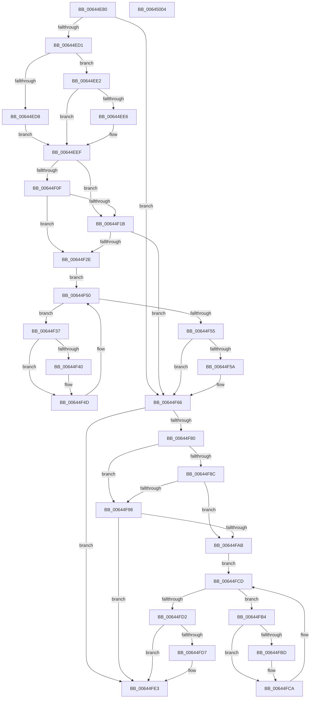

# DifZwOpenThreadWrapper

- RVA: `0x00644E80`–`0x00645005` (길이 `389` bytes)
- VA: `0x0000000140644E80`
- 실행 섹션: `.text`
- PDB 이름 있음: `예`; PDB Function 태그: `아니요`
- unwind 정보 RVA: `0x000D2B7C`
- 디코드: `112`개 명령, `389/389` bytes 표시
- 미해석 바이트: `0` (있으면 어셈블리에 `.byte`로 보존)

> 이 문서는 커널 이미지의 기계어와 PDB 기호를 분석해 생성했습니다. 4번과 5번은 함수 원형과 자료형을 바이너리 사용 방식에서 추정한 C 해석이며 원본 소스 복구 결과는 아닙니다.

## 1. Dependencies

- 직접 호출 지점: **9**; 고유 호출 대상: **6**
- 직접 호출자로 확인된 함수: **0**
- RIP 상대 이미지 참조: **3**

### Outgoing calls
- `0x00644EC0` → [DifGetAPIThunkContextById](../49/DifGetAPIThunkContextById_function_00495A34.md) (function, `0x00495A34`)
- `0x00644EE6` → [DifGetReturnAddressForWrappers](../4D/DifGetReturnAddressForWrappers_function_004D3C08.md) (function, `0x004D3C08`)
- `0x00644F22` → [ExAcquireRundownProtection](../21/ExAcquireRundownProtection_function_00216620.md) (function, `0x00216620`)
- `0x00644F48` → [guard_dispatch_icall](../6B/guard_dispatch_icall_function_006BAAD0.md) (function, `0x006BAAD0`)
- `0x00644F61` → [ExReleaseRundownProtection](../34/ExReleaseRundownProtection_function_00349E80.md) (function, `0x00349E80`)
- `0x00644F73` → [ZwOpenThread](../6A/ZwOpenThread_function_006AF810.md) (function, `0x006AF810`)
- `0x00644F9F` → [ExAcquireRundownProtection](../21/ExAcquireRundownProtection_function_00216620.md) (function, `0x00216620`)
- `0x00644FC5` → [guard_dispatch_icall](../6B/guard_dispatch_icall_function_006BAAD0.md) (function, `0x006BAAD0`)
- `0x00644FDE` → [ExReleaseRundownProtection](../34/ExReleaseRundownProtection_function_00349E80.md) (function, `0x00349E80`)

### Direct callers
- 이 함수 시작 RVA로 연결되는 직접 call은 확인되지 않았습니다. 간접 호출은 완전히 역산할 수 없습니다.

### Static image references
- `0x00644EF6` → RVA `0x00F048B8` (`.data`; read)
- `0x00644F0F` → RVA `0x00F04980` (`.data`; read)
- `0x00644F1B` → RVA `0x00F03E80` (`.data`; read)

## 2. Other-region calls and transfers

- 다른 실행 섹션으로 향하는 call: **0**
- 별도 외부 분기/꼬리 이동을 확인하지 못했습니다.

## 3. Assembly (complete function range)

```asm
00644E80  48 8B C4                        mov rax, rsp
00644E83  48 89 58 10                     mov qword ptr [rax + 0x10], rbx
00644E87  48 89 70 18                     mov qword ptr [rax + 0x18], rsi
00644E8B  48 89 78 20                     mov qword ptr [rax + 0x20], rdi
00644E8F  48 89 48 08                     mov qword ptr [rax + 8], rcx
00644E93  55                              push rbp
00644E94  41 54                           push r12
00644E96  41 55                           push r13
00644E98  41 56                           push r14
00644E9A  41 57                           push r15
00644E9C  48 8B EC                        mov rbp, rsp
00644E9F  48 83 EC 50                     sub rsp, 0x50
00644EA3  0F 57 C0                        xorps xmm0, xmm0
00644EA6  B9 49 00 00 00                  mov ecx, 0x49
00644EAB  0F 11 45 D0                     movups xmmword ptr [rbp - 0x30], xmm0
00644EAF  4D 8B F9                        mov r15, r9
00644EB2  4D 8B E0                        mov r12, r8
00644EB5  0F 11 45 E0                     movups xmmword ptr [rbp - 0x20], xmm0
00644EB9  44 8B EA                        mov r13d, edx
00644EBC  0F 11 45 F0                     movups xmmword ptr [rbp - 0x10], xmm0
00644EC0  E8 6F 0B E5 FF                  call 0x140495a34
00644EC5  48 8B F0                        mov rsi, rax
00644EC8  48 85 C0                        test rax, rax
00644ECB  0F 84 95 00 00 00               je 0x140644f66
00644ED1  8B 40 0C                        mov eax, dword ptr [rax + 0xc]
00644ED4  A8 18                           test al, 0x18
00644ED6  74 0A                           je 0x140644ee2
00644ED8  48 8B 4D 28                     mov rcx, qword ptr [rbp + 0x28]
00644EDC  48 89 4D D0                     mov qword ptr [rbp - 0x30], rcx
00644EE0  EB 0D                           jmp 0x140644eef
00644EE2  A8 04                           test al, 4
00644EE4  74 09                           je 0x140644eef
00644EE6  E8 1D ED E8 FF                  call 0x1404d3c08
00644EEB  48 89 45 D0                     mov qword ptr [rbp - 0x30], rax
00644EEF  48 8B 45 30                     mov rax, qword ptr [rbp + 0x30]
00644EF3  45 32 F6                        xor r14b, r14b
00644EF6  44 38 35 BB F9 8B 00            cmp byte ptr [rip + 0x8bf9bb], r14b
00644EFD  48 89 45 F0                     mov qword ptr [rbp - 0x10], rax
00644F01  44 89 6D E8                     mov dword ptr [rbp - 0x18], r13d
00644F05  4C 89 65 E0                     mov qword ptr [rbp - 0x20], r12
00644F09  4C 89 7D D8                     mov qword ptr [rbp - 0x28], r15
00644F0D  75 0C                           jne 0x140644f1b
00644F0F  F7 05 67 FA 8B 00 00 08 00 00   test dword ptr [rip + 0x8bfa67], 0x800
00644F19  74 13                           je 0x140644f2e
00644F1B  48 8D 0D 5E EF 8B 00            lea rcx, [rip + 0x8bef5e]
00644F22  E8 F9 16 BD FF                  call 0x140216620
00644F27  44 8A F0                        mov r14b, al
00644F2A  84 C0                           test al, al
00644F2C  74 38                           je 0x140644f66
00644F2E  48 8D 7E 20                     lea rdi, [rsi + 0x20]
00644F32  48 8B 1F                        mov rbx, qword ptr [rdi]
00644F35  EB 19                           jmp 0x140644f50
00644F37  48 8D 43 F0                     lea rax, [rbx - 0x10]
00644F3B  48 85 C0                        test rax, rax
00644F3E  74 0D                           je 0x140644f4d
00644F40  48 8B 40 08                     mov rax, qword ptr [rax + 8]
00644F44  48 8D 4D D0                     lea rcx, [rbp - 0x30]
00644F48  E8 83 5B 07 00                  call 0x1406baad0
00644F4D  48 8B 1B                        mov rbx, qword ptr [rbx]
00644F50  48 3B DF                        cmp rbx, rdi
00644F53  75 E2                           jne 0x140644f37
00644F55  45 84 F6                        test r14b, r14b
00644F58  74 0C                           je 0x140644f66
00644F5A  48 8D 0D 1F EF 8B 00            lea rcx, [rip + 0x8bef1f]
00644F61  E8 1A 4F D0 FF                  call 0x140349e80
00644F66  48 8B 4D 30                     mov rcx, qword ptr [rbp + 0x30]
00644F6A  4D 8B CF                        mov r9, r15
00644F6D  4D 8B C4                        mov r8, r12
00644F70  41 8B D5                        mov edx, r13d
00644F73  E8 98 A8 06 00                  call 0x1406af810
00644F78  89 45 F8                        mov dword ptr [rbp - 8], eax
00644F7B  48 85 F6                        test rsi, rsi
00644F7E  74 63                           je 0x140644fe3
00644F80  40 32 FF                        xor dil, dil
00644F83  40 38 3D 2E F9 8B 00            cmp byte ptr [rip + 0x8bf92e], dil
00644F8A  75 0C                           jne 0x140644f98
00644F8C  F7 05 EA F9 8B 00 00 08 00 00   test dword ptr [rip + 0x8bf9ea], 0x800
00644F96  74 13                           je 0x140644fab
00644F98  48 8D 0D E1 EE 8B 00            lea rcx, [rip + 0x8beee1]
00644F9F  E8 7C 16 BD FF                  call 0x140216620
00644FA4  40 8A F8                        mov dil, al
00644FA7  84 C0                           test al, al
00644FA9  74 38                           je 0x140644fe3
00644FAB  48 83 C6 30                     add rsi, 0x30
00644FAF  48 8B 1E                        mov rbx, qword ptr [rsi]
00644FB2  EB 19                           jmp 0x140644fcd
00644FB4  48 8D 43 F0                     lea rax, [rbx - 0x10]
00644FB8  48 85 C0                        test rax, rax
00644FBB  74 0D                           je 0x140644fca
00644FBD  48 8B 40 08                     mov rax, qword ptr [rax + 8]
00644FC1  48 8D 4D D0                     lea rcx, [rbp - 0x30]
00644FC5  E8 06 5B 07 00                  call 0x1406baad0
00644FCA  48 8B 1B                        mov rbx, qword ptr [rbx]
00644FCD  48 3B DE                        cmp rbx, rsi
00644FD0  75 E2                           jne 0x140644fb4
00644FD2  40 84 FF                        test dil, dil
00644FD5  74 0C                           je 0x140644fe3
00644FD7  48 8D 0D A2 EE 8B 00            lea rcx, [rip + 0x8beea2]
00644FDE  E8 9D 4E D0 FF                  call 0x140349e80
00644FE3  8B 45 F8                        mov eax, dword ptr [rbp - 8]
00644FE6  4C 8D 5C 24 50                  lea r11, [rsp + 0x50]
00644FEB  49 8B 5B 38                     mov rbx, qword ptr [r11 + 0x38]
00644FEF  49 8B 73 40                     mov rsi, qword ptr [r11 + 0x40]
00644FF3  49 8B 7B 48                     mov rdi, qword ptr [r11 + 0x48]
00644FF7  49 8B E3                        mov rsp, r11
00644FFA  41 5F                           pop r15
00644FFC  41 5E                           pop r14
00644FFE  41 5D                           pop r13
00645000  41 5C                           pop r12
00645002  5D                              pop rbp
00645003  C3                              ret
00645004  CC                              int3
```

## 4. C-style interpretation (structured pseudocode)

```c
__int64 __fastcall DifZwOpenThreadWrapper(__int64 a1, int a2, __int64 a3, __int64 a4)
{
    __int64 result;
    __int64 v_r14;
    __int64 v_rdi;
    __int64 v_rsi;
    __int64 v_rsp;
    unsigned __int64 v_stack_m28;
    unsigned int v_stack_m30;
    unsigned __int64 v_stack_m38;
    unsigned int v_stack_m40;
    unsigned __int64 v_stack_m48;
    unsigned __int64 v_stack_m50;
    unsigned __int64 v_stack_m58;
    unsigned __int64 v_stack_p0;
    unsigned __int64 v_stack_p8;

    *(unsigned __int64 *)(v_rsp + 16) = v_rbx;
    *(unsigned __int64 *)(v_rsp + 24) = v_rsi;
    *(unsigned __int64 *)(v_rsp + 32) = v_rdi;
    *(unsigned __int64 *)(v_rsp + 8) = a1;
    v_rsp = (v_rsp) - (80);
    v_stack_m58 = v_xmm0;
    v_stack_m48 = v_xmm0;
    v_stack_m38 = v_xmm0;
    result = DifGetAPIThunkContextById(73, a2, a3, a4);
    if (result == 0) goto loc_00644F66;
    if ((((unsigned __int8)((unsigned int)(*(unsigned int *)(result + 12)))) & (24)) == 0) goto loc_00644EE2;
    v_stack_m58 = v_stack_p0;
    goto loc_00644EEF;
loc_00644EE2:
    result = (unsigned int)(*(unsigned int *)(result + 12));
    if ((((unsigned __int8)((unsigned int)(*(unsigned int *)(result + 12)))) & (4)) != 0) {
        result = DifGetReturnAddressForWrappers(v_stack_p0, a2, a3, a4);
        v_stack_m58 = result;
    }
    v_r14 = 0;
    v_stack_m38 = v_stack_p8;
    v_stack_m40 = (unsigned int)((unsigned int)(a2));
    v_stack_m48 = a3;
    v_stack_m50 = a4;
    if ((*(unsigned __int8 *)(v_rip + 9173435)) != 0) goto loc_00644F1B;
    if (((*(unsigned int *)(v_rip + 9173607)) & (0x800ULL)) == 0) goto loc_00644F2E;
loc_00644F1B:
    result = ExAcquireRundownProtection(v_rip + 9170782, a2, a3, a4);
    if ((unsigned __int8)(result) == 0) goto loc_00644F66;
loc_00644F2E:
    goto loc_00644F50;
loc_00644F37:
    result = *(unsigned __int64 *)(result + 32) - 16;
    if (*(unsigned __int64 *)(result + 32) - 16 != 0) {
        result = *(unsigned __int64 *)(*(unsigned __int64 *)(result + 32) - 16 + 8);
        a1 = v_stack_m58;
        result = guard_dispatch_icall(a1, a2, a3, a4);
    }
loc_00644F50:
    if ((*(unsigned __int64 *)(*(unsigned __int64 *)(result + 32))) != (result + 32)) goto loc_00644F37;
    if ((unsigned __int8)((unsigned __int8)(result)) != 0) {
        a1 = v_rip + 9170719;
        result = ExReleaseRundownProtection(a1, a2, a3, a4);
    }
    result = ZwOpenThread(v_stack_p8, (unsigned int)((unsigned int)((unsigned int)(a2))), a3, a4);
    v_stack_m30 = (unsigned int)(result);
    if (result == 0) goto loc_00644FE3;
    v_rdi = 0;
    if ((*(unsigned __int8 *)(v_rip + 9173294)) != 0) goto loc_00644F98;
    if (((*(unsigned int *)(v_rip + 9173482)) & (0x800ULL)) == 0) goto loc_00644FAB;
loc_00644F98:
    result = ExAcquireRundownProtection(v_rip + 9170657, (unsigned int)((unsigned int)((unsigned int)(a2))), a3, a4);
    if ((unsigned __int8)(result) == 0) goto loc_00644FE3;
loc_00644FAB:
    v_rsi = (result) + (48);
    goto loc_00644FCD;
loc_00644FB4:
    result = *(unsigned __int64 *)(v_rsi) - 16;
    if (*(unsigned __int64 *)(v_rsi) - 16 != 0) {
        result = *(unsigned __int64 *)(*(unsigned __int64 *)(v_rsi) - 16 + 8);
        a1 = v_stack_m58;
        result = guard_dispatch_icall(a1, (unsigned int)((unsigned int)((unsigned int)(a2))), a3, a4);
    }
loc_00644FCD:
    if ((*(unsigned __int64 *)(*(unsigned __int64 *)(v_rsi))) != v_rsi) goto loc_00644FB4;
    if ((unsigned __int8)((unsigned __int8)(result)) != 0) {
        a1 = v_rip + 9170594;
        result = ExReleaseRundownProtection(a1, (unsigned int)((unsigned int)((unsigned int)(a2))), a3, a4);
    }
    return (unsigned int)(v_stack_m30);
}
```

## 5. (Beta) C Style

```c
int64_t DifZwOpenThreadWrapper(int64_t Arg1, int32_t Arg2, int64_t Arg3, int64_t Arg4)
{
    int64_t result;
    int64_t local_r14;
    int64_t local_rdi;
    int64_t local_rsi;
    int64_t local_rsp;
    uint64_t v_stack_m28;
    uint32_t v_stack_m30;
    uint64_t v_stack_m38;
    uint32_t v_stack_m40;
    uint64_t v_stack_m48;
    uint64_t v_stack_m50;
    uint64_t v_stack_m58;
    uint64_t v_stack_p0;
    uint64_t v_stack_p8;

    *(uint64_t *)(local_rsp + 0x10) = local_rbx;
    *(uint64_t *)(local_rsp + 0x18) = local_rsi;
    *(uint64_t *)(local_rsp + 0x20) = local_rdi;
    *(uint64_t *)(local_rsp + 0x8) = Arg1;
    local_rsp = (local_rsp) - (80);
    v_stack_m58 = v_xmm0;
    v_stack_m48 = v_xmm0;
    v_stack_m38 = v_xmm0;
    result = DifGetAPIThunkContextById(73, Arg2, Arg3, Arg4);
    if (result == 0) goto loc_00644F66;
    if ((((uint8_t)((uint32_t)(*(uint32_t *)(result + 0xC)))) & (24)) == 0) goto loc_00644EE2;
    v_stack_m58 = v_stack_p0;
    goto loc_00644EEF;
loc_00644EE2:
    result = (uint32_t)(*(uint32_t *)(result + 0xC));
    if ((((uint8_t)((uint32_t)(*(uint32_t *)(result + 0xC)))) & (4)) != 0) {
        result = DifGetReturnAddressForWrappers(v_stack_p0, Arg2, Arg3, Arg4);
        v_stack_m58 = result;
    }
    local_r14 = 0;
    v_stack_m38 = v_stack_p8;
    v_stack_m40 = (uint32_t)((uint32_t)(Arg2));
    v_stack_m48 = Arg3;
    v_stack_m50 = Arg4;
    if ((*(uint8_t *)(v_rip + 0x8BF9BB)) != 0) goto loc_00644F1B;
    if (((*(uint32_t *)(v_rip + 0x8BFA67)) & (0x800ULL)) == 0) goto loc_00644F2E;
loc_00644F1B:
    result = ExAcquireRundownProtection(v_rip + 9170782, Arg2, Arg3, Arg4);
    if ((uint8_t)(result) == 0) goto loc_00644F66;
loc_00644F2E:
    goto loc_00644F50;
loc_00644F37:
    result = *(uint64_t *)(result + 0x20) - 16;
    if (*(uint64_t *)(result + 0x20) - 16 != 0) {
        result = *(uint64_t *)(*(uint64_t *)(result + 0x20) - 0x10 + 0x8);
        Arg1 = v_stack_m58;
        result = guard_dispatch_icall(Arg1, Arg2, Arg3, Arg4);
    }
loc_00644F50:
    if ((*(uint64_t *)(*(uint64_t *)(result + 0x20))) != (result + 32)) goto loc_00644F37;
    if ((uint8_t)((uint8_t)(result)) != 0) {
        Arg1 = v_rip + 9170719;
        result = ExReleaseRundownProtection(Arg1, Arg2, Arg3, Arg4);
    }
    result = ZwOpenThread(v_stack_p8, (uint32_t)((uint32_t)((uint32_t)(Arg2))), Arg3, Arg4);
    v_stack_m30 = (uint32_t)(result);
    if (result == 0) goto loc_00644FE3;
    local_rdi = 0;
    if ((*(uint8_t *)(v_rip + 0x8BF92E)) != 0) goto loc_00644F98;
    if (((*(uint32_t *)(v_rip + 0x8BF9EA)) & (0x800ULL)) == 0) goto loc_00644FAB;
loc_00644F98:
    result = ExAcquireRundownProtection(v_rip + 9170657, (uint32_t)((uint32_t)((uint32_t)(Arg2))), Arg3, Arg4);
    if ((uint8_t)(result) == 0) goto loc_00644FE3;
loc_00644FAB:
    local_rsi = (result) + (48);
    goto loc_00644FCD;
loc_00644FB4:
    result = *(uint64_t *)(local_rsi) - 16;
    if (*(uint64_t *)(local_rsi) - 16 != 0) {
        result = *(uint64_t *)(*(uint64_t *)(local_rsi) - 0x10 + 0x8);
        Arg1 = v_stack_m58;
        result = guard_dispatch_icall(Arg1, (uint32_t)((uint32_t)((uint32_t)(Arg2))), Arg3, Arg4);
    }
loc_00644FCD:
    if ((*(uint64_t *)(*(uint64_t *)(local_rsi))) != local_rsi) goto loc_00644FB4;
    if ((uint8_t)((uint8_t)(result)) != 0) {
        Arg1 = v_rip + 9170594;
        result = ExReleaseRundownProtection(Arg1, (uint32_t)((uint32_t)((uint32_t)(Arg2))), Arg3, Arg4);
    }
    return (uint32_t)(v_stack_m30);
}
```

## 6. Execution-region graph

[열기: 2D/3D 그래프와 함수 탐색 컨트롤 패널](../../../control-panel.html?section=text&rva=0x00644E80&view=graph)

- 2D 그래프는 위에서 아래로 흐르고, 3D 그래프는 빈 공간을 드래그해 회전합니다. Shift+드래그는 이동, 휠은 확대·축소, 함수 노드 선택은 대상 보고서 이동입니다.

### Static fallback


