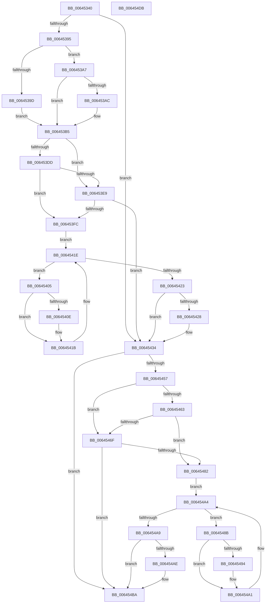

# DifZwOpenTransactionWrapper

- RVA: `0x00645340`–`0x006454DC` (길이 `412` bytes)
- VA: `0x0000000140645340`
- 실행 섹션: `.text`
- PDB 이름 있음: `예`; PDB Function 태그: `아니요`
- unwind 정보 RVA: `0x000BD780`
- 디코드: `118`개 명령, `412/412` bytes 표시
- 미해석 바이트: `0` (있으면 어셈블리에 `.byte`로 보존)

> 이 문서는 커널 이미지의 기계어와 PDB 기호를 분석해 생성했습니다. 4번과 5번은 함수 원형과 자료형을 바이너리 사용 방식에서 추정한 C 해석이며 원본 소스 복구 결과는 아닙니다.

## 1. Dependencies

- 직접 호출 지점: **9**; 고유 호출 대상: **6**
- 직접 호출자로 확인된 함수: **0**
- RIP 상대 이미지 참조: **3**

### Outgoing calls
- `0x00645384` → [DifGetAPIThunkContextById](../49/DifGetAPIThunkContextById_function_00495A34.md) (function, `0x00495A34`)
- `0x006453AC` → [DifGetReturnAddressForWrappers](../4D/DifGetReturnAddressForWrappers_function_004D3C08.md) (function, `0x004D3C08`)
- `0x006453F0` → [ExAcquireRundownProtection](../21/ExAcquireRundownProtection_function_00216620.md) (function, `0x00216620`)
- `0x00645416` → [guard_dispatch_icall](../6B/guard_dispatch_icall_function_006BAAD0.md) (function, `0x006BAAD0`)
- `0x0064542F` → [ExReleaseRundownProtection](../34/ExReleaseRundownProtection_function_00349E80.md) (function, `0x00349E80`)
- `0x0064544A` → [ZwOpenTransaction](../6A/ZwOpenTransaction_function_006AF850.md) (function, `0x006AF850`)
- `0x00645476` → [ExAcquireRundownProtection](../21/ExAcquireRundownProtection_function_00216620.md) (function, `0x00216620`)
- `0x0064549C` → [guard_dispatch_icall](../6B/guard_dispatch_icall_function_006BAAD0.md) (function, `0x006BAAD0`)
- `0x006454B5` → [ExReleaseRundownProtection](../34/ExReleaseRundownProtection_function_00349E80.md) (function, `0x00349E80`)

### Direct callers
- 이 함수 시작 RVA로 연결되는 직접 call은 확인되지 않았습니다. 간접 호출은 완전히 역산할 수 없습니다.

### Static image references
- `0x006453BC` → RVA `0x00F048B8` (`.data`; read)
- `0x006453DD` → RVA `0x00F04980` (`.data`; read)
- `0x006453E9` → RVA `0x00F03E80` (`.data`; read)

## 2. Other-region calls and transfers

- 다른 실행 섹션으로 향하는 call: **0**
- 별도 외부 분기/꼬리 이동을 확인하지 못했습니다.

## 3. Assembly (complete function range)

```asm
00645340  48 8B C4                        mov rax, rsp
00645343  48 89 58 10                     mov qword ptr [rax + 0x10], rbx
00645347  48 89 70 18                     mov qword ptr [rax + 0x18], rsi
0064534B  48 89 78 20                     mov qword ptr [rax + 0x20], rdi
0064534F  48 89 48 08                     mov qword ptr [rax + 8], rcx
00645353  55                              push rbp
00645354  41 54                           push r12
00645356  41 55                           push r13
00645358  41 56                           push r14
0064535A  41 57                           push r15
0064535C  48 8B EC                        mov rbp, rsp
0064535F  48 83 EC 70                     sub rsp, 0x70
00645363  33 C0                           xor eax, eax
00645365  0F 57 C0                        xorps xmm0, xmm0
00645368  4D 8B F9                        mov r15, r9
0064536B  48 89 45 F0                     mov qword ptr [rbp - 0x10], rax
0064536F  4D 8B E0                        mov r12, r8
00645372  44 8B EA                        mov r13d, edx
00645375  0F 11 45 C0                     movups xmmword ptr [rbp - 0x40], xmm0
00645379  8D 48 45                        lea ecx, [rax + 0x45]
0064537C  0F 11 45 D0                     movups xmmword ptr [rbp - 0x30], xmm0
00645380  0F 11 45 E0                     movups xmmword ptr [rbp - 0x20], xmm0
00645384  E8 AB 06 E5 FF                  call 0x140495a34
00645389  4C 8B F0                        mov r14, rax
0064538C  48 85 C0                        test rax, rax
0064538F  0F 84 9F 00 00 00               je 0x140645434
00645395  8B 48 0C                        mov ecx, dword ptr [rax + 0xc]
00645398  F6 C1 18                        test cl, 0x18
0064539B  74 0A                           je 0x1406453a7
0064539D  48 8B 4D 28                     mov rcx, qword ptr [rbp + 0x28]
006453A1  48 89 4D C0                     mov qword ptr [rbp - 0x40], rcx
006453A5  EB 0E                           jmp 0x1406453b5
006453A7  F6 C1 04                        test cl, 4
006453AA  74 09                           je 0x1406453b5
006453AC  E8 57 E8 E8 FF                  call 0x1404d3c08
006453B1  48 89 45 C0                     mov qword ptr [rbp - 0x40], rax
006453B5  48 8B 45 30                     mov rax, qword ptr [rbp + 0x30]
006453B9  40 32 F6                        xor sil, sil
006453BC  40 38 35 F5 F4 8B 00            cmp byte ptr [rip + 0x8bf4f5], sil
006453C3  48 89 45 E8                     mov qword ptr [rbp - 0x18], rax
006453C7  48 8B 45 50                     mov rax, qword ptr [rbp + 0x50]
006453CB  48 89 45 C8                     mov qword ptr [rbp - 0x38], rax
006453CF  44 89 6D E0                     mov dword ptr [rbp - 0x20], r13d
006453D3  4C 89 65 D8                     mov qword ptr [rbp - 0x28], r12
006453D7  4C 89 7D D0                     mov qword ptr [rbp - 0x30], r15
006453DB  75 0C                           jne 0x1406453e9
006453DD  F7 05 99 F5 8B 00 00 08 00 00   test dword ptr [rip + 0x8bf599], 0x800
006453E7  74 13                           je 0x1406453fc
006453E9  48 8D 0D 90 EA 8B 00            lea rcx, [rip + 0x8bea90]
006453F0  E8 2B 12 BD FF                  call 0x140216620
006453F5  40 8A F0                        mov sil, al
006453F8  84 C0                           test al, al
006453FA  74 38                           je 0x140645434
006453FC  49 8D 7E 20                     lea rdi, [r14 + 0x20]
00645400  48 8B 1F                        mov rbx, qword ptr [rdi]
00645403  EB 19                           jmp 0x14064541e
00645405  48 8D 43 F0                     lea rax, [rbx - 0x10]
00645409  48 85 C0                        test rax, rax
0064540C  74 0D                           je 0x14064541b
0064540E  48 8B 40 08                     mov rax, qword ptr [rax + 8]
00645412  48 8D 4D C0                     lea rcx, [rbp - 0x40]
00645416  E8 B5 56 07 00                  call 0x1406baad0
0064541B  48 8B 1B                        mov rbx, qword ptr [rbx]
0064541E  48 3B DF                        cmp rbx, rdi
00645421  75 E2                           jne 0x140645405
00645423  40 84 F6                        test sil, sil
00645426  74 0C                           je 0x140645434
00645428  48 8D 0D 51 EA 8B 00            lea rcx, [rip + 0x8bea51]
0064542F  E8 4C 4A D0 FF                  call 0x140349e80
00645434  48 8B 45 50                     mov rax, qword ptr [rbp + 0x50]
00645438  4D 8B CF                        mov r9, r15
0064543B  48 8B 4D 30                     mov rcx, qword ptr [rbp + 0x30]
0064543F  4D 8B C4                        mov r8, r12
00645442  41 8B D5                        mov edx, r13d
00645445  48 89 44 24 20                  mov qword ptr [rsp + 0x20], rax
0064544A  E8 01 A4 06 00                  call 0x1406af850
0064544F  89 45 F0                        mov dword ptr [rbp - 0x10], eax
00645452  4D 85 F6                        test r14, r14
00645455  74 63                           je 0x1406454ba
00645457  40 32 FF                        xor dil, dil
0064545A  40 38 3D 57 F4 8B 00            cmp byte ptr [rip + 0x8bf457], dil
00645461  75 0C                           jne 0x14064546f
00645463  F7 05 13 F5 8B 00 00 08 00 00   test dword ptr [rip + 0x8bf513], 0x800
0064546D  74 13                           je 0x140645482
0064546F  48 8D 0D 0A EA 8B 00            lea rcx, [rip + 0x8bea0a]
00645476  E8 A5 11 BD FF                  call 0x140216620
0064547B  40 8A F8                        mov dil, al
0064547E  84 C0                           test al, al
00645480  74 38                           je 0x1406454ba
00645482  49 8D 76 30                     lea rsi, [r14 + 0x30]
00645486  48 8B 1E                        mov rbx, qword ptr [rsi]
00645489  EB 19                           jmp 0x1406454a4
0064548B  48 8D 43 F0                     lea rax, [rbx - 0x10]
0064548F  48 85 C0                        test rax, rax
00645492  74 0D                           je 0x1406454a1
00645494  48 8B 40 08                     mov rax, qword ptr [rax + 8]
00645498  48 8D 4D C0                     lea rcx, [rbp - 0x40]
0064549C  E8 2F 56 07 00                  call 0x1406baad0
006454A1  48 8B 1B                        mov rbx, qword ptr [rbx]
006454A4  48 3B DE                        cmp rbx, rsi
006454A7  75 E2                           jne 0x14064548b
006454A9  40 84 FF                        test dil, dil
006454AC  74 0C                           je 0x1406454ba
006454AE  48 8D 0D CB E9 8B 00            lea rcx, [rip + 0x8be9cb]
006454B5  E8 C6 49 D0 FF                  call 0x140349e80
006454BA  8B 45 F0                        mov eax, dword ptr [rbp - 0x10]
006454BD  4C 8D 5C 24 70                  lea r11, [rsp + 0x70]
006454C2  49 8B 5B 38                     mov rbx, qword ptr [r11 + 0x38]
006454C6  49 8B 73 40                     mov rsi, qword ptr [r11 + 0x40]
006454CA  49 8B 7B 48                     mov rdi, qword ptr [r11 + 0x48]
006454CE  49 8B E3                        mov rsp, r11
006454D1  41 5F                           pop r15
006454D3  41 5E                           pop r14
006454D5  41 5D                           pop r13
006454D7  41 5C                           pop r12
006454D9  5D                              pop rbp
006454DA  C3                              ret
006454DB  CC                              int3
```

## 4. C-style interpretation (structured pseudocode)

```c
__int64 __fastcall DifZwOpenTransactionWrapper(__int64 a1, int a2, __int64 a3, __int64 a4, __int64 a5)
{
    __int64 result;
    __int64 v_rdi;
    __int64 v_rsi;
    __int64 v_rsp;
    unsigned __int64 v_stack_m28;
    unsigned __int64 v_stack_m38;
    unsigned __int64 v_stack_m40;
    unsigned __int64 v_stack_m48;
    unsigned __int64 v_stack_m50;
    unsigned __int64 v_stack_m58;
    unsigned __int64 v_stack_m60;
    unsigned __int64 v_stack_m68;
    unsigned __int64 v_stack_m78;
    unsigned __int64 v_stack_p0;
    unsigned __int64 v_stack_p8;

    *(unsigned __int64 *)(v_rsp + 16) = v_rbx;
    *(unsigned __int64 *)(v_rsp + 24) = v_rsi;
    *(unsigned __int64 *)(v_rsp + 32) = v_rdi;
    *(unsigned __int64 *)(v_rsp + 8) = a1;
    v_rsp = (v_rsp) - (112);
    result = 0;
    v_stack_m38 = 0;
    v_stack_m68 = v_xmm0;
    v_stack_m58 = v_xmm0;
    v_stack_m48 = v_xmm0;
    result = DifGetAPIThunkContextById(result + 69, a2, a3, a4);
    if (result == 0) goto loc_00645434;
    if ((((unsigned __int8)((unsigned int)(*(unsigned int *)(result + 12)))) & (24)) == 0) goto loc_006453A7;
    v_stack_m68 = v_stack_p0;
    goto loc_006453B5;
loc_006453A7:
    if ((((unsigned __int8)(v_stack_p0)) & (4)) != 0) {
        result = DifGetReturnAddressForWrappers(v_stack_p0, a2, a3, a4);
        v_stack_m68 = result;
    }
    v_rsi = 0;
    v_stack_m40 = v_stack_p8;
    v_stack_m60 = a5;
    v_stack_m48 = (unsigned int)((unsigned int)(a2));
    v_stack_m50 = a3;
    v_stack_m58 = a4;
    if ((*(unsigned __int8 *)(v_rip + 9172213)) != 0) goto loc_006453E9;
    if (((*(unsigned int *)(v_rip + 9172377)) & (0x800ULL)) == 0) goto loc_006453FC;
loc_006453E9:
    result = ExAcquireRundownProtection(v_rip + 9169552, a2, a3, a4);
    if ((unsigned __int8)(result) == 0) goto loc_00645434;
loc_006453FC:
    goto loc_0064541E;
loc_00645405:
    result = *(unsigned __int64 *)(result + 32) - 16;
    if (*(unsigned __int64 *)(result + 32) - 16 != 0) {
        result = *(unsigned __int64 *)(*(unsigned __int64 *)(result + 32) - 16 + 8);
        a1 = v_stack_m68;
        result = guard_dispatch_icall(a1, a2, a3, a4);
    }
loc_0064541E:
    if ((*(unsigned __int64 *)(*(unsigned __int64 *)(result + 32))) != (result + 32)) goto loc_00645405;
    if ((unsigned __int8)((unsigned __int8)(result)) != 0) {
        a1 = v_rip + 9169489;
        result = ExReleaseRundownProtection(a1, a2, a3, a4);
    }
    v_stack_m78 = a5;
    result = ZwOpenTransaction(v_stack_p8, (unsigned int)((unsigned int)((unsigned int)(a2))), a3, a4);
    v_stack_m38 = (unsigned int)(result);
    if (result == 0) goto loc_006454BA;
    v_rdi = 0;
    if ((*(unsigned __int8 *)(v_rip + 9172055)) != 0) goto loc_0064546F;
    if (((*(unsigned int *)(v_rip + 9172243)) & (0x800ULL)) == 0) goto loc_00645482;
loc_0064546F:
    result = ExAcquireRundownProtection(v_rip + 9169418, (unsigned int)((unsigned int)((unsigned int)(a2))), a3, a4);
    if ((unsigned __int8)(result) == 0) goto loc_006454BA;
loc_00645482:
    goto loc_006454A4;
loc_0064548B:
    result = *(unsigned __int64 *)(result + 48) - 16;
    if (*(unsigned __int64 *)(result + 48) - 16 != 0) {
        result = *(unsigned __int64 *)(*(unsigned __int64 *)(result + 48) - 16 + 8);
        a1 = v_stack_m68;
        result = guard_dispatch_icall(a1, (unsigned int)((unsigned int)((unsigned int)(a2))), a3, a4);
    }
loc_006454A4:
    if ((*(unsigned __int64 *)(*(unsigned __int64 *)(result + 48))) != (result + 48)) goto loc_0064548B;
    if ((unsigned __int8)((unsigned __int8)(result)) != 0) {
        a1 = v_rip + 9169355;
        result = ExReleaseRundownProtection(a1, (unsigned int)((unsigned int)((unsigned int)(a2))), a3, a4);
    }
    return (unsigned int)(v_stack_m38);
}
```

## 5. (Beta) C Style

```c
int64_t DifZwOpenTransactionWrapper(int64_t Arg1, int32_t Arg2, int64_t Arg3, int64_t Arg4, int64_t Arg5)
{
    int64_t result;
    int64_t local_rdi;
    int64_t local_rsi;
    int64_t local_rsp;
    uint64_t v_stack_m28;
    uint64_t v_stack_m38;
    uint64_t v_stack_m40;
    uint64_t v_stack_m48;
    uint64_t v_stack_m50;
    uint64_t v_stack_m58;
    uint64_t v_stack_m60;
    uint64_t v_stack_m68;
    uint64_t v_stack_m78;
    uint64_t v_stack_p0;
    uint64_t v_stack_p8;

    *(uint64_t *)(local_rsp + 0x10) = local_rbx;
    *(uint64_t *)(local_rsp + 0x18) = local_rsi;
    *(uint64_t *)(local_rsp + 0x20) = local_rdi;
    *(uint64_t *)(local_rsp + 0x8) = Arg1;
    local_rsp = (local_rsp) - (112);
    result = 0;
    v_stack_m38 = 0;
    v_stack_m68 = v_xmm0;
    v_stack_m58 = v_xmm0;
    v_stack_m48 = v_xmm0;
    result = DifGetAPIThunkContextById(result + 69, Arg2, Arg3, Arg4);
    if (result == 0) goto loc_00645434;
    if ((((uint8_t)((uint32_t)(*(uint32_t *)(result + 0xC)))) & (24)) == 0) goto loc_006453A7;
    v_stack_m68 = v_stack_p0;
    goto loc_006453B5;
loc_006453A7:
    if ((((uint8_t)(v_stack_p0)) & (4)) != 0) {
        result = DifGetReturnAddressForWrappers(v_stack_p0, Arg2, Arg3, Arg4);
        v_stack_m68 = result;
    }
    local_rsi = 0;
    v_stack_m40 = v_stack_p8;
    v_stack_m60 = Arg5;
    v_stack_m48 = (uint32_t)((uint32_t)(Arg2));
    v_stack_m50 = Arg3;
    v_stack_m58 = Arg4;
    if ((*(uint8_t *)(v_rip + 0x8BF4F5)) != 0) goto loc_006453E9;
    if (((*(uint32_t *)(v_rip + 0x8BF599)) & (0x800ULL)) == 0) goto loc_006453FC;
loc_006453E9:
    result = ExAcquireRundownProtection(v_rip + 9169552, Arg2, Arg3, Arg4);
    if ((uint8_t)(result) == 0) goto loc_00645434;
loc_006453FC:
    goto loc_0064541E;
loc_00645405:
    result = *(uint64_t *)(result + 0x20) - 16;
    if (*(uint64_t *)(result + 0x20) - 16 != 0) {
        result = *(uint64_t *)(*(uint64_t *)(result + 0x20) - 0x10 + 0x8);
        Arg1 = v_stack_m68;
        result = guard_dispatch_icall(Arg1, Arg2, Arg3, Arg4);
    }
loc_0064541E:
    if ((*(uint64_t *)(*(uint64_t *)(result + 0x20))) != (result + 32)) goto loc_00645405;
    if ((uint8_t)((uint8_t)(result)) != 0) {
        Arg1 = v_rip + 9169489;
        result = ExReleaseRundownProtection(Arg1, Arg2, Arg3, Arg4);
    }
    v_stack_m78 = Arg5;
    result = ZwOpenTransaction(v_stack_p8, (uint32_t)((uint32_t)((uint32_t)(Arg2))), Arg3, Arg4);
    v_stack_m38 = (uint32_t)(result);
    if (result == 0) goto loc_006454BA;
    local_rdi = 0;
    if ((*(uint8_t *)(v_rip + 0x8BF457)) != 0) goto loc_0064546F;
    if (((*(uint32_t *)(v_rip + 0x8BF513)) & (0x800ULL)) == 0) goto loc_00645482;
loc_0064546F:
    result = ExAcquireRundownProtection(v_rip + 9169418, (uint32_t)((uint32_t)((uint32_t)(Arg2))), Arg3, Arg4);
    if ((uint8_t)(result) == 0) goto loc_006454BA;
loc_00645482:
    goto loc_006454A4;
loc_0064548B:
    result = *(uint64_t *)(result + 0x30) - 16;
    if (*(uint64_t *)(result + 0x30) - 16 != 0) {
        result = *(uint64_t *)(*(uint64_t *)(result + 0x30) - 0x10 + 0x8);
        Arg1 = v_stack_m68;
        result = guard_dispatch_icall(Arg1, (uint32_t)((uint32_t)((uint32_t)(Arg2))), Arg3, Arg4);
    }
loc_006454A4:
    if ((*(uint64_t *)(*(uint64_t *)(result + 0x30))) != (result + 48)) goto loc_0064548B;
    if ((uint8_t)((uint8_t)(result)) != 0) {
        Arg1 = v_rip + 9169355;
        result = ExReleaseRundownProtection(Arg1, (uint32_t)((uint32_t)((uint32_t)(Arg2))), Arg3, Arg4);
    }
    return (uint32_t)(v_stack_m38);
}
```

## 6. Execution-region graph

[열기: 2D/3D 그래프와 함수 탐색 컨트롤 패널](../../../control-panel.html?section=text&rva=0x00645340&view=graph)

- 2D 그래프는 위에서 아래로 흐르고, 3D 그래프는 빈 공간을 드래그해 회전합니다. Shift+드래그는 이동, 휠은 확대·축소, 함수 노드 선택은 대상 보고서 이동입니다.

### Static fallback


