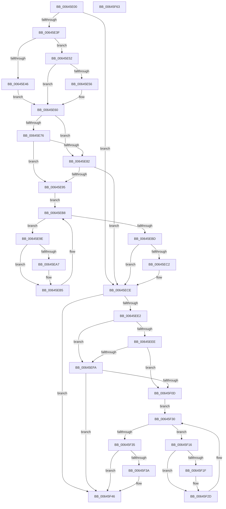

# DifZwQueryBootEntryOrderWrapper

- RVA: `0x00645E00`–`0x00645F64` (길이 `356` bytes)
- VA: `0x0000000140645E00`
- 실행 섹션: `.text`
- PDB 이름 있음: `예`; PDB Function 태그: `아니요`
- unwind 정보 RVA: `0x00093E28`
- 디코드: `98`개 명령, `356/356` bytes 표시
- 미해석 바이트: `0` (있으면 어셈블리에 `.byte`로 보존)

> 이 문서는 커널 이미지의 기계어와 PDB 기호를 분석해 생성했습니다. 4번과 5번은 함수 원형과 자료형을 바이너리 사용 방식에서 추정한 C 해석이며 원본 소스 복구 결과는 아닙니다.

## 1. Dependencies

- 직접 호출 지점: **9**; 고유 호출 대상: **6**
- 직접 호출자로 확인된 함수: **0**
- RIP 상대 이미지 참조: **3**

### Outgoing calls
- `0x00645E2E` → [DifGetAPIThunkContextById](../49/DifGetAPIThunkContextById_function_00495A34.md) (function, `0x00495A34`)
- `0x00645E56` → [DifGetReturnAddressForWrappers](../4D/DifGetReturnAddressForWrappers_function_004D3C08.md) (function, `0x004D3C08`)
- `0x00645E89` → [ExAcquireRundownProtection](../21/ExAcquireRundownProtection_function_00216620.md) (function, `0x00216620`)
- `0x00645EB0` → [guard_dispatch_icall](../6B/guard_dispatch_icall_function_006BAAD0.md) (function, `0x006BAAD0`)
- `0x00645EC9` → [ExReleaseRundownProtection](../34/ExReleaseRundownProtection_function_00349E80.md) (function, `0x00349E80`)
- `0x00645ED4` → [ZwQueryBootEntryOrder](../6A/ZwQueryBootEntryOrder_function_006AFA30.md) (function, `0x006AFA30`)
- `0x00645F01` → [ExAcquireRundownProtection](../21/ExAcquireRundownProtection_function_00216620.md) (function, `0x00216620`)
- `0x00645F28` → [guard_dispatch_icall](../6B/guard_dispatch_icall_function_006BAAD0.md) (function, `0x006BAAD0`)
- `0x00645F41` → [ExReleaseRundownProtection](../34/ExReleaseRundownProtection_function_00349E80.md) (function, `0x00349E80`)

### Direct callers
- 이 함수 시작 RVA로 연결되는 직접 call은 확인되지 않았습니다. 간접 호출은 완전히 역산할 수 없습니다.

### Static image references
- `0x00645E68` → RVA `0x00F048B8` (`.data`; read)
- `0x00645E76` → RVA `0x00F04980` (`.data`; read)
- `0x00645E82` → RVA `0x00F03E80` (`.data`; read)

## 2. Other-region calls and transfers

- 다른 실행 섹션으로 향하는 call: **0**
- 별도 외부 분기/꼬리 이동을 확인하지 못했습니다.

## 3. Assembly (complete function range)

```asm
00645E00  48 8B C4                        mov rax, rsp
00645E03  48 89 58 08                     mov qword ptr [rax + 8], rbx
00645E07  48 89 68 10                     mov qword ptr [rax + 0x10], rbp
00645E0B  48 89 70 18                     mov qword ptr [rax + 0x18], rsi
00645E0F  57                              push rdi
00645E10  41 56                           push r14
00645E12  41 57                           push r15
00645E14  48 83 EC 40                     sub rsp, 0x40
00645E18  0F 57 C0                        xorps xmm0, xmm0
00645E1B  4C 8B F9                        mov r15, rcx
00645E1E  B9 3D 00 00 00                  mov ecx, 0x3d
00645E23  4C 8B F2                        mov r14, rdx
00645E26  0F 11 40 C8                     movups xmmword ptr [rax - 0x38], xmm0
00645E2A  0F 11 40 D8                     movups xmmword ptr [rax - 0x28], xmm0
00645E2E  E8 01 FC E4 FF                  call 0x140495a34
00645E33  48 8B F0                        mov rsi, rax
00645E36  48 85 C0                        test rax, rax
00645E39  0F 84 8F 00 00 00               je 0x140645ece
00645E3F  8B 40 0C                        mov eax, dword ptr [rax + 0xc]
00645E42  A8 18                           test al, 0x18
00645E44  74 0C                           je 0x140645e52
00645E46  48 8B 4C 24 58                  mov rcx, qword ptr [rsp + 0x58]
00645E4B  48 89 4C 24 20                  mov qword ptr [rsp + 0x20], rcx
00645E50  EB 0E                           jmp 0x140645e60
00645E52  A8 04                           test al, 4
00645E54  74 0A                           je 0x140645e60
00645E56  E8 AD DD E8 FF                  call 0x1404d3c08
00645E5B  48 89 44 24 20                  mov qword ptr [rsp + 0x20], rax
00645E60  40 32 ED                        xor bpl, bpl
00645E63  4C 89 7C 24 30                  mov qword ptr [rsp + 0x30], r15
00645E68  40 38 2D 49 EA 8B 00            cmp byte ptr [rip + 0x8bea49], bpl
00645E6F  4C 89 74 24 28                  mov qword ptr [rsp + 0x28], r14
00645E74  75 0C                           jne 0x140645e82
00645E76  F7 05 00 EB 8B 00 00 08 00 00   test dword ptr [rip + 0x8beb00], 0x800
00645E80  74 13                           je 0x140645e95
00645E82  48 8D 0D F7 DF 8B 00            lea rcx, [rip + 0x8bdff7]
00645E89  E8 92 07 BD FF                  call 0x140216620
00645E8E  40 8A E8                        mov bpl, al
00645E91  84 C0                           test al, al
00645E93  74 39                           je 0x140645ece
00645E95  48 8D 7E 20                     lea rdi, [rsi + 0x20]
00645E99  48 8B 1F                        mov rbx, qword ptr [rdi]
00645E9C  EB 1A                           jmp 0x140645eb8
00645E9E  48 8D 43 F0                     lea rax, [rbx - 0x10]
00645EA2  48 85 C0                        test rax, rax
00645EA5  74 0E                           je 0x140645eb5
00645EA7  48 8B 40 08                     mov rax, qword ptr [rax + 8]
00645EAB  48 8D 4C 24 20                  lea rcx, [rsp + 0x20]
00645EB0  E8 1B 4C 07 00                  call 0x1406baad0
00645EB5  48 8B 1B                        mov rbx, qword ptr [rbx]
00645EB8  48 3B DF                        cmp rbx, rdi
00645EBB  75 E1                           jne 0x140645e9e
00645EBD  40 84 ED                        test bpl, bpl
00645EC0  74 0C                           je 0x140645ece
00645EC2  48 8D 0D B7 DF 8B 00            lea rcx, [rip + 0x8bdfb7]
00645EC9  E8 B2 3F D0 FF                  call 0x140349e80
00645ECE  49 8B D6                        mov rdx, r14
00645ED1  49 8B CF                        mov rcx, r15
00645ED4  E8 57 9B 06 00                  call 0x1406afa30
00645ED9  89 44 24 38                     mov dword ptr [rsp + 0x38], eax
00645EDD  48 85 F6                        test rsi, rsi
00645EE0  74 64                           je 0x140645f46
00645EE2  40 32 FF                        xor dil, dil
00645EE5  40 38 3D CC E9 8B 00            cmp byte ptr [rip + 0x8be9cc], dil
00645EEC  75 0C                           jne 0x140645efa
00645EEE  F7 05 88 EA 8B 00 00 08 00 00   test dword ptr [rip + 0x8bea88], 0x800
00645EF8  74 13                           je 0x140645f0d
00645EFA  48 8D 0D 7F DF 8B 00            lea rcx, [rip + 0x8bdf7f]
00645F01  E8 1A 07 BD FF                  call 0x140216620
00645F06  40 8A F8                        mov dil, al
00645F09  84 C0                           test al, al
00645F0B  74 39                           je 0x140645f46
00645F0D  48 83 C6 30                     add rsi, 0x30
00645F11  48 8B 1E                        mov rbx, qword ptr [rsi]
00645F14  EB 1A                           jmp 0x140645f30
00645F16  48 8D 43 F0                     lea rax, [rbx - 0x10]
00645F1A  48 85 C0                        test rax, rax
00645F1D  74 0E                           je 0x140645f2d
00645F1F  48 8B 40 08                     mov rax, qword ptr [rax + 8]
00645F23  48 8D 4C 24 20                  lea rcx, [rsp + 0x20]
00645F28  E8 A3 4B 07 00                  call 0x1406baad0
00645F2D  48 8B 1B                        mov rbx, qword ptr [rbx]
00645F30  48 3B DE                        cmp rbx, rsi
00645F33  75 E1                           jne 0x140645f16
00645F35  40 84 FF                        test dil, dil
00645F38  74 0C                           je 0x140645f46
00645F3A  48 8D 0D 3F DF 8B 00            lea rcx, [rip + 0x8bdf3f]
00645F41  E8 3A 3F D0 FF                  call 0x140349e80
00645F46  8B 44 24 38                     mov eax, dword ptr [rsp + 0x38]
00645F4A  48 8B 5C 24 60                  mov rbx, qword ptr [rsp + 0x60]
00645F4F  48 8B 6C 24 68                  mov rbp, qword ptr [rsp + 0x68]
00645F54  48 8B 74 24 70                  mov rsi, qword ptr [rsp + 0x70]
00645F59  48 83 C4 40                     add rsp, 0x40
00645F5D  41 5F                           pop r15
00645F5F  41 5E                           pop r14
00645F61  5F                              pop rdi
00645F62  C3                              ret
00645F63  CC                              int3
```

## 4. C-style interpretation (structured pseudocode)

```c
__int64 __fastcall DifZwQueryBootEntryOrderWrapper(__int64 a1, __int64 a2)
{
    __int64 result;
    __int64 v_rbp;
    __int64 v_rdi;
    __int64 v_rsi;
    __int64 v_rsp;
    unsigned int v_stack_m20;
    unsigned __int64 v_stack_m28;
    unsigned __int64 v_stack_m30;
    unsigned __int64 v_stack_m38;
    unsigned __int64 v_stack_p0;
    unsigned __int64 v_stack_p10;
    unsigned __int64 v_stack_p18;
    unsigned __int64 v_stack_p8;

    *(unsigned __int64 *)(v_rsp + 8) = v_rbx;
    *(unsigned __int64 *)(v_rsp + 16) = v_rbp;
    *(unsigned __int64 *)(v_rsp + 24) = v_rsi;
    v_rsp = (v_rsp) - (64);
    *(unsigned __int64 *)(v_rsp - 56) = v_xmm0;
    *(unsigned __int64 *)(v_rsp - 40) = v_xmm0;
    result = DifGetAPIThunkContextById(61, a2, a3, a4);
    if (result == 0) goto loc_00645ECE;
    if ((((unsigned __int8)((unsigned int)(*(unsigned int *)(result + 12)))) & (24)) == 0) goto loc_00645E52;
    v_stack_m38 = v_stack_p0;
    goto loc_00645E60;
loc_00645E52:
    result = (unsigned int)(*(unsigned int *)(result + 12));
    if ((((unsigned __int8)((unsigned int)(*(unsigned int *)(result + 12)))) & (4)) != 0) {
        result = DifGetReturnAddressForWrappers(v_stack_p0, a2, a3, a4);
        v_stack_m38 = result;
    }
    v_rbp = 0;
    v_stack_m28 = a1;
    v_stack_m30 = a2;
    if ((*(unsigned __int8 *)(v_rip + 9169481)) != 0) goto loc_00645E82;
    if (((*(unsigned int *)(v_rip + 9169664)) & (0x800ULL)) == 0) goto loc_00645E95;
loc_00645E82:
    result = ExAcquireRundownProtection(v_rip + 9166839, a2, a3, a4);
    if ((unsigned __int8)(result) == 0) goto loc_00645ECE;
loc_00645E95:
    goto loc_00645EB8;
loc_00645E9E:
    result = *(unsigned __int64 *)(result + 32) - 16;
    if (*(unsigned __int64 *)(result + 32) - 16 != 0) {
        result = *(unsigned __int64 *)(*(unsigned __int64 *)(result + 32) - 16 + 8);
        a1 = v_stack_m38;
        result = guard_dispatch_icall(a1, a2, a3, a4);
    }
loc_00645EB8:
    if ((*(unsigned __int64 *)(*(unsigned __int64 *)(result + 32))) != (result + 32)) goto loc_00645E9E;
    if ((unsigned __int8)((unsigned __int8)(result)) != 0) {
        a1 = v_rip + 9166775;
        result = ExReleaseRundownProtection(a1, a2, a3, a4);
    }
    result = ZwQueryBootEntryOrder(a1, a2, a3, a4);
    v_stack_m20 = (unsigned int)(result);
    if (result == 0) goto loc_00645F46;
    v_rdi = 0;
    if ((*(unsigned __int8 *)(v_rip + 9169356)) != 0) goto loc_00645EFA;
    if (((*(unsigned int *)(v_rip + 9169544)) & (0x800ULL)) == 0) goto loc_00645F0D;
loc_00645EFA:
    result = ExAcquireRundownProtection(v_rip + 9166719, a2, a3, a4);
    if ((unsigned __int8)(result) == 0) goto loc_00645F46;
loc_00645F0D:
    v_rsi = (result) + (48);
    goto loc_00645F30;
loc_00645F16:
    result = *(unsigned __int64 *)(v_rsi) - 16;
    if (*(unsigned __int64 *)(v_rsi) - 16 != 0) {
        result = *(unsigned __int64 *)(*(unsigned __int64 *)(v_rsi) - 16 + 8);
        a1 = v_stack_m38;
        result = guard_dispatch_icall(a1, a2, a3, a4);
    }
loc_00645F30:
    if ((*(unsigned __int64 *)(*(unsigned __int64 *)(v_rsi))) != v_rsi) goto loc_00645F16;
    if ((unsigned __int8)((unsigned __int8)(result)) != 0) {
        a1 = v_rip + 9166655;
        result = ExReleaseRundownProtection(a1, a2, a3, a4);
    }
    v_rsp = (v_rsp) + (64);
    return (unsigned int)(v_stack_m20);
}
```

## 5. (Beta) C Style

```c
int64_t DifZwQueryBootEntryOrderWrapper(int64_t Arg1, int64_t Arg2)
{
    int64_t result;
    int64_t local_rbp;
    int64_t local_rdi;
    int64_t local_rsi;
    int64_t local_rsp;
    uint32_t v_stack_m20;
    uint64_t v_stack_m28;
    uint64_t v_stack_m30;
    uint64_t v_stack_m38;
    uint64_t v_stack_p0;
    uint64_t v_stack_p10;
    uint64_t v_stack_p18;
    uint64_t v_stack_p8;

    *(uint64_t *)(local_rsp + 0x8) = local_rbx;
    *(uint64_t *)(local_rsp + 0x10) = local_rbp;
    *(uint64_t *)(local_rsp + 0x18) = local_rsi;
    local_rsp = (local_rsp) - (64);
    *(uint64_t *)(local_rsp - 0x38) = v_xmm0;
    *(uint64_t *)(local_rsp - 0x28) = v_xmm0;
    result = DifGetAPIThunkContextById(61, Arg2, a3, a4);
    if (result == 0) goto loc_00645ECE;
    if ((((uint8_t)((uint32_t)(*(uint32_t *)(result + 0xC)))) & (24)) == 0) goto loc_00645E52;
    v_stack_m38 = v_stack_p0;
    goto loc_00645E60;
loc_00645E52:
    result = (uint32_t)(*(uint32_t *)(result + 0xC));
    if ((((uint8_t)((uint32_t)(*(uint32_t *)(result + 0xC)))) & (4)) != 0) {
        result = DifGetReturnAddressForWrappers(v_stack_p0, Arg2, a3, a4);
        v_stack_m38 = result;
    }
    local_rbp = 0;
    v_stack_m28 = Arg1;
    v_stack_m30 = Arg2;
    if ((*(uint8_t *)(v_rip + 0x8BEA49)) != 0) goto loc_00645E82;
    if (((*(uint32_t *)(v_rip + 0x8BEB00)) & (0x800ULL)) == 0) goto loc_00645E95;
loc_00645E82:
    result = ExAcquireRundownProtection(v_rip + 9166839, Arg2, a3, a4);
    if ((uint8_t)(result) == 0) goto loc_00645ECE;
loc_00645E95:
    goto loc_00645EB8;
loc_00645E9E:
    result = *(uint64_t *)(result + 0x20) - 16;
    if (*(uint64_t *)(result + 0x20) - 16 != 0) {
        result = *(uint64_t *)(*(uint64_t *)(result + 0x20) - 0x10 + 0x8);
        Arg1 = v_stack_m38;
        result = guard_dispatch_icall(Arg1, Arg2, a3, a4);
    }
loc_00645EB8:
    if ((*(uint64_t *)(*(uint64_t *)(result + 0x20))) != (result + 32)) goto loc_00645E9E;
    if ((uint8_t)((uint8_t)(result)) != 0) {
        Arg1 = v_rip + 9166775;
        result = ExReleaseRundownProtection(Arg1, Arg2, a3, a4);
    }
    result = ZwQueryBootEntryOrder(Arg1, Arg2, a3, a4);
    v_stack_m20 = (uint32_t)(result);
    if (result == 0) goto loc_00645F46;
    local_rdi = 0;
    if ((*(uint8_t *)(v_rip + 0x8BE9CC)) != 0) goto loc_00645EFA;
    if (((*(uint32_t *)(v_rip + 0x8BEA88)) & (0x800ULL)) == 0) goto loc_00645F0D;
loc_00645EFA:
    result = ExAcquireRundownProtection(v_rip + 9166719, Arg2, a3, a4);
    if ((uint8_t)(result) == 0) goto loc_00645F46;
loc_00645F0D:
    local_rsi = (result) + (48);
    goto loc_00645F30;
loc_00645F16:
    result = *(uint64_t *)(local_rsi) - 16;
    if (*(uint64_t *)(local_rsi) - 16 != 0) {
        result = *(uint64_t *)(*(uint64_t *)(local_rsi) - 0x10 + 0x8);
        Arg1 = v_stack_m38;
        result = guard_dispatch_icall(Arg1, Arg2, a3, a4);
    }
loc_00645F30:
    if ((*(uint64_t *)(*(uint64_t *)(local_rsi))) != local_rsi) goto loc_00645F16;
    if ((uint8_t)((uint8_t)(result)) != 0) {
        Arg1 = v_rip + 9166655;
        result = ExReleaseRundownProtection(Arg1, Arg2, a3, a4);
    }
    local_rsp = (local_rsp) + (64);
    return (uint32_t)(v_stack_m20);
}
```

## 6. Execution-region graph

[열기: 2D/3D 그래프와 함수 탐색 컨트롤 패널](../../../control-panel.html?section=text&rva=0x00645E00&view=graph)

- 2D 그래프는 위에서 아래로 흐르고, 3D 그래프는 빈 공간을 드래그해 회전합니다. Shift+드래그는 이동, 휠은 확대·축소, 함수 노드 선택은 대상 보고서 이동입니다.

### Static fallback


