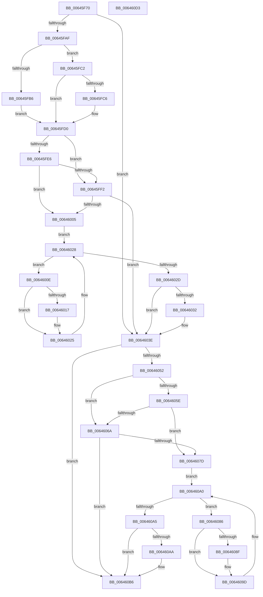

# DifZwQueryBootOptionsWrapper

- RVA: `0x00645F70`–`0x006460D4` (길이 `356` bytes)
- VA: `0x0000000140645F70`
- 실행 섹션: `.text`
- PDB 이름 있음: `예`; PDB Function 태그: `아니요`
- unwind 정보 RVA: `0x00093E28`
- 디코드: `98`개 명령, `356/356` bytes 표시
- 미해석 바이트: `0` (있으면 어셈블리에 `.byte`로 보존)

> 이 문서는 커널 이미지의 기계어와 PDB 기호를 분석해 생성했습니다. 4번과 5번은 함수 원형과 자료형을 바이너리 사용 방식에서 추정한 C 해석이며 원본 소스 복구 결과는 아닙니다.

## 1. Dependencies

- 직접 호출 지점: **9**; 고유 호출 대상: **6**
- 직접 호출자로 확인된 함수: **0**
- RIP 상대 이미지 참조: **3**

### Outgoing calls
- `0x00645F9E` → [DifGetAPIThunkContextById](../49/DifGetAPIThunkContextById_function_00495A34.md) (function, `0x00495A34`)
- `0x00645FC6` → [DifGetReturnAddressForWrappers](../4D/DifGetReturnAddressForWrappers_function_004D3C08.md) (function, `0x004D3C08`)
- `0x00645FF9` → [ExAcquireRundownProtection](../21/ExAcquireRundownProtection_function_00216620.md) (function, `0x00216620`)
- `0x00646020` → [guard_dispatch_icall](../6B/guard_dispatch_icall_function_006BAAD0.md) (function, `0x006BAAD0`)
- `0x00646039` → [ExReleaseRundownProtection](../34/ExReleaseRundownProtection_function_00349E80.md) (function, `0x00349E80`)
- `0x00646044` → [ZwQueryBootOptions](../6A/ZwQueryBootOptions_function_006AFA50.md) (function, `0x006AFA50`)
- `0x00646071` → [ExAcquireRundownProtection](../21/ExAcquireRundownProtection_function_00216620.md) (function, `0x00216620`)
- `0x00646098` → [guard_dispatch_icall](../6B/guard_dispatch_icall_function_006BAAD0.md) (function, `0x006BAAD0`)
- `0x006460B1` → [ExReleaseRundownProtection](../34/ExReleaseRundownProtection_function_00349E80.md) (function, `0x00349E80`)

### Direct callers
- 이 함수 시작 RVA로 연결되는 직접 call은 확인되지 않았습니다. 간접 호출은 완전히 역산할 수 없습니다.

### Static image references
- `0x00645FD8` → RVA `0x00F048B8` (`.data`; read)
- `0x00645FE6` → RVA `0x00F04980` (`.data`; read)
- `0x00645FF2` → RVA `0x00F03E80` (`.data`; read)

## 2. Other-region calls and transfers

- 다른 실행 섹션으로 향하는 call: **0**
- 별도 외부 분기/꼬리 이동을 확인하지 못했습니다.

## 3. Assembly (complete function range)

```asm
00645F70  48 8B C4                        mov rax, rsp
00645F73  48 89 58 08                     mov qword ptr [rax + 8], rbx
00645F77  48 89 68 10                     mov qword ptr [rax + 0x10], rbp
00645F7B  48 89 70 18                     mov qword ptr [rax + 0x18], rsi
00645F7F  57                              push rdi
00645F80  41 56                           push r14
00645F82  41 57                           push r15
00645F84  48 83 EC 40                     sub rsp, 0x40
00645F88  0F 57 C0                        xorps xmm0, xmm0
00645F8B  4C 8B F9                        mov r15, rcx
00645F8E  B9 3C 00 00 00                  mov ecx, 0x3c
00645F93  4C 8B F2                        mov r14, rdx
00645F96  0F 11 40 C8                     movups xmmword ptr [rax - 0x38], xmm0
00645F9A  0F 11 40 D8                     movups xmmword ptr [rax - 0x28], xmm0
00645F9E  E8 91 FA E4 FF                  call 0x140495a34
00645FA3  48 8B F0                        mov rsi, rax
00645FA6  48 85 C0                        test rax, rax
00645FA9  0F 84 8F 00 00 00               je 0x14064603e
00645FAF  8B 40 0C                        mov eax, dword ptr [rax + 0xc]
00645FB2  A8 18                           test al, 0x18
00645FB4  74 0C                           je 0x140645fc2
00645FB6  48 8B 4C 24 58                  mov rcx, qword ptr [rsp + 0x58]
00645FBB  48 89 4C 24 20                  mov qword ptr [rsp + 0x20], rcx
00645FC0  EB 0E                           jmp 0x140645fd0
00645FC2  A8 04                           test al, 4
00645FC4  74 0A                           je 0x140645fd0
00645FC6  E8 3D DC E8 FF                  call 0x1404d3c08
00645FCB  48 89 44 24 20                  mov qword ptr [rsp + 0x20], rax
00645FD0  40 32 ED                        xor bpl, bpl
00645FD3  4C 89 7C 24 30                  mov qword ptr [rsp + 0x30], r15
00645FD8  40 38 2D D9 E8 8B 00            cmp byte ptr [rip + 0x8be8d9], bpl
00645FDF  4C 89 74 24 28                  mov qword ptr [rsp + 0x28], r14
00645FE4  75 0C                           jne 0x140645ff2
00645FE6  F7 05 90 E9 8B 00 00 08 00 00   test dword ptr [rip + 0x8be990], 0x800
00645FF0  74 13                           je 0x140646005
00645FF2  48 8D 0D 87 DE 8B 00            lea rcx, [rip + 0x8bde87]
00645FF9  E8 22 06 BD FF                  call 0x140216620
00645FFE  40 8A E8                        mov bpl, al
00646001  84 C0                           test al, al
00646003  74 39                           je 0x14064603e
00646005  48 8D 7E 20                     lea rdi, [rsi + 0x20]
00646009  48 8B 1F                        mov rbx, qword ptr [rdi]
0064600C  EB 1A                           jmp 0x140646028
0064600E  48 8D 43 F0                     lea rax, [rbx - 0x10]
00646012  48 85 C0                        test rax, rax
00646015  74 0E                           je 0x140646025
00646017  48 8B 40 08                     mov rax, qword ptr [rax + 8]
0064601B  48 8D 4C 24 20                  lea rcx, [rsp + 0x20]
00646020  E8 AB 4A 07 00                  call 0x1406baad0
00646025  48 8B 1B                        mov rbx, qword ptr [rbx]
00646028  48 3B DF                        cmp rbx, rdi
0064602B  75 E1                           jne 0x14064600e
0064602D  40 84 ED                        test bpl, bpl
00646030  74 0C                           je 0x14064603e
00646032  48 8D 0D 47 DE 8B 00            lea rcx, [rip + 0x8bde47]
00646039  E8 42 3E D0 FF                  call 0x140349e80
0064603E  49 8B D6                        mov rdx, r14
00646041  49 8B CF                        mov rcx, r15
00646044  E8 07 9A 06 00                  call 0x1406afa50
00646049  89 44 24 38                     mov dword ptr [rsp + 0x38], eax
0064604D  48 85 F6                        test rsi, rsi
00646050  74 64                           je 0x1406460b6
00646052  40 32 FF                        xor dil, dil
00646055  40 38 3D 5C E8 8B 00            cmp byte ptr [rip + 0x8be85c], dil
0064605C  75 0C                           jne 0x14064606a
0064605E  F7 05 18 E9 8B 00 00 08 00 00   test dword ptr [rip + 0x8be918], 0x800
00646068  74 13                           je 0x14064607d
0064606A  48 8D 0D 0F DE 8B 00            lea rcx, [rip + 0x8bde0f]
00646071  E8 AA 05 BD FF                  call 0x140216620
00646076  40 8A F8                        mov dil, al
00646079  84 C0                           test al, al
0064607B  74 39                           je 0x1406460b6
0064607D  48 83 C6 30                     add rsi, 0x30
00646081  48 8B 1E                        mov rbx, qword ptr [rsi]
00646084  EB 1A                           jmp 0x1406460a0
00646086  48 8D 43 F0                     lea rax, [rbx - 0x10]
0064608A  48 85 C0                        test rax, rax
0064608D  74 0E                           je 0x14064609d
0064608F  48 8B 40 08                     mov rax, qword ptr [rax + 8]
00646093  48 8D 4C 24 20                  lea rcx, [rsp + 0x20]
00646098  E8 33 4A 07 00                  call 0x1406baad0
0064609D  48 8B 1B                        mov rbx, qword ptr [rbx]
006460A0  48 3B DE                        cmp rbx, rsi
006460A3  75 E1                           jne 0x140646086
006460A5  40 84 FF                        test dil, dil
006460A8  74 0C                           je 0x1406460b6
006460AA  48 8D 0D CF DD 8B 00            lea rcx, [rip + 0x8bddcf]
006460B1  E8 CA 3D D0 FF                  call 0x140349e80
006460B6  8B 44 24 38                     mov eax, dword ptr [rsp + 0x38]
006460BA  48 8B 5C 24 60                  mov rbx, qword ptr [rsp + 0x60]
006460BF  48 8B 6C 24 68                  mov rbp, qword ptr [rsp + 0x68]
006460C4  48 8B 74 24 70                  mov rsi, qword ptr [rsp + 0x70]
006460C9  48 83 C4 40                     add rsp, 0x40
006460CD  41 5F                           pop r15
006460CF  41 5E                           pop r14
006460D1  5F                              pop rdi
006460D2  C3                              ret
006460D3  CC                              int3
```

## 4. C-style interpretation (structured pseudocode)

```c
__int64 __fastcall DifZwQueryBootOptionsWrapper(__int64 a1, __int64 a2)
{
    __int64 result;
    __int64 v_rbp;
    __int64 v_rdi;
    __int64 v_rsi;
    __int64 v_rsp;
    unsigned int v_stack_m20;
    unsigned __int64 v_stack_m28;
    unsigned __int64 v_stack_m30;
    unsigned __int64 v_stack_m38;
    unsigned __int64 v_stack_p0;
    unsigned __int64 v_stack_p10;
    unsigned __int64 v_stack_p18;
    unsigned __int64 v_stack_p8;

    *(unsigned __int64 *)(v_rsp + 8) = v_rbx;
    *(unsigned __int64 *)(v_rsp + 16) = v_rbp;
    *(unsigned __int64 *)(v_rsp + 24) = v_rsi;
    v_rsp = (v_rsp) - (64);
    *(unsigned __int64 *)(v_rsp - 56) = v_xmm0;
    *(unsigned __int64 *)(v_rsp - 40) = v_xmm0;
    result = DifGetAPIThunkContextById(60, a2, a3, a4);
    if (result == 0) goto loc_0064603E;
    if ((((unsigned __int8)((unsigned int)(*(unsigned int *)(result + 12)))) & (24)) == 0) goto loc_00645FC2;
    v_stack_m38 = v_stack_p0;
    goto loc_00645FD0;
loc_00645FC2:
    result = (unsigned int)(*(unsigned int *)(result + 12));
    if ((((unsigned __int8)((unsigned int)(*(unsigned int *)(result + 12)))) & (4)) != 0) {
        result = DifGetReturnAddressForWrappers(v_stack_p0, a2, a3, a4);
        v_stack_m38 = result;
    }
    v_rbp = 0;
    v_stack_m28 = a1;
    v_stack_m30 = a2;
    if ((*(unsigned __int8 *)(v_rip + 9169113)) != 0) goto loc_00645FF2;
    if (((*(unsigned int *)(v_rip + 9169296)) & (0x800ULL)) == 0) goto loc_00646005;
loc_00645FF2:
    result = ExAcquireRundownProtection(v_rip + 9166471, a2, a3, a4);
    if ((unsigned __int8)(result) == 0) goto loc_0064603E;
loc_00646005:
    goto loc_00646028;
loc_0064600E:
    result = *(unsigned __int64 *)(result + 32) - 16;
    if (*(unsigned __int64 *)(result + 32) - 16 != 0) {
        result = *(unsigned __int64 *)(*(unsigned __int64 *)(result + 32) - 16 + 8);
        a1 = v_stack_m38;
        result = guard_dispatch_icall(a1, a2, a3, a4);
    }
loc_00646028:
    if ((*(unsigned __int64 *)(*(unsigned __int64 *)(result + 32))) != (result + 32)) goto loc_0064600E;
    if ((unsigned __int8)((unsigned __int8)(result)) != 0) {
        a1 = v_rip + 9166407;
        result = ExReleaseRundownProtection(a1, a2, a3, a4);
    }
    result = ZwQueryBootOptions(a1, a2, a3, a4);
    v_stack_m20 = (unsigned int)(result);
    if (result == 0) goto loc_006460B6;
    v_rdi = 0;
    if ((*(unsigned __int8 *)(v_rip + 9168988)) != 0) goto loc_0064606A;
    if (((*(unsigned int *)(v_rip + 9169176)) & (0x800ULL)) == 0) goto loc_0064607D;
loc_0064606A:
    result = ExAcquireRundownProtection(v_rip + 9166351, a2, a3, a4);
    if ((unsigned __int8)(result) == 0) goto loc_006460B6;
loc_0064607D:
    v_rsi = (result) + (48);
    goto loc_006460A0;
loc_00646086:
    result = *(unsigned __int64 *)(v_rsi) - 16;
    if (*(unsigned __int64 *)(v_rsi) - 16 != 0) {
        result = *(unsigned __int64 *)(*(unsigned __int64 *)(v_rsi) - 16 + 8);
        a1 = v_stack_m38;
        result = guard_dispatch_icall(a1, a2, a3, a4);
    }
loc_006460A0:
    if ((*(unsigned __int64 *)(*(unsigned __int64 *)(v_rsi))) != v_rsi) goto loc_00646086;
    if ((unsigned __int8)((unsigned __int8)(result)) != 0) {
        a1 = v_rip + 9166287;
        result = ExReleaseRundownProtection(a1, a2, a3, a4);
    }
    v_rsp = (v_rsp) + (64);
    return (unsigned int)(v_stack_m20);
}
```

## 5. (Beta) C Style

```c
int64_t DifZwQueryBootOptionsWrapper(int64_t Arg1, int64_t Arg2)
{
    int64_t result;
    int64_t local_rbp;
    int64_t local_rdi;
    int64_t local_rsi;
    int64_t local_rsp;
    uint32_t v_stack_m20;
    uint64_t v_stack_m28;
    uint64_t v_stack_m30;
    uint64_t v_stack_m38;
    uint64_t v_stack_p0;
    uint64_t v_stack_p10;
    uint64_t v_stack_p18;
    uint64_t v_stack_p8;

    *(uint64_t *)(local_rsp + 0x8) = local_rbx;
    *(uint64_t *)(local_rsp + 0x10) = local_rbp;
    *(uint64_t *)(local_rsp + 0x18) = local_rsi;
    local_rsp = (local_rsp) - (64);
    *(uint64_t *)(local_rsp - 0x38) = v_xmm0;
    *(uint64_t *)(local_rsp - 0x28) = v_xmm0;
    result = DifGetAPIThunkContextById(60, Arg2, a3, a4);
    if (result == 0) goto loc_0064603E;
    if ((((uint8_t)((uint32_t)(*(uint32_t *)(result + 0xC)))) & (24)) == 0) goto loc_00645FC2;
    v_stack_m38 = v_stack_p0;
    goto loc_00645FD0;
loc_00645FC2:
    result = (uint32_t)(*(uint32_t *)(result + 0xC));
    if ((((uint8_t)((uint32_t)(*(uint32_t *)(result + 0xC)))) & (4)) != 0) {
        result = DifGetReturnAddressForWrappers(v_stack_p0, Arg2, a3, a4);
        v_stack_m38 = result;
    }
    local_rbp = 0;
    v_stack_m28 = Arg1;
    v_stack_m30 = Arg2;
    if ((*(uint8_t *)(v_rip + 0x8BE8D9)) != 0) goto loc_00645FF2;
    if (((*(uint32_t *)(v_rip + 0x8BE990)) & (0x800ULL)) == 0) goto loc_00646005;
loc_00645FF2:
    result = ExAcquireRundownProtection(v_rip + 9166471, Arg2, a3, a4);
    if ((uint8_t)(result) == 0) goto loc_0064603E;
loc_00646005:
    goto loc_00646028;
loc_0064600E:
    result = *(uint64_t *)(result + 0x20) - 16;
    if (*(uint64_t *)(result + 0x20) - 16 != 0) {
        result = *(uint64_t *)(*(uint64_t *)(result + 0x20) - 0x10 + 0x8);
        Arg1 = v_stack_m38;
        result = guard_dispatch_icall(Arg1, Arg2, a3, a4);
    }
loc_00646028:
    if ((*(uint64_t *)(*(uint64_t *)(result + 0x20))) != (result + 32)) goto loc_0064600E;
    if ((uint8_t)((uint8_t)(result)) != 0) {
        Arg1 = v_rip + 9166407;
        result = ExReleaseRundownProtection(Arg1, Arg2, a3, a4);
    }
    result = ZwQueryBootOptions(Arg1, Arg2, a3, a4);
    v_stack_m20 = (uint32_t)(result);
    if (result == 0) goto loc_006460B6;
    local_rdi = 0;
    if ((*(uint8_t *)(v_rip + 0x8BE85C)) != 0) goto loc_0064606A;
    if (((*(uint32_t *)(v_rip + 0x8BE918)) & (0x800ULL)) == 0) goto loc_0064607D;
loc_0064606A:
    result = ExAcquireRundownProtection(v_rip + 9166351, Arg2, a3, a4);
    if ((uint8_t)(result) == 0) goto loc_006460B6;
loc_0064607D:
    local_rsi = (result) + (48);
    goto loc_006460A0;
loc_00646086:
    result = *(uint64_t *)(local_rsi) - 16;
    if (*(uint64_t *)(local_rsi) - 16 != 0) {
        result = *(uint64_t *)(*(uint64_t *)(local_rsi) - 0x10 + 0x8);
        Arg1 = v_stack_m38;
        result = guard_dispatch_icall(Arg1, Arg2, a3, a4);
    }
loc_006460A0:
    if ((*(uint64_t *)(*(uint64_t *)(local_rsi))) != local_rsi) goto loc_00646086;
    if ((uint8_t)((uint8_t)(result)) != 0) {
        Arg1 = v_rip + 9166287;
        result = ExReleaseRundownProtection(Arg1, Arg2, a3, a4);
    }
    local_rsp = (local_rsp) + (64);
    return (uint32_t)(v_stack_m20);
}
```

## 6. Execution-region graph

[열기: 2D/3D 그래프와 함수 탐색 컨트롤 패널](../../../control-panel.html?section=text&rva=0x00645F70&view=graph)

- 2D 그래프는 위에서 아래로 흐르고, 3D 그래프는 빈 공간을 드래그해 회전합니다. Shift+드래그는 이동, 휠은 확대·축소, 함수 노드 선택은 대상 보고서 이동입니다.

### Static fallback


