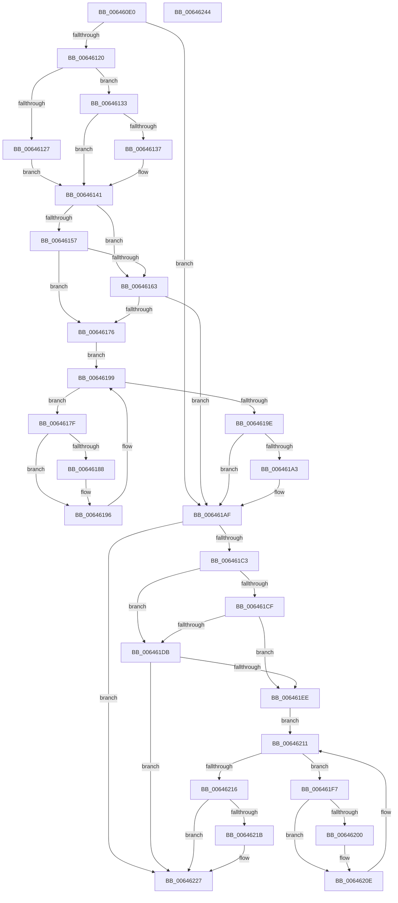

# DifZwQueryDefaultLocaleWrapper

- RVA: `0x006460E0`–`0x00646245` (길이 `357` bytes)
- VA: `0x00000001406460E0`
- 실행 섹션: `.text`
- PDB 이름 있음: `예`; PDB Function 태그: `아니요`
- unwind 정보 RVA: `0x00093E28`
- 디코드: `99`개 명령, `357/357` bytes 표시
- 미해석 바이트: `0` (있으면 어셈블리에 `.byte`로 보존)

> 이 문서는 커널 이미지의 기계어와 PDB 기호를 분석해 생성했습니다. 4번과 5번은 함수 원형과 자료형을 바이너리 사용 방식에서 추정한 C 해석이며 원본 소스 복구 결과는 아닙니다.

## 1. Dependencies

- 직접 호출 지점: **9**; 고유 호출 대상: **6**
- 직접 호출자로 확인된 함수: **0**
- RIP 상대 이미지 참조: **3**

### Outgoing calls
- `0x0064610F` → [DifGetAPIThunkContextById](../49/DifGetAPIThunkContextById_function_00495A34.md) (function, `0x00495A34`)
- `0x00646137` → [DifGetReturnAddressForWrappers](../4D/DifGetReturnAddressForWrappers_function_004D3C08.md) (function, `0x004D3C08`)
- `0x0064616A` → [ExAcquireRundownProtection](../21/ExAcquireRundownProtection_function_00216620.md) (function, `0x00216620`)
- `0x00646191` → [guard_dispatch_icall](../6B/guard_dispatch_icall_function_006BAAD0.md) (function, `0x006BAAD0`)
- `0x006461AA` → [ExReleaseRundownProtection](../34/ExReleaseRundownProtection_function_00349E80.md) (function, `0x00349E80`)
- `0x006461B5` → [ZwQueryDefaultLocale](../6A/ZwQueryDefaultLocale_function_006AD370.md) (function, `0x006AD370`)
- `0x006461E2` → [ExAcquireRundownProtection](../21/ExAcquireRundownProtection_function_00216620.md) (function, `0x00216620`)
- `0x00646209` → [guard_dispatch_icall](../6B/guard_dispatch_icall_function_006BAAD0.md) (function, `0x006BAAD0`)
- `0x00646222` → [ExReleaseRundownProtection](../34/ExReleaseRundownProtection_function_00349E80.md) (function, `0x00349E80`)

### Direct callers
- 이 함수 시작 RVA로 연결되는 직접 call은 확인되지 않았습니다. 간접 호출은 완전히 역산할 수 없습니다.

### Static image references
- `0x00646149` → RVA `0x00F048B8` (`.data`; read)
- `0x00646157` → RVA `0x00F04980` (`.data`; read)
- `0x00646163` → RVA `0x00F03E80` (`.data`; read)

## 2. Other-region calls and transfers

- 다른 실행 섹션으로 향하는 call: **0**
- 별도 외부 분기/꼬리 이동을 확인하지 못했습니다.

## 3. Assembly (complete function range)

```asm
006460E0  4C 8B DC                        mov r11, rsp
006460E3  49 89 5B 08                     mov qword ptr [r11 + 8], rbx
006460E7  49 89 6B 10                     mov qword ptr [r11 + 0x10], rbp
006460EB  49 89 73 18                     mov qword ptr [r11 + 0x18], rsi
006460EF  57                              push rdi
006460F0  41 56                           push r14
006460F2  41 57                           push r15
006460F4  48 83 EC 40                     sub rsp, 0x40
006460F8  33 C0                           xor eax, eax
006460FA  0F 57 C0                        xorps xmm0, xmm0
006460FD  0F 11 44 24 20                  movups xmmword ptr [rsp + 0x20], xmm0
00646102  44 8A F9                        mov r15b, cl
00646105  49 89 43 D8                     mov qword ptr [r11 - 0x28], rax
00646109  4C 8B F2                        mov r14, rdx
0064610C  8D 48 3B                        lea ecx, [rax + 0x3b]
0064610F  E8 20 F9 E4 FF                  call 0x140495a34
00646114  48 8B F0                        mov rsi, rax
00646117  48 85 C0                        test rax, rax
0064611A  0F 84 8F 00 00 00               je 0x1406461af
00646120  8B 40 0C                        mov eax, dword ptr [rax + 0xc]
00646123  A8 18                           test al, 0x18
00646125  74 0C                           je 0x140646133
00646127  48 8B 4C 24 58                  mov rcx, qword ptr [rsp + 0x58]
0064612C  48 89 4C 24 20                  mov qword ptr [rsp + 0x20], rcx
00646131  EB 0E                           jmp 0x140646141
00646133  A8 04                           test al, 4
00646135  74 0A                           je 0x140646141
00646137  E8 CC DA E8 FF                  call 0x1404d3c08
0064613C  48 89 44 24 20                  mov qword ptr [rsp + 0x20], rax
00646141  40 32 ED                        xor bpl, bpl
00646144  44 88 7C 24 30                  mov byte ptr [rsp + 0x30], r15b
00646149  40 38 2D 68 E7 8B 00            cmp byte ptr [rip + 0x8be768], bpl
00646150  4C 89 74 24 28                  mov qword ptr [rsp + 0x28], r14
00646155  75 0C                           jne 0x140646163
00646157  F7 05 1F E8 8B 00 00 08 00 00   test dword ptr [rip + 0x8be81f], 0x800
00646161  74 13                           je 0x140646176
00646163  48 8D 0D 16 DD 8B 00            lea rcx, [rip + 0x8bdd16]
0064616A  E8 B1 04 BD FF                  call 0x140216620
0064616F  40 8A E8                        mov bpl, al
00646172  84 C0                           test al, al
00646174  74 39                           je 0x1406461af
00646176  48 8D 7E 20                     lea rdi, [rsi + 0x20]
0064617A  48 8B 1F                        mov rbx, qword ptr [rdi]
0064617D  EB 1A                           jmp 0x140646199
0064617F  48 8D 43 F0                     lea rax, [rbx - 0x10]
00646183  48 85 C0                        test rax, rax
00646186  74 0E                           je 0x140646196
00646188  48 8B 40 08                     mov rax, qword ptr [rax + 8]
0064618C  48 8D 4C 24 20                  lea rcx, [rsp + 0x20]
00646191  E8 3A 49 07 00                  call 0x1406baad0
00646196  48 8B 1B                        mov rbx, qword ptr [rbx]
00646199  48 3B DF                        cmp rbx, rdi
0064619C  75 E1                           jne 0x14064617f
0064619E  40 84 ED                        test bpl, bpl
006461A1  74 0C                           je 0x1406461af
006461A3  48 8D 0D D6 DC 8B 00            lea rcx, [rip + 0x8bdcd6]
006461AA  E8 D1 3C D0 FF                  call 0x140349e80
006461AF  49 8B D6                        mov rdx, r14
006461B2  41 8A CF                        mov cl, r15b
006461B5  E8 B6 71 06 00                  call 0x1406ad370
006461BA  89 44 24 34                     mov dword ptr [rsp + 0x34], eax
006461BE  48 85 F6                        test rsi, rsi
006461C1  74 64                           je 0x140646227
006461C3  40 32 FF                        xor dil, dil
006461C6  40 38 3D EB E6 8B 00            cmp byte ptr [rip + 0x8be6eb], dil
006461CD  75 0C                           jne 0x1406461db
006461CF  F7 05 A7 E7 8B 00 00 08 00 00   test dword ptr [rip + 0x8be7a7], 0x800
006461D9  74 13                           je 0x1406461ee
006461DB  48 8D 0D 9E DC 8B 00            lea rcx, [rip + 0x8bdc9e]
006461E2  E8 39 04 BD FF                  call 0x140216620
006461E7  40 8A F8                        mov dil, al
006461EA  84 C0                           test al, al
006461EC  74 39                           je 0x140646227
006461EE  48 83 C6 30                     add rsi, 0x30
006461F2  48 8B 1E                        mov rbx, qword ptr [rsi]
006461F5  EB 1A                           jmp 0x140646211
006461F7  48 8D 43 F0                     lea rax, [rbx - 0x10]
006461FB  48 85 C0                        test rax, rax
006461FE  74 0E                           je 0x14064620e
00646200  48 8B 40 08                     mov rax, qword ptr [rax + 8]
00646204  48 8D 4C 24 20                  lea rcx, [rsp + 0x20]
00646209  E8 C2 48 07 00                  call 0x1406baad0
0064620E  48 8B 1B                        mov rbx, qword ptr [rbx]
00646211  48 3B DE                        cmp rbx, rsi
00646214  75 E1                           jne 0x1406461f7
00646216  40 84 FF                        test dil, dil
00646219  74 0C                           je 0x140646227
0064621B  48 8D 0D 5E DC 8B 00            lea rcx, [rip + 0x8bdc5e]
00646222  E8 59 3C D0 FF                  call 0x140349e80
00646227  8B 44 24 34                     mov eax, dword ptr [rsp + 0x34]
0064622B  48 8B 5C 24 60                  mov rbx, qword ptr [rsp + 0x60]
00646230  48 8B 6C 24 68                  mov rbp, qword ptr [rsp + 0x68]
00646235  48 8B 74 24 70                  mov rsi, qword ptr [rsp + 0x70]
0064623A  48 83 C4 40                     add rsp, 0x40
0064623E  41 5F                           pop r15
00646240  41 5E                           pop r14
00646242  5F                              pop rdi
00646243  C3                              ret
00646244  CC                              int3
```

## 4. C-style interpretation (structured pseudocode)

```c
__int64 __fastcall DifZwQueryDefaultLocaleWrapper(unsigned __int8 a1, __int64 a2)
{
    __int64 result;
    __int64 v_rbp;
    __int64 v_rdi;
    __int64 v_rsi;
    __int64 v_rsp;
    unsigned int v_stack_m24;
    unsigned __int8 v_stack_m28;
    unsigned __int64 v_stack_m30;
    unsigned __int64 v_stack_m38;
    unsigned __int64 v_stack_p0;
    unsigned __int64 v_stack_p10;
    unsigned __int64 v_stack_p18;
    unsigned __int64 v_stack_p8;

    *(unsigned __int64 *)(v_rsp + 8) = v_rbx;
    *(unsigned __int64 *)(v_rsp + 16) = v_rbp;
    *(unsigned __int64 *)(v_rsp + 24) = v_rsi;
    v_rsp = (v_rsp) - (64);
    result = 0;
    v_stack_m38 = v_xmm0;
    *(unsigned __int64 *)(v_rsp - 40) = 0;
    result = DifGetAPIThunkContextById(result + 59, a2, a3, a4);
    if (result == 0) goto loc_006461AF;
    if ((((unsigned __int8)((unsigned int)(*(unsigned int *)(result + 12)))) & (24)) == 0) goto loc_00646133;
    v_stack_m38 = v_stack_p0;
    goto loc_00646141;
loc_00646133:
    result = (unsigned int)(*(unsigned int *)(result + 12));
    if ((((unsigned __int8)((unsigned int)(*(unsigned int *)(result + 12)))) & (4)) != 0) {
        result = DifGetReturnAddressForWrappers(v_stack_p0, a2, a3, a4);
        v_stack_m38 = result;
    }
    v_rbp = 0;
    v_stack_m28 = a1;
    v_stack_m30 = a2;
    if ((*(unsigned __int8 *)(v_rip + 9168744)) != 0) goto loc_00646163;
    if (((*(unsigned int *)(v_rip + 9168927)) & (0x800ULL)) == 0) goto loc_00646176;
loc_00646163:
    result = ExAcquireRundownProtection(v_rip + 9166102, a2, a3, a4);
    if ((unsigned __int8)(result) == 0) goto loc_006461AF;
loc_00646176:
    goto loc_00646199;
loc_0064617F:
    result = *(unsigned __int64 *)(result + 32) - 16;
    if (*(unsigned __int64 *)(result + 32) - 16 != 0) {
        result = *(unsigned __int64 *)(*(unsigned __int64 *)(result + 32) - 16 + 8);
        a1 = v_stack_m38;
        result = guard_dispatch_icall(a1, a2, a3, a4);
    }
loc_00646199:
    if ((*(unsigned __int64 *)(*(unsigned __int64 *)(result + 32))) != (result + 32)) goto loc_0064617F;
    if ((unsigned __int8)((unsigned __int8)(result)) != 0) {
        a1 = v_rip + 9166038;
        result = ExReleaseRundownProtection(a1, a2, a3, a4);
    }
    result = ZwQueryDefaultLocale(a1, a2, a3, a4);
    v_stack_m24 = (unsigned int)(result);
    if (result == 0) goto loc_00646227;
    v_rdi = 0;
    if ((*(unsigned __int8 *)(v_rip + 9168619)) != 0) goto loc_006461DB;
    if (((*(unsigned int *)(v_rip + 9168807)) & (0x800ULL)) == 0) goto loc_006461EE;
loc_006461DB:
    result = ExAcquireRundownProtection(v_rip + 9165982, a2, a3, a4);
    if ((unsigned __int8)(result) == 0) goto loc_00646227;
loc_006461EE:
    v_rsi = (result) + (48);
    goto loc_00646211;
loc_006461F7:
    result = *(unsigned __int64 *)(v_rsi) - 16;
    if (*(unsigned __int64 *)(v_rsi) - 16 != 0) {
        result = *(unsigned __int64 *)(*(unsigned __int64 *)(v_rsi) - 16 + 8);
        a1 = v_stack_m38;
        result = guard_dispatch_icall(a1, a2, a3, a4);
    }
loc_00646211:
    if ((*(unsigned __int64 *)(*(unsigned __int64 *)(v_rsi))) != v_rsi) goto loc_006461F7;
    if ((unsigned __int8)((unsigned __int8)(result)) != 0) {
        a1 = v_rip + 9165918;
        result = ExReleaseRundownProtection(a1, a2, a3, a4);
    }
    v_rsp = (v_rsp) + (64);
    return (unsigned int)(v_stack_m24);
}
```

## 5. (Beta) C Style

```c
int64_t DifZwQueryDefaultLocaleWrapper(uint8_t Arg1, int64_t Arg2)
{
    int64_t result;
    int64_t local_rbp;
    int64_t local_rdi;
    int64_t local_rsi;
    int64_t local_rsp;
    uint32_t v_stack_m24;
    uint8_t v_stack_m28;
    uint64_t v_stack_m30;
    uint64_t v_stack_m38;
    uint64_t v_stack_p0;
    uint64_t v_stack_p10;
    uint64_t v_stack_p18;
    uint64_t v_stack_p8;

    *(uint64_t *)(local_rsp + 0x8) = local_rbx;
    *(uint64_t *)(local_rsp + 0x10) = local_rbp;
    *(uint64_t *)(local_rsp + 0x18) = local_rsi;
    local_rsp = (local_rsp) - (64);
    result = 0;
    v_stack_m38 = v_xmm0;
    *(uint64_t *)(local_rsp - 0x28) = 0;
    result = DifGetAPIThunkContextById(result + 59, Arg2, a3, a4);
    if (result == 0) goto loc_006461AF;
    if ((((uint8_t)((uint32_t)(*(uint32_t *)(result + 0xC)))) & (24)) == 0) goto loc_00646133;
    v_stack_m38 = v_stack_p0;
    goto loc_00646141;
loc_00646133:
    result = (uint32_t)(*(uint32_t *)(result + 0xC));
    if ((((uint8_t)((uint32_t)(*(uint32_t *)(result + 0xC)))) & (4)) != 0) {
        result = DifGetReturnAddressForWrappers(v_stack_p0, Arg2, a3, a4);
        v_stack_m38 = result;
    }
    local_rbp = 0;
    v_stack_m28 = Arg1;
    v_stack_m30 = Arg2;
    if ((*(uint8_t *)(v_rip + 0x8BE768)) != 0) goto loc_00646163;
    if (((*(uint32_t *)(v_rip + 0x8BE81F)) & (0x800ULL)) == 0) goto loc_00646176;
loc_00646163:
    result = ExAcquireRundownProtection(v_rip + 9166102, Arg2, a3, a4);
    if ((uint8_t)(result) == 0) goto loc_006461AF;
loc_00646176:
    goto loc_00646199;
loc_0064617F:
    result = *(uint64_t *)(result + 0x20) - 16;
    if (*(uint64_t *)(result + 0x20) - 16 != 0) {
        result = *(uint64_t *)(*(uint64_t *)(result + 0x20) - 0x10 + 0x8);
        Arg1 = v_stack_m38;
        result = guard_dispatch_icall(Arg1, Arg2, a3, a4);
    }
loc_00646199:
    if ((*(uint64_t *)(*(uint64_t *)(result + 0x20))) != (result + 32)) goto loc_0064617F;
    if ((uint8_t)((uint8_t)(result)) != 0) {
        Arg1 = v_rip + 9166038;
        result = ExReleaseRundownProtection(Arg1, Arg2, a3, a4);
    }
    result = ZwQueryDefaultLocale(Arg1, Arg2, a3, a4);
    v_stack_m24 = (uint32_t)(result);
    if (result == 0) goto loc_00646227;
    local_rdi = 0;
    if ((*(uint8_t *)(v_rip + 0x8BE6EB)) != 0) goto loc_006461DB;
    if (((*(uint32_t *)(v_rip + 0x8BE7A7)) & (0x800ULL)) == 0) goto loc_006461EE;
loc_006461DB:
    result = ExAcquireRundownProtection(v_rip + 9165982, Arg2, a3, a4);
    if ((uint8_t)(result) == 0) goto loc_00646227;
loc_006461EE:
    local_rsi = (result) + (48);
    goto loc_00646211;
loc_006461F7:
    result = *(uint64_t *)(local_rsi) - 16;
    if (*(uint64_t *)(local_rsi) - 16 != 0) {
        result = *(uint64_t *)(*(uint64_t *)(local_rsi) - 0x10 + 0x8);
        Arg1 = v_stack_m38;
        result = guard_dispatch_icall(Arg1, Arg2, a3, a4);
    }
loc_00646211:
    if ((*(uint64_t *)(*(uint64_t *)(local_rsi))) != local_rsi) goto loc_006461F7;
    if ((uint8_t)((uint8_t)(result)) != 0) {
        Arg1 = v_rip + 9165918;
        result = ExReleaseRundownProtection(Arg1, Arg2, a3, a4);
    }
    local_rsp = (local_rsp) + (64);
    return (uint32_t)(v_stack_m24);
}
```

## 6. Execution-region graph

[열기: 2D/3D 그래프와 함수 탐색 컨트롤 패널](../../../control-panel.html?section=text&rva=0x006460E0&view=graph)

- 2D 그래프는 위에서 아래로 흐르고, 3D 그래프는 빈 공간을 드래그해 회전합니다. Shift+드래그는 이동, 휠은 확대·축소, 함수 노드 선택은 대상 보고서 이동입니다.

### Static fallback


