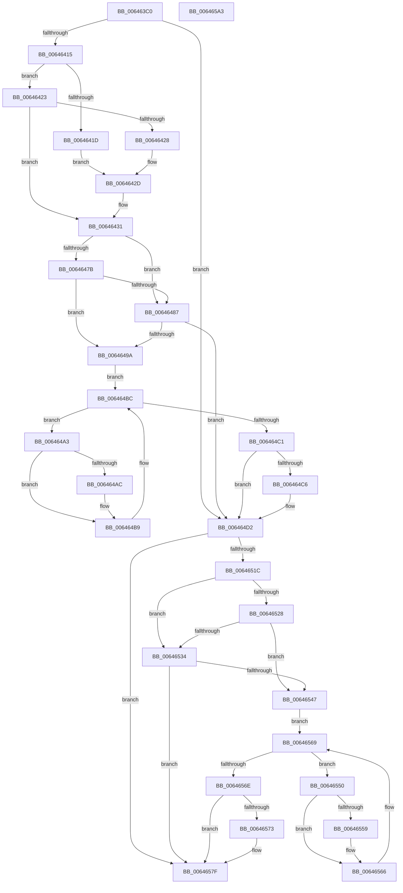

# DifZwQueryDirectoryFileExWrapper

- RVA: `0x006463C0`–`0x006465A4` (길이 `484` bytes)
- VA: `0x00000001406463C0`
- 실행 섹션: `.text`
- PDB 이름 있음: `예`; PDB Function 태그: `아니요`
- unwind 정보 RVA: `0x000D2BDC`
- 디코드: `135`개 명령, `484/484` bytes 표시
- 미해석 바이트: `0` (있으면 어셈블리에 `.byte`로 보존)

> 이 문서는 커널 이미지의 기계어와 PDB 기호를 분석해 생성했습니다. 4번과 5번은 함수 원형과 자료형을 바이너리 사용 방식에서 추정한 C 해석이며 원본 소스 복구 결과는 아닙니다.

## 1. Dependencies

- 직접 호출 지점: **10**; 고유 호출 대상: **7**
- 직접 호출자로 확인된 함수: **0**
- RIP 상대 이미지 참조: **3**

### Outgoing calls
- `0x006463FA` → [memset](../6C/memset_function_006C6C40.md) (function, `0x006C6C40`)
- `0x00646404` → [DifGetAPIThunkContextById](../49/DifGetAPIThunkContextById_function_00495A34.md) (function, `0x00495A34`)
- `0x00646428` → [DifGetReturnAddressForWrappers](../4D/DifGetReturnAddressForWrappers_function_004D3C08.md) (function, `0x004D3C08`)
- `0x0064648E` → [ExAcquireRundownProtection](../21/ExAcquireRundownProtection_function_00216620.md) (function, `0x00216620`)
- `0x006464B4` → [guard_dispatch_icall](../6B/guard_dispatch_icall_function_006BAAD0.md) (function, `0x006BAAD0`)
- `0x006464CD` → [ExReleaseRundownProtection](../34/ExReleaseRundownProtection_function_00349E80.md) (function, `0x00349E80`)
- `0x0064650F` → [ZwQueryDirectoryFileEx](../6A/ZwQueryDirectoryFileEx_function_006AFA90.md) (function, `0x006AFA90`)
- `0x0064653B` → [ExAcquireRundownProtection](../21/ExAcquireRundownProtection_function_00216620.md) (function, `0x00216620`)
- `0x00646561` → [guard_dispatch_icall](../6B/guard_dispatch_icall_function_006BAAD0.md) (function, `0x006BAAD0`)
- `0x0064657A` → [ExReleaseRundownProtection](../34/ExReleaseRundownProtection_function_00349E80.md) (function, `0x00349E80`)

### Direct callers
- 이 함수 시작 RVA로 연결되는 직접 call은 확인되지 않았습니다. 간접 호출은 완전히 역산할 수 없습니다.

### Static image references
- `0x00646438` → RVA `0x00F048B8` (`.data`; read)
- `0x0064647B` → RVA `0x00F04980` (`.data`; read)
- `0x00646487` → RVA `0x00F03E80` (`.data`; read)

## 2. Other-region calls and transfers

- 다른 실행 섹션으로 향하는 call: **0**
- 별도 외부 분기/꼬리 이동을 확인하지 못했습니다.

## 3. Assembly (complete function range)

```asm
006463C0  48 8B C4                        mov rax, rsp
006463C3  48 89 58 10                     mov qword ptr [rax + 0x10], rbx
006463C7  48 89 70 18                     mov qword ptr [rax + 0x18], rsi
006463CB  48 89 78 20                     mov qword ptr [rax + 0x20], rdi
006463CF  48 89 48 08                     mov qword ptr [rax + 8], rcx
006463D3  55                              push rbp
006463D4  41 54                           push r12
006463D6  41 55                           push r13
006463D8  41 56                           push r14
006463DA  41 57                           push r15
006463DC  48 8D 68 D1                     lea rbp, [rax - 0x2f]
006463E0  48 81 EC B0 00 00 00            sub rsp, 0xb0
006463E7  4C 8B EA                        mov r13, rdx
006463EA  48 8D 4D A7                     lea rcx, [rbp - 0x59]
006463EE  33 D2                           xor edx, edx
006463F0  4D 8B E0                        mov r12, r8
006463F3  4D 8B F9                        mov r15, r9
006463F6  44 8D 42 58                     lea r8d, [rdx + 0x58]
006463FA  E8 41 08 08 00                  call 0x1406c6c40
006463FF  B9 38 00 00 00                  mov ecx, 0x38
00646404  E8 2B F6 E4 FF                  call 0x140495a34
00646409  48 8B F0                        mov rsi, rax
0064640C  48 85 C0                        test rax, rax
0064640F  0F 84 BD 00 00 00               je 0x1406464d2
00646415  8B 48 0C                        mov ecx, dword ptr [rax + 0xc]
00646418  F6 C1 18                        test cl, 0x18
0064641B  74 06                           je 0x140646423
0064641D  48 8B 45 2F                     mov rax, qword ptr [rbp + 0x2f]
00646421  EB 0A                           jmp 0x14064642d
00646423  F6 C1 04                        test cl, 4
00646426  74 09                           je 0x140646431
00646428  E8 DB D7 E8 FF                  call 0x1404d3c08
0064642D  48 89 45 A7                     mov qword ptr [rbp - 0x59], rax
00646431  48 8B 45 37                     mov rax, qword ptr [rbp + 0x37]
00646435  45 32 F6                        xor r14b, r14b
00646438  44 38 35 79 E4 8B 00            cmp byte ptr [rip + 0x8be479], r14b
0064643F  48 89 45 EF                     mov qword ptr [rbp - 0x11], rax
00646443  48 8B 45 57                     mov rax, qword ptr [rbp + 0x57]
00646447  48 89 45 CF                     mov qword ptr [rbp - 0x31], rax
0064644B  48 8B 45 5F                     mov rax, qword ptr [rbp + 0x5f]
0064644F  48 89 45 C7                     mov qword ptr [rbp - 0x39], rax
00646453  8B 45 67                        mov eax, dword ptr [rbp + 0x67]
00646456  89 45 BF                        mov dword ptr [rbp - 0x41], eax
00646459  8B 45 6F                        mov eax, dword ptr [rbp + 0x6f]
0064645C  89 45 BB                        mov dword ptr [rbp - 0x45], eax
0064645F  8B 45 77                        mov eax, dword ptr [rbp + 0x77]
00646462  89 45 B7                        mov dword ptr [rbp - 0x49], eax
00646465  48 8B 45 7F                     mov rax, qword ptr [rbp + 0x7f]
00646469  48 89 45 AF                     mov qword ptr [rbp - 0x51], rax
0064646D  4C 89 6D E7                     mov qword ptr [rbp - 0x19], r13
00646471  4C 89 65 DF                     mov qword ptr [rbp - 0x21], r12
00646475  4C 89 7D D7                     mov qword ptr [rbp - 0x29], r15
00646479  75 0C                           jne 0x140646487
0064647B  F7 05 FB E4 8B 00 00 08 00 00   test dword ptr [rip + 0x8be4fb], 0x800
00646485  74 13                           je 0x14064649a
00646487  48 8D 0D F2 D9 8B 00            lea rcx, [rip + 0x8bd9f2]
0064648E  E8 8D 01 BD FF                  call 0x140216620
00646493  44 8A F0                        mov r14b, al
00646496  84 C0                           test al, al
00646498  74 38                           je 0x1406464d2
0064649A  48 8D 7E 20                     lea rdi, [rsi + 0x20]
0064649E  48 8B 1F                        mov rbx, qword ptr [rdi]
006464A1  EB 19                           jmp 0x1406464bc
006464A3  48 8D 43 F0                     lea rax, [rbx - 0x10]
006464A7  48 85 C0                        test rax, rax
006464AA  74 0D                           je 0x1406464b9
006464AC  48 8B 40 08                     mov rax, qword ptr [rax + 8]
006464B0  48 8D 4D A7                     lea rcx, [rbp - 0x59]
006464B4  E8 17 46 07 00                  call 0x1406baad0
006464B9  48 8B 1B                        mov rbx, qword ptr [rbx]
006464BC  48 3B DF                        cmp rbx, rdi
006464BF  75 E2                           jne 0x1406464a3
006464C1  45 84 F6                        test r14b, r14b
006464C4  74 0C                           je 0x1406464d2
006464C6  48 8D 0D B3 D9 8B 00            lea rcx, [rip + 0x8bd9b3]
006464CD  E8 AE 39 D0 FF                  call 0x140349e80
006464D2  48 8B 45 7F                     mov rax, qword ptr [rbp + 0x7f]
006464D6  4D 8B CF                        mov r9, r15
006464D9  48 8B 4D 37                     mov rcx, qword ptr [rbp + 0x37]
006464DD  4D 8B C4                        mov r8, r12
006464E0  48 89 44 24 48                  mov qword ptr [rsp + 0x48], rax
006464E5  49 8B D5                        mov rdx, r13
006464E8  8B 45 77                        mov eax, dword ptr [rbp + 0x77]
006464EB  89 44 24 40                     mov dword ptr [rsp + 0x40], eax
006464EF  8B 45 6F                        mov eax, dword ptr [rbp + 0x6f]
006464F2  89 44 24 38                     mov dword ptr [rsp + 0x38], eax
006464F6  8B 45 67                        mov eax, dword ptr [rbp + 0x67]
006464F9  89 44 24 30                     mov dword ptr [rsp + 0x30], eax
006464FD  48 8B 45 5F                     mov rax, qword ptr [rbp + 0x5f]
00646501  48 89 44 24 28                  mov qword ptr [rsp + 0x28], rax
00646506  48 8B 45 57                     mov rax, qword ptr [rbp + 0x57]
0064650A  48 89 44 24 20                  mov qword ptr [rsp + 0x20], rax
0064650F  E8 7C 95 06 00                  call 0x1406afa90
00646514  89 45 F7                        mov dword ptr [rbp - 9], eax
00646517  48 85 F6                        test rsi, rsi
0064651A  74 63                           je 0x14064657f
0064651C  40 32 FF                        xor dil, dil
0064651F  40 38 3D 92 E3 8B 00            cmp byte ptr [rip + 0x8be392], dil
00646526  75 0C                           jne 0x140646534
00646528  F7 05 4E E4 8B 00 00 08 00 00   test dword ptr [rip + 0x8be44e], 0x800
00646532  74 13                           je 0x140646547
00646534  48 8D 0D 45 D9 8B 00            lea rcx, [rip + 0x8bd945]
0064653B  E8 E0 00 BD FF                  call 0x140216620
00646540  40 8A F8                        mov dil, al
00646543  84 C0                           test al, al
00646545  74 38                           je 0x14064657f
00646547  48 83 C6 30                     add rsi, 0x30
0064654B  48 8B 1E                        mov rbx, qword ptr [rsi]
0064654E  EB 19                           jmp 0x140646569
00646550  48 8D 43 F0                     lea rax, [rbx - 0x10]
00646554  48 85 C0                        test rax, rax
00646557  74 0D                           je 0x140646566
00646559  48 8B 40 08                     mov rax, qword ptr [rax + 8]
0064655D  48 8D 4D A7                     lea rcx, [rbp - 0x59]
00646561  E8 6A 45 07 00                  call 0x1406baad0
00646566  48 8B 1B                        mov rbx, qword ptr [rbx]
00646569  48 3B DE                        cmp rbx, rsi
0064656C  75 E2                           jne 0x140646550
0064656E  40 84 FF                        test dil, dil
00646571  74 0C                           je 0x14064657f
00646573  48 8D 0D 06 D9 8B 00            lea rcx, [rip + 0x8bd906]
0064657A  E8 01 39 D0 FF                  call 0x140349e80
0064657F  8B 45 F7                        mov eax, dword ptr [rbp - 9]
00646582  4C 8D 9C 24 B0 00 00 00         lea r11, [rsp + 0xb0]
0064658A  49 8B 5B 38                     mov rbx, qword ptr [r11 + 0x38]
0064658E  49 8B 73 40                     mov rsi, qword ptr [r11 + 0x40]
00646592  49 8B 7B 48                     mov rdi, qword ptr [r11 + 0x48]
00646596  49 8B E3                        mov rsp, r11
00646599  41 5F                           pop r15
0064659B  41 5E                           pop r14
0064659D  41 5D                           pop r13
0064659F  41 5C                           pop r12
006465A1  5D                              pop rbp
006465A2  C3                              ret
006465A3  CC                              int3
```

## 4. C-style interpretation (structured pseudocode)

```c
__int64 __fastcall DifZwQueryDirectoryFileExWrapper(__int64 a1, __int64 a2, __int64 a3, __int64 a4)
{
    __int64 result;
    __int64 v_r14;
    __int64 v_rdi;
    __int64 v_rsi;
    __int64 v_rsp;
    unsigned __int64 v_stack_m28;
    unsigned __int64 v_stack_m90;
    unsigned int v_stack_m98;
    unsigned int v_stack_mA0;
    unsigned int v_stack_mA8;
    unsigned __int64 v_stack_mB0;
    unsigned __int64 v_stack_mB8;

    *(unsigned __int64 *)(v_rsp + 16) = v_rbx;
    *(unsigned __int64 *)(v_rsp + 24) = v_rsi;
    *(unsigned __int64 *)(v_rsp + 32) = v_rdi;
    *(unsigned __int64 *)(v_rsp + 8) = a1;
    v_rsp = (v_rsp) - (176);
    a2 = 0;
    result = memset(v_rsp - 47 - 89, a2, a2 + 88, a4);
    result = DifGetAPIThunkContextById(56, a2, a2 + 88, a4);
    if (result == 0) goto loc_006464D2;
    if ((((unsigned __int8)((unsigned int)(*(unsigned int *)(result + 12)))) & (24)) == 0) goto loc_00646423;
    goto loc_0064642D;
loc_00646423:
    if ((((unsigned __int8)((unsigned int)(*(unsigned int *)(result + 12)))) & (4)) == 0) goto loc_00646431;
    result = DifGetReturnAddressForWrappers((unsigned int)(*(unsigned int *)(result + 12)), a2, a2 + 88, a4);
loc_0064642D:
    *(unsigned __int64 *)(v_rsp - 47 - 89) = result;
loc_00646431:
    v_r14 = 0;
    *(unsigned __int64 *)(v_rsp - 47 - 17) = *(unsigned __int64 *)(v_rsp - 47 + 55);
    *(unsigned __int64 *)(v_rsp - 47 - 49) = *(unsigned __int64 *)(v_rsp - 47 + 87);
    *(unsigned __int64 *)(v_rsp - 47 - 57) = *(unsigned __int64 *)(v_rsp - 47 + 95);
    *(unsigned int *)(v_rsp - 47 - 65) = (unsigned int)((unsigned int)(*(unsigned int *)(v_rsp - 47 + 103)));
    *(unsigned int *)(v_rsp - 47 - 69) = (unsigned int)((unsigned int)(*(unsigned int *)(v_rsp - 47 + 111)));
    *(unsigned int *)(v_rsp - 47 - 73) = (unsigned int)((unsigned int)(*(unsigned int *)(v_rsp - 47 + 119)));
    *(unsigned __int64 *)(v_rsp - 47 - 81) = *(unsigned __int64 *)(v_rsp - 47 + 127);
    *(unsigned __int64 *)(v_rsp - 47 - 25) = 0;
    *(unsigned __int64 *)(v_rsp - 47 - 33) = a3;
    *(unsigned __int64 *)(v_rsp - 47 - 41) = a4;
    if ((*(unsigned __int8 *)(v_rip + 9167993)) != 0) goto loc_00646487;
    if (((*(unsigned int *)(v_rip + 9168123)) & (0x800ULL)) == 0) goto loc_0064649A;
loc_00646487:
    result = ExAcquireRundownProtection(v_rip + 9165298, a2, a2 + 88, a4);
    if ((unsigned __int8)(result) == 0) goto loc_006464D2;
loc_0064649A:
    goto loc_006464BC;
loc_006464A3:
    result = *(unsigned __int64 *)(result + 32) - 16;
    if (*(unsigned __int64 *)(result + 32) - 16 != 0) {
        result = *(unsigned __int64 *)(*(unsigned __int64 *)(result + 32) - 16 + 8);
        a1 = v_rsp - 47 - 89;
        result = guard_dispatch_icall(a1, a2, a2 + 88, a4);
    }
loc_006464BC:
    if ((*(unsigned __int64 *)(*(unsigned __int64 *)(result + 32))) != (result + 32)) goto loc_006464A3;
    if ((unsigned __int8)((unsigned __int8)(result)) != 0) {
        a1 = v_rip + 9165235;
        result = ExReleaseRundownProtection(a1, a2, a2 + 88, a4);
    }
    v_stack_m90 = *(unsigned __int64 *)(v_rsp - 47 + 127);
    v_stack_m98 = (unsigned int)((unsigned int)(*(unsigned int *)(v_rsp - 47 + 119)));
    v_stack_mA0 = (unsigned int)((unsigned int)(*(unsigned int *)(v_rsp - 47 + 111)));
    v_stack_mA8 = (unsigned int)((unsigned int)(*(unsigned int *)(v_rsp - 47 + 103)));
    v_stack_mB0 = *(unsigned __int64 *)(v_rsp - 47 + 95);
    v_stack_mB8 = *(unsigned __int64 *)(v_rsp - 47 + 87);
    result = ZwQueryDirectoryFileEx(*(unsigned __int64 *)(v_rsp - 47 + 55), 0, a3, a4);
    *(unsigned int *)(v_rsp - 47 - 9) = (unsigned int)(result);
    if (result == 0) goto loc_0064657F;
    v_rdi = 0;
    if ((*(unsigned __int8 *)(v_rip + 9167762)) != 0) goto loc_00646534;
    if (((*(unsigned int *)(v_rip + 9167950)) & (0x800ULL)) == 0) goto loc_00646547;
loc_00646534:
    result = ExAcquireRundownProtection(v_rip + 9165125, 0, a3, a4);
    if ((unsigned __int8)(result) == 0) goto loc_0064657F;
loc_00646547:
    v_rsi = (result) + (48);
    goto loc_00646569;
loc_00646550:
    result = *(unsigned __int64 *)(v_rsi) - 16;
    if (*(unsigned __int64 *)(v_rsi) - 16 != 0) {
        result = *(unsigned __int64 *)(*(unsigned __int64 *)(v_rsi) - 16 + 8);
        a1 = v_rsp - 47 - 89;
        result = guard_dispatch_icall(a1, 0, a3, a4);
    }
loc_00646569:
    if ((*(unsigned __int64 *)(*(unsigned __int64 *)(v_rsi))) != v_rsi) goto loc_00646550;
    if ((unsigned __int8)((unsigned __int8)(result)) != 0) {
        a1 = v_rip + 9165062;
        result = ExReleaseRundownProtection(a1, 0, a3, a4);
    }
    return (unsigned int)(*(unsigned int *)(v_rsp - 47 - 9));
}
```

## 5. (Beta) C Style

```c
int64_t DifZwQueryDirectoryFileExWrapper(int64_t Arg1, int64_t Arg2, int64_t Arg3, int64_t Arg4)
{
    int64_t result;
    int64_t local_r14;
    int64_t local_rdi;
    int64_t local_rsi;
    int64_t local_rsp;
    uint64_t v_stack_m28;
    uint64_t v_stack_m90;
    uint32_t v_stack_m98;
    uint32_t v_stack_mA0;
    uint32_t v_stack_mA8;
    uint64_t v_stack_mB0;
    uint64_t v_stack_mB8;

    *(uint64_t *)(local_rsp + 0x10) = local_rbx;
    *(uint64_t *)(local_rsp + 0x18) = local_rsi;
    *(uint64_t *)(local_rsp + 0x20) = local_rdi;
    *(uint64_t *)(local_rsp + 0x8) = Arg1;
    local_rsp = (local_rsp) - (176);
    Arg2 = 0;
    result = memset(local_rsp - 47 - 89, Arg2, Arg2 + 88, Arg4);
    result = DifGetAPIThunkContextById(56, Arg2, Arg2 + 88, Arg4);
    if (result == 0) goto loc_006464D2;
    if ((((uint8_t)((uint32_t)(*(uint32_t *)(result + 0xC)))) & (24)) == 0) goto loc_00646423;
    goto loc_0064642D;
loc_00646423:
    if ((((uint8_t)((uint32_t)(*(uint32_t *)(result + 0xC)))) & (4)) == 0) goto loc_00646431;
    result = DifGetReturnAddressForWrappers((uint32_t)(*(uint32_t *)(result + 0xC)), Arg2, Arg2 + 88, Arg4);
loc_0064642D:
    *(uint64_t *)(local_rsp - 0x2F - 0x59) = result;
loc_00646431:
    local_r14 = 0;
    *(uint64_t *)(local_rsp - 0x2F - 0x11) = *(uint64_t *)(local_rsp - 0x2F + 0x37);
    *(uint64_t *)(local_rsp - 0x2F - 0x31) = *(uint64_t *)(local_rsp - 0x2F + 0x57);
    *(uint64_t *)(local_rsp - 0x2F - 0x39) = *(uint64_t *)(local_rsp - 0x2F + 0x5F);
    *(uint32_t *)(local_rsp - 0x2F - 0x41) = (uint32_t)((uint32_t)(*(uint32_t *)(local_rsp - 0x2F + 0x67)));
    *(uint32_t *)(local_rsp - 0x2F - 0x45) = (uint32_t)((uint32_t)(*(uint32_t *)(local_rsp - 0x2F + 0x6F)));
    *(uint32_t *)(local_rsp - 0x2F - 0x49) = (uint32_t)((uint32_t)(*(uint32_t *)(local_rsp - 0x2F + 0x77)));
    *(uint64_t *)(local_rsp - 0x2F - 0x51) = *(uint64_t *)(local_rsp - 0x2F + 0x7F);
    *(uint64_t *)(local_rsp - 0x2F - 0x19) = 0;
    *(uint64_t *)(local_rsp - 0x2F - 0x21) = Arg3;
    *(uint64_t *)(local_rsp - 0x2F - 0x29) = Arg4;
    if ((*(uint8_t *)(v_rip + 0x8BE479)) != 0) goto loc_00646487;
    if (((*(uint32_t *)(v_rip + 0x8BE4FB)) & (0x800ULL)) == 0) goto loc_0064649A;
loc_00646487:
    result = ExAcquireRundownProtection(v_rip + 9165298, Arg2, Arg2 + 88, Arg4);
    if ((uint8_t)(result) == 0) goto loc_006464D2;
loc_0064649A:
    goto loc_006464BC;
loc_006464A3:
    result = *(uint64_t *)(result + 0x20) - 16;
    if (*(uint64_t *)(result + 0x20) - 16 != 0) {
        result = *(uint64_t *)(*(uint64_t *)(result + 0x20) - 0x10 + 0x8);
        Arg1 = local_rsp - 47 - 89;
        result = guard_dispatch_icall(Arg1, Arg2, Arg2 + 88, Arg4);
    }
loc_006464BC:
    if ((*(uint64_t *)(*(uint64_t *)(result + 0x20))) != (result + 32)) goto loc_006464A3;
    if ((uint8_t)((uint8_t)(result)) != 0) {
        Arg1 = v_rip + 9165235;
        result = ExReleaseRundownProtection(Arg1, Arg2, Arg2 + 88, Arg4);
    }
    v_stack_m90 = *(uint64_t *)(local_rsp - 0x2F + 0x7F);
    v_stack_m98 = (uint32_t)((uint32_t)(*(uint32_t *)(local_rsp - 0x2F + 0x77)));
    v_stack_mA0 = (uint32_t)((uint32_t)(*(uint32_t *)(local_rsp - 0x2F + 0x6F)));
    v_stack_mA8 = (uint32_t)((uint32_t)(*(uint32_t *)(local_rsp - 0x2F + 0x67)));
    v_stack_mB0 = *(uint64_t *)(local_rsp - 0x2F + 0x5F);
    v_stack_mB8 = *(uint64_t *)(local_rsp - 0x2F + 0x57);
    result = ZwQueryDirectoryFileEx(*(uint64_t *)(local_rsp - 0x2F + 0x37), 0, Arg3, Arg4);
    *(uint32_t *)(local_rsp - 0x2F - 0x9) = (uint32_t)(result);
    if (result == 0) goto loc_0064657F;
    local_rdi = 0;
    if ((*(uint8_t *)(v_rip + 0x8BE392)) != 0) goto loc_00646534;
    if (((*(uint32_t *)(v_rip + 0x8BE44E)) & (0x800ULL)) == 0) goto loc_00646547;
loc_00646534:
    result = ExAcquireRundownProtection(v_rip + 9165125, 0, Arg3, Arg4);
    if ((uint8_t)(result) == 0) goto loc_0064657F;
loc_00646547:
    local_rsi = (result) + (48);
    goto loc_00646569;
loc_00646550:
    result = *(uint64_t *)(local_rsi) - 16;
    if (*(uint64_t *)(local_rsi) - 16 != 0) {
        result = *(uint64_t *)(*(uint64_t *)(local_rsi) - 0x10 + 0x8);
        Arg1 = local_rsp - 47 - 89;
        result = guard_dispatch_icall(Arg1, 0, Arg3, Arg4);
    }
loc_00646569:
    if ((*(uint64_t *)(*(uint64_t *)(local_rsi))) != local_rsi) goto loc_00646550;
    if ((uint8_t)((uint8_t)(result)) != 0) {
        Arg1 = v_rip + 9165062;
        result = ExReleaseRundownProtection(Arg1, 0, Arg3, Arg4);
    }
    return (uint32_t)(*(uint32_t *)(local_rsp - 0x2F - 0x9));
}
```

## 6. Execution-region graph

[열기: 2D/3D 그래프와 함수 탐색 컨트롤 패널](../../../control-panel.html?section=text&rva=0x006463C0&view=graph)

- 2D 그래프는 위에서 아래로 흐르고, 3D 그래프는 빈 공간을 드래그해 회전합니다. Shift+드래그는 이동, 휠은 확대·축소, 함수 노드 선택은 대상 보고서 이동입니다.

### Static fallback


