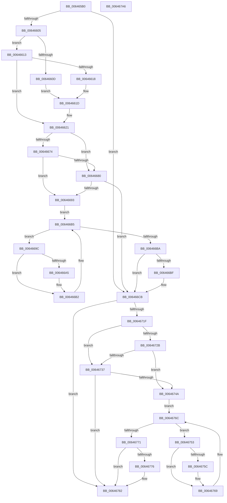

# DifZwQueryDirectoryFileWrapper

- RVA: `0x006465B0`–`0x006467A7` (길이 `503` bytes)
- VA: `0x00000001406465B0`
- 실행 섹션: `.text`
- PDB 이름 있음: `예`; PDB Function 태그: `아니요`
- unwind 정보 RVA: `0x000D2D24`
- 디코드: `139`개 명령, `503/503` bytes 표시
- 미해석 바이트: `0` (있으면 어셈블리에 `.byte`로 보존)

> 이 문서는 커널 이미지의 기계어와 PDB 기호를 분석해 생성했습니다. 4번과 5번은 함수 원형과 자료형을 바이너리 사용 방식에서 추정한 C 해석이며 원본 소스 복구 결과는 아닙니다.

## 1. Dependencies

- 직접 호출 지점: **10**; 고유 호출 대상: **7**
- 직접 호출자로 확인된 함수: **0**
- RIP 상대 이미지 참조: **3**

### Outgoing calls
- `0x006465EA` → [memset](../6C/memset_function_006C6C40.md) (function, `0x006C6C40`)
- `0x006465F4` → [DifGetAPIThunkContextById](../49/DifGetAPIThunkContextById_function_00495A34.md) (function, `0x00495A34`)
- `0x00646618` → [DifGetReturnAddressForWrappers](../4D/DifGetReturnAddressForWrappers_function_004D3C08.md) (function, `0x004D3C08`)
- `0x00646687` → [ExAcquireRundownProtection](../21/ExAcquireRundownProtection_function_00216620.md) (function, `0x00216620`)
- `0x006466AD` → [guard_dispatch_icall](../6B/guard_dispatch_icall_function_006BAAD0.md) (function, `0x006BAAD0`)
- `0x006466C6` → [ExReleaseRundownProtection](../34/ExReleaseRundownProtection_function_00349E80.md) (function, `0x00349E80`)
- `0x00646712` → [ZwQueryDirectoryFile](../6A/ZwQueryDirectoryFile_function_006AD770.md) (function, `0x006AD770`)
- `0x0064673E` → [ExAcquireRundownProtection](../21/ExAcquireRundownProtection_function_00216620.md) (function, `0x00216620`)
- `0x00646764` → [guard_dispatch_icall](../6B/guard_dispatch_icall_function_006BAAD0.md) (function, `0x006BAAD0`)
- `0x0064677D` → [ExReleaseRundownProtection](../34/ExReleaseRundownProtection_function_00349E80.md) (function, `0x00349E80`)

### Direct callers
- 이 함수 시작 RVA로 연결되는 직접 call은 확인되지 않았습니다. 간접 호출은 완전히 역산할 수 없습니다.

### Static image references
- `0x00646628` → RVA `0x00F048B8` (`.data`; read)
- `0x00646674` → RVA `0x00F04980` (`.data`; read)
- `0x00646680` → RVA `0x00F03E80` (`.data`; read)

## 2. Other-region calls and transfers

- 다른 실행 섹션으로 향하는 call: **0**
- 별도 외부 분기/꼬리 이동을 확인하지 못했습니다.

## 3. Assembly (complete function range)

```asm
006465B0  48 8B C4                        mov rax, rsp
006465B3  48 89 58 10                     mov qword ptr [rax + 0x10], rbx
006465B7  48 89 70 18                     mov qword ptr [rax + 0x18], rsi
006465BB  48 89 78 20                     mov qword ptr [rax + 0x20], rdi
006465BF  48 89 48 08                     mov qword ptr [rax + 8], rcx
006465C3  55                              push rbp
006465C4  41 54                           push r12
006465C6  41 55                           push r13
006465C8  41 56                           push r14
006465CA  41 57                           push r15
006465CC  48 8D 68 D1                     lea rbp, [rax - 0x2f]
006465D0  48 81 EC C0 00 00 00            sub rsp, 0xc0
006465D7  4C 8B EA                        mov r13, rdx
006465DA  48 8D 4D A7                     lea rcx, [rbp - 0x59]
006465DE  33 D2                           xor edx, edx
006465E0  4D 8B E0                        mov r12, r8
006465E3  4D 8B F9                        mov r15, r9
006465E6  44 8D 42 60                     lea r8d, [rdx + 0x60]
006465EA  E8 51 06 08 00                  call 0x1406c6c40
006465EF  B9 39 00 00 00                  mov ecx, 0x39
006465F4  E8 3B F4 E4 FF                  call 0x140495a34
006465F9  48 8B F0                        mov rsi, rax
006465FC  48 85 C0                        test rax, rax
006465FF  0F 84 C6 00 00 00               je 0x1406466cb
00646605  8B 48 0C                        mov ecx, dword ptr [rax + 0xc]
00646608  F6 C1 18                        test cl, 0x18
0064660B  74 06                           je 0x140646613
0064660D  48 8B 45 2F                     mov rax, qword ptr [rbp + 0x2f]
00646611  EB 0A                           jmp 0x14064661d
00646613  F6 C1 04                        test cl, 4
00646616  74 09                           je 0x140646621
00646618  E8 EB D5 E8 FF                  call 0x1404d3c08
0064661D  48 89 45 A7                     mov qword ptr [rbp - 0x59], rax
00646621  48 8B 45 37                     mov rax, qword ptr [rbp + 0x37]
00646625  45 32 F6                        xor r14b, r14b
00646628  44 38 35 89 E2 8B 00            cmp byte ptr [rip + 0x8be289], r14b
0064662F  48 89 45 F7                     mov qword ptr [rbp - 9], rax
00646633  48 8B 45 57                     mov rax, qword ptr [rbp + 0x57]
00646637  48 89 45 D7                     mov qword ptr [rbp - 0x29], rax
0064663B  48 8B 45 5F                     mov rax, qword ptr [rbp + 0x5f]
0064663F  48 89 45 CF                     mov qword ptr [rbp - 0x31], rax
00646643  8B 45 67                        mov eax, dword ptr [rbp + 0x67]
00646646  89 45 C7                        mov dword ptr [rbp - 0x39], eax
00646649  8B 45 6F                        mov eax, dword ptr [rbp + 0x6f]
0064664C  89 45 C3                        mov dword ptr [rbp - 0x3d], eax
0064664F  8A 45 77                        mov al, byte ptr [rbp + 0x77]
00646652  88 45 BF                        mov byte ptr [rbp - 0x41], al
00646655  48 8B 45 7F                     mov rax, qword ptr [rbp + 0x7f]
00646659  48 89 45 B7                     mov qword ptr [rbp - 0x49], rax
0064665D  8A 85 87 00 00 00               mov al, byte ptr [rbp + 0x87]
00646663  88 45 AF                        mov byte ptr [rbp - 0x51], al
00646666  4C 89 6D EF                     mov qword ptr [rbp - 0x11], r13
0064666A  4C 89 65 E7                     mov qword ptr [rbp - 0x19], r12
0064666E  4C 89 7D DF                     mov qword ptr [rbp - 0x21], r15
00646672  75 0C                           jne 0x140646680
00646674  F7 05 02 E3 8B 00 00 08 00 00   test dword ptr [rip + 0x8be302], 0x800
0064667E  74 13                           je 0x140646693
00646680  48 8D 0D F9 D7 8B 00            lea rcx, [rip + 0x8bd7f9]
00646687  E8 94 FF BC FF                  call 0x140216620
0064668C  44 8A F0                        mov r14b, al
0064668F  84 C0                           test al, al
00646691  74 38                           je 0x1406466cb
00646693  48 8D 7E 20                     lea rdi, [rsi + 0x20]
00646697  48 8B 1F                        mov rbx, qword ptr [rdi]
0064669A  EB 19                           jmp 0x1406466b5
0064669C  48 8D 43 F0                     lea rax, [rbx - 0x10]
006466A0  48 85 C0                        test rax, rax
006466A3  74 0D                           je 0x1406466b2
006466A5  48 8B 40 08                     mov rax, qword ptr [rax + 8]
006466A9  48 8D 4D A7                     lea rcx, [rbp - 0x59]
006466AD  E8 1E 44 07 00                  call 0x1406baad0
006466B2  48 8B 1B                        mov rbx, qword ptr [rbx]
006466B5  48 3B DF                        cmp rbx, rdi
006466B8  75 E2                           jne 0x14064669c
006466BA  45 84 F6                        test r14b, r14b
006466BD  74 0C                           je 0x1406466cb
006466BF  48 8D 0D BA D7 8B 00            lea rcx, [rip + 0x8bd7ba]
006466C6  E8 B5 37 D0 FF                  call 0x140349e80
006466CB  8A 85 87 00 00 00               mov al, byte ptr [rbp + 0x87]
006466D1  4D 8B CF                        mov r9, r15
006466D4  48 8B 4D 37                     mov rcx, qword ptr [rbp + 0x37]
006466D8  4D 8B C4                        mov r8, r12
006466DB  88 44 24 50                     mov byte ptr [rsp + 0x50], al
006466DF  49 8B D5                        mov rdx, r13
006466E2  48 8B 45 7F                     mov rax, qword ptr [rbp + 0x7f]
006466E6  48 89 44 24 48                  mov qword ptr [rsp + 0x48], rax
006466EB  8A 45 77                        mov al, byte ptr [rbp + 0x77]
006466EE  88 44 24 40                     mov byte ptr [rsp + 0x40], al
006466F2  8B 45 6F                        mov eax, dword ptr [rbp + 0x6f]
006466F5  89 44 24 38                     mov dword ptr [rsp + 0x38], eax
006466F9  8B 45 67                        mov eax, dword ptr [rbp + 0x67]
006466FC  89 44 24 30                     mov dword ptr [rsp + 0x30], eax
00646700  48 8B 45 5F                     mov rax, qword ptr [rbp + 0x5f]
00646704  48 89 44 24 28                  mov qword ptr [rsp + 0x28], rax
00646709  48 8B 45 57                     mov rax, qword ptr [rbp + 0x57]
0064670D  48 89 44 24 20                  mov qword ptr [rsp + 0x20], rax
00646712  E8 59 70 06 00                  call 0x1406ad770
00646717  89 45 FF                        mov dword ptr [rbp - 1], eax
0064671A  48 85 F6                        test rsi, rsi
0064671D  74 63                           je 0x140646782
0064671F  40 32 FF                        xor dil, dil
00646722  40 38 3D 8F E1 8B 00            cmp byte ptr [rip + 0x8be18f], dil
00646729  75 0C                           jne 0x140646737
0064672B  F7 05 4B E2 8B 00 00 08 00 00   test dword ptr [rip + 0x8be24b], 0x800
00646735  74 13                           je 0x14064674a
00646737  48 8D 0D 42 D7 8B 00            lea rcx, [rip + 0x8bd742]
0064673E  E8 DD FE BC FF                  call 0x140216620
00646743  40 8A F8                        mov dil, al
00646746  84 C0                           test al, al
00646748  74 38                           je 0x140646782
0064674A  48 83 C6 30                     add rsi, 0x30
0064674E  48 8B 1E                        mov rbx, qword ptr [rsi]
00646751  EB 19                           jmp 0x14064676c
00646753  48 8D 43 F0                     lea rax, [rbx - 0x10]
00646757  48 85 C0                        test rax, rax
0064675A  74 0D                           je 0x140646769
0064675C  48 8B 40 08                     mov rax, qword ptr [rax + 8]
00646760  48 8D 4D A7                     lea rcx, [rbp - 0x59]
00646764  E8 67 43 07 00                  call 0x1406baad0
00646769  48 8B 1B                        mov rbx, qword ptr [rbx]
0064676C  48 3B DE                        cmp rbx, rsi
0064676F  75 E2                           jne 0x140646753
00646771  40 84 FF                        test dil, dil
00646774  74 0C                           je 0x140646782
00646776  48 8D 0D 03 D7 8B 00            lea rcx, [rip + 0x8bd703]
0064677D  E8 FE 36 D0 FF                  call 0x140349e80
00646782  8B 45 FF                        mov eax, dword ptr [rbp - 1]
00646785  4C 8D 9C 24 C0 00 00 00         lea r11, [rsp + 0xc0]
0064678D  49 8B 5B 38                     mov rbx, qword ptr [r11 + 0x38]
00646791  49 8B 73 40                     mov rsi, qword ptr [r11 + 0x40]
00646795  49 8B 7B 48                     mov rdi, qword ptr [r11 + 0x48]
00646799  49 8B E3                        mov rsp, r11
0064679C  41 5F                           pop r15
0064679E  41 5E                           pop r14
006467A0  41 5D                           pop r13
006467A2  41 5C                           pop r12
006467A4  5D                              pop rbp
006467A5  C3                              ret
006467A6  CC                              int3
```

## 4. C-style interpretation (structured pseudocode)

```c
__int64 __fastcall DifZwQueryDirectoryFileWrapper(__int64 a1, __int64 a2, __int64 a3, __int64 a4)
{
    __int64 result;
    __int64 v_r14;
    __int64 v_rdi;
    __int64 v_rsi;
    __int64 v_rsp;
    unsigned __int64 v_stack_m28;
    unsigned __int8 v_stack_m98;
    unsigned __int64 v_stack_mA0;
    unsigned __int8 v_stack_mA8;
    unsigned int v_stack_mB0;
    unsigned int v_stack_mB8;
    unsigned __int64 v_stack_mC0;
    unsigned __int64 v_stack_mC8;

    *(unsigned __int64 *)(v_rsp + 16) = v_rbx;
    *(unsigned __int64 *)(v_rsp + 24) = v_rsi;
    *(unsigned __int64 *)(v_rsp + 32) = v_rdi;
    *(unsigned __int64 *)(v_rsp + 8) = a1;
    v_rsp = (v_rsp) - (192);
    a2 = 0;
    result = memset(v_rsp - 47 - 89, a2, a2 + 96, a4);
    result = DifGetAPIThunkContextById(57, a2, a2 + 96, a4);
    if (result == 0) goto loc_006466CB;
    if ((((unsigned __int8)((unsigned int)(*(unsigned int *)(result + 12)))) & (24)) == 0) goto loc_00646613;
    goto loc_0064661D;
loc_00646613:
    if ((((unsigned __int8)((unsigned int)(*(unsigned int *)(result + 12)))) & (4)) == 0) goto loc_00646621;
    result = DifGetReturnAddressForWrappers((unsigned int)(*(unsigned int *)(result + 12)), a2, a2 + 96, a4);
loc_0064661D:
    *(unsigned __int64 *)(v_rsp - 47 - 89) = result;
loc_00646621:
    v_r14 = 0;
    *(unsigned __int64 *)(v_rsp - 47 - 9) = *(unsigned __int64 *)(v_rsp - 47 + 55);
    *(unsigned __int64 *)(v_rsp - 47 - 41) = *(unsigned __int64 *)(v_rsp - 47 + 87);
    *(unsigned __int64 *)(v_rsp - 47 - 49) = *(unsigned __int64 *)(v_rsp - 47 + 95);
    *(unsigned int *)(v_rsp - 47 - 57) = (unsigned int)((unsigned int)(*(unsigned int *)(v_rsp - 47 + 103)));
    *(unsigned int *)(v_rsp - 47 - 61) = (unsigned int)((unsigned int)(*(unsigned int *)(v_rsp - 47 + 111)));
    *(unsigned __int8 *)(v_rsp - 47 - 65) = (unsigned __int8)(*(unsigned __int8 *)(v_rsp - 47 + 119));
    *(unsigned __int64 *)(v_rsp - 47 - 73) = *(unsigned __int64 *)(v_rsp - 47 + 127);
    *(unsigned __int8 *)(v_rsp - 47 - 81) = (unsigned __int8)(*(unsigned __int8 *)(v_rsp - 47 + 135));
    *(unsigned __int64 *)(v_rsp - 47 - 17) = 0;
    *(unsigned __int64 *)(v_rsp - 47 - 25) = a3;
    *(unsigned __int64 *)(v_rsp - 47 - 33) = a4;
    if ((*(unsigned __int8 *)(v_rip + 9167497)) != 0) goto loc_00646680;
    if (((*(unsigned int *)(v_rip + 9167618)) & (0x800ULL)) == 0) goto loc_00646693;
loc_00646680:
    result = ExAcquireRundownProtection(v_rip + 9164793, a2, a2 + 96, a4);
    if ((unsigned __int8)(result) == 0) goto loc_006466CB;
loc_00646693:
    goto loc_006466B5;
loc_0064669C:
    result = *(unsigned __int64 *)(result + 32) - 16;
    if (*(unsigned __int64 *)(result + 32) - 16 != 0) {
        result = *(unsigned __int64 *)(*(unsigned __int64 *)(result + 32) - 16 + 8);
        a1 = v_rsp - 47 - 89;
        result = guard_dispatch_icall(a1, a2, a2 + 96, a4);
    }
loc_006466B5:
    if ((*(unsigned __int64 *)(*(unsigned __int64 *)(result + 32))) != (result + 32)) goto loc_0064669C;
    if ((unsigned __int8)((unsigned __int8)(result)) != 0) {
        a1 = v_rip + 9164730;
        result = ExReleaseRundownProtection(a1, a2, a2 + 96, a4);
    }
    v_stack_m98 = (unsigned __int8)(*(unsigned __int8 *)(v_rsp - 47 + 135));
    v_stack_mA0 = *(unsigned __int64 *)(v_rsp - 47 + 127);
    v_stack_mA8 = (unsigned __int8)(*(unsigned __int8 *)(v_rsp - 47 + 119));
    v_stack_mB0 = (unsigned int)((unsigned int)(*(unsigned int *)(v_rsp - 47 + 111)));
    v_stack_mB8 = (unsigned int)((unsigned int)(*(unsigned int *)(v_rsp - 47 + 103)));
    v_stack_mC0 = *(unsigned __int64 *)(v_rsp - 47 + 95);
    v_stack_mC8 = *(unsigned __int64 *)(v_rsp - 47 + 87);
    result = ZwQueryDirectoryFile(*(unsigned __int64 *)(v_rsp - 47 + 55), 0, a3, a4);
    *(unsigned int *)(v_rsp - 47 - 1) = (unsigned int)(result);
    if (result == 0) goto loc_00646782;
    v_rdi = 0;
    if ((*(unsigned __int8 *)(v_rip + 9167247)) != 0) goto loc_00646737;
    if (((*(unsigned int *)(v_rip + 9167435)) & (0x800ULL)) == 0) goto loc_0064674A;
loc_00646737:
    result = ExAcquireRundownProtection(v_rip + 9164610, 0, a3, a4);
    if ((unsigned __int8)(result) == 0) goto loc_00646782;
loc_0064674A:
    v_rsi = (result) + (48);
    goto loc_0064676C;
loc_00646753:
    result = *(unsigned __int64 *)(v_rsi) - 16;
    if (*(unsigned __int64 *)(v_rsi) - 16 != 0) {
        result = *(unsigned __int64 *)(*(unsigned __int64 *)(v_rsi) - 16 + 8);
        a1 = v_rsp - 47 - 89;
        result = guard_dispatch_icall(a1, 0, a3, a4);
    }
loc_0064676C:
    if ((*(unsigned __int64 *)(*(unsigned __int64 *)(v_rsi))) != v_rsi) goto loc_00646753;
    if ((unsigned __int8)((unsigned __int8)(result)) != 0) {
        a1 = v_rip + 9164547;
        result = ExReleaseRundownProtection(a1, 0, a3, a4);
    }
    return (unsigned int)(*(unsigned int *)(v_rsp - 47 - 1));
}
```

## 5. (Beta) C Style

```c
int64_t DifZwQueryDirectoryFileWrapper(int64_t Arg1, int64_t Arg2, int64_t Arg3, int64_t Arg4)
{
    int64_t result;
    int64_t local_r14;
    int64_t local_rdi;
    int64_t local_rsi;
    int64_t local_rsp;
    uint64_t v_stack_m28;
    uint8_t v_stack_m98;
    uint64_t v_stack_mA0;
    uint8_t v_stack_mA8;
    uint32_t v_stack_mB0;
    uint32_t v_stack_mB8;
    uint64_t v_stack_mC0;
    uint64_t v_stack_mC8;

    *(uint64_t *)(local_rsp + 0x10) = local_rbx;
    *(uint64_t *)(local_rsp + 0x18) = local_rsi;
    *(uint64_t *)(local_rsp + 0x20) = local_rdi;
    *(uint64_t *)(local_rsp + 0x8) = Arg1;
    local_rsp = (local_rsp) - (192);
    Arg2 = 0;
    result = memset(local_rsp - 47 - 89, Arg2, Arg2 + 96, Arg4);
    result = DifGetAPIThunkContextById(57, Arg2, Arg2 + 96, Arg4);
    if (result == 0) goto loc_006466CB;
    if ((((uint8_t)((uint32_t)(*(uint32_t *)(result + 0xC)))) & (24)) == 0) goto loc_00646613;
    goto loc_0064661D;
loc_00646613:
    if ((((uint8_t)((uint32_t)(*(uint32_t *)(result + 0xC)))) & (4)) == 0) goto loc_00646621;
    result = DifGetReturnAddressForWrappers((uint32_t)(*(uint32_t *)(result + 0xC)), Arg2, Arg2 + 96, Arg4);
loc_0064661D:
    *(uint64_t *)(local_rsp - 0x2F - 0x59) = result;
loc_00646621:
    local_r14 = 0;
    *(uint64_t *)(local_rsp - 0x2F - 0x9) = *(uint64_t *)(local_rsp - 0x2F + 0x37);
    *(uint64_t *)(local_rsp - 0x2F - 0x29) = *(uint64_t *)(local_rsp - 0x2F + 0x57);
    *(uint64_t *)(local_rsp - 0x2F - 0x31) = *(uint64_t *)(local_rsp - 0x2F + 0x5F);
    *(uint32_t *)(local_rsp - 0x2F - 0x39) = (uint32_t)((uint32_t)(*(uint32_t *)(local_rsp - 0x2F + 0x67)));
    *(uint32_t *)(local_rsp - 0x2F - 0x3D) = (uint32_t)((uint32_t)(*(uint32_t *)(local_rsp - 0x2F + 0x6F)));
    *(uint8_t *)(local_rsp - 0x2F - 0x41) = (uint8_t)(*(uint8_t *)(local_rsp - 0x2F + 0x77));
    *(uint64_t *)(local_rsp - 0x2F - 0x49) = *(uint64_t *)(local_rsp - 0x2F + 0x7F);
    *(uint8_t *)(local_rsp - 0x2F - 0x51) = (uint8_t)(*(uint8_t *)(local_rsp - 0x2F + 0x87));
    *(uint64_t *)(local_rsp - 0x2F - 0x11) = 0;
    *(uint64_t *)(local_rsp - 0x2F - 0x19) = Arg3;
    *(uint64_t *)(local_rsp - 0x2F - 0x21) = Arg4;
    if ((*(uint8_t *)(v_rip + 0x8BE289)) != 0) goto loc_00646680;
    if (((*(uint32_t *)(v_rip + 0x8BE302)) & (0x800ULL)) == 0) goto loc_00646693;
loc_00646680:
    result = ExAcquireRundownProtection(v_rip + 9164793, Arg2, Arg2 + 96, Arg4);
    if ((uint8_t)(result) == 0) goto loc_006466CB;
loc_00646693:
    goto loc_006466B5;
loc_0064669C:
    result = *(uint64_t *)(result + 0x20) - 16;
    if (*(uint64_t *)(result + 0x20) - 16 != 0) {
        result = *(uint64_t *)(*(uint64_t *)(result + 0x20) - 0x10 + 0x8);
        Arg1 = local_rsp - 47 - 89;
        result = guard_dispatch_icall(Arg1, Arg2, Arg2 + 96, Arg4);
    }
loc_006466B5:
    if ((*(uint64_t *)(*(uint64_t *)(result + 0x20))) != (result + 32)) goto loc_0064669C;
    if ((uint8_t)((uint8_t)(result)) != 0) {
        Arg1 = v_rip + 9164730;
        result = ExReleaseRundownProtection(Arg1, Arg2, Arg2 + 96, Arg4);
    }
    v_stack_m98 = (uint8_t)(*(uint8_t *)(local_rsp - 0x2F + 0x87));
    v_stack_mA0 = *(uint64_t *)(local_rsp - 0x2F + 0x7F);
    v_stack_mA8 = (uint8_t)(*(uint8_t *)(local_rsp - 0x2F + 0x77));
    v_stack_mB0 = (uint32_t)((uint32_t)(*(uint32_t *)(local_rsp - 0x2F + 0x6F)));
    v_stack_mB8 = (uint32_t)((uint32_t)(*(uint32_t *)(local_rsp - 0x2F + 0x67)));
    v_stack_mC0 = *(uint64_t *)(local_rsp - 0x2F + 0x5F);
    v_stack_mC8 = *(uint64_t *)(local_rsp - 0x2F + 0x57);
    result = ZwQueryDirectoryFile(*(uint64_t *)(local_rsp - 0x2F + 0x37), 0, Arg3, Arg4);
    *(uint32_t *)(local_rsp - 0x2F - 0x1) = (uint32_t)(result);
    if (result == 0) goto loc_00646782;
    local_rdi = 0;
    if ((*(uint8_t *)(v_rip + 0x8BE18F)) != 0) goto loc_00646737;
    if (((*(uint32_t *)(v_rip + 0x8BE24B)) & (0x800ULL)) == 0) goto loc_0064674A;
loc_00646737:
    result = ExAcquireRundownProtection(v_rip + 9164610, 0, Arg3, Arg4);
    if ((uint8_t)(result) == 0) goto loc_00646782;
loc_0064674A:
    local_rsi = (result) + (48);
    goto loc_0064676C;
loc_00646753:
    result = *(uint64_t *)(local_rsi) - 16;
    if (*(uint64_t *)(local_rsi) - 16 != 0) {
        result = *(uint64_t *)(*(uint64_t *)(local_rsi) - 0x10 + 0x8);
        Arg1 = local_rsp - 47 - 89;
        result = guard_dispatch_icall(Arg1, 0, Arg3, Arg4);
    }
loc_0064676C:
    if ((*(uint64_t *)(*(uint64_t *)(local_rsi))) != local_rsi) goto loc_00646753;
    if ((uint8_t)((uint8_t)(result)) != 0) {
        Arg1 = v_rip + 9164547;
        result = ExReleaseRundownProtection(Arg1, 0, Arg3, Arg4);
    }
    return (uint32_t)(*(uint32_t *)(local_rsp - 0x2F - 0x1));
}
```

## 6. Execution-region graph

[열기: 2D/3D 그래프와 함수 탐색 컨트롤 패널](../../../control-panel.html?section=text&rva=0x006465B0&view=graph)

- 2D 그래프는 위에서 아래로 흐르고, 3D 그래프는 빈 공간을 드래그해 회전합니다. Shift+드래그는 이동, 휠은 확대·축소, 함수 노드 선택은 대상 보고서 이동입니다.

### Static fallback


