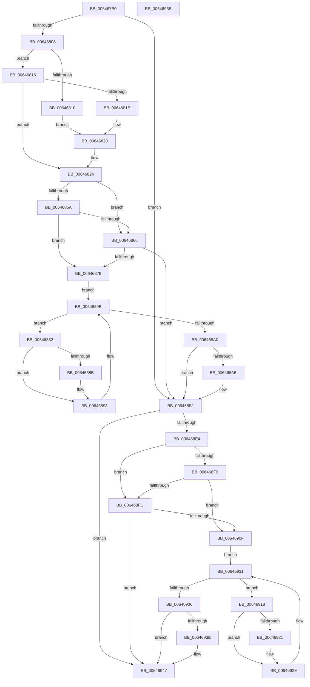

# DifZwQueryDirectoryObjectWrapper

- RVA: `0x006467B0`–`0x0064696C` (길이 `444` bytes)
- VA: `0x00000001406467B0`
- 실행 섹션: `.text`
- PDB 이름 있음: `예`; PDB Function 태그: `아니요`
- unwind 정보 RVA: `0x000BC530`
- 디코드: `125`개 명령, `444/444` bytes 표시
- 미해석 바이트: `0` (있으면 어셈블리에 `.byte`로 보존)

> 이 문서는 커널 이미지의 기계어와 PDB 기호를 분석해 생성했습니다. 4번과 5번은 함수 원형과 자료형을 바이너리 사용 방식에서 추정한 C 해석이며 원본 소스 복구 결과는 아닙니다.

## 1. Dependencies

- 직접 호출 지점: **9**; 고유 호출 대상: **6**
- 직접 호출자로 확인된 함수: **0**
- RIP 상대 이미지 참조: **3**

### Outgoing calls
- `0x006467F7` → [DifGetAPIThunkContextById](../49/DifGetAPIThunkContextById_function_00495A34.md) (function, `0x00495A34`)
- `0x0064681B` → [DifGetReturnAddressForWrappers](../4D/DifGetReturnAddressForWrappers_function_004D3C08.md) (function, `0x004D3C08`)
- `0x0064686D` → [ExAcquireRundownProtection](../21/ExAcquireRundownProtection_function_00216620.md) (function, `0x00216620`)
- `0x00646893` → [guard_dispatch_icall](../6B/guard_dispatch_icall_function_006BAAD0.md) (function, `0x006BAAD0`)
- `0x006468AC` → [ExReleaseRundownProtection](../34/ExReleaseRundownProtection_function_00349E80.md) (function, `0x00349E80`)
- `0x006468D7` → [ZwQueryDirectoryObject](../6A/ZwQueryDirectoryObject_function_006AFAB0.md) (function, `0x006AFAB0`)
- `0x00646903` → [ExAcquireRundownProtection](../21/ExAcquireRundownProtection_function_00216620.md) (function, `0x00216620`)
- `0x00646929` → [guard_dispatch_icall](../6B/guard_dispatch_icall_function_006BAAD0.md) (function, `0x006BAAD0`)
- `0x00646942` → [ExReleaseRundownProtection](../34/ExReleaseRundownProtection_function_00349E80.md) (function, `0x00349E80`)

### Direct callers
- 이 함수 시작 RVA로 연결되는 직접 call은 확인되지 않았습니다. 간접 호출은 완전히 역산할 수 없습니다.

### Static image references
- `0x0064682B` → RVA `0x00F048B8` (`.data`; read)
- `0x0064685A` → RVA `0x00F04980` (`.data`; read)
- `0x00646866` → RVA `0x00F03E80` (`.data`; read)

## 2. Other-region calls and transfers

- 다른 실행 섹션으로 향하는 call: **0**
- 별도 외부 분기/꼬리 이동을 확인하지 못했습니다.

## 3. Assembly (complete function range)

```asm
006467B0  48 8B C4                        mov rax, rsp
006467B3  48 89 58 10                     mov qword ptr [rax + 0x10], rbx
006467B7  48 89 70 18                     mov qword ptr [rax + 0x18], rsi
006467BB  48 89 78 20                     mov qword ptr [rax + 0x20], rdi
006467BF  48 89 48 08                     mov qword ptr [rax + 8], rcx
006467C3  55                              push rbp
006467C4  41 54                           push r12
006467C6  41 55                           push r13
006467C8  41 56                           push r14
006467CA  41 57                           push r15
006467CC  48 8B EC                        mov rbp, rsp
006467CF  48 81 EC 80 00 00 00            sub rsp, 0x80
006467D6  33 C0                           xor eax, eax
006467D8  0F 57 C0                        xorps xmm0, xmm0
006467DB  45 8A F9                        mov r15b, r9b
006467DE  48 89 45 F0                     mov qword ptr [rbp - 0x10], rax
006467E2  45 8B E0                        mov r12d, r8d
006467E5  4C 8B EA                        mov r13, rdx
006467E8  0F 11 45 C0                     movups xmmword ptr [rbp - 0x40], xmm0
006467EC  8D 48 37                        lea ecx, [rax + 0x37]
006467EF  0F 11 45 D0                     movups xmmword ptr [rbp - 0x30], xmm0
006467F3  0F 11 45 E0                     movups xmmword ptr [rbp - 0x20], xmm0
006467F7  E8 38 F2 E4 FF                  call 0x140495a34
006467FC  4C 8B F0                        mov r14, rax
006467FF  48 85 C0                        test rax, rax
00646802  0F 84 A9 00 00 00               je 0x1406468b1
00646808  8B 48 0C                        mov ecx, dword ptr [rax + 0xc]
0064680B  F6 C1 18                        test cl, 0x18
0064680E  74 06                           je 0x140646816
00646810  48 8B 45 28                     mov rax, qword ptr [rbp + 0x28]
00646814  EB 0A                           jmp 0x140646820
00646816  F6 C1 04                        test cl, 4
00646819  74 09                           je 0x140646824
0064681B  E8 E8 D3 E8 FF                  call 0x1404d3c08
00646820  48 89 45 C0                     mov qword ptr [rbp - 0x40], rax
00646824  48 8B 45 30                     mov rax, qword ptr [rbp + 0x30]
00646828  40 32 F6                        xor sil, sil
0064682B  40 38 35 86 E0 8B 00            cmp byte ptr [rip + 0x8be086], sil
00646832  48 89 45 E8                     mov qword ptr [rbp - 0x18], rax
00646836  8A 45 50                        mov al, byte ptr [rbp + 0x50]
00646839  88 45 D8                        mov byte ptr [rbp - 0x28], al
0064683C  48 8B 45 58                     mov rax, qword ptr [rbp + 0x58]
00646840  48 89 45 D0                     mov qword ptr [rbp - 0x30], rax
00646844  48 8B 45 60                     mov rax, qword ptr [rbp + 0x60]
00646848  48 89 45 C8                     mov qword ptr [rbp - 0x38], rax
0064684C  4C 89 6D E0                     mov qword ptr [rbp - 0x20], r13
00646850  44 89 65 DC                     mov dword ptr [rbp - 0x24], r12d
00646854  44 88 7D D9                     mov byte ptr [rbp - 0x27], r15b
00646858  75 0C                           jne 0x140646866
0064685A  F7 05 1C E1 8B 00 00 08 00 00   test dword ptr [rip + 0x8be11c], 0x800
00646864  74 13                           je 0x140646879
00646866  48 8D 0D 13 D6 8B 00            lea rcx, [rip + 0x8bd613]
0064686D  E8 AE FD BC FF                  call 0x140216620
00646872  40 8A F0                        mov sil, al
00646875  84 C0                           test al, al
00646877  74 38                           je 0x1406468b1
00646879  49 8D 7E 20                     lea rdi, [r14 + 0x20]
0064687D  48 8B 1F                        mov rbx, qword ptr [rdi]
00646880  EB 19                           jmp 0x14064689b
00646882  48 8D 43 F0                     lea rax, [rbx - 0x10]
00646886  48 85 C0                        test rax, rax
00646889  74 0D                           je 0x140646898
0064688B  48 8B 40 08                     mov rax, qword ptr [rax + 8]
0064688F  48 8D 4D C0                     lea rcx, [rbp - 0x40]
00646893  E8 38 42 07 00                  call 0x1406baad0
00646898  48 8B 1B                        mov rbx, qword ptr [rbx]
0064689B  48 3B DF                        cmp rbx, rdi
0064689E  75 E2                           jne 0x140646882
006468A0  40 84 F6                        test sil, sil
006468A3  74 0C                           je 0x1406468b1
006468A5  48 8D 0D D4 D5 8B 00            lea rcx, [rip + 0x8bd5d4]
006468AC  E8 CF 35 D0 FF                  call 0x140349e80
006468B1  48 8B 45 60                     mov rax, qword ptr [rbp + 0x60]
006468B5  45 8A CF                        mov r9b, r15b
006468B8  48 8B 4D 30                     mov rcx, qword ptr [rbp + 0x30]
006468BC  45 8B C4                        mov r8d, r12d
006468BF  48 89 44 24 30                  mov qword ptr [rsp + 0x30], rax
006468C4  49 8B D5                        mov rdx, r13
006468C7  48 8B 45 58                     mov rax, qword ptr [rbp + 0x58]
006468CB  48 89 44 24 28                  mov qword ptr [rsp + 0x28], rax
006468D0  8A 45 50                        mov al, byte ptr [rbp + 0x50]
006468D3  88 44 24 20                     mov byte ptr [rsp + 0x20], al
006468D7  E8 D4 91 06 00                  call 0x1406afab0
006468DC  89 45 F0                        mov dword ptr [rbp - 0x10], eax
006468DF  4D 85 F6                        test r14, r14
006468E2  74 63                           je 0x140646947
006468E4  40 32 FF                        xor dil, dil
006468E7  40 38 3D CA DF 8B 00            cmp byte ptr [rip + 0x8bdfca], dil
006468EE  75 0C                           jne 0x1406468fc
006468F0  F7 05 86 E0 8B 00 00 08 00 00   test dword ptr [rip + 0x8be086], 0x800
006468FA  74 13                           je 0x14064690f
006468FC  48 8D 0D 7D D5 8B 00            lea rcx, [rip + 0x8bd57d]
00646903  E8 18 FD BC FF                  call 0x140216620
00646908  40 8A F8                        mov dil, al
0064690B  84 C0                           test al, al
0064690D  74 38                           je 0x140646947
0064690F  49 8D 76 30                     lea rsi, [r14 + 0x30]
00646913  48 8B 1E                        mov rbx, qword ptr [rsi]
00646916  EB 19                           jmp 0x140646931
00646918  48 8D 43 F0                     lea rax, [rbx - 0x10]
0064691C  48 85 C0                        test rax, rax
0064691F  74 0D                           je 0x14064692e
00646921  48 8B 40 08                     mov rax, qword ptr [rax + 8]
00646925  48 8D 4D C0                     lea rcx, [rbp - 0x40]
00646929  E8 A2 41 07 00                  call 0x1406baad0
0064692E  48 8B 1B                        mov rbx, qword ptr [rbx]
00646931  48 3B DE                        cmp rbx, rsi
00646934  75 E2                           jne 0x140646918
00646936  40 84 FF                        test dil, dil
00646939  74 0C                           je 0x140646947
0064693B  48 8D 0D 3E D5 8B 00            lea rcx, [rip + 0x8bd53e]
00646942  E8 39 35 D0 FF                  call 0x140349e80
00646947  8B 45 F0                        mov eax, dword ptr [rbp - 0x10]
0064694A  4C 8D 9C 24 80 00 00 00         lea r11, [rsp + 0x80]
00646952  49 8B 5B 38                     mov rbx, qword ptr [r11 + 0x38]
00646956  49 8B 73 40                     mov rsi, qword ptr [r11 + 0x40]
0064695A  49 8B 7B 48                     mov rdi, qword ptr [r11 + 0x48]
0064695E  49 8B E3                        mov rsp, r11
00646961  41 5F                           pop r15
00646963  41 5E                           pop r14
00646965  41 5D                           pop r13
00646967  41 5C                           pop r12
00646969  5D                              pop rbp
0064696A  C3                              ret
0064696B  CC                              int3
```

## 4. C-style interpretation (structured pseudocode)

```c
__int64 __fastcall DifZwQueryDirectoryObjectWrapper(__int64 a1, __int64 a2, int a3, unsigned __int8 a4, unsigned __int8 a5, __int64 a6, __int64 a7)
{
    __int64 result;
    __int64 v_rdi;
    __int64 v_rsi;
    __int64 v_rsp;
    unsigned __int64 v_stack_m28;
    unsigned __int64 v_stack_m38;
    unsigned __int64 v_stack_m40;
    unsigned __int64 v_stack_m48;
    unsigned int v_stack_m4C;
    unsigned __int8 v_stack_m4F;
    unsigned __int8 v_stack_m50;
    unsigned __int64 v_stack_m58;
    unsigned __int64 v_stack_m60;
    unsigned __int64 v_stack_m68;
    unsigned __int64 v_stack_m78;
    unsigned __int64 v_stack_m80;
    unsigned __int8 v_stack_m88;
    unsigned __int64 v_stack_p0;
    unsigned __int64 v_stack_p8;

    *(unsigned __int64 *)(v_rsp + 16) = v_rbx;
    *(unsigned __int64 *)(v_rsp + 24) = v_rsi;
    *(unsigned __int64 *)(v_rsp + 32) = v_rdi;
    *(unsigned __int64 *)(v_rsp + 8) = a1;
    v_rsp = (v_rsp) - (128);
    result = 0;
    v_stack_m38 = 0;
    v_stack_m68 = v_xmm0;
    v_stack_m58 = v_xmm0;
    v_stack_m48 = v_xmm0;
    result = DifGetAPIThunkContextById(result + 55, a2, a3, a4);
    if (result == 0) goto loc_006468B1;
    if ((((unsigned __int8)((unsigned int)(*(unsigned int *)(result + 12)))) & (24)) == 0) goto loc_00646816;
    goto loc_00646820;
loc_00646816:
    if ((((unsigned __int8)((unsigned int)(*(unsigned int *)(result + 12)))) & (4)) == 0) goto loc_00646824;
    result = DifGetReturnAddressForWrappers((unsigned int)(*(unsigned int *)(result + 12)), a2, a3, a4);
loc_00646820:
    v_stack_m68 = result;
loc_00646824:
    v_rsi = 0;
    v_stack_m40 = v_stack_p8;
    v_stack_m50 = a5;
    v_stack_m58 = a6;
    v_stack_m60 = a7;
    v_stack_m48 = a2;
    v_stack_m4C = (unsigned int)((unsigned int)(a3));
    v_stack_m4F = a4;
    if ((*(unsigned __int8 *)(v_rip + 9166982)) != 0) goto loc_00646866;
    if (((*(unsigned int *)(v_rip + 9167132)) & (0x800ULL)) == 0) goto loc_00646879;
loc_00646866:
    result = ExAcquireRundownProtection(v_rip + 9164307, a2, a3, a4);
    if ((unsigned __int8)(result) == 0) goto loc_006468B1;
loc_00646879:
    goto loc_0064689B;
loc_00646882:
    result = *(unsigned __int64 *)(result + 32) - 16;
    if (*(unsigned __int64 *)(result + 32) - 16 != 0) {
        result = *(unsigned __int64 *)(*(unsigned __int64 *)(result + 32) - 16 + 8);
        a1 = v_stack_m68;
        result = guard_dispatch_icall(a1, a2, a3, a4);
    }
loc_0064689B:
    if ((*(unsigned __int64 *)(*(unsigned __int64 *)(result + 32))) != (result + 32)) goto loc_00646882;
    if ((unsigned __int8)((unsigned __int8)(result)) != 0) {
        a1 = v_rip + 9164244;
        result = ExReleaseRundownProtection(a1, a2, a3, a4);
    }
    v_stack_m78 = a7;
    v_stack_m80 = a6;
    v_stack_m88 = a5;
    result = ZwQueryDirectoryObject(v_stack_p8, a2, (unsigned int)((unsigned int)((unsigned int)(a3))), a4);
    v_stack_m38 = (unsigned int)(result);
    if (result == 0) goto loc_00646947;
    v_rdi = 0;
    if ((*(unsigned __int8 *)(v_rip + 9166794)) != 0) goto loc_006468FC;
    if (((*(unsigned int *)(v_rip + 9166982)) & (0x800ULL)) == 0) goto loc_0064690F;
loc_006468FC:
    result = ExAcquireRundownProtection(v_rip + 9164157, a2, (unsigned int)((unsigned int)((unsigned int)(a3))), a4);
    if ((unsigned __int8)(result) == 0) goto loc_00646947;
loc_0064690F:
    goto loc_00646931;
loc_00646918:
    result = *(unsigned __int64 *)(result + 48) - 16;
    if (*(unsigned __int64 *)(result + 48) - 16 != 0) {
        result = *(unsigned __int64 *)(*(unsigned __int64 *)(result + 48) - 16 + 8);
        a1 = v_stack_m68;
        result = guard_dispatch_icall(a1, a2, (unsigned int)((unsigned int)((unsigned int)(a3))), a4);
    }
loc_00646931:
    if ((*(unsigned __int64 *)(*(unsigned __int64 *)(result + 48))) != (result + 48)) goto loc_00646918;
    if ((unsigned __int8)((unsigned __int8)(result)) != 0) {
        a1 = v_rip + 9164094;
        result = ExReleaseRundownProtection(a1, a2, (unsigned int)((unsigned int)((unsigned int)(a3))), a4);
    }
    return (unsigned int)(v_stack_m38);
}
```

## 5. (Beta) C Style

```c
int64_t DifZwQueryDirectoryObjectWrapper(int64_t Arg1, int64_t Arg2, int32_t Arg3, uint8_t Arg4, uint8_t Arg5, int64_t Arg6, int64_t Arg7)
{
    int64_t result;
    int64_t local_rdi;
    int64_t local_rsi;
    int64_t local_rsp;
    uint64_t v_stack_m28;
    uint64_t v_stack_m38;
    uint64_t v_stack_m40;
    uint64_t v_stack_m48;
    uint32_t v_stack_m4C;
    uint8_t v_stack_m4F;
    uint8_t v_stack_m50;
    uint64_t v_stack_m58;
    uint64_t v_stack_m60;
    uint64_t v_stack_m68;
    uint64_t v_stack_m78;
    uint64_t v_stack_m80;
    uint8_t v_stack_m88;
    uint64_t v_stack_p0;
    uint64_t v_stack_p8;

    *(uint64_t *)(local_rsp + 0x10) = local_rbx;
    *(uint64_t *)(local_rsp + 0x18) = local_rsi;
    *(uint64_t *)(local_rsp + 0x20) = local_rdi;
    *(uint64_t *)(local_rsp + 0x8) = Arg1;
    local_rsp = (local_rsp) - (128);
    result = 0;
    v_stack_m38 = 0;
    v_stack_m68 = v_xmm0;
    v_stack_m58 = v_xmm0;
    v_stack_m48 = v_xmm0;
    result = DifGetAPIThunkContextById(result + 55, Arg2, Arg3, Arg4);
    if (result == 0) goto loc_006468B1;
    if ((((uint8_t)((uint32_t)(*(uint32_t *)(result + 0xC)))) & (24)) == 0) goto loc_00646816;
    goto loc_00646820;
loc_00646816:
    if ((((uint8_t)((uint32_t)(*(uint32_t *)(result + 0xC)))) & (4)) == 0) goto loc_00646824;
    result = DifGetReturnAddressForWrappers((uint32_t)(*(uint32_t *)(result + 0xC)), Arg2, Arg3, Arg4);
loc_00646820:
    v_stack_m68 = result;
loc_00646824:
    local_rsi = 0;
    v_stack_m40 = v_stack_p8;
    v_stack_m50 = Arg5;
    v_stack_m58 = Arg6;
    v_stack_m60 = Arg7;
    v_stack_m48 = Arg2;
    v_stack_m4C = (uint32_t)((uint32_t)(Arg3));
    v_stack_m4F = Arg4;
    if ((*(uint8_t *)(v_rip + 0x8BE086)) != 0) goto loc_00646866;
    if (((*(uint32_t *)(v_rip + 0x8BE11C)) & (0x800ULL)) == 0) goto loc_00646879;
loc_00646866:
    result = ExAcquireRundownProtection(v_rip + 9164307, Arg2, Arg3, Arg4);
    if ((uint8_t)(result) == 0) goto loc_006468B1;
loc_00646879:
    goto loc_0064689B;
loc_00646882:
    result = *(uint64_t *)(result + 0x20) - 16;
    if (*(uint64_t *)(result + 0x20) - 16 != 0) {
        result = *(uint64_t *)(*(uint64_t *)(result + 0x20) - 0x10 + 0x8);
        Arg1 = v_stack_m68;
        result = guard_dispatch_icall(Arg1, Arg2, Arg3, Arg4);
    }
loc_0064689B:
    if ((*(uint64_t *)(*(uint64_t *)(result + 0x20))) != (result + 32)) goto loc_00646882;
    if ((uint8_t)((uint8_t)(result)) != 0) {
        Arg1 = v_rip + 9164244;
        result = ExReleaseRundownProtection(Arg1, Arg2, Arg3, Arg4);
    }
    v_stack_m78 = Arg7;
    v_stack_m80 = Arg6;
    v_stack_m88 = Arg5;
    result = ZwQueryDirectoryObject(v_stack_p8, Arg2, (uint32_t)((uint32_t)((uint32_t)(Arg3))), Arg4);
    v_stack_m38 = (uint32_t)(result);
    if (result == 0) goto loc_00646947;
    local_rdi = 0;
    if ((*(uint8_t *)(v_rip + 0x8BDFCA)) != 0) goto loc_006468FC;
    if (((*(uint32_t *)(v_rip + 0x8BE086)) & (0x800ULL)) == 0) goto loc_0064690F;
loc_006468FC:
    result = ExAcquireRundownProtection(v_rip + 9164157, Arg2, (uint32_t)((uint32_t)((uint32_t)(Arg3))), Arg4);
    if ((uint8_t)(result) == 0) goto loc_00646947;
loc_0064690F:
    goto loc_00646931;
loc_00646918:
    result = *(uint64_t *)(result + 0x30) - 16;
    if (*(uint64_t *)(result + 0x30) - 16 != 0) {
        result = *(uint64_t *)(*(uint64_t *)(result + 0x30) - 0x10 + 0x8);
        Arg1 = v_stack_m68;
        result = guard_dispatch_icall(Arg1, Arg2, (uint32_t)((uint32_t)((uint32_t)(Arg3))), Arg4);
    }
loc_00646931:
    if ((*(uint64_t *)(*(uint64_t *)(result + 0x30))) != (result + 48)) goto loc_00646918;
    if ((uint8_t)((uint8_t)(result)) != 0) {
        Arg1 = v_rip + 9164094;
        result = ExReleaseRundownProtection(Arg1, Arg2, (uint32_t)((uint32_t)((uint32_t)(Arg3))), Arg4);
    }
    return (uint32_t)(v_stack_m38);
}
```

## 6. Execution-region graph

[열기: 2D/3D 그래프와 함수 탐색 컨트롤 패널](../../../control-panel.html?section=text&rva=0x006467B0&view=graph)

- 2D 그래프는 위에서 아래로 흐르고, 3D 그래프는 빈 공간을 드래그해 회전합니다. Shift+드래그는 이동, 휠은 확대·축소, 함수 노드 선택은 대상 보고서 이동입니다.

### Static fallback


