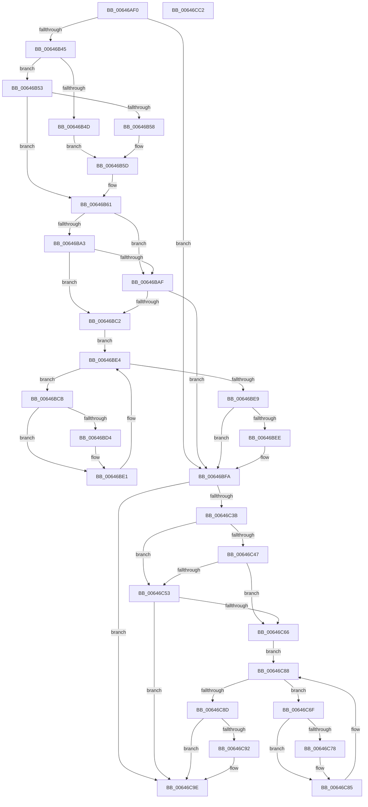

# DifZwQueryEaFileWrapper

- RVA: `0x00646AF0`–`0x00646CC3` (길이 `467` bytes)
- VA: `0x0000000140646AF0`
- 실행 섹션: `.text`
- PDB 이름 있음: `예`; PDB Function 태그: `아니요`
- unwind 정보 RVA: `0x000D2C98`
- 디코드: `131`개 명령, `467/467` bytes 표시
- 미해석 바이트: `0` (있으면 어셈블리에 `.byte`로 보존)

> 이 문서는 커널 이미지의 기계어와 PDB 기호를 분석해 생성했습니다. 4번과 5번은 함수 원형과 자료형을 바이너리 사용 방식에서 추정한 C 해석이며 원본 소스 복구 결과는 아닙니다.

## 1. Dependencies

- 직접 호출 지점: **10**; 고유 호출 대상: **7**
- 직접 호출자로 확인된 함수: **0**
- RIP 상대 이미지 참조: **3**

### Outgoing calls
- `0x00646B2A` → [memset](../6C/memset_function_006C6C40.md) (function, `0x006C6C40`)
- `0x00646B34` → [DifGetAPIThunkContextById](../49/DifGetAPIThunkContextById_function_00495A34.md) (function, `0x00495A34`)
- `0x00646B58` → [DifGetReturnAddressForWrappers](../4D/DifGetReturnAddressForWrappers_function_004D3C08.md) (function, `0x004D3C08`)
- `0x00646BB6` → [ExAcquireRundownProtection](../21/ExAcquireRundownProtection_function_00216620.md) (function, `0x00216620`)
- `0x00646BDC` → [guard_dispatch_icall](../6B/guard_dispatch_icall_function_006BAAD0.md) (function, `0x006BAAD0`)
- `0x00646BF5` → [ExReleaseRundownProtection](../34/ExReleaseRundownProtection_function_00349E80.md) (function, `0x00349E80`)
- `0x00646C2E` → [ZwQueryEaFile](../6A/ZwQueryEaFile_function_006AFAF0.md) (function, `0x006AFAF0`)
- `0x00646C5A` → [ExAcquireRundownProtection](../21/ExAcquireRundownProtection_function_00216620.md) (function, `0x00216620`)
- `0x00646C80` → [guard_dispatch_icall](../6B/guard_dispatch_icall_function_006BAAD0.md) (function, `0x006BAAD0`)
- `0x00646C99` → [ExReleaseRundownProtection](../34/ExReleaseRundownProtection_function_00349E80.md) (function, `0x00349E80`)

### Direct callers
- 이 함수 시작 RVA로 연결되는 직접 call은 확인되지 않았습니다. 간접 호출은 완전히 역산할 수 없습니다.

### Static image references
- `0x00646B68` → RVA `0x00F048B8` (`.data`; read)
- `0x00646BA3` → RVA `0x00F04980` (`.data`; read)
- `0x00646BAF` → RVA `0x00F03E80` (`.data`; read)

## 2. Other-region calls and transfers

- 다른 실행 섹션으로 향하는 call: **0**
- 별도 외부 분기/꼬리 이동을 확인하지 못했습니다.

## 3. Assembly (complete function range)

```asm
00646AF0  48 8B C4                        mov rax, rsp
00646AF3  48 89 58 10                     mov qword ptr [rax + 0x10], rbx
00646AF7  48 89 70 18                     mov qword ptr [rax + 0x18], rsi
00646AFB  48 89 78 20                     mov qword ptr [rax + 0x20], rdi
00646AFF  48 89 48 08                     mov qword ptr [rax + 8], rcx
00646B03  55                              push rbp
00646B04  41 54                           push r12
00646B06  41 55                           push r13
00646B08  41 56                           push r14
00646B0A  41 57                           push r15
00646B0C  48 8D 68 C9                     lea rbp, [rax - 0x37]
00646B10  48 81 EC A0 00 00 00            sub rsp, 0xa0
00646B17  4C 8B EA                        mov r13, rdx
00646B1A  48 8D 4D BF                     lea rcx, [rbp - 0x41]
00646B1E  33 D2                           xor edx, edx
00646B20  4D 8B E0                        mov r12, r8
00646B23  45 8B F9                        mov r15d, r9d
00646B26  44 8D 42 50                     lea r8d, [rdx + 0x50]
00646B2A  E8 11 01 08 00                  call 0x1406c6c40
00646B2F  B9 35 00 00 00                  mov ecx, 0x35
00646B34  E8 FB EE E4 FF                  call 0x140495a34
00646B39  48 8B F0                        mov rsi, rax
00646B3C  48 85 C0                        test rax, rax
00646B3F  0F 84 B5 00 00 00               je 0x140646bfa
00646B45  8B 48 0C                        mov ecx, dword ptr [rax + 0xc]
00646B48  F6 C1 18                        test cl, 0x18
00646B4B  74 06                           je 0x140646b53
00646B4D  48 8B 45 37                     mov rax, qword ptr [rbp + 0x37]
00646B51  EB 0A                           jmp 0x140646b5d
00646B53  F6 C1 04                        test cl, 4
00646B56  74 09                           je 0x140646b61
00646B58  E8 AB D0 E8 FF                  call 0x1404d3c08
00646B5D  48 89 45 BF                     mov qword ptr [rbp - 0x41], rax
00646B61  48 8B 45 3F                     mov rax, qword ptr [rbp + 0x3f]
00646B65  45 32 F6                        xor r14b, r14b
00646B68  44 38 35 49 DD 8B 00            cmp byte ptr [rip + 0x8bdd49], r14b
00646B6F  48 89 45 FF                     mov qword ptr [rbp - 1], rax
00646B73  8A 45 5F                        mov al, byte ptr [rbp + 0x5f]
00646B76  88 45 E7                        mov byte ptr [rbp - 0x19], al
00646B79  48 8B 45 67                     mov rax, qword ptr [rbp + 0x67]
00646B7D  48 89 45 DF                     mov qword ptr [rbp - 0x21], rax
00646B81  8B 45 6F                        mov eax, dword ptr [rbp + 0x6f]
00646B84  89 45 D7                        mov dword ptr [rbp - 0x29], eax
00646B87  48 8B 45 77                     mov rax, qword ptr [rbp + 0x77]
00646B8B  48 89 45 CF                     mov qword ptr [rbp - 0x31], rax
00646B8F  8A 45 7F                        mov al, byte ptr [rbp + 0x7f]
00646B92  88 45 C7                        mov byte ptr [rbp - 0x39], al
00646B95  4C 89 6D F7                     mov qword ptr [rbp - 9], r13
00646B99  4C 89 65 EF                     mov qword ptr [rbp - 0x11], r12
00646B9D  44 89 7D EB                     mov dword ptr [rbp - 0x15], r15d
00646BA1  75 0C                           jne 0x140646baf
00646BA3  F7 05 D3 DD 8B 00 00 08 00 00   test dword ptr [rip + 0x8bddd3], 0x800
00646BAD  74 13                           je 0x140646bc2
00646BAF  48 8D 0D CA D2 8B 00            lea rcx, [rip + 0x8bd2ca]
00646BB6  E8 65 FA BC FF                  call 0x140216620
00646BBB  44 8A F0                        mov r14b, al
00646BBE  84 C0                           test al, al
00646BC0  74 38                           je 0x140646bfa
00646BC2  48 8D 7E 20                     lea rdi, [rsi + 0x20]
00646BC6  48 8B 1F                        mov rbx, qword ptr [rdi]
00646BC9  EB 19                           jmp 0x140646be4
00646BCB  48 8D 43 F0                     lea rax, [rbx - 0x10]
00646BCF  48 85 C0                        test rax, rax
00646BD2  74 0D                           je 0x140646be1
00646BD4  48 8B 40 08                     mov rax, qword ptr [rax + 8]
00646BD8  48 8D 4D BF                     lea rcx, [rbp - 0x41]
00646BDC  E8 EF 3E 07 00                  call 0x1406baad0
00646BE1  48 8B 1B                        mov rbx, qword ptr [rbx]
00646BE4  48 3B DF                        cmp rbx, rdi
00646BE7  75 E2                           jne 0x140646bcb
00646BE9  45 84 F6                        test r14b, r14b
00646BEC  74 0C                           je 0x140646bfa
00646BEE  48 8D 0D 8B D2 8B 00            lea rcx, [rip + 0x8bd28b]
00646BF5  E8 86 32 D0 FF                  call 0x140349e80
00646BFA  8A 45 7F                        mov al, byte ptr [rbp + 0x7f]
00646BFD  45 8B CF                        mov r9d, r15d
00646C00  48 8B 4D 3F                     mov rcx, qword ptr [rbp + 0x3f]
00646C04  4D 8B C4                        mov r8, r12
00646C07  88 44 24 40                     mov byte ptr [rsp + 0x40], al
00646C0B  49 8B D5                        mov rdx, r13
00646C0E  48 8B 45 77                     mov rax, qword ptr [rbp + 0x77]
00646C12  48 89 44 24 38                  mov qword ptr [rsp + 0x38], rax
00646C17  8B 45 6F                        mov eax, dword ptr [rbp + 0x6f]
00646C1A  89 44 24 30                     mov dword ptr [rsp + 0x30], eax
00646C1E  48 8B 45 67                     mov rax, qword ptr [rbp + 0x67]
00646C22  48 89 44 24 28                  mov qword ptr [rsp + 0x28], rax
00646C27  8A 45 5F                        mov al, byte ptr [rbp + 0x5f]
00646C2A  88 44 24 20                     mov byte ptr [rsp + 0x20], al
00646C2E  E8 BD 8E 06 00                  call 0x1406afaf0
00646C33  89 45 07                        mov dword ptr [rbp + 7], eax
00646C36  48 85 F6                        test rsi, rsi
00646C39  74 63                           je 0x140646c9e
00646C3B  40 32 FF                        xor dil, dil
00646C3E  40 38 3D 73 DC 8B 00            cmp byte ptr [rip + 0x8bdc73], dil
00646C45  75 0C                           jne 0x140646c53
00646C47  F7 05 2F DD 8B 00 00 08 00 00   test dword ptr [rip + 0x8bdd2f], 0x800
00646C51  74 13                           je 0x140646c66
00646C53  48 8D 0D 26 D2 8B 00            lea rcx, [rip + 0x8bd226]
00646C5A  E8 C1 F9 BC FF                  call 0x140216620
00646C5F  40 8A F8                        mov dil, al
00646C62  84 C0                           test al, al
00646C64  74 38                           je 0x140646c9e
00646C66  48 83 C6 30                     add rsi, 0x30
00646C6A  48 8B 1E                        mov rbx, qword ptr [rsi]
00646C6D  EB 19                           jmp 0x140646c88
00646C6F  48 8D 43 F0                     lea rax, [rbx - 0x10]
00646C73  48 85 C0                        test rax, rax
00646C76  74 0D                           je 0x140646c85
00646C78  48 8B 40 08                     mov rax, qword ptr [rax + 8]
00646C7C  48 8D 4D BF                     lea rcx, [rbp - 0x41]
00646C80  E8 4B 3E 07 00                  call 0x1406baad0
00646C85  48 8B 1B                        mov rbx, qword ptr [rbx]
00646C88  48 3B DE                        cmp rbx, rsi
00646C8B  75 E2                           jne 0x140646c6f
00646C8D  40 84 FF                        test dil, dil
00646C90  74 0C                           je 0x140646c9e
00646C92  48 8D 0D E7 D1 8B 00            lea rcx, [rip + 0x8bd1e7]
00646C99  E8 E2 31 D0 FF                  call 0x140349e80
00646C9E  8B 45 07                        mov eax, dword ptr [rbp + 7]
00646CA1  4C 8D 9C 24 A0 00 00 00         lea r11, [rsp + 0xa0]
00646CA9  49 8B 5B 38                     mov rbx, qword ptr [r11 + 0x38]
00646CAD  49 8B 73 40                     mov rsi, qword ptr [r11 + 0x40]
00646CB1  49 8B 7B 48                     mov rdi, qword ptr [r11 + 0x48]
00646CB5  49 8B E3                        mov rsp, r11
00646CB8  41 5F                           pop r15
00646CBA  41 5E                           pop r14
00646CBC  41 5D                           pop r13
00646CBE  41 5C                           pop r12
00646CC0  5D                              pop rbp
00646CC1  C3                              ret
00646CC2  CC                              int3
```

## 4. C-style interpretation (structured pseudocode)

```c
__int64 __fastcall DifZwQueryEaFileWrapper(__int64 a1, __int64 a2, __int64 a3, int a4)
{
    __int64 result;
    __int64 v_r14;
    __int64 v_rdi;
    __int64 v_rsi;
    __int64 v_rsp;
    unsigned __int64 v_stack_m28;
    unsigned __int8 v_stack_m88;
    unsigned __int64 v_stack_m90;
    unsigned int v_stack_m98;
    unsigned __int64 v_stack_mA0;
    unsigned __int8 v_stack_mA8;

    *(unsigned __int64 *)(v_rsp + 16) = v_rbx;
    *(unsigned __int64 *)(v_rsp + 24) = v_rsi;
    *(unsigned __int64 *)(v_rsp + 32) = v_rdi;
    *(unsigned __int64 *)(v_rsp + 8) = a1;
    v_rsp = (v_rsp) - (160);
    a2 = 0;
    result = memset(v_rsp - 55 - 65, a2, a2 + 80, a4);
    result = DifGetAPIThunkContextById(53, a2, a2 + 80, a4);
    if (result == 0) goto loc_00646BFA;
    if ((((unsigned __int8)((unsigned int)(*(unsigned int *)(result + 12)))) & (24)) == 0) goto loc_00646B53;
    goto loc_00646B5D;
loc_00646B53:
    if ((((unsigned __int8)((unsigned int)(*(unsigned int *)(result + 12)))) & (4)) == 0) goto loc_00646B61;
    result = DifGetReturnAddressForWrappers((unsigned int)(*(unsigned int *)(result + 12)), a2, a2 + 80, a4);
loc_00646B5D:
    *(unsigned __int64 *)(v_rsp - 55 - 65) = result;
loc_00646B61:
    v_r14 = 0;
    *(unsigned __int64 *)(v_rsp - 55 - 1) = *(unsigned __int64 *)(v_rsp - 55 + 63);
    *(unsigned __int8 *)(v_rsp - 55 - 25) = (unsigned __int8)(*(unsigned __int8 *)(v_rsp - 55 + 95));
    *(unsigned __int64 *)(v_rsp - 55 - 33) = *(unsigned __int64 *)(v_rsp - 55 + 103);
    *(unsigned int *)(v_rsp - 55 - 41) = (unsigned int)((unsigned int)(*(unsigned int *)(v_rsp - 55 + 111)));
    *(unsigned __int64 *)(v_rsp - 55 - 49) = *(unsigned __int64 *)(v_rsp - 55 + 119);
    *(unsigned __int8 *)(v_rsp - 55 - 57) = (unsigned __int8)(*(unsigned __int8 *)(v_rsp - 55 + 127));
    *(unsigned __int64 *)(v_rsp - 55 - 9) = 0;
    *(unsigned __int64 *)(v_rsp - 55 - 17) = a3;
    *(unsigned int *)(v_rsp - 55 - 21) = (unsigned int)((unsigned int)(a4));
    if ((*(unsigned __int8 *)(v_rip + 9166153)) != 0) goto loc_00646BAF;
    if (((*(unsigned int *)(v_rip + 9166291)) & (0x800ULL)) == 0) goto loc_00646BC2;
loc_00646BAF:
    result = ExAcquireRundownProtection(v_rip + 9163466, a2, a2 + 80, a4);
    if ((unsigned __int8)(result) == 0) goto loc_00646BFA;
loc_00646BC2:
    goto loc_00646BE4;
loc_00646BCB:
    result = *(unsigned __int64 *)(result + 32) - 16;
    if (*(unsigned __int64 *)(result + 32) - 16 != 0) {
        result = *(unsigned __int64 *)(*(unsigned __int64 *)(result + 32) - 16 + 8);
        a1 = v_rsp - 55 - 65;
        result = guard_dispatch_icall(a1, a2, a2 + 80, a4);
    }
loc_00646BE4:
    if ((*(unsigned __int64 *)(*(unsigned __int64 *)(result + 32))) != (result + 32)) goto loc_00646BCB;
    if ((unsigned __int8)((unsigned __int8)(result)) != 0) {
        a1 = v_rip + 9163403;
        result = ExReleaseRundownProtection(a1, a2, a2 + 80, a4);
    }
    v_stack_m88 = (unsigned __int8)(*(unsigned __int8 *)(v_rsp - 55 + 127));
    v_stack_m90 = *(unsigned __int64 *)(v_rsp - 55 + 119);
    v_stack_m98 = (unsigned int)((unsigned int)(*(unsigned int *)(v_rsp - 55 + 111)));
    v_stack_mA0 = *(unsigned __int64 *)(v_rsp - 55 + 103);
    v_stack_mA8 = (unsigned __int8)(*(unsigned __int8 *)(v_rsp - 55 + 95));
    result = ZwQueryEaFile(*(unsigned __int64 *)(v_rsp - 55 + 63), 0, a3, (unsigned int)((unsigned int)((unsigned int)(a4))));
    *(unsigned int *)(v_rsp - 55 + 7) = (unsigned int)(result);
    if (result == 0) goto loc_00646C9E;
    v_rdi = 0;
    if ((*(unsigned __int8 *)(v_rip + 9165939)) != 0) goto loc_00646C53;
    if (((*(unsigned int *)(v_rip + 9166127)) & (0x800ULL)) == 0) goto loc_00646C66;
loc_00646C53:
    result = ExAcquireRundownProtection(v_rip + 9163302, 0, a3, (unsigned int)((unsigned int)((unsigned int)(a4))));
    if ((unsigned __int8)(result) == 0) goto loc_00646C9E;
loc_00646C66:
    v_rsi = (result) + (48);
    goto loc_00646C88;
loc_00646C6F:
    result = *(unsigned __int64 *)(v_rsi) - 16;
    if (*(unsigned __int64 *)(v_rsi) - 16 != 0) {
        result = *(unsigned __int64 *)(*(unsigned __int64 *)(v_rsi) - 16 + 8);
        a1 = v_rsp - 55 - 65;
        result = guard_dispatch_icall(a1, 0, a3, (unsigned int)((unsigned int)((unsigned int)(a4))));
    }
loc_00646C88:
    if ((*(unsigned __int64 *)(*(unsigned __int64 *)(v_rsi))) != v_rsi) goto loc_00646C6F;
    if ((unsigned __int8)((unsigned __int8)(result)) != 0) {
        a1 = v_rip + 9163239;
        result = ExReleaseRundownProtection(a1, 0, a3, (unsigned int)((unsigned int)((unsigned int)(a4))));
    }
    return (unsigned int)(*(unsigned int *)(v_rsp - 55 + 7));
}
```

## 5. (Beta) C Style

```c
int64_t DifZwQueryEaFileWrapper(int64_t Arg1, int64_t Arg2, int64_t Arg3, int32_t Arg4)
{
    int64_t result;
    int64_t local_r14;
    int64_t local_rdi;
    int64_t local_rsi;
    int64_t local_rsp;
    uint64_t v_stack_m28;
    uint8_t v_stack_m88;
    uint64_t v_stack_m90;
    uint32_t v_stack_m98;
    uint64_t v_stack_mA0;
    uint8_t v_stack_mA8;

    *(uint64_t *)(local_rsp + 0x10) = local_rbx;
    *(uint64_t *)(local_rsp + 0x18) = local_rsi;
    *(uint64_t *)(local_rsp + 0x20) = local_rdi;
    *(uint64_t *)(local_rsp + 0x8) = Arg1;
    local_rsp = (local_rsp) - (160);
    Arg2 = 0;
    result = memset(local_rsp - 55 - 65, Arg2, Arg2 + 80, Arg4);
    result = DifGetAPIThunkContextById(53, Arg2, Arg2 + 80, Arg4);
    if (result == 0) goto loc_00646BFA;
    if ((((uint8_t)((uint32_t)(*(uint32_t *)(result + 0xC)))) & (24)) == 0) goto loc_00646B53;
    goto loc_00646B5D;
loc_00646B53:
    if ((((uint8_t)((uint32_t)(*(uint32_t *)(result + 0xC)))) & (4)) == 0) goto loc_00646B61;
    result = DifGetReturnAddressForWrappers((uint32_t)(*(uint32_t *)(result + 0xC)), Arg2, Arg2 + 80, Arg4);
loc_00646B5D:
    *(uint64_t *)(local_rsp - 0x37 - 0x41) = result;
loc_00646B61:
    local_r14 = 0;
    *(uint64_t *)(local_rsp - 0x37 - 0x1) = *(uint64_t *)(local_rsp - 0x37 + 0x3F);
    *(uint8_t *)(local_rsp - 0x37 - 0x19) = (uint8_t)(*(uint8_t *)(local_rsp - 0x37 + 0x5F));
    *(uint64_t *)(local_rsp - 0x37 - 0x21) = *(uint64_t *)(local_rsp - 0x37 + 0x67);
    *(uint32_t *)(local_rsp - 0x37 - 0x29) = (uint32_t)((uint32_t)(*(uint32_t *)(local_rsp - 0x37 + 0x6F)));
    *(uint64_t *)(local_rsp - 0x37 - 0x31) = *(uint64_t *)(local_rsp - 0x37 + 0x77);
    *(uint8_t *)(local_rsp - 0x37 - 0x39) = (uint8_t)(*(uint8_t *)(local_rsp - 0x37 + 0x7F));
    *(uint64_t *)(local_rsp - 0x37 - 0x9) = 0;
    *(uint64_t *)(local_rsp - 0x37 - 0x11) = Arg3;
    *(uint32_t *)(local_rsp - 0x37 - 0x15) = (uint32_t)((uint32_t)(Arg4));
    if ((*(uint8_t *)(v_rip + 0x8BDD49)) != 0) goto loc_00646BAF;
    if (((*(uint32_t *)(v_rip + 0x8BDDD3)) & (0x800ULL)) == 0) goto loc_00646BC2;
loc_00646BAF:
    result = ExAcquireRundownProtection(v_rip + 9163466, Arg2, Arg2 + 80, Arg4);
    if ((uint8_t)(result) == 0) goto loc_00646BFA;
loc_00646BC2:
    goto loc_00646BE4;
loc_00646BCB:
    result = *(uint64_t *)(result + 0x20) - 16;
    if (*(uint64_t *)(result + 0x20) - 16 != 0) {
        result = *(uint64_t *)(*(uint64_t *)(result + 0x20) - 0x10 + 0x8);
        Arg1 = local_rsp - 55 - 65;
        result = guard_dispatch_icall(Arg1, Arg2, Arg2 + 80, Arg4);
    }
loc_00646BE4:
    if ((*(uint64_t *)(*(uint64_t *)(result + 0x20))) != (result + 32)) goto loc_00646BCB;
    if ((uint8_t)((uint8_t)(result)) != 0) {
        Arg1 = v_rip + 9163403;
        result = ExReleaseRundownProtection(Arg1, Arg2, Arg2 + 80, Arg4);
    }
    v_stack_m88 = (uint8_t)(*(uint8_t *)(local_rsp - 0x37 + 0x7F));
    v_stack_m90 = *(uint64_t *)(local_rsp - 0x37 + 0x77);
    v_stack_m98 = (uint32_t)((uint32_t)(*(uint32_t *)(local_rsp - 0x37 + 0x6F)));
    v_stack_mA0 = *(uint64_t *)(local_rsp - 0x37 + 0x67);
    v_stack_mA8 = (uint8_t)(*(uint8_t *)(local_rsp - 0x37 + 0x5F));
    result = ZwQueryEaFile(*(uint64_t *)(local_rsp - 0x37 + 0x3F), 0, Arg3, (uint32_t)((uint32_t)((uint32_t)(Arg4))));
    *(uint32_t *)(local_rsp - 0x37 + 0x7) = (uint32_t)(result);
    if (result == 0) goto loc_00646C9E;
    local_rdi = 0;
    if ((*(uint8_t *)(v_rip + 0x8BDC73)) != 0) goto loc_00646C53;
    if (((*(uint32_t *)(v_rip + 0x8BDD2F)) & (0x800ULL)) == 0) goto loc_00646C66;
loc_00646C53:
    result = ExAcquireRundownProtection(v_rip + 9163302, 0, Arg3, (uint32_t)((uint32_t)((uint32_t)(Arg4))));
    if ((uint8_t)(result) == 0) goto loc_00646C9E;
loc_00646C66:
    local_rsi = (result) + (48);
    goto loc_00646C88;
loc_00646C6F:
    result = *(uint64_t *)(local_rsi) - 16;
    if (*(uint64_t *)(local_rsi) - 16 != 0) {
        result = *(uint64_t *)(*(uint64_t *)(local_rsi) - 0x10 + 0x8);
        Arg1 = local_rsp - 55 - 65;
        result = guard_dispatch_icall(Arg1, 0, Arg3, (uint32_t)((uint32_t)((uint32_t)(Arg4))));
    }
loc_00646C88:
    if ((*(uint64_t *)(*(uint64_t *)(local_rsi))) != local_rsi) goto loc_00646C6F;
    if ((uint8_t)((uint8_t)(result)) != 0) {
        Arg1 = v_rip + 9163239;
        result = ExReleaseRundownProtection(Arg1, 0, Arg3, (uint32_t)((uint32_t)((uint32_t)(Arg4))));
    }
    return (uint32_t)(*(uint32_t *)(local_rsp - 0x37 + 0x7));
}
```

## 6. Execution-region graph

[열기: 2D/3D 그래프와 함수 탐색 컨트롤 패널](../../../control-panel.html?section=text&rva=0x00646AF0&view=graph)

- 2D 그래프는 위에서 아래로 흐르고, 3D 그래프는 빈 공간을 드래그해 회전합니다. Shift+드래그는 이동, 휠은 확대·축소, 함수 노드 선택은 대상 보고서 이동입니다.

### Static fallback


