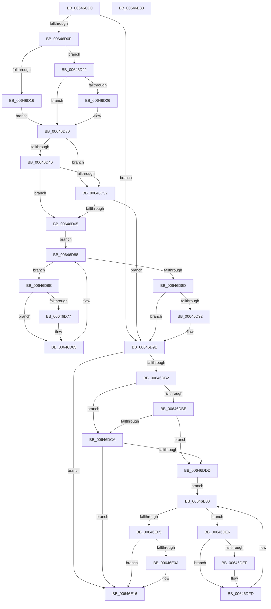

# DifZwQueryFullAttributesFileWrapper

- RVA: `0x00646CD0`–`0x00646E34` (길이 `356` bytes)
- VA: `0x0000000140646CD0`
- 실행 섹션: `.text`
- PDB 이름 있음: `예`; PDB Function 태그: `아니요`
- unwind 정보 RVA: `0x00093E28`
- 디코드: `98`개 명령, `356/356` bytes 표시
- 미해석 바이트: `0` (있으면 어셈블리에 `.byte`로 보존)

> 이 문서는 커널 이미지의 기계어와 PDB 기호를 분석해 생성했습니다. 4번과 5번은 함수 원형과 자료형을 바이너리 사용 방식에서 추정한 C 해석이며 원본 소스 복구 결과는 아닙니다.

## 1. Dependencies

- 직접 호출 지점: **9**; 고유 호출 대상: **6**
- 직접 호출자로 확인된 함수: **0**
- RIP 상대 이미지 참조: **3**

### Outgoing calls
- `0x00646CFE` → [DifGetAPIThunkContextById](../49/DifGetAPIThunkContextById_function_00495A34.md) (function, `0x00495A34`)
- `0x00646D26` → [DifGetReturnAddressForWrappers](../4D/DifGetReturnAddressForWrappers_function_004D3C08.md) (function, `0x004D3C08`)
- `0x00646D59` → [ExAcquireRundownProtection](../21/ExAcquireRundownProtection_function_00216620.md) (function, `0x00216620`)
- `0x00646D80` → [guard_dispatch_icall](../6B/guard_dispatch_icall_function_006BAAD0.md) (function, `0x006BAAD0`)
- `0x00646D99` → [ExReleaseRundownProtection](../34/ExReleaseRundownProtection_function_00349E80.md) (function, `0x00349E80`)
- `0x00646DA4` → [ZwQueryFullAttributesFile](../6A/ZwQueryFullAttributesFile_function_006AFB10.md) (function, `0x006AFB10`)
- `0x00646DD1` → [ExAcquireRundownProtection](../21/ExAcquireRundownProtection_function_00216620.md) (function, `0x00216620`)
- `0x00646DF8` → [guard_dispatch_icall](../6B/guard_dispatch_icall_function_006BAAD0.md) (function, `0x006BAAD0`)
- `0x00646E11` → [ExReleaseRundownProtection](../34/ExReleaseRundownProtection_function_00349E80.md) (function, `0x00349E80`)

### Direct callers
- 이 함수 시작 RVA로 연결되는 직접 call은 확인되지 않았습니다. 간접 호출은 완전히 역산할 수 없습니다.

### Static image references
- `0x00646D38` → RVA `0x00F048B8` (`.data`; read)
- `0x00646D46` → RVA `0x00F04980` (`.data`; read)
- `0x00646D52` → RVA `0x00F03E80` (`.data`; read)

## 2. Other-region calls and transfers

- 다른 실행 섹션으로 향하는 call: **0**
- 별도 외부 분기/꼬리 이동을 확인하지 못했습니다.

## 3. Assembly (complete function range)

```asm
00646CD0  48 8B C4                        mov rax, rsp
00646CD3  48 89 58 08                     mov qword ptr [rax + 8], rbx
00646CD7  48 89 68 10                     mov qword ptr [rax + 0x10], rbp
00646CDB  48 89 70 18                     mov qword ptr [rax + 0x18], rsi
00646CDF  57                              push rdi
00646CE0  41 56                           push r14
00646CE2  41 57                           push r15
00646CE4  48 83 EC 40                     sub rsp, 0x40
00646CE8  0F 57 C0                        xorps xmm0, xmm0
00646CEB  4C 8B F9                        mov r15, rcx
00646CEE  B9 34 00 00 00                  mov ecx, 0x34
00646CF3  4C 8B F2                        mov r14, rdx
00646CF6  0F 11 40 C8                     movups xmmword ptr [rax - 0x38], xmm0
00646CFA  0F 11 40 D8                     movups xmmword ptr [rax - 0x28], xmm0
00646CFE  E8 31 ED E4 FF                  call 0x140495a34
00646D03  48 8B F0                        mov rsi, rax
00646D06  48 85 C0                        test rax, rax
00646D09  0F 84 8F 00 00 00               je 0x140646d9e
00646D0F  8B 40 0C                        mov eax, dword ptr [rax + 0xc]
00646D12  A8 18                           test al, 0x18
00646D14  74 0C                           je 0x140646d22
00646D16  48 8B 4C 24 58                  mov rcx, qword ptr [rsp + 0x58]
00646D1B  48 89 4C 24 20                  mov qword ptr [rsp + 0x20], rcx
00646D20  EB 0E                           jmp 0x140646d30
00646D22  A8 04                           test al, 4
00646D24  74 0A                           je 0x140646d30
00646D26  E8 DD CE E8 FF                  call 0x1404d3c08
00646D2B  48 89 44 24 20                  mov qword ptr [rsp + 0x20], rax
00646D30  40 32 ED                        xor bpl, bpl
00646D33  4C 89 7C 24 30                  mov qword ptr [rsp + 0x30], r15
00646D38  40 38 2D 79 DB 8B 00            cmp byte ptr [rip + 0x8bdb79], bpl
00646D3F  4C 89 74 24 28                  mov qword ptr [rsp + 0x28], r14
00646D44  75 0C                           jne 0x140646d52
00646D46  F7 05 30 DC 8B 00 00 08 00 00   test dword ptr [rip + 0x8bdc30], 0x800
00646D50  74 13                           je 0x140646d65
00646D52  48 8D 0D 27 D1 8B 00            lea rcx, [rip + 0x8bd127]
00646D59  E8 C2 F8 BC FF                  call 0x140216620
00646D5E  40 8A E8                        mov bpl, al
00646D61  84 C0                           test al, al
00646D63  74 39                           je 0x140646d9e
00646D65  48 8D 7E 20                     lea rdi, [rsi + 0x20]
00646D69  48 8B 1F                        mov rbx, qword ptr [rdi]
00646D6C  EB 1A                           jmp 0x140646d88
00646D6E  48 8D 43 F0                     lea rax, [rbx - 0x10]
00646D72  48 85 C0                        test rax, rax
00646D75  74 0E                           je 0x140646d85
00646D77  48 8B 40 08                     mov rax, qword ptr [rax + 8]
00646D7B  48 8D 4C 24 20                  lea rcx, [rsp + 0x20]
00646D80  E8 4B 3D 07 00                  call 0x1406baad0
00646D85  48 8B 1B                        mov rbx, qword ptr [rbx]
00646D88  48 3B DF                        cmp rbx, rdi
00646D8B  75 E1                           jne 0x140646d6e
00646D8D  40 84 ED                        test bpl, bpl
00646D90  74 0C                           je 0x140646d9e
00646D92  48 8D 0D E7 D0 8B 00            lea rcx, [rip + 0x8bd0e7]
00646D99  E8 E2 30 D0 FF                  call 0x140349e80
00646D9E  49 8B D6                        mov rdx, r14
00646DA1  49 8B CF                        mov rcx, r15
00646DA4  E8 67 8D 06 00                  call 0x1406afb10
00646DA9  89 44 24 38                     mov dword ptr [rsp + 0x38], eax
00646DAD  48 85 F6                        test rsi, rsi
00646DB0  74 64                           je 0x140646e16
00646DB2  40 32 FF                        xor dil, dil
00646DB5  40 38 3D FC DA 8B 00            cmp byte ptr [rip + 0x8bdafc], dil
00646DBC  75 0C                           jne 0x140646dca
00646DBE  F7 05 B8 DB 8B 00 00 08 00 00   test dword ptr [rip + 0x8bdbb8], 0x800
00646DC8  74 13                           je 0x140646ddd
00646DCA  48 8D 0D AF D0 8B 00            lea rcx, [rip + 0x8bd0af]
00646DD1  E8 4A F8 BC FF                  call 0x140216620
00646DD6  40 8A F8                        mov dil, al
00646DD9  84 C0                           test al, al
00646DDB  74 39                           je 0x140646e16
00646DDD  48 83 C6 30                     add rsi, 0x30
00646DE1  48 8B 1E                        mov rbx, qword ptr [rsi]
00646DE4  EB 1A                           jmp 0x140646e00
00646DE6  48 8D 43 F0                     lea rax, [rbx - 0x10]
00646DEA  48 85 C0                        test rax, rax
00646DED  74 0E                           je 0x140646dfd
00646DEF  48 8B 40 08                     mov rax, qword ptr [rax + 8]
00646DF3  48 8D 4C 24 20                  lea rcx, [rsp + 0x20]
00646DF8  E8 D3 3C 07 00                  call 0x1406baad0
00646DFD  48 8B 1B                        mov rbx, qword ptr [rbx]
00646E00  48 3B DE                        cmp rbx, rsi
00646E03  75 E1                           jne 0x140646de6
00646E05  40 84 FF                        test dil, dil
00646E08  74 0C                           je 0x140646e16
00646E0A  48 8D 0D 6F D0 8B 00            lea rcx, [rip + 0x8bd06f]
00646E11  E8 6A 30 D0 FF                  call 0x140349e80
00646E16  8B 44 24 38                     mov eax, dword ptr [rsp + 0x38]
00646E1A  48 8B 5C 24 60                  mov rbx, qword ptr [rsp + 0x60]
00646E1F  48 8B 6C 24 68                  mov rbp, qword ptr [rsp + 0x68]
00646E24  48 8B 74 24 70                  mov rsi, qword ptr [rsp + 0x70]
00646E29  48 83 C4 40                     add rsp, 0x40
00646E2D  41 5F                           pop r15
00646E2F  41 5E                           pop r14
00646E31  5F                              pop rdi
00646E32  C3                              ret
00646E33  CC                              int3
```

## 4. C-style interpretation (structured pseudocode)

```c
__int64 __fastcall DifZwQueryFullAttributesFileWrapper(__int64 a1, __int64 a2)
{
    __int64 result;
    __int64 v_rbp;
    __int64 v_rdi;
    __int64 v_rsi;
    __int64 v_rsp;
    unsigned int v_stack_m20;
    unsigned __int64 v_stack_m28;
    unsigned __int64 v_stack_m30;
    unsigned __int64 v_stack_m38;
    unsigned __int64 v_stack_p0;
    unsigned __int64 v_stack_p10;
    unsigned __int64 v_stack_p18;
    unsigned __int64 v_stack_p8;

    *(unsigned __int64 *)(v_rsp + 8) = v_rbx;
    *(unsigned __int64 *)(v_rsp + 16) = v_rbp;
    *(unsigned __int64 *)(v_rsp + 24) = v_rsi;
    v_rsp = (v_rsp) - (64);
    *(unsigned __int64 *)(v_rsp - 56) = v_xmm0;
    *(unsigned __int64 *)(v_rsp - 40) = v_xmm0;
    result = DifGetAPIThunkContextById(52, a2, a3, a4);
    if (result == 0) goto loc_00646D9E;
    if ((((unsigned __int8)((unsigned int)(*(unsigned int *)(result + 12)))) & (24)) == 0) goto loc_00646D22;
    v_stack_m38 = v_stack_p0;
    goto loc_00646D30;
loc_00646D22:
    result = (unsigned int)(*(unsigned int *)(result + 12));
    if ((((unsigned __int8)((unsigned int)(*(unsigned int *)(result + 12)))) & (4)) != 0) {
        result = DifGetReturnAddressForWrappers(v_stack_p0, a2, a3, a4);
        v_stack_m38 = result;
    }
    v_rbp = 0;
    v_stack_m28 = a1;
    v_stack_m30 = a2;
    if ((*(unsigned __int8 *)(v_rip + 9165689)) != 0) goto loc_00646D52;
    if (((*(unsigned int *)(v_rip + 9165872)) & (0x800ULL)) == 0) goto loc_00646D65;
loc_00646D52:
    result = ExAcquireRundownProtection(v_rip + 9163047, a2, a3, a4);
    if ((unsigned __int8)(result) == 0) goto loc_00646D9E;
loc_00646D65:
    goto loc_00646D88;
loc_00646D6E:
    result = *(unsigned __int64 *)(result + 32) - 16;
    if (*(unsigned __int64 *)(result + 32) - 16 != 0) {
        result = *(unsigned __int64 *)(*(unsigned __int64 *)(result + 32) - 16 + 8);
        a1 = v_stack_m38;
        result = guard_dispatch_icall(a1, a2, a3, a4);
    }
loc_00646D88:
    if ((*(unsigned __int64 *)(*(unsigned __int64 *)(result + 32))) != (result + 32)) goto loc_00646D6E;
    if ((unsigned __int8)((unsigned __int8)(result)) != 0) {
        a1 = v_rip + 9162983;
        result = ExReleaseRundownProtection(a1, a2, a3, a4);
    }
    result = ZwQueryFullAttributesFile(a1, a2, a3, a4);
    v_stack_m20 = (unsigned int)(result);
    if (result == 0) goto loc_00646E16;
    v_rdi = 0;
    if ((*(unsigned __int8 *)(v_rip + 9165564)) != 0) goto loc_00646DCA;
    if (((*(unsigned int *)(v_rip + 9165752)) & (0x800ULL)) == 0) goto loc_00646DDD;
loc_00646DCA:
    result = ExAcquireRundownProtection(v_rip + 9162927, a2, a3, a4);
    if ((unsigned __int8)(result) == 0) goto loc_00646E16;
loc_00646DDD:
    v_rsi = (result) + (48);
    goto loc_00646E00;
loc_00646DE6:
    result = *(unsigned __int64 *)(v_rsi) - 16;
    if (*(unsigned __int64 *)(v_rsi) - 16 != 0) {
        result = *(unsigned __int64 *)(*(unsigned __int64 *)(v_rsi) - 16 + 8);
        a1 = v_stack_m38;
        result = guard_dispatch_icall(a1, a2, a3, a4);
    }
loc_00646E00:
    if ((*(unsigned __int64 *)(*(unsigned __int64 *)(v_rsi))) != v_rsi) goto loc_00646DE6;
    if ((unsigned __int8)((unsigned __int8)(result)) != 0) {
        a1 = v_rip + 9162863;
        result = ExReleaseRundownProtection(a1, a2, a3, a4);
    }
    v_rsp = (v_rsp) + (64);
    return (unsigned int)(v_stack_m20);
}
```

## 5. (Beta) C Style

```c
int64_t DifZwQueryFullAttributesFileWrapper(int64_t Arg1, int64_t Arg2)
{
    int64_t result;
    int64_t local_rbp;
    int64_t local_rdi;
    int64_t local_rsi;
    int64_t local_rsp;
    uint32_t v_stack_m20;
    uint64_t v_stack_m28;
    uint64_t v_stack_m30;
    uint64_t v_stack_m38;
    uint64_t v_stack_p0;
    uint64_t v_stack_p10;
    uint64_t v_stack_p18;
    uint64_t v_stack_p8;

    *(uint64_t *)(local_rsp + 0x8) = local_rbx;
    *(uint64_t *)(local_rsp + 0x10) = local_rbp;
    *(uint64_t *)(local_rsp + 0x18) = local_rsi;
    local_rsp = (local_rsp) - (64);
    *(uint64_t *)(local_rsp - 0x38) = v_xmm0;
    *(uint64_t *)(local_rsp - 0x28) = v_xmm0;
    result = DifGetAPIThunkContextById(52, Arg2, a3, a4);
    if (result == 0) goto loc_00646D9E;
    if ((((uint8_t)((uint32_t)(*(uint32_t *)(result + 0xC)))) & (24)) == 0) goto loc_00646D22;
    v_stack_m38 = v_stack_p0;
    goto loc_00646D30;
loc_00646D22:
    result = (uint32_t)(*(uint32_t *)(result + 0xC));
    if ((((uint8_t)((uint32_t)(*(uint32_t *)(result + 0xC)))) & (4)) != 0) {
        result = DifGetReturnAddressForWrappers(v_stack_p0, Arg2, a3, a4);
        v_stack_m38 = result;
    }
    local_rbp = 0;
    v_stack_m28 = Arg1;
    v_stack_m30 = Arg2;
    if ((*(uint8_t *)(v_rip + 0x8BDB79)) != 0) goto loc_00646D52;
    if (((*(uint32_t *)(v_rip + 0x8BDC30)) & (0x800ULL)) == 0) goto loc_00646D65;
loc_00646D52:
    result = ExAcquireRundownProtection(v_rip + 9163047, Arg2, a3, a4);
    if ((uint8_t)(result) == 0) goto loc_00646D9E;
loc_00646D65:
    goto loc_00646D88;
loc_00646D6E:
    result = *(uint64_t *)(result + 0x20) - 16;
    if (*(uint64_t *)(result + 0x20) - 16 != 0) {
        result = *(uint64_t *)(*(uint64_t *)(result + 0x20) - 0x10 + 0x8);
        Arg1 = v_stack_m38;
        result = guard_dispatch_icall(Arg1, Arg2, a3, a4);
    }
loc_00646D88:
    if ((*(uint64_t *)(*(uint64_t *)(result + 0x20))) != (result + 32)) goto loc_00646D6E;
    if ((uint8_t)((uint8_t)(result)) != 0) {
        Arg1 = v_rip + 9162983;
        result = ExReleaseRundownProtection(Arg1, Arg2, a3, a4);
    }
    result = ZwQueryFullAttributesFile(Arg1, Arg2, a3, a4);
    v_stack_m20 = (uint32_t)(result);
    if (result == 0) goto loc_00646E16;
    local_rdi = 0;
    if ((*(uint8_t *)(v_rip + 0x8BDAFC)) != 0) goto loc_00646DCA;
    if (((*(uint32_t *)(v_rip + 0x8BDBB8)) & (0x800ULL)) == 0) goto loc_00646DDD;
loc_00646DCA:
    result = ExAcquireRundownProtection(v_rip + 9162927, Arg2, a3, a4);
    if ((uint8_t)(result) == 0) goto loc_00646E16;
loc_00646DDD:
    local_rsi = (result) + (48);
    goto loc_00646E00;
loc_00646DE6:
    result = *(uint64_t *)(local_rsi) - 16;
    if (*(uint64_t *)(local_rsi) - 16 != 0) {
        result = *(uint64_t *)(*(uint64_t *)(local_rsi) - 0x10 + 0x8);
        Arg1 = v_stack_m38;
        result = guard_dispatch_icall(Arg1, Arg2, a3, a4);
    }
loc_00646E00:
    if ((*(uint64_t *)(*(uint64_t *)(local_rsi))) != local_rsi) goto loc_00646DE6;
    if ((uint8_t)((uint8_t)(result)) != 0) {
        Arg1 = v_rip + 9162863;
        result = ExReleaseRundownProtection(Arg1, Arg2, a3, a4);
    }
    local_rsp = (local_rsp) + (64);
    return (uint32_t)(v_stack_m20);
}
```

## 6. Execution-region graph

[열기: 2D/3D 그래프와 함수 탐색 컨트롤 패널](../../../control-panel.html?section=text&rva=0x00646CD0&view=graph)

- 2D 그래프는 위에서 아래로 흐르고, 3D 그래프는 빈 공간을 드래그해 회전합니다. Shift+드래그는 이동, 휠은 확대·축소, 함수 노드 선택은 대상 보고서 이동입니다.

### Static fallback


