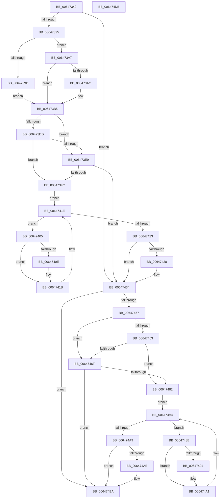

# DifZwQueryInformationProcessWrapper

- RVA: `0x00647340`–`0x006474DC` (길이 `412` bytes)
- VA: `0x0000000140647340`
- 실행 섹션: `.text`
- PDB 이름 있음: `예`; PDB Function 태그: `아니요`
- unwind 정보 RVA: `0x000BD780`
- 디코드: `118`개 명령, `412/412` bytes 표시
- 미해석 바이트: `0` (있으면 어셈블리에 `.byte`로 보존)

> 이 문서는 커널 이미지의 기계어와 PDB 기호를 분석해 생성했습니다. 4번과 5번은 함수 원형과 자료형을 바이너리 사용 방식에서 추정한 C 해석이며 원본 소스 복구 결과는 아닙니다.

## 1. Dependencies

- 직접 호출 지점: **9**; 고유 호출 대상: **6**
- 직접 호출자로 확인된 함수: **0**
- RIP 상대 이미지 참조: **3**

### Outgoing calls
- `0x00647384` → [DifGetAPIThunkContextById](../49/DifGetAPIThunkContextById_function_00495A34.md) (function, `0x00495A34`)
- `0x006473AC` → [DifGetReturnAddressForWrappers](../4D/DifGetReturnAddressForWrappers_function_004D3C08.md) (function, `0x004D3C08`)
- `0x006473F0` → [ExAcquireRundownProtection](../21/ExAcquireRundownProtection_function_00216620.md) (function, `0x00216620`)
- `0x00647416` → [guard_dispatch_icall](../6B/guard_dispatch_icall_function_006BAAD0.md) (function, `0x006BAAD0`)
- `0x0064742F` → [ExReleaseRundownProtection](../34/ExReleaseRundownProtection_function_00349E80.md) (function, `0x00349E80`)
- `0x0064744A` → [ZwQueryInformationProcess](../6A/ZwQueryInformationProcess_function_006AD3F0.md) (function, `0x006AD3F0`)
- `0x00647476` → [ExAcquireRundownProtection](../21/ExAcquireRundownProtection_function_00216620.md) (function, `0x00216620`)
- `0x0064749C` → [guard_dispatch_icall](../6B/guard_dispatch_icall_function_006BAAD0.md) (function, `0x006BAAD0`)
- `0x006474B5` → [ExReleaseRundownProtection](../34/ExReleaseRundownProtection_function_00349E80.md) (function, `0x00349E80`)

### Direct callers
- 이 함수 시작 RVA로 연결되는 직접 call은 확인되지 않았습니다. 간접 호출은 완전히 역산할 수 없습니다.

### Static image references
- `0x006473BC` → RVA `0x00F048B8` (`.data`; read)
- `0x006473DD` → RVA `0x00F04980` (`.data`; read)
- `0x006473E9` → RVA `0x00F03E80` (`.data`; read)

## 2. Other-region calls and transfers

- 다른 실행 섹션으로 향하는 call: **0**
- 별도 외부 분기/꼬리 이동을 확인하지 못했습니다.

## 3. Assembly (complete function range)

```asm
00647340  48 8B C4                        mov rax, rsp
00647343  48 89 58 10                     mov qword ptr [rax + 0x10], rbx
00647347  48 89 70 18                     mov qword ptr [rax + 0x18], rsi
0064734B  48 89 78 20                     mov qword ptr [rax + 0x20], rdi
0064734F  48 89 48 08                     mov qword ptr [rax + 8], rcx
00647353  55                              push rbp
00647354  41 54                           push r12
00647356  41 55                           push r13
00647358  41 56                           push r14
0064735A  41 57                           push r15
0064735C  48 8B EC                        mov rbp, rsp
0064735F  48 83 EC 70                     sub rsp, 0x70
00647363  33 C0                           xor eax, eax
00647365  0F 57 C0                        xorps xmm0, xmm0
00647368  45 8B F9                        mov r15d, r9d
0064736B  48 89 45 F0                     mov qword ptr [rbp - 0x10], rax
0064736F  4D 8B E0                        mov r12, r8
00647372  44 8B EA                        mov r13d, edx
00647375  0F 11 45 C0                     movups xmmword ptr [rbp - 0x40], xmm0
00647379  8D 48 30                        lea ecx, [rax + 0x30]
0064737C  0F 11 45 D0                     movups xmmword ptr [rbp - 0x30], xmm0
00647380  0F 11 45 E0                     movups xmmword ptr [rbp - 0x20], xmm0
00647384  E8 AB E6 E4 FF                  call 0x140495a34
00647389  4C 8B F0                        mov r14, rax
0064738C  48 85 C0                        test rax, rax
0064738F  0F 84 9F 00 00 00               je 0x140647434
00647395  8B 48 0C                        mov ecx, dword ptr [rax + 0xc]
00647398  F6 C1 18                        test cl, 0x18
0064739B  74 0A                           je 0x1406473a7
0064739D  48 8B 4D 28                     mov rcx, qword ptr [rbp + 0x28]
006473A1  48 89 4D C0                     mov qword ptr [rbp - 0x40], rcx
006473A5  EB 0E                           jmp 0x1406473b5
006473A7  F6 C1 04                        test cl, 4
006473AA  74 09                           je 0x1406473b5
006473AC  E8 57 C8 E8 FF                  call 0x1404d3c08
006473B1  48 89 45 C0                     mov qword ptr [rbp - 0x40], rax
006473B5  48 8B 45 30                     mov rax, qword ptr [rbp + 0x30]
006473B9  40 32 F6                        xor sil, sil
006473BC  40 38 35 F5 D4 8B 00            cmp byte ptr [rip + 0x8bd4f5], sil
006473C3  48 89 45 E8                     mov qword ptr [rbp - 0x18], rax
006473C7  48 8B 45 50                     mov rax, qword ptr [rbp + 0x50]
006473CB  48 89 45 C8                     mov qword ptr [rbp - 0x38], rax
006473CF  44 89 6D E0                     mov dword ptr [rbp - 0x20], r13d
006473D3  4C 89 65 D8                     mov qword ptr [rbp - 0x28], r12
006473D7  44 89 7D D0                     mov dword ptr [rbp - 0x30], r15d
006473DB  75 0C                           jne 0x1406473e9
006473DD  F7 05 99 D5 8B 00 00 08 00 00   test dword ptr [rip + 0x8bd599], 0x800
006473E7  74 13                           je 0x1406473fc
006473E9  48 8D 0D 90 CA 8B 00            lea rcx, [rip + 0x8bca90]
006473F0  E8 2B F2 BC FF                  call 0x140216620
006473F5  40 8A F0                        mov sil, al
006473F8  84 C0                           test al, al
006473FA  74 38                           je 0x140647434
006473FC  49 8D 7E 20                     lea rdi, [r14 + 0x20]
00647400  48 8B 1F                        mov rbx, qword ptr [rdi]
00647403  EB 19                           jmp 0x14064741e
00647405  48 8D 43 F0                     lea rax, [rbx - 0x10]
00647409  48 85 C0                        test rax, rax
0064740C  74 0D                           je 0x14064741b
0064740E  48 8B 40 08                     mov rax, qword ptr [rax + 8]
00647412  48 8D 4D C0                     lea rcx, [rbp - 0x40]
00647416  E8 B5 36 07 00                  call 0x1406baad0
0064741B  48 8B 1B                        mov rbx, qword ptr [rbx]
0064741E  48 3B DF                        cmp rbx, rdi
00647421  75 E2                           jne 0x140647405
00647423  40 84 F6                        test sil, sil
00647426  74 0C                           je 0x140647434
00647428  48 8D 0D 51 CA 8B 00            lea rcx, [rip + 0x8bca51]
0064742F  E8 4C 2A D0 FF                  call 0x140349e80
00647434  48 8B 45 50                     mov rax, qword ptr [rbp + 0x50]
00647438  45 8B CF                        mov r9d, r15d
0064743B  48 8B 4D 30                     mov rcx, qword ptr [rbp + 0x30]
0064743F  4D 8B C4                        mov r8, r12
00647442  41 8B D5                        mov edx, r13d
00647445  48 89 44 24 20                  mov qword ptr [rsp + 0x20], rax
0064744A  E8 A1 5F 06 00                  call 0x1406ad3f0
0064744F  89 45 F0                        mov dword ptr [rbp - 0x10], eax
00647452  4D 85 F6                        test r14, r14
00647455  74 63                           je 0x1406474ba
00647457  40 32 FF                        xor dil, dil
0064745A  40 38 3D 57 D4 8B 00            cmp byte ptr [rip + 0x8bd457], dil
00647461  75 0C                           jne 0x14064746f
00647463  F7 05 13 D5 8B 00 00 08 00 00   test dword ptr [rip + 0x8bd513], 0x800
0064746D  74 13                           je 0x140647482
0064746F  48 8D 0D 0A CA 8B 00            lea rcx, [rip + 0x8bca0a]
00647476  E8 A5 F1 BC FF                  call 0x140216620
0064747B  40 8A F8                        mov dil, al
0064747E  84 C0                           test al, al
00647480  74 38                           je 0x1406474ba
00647482  49 8D 76 30                     lea rsi, [r14 + 0x30]
00647486  48 8B 1E                        mov rbx, qword ptr [rsi]
00647489  EB 19                           jmp 0x1406474a4
0064748B  48 8D 43 F0                     lea rax, [rbx - 0x10]
0064748F  48 85 C0                        test rax, rax
00647492  74 0D                           je 0x1406474a1
00647494  48 8B 40 08                     mov rax, qword ptr [rax + 8]
00647498  48 8D 4D C0                     lea rcx, [rbp - 0x40]
0064749C  E8 2F 36 07 00                  call 0x1406baad0
006474A1  48 8B 1B                        mov rbx, qword ptr [rbx]
006474A4  48 3B DE                        cmp rbx, rsi
006474A7  75 E2                           jne 0x14064748b
006474A9  40 84 FF                        test dil, dil
006474AC  74 0C                           je 0x1406474ba
006474AE  48 8D 0D CB C9 8B 00            lea rcx, [rip + 0x8bc9cb]
006474B5  E8 C6 29 D0 FF                  call 0x140349e80
006474BA  8B 45 F0                        mov eax, dword ptr [rbp - 0x10]
006474BD  4C 8D 5C 24 70                  lea r11, [rsp + 0x70]
006474C2  49 8B 5B 38                     mov rbx, qword ptr [r11 + 0x38]
006474C6  49 8B 73 40                     mov rsi, qword ptr [r11 + 0x40]
006474CA  49 8B 7B 48                     mov rdi, qword ptr [r11 + 0x48]
006474CE  49 8B E3                        mov rsp, r11
006474D1  41 5F                           pop r15
006474D3  41 5E                           pop r14
006474D5  41 5D                           pop r13
006474D7  41 5C                           pop r12
006474D9  5D                              pop rbp
006474DA  C3                              ret
006474DB  CC                              int3
```

## 4. C-style interpretation (structured pseudocode)

```c
__int64 __fastcall DifZwQueryInformationProcessWrapper(__int64 a1, int a2, __int64 a3, int a4, __int64 a5)
{
    __int64 result;
    __int64 v_rdi;
    __int64 v_rsi;
    __int64 v_rsp;
    unsigned __int64 v_stack_m28;
    unsigned __int64 v_stack_m38;
    unsigned __int64 v_stack_m40;
    unsigned __int64 v_stack_m48;
    unsigned __int64 v_stack_m50;
    unsigned __int64 v_stack_m58;
    unsigned __int64 v_stack_m60;
    unsigned __int64 v_stack_m68;
    unsigned __int64 v_stack_m78;
    unsigned __int64 v_stack_p0;
    unsigned __int64 v_stack_p8;

    *(unsigned __int64 *)(v_rsp + 16) = v_rbx;
    *(unsigned __int64 *)(v_rsp + 24) = v_rsi;
    *(unsigned __int64 *)(v_rsp + 32) = v_rdi;
    *(unsigned __int64 *)(v_rsp + 8) = a1;
    v_rsp = (v_rsp) - (112);
    result = 0;
    v_stack_m38 = 0;
    v_stack_m68 = v_xmm0;
    v_stack_m58 = v_xmm0;
    v_stack_m48 = v_xmm0;
    result = DifGetAPIThunkContextById(result + 48, a2, a3, a4);
    if (result == 0) goto loc_00647434;
    if ((((unsigned __int8)((unsigned int)(*(unsigned int *)(result + 12)))) & (24)) == 0) goto loc_006473A7;
    v_stack_m68 = v_stack_p0;
    goto loc_006473B5;
loc_006473A7:
    if ((((unsigned __int8)(v_stack_p0)) & (4)) != 0) {
        result = DifGetReturnAddressForWrappers(v_stack_p0, a2, a3, a4);
        v_stack_m68 = result;
    }
    v_rsi = 0;
    v_stack_m40 = v_stack_p8;
    v_stack_m60 = a5;
    v_stack_m48 = (unsigned int)((unsigned int)(a2));
    v_stack_m50 = a3;
    v_stack_m58 = (unsigned int)((unsigned int)(a4));
    if ((*(unsigned __int8 *)(v_rip + 9164021)) != 0) goto loc_006473E9;
    if (((*(unsigned int *)(v_rip + 9164185)) & (0x800ULL)) == 0) goto loc_006473FC;
loc_006473E9:
    result = ExAcquireRundownProtection(v_rip + 9161360, a2, a3, a4);
    if ((unsigned __int8)(result) == 0) goto loc_00647434;
loc_006473FC:
    goto loc_0064741E;
loc_00647405:
    result = *(unsigned __int64 *)(result + 32) - 16;
    if (*(unsigned __int64 *)(result + 32) - 16 != 0) {
        result = *(unsigned __int64 *)(*(unsigned __int64 *)(result + 32) - 16 + 8);
        a1 = v_stack_m68;
        result = guard_dispatch_icall(a1, a2, a3, a4);
    }
loc_0064741E:
    if ((*(unsigned __int64 *)(*(unsigned __int64 *)(result + 32))) != (result + 32)) goto loc_00647405;
    if ((unsigned __int8)((unsigned __int8)(result)) != 0) {
        a1 = v_rip + 9161297;
        result = ExReleaseRundownProtection(a1, a2, a3, a4);
    }
    v_stack_m78 = a5;
    result = ZwQueryInformationProcess(v_stack_p8, (unsigned int)((unsigned int)((unsigned int)(a2))), a3, (unsigned int)((unsigned int)((unsigned int)(a4))));
    v_stack_m38 = (unsigned int)(result);
    if (result == 0) goto loc_006474BA;
    v_rdi = 0;
    if ((*(unsigned __int8 *)(v_rip + 9163863)) != 0) goto loc_0064746F;
    if (((*(unsigned int *)(v_rip + 9164051)) & (0x800ULL)) == 0) goto loc_00647482;
loc_0064746F:
    result = ExAcquireRundownProtection(v_rip + 9161226, (unsigned int)((unsigned int)((unsigned int)(a2))), a3, (unsigned int)((unsigned int)((unsigned int)(a4))));
    if ((unsigned __int8)(result) == 0) goto loc_006474BA;
loc_00647482:
    goto loc_006474A4;
loc_0064748B:
    result = *(unsigned __int64 *)(result + 48) - 16;
    if (*(unsigned __int64 *)(result + 48) - 16 != 0) {
        result = *(unsigned __int64 *)(*(unsigned __int64 *)(result + 48) - 16 + 8);
        a1 = v_stack_m68;
        result = guard_dispatch_icall(a1, (unsigned int)((unsigned int)((unsigned int)(a2))), a3, (unsigned int)((unsigned int)((unsigned int)(a4))));
    }
loc_006474A4:
    if ((*(unsigned __int64 *)(*(unsigned __int64 *)(result + 48))) != (result + 48)) goto loc_0064748B;
    if ((unsigned __int8)((unsigned __int8)(result)) != 0) {
        a1 = v_rip + 9161163;
        result = ExReleaseRundownProtection(a1, (unsigned int)((unsigned int)((unsigned int)(a2))), a3, (unsigned int)((unsigned int)((unsigned int)(a4))));
    }
    return (unsigned int)(v_stack_m38);
}
```

## 5. (Beta) C Style

```c
int64_t DifZwQueryInformationProcessWrapper(int64_t Arg1, int32_t Arg2, int64_t Arg3, int32_t Arg4, int64_t Arg5)
{
    int64_t result;
    int64_t local_rdi;
    int64_t local_rsi;
    int64_t local_rsp;
    uint64_t v_stack_m28;
    uint64_t v_stack_m38;
    uint64_t v_stack_m40;
    uint64_t v_stack_m48;
    uint64_t v_stack_m50;
    uint64_t v_stack_m58;
    uint64_t v_stack_m60;
    uint64_t v_stack_m68;
    uint64_t v_stack_m78;
    uint64_t v_stack_p0;
    uint64_t v_stack_p8;

    *(uint64_t *)(local_rsp + 0x10) = local_rbx;
    *(uint64_t *)(local_rsp + 0x18) = local_rsi;
    *(uint64_t *)(local_rsp + 0x20) = local_rdi;
    *(uint64_t *)(local_rsp + 0x8) = Arg1;
    local_rsp = (local_rsp) - (112);
    result = 0;
    v_stack_m38 = 0;
    v_stack_m68 = v_xmm0;
    v_stack_m58 = v_xmm0;
    v_stack_m48 = v_xmm0;
    result = DifGetAPIThunkContextById(result + 48, Arg2, Arg3, Arg4);
    if (result == 0) goto loc_00647434;
    if ((((uint8_t)((uint32_t)(*(uint32_t *)(result + 0xC)))) & (24)) == 0) goto loc_006473A7;
    v_stack_m68 = v_stack_p0;
    goto loc_006473B5;
loc_006473A7:
    if ((((uint8_t)(v_stack_p0)) & (4)) != 0) {
        result = DifGetReturnAddressForWrappers(v_stack_p0, Arg2, Arg3, Arg4);
        v_stack_m68 = result;
    }
    local_rsi = 0;
    v_stack_m40 = v_stack_p8;
    v_stack_m60 = Arg5;
    v_stack_m48 = (uint32_t)((uint32_t)(Arg2));
    v_stack_m50 = Arg3;
    v_stack_m58 = (uint32_t)((uint32_t)(Arg4));
    if ((*(uint8_t *)(v_rip + 0x8BD4F5)) != 0) goto loc_006473E9;
    if (((*(uint32_t *)(v_rip + 0x8BD599)) & (0x800ULL)) == 0) goto loc_006473FC;
loc_006473E9:
    result = ExAcquireRundownProtection(v_rip + 9161360, Arg2, Arg3, Arg4);
    if ((uint8_t)(result) == 0) goto loc_00647434;
loc_006473FC:
    goto loc_0064741E;
loc_00647405:
    result = *(uint64_t *)(result + 0x20) - 16;
    if (*(uint64_t *)(result + 0x20) - 16 != 0) {
        result = *(uint64_t *)(*(uint64_t *)(result + 0x20) - 0x10 + 0x8);
        Arg1 = v_stack_m68;
        result = guard_dispatch_icall(Arg1, Arg2, Arg3, Arg4);
    }
loc_0064741E:
    if ((*(uint64_t *)(*(uint64_t *)(result + 0x20))) != (result + 32)) goto loc_00647405;
    if ((uint8_t)((uint8_t)(result)) != 0) {
        Arg1 = v_rip + 9161297;
        result = ExReleaseRundownProtection(Arg1, Arg2, Arg3, Arg4);
    }
    v_stack_m78 = Arg5;
    result = ZwQueryInformationProcess(v_stack_p8, (uint32_t)((uint32_t)((uint32_t)(Arg2))), Arg3, (uint32_t)((uint32_t)((uint32_t)(Arg4))));
    v_stack_m38 = (uint32_t)(result);
    if (result == 0) goto loc_006474BA;
    local_rdi = 0;
    if ((*(uint8_t *)(v_rip + 0x8BD457)) != 0) goto loc_0064746F;
    if (((*(uint32_t *)(v_rip + 0x8BD513)) & (0x800ULL)) == 0) goto loc_00647482;
loc_0064746F:
    result = ExAcquireRundownProtection(v_rip + 9161226, (uint32_t)((uint32_t)((uint32_t)(Arg2))), Arg3, (uint32_t)((uint32_t)((uint32_t)(Arg4))));
    if ((uint8_t)(result) == 0) goto loc_006474BA;
loc_00647482:
    goto loc_006474A4;
loc_0064748B:
    result = *(uint64_t *)(result + 0x30) - 16;
    if (*(uint64_t *)(result + 0x30) - 16 != 0) {
        result = *(uint64_t *)(*(uint64_t *)(result + 0x30) - 0x10 + 0x8);
        Arg1 = v_stack_m68;
        result = guard_dispatch_icall(Arg1, (uint32_t)((uint32_t)((uint32_t)(Arg2))), Arg3, (uint32_t)((uint32_t)((uint32_t)(Arg4))));
    }
loc_006474A4:
    if ((*(uint64_t *)(*(uint64_t *)(result + 0x30))) != (result + 48)) goto loc_0064748B;
    if ((uint8_t)((uint8_t)(result)) != 0) {
        Arg1 = v_rip + 9161163;
        result = ExReleaseRundownProtection(Arg1, (uint32_t)((uint32_t)((uint32_t)(Arg2))), Arg3, (uint32_t)((uint32_t)((uint32_t)(Arg4))));
    }
    return (uint32_t)(v_stack_m38);
}
```

## 6. Execution-region graph

[열기: 2D/3D 그래프와 함수 탐색 컨트롤 패널](../../../control-panel.html?section=text&rva=0x00647340&view=graph)

- 2D 그래프는 위에서 아래로 흐르고, 3D 그래프는 빈 공간을 드래그해 회전합니다. Shift+드래그는 이동, 휠은 확대·축소, 함수 노드 선택은 대상 보고서 이동입니다.

### Static fallback


