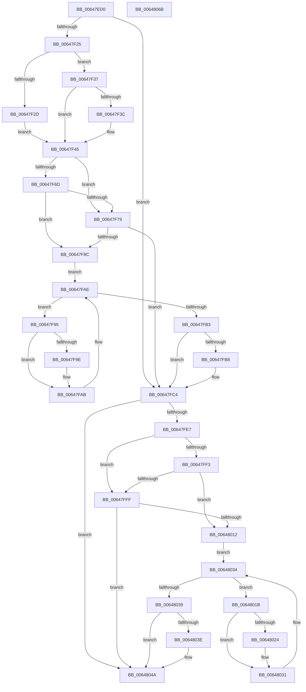

# DifZwQueryKeyWrapper

- RVA: `0x00647ED0`–`0x0064806C` (길이 `412` bytes)
- VA: `0x0000000140647ED0`
- 실행 섹션: `.text`
- PDB 이름 있음: `예`; PDB Function 태그: `아니요`
- unwind 정보 RVA: `0x000BD780`
- 디코드: `118`개 명령, `412/412` bytes 표시
- 미해석 바이트: `0` (있으면 어셈블리에 `.byte`로 보존)

> 이 문서는 커널 이미지의 기계어와 PDB 기호를 분석해 생성했습니다. 4번과 5번은 함수 원형과 자료형을 바이너리 사용 방식에서 추정한 C 해석이며 원본 소스 복구 결과는 아닙니다.

## 1. Dependencies

- 직접 호출 지점: **9**; 고유 호출 대상: **6**
- 직접 호출자로 확인된 함수: **0**
- RIP 상대 이미지 참조: **3**

### Outgoing calls
- `0x00647F14` → [DifGetAPIThunkContextById](../49/DifGetAPIThunkContextById_function_00495A34.md) (function, `0x00495A34`)
- `0x00647F3C` → [DifGetReturnAddressForWrappers](../4D/DifGetReturnAddressForWrappers_function_004D3C08.md) (function, `0x004D3C08`)
- `0x00647F80` → [ExAcquireRundownProtection](../21/ExAcquireRundownProtection_function_00216620.md) (function, `0x00216620`)
- `0x00647FA6` → [guard_dispatch_icall](../6B/guard_dispatch_icall_function_006BAAD0.md) (function, `0x006BAAD0`)
- `0x00647FBF` → [ExReleaseRundownProtection](../34/ExReleaseRundownProtection_function_00349E80.md) (function, `0x00349E80`)
- `0x00647FDA` → [ZwQueryKey](../6A/ZwQueryKey_function_006AD390.md) (function, `0x006AD390`)
- `0x00648006` → [ExAcquireRundownProtection](../21/ExAcquireRundownProtection_function_00216620.md) (function, `0x00216620`)
- `0x0064802C` → [guard_dispatch_icall](../6B/guard_dispatch_icall_function_006BAAD0.md) (function, `0x006BAAD0`)
- `0x00648045` → [ExReleaseRundownProtection](../34/ExReleaseRundownProtection_function_00349E80.md) (function, `0x00349E80`)

### Direct callers
- 이 함수 시작 RVA로 연결되는 직접 call은 확인되지 않았습니다. 간접 호출은 완전히 역산할 수 없습니다.

### Static image references
- `0x00647F4C` → RVA `0x00F048B8` (`.data`; read)
- `0x00647F6D` → RVA `0x00F04980` (`.data`; read)
- `0x00647F79` → RVA `0x00F03E80` (`.data`; read)

## 2. Other-region calls and transfers

- 다른 실행 섹션으로 향하는 call: **0**
- 별도 외부 분기/꼬리 이동을 확인하지 못했습니다.

## 3. Assembly (complete function range)

```asm
00647ED0  48 8B C4                        mov rax, rsp
00647ED3  48 89 58 10                     mov qword ptr [rax + 0x10], rbx
00647ED7  48 89 70 18                     mov qword ptr [rax + 0x18], rsi
00647EDB  48 89 78 20                     mov qword ptr [rax + 0x20], rdi
00647EDF  48 89 48 08                     mov qword ptr [rax + 8], rcx
00647EE3  55                              push rbp
00647EE4  41 54                           push r12
00647EE6  41 55                           push r13
00647EE8  41 56                           push r14
00647EEA  41 57                           push r15
00647EEC  48 8B EC                        mov rbp, rsp
00647EEF  48 83 EC 70                     sub rsp, 0x70
00647EF3  33 C0                           xor eax, eax
00647EF5  0F 57 C0                        xorps xmm0, xmm0
00647EF8  45 8B F9                        mov r15d, r9d
00647EFB  48 89 45 F0                     mov qword ptr [rbp - 0x10], rax
00647EFF  4D 8B E0                        mov r12, r8
00647F02  44 8B EA                        mov r13d, edx
00647F05  0F 11 45 C0                     movups xmmword ptr [rbp - 0x40], xmm0
00647F09  8D 48 29                        lea ecx, [rax + 0x29]
00647F0C  0F 11 45 D0                     movups xmmword ptr [rbp - 0x30], xmm0
00647F10  0F 11 45 E0                     movups xmmword ptr [rbp - 0x20], xmm0
00647F14  E8 1B DB E4 FF                  call 0x140495a34
00647F19  4C 8B F0                        mov r14, rax
00647F1C  48 85 C0                        test rax, rax
00647F1F  0F 84 9F 00 00 00               je 0x140647fc4
00647F25  8B 48 0C                        mov ecx, dword ptr [rax + 0xc]
00647F28  F6 C1 18                        test cl, 0x18
00647F2B  74 0A                           je 0x140647f37
00647F2D  48 8B 4D 28                     mov rcx, qword ptr [rbp + 0x28]
00647F31  48 89 4D C0                     mov qword ptr [rbp - 0x40], rcx
00647F35  EB 0E                           jmp 0x140647f45
00647F37  F6 C1 04                        test cl, 4
00647F3A  74 09                           je 0x140647f45
00647F3C  E8 C7 BC E8 FF                  call 0x1404d3c08
00647F41  48 89 45 C0                     mov qword ptr [rbp - 0x40], rax
00647F45  48 8B 45 30                     mov rax, qword ptr [rbp + 0x30]
00647F49  40 32 F6                        xor sil, sil
00647F4C  40 38 35 65 C9 8B 00            cmp byte ptr [rip + 0x8bc965], sil
00647F53  48 89 45 E8                     mov qword ptr [rbp - 0x18], rax
00647F57  48 8B 45 50                     mov rax, qword ptr [rbp + 0x50]
00647F5B  48 89 45 C8                     mov qword ptr [rbp - 0x38], rax
00647F5F  44 89 6D E0                     mov dword ptr [rbp - 0x20], r13d
00647F63  4C 89 65 D8                     mov qword ptr [rbp - 0x28], r12
00647F67  44 89 7D D0                     mov dword ptr [rbp - 0x30], r15d
00647F6B  75 0C                           jne 0x140647f79
00647F6D  F7 05 09 CA 8B 00 00 08 00 00   test dword ptr [rip + 0x8bca09], 0x800
00647F77  74 13                           je 0x140647f8c
00647F79  48 8D 0D 00 BF 8B 00            lea rcx, [rip + 0x8bbf00]
00647F80  E8 9B E6 BC FF                  call 0x140216620
00647F85  40 8A F0                        mov sil, al
00647F88  84 C0                           test al, al
00647F8A  74 38                           je 0x140647fc4
00647F8C  49 8D 7E 20                     lea rdi, [r14 + 0x20]
00647F90  48 8B 1F                        mov rbx, qword ptr [rdi]
00647F93  EB 19                           jmp 0x140647fae
00647F95  48 8D 43 F0                     lea rax, [rbx - 0x10]
00647F99  48 85 C0                        test rax, rax
00647F9C  74 0D                           je 0x140647fab
00647F9E  48 8B 40 08                     mov rax, qword ptr [rax + 8]
00647FA2  48 8D 4D C0                     lea rcx, [rbp - 0x40]
00647FA6  E8 25 2B 07 00                  call 0x1406baad0
00647FAB  48 8B 1B                        mov rbx, qword ptr [rbx]
00647FAE  48 3B DF                        cmp rbx, rdi
00647FB1  75 E2                           jne 0x140647f95
00647FB3  40 84 F6                        test sil, sil
00647FB6  74 0C                           je 0x140647fc4
00647FB8  48 8D 0D C1 BE 8B 00            lea rcx, [rip + 0x8bbec1]
00647FBF  E8 BC 1E D0 FF                  call 0x140349e80
00647FC4  48 8B 45 50                     mov rax, qword ptr [rbp + 0x50]
00647FC8  45 8B CF                        mov r9d, r15d
00647FCB  48 8B 4D 30                     mov rcx, qword ptr [rbp + 0x30]
00647FCF  4D 8B C4                        mov r8, r12
00647FD2  41 8B D5                        mov edx, r13d
00647FD5  48 89 44 24 20                  mov qword ptr [rsp + 0x20], rax
00647FDA  E8 B1 53 06 00                  call 0x1406ad390
00647FDF  89 45 F0                        mov dword ptr [rbp - 0x10], eax
00647FE2  4D 85 F6                        test r14, r14
00647FE5  74 63                           je 0x14064804a
00647FE7  40 32 FF                        xor dil, dil
00647FEA  40 38 3D C7 C8 8B 00            cmp byte ptr [rip + 0x8bc8c7], dil
00647FF1  75 0C                           jne 0x140647fff
00647FF3  F7 05 83 C9 8B 00 00 08 00 00   test dword ptr [rip + 0x8bc983], 0x800
00647FFD  74 13                           je 0x140648012
00647FFF  48 8D 0D 7A BE 8B 00            lea rcx, [rip + 0x8bbe7a]
00648006  E8 15 E6 BC FF                  call 0x140216620
0064800B  40 8A F8                        mov dil, al
0064800E  84 C0                           test al, al
00648010  74 38                           je 0x14064804a
00648012  49 8D 76 30                     lea rsi, [r14 + 0x30]
00648016  48 8B 1E                        mov rbx, qword ptr [rsi]
00648019  EB 19                           jmp 0x140648034
0064801B  48 8D 43 F0                     lea rax, [rbx - 0x10]
0064801F  48 85 C0                        test rax, rax
00648022  74 0D                           je 0x140648031
00648024  48 8B 40 08                     mov rax, qword ptr [rax + 8]
00648028  48 8D 4D C0                     lea rcx, [rbp - 0x40]
0064802C  E8 9F 2A 07 00                  call 0x1406baad0
00648031  48 8B 1B                        mov rbx, qword ptr [rbx]
00648034  48 3B DE                        cmp rbx, rsi
00648037  75 E2                           jne 0x14064801b
00648039  40 84 FF                        test dil, dil
0064803C  74 0C                           je 0x14064804a
0064803E  48 8D 0D 3B BE 8B 00            lea rcx, [rip + 0x8bbe3b]
00648045  E8 36 1E D0 FF                  call 0x140349e80
0064804A  8B 45 F0                        mov eax, dword ptr [rbp - 0x10]
0064804D  4C 8D 5C 24 70                  lea r11, [rsp + 0x70]
00648052  49 8B 5B 38                     mov rbx, qword ptr [r11 + 0x38]
00648056  49 8B 73 40                     mov rsi, qword ptr [r11 + 0x40]
0064805A  49 8B 7B 48                     mov rdi, qword ptr [r11 + 0x48]
0064805E  49 8B E3                        mov rsp, r11
00648061  41 5F                           pop r15
00648063  41 5E                           pop r14
00648065  41 5D                           pop r13
00648067  41 5C                           pop r12
00648069  5D                              pop rbp
0064806A  C3                              ret
0064806B  CC                              int3
```

## 4. C-style interpretation (structured pseudocode)

```c
__int64 __fastcall DifZwQueryKeyWrapper(__int64 a1, int a2, __int64 a3, int a4, __int64 a5)
{
    __int64 result;
    __int64 v_rdi;
    __int64 v_rsi;
    __int64 v_rsp;
    unsigned __int64 v_stack_m28;
    unsigned __int64 v_stack_m38;
    unsigned __int64 v_stack_m40;
    unsigned __int64 v_stack_m48;
    unsigned __int64 v_stack_m50;
    unsigned __int64 v_stack_m58;
    unsigned __int64 v_stack_m60;
    unsigned __int64 v_stack_m68;
    unsigned __int64 v_stack_m78;
    unsigned __int64 v_stack_p0;
    unsigned __int64 v_stack_p8;

    *(unsigned __int64 *)(v_rsp + 16) = v_rbx;
    *(unsigned __int64 *)(v_rsp + 24) = v_rsi;
    *(unsigned __int64 *)(v_rsp + 32) = v_rdi;
    *(unsigned __int64 *)(v_rsp + 8) = a1;
    v_rsp = (v_rsp) - (112);
    result = 0;
    v_stack_m38 = 0;
    v_stack_m68 = v_xmm0;
    v_stack_m58 = v_xmm0;
    v_stack_m48 = v_xmm0;
    result = DifGetAPIThunkContextById(result + 41, a2, a3, a4);
    if (result == 0) goto loc_00647FC4;
    if ((((unsigned __int8)((unsigned int)(*(unsigned int *)(result + 12)))) & (24)) == 0) goto loc_00647F37;
    v_stack_m68 = v_stack_p0;
    goto loc_00647F45;
loc_00647F37:
    if ((((unsigned __int8)(v_stack_p0)) & (4)) != 0) {
        result = DifGetReturnAddressForWrappers(v_stack_p0, a2, a3, a4);
        v_stack_m68 = result;
    }
    v_rsi = 0;
    v_stack_m40 = v_stack_p8;
    v_stack_m60 = a5;
    v_stack_m48 = (unsigned int)((unsigned int)(a2));
    v_stack_m50 = a3;
    v_stack_m58 = (unsigned int)((unsigned int)(a4));
    if ((*(unsigned __int8 *)(v_rip + 9161061)) != 0) goto loc_00647F79;
    if (((*(unsigned int *)(v_rip + 9161225)) & (0x800ULL)) == 0) goto loc_00647F8C;
loc_00647F79:
    result = ExAcquireRundownProtection(v_rip + 9158400, a2, a3, a4);
    if ((unsigned __int8)(result) == 0) goto loc_00647FC4;
loc_00647F8C:
    goto loc_00647FAE;
loc_00647F95:
    result = *(unsigned __int64 *)(result + 32) - 16;
    if (*(unsigned __int64 *)(result + 32) - 16 != 0) {
        result = *(unsigned __int64 *)(*(unsigned __int64 *)(result + 32) - 16 + 8);
        a1 = v_stack_m68;
        result = guard_dispatch_icall(a1, a2, a3, a4);
    }
loc_00647FAE:
    if ((*(unsigned __int64 *)(*(unsigned __int64 *)(result + 32))) != (result + 32)) goto loc_00647F95;
    if ((unsigned __int8)((unsigned __int8)(result)) != 0) {
        a1 = v_rip + 9158337;
        result = ExReleaseRundownProtection(a1, a2, a3, a4);
    }
    v_stack_m78 = a5;
    result = ZwQueryKey(v_stack_p8, (unsigned int)((unsigned int)((unsigned int)(a2))), a3, (unsigned int)((unsigned int)((unsigned int)(a4))));
    v_stack_m38 = (unsigned int)(result);
    if (result == 0) goto loc_0064804A;
    v_rdi = 0;
    if ((*(unsigned __int8 *)(v_rip + 9160903)) != 0) goto loc_00647FFF;
    if (((*(unsigned int *)(v_rip + 9161091)) & (0x800ULL)) == 0) goto loc_00648012;
loc_00647FFF:
    result = ExAcquireRundownProtection(v_rip + 9158266, (unsigned int)((unsigned int)((unsigned int)(a2))), a3, (unsigned int)((unsigned int)((unsigned int)(a4))));
    if ((unsigned __int8)(result) == 0) goto loc_0064804A;
loc_00648012:
    goto loc_00648034;
loc_0064801B:
    result = *(unsigned __int64 *)(result + 48) - 16;
    if (*(unsigned __int64 *)(result + 48) - 16 != 0) {
        result = *(unsigned __int64 *)(*(unsigned __int64 *)(result + 48) - 16 + 8);
        a1 = v_stack_m68;
        result = guard_dispatch_icall(a1, (unsigned int)((unsigned int)((unsigned int)(a2))), a3, (unsigned int)((unsigned int)((unsigned int)(a4))));
    }
loc_00648034:
    if ((*(unsigned __int64 *)(*(unsigned __int64 *)(result + 48))) != (result + 48)) goto loc_0064801B;
    if ((unsigned __int8)((unsigned __int8)(result)) != 0) {
        a1 = v_rip + 9158203;
        result = ExReleaseRundownProtection(a1, (unsigned int)((unsigned int)((unsigned int)(a2))), a3, (unsigned int)((unsigned int)((unsigned int)(a4))));
    }
    return (unsigned int)(v_stack_m38);
}
```

## 5. (Beta) C Style

```c
int64_t DifZwQueryKeyWrapper(int64_t Arg1, int32_t Arg2, int64_t Arg3, int32_t Arg4, int64_t Arg5)
{
    int64_t result;
    int64_t local_rdi;
    int64_t local_rsi;
    int64_t local_rsp;
    uint64_t v_stack_m28;
    uint64_t v_stack_m38;
    uint64_t v_stack_m40;
    uint64_t v_stack_m48;
    uint64_t v_stack_m50;
    uint64_t v_stack_m58;
    uint64_t v_stack_m60;
    uint64_t v_stack_m68;
    uint64_t v_stack_m78;
    uint64_t v_stack_p0;
    uint64_t v_stack_p8;

    *(uint64_t *)(local_rsp + 0x10) = local_rbx;
    *(uint64_t *)(local_rsp + 0x18) = local_rsi;
    *(uint64_t *)(local_rsp + 0x20) = local_rdi;
    *(uint64_t *)(local_rsp + 0x8) = Arg1;
    local_rsp = (local_rsp) - (112);
    result = 0;
    v_stack_m38 = 0;
    v_stack_m68 = v_xmm0;
    v_stack_m58 = v_xmm0;
    v_stack_m48 = v_xmm0;
    result = DifGetAPIThunkContextById(result + 41, Arg2, Arg3, Arg4);
    if (result == 0) goto loc_00647FC4;
    if ((((uint8_t)((uint32_t)(*(uint32_t *)(result + 0xC)))) & (24)) == 0) goto loc_00647F37;
    v_stack_m68 = v_stack_p0;
    goto loc_00647F45;
loc_00647F37:
    if ((((uint8_t)(v_stack_p0)) & (4)) != 0) {
        result = DifGetReturnAddressForWrappers(v_stack_p0, Arg2, Arg3, Arg4);
        v_stack_m68 = result;
    }
    local_rsi = 0;
    v_stack_m40 = v_stack_p8;
    v_stack_m60 = Arg5;
    v_stack_m48 = (uint32_t)((uint32_t)(Arg2));
    v_stack_m50 = Arg3;
    v_stack_m58 = (uint32_t)((uint32_t)(Arg4));
    if ((*(uint8_t *)(v_rip + 0x8BC965)) != 0) goto loc_00647F79;
    if (((*(uint32_t *)(v_rip + 0x8BCA09)) & (0x800ULL)) == 0) goto loc_00647F8C;
loc_00647F79:
    result = ExAcquireRundownProtection(v_rip + 9158400, Arg2, Arg3, Arg4);
    if ((uint8_t)(result) == 0) goto loc_00647FC4;
loc_00647F8C:
    goto loc_00647FAE;
loc_00647F95:
    result = *(uint64_t *)(result + 0x20) - 16;
    if (*(uint64_t *)(result + 0x20) - 16 != 0) {
        result = *(uint64_t *)(*(uint64_t *)(result + 0x20) - 0x10 + 0x8);
        Arg1 = v_stack_m68;
        result = guard_dispatch_icall(Arg1, Arg2, Arg3, Arg4);
    }
loc_00647FAE:
    if ((*(uint64_t *)(*(uint64_t *)(result + 0x20))) != (result + 32)) goto loc_00647F95;
    if ((uint8_t)((uint8_t)(result)) != 0) {
        Arg1 = v_rip + 9158337;
        result = ExReleaseRundownProtection(Arg1, Arg2, Arg3, Arg4);
    }
    v_stack_m78 = Arg5;
    result = ZwQueryKey(v_stack_p8, (uint32_t)((uint32_t)((uint32_t)(Arg2))), Arg3, (uint32_t)((uint32_t)((uint32_t)(Arg4))));
    v_stack_m38 = (uint32_t)(result);
    if (result == 0) goto loc_0064804A;
    local_rdi = 0;
    if ((*(uint8_t *)(v_rip + 0x8BC8C7)) != 0) goto loc_00647FFF;
    if (((*(uint32_t *)(v_rip + 0x8BC983)) & (0x800ULL)) == 0) goto loc_00648012;
loc_00647FFF:
    result = ExAcquireRundownProtection(v_rip + 9158266, (uint32_t)((uint32_t)((uint32_t)(Arg2))), Arg3, (uint32_t)((uint32_t)((uint32_t)(Arg4))));
    if ((uint8_t)(result) == 0) goto loc_0064804A;
loc_00648012:
    goto loc_00648034;
loc_0064801B:
    result = *(uint64_t *)(result + 0x30) - 16;
    if (*(uint64_t *)(result + 0x30) - 16 != 0) {
        result = *(uint64_t *)(*(uint64_t *)(result + 0x30) - 0x10 + 0x8);
        Arg1 = v_stack_m68;
        result = guard_dispatch_icall(Arg1, (uint32_t)((uint32_t)((uint32_t)(Arg2))), Arg3, (uint32_t)((uint32_t)((uint32_t)(Arg4))));
    }
loc_00648034:
    if ((*(uint64_t *)(*(uint64_t *)(result + 0x30))) != (result + 48)) goto loc_0064801B;
    if ((uint8_t)((uint8_t)(result)) != 0) {
        Arg1 = v_rip + 9158203;
        result = ExReleaseRundownProtection(Arg1, (uint32_t)((uint32_t)((uint32_t)(Arg2))), Arg3, (uint32_t)((uint32_t)((uint32_t)(Arg4))));
    }
    return (uint32_t)(v_stack_m38);
}
```

## 6. Execution-region graph

[열기: 2D/3D 그래프와 함수 탐색 컨트롤 패널](../../../control-panel.html?section=text&rva=0x00647ED0&view=graph)

- 2D 그래프는 위에서 아래로 흐르고, 3D 그래프는 빈 공간을 드래그해 회전합니다. Shift+드래그는 이동, 휠은 확대·축소, 함수 노드 선택은 대상 보고서 이동입니다.

### Static fallback


