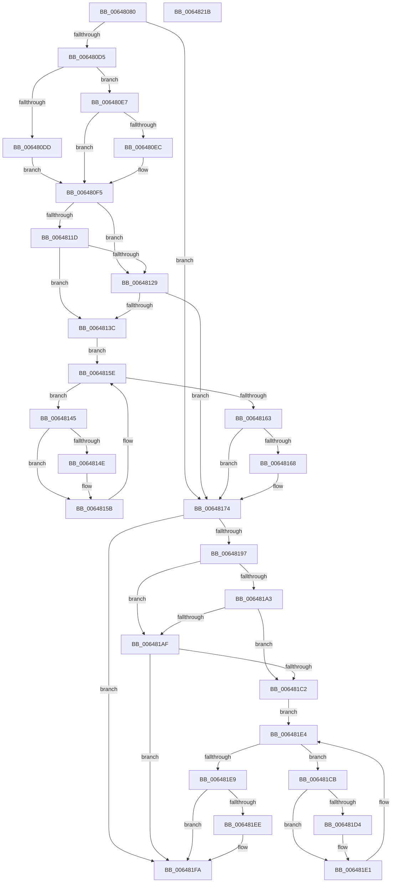

# DifZwQueryLicenseValueWrapper

- RVA: `0x00648080`–`0x0064821C` (길이 `412` bytes)
- VA: `0x0000000140648080`
- 실행 섹션: `.text`
- PDB 이름 있음: `예`; PDB Function 태그: `아니요`
- unwind 정보 RVA: `0x000BD780`
- 디코드: `118`개 명령, `412/412` bytes 표시
- 미해석 바이트: `0` (있으면 어셈블리에 `.byte`로 보존)

> 이 문서는 커널 이미지의 기계어와 PDB 기호를 분석해 생성했습니다. 4번과 5번은 함수 원형과 자료형을 바이너리 사용 방식에서 추정한 C 해석이며 원본 소스 복구 결과는 아닙니다.

## 1. Dependencies

- 직접 호출 지점: **9**; 고유 호출 대상: **6**
- 직접 호출자로 확인된 함수: **0**
- RIP 상대 이미지 참조: **3**

### Outgoing calls
- `0x006480C4` → [DifGetAPIThunkContextById](../49/DifGetAPIThunkContextById_function_00495A34.md) (function, `0x00495A34`)
- `0x006480EC` → [DifGetReturnAddressForWrappers](../4D/DifGetReturnAddressForWrappers_function_004D3C08.md) (function, `0x004D3C08`)
- `0x00648130` → [ExAcquireRundownProtection](../21/ExAcquireRundownProtection_function_00216620.md) (function, `0x00216620`)
- `0x00648156` → [guard_dispatch_icall](../6B/guard_dispatch_icall_function_006BAAD0.md) (function, `0x006BAAD0`)
- `0x0064816F` → [ExReleaseRundownProtection](../34/ExReleaseRundownProtection_function_00349E80.md) (function, `0x00349E80`)
- `0x0064818A` → [ZwQueryLicenseValue](../6A/ZwQueryLicenseValue_function_006AFCF0.md) (function, `0x006AFCF0`)
- `0x006481B6` → [ExAcquireRundownProtection](../21/ExAcquireRundownProtection_function_00216620.md) (function, `0x00216620`)
- `0x006481DC` → [guard_dispatch_icall](../6B/guard_dispatch_icall_function_006BAAD0.md) (function, `0x006BAAD0`)
- `0x006481F5` → [ExReleaseRundownProtection](../34/ExReleaseRundownProtection_function_00349E80.md) (function, `0x00349E80`)

### Direct callers
- 이 함수 시작 RVA로 연결되는 직접 call은 확인되지 않았습니다. 간접 호출은 완전히 역산할 수 없습니다.

### Static image references
- `0x006480FC` → RVA `0x00F048B8` (`.data`; read)
- `0x0064811D` → RVA `0x00F04980` (`.data`; read)
- `0x00648129` → RVA `0x00F03E80` (`.data`; read)

## 2. Other-region calls and transfers

- 다른 실행 섹션으로 향하는 call: **0**
- 별도 외부 분기/꼬리 이동을 확인하지 못했습니다.

## 3. Assembly (complete function range)

```asm
00648080  48 8B C4                        mov rax, rsp
00648083  48 89 58 10                     mov qword ptr [rax + 0x10], rbx
00648087  48 89 70 18                     mov qword ptr [rax + 0x18], rsi
0064808B  48 89 78 20                     mov qword ptr [rax + 0x20], rdi
0064808F  48 89 48 08                     mov qword ptr [rax + 8], rcx
00648093  55                              push rbp
00648094  41 54                           push r12
00648096  41 55                           push r13
00648098  41 56                           push r14
0064809A  41 57                           push r15
0064809C  48 8B EC                        mov rbp, rsp
0064809F  48 83 EC 70                     sub rsp, 0x70
006480A3  33 C0                           xor eax, eax
006480A5  0F 57 C0                        xorps xmm0, xmm0
006480A8  45 8B F9                        mov r15d, r9d
006480AB  48 89 45 F0                     mov qword ptr [rbp - 0x10], rax
006480AF  4D 8B E0                        mov r12, r8
006480B2  4C 8B EA                        mov r13, rdx
006480B5  0F 11 45 C0                     movups xmmword ptr [rbp - 0x40], xmm0
006480B9  8D 48 28                        lea ecx, [rax + 0x28]
006480BC  0F 11 45 D0                     movups xmmword ptr [rbp - 0x30], xmm0
006480C0  0F 11 45 E0                     movups xmmword ptr [rbp - 0x20], xmm0
006480C4  E8 6B D9 E4 FF                  call 0x140495a34
006480C9  4C 8B F0                        mov r14, rax
006480CC  48 85 C0                        test rax, rax
006480CF  0F 84 9F 00 00 00               je 0x140648174
006480D5  8B 48 0C                        mov ecx, dword ptr [rax + 0xc]
006480D8  F6 C1 18                        test cl, 0x18
006480DB  74 0A                           je 0x1406480e7
006480DD  48 8B 4D 28                     mov rcx, qword ptr [rbp + 0x28]
006480E1  48 89 4D C0                     mov qword ptr [rbp - 0x40], rcx
006480E5  EB 0E                           jmp 0x1406480f5
006480E7  F6 C1 04                        test cl, 4
006480EA  74 09                           je 0x1406480f5
006480EC  E8 17 BB E8 FF                  call 0x1404d3c08
006480F1  48 89 45 C0                     mov qword ptr [rbp - 0x40], rax
006480F5  48 8B 45 30                     mov rax, qword ptr [rbp + 0x30]
006480F9  40 32 F6                        xor sil, sil
006480FC  40 38 35 B5 C7 8B 00            cmp byte ptr [rip + 0x8bc7b5], sil
00648103  48 89 45 E8                     mov qword ptr [rbp - 0x18], rax
00648107  48 8B 45 50                     mov rax, qword ptr [rbp + 0x50]
0064810B  48 89 45 C8                     mov qword ptr [rbp - 0x38], rax
0064810F  4C 89 6D E0                     mov qword ptr [rbp - 0x20], r13
00648113  4C 89 65 D8                     mov qword ptr [rbp - 0x28], r12
00648117  44 89 7D D0                     mov dword ptr [rbp - 0x30], r15d
0064811B  75 0C                           jne 0x140648129
0064811D  F7 05 59 C8 8B 00 00 08 00 00   test dword ptr [rip + 0x8bc859], 0x800
00648127  74 13                           je 0x14064813c
00648129  48 8D 0D 50 BD 8B 00            lea rcx, [rip + 0x8bbd50]
00648130  E8 EB E4 BC FF                  call 0x140216620
00648135  40 8A F0                        mov sil, al
00648138  84 C0                           test al, al
0064813A  74 38                           je 0x140648174
0064813C  49 8D 7E 20                     lea rdi, [r14 + 0x20]
00648140  48 8B 1F                        mov rbx, qword ptr [rdi]
00648143  EB 19                           jmp 0x14064815e
00648145  48 8D 43 F0                     lea rax, [rbx - 0x10]
00648149  48 85 C0                        test rax, rax
0064814C  74 0D                           je 0x14064815b
0064814E  48 8B 40 08                     mov rax, qword ptr [rax + 8]
00648152  48 8D 4D C0                     lea rcx, [rbp - 0x40]
00648156  E8 75 29 07 00                  call 0x1406baad0
0064815B  48 8B 1B                        mov rbx, qword ptr [rbx]
0064815E  48 3B DF                        cmp rbx, rdi
00648161  75 E2                           jne 0x140648145
00648163  40 84 F6                        test sil, sil
00648166  74 0C                           je 0x140648174
00648168  48 8D 0D 11 BD 8B 00            lea rcx, [rip + 0x8bbd11]
0064816F  E8 0C 1D D0 FF                  call 0x140349e80
00648174  48 8B 45 50                     mov rax, qword ptr [rbp + 0x50]
00648178  45 8B CF                        mov r9d, r15d
0064817B  48 8B 4D 30                     mov rcx, qword ptr [rbp + 0x30]
0064817F  4D 8B C4                        mov r8, r12
00648182  49 8B D5                        mov rdx, r13
00648185  48 89 44 24 20                  mov qword ptr [rsp + 0x20], rax
0064818A  E8 61 7B 06 00                  call 0x1406afcf0
0064818F  89 45 F0                        mov dword ptr [rbp - 0x10], eax
00648192  4D 85 F6                        test r14, r14
00648195  74 63                           je 0x1406481fa
00648197  40 32 FF                        xor dil, dil
0064819A  40 38 3D 17 C7 8B 00            cmp byte ptr [rip + 0x8bc717], dil
006481A1  75 0C                           jne 0x1406481af
006481A3  F7 05 D3 C7 8B 00 00 08 00 00   test dword ptr [rip + 0x8bc7d3], 0x800
006481AD  74 13                           je 0x1406481c2
006481AF  48 8D 0D CA BC 8B 00            lea rcx, [rip + 0x8bbcca]
006481B6  E8 65 E4 BC FF                  call 0x140216620
006481BB  40 8A F8                        mov dil, al
006481BE  84 C0                           test al, al
006481C0  74 38                           je 0x1406481fa
006481C2  49 8D 76 30                     lea rsi, [r14 + 0x30]
006481C6  48 8B 1E                        mov rbx, qword ptr [rsi]
006481C9  EB 19                           jmp 0x1406481e4
006481CB  48 8D 43 F0                     lea rax, [rbx - 0x10]
006481CF  48 85 C0                        test rax, rax
006481D2  74 0D                           je 0x1406481e1
006481D4  48 8B 40 08                     mov rax, qword ptr [rax + 8]
006481D8  48 8D 4D C0                     lea rcx, [rbp - 0x40]
006481DC  E8 EF 28 07 00                  call 0x1406baad0
006481E1  48 8B 1B                        mov rbx, qword ptr [rbx]
006481E4  48 3B DE                        cmp rbx, rsi
006481E7  75 E2                           jne 0x1406481cb
006481E9  40 84 FF                        test dil, dil
006481EC  74 0C                           je 0x1406481fa
006481EE  48 8D 0D 8B BC 8B 00            lea rcx, [rip + 0x8bbc8b]
006481F5  E8 86 1C D0 FF                  call 0x140349e80
006481FA  8B 45 F0                        mov eax, dword ptr [rbp - 0x10]
006481FD  4C 8D 5C 24 70                  lea r11, [rsp + 0x70]
00648202  49 8B 5B 38                     mov rbx, qword ptr [r11 + 0x38]
00648206  49 8B 73 40                     mov rsi, qword ptr [r11 + 0x40]
0064820A  49 8B 7B 48                     mov rdi, qword ptr [r11 + 0x48]
0064820E  49 8B E3                        mov rsp, r11
00648211  41 5F                           pop r15
00648213  41 5E                           pop r14
00648215  41 5D                           pop r13
00648217  41 5C                           pop r12
00648219  5D                              pop rbp
0064821A  C3                              ret
0064821B  CC                              int3
```

## 4. C-style interpretation (structured pseudocode)

```c
__int64 __fastcall DifZwQueryLicenseValueWrapper(__int64 a1, __int64 a2, __int64 a3, int a4, __int64 a5)
{
    __int64 result;
    __int64 v_rdi;
    __int64 v_rsi;
    __int64 v_rsp;
    unsigned __int64 v_stack_m28;
    unsigned __int64 v_stack_m38;
    unsigned __int64 v_stack_m40;
    unsigned __int64 v_stack_m48;
    unsigned __int64 v_stack_m50;
    unsigned __int64 v_stack_m58;
    unsigned __int64 v_stack_m60;
    unsigned __int64 v_stack_m68;
    unsigned __int64 v_stack_m78;
    unsigned __int64 v_stack_p0;
    unsigned __int64 v_stack_p8;

    *(unsigned __int64 *)(v_rsp + 16) = v_rbx;
    *(unsigned __int64 *)(v_rsp + 24) = v_rsi;
    *(unsigned __int64 *)(v_rsp + 32) = v_rdi;
    *(unsigned __int64 *)(v_rsp + 8) = a1;
    v_rsp = (v_rsp) - (112);
    result = 0;
    v_stack_m38 = 0;
    v_stack_m68 = v_xmm0;
    v_stack_m58 = v_xmm0;
    v_stack_m48 = v_xmm0;
    result = DifGetAPIThunkContextById(result + 40, a2, a3, a4);
    if (result == 0) goto loc_00648174;
    if ((((unsigned __int8)((unsigned int)(*(unsigned int *)(result + 12)))) & (24)) == 0) goto loc_006480E7;
    v_stack_m68 = v_stack_p0;
    goto loc_006480F5;
loc_006480E7:
    if ((((unsigned __int8)(v_stack_p0)) & (4)) != 0) {
        result = DifGetReturnAddressForWrappers(v_stack_p0, a2, a3, a4);
        v_stack_m68 = result;
    }
    v_rsi = 0;
    v_stack_m40 = v_stack_p8;
    v_stack_m60 = a5;
    v_stack_m48 = a2;
    v_stack_m50 = a3;
    v_stack_m58 = (unsigned int)((unsigned int)(a4));
    if ((*(unsigned __int8 *)(v_rip + 9160629)) != 0) goto loc_00648129;
    if (((*(unsigned int *)(v_rip + 9160793)) & (0x800ULL)) == 0) goto loc_0064813C;
loc_00648129:
    result = ExAcquireRundownProtection(v_rip + 9157968, a2, a3, a4);
    if ((unsigned __int8)(result) == 0) goto loc_00648174;
loc_0064813C:
    goto loc_0064815E;
loc_00648145:
    result = *(unsigned __int64 *)(result + 32) - 16;
    if (*(unsigned __int64 *)(result + 32) - 16 != 0) {
        result = *(unsigned __int64 *)(*(unsigned __int64 *)(result + 32) - 16 + 8);
        a1 = v_stack_m68;
        result = guard_dispatch_icall(a1, a2, a3, a4);
    }
loc_0064815E:
    if ((*(unsigned __int64 *)(*(unsigned __int64 *)(result + 32))) != (result + 32)) goto loc_00648145;
    if ((unsigned __int8)((unsigned __int8)(result)) != 0) {
        a1 = v_rip + 9157905;
        result = ExReleaseRundownProtection(a1, a2, a3, a4);
    }
    v_stack_m78 = a5;
    result = ZwQueryLicenseValue(v_stack_p8, a2, a3, (unsigned int)((unsigned int)((unsigned int)(a4))));
    v_stack_m38 = (unsigned int)(result);
    if (result == 0) goto loc_006481FA;
    v_rdi = 0;
    if ((*(unsigned __int8 *)(v_rip + 9160471)) != 0) goto loc_006481AF;
    if (((*(unsigned int *)(v_rip + 9160659)) & (0x800ULL)) == 0) goto loc_006481C2;
loc_006481AF:
    result = ExAcquireRundownProtection(v_rip + 9157834, a2, a3, (unsigned int)((unsigned int)((unsigned int)(a4))));
    if ((unsigned __int8)(result) == 0) goto loc_006481FA;
loc_006481C2:
    goto loc_006481E4;
loc_006481CB:
    result = *(unsigned __int64 *)(result + 48) - 16;
    if (*(unsigned __int64 *)(result + 48) - 16 != 0) {
        result = *(unsigned __int64 *)(*(unsigned __int64 *)(result + 48) - 16 + 8);
        a1 = v_stack_m68;
        result = guard_dispatch_icall(a1, a2, a3, (unsigned int)((unsigned int)((unsigned int)(a4))));
    }
loc_006481E4:
    if ((*(unsigned __int64 *)(*(unsigned __int64 *)(result + 48))) != (result + 48)) goto loc_006481CB;
    if ((unsigned __int8)((unsigned __int8)(result)) != 0) {
        a1 = v_rip + 9157771;
        result = ExReleaseRundownProtection(a1, a2, a3, (unsigned int)((unsigned int)((unsigned int)(a4))));
    }
    return (unsigned int)(v_stack_m38);
}
```

## 5. (Beta) C Style

```c
int64_t DifZwQueryLicenseValueWrapper(int64_t Arg1, int64_t Arg2, int64_t Arg3, int32_t Arg4, int64_t Arg5)
{
    int64_t result;
    int64_t local_rdi;
    int64_t local_rsi;
    int64_t local_rsp;
    uint64_t v_stack_m28;
    uint64_t v_stack_m38;
    uint64_t v_stack_m40;
    uint64_t v_stack_m48;
    uint64_t v_stack_m50;
    uint64_t v_stack_m58;
    uint64_t v_stack_m60;
    uint64_t v_stack_m68;
    uint64_t v_stack_m78;
    uint64_t v_stack_p0;
    uint64_t v_stack_p8;

    *(uint64_t *)(local_rsp + 0x10) = local_rbx;
    *(uint64_t *)(local_rsp + 0x18) = local_rsi;
    *(uint64_t *)(local_rsp + 0x20) = local_rdi;
    *(uint64_t *)(local_rsp + 0x8) = Arg1;
    local_rsp = (local_rsp) - (112);
    result = 0;
    v_stack_m38 = 0;
    v_stack_m68 = v_xmm0;
    v_stack_m58 = v_xmm0;
    v_stack_m48 = v_xmm0;
    result = DifGetAPIThunkContextById(result + 40, Arg2, Arg3, Arg4);
    if (result == 0) goto loc_00648174;
    if ((((uint8_t)((uint32_t)(*(uint32_t *)(result + 0xC)))) & (24)) == 0) goto loc_006480E7;
    v_stack_m68 = v_stack_p0;
    goto loc_006480F5;
loc_006480E7:
    if ((((uint8_t)(v_stack_p0)) & (4)) != 0) {
        result = DifGetReturnAddressForWrappers(v_stack_p0, Arg2, Arg3, Arg4);
        v_stack_m68 = result;
    }
    local_rsi = 0;
    v_stack_m40 = v_stack_p8;
    v_stack_m60 = Arg5;
    v_stack_m48 = Arg2;
    v_stack_m50 = Arg3;
    v_stack_m58 = (uint32_t)((uint32_t)(Arg4));
    if ((*(uint8_t *)(v_rip + 0x8BC7B5)) != 0) goto loc_00648129;
    if (((*(uint32_t *)(v_rip + 0x8BC859)) & (0x800ULL)) == 0) goto loc_0064813C;
loc_00648129:
    result = ExAcquireRundownProtection(v_rip + 9157968, Arg2, Arg3, Arg4);
    if ((uint8_t)(result) == 0) goto loc_00648174;
loc_0064813C:
    goto loc_0064815E;
loc_00648145:
    result = *(uint64_t *)(result + 0x20) - 16;
    if (*(uint64_t *)(result + 0x20) - 16 != 0) {
        result = *(uint64_t *)(*(uint64_t *)(result + 0x20) - 0x10 + 0x8);
        Arg1 = v_stack_m68;
        result = guard_dispatch_icall(Arg1, Arg2, Arg3, Arg4);
    }
loc_0064815E:
    if ((*(uint64_t *)(*(uint64_t *)(result + 0x20))) != (result + 32)) goto loc_00648145;
    if ((uint8_t)((uint8_t)(result)) != 0) {
        Arg1 = v_rip + 9157905;
        result = ExReleaseRundownProtection(Arg1, Arg2, Arg3, Arg4);
    }
    v_stack_m78 = Arg5;
    result = ZwQueryLicenseValue(v_stack_p8, Arg2, Arg3, (uint32_t)((uint32_t)((uint32_t)(Arg4))));
    v_stack_m38 = (uint32_t)(result);
    if (result == 0) goto loc_006481FA;
    local_rdi = 0;
    if ((*(uint8_t *)(v_rip + 0x8BC717)) != 0) goto loc_006481AF;
    if (((*(uint32_t *)(v_rip + 0x8BC7D3)) & (0x800ULL)) == 0) goto loc_006481C2;
loc_006481AF:
    result = ExAcquireRundownProtection(v_rip + 9157834, Arg2, Arg3, (uint32_t)((uint32_t)((uint32_t)(Arg4))));
    if ((uint8_t)(result) == 0) goto loc_006481FA;
loc_006481C2:
    goto loc_006481E4;
loc_006481CB:
    result = *(uint64_t *)(result + 0x30) - 16;
    if (*(uint64_t *)(result + 0x30) - 16 != 0) {
        result = *(uint64_t *)(*(uint64_t *)(result + 0x30) - 0x10 + 0x8);
        Arg1 = v_stack_m68;
        result = guard_dispatch_icall(Arg1, Arg2, Arg3, (uint32_t)((uint32_t)((uint32_t)(Arg4))));
    }
loc_006481E4:
    if ((*(uint64_t *)(*(uint64_t *)(result + 0x30))) != (result + 48)) goto loc_006481CB;
    if ((uint8_t)((uint8_t)(result)) != 0) {
        Arg1 = v_rip + 9157771;
        result = ExReleaseRundownProtection(Arg1, Arg2, Arg3, (uint32_t)((uint32_t)((uint32_t)(Arg4))));
    }
    return (uint32_t)(v_stack_m38);
}
```

## 6. Execution-region graph

[열기: 2D/3D 그래프와 함수 탐색 컨트롤 패널](../../../control-panel.html?section=text&rva=0x00648080&view=graph)

- 2D 그래프는 위에서 아래로 흐르고, 3D 그래프는 빈 공간을 드래그해 회전합니다. Shift+드래그는 이동, 휠은 확대·축소, 함수 노드 선택은 대상 보고서 이동입니다.

### Static fallback


