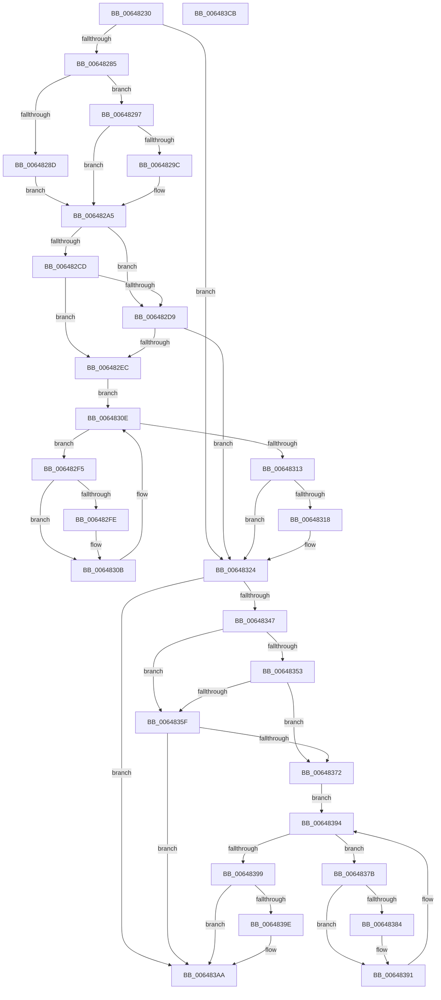

# DifZwQueryObjectWrapper

- RVA: `0x00648230`–`0x006483CC` (길이 `412` bytes)
- VA: `0x0000000140648230`
- 실행 섹션: `.text`
- PDB 이름 있음: `예`; PDB Function 태그: `아니요`
- unwind 정보 RVA: `0x000BD780`
- 디코드: `118`개 명령, `412/412` bytes 표시
- 미해석 바이트: `0` (있으면 어셈블리에 `.byte`로 보존)

> 이 문서는 커널 이미지의 기계어와 PDB 기호를 분석해 생성했습니다. 4번과 5번은 함수 원형과 자료형을 바이너리 사용 방식에서 추정한 C 해석이며 원본 소스 복구 결과는 아닙니다.

## 1. Dependencies

- 직접 호출 지점: **9**; 고유 호출 대상: **6**
- 직접 호출자로 확인된 함수: **0**
- RIP 상대 이미지 참조: **3**

### Outgoing calls
- `0x00648274` → [DifGetAPIThunkContextById](../49/DifGetAPIThunkContextById_function_00495A34.md) (function, `0x00495A34`)
- `0x0064829C` → [DifGetReturnAddressForWrappers](../4D/DifGetReturnAddressForWrappers_function_004D3C08.md) (function, `0x004D3C08`)
- `0x006482E0` → [ExAcquireRundownProtection](../21/ExAcquireRundownProtection_function_00216620.md) (function, `0x00216620`)
- `0x00648306` → [guard_dispatch_icall](../6B/guard_dispatch_icall_function_006BAAD0.md) (function, `0x006BAAD0`)
- `0x0064831F` → [ExReleaseRundownProtection](../34/ExReleaseRundownProtection_function_00349E80.md) (function, `0x00349E80`)
- `0x0064833A` → [ZwQueryObject](../6A/ZwQueryObject_function_006AD2D0.md) (function, `0x006AD2D0`)
- `0x00648366` → [ExAcquireRundownProtection](../21/ExAcquireRundownProtection_function_00216620.md) (function, `0x00216620`)
- `0x0064838C` → [guard_dispatch_icall](../6B/guard_dispatch_icall_function_006BAAD0.md) (function, `0x006BAAD0`)
- `0x006483A5` → [ExReleaseRundownProtection](../34/ExReleaseRundownProtection_function_00349E80.md) (function, `0x00349E80`)

### Direct callers
- 이 함수 시작 RVA로 연결되는 직접 call은 확인되지 않았습니다. 간접 호출은 완전히 역산할 수 없습니다.

### Static image references
- `0x006482AC` → RVA `0x00F048B8` (`.data`; read)
- `0x006482CD` → RVA `0x00F04980` (`.data`; read)
- `0x006482D9` → RVA `0x00F03E80` (`.data`; read)

## 2. Other-region calls and transfers

- 다른 실행 섹션으로 향하는 call: **0**
- 별도 외부 분기/꼬리 이동을 확인하지 못했습니다.

## 3. Assembly (complete function range)

```asm
00648230  48 8B C4                        mov rax, rsp
00648233  48 89 58 10                     mov qword ptr [rax + 0x10], rbx
00648237  48 89 70 18                     mov qword ptr [rax + 0x18], rsi
0064823B  48 89 78 20                     mov qword ptr [rax + 0x20], rdi
0064823F  48 89 48 08                     mov qword ptr [rax + 8], rcx
00648243  55                              push rbp
00648244  41 54                           push r12
00648246  41 55                           push r13
00648248  41 56                           push r14
0064824A  41 57                           push r15
0064824C  48 8B EC                        mov rbp, rsp
0064824F  48 83 EC 70                     sub rsp, 0x70
00648253  33 C0                           xor eax, eax
00648255  0F 57 C0                        xorps xmm0, xmm0
00648258  45 8B F9                        mov r15d, r9d
0064825B  48 89 45 F0                     mov qword ptr [rbp - 0x10], rax
0064825F  4D 8B E0                        mov r12, r8
00648262  44 8B EA                        mov r13d, edx
00648265  0F 11 45 C0                     movups xmmword ptr [rbp - 0x40], xmm0
00648269  8D 48 27                        lea ecx, [rax + 0x27]
0064826C  0F 11 45 D0                     movups xmmword ptr [rbp - 0x30], xmm0
00648270  0F 11 45 E0                     movups xmmword ptr [rbp - 0x20], xmm0
00648274  E8 BB D7 E4 FF                  call 0x140495a34
00648279  4C 8B F0                        mov r14, rax
0064827C  48 85 C0                        test rax, rax
0064827F  0F 84 9F 00 00 00               je 0x140648324
00648285  8B 48 0C                        mov ecx, dword ptr [rax + 0xc]
00648288  F6 C1 18                        test cl, 0x18
0064828B  74 0A                           je 0x140648297
0064828D  48 8B 4D 28                     mov rcx, qword ptr [rbp + 0x28]
00648291  48 89 4D C0                     mov qword ptr [rbp - 0x40], rcx
00648295  EB 0E                           jmp 0x1406482a5
00648297  F6 C1 04                        test cl, 4
0064829A  74 09                           je 0x1406482a5
0064829C  E8 67 B9 E8 FF                  call 0x1404d3c08
006482A1  48 89 45 C0                     mov qword ptr [rbp - 0x40], rax
006482A5  48 8B 45 30                     mov rax, qword ptr [rbp + 0x30]
006482A9  40 32 F6                        xor sil, sil
006482AC  40 38 35 05 C6 8B 00            cmp byte ptr [rip + 0x8bc605], sil
006482B3  48 89 45 E8                     mov qword ptr [rbp - 0x18], rax
006482B7  48 8B 45 50                     mov rax, qword ptr [rbp + 0x50]
006482BB  48 89 45 C8                     mov qword ptr [rbp - 0x38], rax
006482BF  44 89 6D E0                     mov dword ptr [rbp - 0x20], r13d
006482C3  4C 89 65 D8                     mov qword ptr [rbp - 0x28], r12
006482C7  44 89 7D D0                     mov dword ptr [rbp - 0x30], r15d
006482CB  75 0C                           jne 0x1406482d9
006482CD  F7 05 A9 C6 8B 00 00 08 00 00   test dword ptr [rip + 0x8bc6a9], 0x800
006482D7  74 13                           je 0x1406482ec
006482D9  48 8D 0D A0 BB 8B 00            lea rcx, [rip + 0x8bbba0]
006482E0  E8 3B E3 BC FF                  call 0x140216620
006482E5  40 8A F0                        mov sil, al
006482E8  84 C0                           test al, al
006482EA  74 38                           je 0x140648324
006482EC  49 8D 7E 20                     lea rdi, [r14 + 0x20]
006482F0  48 8B 1F                        mov rbx, qword ptr [rdi]
006482F3  EB 19                           jmp 0x14064830e
006482F5  48 8D 43 F0                     lea rax, [rbx - 0x10]
006482F9  48 85 C0                        test rax, rax
006482FC  74 0D                           je 0x14064830b
006482FE  48 8B 40 08                     mov rax, qword ptr [rax + 8]
00648302  48 8D 4D C0                     lea rcx, [rbp - 0x40]
00648306  E8 C5 27 07 00                  call 0x1406baad0
0064830B  48 8B 1B                        mov rbx, qword ptr [rbx]
0064830E  48 3B DF                        cmp rbx, rdi
00648311  75 E2                           jne 0x1406482f5
00648313  40 84 F6                        test sil, sil
00648316  74 0C                           je 0x140648324
00648318  48 8D 0D 61 BB 8B 00            lea rcx, [rip + 0x8bbb61]
0064831F  E8 5C 1B D0 FF                  call 0x140349e80
00648324  48 8B 45 50                     mov rax, qword ptr [rbp + 0x50]
00648328  45 8B CF                        mov r9d, r15d
0064832B  48 8B 4D 30                     mov rcx, qword ptr [rbp + 0x30]
0064832F  4D 8B C4                        mov r8, r12
00648332  41 8B D5                        mov edx, r13d
00648335  48 89 44 24 20                  mov qword ptr [rsp + 0x20], rax
0064833A  E8 91 4F 06 00                  call 0x1406ad2d0
0064833F  89 45 F0                        mov dword ptr [rbp - 0x10], eax
00648342  4D 85 F6                        test r14, r14
00648345  74 63                           je 0x1406483aa
00648347  40 32 FF                        xor dil, dil
0064834A  40 38 3D 67 C5 8B 00            cmp byte ptr [rip + 0x8bc567], dil
00648351  75 0C                           jne 0x14064835f
00648353  F7 05 23 C6 8B 00 00 08 00 00   test dword ptr [rip + 0x8bc623], 0x800
0064835D  74 13                           je 0x140648372
0064835F  48 8D 0D 1A BB 8B 00            lea rcx, [rip + 0x8bbb1a]
00648366  E8 B5 E2 BC FF                  call 0x140216620
0064836B  40 8A F8                        mov dil, al
0064836E  84 C0                           test al, al
00648370  74 38                           je 0x1406483aa
00648372  49 8D 76 30                     lea rsi, [r14 + 0x30]
00648376  48 8B 1E                        mov rbx, qword ptr [rsi]
00648379  EB 19                           jmp 0x140648394
0064837B  48 8D 43 F0                     lea rax, [rbx - 0x10]
0064837F  48 85 C0                        test rax, rax
00648382  74 0D                           je 0x140648391
00648384  48 8B 40 08                     mov rax, qword ptr [rax + 8]
00648388  48 8D 4D C0                     lea rcx, [rbp - 0x40]
0064838C  E8 3F 27 07 00                  call 0x1406baad0
00648391  48 8B 1B                        mov rbx, qword ptr [rbx]
00648394  48 3B DE                        cmp rbx, rsi
00648397  75 E2                           jne 0x14064837b
00648399  40 84 FF                        test dil, dil
0064839C  74 0C                           je 0x1406483aa
0064839E  48 8D 0D DB BA 8B 00            lea rcx, [rip + 0x8bbadb]
006483A5  E8 D6 1A D0 FF                  call 0x140349e80
006483AA  8B 45 F0                        mov eax, dword ptr [rbp - 0x10]
006483AD  4C 8D 5C 24 70                  lea r11, [rsp + 0x70]
006483B2  49 8B 5B 38                     mov rbx, qword ptr [r11 + 0x38]
006483B6  49 8B 73 40                     mov rsi, qword ptr [r11 + 0x40]
006483BA  49 8B 7B 48                     mov rdi, qword ptr [r11 + 0x48]
006483BE  49 8B E3                        mov rsp, r11
006483C1  41 5F                           pop r15
006483C3  41 5E                           pop r14
006483C5  41 5D                           pop r13
006483C7  41 5C                           pop r12
006483C9  5D                              pop rbp
006483CA  C3                              ret
006483CB  CC                              int3
```

## 4. C-style interpretation (structured pseudocode)

```c
__int64 __fastcall DifZwQueryObjectWrapper(__int64 a1, int a2, __int64 a3, int a4, __int64 a5)
{
    __int64 result;
    __int64 v_rdi;
    __int64 v_rsi;
    __int64 v_rsp;
    unsigned __int64 v_stack_m28;
    unsigned __int64 v_stack_m38;
    unsigned __int64 v_stack_m40;
    unsigned __int64 v_stack_m48;
    unsigned __int64 v_stack_m50;
    unsigned __int64 v_stack_m58;
    unsigned __int64 v_stack_m60;
    unsigned __int64 v_stack_m68;
    unsigned __int64 v_stack_m78;
    unsigned __int64 v_stack_p0;
    unsigned __int64 v_stack_p8;

    *(unsigned __int64 *)(v_rsp + 16) = v_rbx;
    *(unsigned __int64 *)(v_rsp + 24) = v_rsi;
    *(unsigned __int64 *)(v_rsp + 32) = v_rdi;
    *(unsigned __int64 *)(v_rsp + 8) = a1;
    v_rsp = (v_rsp) - (112);
    result = 0;
    v_stack_m38 = 0;
    v_stack_m68 = v_xmm0;
    v_stack_m58 = v_xmm0;
    v_stack_m48 = v_xmm0;
    result = DifGetAPIThunkContextById(result + 39, a2, a3, a4);
    if (result == 0) goto loc_00648324;
    if ((((unsigned __int8)((unsigned int)(*(unsigned int *)(result + 12)))) & (24)) == 0) goto loc_00648297;
    v_stack_m68 = v_stack_p0;
    goto loc_006482A5;
loc_00648297:
    if ((((unsigned __int8)(v_stack_p0)) & (4)) != 0) {
        result = DifGetReturnAddressForWrappers(v_stack_p0, a2, a3, a4);
        v_stack_m68 = result;
    }
    v_rsi = 0;
    v_stack_m40 = v_stack_p8;
    v_stack_m60 = a5;
    v_stack_m48 = (unsigned int)((unsigned int)(a2));
    v_stack_m50 = a3;
    v_stack_m58 = (unsigned int)((unsigned int)(a4));
    if ((*(unsigned __int8 *)(v_rip + 9160197)) != 0) goto loc_006482D9;
    if (((*(unsigned int *)(v_rip + 9160361)) & (0x800ULL)) == 0) goto loc_006482EC;
loc_006482D9:
    result = ExAcquireRundownProtection(v_rip + 9157536, a2, a3, a4);
    if ((unsigned __int8)(result) == 0) goto loc_00648324;
loc_006482EC:
    goto loc_0064830E;
loc_006482F5:
    result = *(unsigned __int64 *)(result + 32) - 16;
    if (*(unsigned __int64 *)(result + 32) - 16 != 0) {
        result = *(unsigned __int64 *)(*(unsigned __int64 *)(result + 32) - 16 + 8);
        a1 = v_stack_m68;
        result = guard_dispatch_icall(a1, a2, a3, a4);
    }
loc_0064830E:
    if ((*(unsigned __int64 *)(*(unsigned __int64 *)(result + 32))) != (result + 32)) goto loc_006482F5;
    if ((unsigned __int8)((unsigned __int8)(result)) != 0) {
        a1 = v_rip + 9157473;
        result = ExReleaseRundownProtection(a1, a2, a3, a4);
    }
    v_stack_m78 = a5;
    result = ZwQueryObject(v_stack_p8, (unsigned int)((unsigned int)((unsigned int)(a2))), a3, (unsigned int)((unsigned int)((unsigned int)(a4))));
    v_stack_m38 = (unsigned int)(result);
    if (result == 0) goto loc_006483AA;
    v_rdi = 0;
    if ((*(unsigned __int8 *)(v_rip + 9160039)) != 0) goto loc_0064835F;
    if (((*(unsigned int *)(v_rip + 9160227)) & (0x800ULL)) == 0) goto loc_00648372;
loc_0064835F:
    result = ExAcquireRundownProtection(v_rip + 9157402, (unsigned int)((unsigned int)((unsigned int)(a2))), a3, (unsigned int)((unsigned int)((unsigned int)(a4))));
    if ((unsigned __int8)(result) == 0) goto loc_006483AA;
loc_00648372:
    goto loc_00648394;
loc_0064837B:
    result = *(unsigned __int64 *)(result + 48) - 16;
    if (*(unsigned __int64 *)(result + 48) - 16 != 0) {
        result = *(unsigned __int64 *)(*(unsigned __int64 *)(result + 48) - 16 + 8);
        a1 = v_stack_m68;
        result = guard_dispatch_icall(a1, (unsigned int)((unsigned int)((unsigned int)(a2))), a3, (unsigned int)((unsigned int)((unsigned int)(a4))));
    }
loc_00648394:
    if ((*(unsigned __int64 *)(*(unsigned __int64 *)(result + 48))) != (result + 48)) goto loc_0064837B;
    if ((unsigned __int8)((unsigned __int8)(result)) != 0) {
        a1 = v_rip + 9157339;
        result = ExReleaseRundownProtection(a1, (unsigned int)((unsigned int)((unsigned int)(a2))), a3, (unsigned int)((unsigned int)((unsigned int)(a4))));
    }
    return (unsigned int)(v_stack_m38);
}
```

## 5. (Beta) C Style

```c
int64_t DifZwQueryObjectWrapper(int64_t Arg1, int32_t Arg2, int64_t Arg3, int32_t Arg4, int64_t Arg5)
{
    int64_t result;
    int64_t local_rdi;
    int64_t local_rsi;
    int64_t local_rsp;
    uint64_t v_stack_m28;
    uint64_t v_stack_m38;
    uint64_t v_stack_m40;
    uint64_t v_stack_m48;
    uint64_t v_stack_m50;
    uint64_t v_stack_m58;
    uint64_t v_stack_m60;
    uint64_t v_stack_m68;
    uint64_t v_stack_m78;
    uint64_t v_stack_p0;
    uint64_t v_stack_p8;

    *(uint64_t *)(local_rsp + 0x10) = local_rbx;
    *(uint64_t *)(local_rsp + 0x18) = local_rsi;
    *(uint64_t *)(local_rsp + 0x20) = local_rdi;
    *(uint64_t *)(local_rsp + 0x8) = Arg1;
    local_rsp = (local_rsp) - (112);
    result = 0;
    v_stack_m38 = 0;
    v_stack_m68 = v_xmm0;
    v_stack_m58 = v_xmm0;
    v_stack_m48 = v_xmm0;
    result = DifGetAPIThunkContextById(result + 39, Arg2, Arg3, Arg4);
    if (result == 0) goto loc_00648324;
    if ((((uint8_t)((uint32_t)(*(uint32_t *)(result + 0xC)))) & (24)) == 0) goto loc_00648297;
    v_stack_m68 = v_stack_p0;
    goto loc_006482A5;
loc_00648297:
    if ((((uint8_t)(v_stack_p0)) & (4)) != 0) {
        result = DifGetReturnAddressForWrappers(v_stack_p0, Arg2, Arg3, Arg4);
        v_stack_m68 = result;
    }
    local_rsi = 0;
    v_stack_m40 = v_stack_p8;
    v_stack_m60 = Arg5;
    v_stack_m48 = (uint32_t)((uint32_t)(Arg2));
    v_stack_m50 = Arg3;
    v_stack_m58 = (uint32_t)((uint32_t)(Arg4));
    if ((*(uint8_t *)(v_rip + 0x8BC605)) != 0) goto loc_006482D9;
    if (((*(uint32_t *)(v_rip + 0x8BC6A9)) & (0x800ULL)) == 0) goto loc_006482EC;
loc_006482D9:
    result = ExAcquireRundownProtection(v_rip + 9157536, Arg2, Arg3, Arg4);
    if ((uint8_t)(result) == 0) goto loc_00648324;
loc_006482EC:
    goto loc_0064830E;
loc_006482F5:
    result = *(uint64_t *)(result + 0x20) - 16;
    if (*(uint64_t *)(result + 0x20) - 16 != 0) {
        result = *(uint64_t *)(*(uint64_t *)(result + 0x20) - 0x10 + 0x8);
        Arg1 = v_stack_m68;
        result = guard_dispatch_icall(Arg1, Arg2, Arg3, Arg4);
    }
loc_0064830E:
    if ((*(uint64_t *)(*(uint64_t *)(result + 0x20))) != (result + 32)) goto loc_006482F5;
    if ((uint8_t)((uint8_t)(result)) != 0) {
        Arg1 = v_rip + 9157473;
        result = ExReleaseRundownProtection(Arg1, Arg2, Arg3, Arg4);
    }
    v_stack_m78 = Arg5;
    result = ZwQueryObject(v_stack_p8, (uint32_t)((uint32_t)((uint32_t)(Arg2))), Arg3, (uint32_t)((uint32_t)((uint32_t)(Arg4))));
    v_stack_m38 = (uint32_t)(result);
    if (result == 0) goto loc_006483AA;
    local_rdi = 0;
    if ((*(uint8_t *)(v_rip + 0x8BC567)) != 0) goto loc_0064835F;
    if (((*(uint32_t *)(v_rip + 0x8BC623)) & (0x800ULL)) == 0) goto loc_00648372;
loc_0064835F:
    result = ExAcquireRundownProtection(v_rip + 9157402, (uint32_t)((uint32_t)((uint32_t)(Arg2))), Arg3, (uint32_t)((uint32_t)((uint32_t)(Arg4))));
    if ((uint8_t)(result) == 0) goto loc_006483AA;
loc_00648372:
    goto loc_00648394;
loc_0064837B:
    result = *(uint64_t *)(result + 0x30) - 16;
    if (*(uint64_t *)(result + 0x30) - 16 != 0) {
        result = *(uint64_t *)(*(uint64_t *)(result + 0x30) - 0x10 + 0x8);
        Arg1 = v_stack_m68;
        result = guard_dispatch_icall(Arg1, (uint32_t)((uint32_t)((uint32_t)(Arg2))), Arg3, (uint32_t)((uint32_t)((uint32_t)(Arg4))));
    }
loc_00648394:
    if ((*(uint64_t *)(*(uint64_t *)(result + 0x30))) != (result + 48)) goto loc_0064837B;
    if ((uint8_t)((uint8_t)(result)) != 0) {
        Arg1 = v_rip + 9157339;
        result = ExReleaseRundownProtection(Arg1, (uint32_t)((uint32_t)((uint32_t)(Arg2))), Arg3, (uint32_t)((uint32_t)((uint32_t)(Arg4))));
    }
    return (uint32_t)(v_stack_m38);
}
```

## 6. Execution-region graph

[열기: 2D/3D 그래프와 함수 탐색 컨트롤 패널](../../../control-panel.html?section=text&rva=0x00648230&view=graph)

- 2D 그래프는 위에서 아래로 흐르고, 3D 그래프는 빈 공간을 드래그해 회전합니다. Shift+드래그는 이동, 휠은 확대·축소, 함수 노드 선택은 대상 보고서 이동입니다.

### Static fallback


