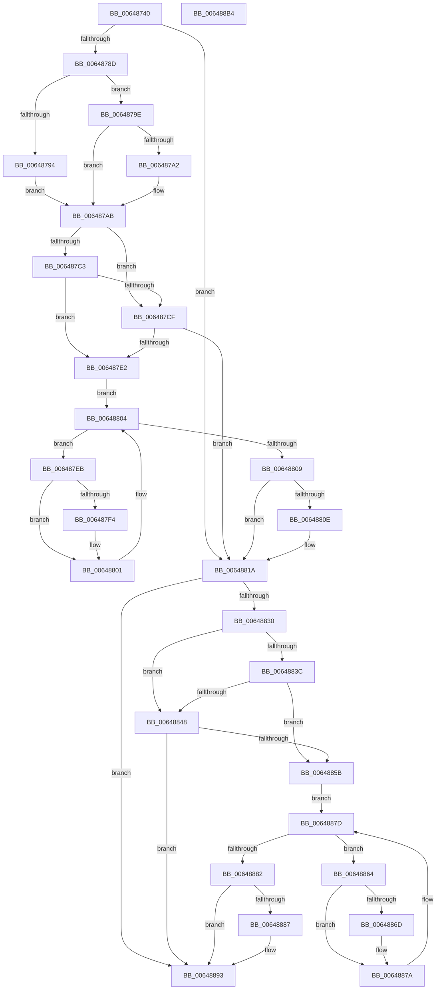

# DifZwQuerySymbolicLinkObjectWrapper

- RVA: `0x00648740`–`0x006488B5` (길이 `373` bytes)
- VA: `0x0000000140648740`
- 실행 섹션: `.text`
- PDB 이름 있음: `예`; PDB Function 태그: `아니요`
- unwind 정보 RVA: `0x000A9A64`
- 디코드: `108`개 명령, `373/373` bytes 표시
- 미해석 바이트: `0` (있으면 어셈블리에 `.byte`로 보존)

> 이 문서는 커널 이미지의 기계어와 PDB 기호를 분석해 생성했습니다. 4번과 5번은 함수 원형과 자료형을 바이너리 사용 방식에서 추정한 C 해석이며 원본 소스 복구 결과는 아닙니다.

## 1. Dependencies

- 직접 호출 지점: **9**; 고유 호출 대상: **6**
- 직접 호출자로 확인된 함수: **0**
- RIP 상대 이미지 참조: **3**

### Outgoing calls
- `0x0064877C` → [DifGetAPIThunkContextById](../49/DifGetAPIThunkContextById_function_00495A34.md) (function, `0x00495A34`)
- `0x006487A2` → [DifGetReturnAddressForWrappers](../4D/DifGetReturnAddressForWrappers_function_004D3C08.md) (function, `0x004D3C08`)
- `0x006487D6` → [ExAcquireRundownProtection](../21/ExAcquireRundownProtection_function_00216620.md) (function, `0x00216620`)
- `0x006487FC` → [guard_dispatch_icall](../6B/guard_dispatch_icall_function_006BAAD0.md) (function, `0x006BAAD0`)
- `0x00648815` → [ExReleaseRundownProtection](../34/ExReleaseRundownProtection_function_00349E80.md) (function, `0x00349E80`)
- `0x00648823` → [ZwQuerySymbolicLinkObject](../6A/ZwQuerySymbolicLinkObject_function_006AFE50.md) (function, `0x006AFE50`)
- `0x0064884F` → [ExAcquireRundownProtection](../21/ExAcquireRundownProtection_function_00216620.md) (function, `0x00216620`)
- `0x00648875` → [guard_dispatch_icall](../6B/guard_dispatch_icall_function_006BAAD0.md) (function, `0x006BAAD0`)
- `0x0064888E` → [ExReleaseRundownProtection](../34/ExReleaseRundownProtection_function_00349E80.md) (function, `0x00349E80`)

### Direct callers
- 이 함수 시작 RVA로 연결되는 직접 call은 확인되지 않았습니다. 간접 호출은 완전히 역산할 수 없습니다.

### Static image references
- `0x006487B2` → RVA `0x00F048B8` (`.data`; read)
- `0x006487C3` → RVA `0x00F04980` (`.data`; read)
- `0x006487CF` → RVA `0x00F03E80` (`.data`; read)

## 2. Other-region calls and transfers

- 다른 실행 섹션으로 향하는 call: **0**
- 별도 외부 분기/꼬리 이동을 확인하지 못했습니다.

## 3. Assembly (complete function range)

```asm
00648740  48 89 5C 24 08                  mov qword ptr [rsp + 8], rbx
00648745  48 89 74 24 10                  mov qword ptr [rsp + 0x10], rsi
0064874A  48 89 7C 24 18                  mov qword ptr [rsp + 0x18], rdi
0064874F  55                              push rbp
00648750  41 54                           push r12
00648752  41 55                           push r13
00648754  41 56                           push r14
00648756  41 57                           push r15
00648758  48 8B EC                        mov rbp, rsp
0064875B  48 83 EC 50                     sub rsp, 0x50
0064875F  33 C0                           xor eax, eax
00648761  0F 57 C0                        xorps xmm0, xmm0
00648764  4C 8B E9                        mov r13, rcx
00648767  48 89 45 F0                     mov qword ptr [rbp - 0x10], rax
0064876B  4D 8B F8                        mov r15, r8
0064876E  4C 8B E2                        mov r12, rdx
00648771  0F 11 45 D0                     movups xmmword ptr [rbp - 0x30], xmm0
00648775  8D 48 24                        lea ecx, [rax + 0x24]
00648778  0F 11 45 E0                     movups xmmword ptr [rbp - 0x20], xmm0
0064877C  E8 B3 D2 E4 FF                  call 0x140495a34
00648781  48 8B F0                        mov rsi, rax
00648784  48 85 C0                        test rax, rax
00648787  0F 84 8D 00 00 00               je 0x14064881a
0064878D  8B 40 0C                        mov eax, dword ptr [rax + 0xc]
00648790  A8 18                           test al, 0x18
00648792  74 0A                           je 0x14064879e
00648794  48 8B 4D 28                     mov rcx, qword ptr [rbp + 0x28]
00648798  48 89 4D D0                     mov qword ptr [rbp - 0x30], rcx
0064879C  EB 0D                           jmp 0x1406487ab
0064879E  A8 04                           test al, 4
006487A0  74 09                           je 0x1406487ab
006487A2  E8 61 B4 E8 FF                  call 0x1404d3c08
006487A7  48 89 45 D0                     mov qword ptr [rbp - 0x30], rax
006487AB  45 32 F6                        xor r14b, r14b
006487AE  4C 89 6D E8                     mov qword ptr [rbp - 0x18], r13
006487B2  44 38 35 FF C0 8B 00            cmp byte ptr [rip + 0x8bc0ff], r14b
006487B9  4C 89 65 E0                     mov qword ptr [rbp - 0x20], r12
006487BD  4C 89 7D D8                     mov qword ptr [rbp - 0x28], r15
006487C1  75 0C                           jne 0x1406487cf
006487C3  F7 05 B3 C1 8B 00 00 08 00 00   test dword ptr [rip + 0x8bc1b3], 0x800
006487CD  74 13                           je 0x1406487e2
006487CF  48 8D 0D AA B6 8B 00            lea rcx, [rip + 0x8bb6aa]
006487D6  E8 45 DE BC FF                  call 0x140216620
006487DB  44 8A F0                        mov r14b, al
006487DE  84 C0                           test al, al
006487E0  74 38                           je 0x14064881a
006487E2  48 8D 7E 20                     lea rdi, [rsi + 0x20]
006487E6  48 8B 1F                        mov rbx, qword ptr [rdi]
006487E9  EB 19                           jmp 0x140648804
006487EB  48 8D 43 F0                     lea rax, [rbx - 0x10]
006487EF  48 85 C0                        test rax, rax
006487F2  74 0D                           je 0x140648801
006487F4  48 8B 40 08                     mov rax, qword ptr [rax + 8]
006487F8  48 8D 4D D0                     lea rcx, [rbp - 0x30]
006487FC  E8 CF 22 07 00                  call 0x1406baad0
00648801  48 8B 1B                        mov rbx, qword ptr [rbx]
00648804  48 3B DF                        cmp rbx, rdi
00648807  75 E2                           jne 0x1406487eb
00648809  45 84 F6                        test r14b, r14b
0064880C  74 0C                           je 0x14064881a
0064880E  48 8D 0D 6B B6 8B 00            lea rcx, [rip + 0x8bb66b]
00648815  E8 66 16 D0 FF                  call 0x140349e80
0064881A  4D 8B C7                        mov r8, r15
0064881D  49 8B D4                        mov rdx, r12
00648820  49 8B CD                        mov rcx, r13
00648823  E8 28 76 06 00                  call 0x1406afe50
00648828  89 45 F0                        mov dword ptr [rbp - 0x10], eax
0064882B  48 85 F6                        test rsi, rsi
0064882E  74 63                           je 0x140648893
00648830  40 32 FF                        xor dil, dil
00648833  40 38 3D 7E C0 8B 00            cmp byte ptr [rip + 0x8bc07e], dil
0064883A  75 0C                           jne 0x140648848
0064883C  F7 05 3A C1 8B 00 00 08 00 00   test dword ptr [rip + 0x8bc13a], 0x800
00648846  74 13                           je 0x14064885b
00648848  48 8D 0D 31 B6 8B 00            lea rcx, [rip + 0x8bb631]
0064884F  E8 CC DD BC FF                  call 0x140216620
00648854  40 8A F8                        mov dil, al
00648857  84 C0                           test al, al
00648859  74 38                           je 0x140648893
0064885B  48 83 C6 30                     add rsi, 0x30
0064885F  48 8B 1E                        mov rbx, qword ptr [rsi]
00648862  EB 19                           jmp 0x14064887d
00648864  48 8D 43 F0                     lea rax, [rbx - 0x10]
00648868  48 85 C0                        test rax, rax
0064886B  74 0D                           je 0x14064887a
0064886D  48 8B 40 08                     mov rax, qword ptr [rax + 8]
00648871  48 8D 4D D0                     lea rcx, [rbp - 0x30]
00648875  E8 56 22 07 00                  call 0x1406baad0
0064887A  48 8B 1B                        mov rbx, qword ptr [rbx]
0064887D  48 3B DE                        cmp rbx, rsi
00648880  75 E2                           jne 0x140648864
00648882  40 84 FF                        test dil, dil
00648885  74 0C                           je 0x140648893
00648887  48 8D 0D F2 B5 8B 00            lea rcx, [rip + 0x8bb5f2]
0064888E  E8 ED 15 D0 FF                  call 0x140349e80
00648893  8B 45 F0                        mov eax, dword ptr [rbp - 0x10]
00648896  4C 8D 5C 24 50                  lea r11, [rsp + 0x50]
0064889B  49 8B 5B 30                     mov rbx, qword ptr [r11 + 0x30]
0064889F  49 8B 73 38                     mov rsi, qword ptr [r11 + 0x38]
006488A3  49 8B 7B 40                     mov rdi, qword ptr [r11 + 0x40]
006488A7  49 8B E3                        mov rsp, r11
006488AA  41 5F                           pop r15
006488AC  41 5E                           pop r14
006488AE  41 5D                           pop r13
006488B0  41 5C                           pop r12
006488B2  5D                              pop rbp
006488B3  C3                              ret
006488B4  CC                              int3
```

## 4. C-style interpretation (structured pseudocode)

```c
__int64 __fastcall DifZwQuerySymbolicLinkObjectWrapper(__int64 a1, __int64 a2, __int64 a3)
{
    __int64 result;
    __int64 v_r14;
    __int64 v_rdi;
    __int64 v_rsi;
    __int64 v_rsp;
    unsigned __int64 v_stack_m28;
    unsigned __int64 v_stack_m38;
    unsigned __int64 v_stack_m40;
    unsigned __int64 v_stack_m48;
    unsigned __int64 v_stack_m50;
    unsigned __int64 v_stack_m58;
    unsigned __int64 v_stack_p0;
    unsigned __int64 v_stack_p10;
    unsigned __int64 v_stack_p18;
    unsigned __int64 v_stack_p8;

    v_stack_p8 = v_rbx;
    v_stack_p10 = v_rsi;
    v_stack_p18 = v_rdi;
    v_rsp = (v_rsp) - (80);
    result = 0;
    v_stack_m38 = 0;
    v_stack_m58 = v_xmm0;
    v_stack_m48 = v_xmm0;
    result = DifGetAPIThunkContextById(result + 36, a2, a3, a4);
    if (result == 0) goto loc_0064881A;
    if ((((unsigned __int8)((unsigned int)(*(unsigned int *)(result + 12)))) & (24)) == 0) goto loc_0064879E;
    v_stack_m58 = v_stack_p0;
    goto loc_006487AB;
loc_0064879E:
    result = (unsigned int)(*(unsigned int *)(result + 12));
    if ((((unsigned __int8)((unsigned int)(*(unsigned int *)(result + 12)))) & (4)) != 0) {
        result = DifGetReturnAddressForWrappers(v_stack_p0, a2, a3, a4);
        v_stack_m58 = result;
    }
    v_r14 = 0;
    v_stack_m40 = a1;
    v_stack_m48 = a2;
    v_stack_m50 = a3;
    if ((*(unsigned __int8 *)(v_rip + 9158911)) != 0) goto loc_006487CF;
    if (((*(unsigned int *)(v_rip + 9159091)) & (0x800ULL)) == 0) goto loc_006487E2;
loc_006487CF:
    result = ExAcquireRundownProtection(v_rip + 9156266, a2, a3, a4);
    if ((unsigned __int8)(result) == 0) goto loc_0064881A;
loc_006487E2:
    goto loc_00648804;
loc_006487EB:
    result = *(unsigned __int64 *)(result + 32) - 16;
    if (*(unsigned __int64 *)(result + 32) - 16 != 0) {
        result = *(unsigned __int64 *)(*(unsigned __int64 *)(result + 32) - 16 + 8);
        a1 = v_stack_m58;
        result = guard_dispatch_icall(a1, a2, a3, a4);
    }
loc_00648804:
    if ((*(unsigned __int64 *)(*(unsigned __int64 *)(result + 32))) != (result + 32)) goto loc_006487EB;
    if ((unsigned __int8)((unsigned __int8)(result)) != 0) {
        a1 = v_rip + 9156203;
        result = ExReleaseRundownProtection(a1, a2, a3, a4);
    }
    result = ZwQuerySymbolicLinkObject(a1, a2, a3, a4);
    v_stack_m38 = (unsigned int)(result);
    if (result == 0) goto loc_00648893;
    v_rdi = 0;
    if ((*(unsigned __int8 *)(v_rip + 9158782)) != 0) goto loc_00648848;
    if (((*(unsigned int *)(v_rip + 9158970)) & (0x800ULL)) == 0) goto loc_0064885B;
loc_00648848:
    result = ExAcquireRundownProtection(v_rip + 9156145, a2, a3, a4);
    if ((unsigned __int8)(result) == 0) goto loc_00648893;
loc_0064885B:
    v_rsi = (result) + (48);
    goto loc_0064887D;
loc_00648864:
    result = *(unsigned __int64 *)(v_rsi) - 16;
    if (*(unsigned __int64 *)(v_rsi) - 16 != 0) {
        result = *(unsigned __int64 *)(*(unsigned __int64 *)(v_rsi) - 16 + 8);
        a1 = v_stack_m58;
        result = guard_dispatch_icall(a1, a2, a3, a4);
    }
loc_0064887D:
    if ((*(unsigned __int64 *)(*(unsigned __int64 *)(v_rsi))) != v_rsi) goto loc_00648864;
    if ((unsigned __int8)((unsigned __int8)(result)) != 0) {
        a1 = v_rip + 9156082;
        result = ExReleaseRundownProtection(a1, a2, a3, a4);
    }
    return (unsigned int)(v_stack_m38);
}
```

## 5. (Beta) C Style

```c
int64_t DifZwQuerySymbolicLinkObjectWrapper(int64_t Arg1, int64_t Arg2, int64_t Arg3)
{
    int64_t result;
    int64_t local_r14;
    int64_t local_rdi;
    int64_t local_rsi;
    int64_t local_rsp;
    uint64_t v_stack_m28;
    uint64_t v_stack_m38;
    uint64_t v_stack_m40;
    uint64_t v_stack_m48;
    uint64_t v_stack_m50;
    uint64_t v_stack_m58;
    uint64_t v_stack_p0;
    uint64_t v_stack_p10;
    uint64_t v_stack_p18;
    uint64_t v_stack_p8;

    v_stack_p8 = local_rbx;
    v_stack_p10 = local_rsi;
    v_stack_p18 = local_rdi;
    local_rsp = (local_rsp) - (80);
    result = 0;
    v_stack_m38 = 0;
    v_stack_m58 = v_xmm0;
    v_stack_m48 = v_xmm0;
    result = DifGetAPIThunkContextById(result + 36, Arg2, Arg3, a4);
    if (result == 0) goto loc_0064881A;
    if ((((uint8_t)((uint32_t)(*(uint32_t *)(result + 0xC)))) & (24)) == 0) goto loc_0064879E;
    v_stack_m58 = v_stack_p0;
    goto loc_006487AB;
loc_0064879E:
    result = (uint32_t)(*(uint32_t *)(result + 0xC));
    if ((((uint8_t)((uint32_t)(*(uint32_t *)(result + 0xC)))) & (4)) != 0) {
        result = DifGetReturnAddressForWrappers(v_stack_p0, Arg2, Arg3, a4);
        v_stack_m58 = result;
    }
    local_r14 = 0;
    v_stack_m40 = Arg1;
    v_stack_m48 = Arg2;
    v_stack_m50 = Arg3;
    if ((*(uint8_t *)(v_rip + 0x8BC0FF)) != 0) goto loc_006487CF;
    if (((*(uint32_t *)(v_rip + 0x8BC1B3)) & (0x800ULL)) == 0) goto loc_006487E2;
loc_006487CF:
    result = ExAcquireRundownProtection(v_rip + 9156266, Arg2, Arg3, a4);
    if ((uint8_t)(result) == 0) goto loc_0064881A;
loc_006487E2:
    goto loc_00648804;
loc_006487EB:
    result = *(uint64_t *)(result + 0x20) - 16;
    if (*(uint64_t *)(result + 0x20) - 16 != 0) {
        result = *(uint64_t *)(*(uint64_t *)(result + 0x20) - 0x10 + 0x8);
        Arg1 = v_stack_m58;
        result = guard_dispatch_icall(Arg1, Arg2, Arg3, a4);
    }
loc_00648804:
    if ((*(uint64_t *)(*(uint64_t *)(result + 0x20))) != (result + 32)) goto loc_006487EB;
    if ((uint8_t)((uint8_t)(result)) != 0) {
        Arg1 = v_rip + 9156203;
        result = ExReleaseRundownProtection(Arg1, Arg2, Arg3, a4);
    }
    result = ZwQuerySymbolicLinkObject(Arg1, Arg2, Arg3, a4);
    v_stack_m38 = (uint32_t)(result);
    if (result == 0) goto loc_00648893;
    local_rdi = 0;
    if ((*(uint8_t *)(v_rip + 0x8BC07E)) != 0) goto loc_00648848;
    if (((*(uint32_t *)(v_rip + 0x8BC13A)) & (0x800ULL)) == 0) goto loc_0064885B;
loc_00648848:
    result = ExAcquireRundownProtection(v_rip + 9156145, Arg2, Arg3, a4);
    if ((uint8_t)(result) == 0) goto loc_00648893;
loc_0064885B:
    local_rsi = (result) + (48);
    goto loc_0064887D;
loc_00648864:
    result = *(uint64_t *)(local_rsi) - 16;
    if (*(uint64_t *)(local_rsi) - 16 != 0) {
        result = *(uint64_t *)(*(uint64_t *)(local_rsi) - 0x10 + 0x8);
        Arg1 = v_stack_m58;
        result = guard_dispatch_icall(Arg1, Arg2, Arg3, a4);
    }
loc_0064887D:
    if ((*(uint64_t *)(*(uint64_t *)(local_rsi))) != local_rsi) goto loc_00648864;
    if ((uint8_t)((uint8_t)(result)) != 0) {
        Arg1 = v_rip + 9156082;
        result = ExReleaseRundownProtection(Arg1, Arg2, Arg3, a4);
    }
    return (uint32_t)(v_stack_m38);
}
```

## 6. Execution-region graph

[열기: 2D/3D 그래프와 함수 탐색 컨트롤 패널](../../../control-panel.html?section=text&rva=0x00648740&view=graph)

- 2D 그래프는 위에서 아래로 흐르고, 3D 그래프는 빈 공간을 드래그해 회전합니다. Shift+드래그는 이동, 휠은 확대·축소, 함수 노드 선택은 대상 보고서 이동입니다.

### Static fallback


