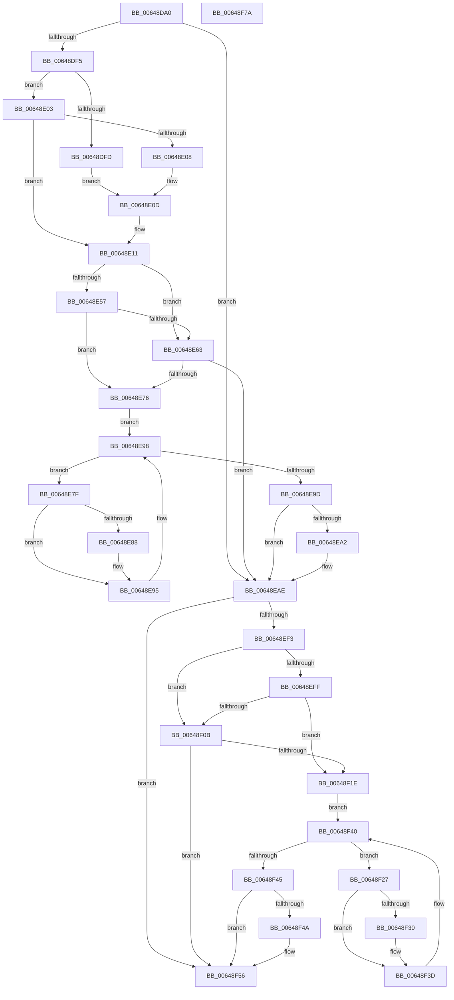

# DifZwReadFileWrapper

- RVA: `0x00648DA0`–`0x00648F7B` (길이 `475` bytes)
- VA: `0x0000000140648DA0`
- 실행 섹션: `.text`
- PDB 이름 있음: `예`; PDB Function 태그: `아니요`
- unwind 정보 RVA: `0x000D2BDC`
- 디코드: `131`개 명령, `475/475` bytes 표시
- 미해석 바이트: `0` (있으면 어셈블리에 `.byte`로 보존)

> 이 문서는 커널 이미지의 기계어와 PDB 기호를 분석해 생성했습니다. 4번과 5번은 함수 원형과 자료형을 바이너리 사용 방식에서 추정한 C 해석이며 원본 소스 복구 결과는 아닙니다.

## 1. Dependencies

- 직접 호출 지점: **10**; 고유 호출 대상: **7**
- 직접 호출자로 확인된 함수: **0**
- RIP 상대 이미지 참조: **3**

### Outgoing calls
- `0x00648DDA` → [memset](../6C/memset_function_006C6C40.md) (function, `0x006C6C40`)
- `0x00648DE4` → [DifGetAPIThunkContextById](../49/DifGetAPIThunkContextById_function_00495A34.md) (function, `0x00495A34`)
- `0x00648E08` → [DifGetReturnAddressForWrappers](../4D/DifGetReturnAddressForWrappers_function_004D3C08.md) (function, `0x004D3C08`)
- `0x00648E6A` → [ExAcquireRundownProtection](../21/ExAcquireRundownProtection_function_00216620.md) (function, `0x00216620`)
- `0x00648E90` → [guard_dispatch_icall](../6B/guard_dispatch_icall_function_006BAAD0.md) (function, `0x006BAAD0`)
- `0x00648EA9` → [ExReleaseRundownProtection](../34/ExReleaseRundownProtection_function_00349E80.md) (function, `0x00349E80`)
- `0x00648EE6` → [ZwReadFile](../6A/ZwReadFile_function_006AD190.md) (function, `0x006AD190`)
- `0x00648F12` → [ExAcquireRundownProtection](../21/ExAcquireRundownProtection_function_00216620.md) (function, `0x00216620`)
- `0x00648F38` → [guard_dispatch_icall](../6B/guard_dispatch_icall_function_006BAAD0.md) (function, `0x006BAAD0`)
- `0x00648F51` → [ExReleaseRundownProtection](../34/ExReleaseRundownProtection_function_00349E80.md) (function, `0x00349E80`)

### Direct callers
- 이 함수 시작 RVA로 연결되는 직접 call은 확인되지 않았습니다. 간접 호출은 완전히 역산할 수 없습니다.

### Static image references
- `0x00648E18` → RVA `0x00F048B8` (`.data`; read)
- `0x00648E57` → RVA `0x00F04980` (`.data`; read)
- `0x00648E63` → RVA `0x00F03E80` (`.data`; read)

## 2. Other-region calls and transfers

- 다른 실행 섹션으로 향하는 call: **0**
- 별도 외부 분기/꼬리 이동을 확인하지 못했습니다.

## 3. Assembly (complete function range)

```asm
00648DA0  48 8B C4                        mov rax, rsp
00648DA3  48 89 58 10                     mov qword ptr [rax + 0x10], rbx
00648DA7  48 89 70 18                     mov qword ptr [rax + 0x18], rsi
00648DAB  48 89 78 20                     mov qword ptr [rax + 0x20], rdi
00648DAF  48 89 48 08                     mov qword ptr [rax + 8], rcx
00648DB3  55                              push rbp
00648DB4  41 54                           push r12
00648DB6  41 55                           push r13
00648DB8  41 56                           push r14
00648DBA  41 57                           push r15
00648DBC  48 8D 68 C9                     lea rbp, [rax - 0x37]
00648DC0  48 81 EC B0 00 00 00            sub rsp, 0xb0
00648DC7  4C 8B EA                        mov r13, rdx
00648DCA  48 8D 4D AF                     lea rcx, [rbp - 0x51]
00648DCE  33 D2                           xor edx, edx
00648DD0  4D 8B E0                        mov r12, r8
00648DD3  4D 8B F9                        mov r15, r9
00648DD6  44 8D 42 58                     lea r8d, [rdx + 0x58]
00648DDA  E8 61 DE 07 00                  call 0x1406c6c40
00648DDF  B9 20 00 00 00                  mov ecx, 0x20
00648DE4  E8 4B CC E4 FF                  call 0x140495a34
00648DE9  48 8B F0                        mov rsi, rax
00648DEC  48 85 C0                        test rax, rax
00648DEF  0F 84 B9 00 00 00               je 0x140648eae
00648DF5  8B 48 0C                        mov ecx, dword ptr [rax + 0xc]
00648DF8  F6 C1 18                        test cl, 0x18
00648DFB  74 06                           je 0x140648e03
00648DFD  48 8B 45 37                     mov rax, qword ptr [rbp + 0x37]
00648E01  EB 0A                           jmp 0x140648e0d
00648E03  F6 C1 04                        test cl, 4
00648E06  74 09                           je 0x140648e11
00648E08  E8 FB AD E8 FF                  call 0x1404d3c08
00648E0D  48 89 45 AF                     mov qword ptr [rbp - 0x51], rax
00648E11  48 8B 45 3F                     mov rax, qword ptr [rbp + 0x3f]
00648E15  45 32 F6                        xor r14b, r14b
00648E18  44 38 35 99 BA 8B 00            cmp byte ptr [rip + 0x8bba99], r14b
00648E1F  48 89 45 F7                     mov qword ptr [rbp - 9], rax
00648E23  48 8B 45 5F                     mov rax, qword ptr [rbp + 0x5f]
00648E27  48 89 45 D7                     mov qword ptr [rbp - 0x29], rax
00648E2B  48 8B 45 67                     mov rax, qword ptr [rbp + 0x67]
00648E2F  48 89 45 CF                     mov qword ptr [rbp - 0x31], rax
00648E33  8B 45 6F                        mov eax, dword ptr [rbp + 0x6f]
00648E36  89 45 C7                        mov dword ptr [rbp - 0x39], eax
00648E39  48 8B 45 77                     mov rax, qword ptr [rbp + 0x77]
00648E3D  48 89 45 BF                     mov qword ptr [rbp - 0x41], rax
00648E41  48 8B 45 7F                     mov rax, qword ptr [rbp + 0x7f]
00648E45  48 89 45 B7                     mov qword ptr [rbp - 0x49], rax
00648E49  4C 89 6D EF                     mov qword ptr [rbp - 0x11], r13
00648E4D  4C 89 65 E7                     mov qword ptr [rbp - 0x19], r12
00648E51  4C 89 7D DF                     mov qword ptr [rbp - 0x21], r15
00648E55  75 0C                           jne 0x140648e63
00648E57  F7 05 1F BB 8B 00 00 08 00 00   test dword ptr [rip + 0x8bbb1f], 0x800
00648E61  74 13                           je 0x140648e76
00648E63  48 8D 0D 16 B0 8B 00            lea rcx, [rip + 0x8bb016]
00648E6A  E8 B1 D7 BC FF                  call 0x140216620
00648E6F  44 8A F0                        mov r14b, al
00648E72  84 C0                           test al, al
00648E74  74 38                           je 0x140648eae
00648E76  48 8D 7E 20                     lea rdi, [rsi + 0x20]
00648E7A  48 8B 1F                        mov rbx, qword ptr [rdi]
00648E7D  EB 19                           jmp 0x140648e98
00648E7F  48 8D 43 F0                     lea rax, [rbx - 0x10]
00648E83  48 85 C0                        test rax, rax
00648E86  74 0D                           je 0x140648e95
00648E88  48 8B 40 08                     mov rax, qword ptr [rax + 8]
00648E8C  48 8D 4D AF                     lea rcx, [rbp - 0x51]
00648E90  E8 3B 1C 07 00                  call 0x1406baad0
00648E95  48 8B 1B                        mov rbx, qword ptr [rbx]
00648E98  48 3B DF                        cmp rbx, rdi
00648E9B  75 E2                           jne 0x140648e7f
00648E9D  45 84 F6                        test r14b, r14b
00648EA0  74 0C                           je 0x140648eae
00648EA2  48 8D 0D D7 AF 8B 00            lea rcx, [rip + 0x8bafd7]
00648EA9  E8 D2 0F D0 FF                  call 0x140349e80
00648EAE  48 8B 45 7F                     mov rax, qword ptr [rbp + 0x7f]
00648EB2  4D 8B CF                        mov r9, r15
00648EB5  48 8B 4D 3F                     mov rcx, qword ptr [rbp + 0x3f]
00648EB9  4D 8B C4                        mov r8, r12
00648EBC  48 89 44 24 40                  mov qword ptr [rsp + 0x40], rax
00648EC1  49 8B D5                        mov rdx, r13
00648EC4  48 8B 45 77                     mov rax, qword ptr [rbp + 0x77]
00648EC8  48 89 44 24 38                  mov qword ptr [rsp + 0x38], rax
00648ECD  8B 45 6F                        mov eax, dword ptr [rbp + 0x6f]
00648ED0  89 44 24 30                     mov dword ptr [rsp + 0x30], eax
00648ED4  48 8B 45 67                     mov rax, qword ptr [rbp + 0x67]
00648ED8  48 89 44 24 28                  mov qword ptr [rsp + 0x28], rax
00648EDD  48 8B 45 5F                     mov rax, qword ptr [rbp + 0x5f]
00648EE1  48 89 44 24 20                  mov qword ptr [rsp + 0x20], rax
00648EE6  E8 A5 42 06 00                  call 0x1406ad190
00648EEB  89 45 FF                        mov dword ptr [rbp - 1], eax
00648EEE  48 85 F6                        test rsi, rsi
00648EF1  74 63                           je 0x140648f56
00648EF3  40 32 FF                        xor dil, dil
00648EF6  40 38 3D BB B9 8B 00            cmp byte ptr [rip + 0x8bb9bb], dil
00648EFD  75 0C                           jne 0x140648f0b
00648EFF  F7 05 77 BA 8B 00 00 08 00 00   test dword ptr [rip + 0x8bba77], 0x800
00648F09  74 13                           je 0x140648f1e
00648F0B  48 8D 0D 6E AF 8B 00            lea rcx, [rip + 0x8baf6e]
00648F12  E8 09 D7 BC FF                  call 0x140216620
00648F17  40 8A F8                        mov dil, al
00648F1A  84 C0                           test al, al
00648F1C  74 38                           je 0x140648f56
00648F1E  48 83 C6 30                     add rsi, 0x30
00648F22  48 8B 1E                        mov rbx, qword ptr [rsi]
00648F25  EB 19                           jmp 0x140648f40
00648F27  48 8D 43 F0                     lea rax, [rbx - 0x10]
00648F2B  48 85 C0                        test rax, rax
00648F2E  74 0D                           je 0x140648f3d
00648F30  48 8B 40 08                     mov rax, qword ptr [rax + 8]
00648F34  48 8D 4D AF                     lea rcx, [rbp - 0x51]
00648F38  E8 93 1B 07 00                  call 0x1406baad0
00648F3D  48 8B 1B                        mov rbx, qword ptr [rbx]
00648F40  48 3B DE                        cmp rbx, rsi
00648F43  75 E2                           jne 0x140648f27
00648F45  40 84 FF                        test dil, dil
00648F48  74 0C                           je 0x140648f56
00648F4A  48 8D 0D 2F AF 8B 00            lea rcx, [rip + 0x8baf2f]
00648F51  E8 2A 0F D0 FF                  call 0x140349e80
00648F56  8B 45 FF                        mov eax, dword ptr [rbp - 1]
00648F59  4C 8D 9C 24 B0 00 00 00         lea r11, [rsp + 0xb0]
00648F61  49 8B 5B 38                     mov rbx, qword ptr [r11 + 0x38]
00648F65  49 8B 73 40                     mov rsi, qword ptr [r11 + 0x40]
00648F69  49 8B 7B 48                     mov rdi, qword ptr [r11 + 0x48]
00648F6D  49 8B E3                        mov rsp, r11
00648F70  41 5F                           pop r15
00648F72  41 5E                           pop r14
00648F74  41 5D                           pop r13
00648F76  41 5C                           pop r12
00648F78  5D                              pop rbp
00648F79  C3                              ret
00648F7A  CC                              int3
```

## 4. C-style interpretation (structured pseudocode)

```c
__int64 __fastcall DifZwReadFileWrapper(__int64 a1, __int64 a2, __int64 a3, __int64 a4)
{
    __int64 result;
    __int64 v_r14;
    __int64 v_rdi;
    __int64 v_rsi;
    __int64 v_rsp;
    unsigned __int64 v_stack_m28;
    unsigned __int64 v_stack_m98;
    unsigned __int64 v_stack_mA0;
    unsigned int v_stack_mA8;
    unsigned __int64 v_stack_mB0;
    unsigned __int64 v_stack_mB8;

    *(unsigned __int64 *)(v_rsp + 16) = v_rbx;
    *(unsigned __int64 *)(v_rsp + 24) = v_rsi;
    *(unsigned __int64 *)(v_rsp + 32) = v_rdi;
    *(unsigned __int64 *)(v_rsp + 8) = a1;
    v_rsp = (v_rsp) - (176);
    a2 = 0;
    result = memset(v_rsp - 55 - 81, a2, a2 + 88, a4);
    result = DifGetAPIThunkContextById(32, a2, a2 + 88, a4);
    if (result == 0) goto loc_00648EAE;
    if ((((unsigned __int8)((unsigned int)(*(unsigned int *)(result + 12)))) & (24)) == 0) goto loc_00648E03;
    goto loc_00648E0D;
loc_00648E03:
    if ((((unsigned __int8)((unsigned int)(*(unsigned int *)(result + 12)))) & (4)) == 0) goto loc_00648E11;
    result = DifGetReturnAddressForWrappers((unsigned int)(*(unsigned int *)(result + 12)), a2, a2 + 88, a4);
loc_00648E0D:
    *(unsigned __int64 *)(v_rsp - 55 - 81) = result;
loc_00648E11:
    v_r14 = 0;
    *(unsigned __int64 *)(v_rsp - 55 - 9) = *(unsigned __int64 *)(v_rsp - 55 + 63);
    *(unsigned __int64 *)(v_rsp - 55 - 41) = *(unsigned __int64 *)(v_rsp - 55 + 95);
    *(unsigned __int64 *)(v_rsp - 55 - 49) = *(unsigned __int64 *)(v_rsp - 55 + 103);
    *(unsigned int *)(v_rsp - 55 - 57) = (unsigned int)((unsigned int)(*(unsigned int *)(v_rsp - 55 + 111)));
    *(unsigned __int64 *)(v_rsp - 55 - 65) = *(unsigned __int64 *)(v_rsp - 55 + 119);
    *(unsigned __int64 *)(v_rsp - 55 - 73) = *(unsigned __int64 *)(v_rsp - 55 + 127);
    *(unsigned __int64 *)(v_rsp - 55 - 17) = 0;
    *(unsigned __int64 *)(v_rsp - 55 - 25) = a3;
    *(unsigned __int64 *)(v_rsp - 55 - 33) = a4;
    if ((*(unsigned __int8 *)(v_rip + 9157273)) != 0) goto loc_00648E63;
    if (((*(unsigned int *)(v_rip + 9157407)) & (0x800ULL)) == 0) goto loc_00648E76;
loc_00648E63:
    result = ExAcquireRundownProtection(v_rip + 9154582, a2, a2 + 88, a4);
    if ((unsigned __int8)(result) == 0) goto loc_00648EAE;
loc_00648E76:
    goto loc_00648E98;
loc_00648E7F:
    result = *(unsigned __int64 *)(result + 32) - 16;
    if (*(unsigned __int64 *)(result + 32) - 16 != 0) {
        result = *(unsigned __int64 *)(*(unsigned __int64 *)(result + 32) - 16 + 8);
        a1 = v_rsp - 55 - 81;
        result = guard_dispatch_icall(a1, a2, a2 + 88, a4);
    }
loc_00648E98:
    if ((*(unsigned __int64 *)(*(unsigned __int64 *)(result + 32))) != (result + 32)) goto loc_00648E7F;
    if ((unsigned __int8)((unsigned __int8)(result)) != 0) {
        a1 = v_rip + 9154519;
        result = ExReleaseRundownProtection(a1, a2, a2 + 88, a4);
    }
    v_stack_m98 = *(unsigned __int64 *)(v_rsp - 55 + 127);
    v_stack_mA0 = *(unsigned __int64 *)(v_rsp - 55 + 119);
    v_stack_mA8 = (unsigned int)((unsigned int)(*(unsigned int *)(v_rsp - 55 + 111)));
    v_stack_mB0 = *(unsigned __int64 *)(v_rsp - 55 + 103);
    v_stack_mB8 = *(unsigned __int64 *)(v_rsp - 55 + 95);
    result = ZwReadFile(*(unsigned __int64 *)(v_rsp - 55 + 63), 0, a3, a4);
    *(unsigned int *)(v_rsp - 55 - 1) = (unsigned int)(result);
    if (result == 0) goto loc_00648F56;
    v_rdi = 0;
    if ((*(unsigned __int8 *)(v_rip + 9157051)) != 0) goto loc_00648F0B;
    if (((*(unsigned int *)(v_rip + 9157239)) & (0x800ULL)) == 0) goto loc_00648F1E;
loc_00648F0B:
    result = ExAcquireRundownProtection(v_rip + 9154414, 0, a3, a4);
    if ((unsigned __int8)(result) == 0) goto loc_00648F56;
loc_00648F1E:
    v_rsi = (result) + (48);
    goto loc_00648F40;
loc_00648F27:
    result = *(unsigned __int64 *)(v_rsi) - 16;
    if (*(unsigned __int64 *)(v_rsi) - 16 != 0) {
        result = *(unsigned __int64 *)(*(unsigned __int64 *)(v_rsi) - 16 + 8);
        a1 = v_rsp - 55 - 81;
        result = guard_dispatch_icall(a1, 0, a3, a4);
    }
loc_00648F40:
    if ((*(unsigned __int64 *)(*(unsigned __int64 *)(v_rsi))) != v_rsi) goto loc_00648F27;
    if ((unsigned __int8)((unsigned __int8)(result)) != 0) {
        a1 = v_rip + 9154351;
        result = ExReleaseRundownProtection(a1, 0, a3, a4);
    }
    return (unsigned int)(*(unsigned int *)(v_rsp - 55 - 1));
}
```

## 5. (Beta) C Style

```c
int64_t DifZwReadFileWrapper(int64_t Arg1, int64_t Arg2, int64_t Arg3, int64_t Arg4)
{
    int64_t result;
    int64_t local_r14;
    int64_t local_rdi;
    int64_t local_rsi;
    int64_t local_rsp;
    uint64_t v_stack_m28;
    uint64_t v_stack_m98;
    uint64_t v_stack_mA0;
    uint32_t v_stack_mA8;
    uint64_t v_stack_mB0;
    uint64_t v_stack_mB8;

    *(uint64_t *)(local_rsp + 0x10) = local_rbx;
    *(uint64_t *)(local_rsp + 0x18) = local_rsi;
    *(uint64_t *)(local_rsp + 0x20) = local_rdi;
    *(uint64_t *)(local_rsp + 0x8) = Arg1;
    local_rsp = (local_rsp) - (176);
    Arg2 = 0;
    result = memset(local_rsp - 55 - 81, Arg2, Arg2 + 88, Arg4);
    result = DifGetAPIThunkContextById(32, Arg2, Arg2 + 88, Arg4);
    if (result == 0) goto loc_00648EAE;
    if ((((uint8_t)((uint32_t)(*(uint32_t *)(result + 0xC)))) & (24)) == 0) goto loc_00648E03;
    goto loc_00648E0D;
loc_00648E03:
    if ((((uint8_t)((uint32_t)(*(uint32_t *)(result + 0xC)))) & (4)) == 0) goto loc_00648E11;
    result = DifGetReturnAddressForWrappers((uint32_t)(*(uint32_t *)(result + 0xC)), Arg2, Arg2 + 88, Arg4);
loc_00648E0D:
    *(uint64_t *)(local_rsp - 0x37 - 0x51) = result;
loc_00648E11:
    local_r14 = 0;
    *(uint64_t *)(local_rsp - 0x37 - 0x9) = *(uint64_t *)(local_rsp - 0x37 + 0x3F);
    *(uint64_t *)(local_rsp - 0x37 - 0x29) = *(uint64_t *)(local_rsp - 0x37 + 0x5F);
    *(uint64_t *)(local_rsp - 0x37 - 0x31) = *(uint64_t *)(local_rsp - 0x37 + 0x67);
    *(uint32_t *)(local_rsp - 0x37 - 0x39) = (uint32_t)((uint32_t)(*(uint32_t *)(local_rsp - 0x37 + 0x6F)));
    *(uint64_t *)(local_rsp - 0x37 - 0x41) = *(uint64_t *)(local_rsp - 0x37 + 0x77);
    *(uint64_t *)(local_rsp - 0x37 - 0x49) = *(uint64_t *)(local_rsp - 0x37 + 0x7F);
    *(uint64_t *)(local_rsp - 0x37 - 0x11) = 0;
    *(uint64_t *)(local_rsp - 0x37 - 0x19) = Arg3;
    *(uint64_t *)(local_rsp - 0x37 - 0x21) = Arg4;
    if ((*(uint8_t *)(v_rip + 0x8BBA99)) != 0) goto loc_00648E63;
    if (((*(uint32_t *)(v_rip + 0x8BBB1F)) & (0x800ULL)) == 0) goto loc_00648E76;
loc_00648E63:
    result = ExAcquireRundownProtection(v_rip + 9154582, Arg2, Arg2 + 88, Arg4);
    if ((uint8_t)(result) == 0) goto loc_00648EAE;
loc_00648E76:
    goto loc_00648E98;
loc_00648E7F:
    result = *(uint64_t *)(result + 0x20) - 16;
    if (*(uint64_t *)(result + 0x20) - 16 != 0) {
        result = *(uint64_t *)(*(uint64_t *)(result + 0x20) - 0x10 + 0x8);
        Arg1 = local_rsp - 55 - 81;
        result = guard_dispatch_icall(Arg1, Arg2, Arg2 + 88, Arg4);
    }
loc_00648E98:
    if ((*(uint64_t *)(*(uint64_t *)(result + 0x20))) != (result + 32)) goto loc_00648E7F;
    if ((uint8_t)((uint8_t)(result)) != 0) {
        Arg1 = v_rip + 9154519;
        result = ExReleaseRundownProtection(Arg1, Arg2, Arg2 + 88, Arg4);
    }
    v_stack_m98 = *(uint64_t *)(local_rsp - 0x37 + 0x7F);
    v_stack_mA0 = *(uint64_t *)(local_rsp - 0x37 + 0x77);
    v_stack_mA8 = (uint32_t)((uint32_t)(*(uint32_t *)(local_rsp - 0x37 + 0x6F)));
    v_stack_mB0 = *(uint64_t *)(local_rsp - 0x37 + 0x67);
    v_stack_mB8 = *(uint64_t *)(local_rsp - 0x37 + 0x5F);
    result = ZwReadFile(*(uint64_t *)(local_rsp - 0x37 + 0x3F), 0, Arg3, Arg4);
    *(uint32_t *)(local_rsp - 0x37 - 0x1) = (uint32_t)(result);
    if (result == 0) goto loc_00648F56;
    local_rdi = 0;
    if ((*(uint8_t *)(v_rip + 0x8BB9BB)) != 0) goto loc_00648F0B;
    if (((*(uint32_t *)(v_rip + 0x8BBA77)) & (0x800ULL)) == 0) goto loc_00648F1E;
loc_00648F0B:
    result = ExAcquireRundownProtection(v_rip + 9154414, 0, Arg3, Arg4);
    if ((uint8_t)(result) == 0) goto loc_00648F56;
loc_00648F1E:
    local_rsi = (result) + (48);
    goto loc_00648F40;
loc_00648F27:
    result = *(uint64_t *)(local_rsi) - 16;
    if (*(uint64_t *)(local_rsi) - 16 != 0) {
        result = *(uint64_t *)(*(uint64_t *)(local_rsi) - 0x10 + 0x8);
        Arg1 = local_rsp - 55 - 81;
        result = guard_dispatch_icall(Arg1, 0, Arg3, Arg4);
    }
loc_00648F40:
    if ((*(uint64_t *)(*(uint64_t *)(local_rsi))) != local_rsi) goto loc_00648F27;
    if ((uint8_t)((uint8_t)(result)) != 0) {
        Arg1 = v_rip + 9154351;
        result = ExReleaseRundownProtection(Arg1, 0, Arg3, Arg4);
    }
    return (uint32_t)(*(uint32_t *)(local_rsp - 0x37 - 0x1));
}
```

## 6. Execution-region graph

[열기: 2D/3D 그래프와 함수 탐색 컨트롤 패널](../../../control-panel.html?section=text&rva=0x00648DA0&view=graph)

- 2D 그래프는 위에서 아래로 흐르고, 3D 그래프는 빈 공간을 드래그해 회전합니다. Shift+드래그는 이동, 휠은 확대·축소, 함수 노드 선택은 대상 보고서 이동입니다.

### Static fallback


