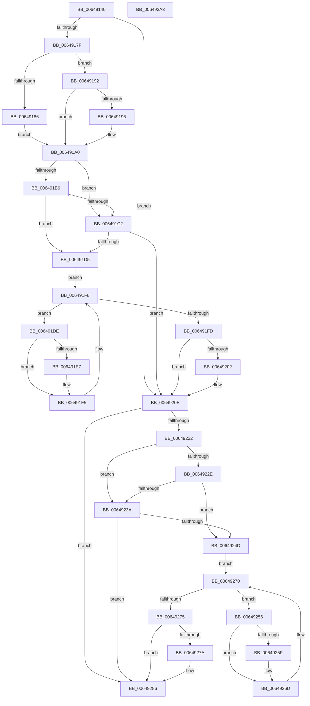

# DifZwRenameKeyWrapper

- RVA: `0x00649140`–`0x006492A4` (길이 `356` bytes)
- VA: `0x0000000140649140`
- 실행 섹션: `.text`
- PDB 이름 있음: `예`; PDB Function 태그: `아니요`
- unwind 정보 RVA: `0x00093E28`
- 디코드: `98`개 명령, `356/356` bytes 표시
- 미해석 바이트: `0` (있으면 어셈블리에 `.byte`로 보존)

> 이 문서는 커널 이미지의 기계어와 PDB 기호를 분석해 생성했습니다. 4번과 5번은 함수 원형과 자료형을 바이너리 사용 방식에서 추정한 C 해석이며 원본 소스 복구 결과는 아닙니다.

## 1. Dependencies

- 직접 호출 지점: **9**; 고유 호출 대상: **6**
- 직접 호출자로 확인된 함수: **0**
- RIP 상대 이미지 참조: **3**

### Outgoing calls
- `0x0064916E` → [DifGetAPIThunkContextById](../49/DifGetAPIThunkContextById_function_00495A34.md) (function, `0x00495A34`)
- `0x00649196` → [DifGetReturnAddressForWrappers](../4D/DifGetReturnAddressForWrappers_function_004D3C08.md) (function, `0x004D3C08`)
- `0x006491C9` → [ExAcquireRundownProtection](../21/ExAcquireRundownProtection_function_00216620.md) (function, `0x00216620`)
- `0x006491F0` → [guard_dispatch_icall](../6B/guard_dispatch_icall_function_006BAAD0.md) (function, `0x006BAAD0`)
- `0x00649209` → [ExReleaseRundownProtection](../34/ExReleaseRundownProtection_function_00349E80.md) (function, `0x00349E80`)
- `0x00649214` → [ZwRenameKey](../6B/ZwRenameKey_function_006B0110.md) (function, `0x006B0110`)
- `0x00649241` → [ExAcquireRundownProtection](../21/ExAcquireRundownProtection_function_00216620.md) (function, `0x00216620`)
- `0x00649268` → [guard_dispatch_icall](../6B/guard_dispatch_icall_function_006BAAD0.md) (function, `0x006BAAD0`)
- `0x00649281` → [ExReleaseRundownProtection](../34/ExReleaseRundownProtection_function_00349E80.md) (function, `0x00349E80`)

### Direct callers
- 이 함수 시작 RVA로 연결되는 직접 call은 확인되지 않았습니다. 간접 호출은 완전히 역산할 수 없습니다.

### Static image references
- `0x006491A8` → RVA `0x00F048B8` (`.data`; read)
- `0x006491B6` → RVA `0x00F04980` (`.data`; read)
- `0x006491C2` → RVA `0x00F03E80` (`.data`; read)

## 2. Other-region calls and transfers

- 다른 실행 섹션으로 향하는 call: **0**
- 별도 외부 분기/꼬리 이동을 확인하지 못했습니다.

## 3. Assembly (complete function range)

```asm
00649140  48 8B C4                        mov rax, rsp
00649143  48 89 58 08                     mov qword ptr [rax + 8], rbx
00649147  48 89 68 10                     mov qword ptr [rax + 0x10], rbp
0064914B  48 89 70 18                     mov qword ptr [rax + 0x18], rsi
0064914F  57                              push rdi
00649150  41 56                           push r14
00649152  41 57                           push r15
00649154  48 83 EC 40                     sub rsp, 0x40
00649158  0F 57 C0                        xorps xmm0, xmm0
0064915B  4C 8B F9                        mov r15, rcx
0064915E  B9 1E 00 00 00                  mov ecx, 0x1e
00649163  4C 8B F2                        mov r14, rdx
00649166  0F 11 40 C8                     movups xmmword ptr [rax - 0x38], xmm0
0064916A  0F 11 40 D8                     movups xmmword ptr [rax - 0x28], xmm0
0064916E  E8 C1 C8 E4 FF                  call 0x140495a34
00649173  48 8B F0                        mov rsi, rax
00649176  48 85 C0                        test rax, rax
00649179  0F 84 8F 00 00 00               je 0x14064920e
0064917F  8B 40 0C                        mov eax, dword ptr [rax + 0xc]
00649182  A8 18                           test al, 0x18
00649184  74 0C                           je 0x140649192
00649186  48 8B 4C 24 58                  mov rcx, qword ptr [rsp + 0x58]
0064918B  48 89 4C 24 20                  mov qword ptr [rsp + 0x20], rcx
00649190  EB 0E                           jmp 0x1406491a0
00649192  A8 04                           test al, 4
00649194  74 0A                           je 0x1406491a0
00649196  E8 6D AA E8 FF                  call 0x1404d3c08
0064919B  48 89 44 24 20                  mov qword ptr [rsp + 0x20], rax
006491A0  40 32 ED                        xor bpl, bpl
006491A3  4C 89 7C 24 30                  mov qword ptr [rsp + 0x30], r15
006491A8  40 38 2D 09 B7 8B 00            cmp byte ptr [rip + 0x8bb709], bpl
006491AF  4C 89 74 24 28                  mov qword ptr [rsp + 0x28], r14
006491B4  75 0C                           jne 0x1406491c2
006491B6  F7 05 C0 B7 8B 00 00 08 00 00   test dword ptr [rip + 0x8bb7c0], 0x800
006491C0  74 13                           je 0x1406491d5
006491C2  48 8D 0D B7 AC 8B 00            lea rcx, [rip + 0x8bacb7]
006491C9  E8 52 D4 BC FF                  call 0x140216620
006491CE  40 8A E8                        mov bpl, al
006491D1  84 C0                           test al, al
006491D3  74 39                           je 0x14064920e
006491D5  48 8D 7E 20                     lea rdi, [rsi + 0x20]
006491D9  48 8B 1F                        mov rbx, qword ptr [rdi]
006491DC  EB 1A                           jmp 0x1406491f8
006491DE  48 8D 43 F0                     lea rax, [rbx - 0x10]
006491E2  48 85 C0                        test rax, rax
006491E5  74 0E                           je 0x1406491f5
006491E7  48 8B 40 08                     mov rax, qword ptr [rax + 8]
006491EB  48 8D 4C 24 20                  lea rcx, [rsp + 0x20]
006491F0  E8 DB 18 07 00                  call 0x1406baad0
006491F5  48 8B 1B                        mov rbx, qword ptr [rbx]
006491F8  48 3B DF                        cmp rbx, rdi
006491FB  75 E1                           jne 0x1406491de
006491FD  40 84 ED                        test bpl, bpl
00649200  74 0C                           je 0x14064920e
00649202  48 8D 0D 77 AC 8B 00            lea rcx, [rip + 0x8bac77]
00649209  E8 72 0C D0 FF                  call 0x140349e80
0064920E  49 8B D6                        mov rdx, r14
00649211  49 8B CF                        mov rcx, r15
00649214  E8 F7 6E 06 00                  call 0x1406b0110
00649219  89 44 24 38                     mov dword ptr [rsp + 0x38], eax
0064921D  48 85 F6                        test rsi, rsi
00649220  74 64                           je 0x140649286
00649222  40 32 FF                        xor dil, dil
00649225  40 38 3D 8C B6 8B 00            cmp byte ptr [rip + 0x8bb68c], dil
0064922C  75 0C                           jne 0x14064923a
0064922E  F7 05 48 B7 8B 00 00 08 00 00   test dword ptr [rip + 0x8bb748], 0x800
00649238  74 13                           je 0x14064924d
0064923A  48 8D 0D 3F AC 8B 00            lea rcx, [rip + 0x8bac3f]
00649241  E8 DA D3 BC FF                  call 0x140216620
00649246  40 8A F8                        mov dil, al
00649249  84 C0                           test al, al
0064924B  74 39                           je 0x140649286
0064924D  48 83 C6 30                     add rsi, 0x30
00649251  48 8B 1E                        mov rbx, qword ptr [rsi]
00649254  EB 1A                           jmp 0x140649270
00649256  48 8D 43 F0                     lea rax, [rbx - 0x10]
0064925A  48 85 C0                        test rax, rax
0064925D  74 0E                           je 0x14064926d
0064925F  48 8B 40 08                     mov rax, qword ptr [rax + 8]
00649263  48 8D 4C 24 20                  lea rcx, [rsp + 0x20]
00649268  E8 63 18 07 00                  call 0x1406baad0
0064926D  48 8B 1B                        mov rbx, qword ptr [rbx]
00649270  48 3B DE                        cmp rbx, rsi
00649273  75 E1                           jne 0x140649256
00649275  40 84 FF                        test dil, dil
00649278  74 0C                           je 0x140649286
0064927A  48 8D 0D FF AB 8B 00            lea rcx, [rip + 0x8babff]
00649281  E8 FA 0B D0 FF                  call 0x140349e80
00649286  8B 44 24 38                     mov eax, dword ptr [rsp + 0x38]
0064928A  48 8B 5C 24 60                  mov rbx, qword ptr [rsp + 0x60]
0064928F  48 8B 6C 24 68                  mov rbp, qword ptr [rsp + 0x68]
00649294  48 8B 74 24 70                  mov rsi, qword ptr [rsp + 0x70]
00649299  48 83 C4 40                     add rsp, 0x40
0064929D  41 5F                           pop r15
0064929F  41 5E                           pop r14
006492A1  5F                              pop rdi
006492A2  C3                              ret
006492A3  CC                              int3
```

## 4. C-style interpretation (structured pseudocode)

```c
__int64 __fastcall DifZwRenameKeyWrapper(__int64 a1, __int64 a2)
{
    __int64 result;
    __int64 v_rbp;
    __int64 v_rdi;
    __int64 v_rsi;
    __int64 v_rsp;
    unsigned int v_stack_m20;
    unsigned __int64 v_stack_m28;
    unsigned __int64 v_stack_m30;
    unsigned __int64 v_stack_m38;
    unsigned __int64 v_stack_p0;
    unsigned __int64 v_stack_p10;
    unsigned __int64 v_stack_p18;
    unsigned __int64 v_stack_p8;

    *(unsigned __int64 *)(v_rsp + 8) = v_rbx;
    *(unsigned __int64 *)(v_rsp + 16) = v_rbp;
    *(unsigned __int64 *)(v_rsp + 24) = v_rsi;
    v_rsp = (v_rsp) - (64);
    *(unsigned __int64 *)(v_rsp - 56) = v_xmm0;
    *(unsigned __int64 *)(v_rsp - 40) = v_xmm0;
    result = DifGetAPIThunkContextById(30, a2, a3, a4);
    if (result == 0) goto loc_0064920E;
    if ((((unsigned __int8)((unsigned int)(*(unsigned int *)(result + 12)))) & (24)) == 0) goto loc_00649192;
    v_stack_m38 = v_stack_p0;
    goto loc_006491A0;
loc_00649192:
    result = (unsigned int)(*(unsigned int *)(result + 12));
    if ((((unsigned __int8)((unsigned int)(*(unsigned int *)(result + 12)))) & (4)) != 0) {
        result = DifGetReturnAddressForWrappers(v_stack_p0, a2, a3, a4);
        v_stack_m38 = result;
    }
    v_rbp = 0;
    v_stack_m28 = a1;
    v_stack_m30 = a2;
    if ((*(unsigned __int8 *)(v_rip + 9156361)) != 0) goto loc_006491C2;
    if (((*(unsigned int *)(v_rip + 9156544)) & (0x800ULL)) == 0) goto loc_006491D5;
loc_006491C2:
    result = ExAcquireRundownProtection(v_rip + 9153719, a2, a3, a4);
    if ((unsigned __int8)(result) == 0) goto loc_0064920E;
loc_006491D5:
    goto loc_006491F8;
loc_006491DE:
    result = *(unsigned __int64 *)(result + 32) - 16;
    if (*(unsigned __int64 *)(result + 32) - 16 != 0) {
        result = *(unsigned __int64 *)(*(unsigned __int64 *)(result + 32) - 16 + 8);
        a1 = v_stack_m38;
        result = guard_dispatch_icall(a1, a2, a3, a4);
    }
loc_006491F8:
    if ((*(unsigned __int64 *)(*(unsigned __int64 *)(result + 32))) != (result + 32)) goto loc_006491DE;
    if ((unsigned __int8)((unsigned __int8)(result)) != 0) {
        a1 = v_rip + 9153655;
        result = ExReleaseRundownProtection(a1, a2, a3, a4);
    }
    result = ZwRenameKey(a1, a2, a3, a4);
    v_stack_m20 = (unsigned int)(result);
    if (result == 0) goto loc_00649286;
    v_rdi = 0;
    if ((*(unsigned __int8 *)(v_rip + 9156236)) != 0) goto loc_0064923A;
    if (((*(unsigned int *)(v_rip + 9156424)) & (0x800ULL)) == 0) goto loc_0064924D;
loc_0064923A:
    result = ExAcquireRundownProtection(v_rip + 9153599, a2, a3, a4);
    if ((unsigned __int8)(result) == 0) goto loc_00649286;
loc_0064924D:
    v_rsi = (result) + (48);
    goto loc_00649270;
loc_00649256:
    result = *(unsigned __int64 *)(v_rsi) - 16;
    if (*(unsigned __int64 *)(v_rsi) - 16 != 0) {
        result = *(unsigned __int64 *)(*(unsigned __int64 *)(v_rsi) - 16 + 8);
        a1 = v_stack_m38;
        result = guard_dispatch_icall(a1, a2, a3, a4);
    }
loc_00649270:
    if ((*(unsigned __int64 *)(*(unsigned __int64 *)(v_rsi))) != v_rsi) goto loc_00649256;
    if ((unsigned __int8)((unsigned __int8)(result)) != 0) {
        a1 = v_rip + 9153535;
        result = ExReleaseRundownProtection(a1, a2, a3, a4);
    }
    v_rsp = (v_rsp) + (64);
    return (unsigned int)(v_stack_m20);
}
```

## 5. (Beta) C Style

```c
int64_t DifZwRenameKeyWrapper(int64_t Arg1, int64_t Arg2)
{
    int64_t result;
    int64_t local_rbp;
    int64_t local_rdi;
    int64_t local_rsi;
    int64_t local_rsp;
    uint32_t v_stack_m20;
    uint64_t v_stack_m28;
    uint64_t v_stack_m30;
    uint64_t v_stack_m38;
    uint64_t v_stack_p0;
    uint64_t v_stack_p10;
    uint64_t v_stack_p18;
    uint64_t v_stack_p8;

    *(uint64_t *)(local_rsp + 0x8) = local_rbx;
    *(uint64_t *)(local_rsp + 0x10) = local_rbp;
    *(uint64_t *)(local_rsp + 0x18) = local_rsi;
    local_rsp = (local_rsp) - (64);
    *(uint64_t *)(local_rsp - 0x38) = v_xmm0;
    *(uint64_t *)(local_rsp - 0x28) = v_xmm0;
    result = DifGetAPIThunkContextById(30, Arg2, a3, a4);
    if (result == 0) goto loc_0064920E;
    if ((((uint8_t)((uint32_t)(*(uint32_t *)(result + 0xC)))) & (24)) == 0) goto loc_00649192;
    v_stack_m38 = v_stack_p0;
    goto loc_006491A0;
loc_00649192:
    result = (uint32_t)(*(uint32_t *)(result + 0xC));
    if ((((uint8_t)((uint32_t)(*(uint32_t *)(result + 0xC)))) & (4)) != 0) {
        result = DifGetReturnAddressForWrappers(v_stack_p0, Arg2, a3, a4);
        v_stack_m38 = result;
    }
    local_rbp = 0;
    v_stack_m28 = Arg1;
    v_stack_m30 = Arg2;
    if ((*(uint8_t *)(v_rip + 0x8BB709)) != 0) goto loc_006491C2;
    if (((*(uint32_t *)(v_rip + 0x8BB7C0)) & (0x800ULL)) == 0) goto loc_006491D5;
loc_006491C2:
    result = ExAcquireRundownProtection(v_rip + 9153719, Arg2, a3, a4);
    if ((uint8_t)(result) == 0) goto loc_0064920E;
loc_006491D5:
    goto loc_006491F8;
loc_006491DE:
    result = *(uint64_t *)(result + 0x20) - 16;
    if (*(uint64_t *)(result + 0x20) - 16 != 0) {
        result = *(uint64_t *)(*(uint64_t *)(result + 0x20) - 0x10 + 0x8);
        Arg1 = v_stack_m38;
        result = guard_dispatch_icall(Arg1, Arg2, a3, a4);
    }
loc_006491F8:
    if ((*(uint64_t *)(*(uint64_t *)(result + 0x20))) != (result + 32)) goto loc_006491DE;
    if ((uint8_t)((uint8_t)(result)) != 0) {
        Arg1 = v_rip + 9153655;
        result = ExReleaseRundownProtection(Arg1, Arg2, a3, a4);
    }
    result = ZwRenameKey(Arg1, Arg2, a3, a4);
    v_stack_m20 = (uint32_t)(result);
    if (result == 0) goto loc_00649286;
    local_rdi = 0;
    if ((*(uint8_t *)(v_rip + 0x8BB68C)) != 0) goto loc_0064923A;
    if (((*(uint32_t *)(v_rip + 0x8BB748)) & (0x800ULL)) == 0) goto loc_0064924D;
loc_0064923A:
    result = ExAcquireRundownProtection(v_rip + 9153599, Arg2, a3, a4);
    if ((uint8_t)(result) == 0) goto loc_00649286;
loc_0064924D:
    local_rsi = (result) + (48);
    goto loc_00649270;
loc_00649256:
    result = *(uint64_t *)(local_rsi) - 16;
    if (*(uint64_t *)(local_rsi) - 16 != 0) {
        result = *(uint64_t *)(*(uint64_t *)(local_rsi) - 0x10 + 0x8);
        Arg1 = v_stack_m38;
        result = guard_dispatch_icall(Arg1, Arg2, a3, a4);
    }
loc_00649270:
    if ((*(uint64_t *)(*(uint64_t *)(local_rsi))) != local_rsi) goto loc_00649256;
    if ((uint8_t)((uint8_t)(result)) != 0) {
        Arg1 = v_rip + 9153535;
        result = ExReleaseRundownProtection(Arg1, Arg2, a3, a4);
    }
    local_rsp = (local_rsp) + (64);
    return (uint32_t)(v_stack_m20);
}
```

## 6. Execution-region graph

[열기: 2D/3D 그래프와 함수 탐색 컨트롤 패널](../../../control-panel.html?section=text&rva=0x00649140&view=graph)

- 2D 그래프는 위에서 아래로 흐르고, 3D 그래프는 빈 공간을 드래그해 회전합니다. Shift+드래그는 이동, 휠은 확대·축소, 함수 노드 선택은 대상 보고서 이동입니다.

### Static fallback


