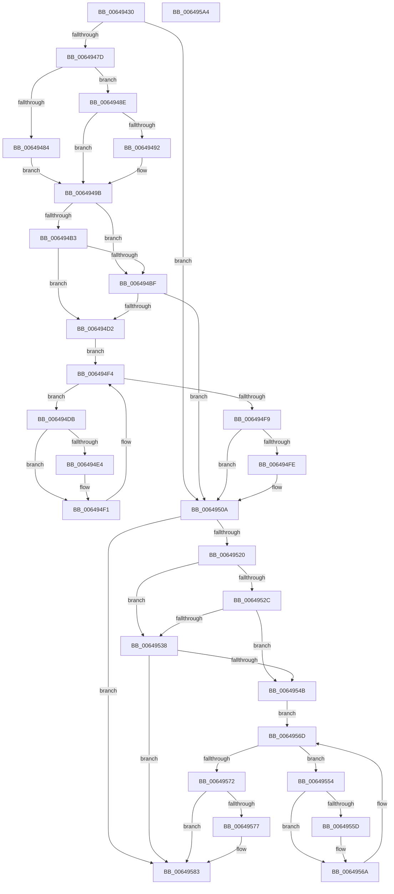

# DifZwRequestWaitReplyPortWrapper

- RVA: `0x00649430`–`0x006495A5` (길이 `373` bytes)
- VA: `0x0000000140649430`
- 실행 섹션: `.text`
- PDB 이름 있음: `예`; PDB Function 태그: `아니요`
- unwind 정보 RVA: `0x000A9A64`
- 디코드: `108`개 명령, `373/373` bytes 표시
- 미해석 바이트: `0` (있으면 어셈블리에 `.byte`로 보존)

> 이 문서는 커널 이미지의 기계어와 PDB 기호를 분석해 생성했습니다. 4번과 5번은 함수 원형과 자료형을 바이너리 사용 방식에서 추정한 C 해석이며 원본 소스 복구 결과는 아닙니다.

## 1. Dependencies

- 직접 호출 지점: **9**; 고유 호출 대상: **6**
- 직접 호출자로 확인된 함수: **0**
- RIP 상대 이미지 참조: **3**

### Outgoing calls
- `0x0064946C` → [DifGetAPIThunkContextById](../49/DifGetAPIThunkContextById_function_00495A34.md) (function, `0x00495A34`)
- `0x00649492` → [DifGetReturnAddressForWrappers](../4D/DifGetReturnAddressForWrappers_function_004D3C08.md) (function, `0x004D3C08`)
- `0x006494C6` → [ExAcquireRundownProtection](../21/ExAcquireRundownProtection_function_00216620.md) (function, `0x00216620`)
- `0x006494EC` → [guard_dispatch_icall](../6B/guard_dispatch_icall_function_006BAAD0.md) (function, `0x006BAAD0`)
- `0x00649505` → [ExReleaseRundownProtection](../34/ExReleaseRundownProtection_function_00349E80.md) (function, `0x00349E80`)
- `0x00649513` → [ZwRequestWaitReplyPort](../6A/ZwRequestWaitReplyPort_function_006AD510.md) (function, `0x006AD510`)
- `0x0064953F` → [ExAcquireRundownProtection](../21/ExAcquireRundownProtection_function_00216620.md) (function, `0x00216620`)
- `0x00649565` → [guard_dispatch_icall](../6B/guard_dispatch_icall_function_006BAAD0.md) (function, `0x006BAAD0`)
- `0x0064957E` → [ExReleaseRundownProtection](../34/ExReleaseRundownProtection_function_00349E80.md) (function, `0x00349E80`)

### Direct callers
- 이 함수 시작 RVA로 연결되는 직접 call은 확인되지 않았습니다. 간접 호출은 완전히 역산할 수 없습니다.

### Static image references
- `0x006494A2` → RVA `0x00F048B8` (`.data`; read)
- `0x006494B3` → RVA `0x00F04980` (`.data`; read)
- `0x006494BF` → RVA `0x00F03E80` (`.data`; read)

## 2. Other-region calls and transfers

- 다른 실행 섹션으로 향하는 call: **0**
- 별도 외부 분기/꼬리 이동을 확인하지 못했습니다.

## 3. Assembly (complete function range)

```asm
00649430  48 89 5C 24 08                  mov qword ptr [rsp + 8], rbx
00649435  48 89 74 24 10                  mov qword ptr [rsp + 0x10], rsi
0064943A  48 89 7C 24 18                  mov qword ptr [rsp + 0x18], rdi
0064943F  55                              push rbp
00649440  41 54                           push r12
00649442  41 55                           push r13
00649444  41 56                           push r14
00649446  41 57                           push r15
00649448  48 8B EC                        mov rbp, rsp
0064944B  48 83 EC 50                     sub rsp, 0x50
0064944F  33 C0                           xor eax, eax
00649451  0F 57 C0                        xorps xmm0, xmm0
00649454  4C 8B E9                        mov r13, rcx
00649457  48 89 45 F0                     mov qword ptr [rbp - 0x10], rax
0064945B  4D 8B F8                        mov r15, r8
0064945E  4C 8B E2                        mov r12, rdx
00649461  0F 11 45 D0                     movups xmmword ptr [rbp - 0x30], xmm0
00649465  8D 48 1C                        lea ecx, [rax + 0x1c]
00649468  0F 11 45 E0                     movups xmmword ptr [rbp - 0x20], xmm0
0064946C  E8 C3 C5 E4 FF                  call 0x140495a34
00649471  48 8B F0                        mov rsi, rax
00649474  48 85 C0                        test rax, rax
00649477  0F 84 8D 00 00 00               je 0x14064950a
0064947D  8B 40 0C                        mov eax, dword ptr [rax + 0xc]
00649480  A8 18                           test al, 0x18
00649482  74 0A                           je 0x14064948e
00649484  48 8B 4D 28                     mov rcx, qword ptr [rbp + 0x28]
00649488  48 89 4D D0                     mov qword ptr [rbp - 0x30], rcx
0064948C  EB 0D                           jmp 0x14064949b
0064948E  A8 04                           test al, 4
00649490  74 09                           je 0x14064949b
00649492  E8 71 A7 E8 FF                  call 0x1404d3c08
00649497  48 89 45 D0                     mov qword ptr [rbp - 0x30], rax
0064949B  45 32 F6                        xor r14b, r14b
0064949E  4C 89 6D E8                     mov qword ptr [rbp - 0x18], r13
006494A2  44 38 35 0F B4 8B 00            cmp byte ptr [rip + 0x8bb40f], r14b
006494A9  4C 89 65 E0                     mov qword ptr [rbp - 0x20], r12
006494AD  4C 89 7D D8                     mov qword ptr [rbp - 0x28], r15
006494B1  75 0C                           jne 0x1406494bf
006494B3  F7 05 C3 B4 8B 00 00 08 00 00   test dword ptr [rip + 0x8bb4c3], 0x800
006494BD  74 13                           je 0x1406494d2
006494BF  48 8D 0D BA A9 8B 00            lea rcx, [rip + 0x8ba9ba]
006494C6  E8 55 D1 BC FF                  call 0x140216620
006494CB  44 8A F0                        mov r14b, al
006494CE  84 C0                           test al, al
006494D0  74 38                           je 0x14064950a
006494D2  48 8D 7E 20                     lea rdi, [rsi + 0x20]
006494D6  48 8B 1F                        mov rbx, qword ptr [rdi]
006494D9  EB 19                           jmp 0x1406494f4
006494DB  48 8D 43 F0                     lea rax, [rbx - 0x10]
006494DF  48 85 C0                        test rax, rax
006494E2  74 0D                           je 0x1406494f1
006494E4  48 8B 40 08                     mov rax, qword ptr [rax + 8]
006494E8  48 8D 4D D0                     lea rcx, [rbp - 0x30]
006494EC  E8 DF 15 07 00                  call 0x1406baad0
006494F1  48 8B 1B                        mov rbx, qword ptr [rbx]
006494F4  48 3B DF                        cmp rbx, rdi
006494F7  75 E2                           jne 0x1406494db
006494F9  45 84 F6                        test r14b, r14b
006494FC  74 0C                           je 0x14064950a
006494FE  48 8D 0D 7B A9 8B 00            lea rcx, [rip + 0x8ba97b]
00649505  E8 76 09 D0 FF                  call 0x140349e80
0064950A  4D 8B C7                        mov r8, r15
0064950D  49 8B D4                        mov rdx, r12
00649510  49 8B CD                        mov rcx, r13
00649513  E8 F8 3F 06 00                  call 0x1406ad510
00649518  89 45 F0                        mov dword ptr [rbp - 0x10], eax
0064951B  48 85 F6                        test rsi, rsi
0064951E  74 63                           je 0x140649583
00649520  40 32 FF                        xor dil, dil
00649523  40 38 3D 8E B3 8B 00            cmp byte ptr [rip + 0x8bb38e], dil
0064952A  75 0C                           jne 0x140649538
0064952C  F7 05 4A B4 8B 00 00 08 00 00   test dword ptr [rip + 0x8bb44a], 0x800
00649536  74 13                           je 0x14064954b
00649538  48 8D 0D 41 A9 8B 00            lea rcx, [rip + 0x8ba941]
0064953F  E8 DC D0 BC FF                  call 0x140216620
00649544  40 8A F8                        mov dil, al
00649547  84 C0                           test al, al
00649549  74 38                           je 0x140649583
0064954B  48 83 C6 30                     add rsi, 0x30
0064954F  48 8B 1E                        mov rbx, qword ptr [rsi]
00649552  EB 19                           jmp 0x14064956d
00649554  48 8D 43 F0                     lea rax, [rbx - 0x10]
00649558  48 85 C0                        test rax, rax
0064955B  74 0D                           je 0x14064956a
0064955D  48 8B 40 08                     mov rax, qword ptr [rax + 8]
00649561  48 8D 4D D0                     lea rcx, [rbp - 0x30]
00649565  E8 66 15 07 00                  call 0x1406baad0
0064956A  48 8B 1B                        mov rbx, qword ptr [rbx]
0064956D  48 3B DE                        cmp rbx, rsi
00649570  75 E2                           jne 0x140649554
00649572  40 84 FF                        test dil, dil
00649575  74 0C                           je 0x140649583
00649577  48 8D 0D 02 A9 8B 00            lea rcx, [rip + 0x8ba902]
0064957E  E8 FD 08 D0 FF                  call 0x140349e80
00649583  8B 45 F0                        mov eax, dword ptr [rbp - 0x10]
00649586  4C 8D 5C 24 50                  lea r11, [rsp + 0x50]
0064958B  49 8B 5B 30                     mov rbx, qword ptr [r11 + 0x30]
0064958F  49 8B 73 38                     mov rsi, qword ptr [r11 + 0x38]
00649593  49 8B 7B 40                     mov rdi, qword ptr [r11 + 0x40]
00649597  49 8B E3                        mov rsp, r11
0064959A  41 5F                           pop r15
0064959C  41 5E                           pop r14
0064959E  41 5D                           pop r13
006495A0  41 5C                           pop r12
006495A2  5D                              pop rbp
006495A3  C3                              ret
006495A4  CC                              int3
```

## 4. C-style interpretation (structured pseudocode)

```c
__int64 __fastcall DifZwRequestWaitReplyPortWrapper(__int64 a1, __int64 a2, __int64 a3)
{
    __int64 result;
    __int64 v_r14;
    __int64 v_rdi;
    __int64 v_rsi;
    __int64 v_rsp;
    unsigned __int64 v_stack_m28;
    unsigned __int64 v_stack_m38;
    unsigned __int64 v_stack_m40;
    unsigned __int64 v_stack_m48;
    unsigned __int64 v_stack_m50;
    unsigned __int64 v_stack_m58;
    unsigned __int64 v_stack_p0;
    unsigned __int64 v_stack_p10;
    unsigned __int64 v_stack_p18;
    unsigned __int64 v_stack_p8;

    v_stack_p8 = v_rbx;
    v_stack_p10 = v_rsi;
    v_stack_p18 = v_rdi;
    v_rsp = (v_rsp) - (80);
    result = 0;
    v_stack_m38 = 0;
    v_stack_m58 = v_xmm0;
    v_stack_m48 = v_xmm0;
    result = DifGetAPIThunkContextById(result + 28, a2, a3, a4);
    if (result == 0) goto loc_0064950A;
    if ((((unsigned __int8)((unsigned int)(*(unsigned int *)(result + 12)))) & (24)) == 0) goto loc_0064948E;
    v_stack_m58 = v_stack_p0;
    goto loc_0064949B;
loc_0064948E:
    result = (unsigned int)(*(unsigned int *)(result + 12));
    if ((((unsigned __int8)((unsigned int)(*(unsigned int *)(result + 12)))) & (4)) != 0) {
        result = DifGetReturnAddressForWrappers(v_stack_p0, a2, a3, a4);
        v_stack_m58 = result;
    }
    v_r14 = 0;
    v_stack_m40 = a1;
    v_stack_m48 = a2;
    v_stack_m50 = a3;
    if ((*(unsigned __int8 *)(v_rip + 9155599)) != 0) goto loc_006494BF;
    if (((*(unsigned int *)(v_rip + 9155779)) & (0x800ULL)) == 0) goto loc_006494D2;
loc_006494BF:
    result = ExAcquireRundownProtection(v_rip + 9152954, a2, a3, a4);
    if ((unsigned __int8)(result) == 0) goto loc_0064950A;
loc_006494D2:
    goto loc_006494F4;
loc_006494DB:
    result = *(unsigned __int64 *)(result + 32) - 16;
    if (*(unsigned __int64 *)(result + 32) - 16 != 0) {
        result = *(unsigned __int64 *)(*(unsigned __int64 *)(result + 32) - 16 + 8);
        a1 = v_stack_m58;
        result = guard_dispatch_icall(a1, a2, a3, a4);
    }
loc_006494F4:
    if ((*(unsigned __int64 *)(*(unsigned __int64 *)(result + 32))) != (result + 32)) goto loc_006494DB;
    if ((unsigned __int8)((unsigned __int8)(result)) != 0) {
        a1 = v_rip + 9152891;
        result = ExReleaseRundownProtection(a1, a2, a3, a4);
    }
    result = ZwRequestWaitReplyPort(a1, a2, a3, a4);
    v_stack_m38 = (unsigned int)(result);
    if (result == 0) goto loc_00649583;
    v_rdi = 0;
    if ((*(unsigned __int8 *)(v_rip + 9155470)) != 0) goto loc_00649538;
    if (((*(unsigned int *)(v_rip + 9155658)) & (0x800ULL)) == 0) goto loc_0064954B;
loc_00649538:
    result = ExAcquireRundownProtection(v_rip + 9152833, a2, a3, a4);
    if ((unsigned __int8)(result) == 0) goto loc_00649583;
loc_0064954B:
    v_rsi = (result) + (48);
    goto loc_0064956D;
loc_00649554:
    result = *(unsigned __int64 *)(v_rsi) - 16;
    if (*(unsigned __int64 *)(v_rsi) - 16 != 0) {
        result = *(unsigned __int64 *)(*(unsigned __int64 *)(v_rsi) - 16 + 8);
        a1 = v_stack_m58;
        result = guard_dispatch_icall(a1, a2, a3, a4);
    }
loc_0064956D:
    if ((*(unsigned __int64 *)(*(unsigned __int64 *)(v_rsi))) != v_rsi) goto loc_00649554;
    if ((unsigned __int8)((unsigned __int8)(result)) != 0) {
        a1 = v_rip + 9152770;
        result = ExReleaseRundownProtection(a1, a2, a3, a4);
    }
    return (unsigned int)(v_stack_m38);
}
```

## 5. (Beta) C Style

```c
int64_t DifZwRequestWaitReplyPortWrapper(int64_t Arg1, int64_t Arg2, int64_t Arg3)
{
    int64_t result;
    int64_t local_r14;
    int64_t local_rdi;
    int64_t local_rsi;
    int64_t local_rsp;
    uint64_t v_stack_m28;
    uint64_t v_stack_m38;
    uint64_t v_stack_m40;
    uint64_t v_stack_m48;
    uint64_t v_stack_m50;
    uint64_t v_stack_m58;
    uint64_t v_stack_p0;
    uint64_t v_stack_p10;
    uint64_t v_stack_p18;
    uint64_t v_stack_p8;

    v_stack_p8 = local_rbx;
    v_stack_p10 = local_rsi;
    v_stack_p18 = local_rdi;
    local_rsp = (local_rsp) - (80);
    result = 0;
    v_stack_m38 = 0;
    v_stack_m58 = v_xmm0;
    v_stack_m48 = v_xmm0;
    result = DifGetAPIThunkContextById(result + 28, Arg2, Arg3, a4);
    if (result == 0) goto loc_0064950A;
    if ((((uint8_t)((uint32_t)(*(uint32_t *)(result + 0xC)))) & (24)) == 0) goto loc_0064948E;
    v_stack_m58 = v_stack_p0;
    goto loc_0064949B;
loc_0064948E:
    result = (uint32_t)(*(uint32_t *)(result + 0xC));
    if ((((uint8_t)((uint32_t)(*(uint32_t *)(result + 0xC)))) & (4)) != 0) {
        result = DifGetReturnAddressForWrappers(v_stack_p0, Arg2, Arg3, a4);
        v_stack_m58 = result;
    }
    local_r14 = 0;
    v_stack_m40 = Arg1;
    v_stack_m48 = Arg2;
    v_stack_m50 = Arg3;
    if ((*(uint8_t *)(v_rip + 0x8BB40F)) != 0) goto loc_006494BF;
    if (((*(uint32_t *)(v_rip + 0x8BB4C3)) & (0x800ULL)) == 0) goto loc_006494D2;
loc_006494BF:
    result = ExAcquireRundownProtection(v_rip + 9152954, Arg2, Arg3, a4);
    if ((uint8_t)(result) == 0) goto loc_0064950A;
loc_006494D2:
    goto loc_006494F4;
loc_006494DB:
    result = *(uint64_t *)(result + 0x20) - 16;
    if (*(uint64_t *)(result + 0x20) - 16 != 0) {
        result = *(uint64_t *)(*(uint64_t *)(result + 0x20) - 0x10 + 0x8);
        Arg1 = v_stack_m58;
        result = guard_dispatch_icall(Arg1, Arg2, Arg3, a4);
    }
loc_006494F4:
    if ((*(uint64_t *)(*(uint64_t *)(result + 0x20))) != (result + 32)) goto loc_006494DB;
    if ((uint8_t)((uint8_t)(result)) != 0) {
        Arg1 = v_rip + 9152891;
        result = ExReleaseRundownProtection(Arg1, Arg2, Arg3, a4);
    }
    result = ZwRequestWaitReplyPort(Arg1, Arg2, Arg3, a4);
    v_stack_m38 = (uint32_t)(result);
    if (result == 0) goto loc_00649583;
    local_rdi = 0;
    if ((*(uint8_t *)(v_rip + 0x8BB38E)) != 0) goto loc_00649538;
    if (((*(uint32_t *)(v_rip + 0x8BB44A)) & (0x800ULL)) == 0) goto loc_0064954B;
loc_00649538:
    result = ExAcquireRundownProtection(v_rip + 9152833, Arg2, Arg3, a4);
    if ((uint8_t)(result) == 0) goto loc_00649583;
loc_0064954B:
    local_rsi = (result) + (48);
    goto loc_0064956D;
loc_00649554:
    result = *(uint64_t *)(local_rsi) - 16;
    if (*(uint64_t *)(local_rsi) - 16 != 0) {
        result = *(uint64_t *)(*(uint64_t *)(local_rsi) - 0x10 + 0x8);
        Arg1 = v_stack_m58;
        result = guard_dispatch_icall(Arg1, Arg2, Arg3, a4);
    }
loc_0064956D:
    if ((*(uint64_t *)(*(uint64_t *)(local_rsi))) != local_rsi) goto loc_00649554;
    if ((uint8_t)((uint8_t)(result)) != 0) {
        Arg1 = v_rip + 9152770;
        result = ExReleaseRundownProtection(Arg1, Arg2, Arg3, a4);
    }
    return (uint32_t)(v_stack_m38);
}
```

## 6. Execution-region graph

[열기: 2D/3D 그래프와 함수 탐색 컨트롤 패널](../../../control-panel.html?section=text&rva=0x00649430&view=graph)

- 2D 그래프는 위에서 아래로 흐르고, 3D 그래프는 빈 공간을 드래그해 회전합니다. Shift+드래그는 이동, 휠은 확대·축소, 함수 노드 선택은 대상 보고서 이동입니다.

### Static fallback


