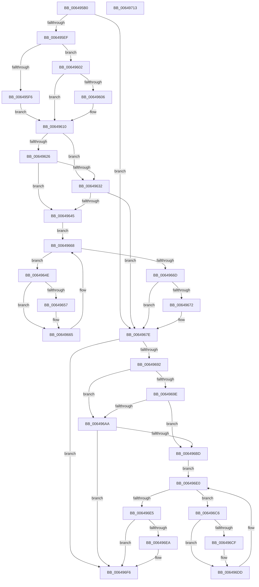

# DifZwResetEventWrapper

- RVA: `0x006495B0`–`0x00649714` (길이 `356` bytes)
- VA: `0x00000001406495B0`
- 실행 섹션: `.text`
- PDB 이름 있음: `예`; PDB Function 태그: `아니요`
- unwind 정보 RVA: `0x00093E28`
- 디코드: `98`개 명령, `356/356` bytes 표시
- 미해석 바이트: `0` (있으면 어셈블리에 `.byte`로 보존)

> 이 문서는 커널 이미지의 기계어와 PDB 기호를 분석해 생성했습니다. 4번과 5번은 함수 원형과 자료형을 바이너리 사용 방식에서 추정한 C 해석이며 원본 소스 복구 결과는 아닙니다.

## 1. Dependencies

- 직접 호출 지점: **9**; 고유 호출 대상: **6**
- 직접 호출자로 확인된 함수: **0**
- RIP 상대 이미지 참조: **3**

### Outgoing calls
- `0x006495DE` → [DifGetAPIThunkContextById](../49/DifGetAPIThunkContextById_function_00495A34.md) (function, `0x00495A34`)
- `0x00649606` → [DifGetReturnAddressForWrappers](../4D/DifGetReturnAddressForWrappers_function_004D3C08.md) (function, `0x004D3C08`)
- `0x00649639` → [ExAcquireRundownProtection](../21/ExAcquireRundownProtection_function_00216620.md) (function, `0x00216620`)
- `0x00649660` → [guard_dispatch_icall](../6B/guard_dispatch_icall_function_006BAAD0.md) (function, `0x006BAAD0`)
- `0x00649679` → [ExReleaseRundownProtection](../34/ExReleaseRundownProtection_function_00349E80.md) (function, `0x00349E80`)
- `0x00649684` → [ZwResetEvent](../6B/ZwResetEvent_function_006B01D0.md) (function, `0x006B01D0`)
- `0x006496B1` → [ExAcquireRundownProtection](../21/ExAcquireRundownProtection_function_00216620.md) (function, `0x00216620`)
- `0x006496D8` → [guard_dispatch_icall](../6B/guard_dispatch_icall_function_006BAAD0.md) (function, `0x006BAAD0`)
- `0x006496F1` → [ExReleaseRundownProtection](../34/ExReleaseRundownProtection_function_00349E80.md) (function, `0x00349E80`)

### Direct callers
- 이 함수 시작 RVA로 연결되는 직접 call은 확인되지 않았습니다. 간접 호출은 완전히 역산할 수 없습니다.

### Static image references
- `0x00649618` → RVA `0x00F048B8` (`.data`; read)
- `0x00649626` → RVA `0x00F04980` (`.data`; read)
- `0x00649632` → RVA `0x00F03E80` (`.data`; read)

## 2. Other-region calls and transfers

- 다른 실행 섹션으로 향하는 call: **0**
- 별도 외부 분기/꼬리 이동을 확인하지 못했습니다.

## 3. Assembly (complete function range)

```asm
006495B0  48 8B C4                        mov rax, rsp
006495B3  48 89 58 08                     mov qword ptr [rax + 8], rbx
006495B7  48 89 68 10                     mov qword ptr [rax + 0x10], rbp
006495BB  48 89 70 18                     mov qword ptr [rax + 0x18], rsi
006495BF  57                              push rdi
006495C0  41 56                           push r14
006495C2  41 57                           push r15
006495C4  48 83 EC 40                     sub rsp, 0x40
006495C8  0F 57 C0                        xorps xmm0, xmm0
006495CB  4C 8B F9                        mov r15, rcx
006495CE  B9 1B 00 00 00                  mov ecx, 0x1b
006495D3  4C 8B F2                        mov r14, rdx
006495D6  0F 11 40 C8                     movups xmmword ptr [rax - 0x38], xmm0
006495DA  0F 11 40 D8                     movups xmmword ptr [rax - 0x28], xmm0
006495DE  E8 51 C4 E4 FF                  call 0x140495a34
006495E3  48 8B F0                        mov rsi, rax
006495E6  48 85 C0                        test rax, rax
006495E9  0F 84 8F 00 00 00               je 0x14064967e
006495EF  8B 40 0C                        mov eax, dword ptr [rax + 0xc]
006495F2  A8 18                           test al, 0x18
006495F4  74 0C                           je 0x140649602
006495F6  48 8B 4C 24 58                  mov rcx, qword ptr [rsp + 0x58]
006495FB  48 89 4C 24 20                  mov qword ptr [rsp + 0x20], rcx
00649600  EB 0E                           jmp 0x140649610
00649602  A8 04                           test al, 4
00649604  74 0A                           je 0x140649610
00649606  E8 FD A5 E8 FF                  call 0x1404d3c08
0064960B  48 89 44 24 20                  mov qword ptr [rsp + 0x20], rax
00649610  40 32 ED                        xor bpl, bpl
00649613  4C 89 7C 24 30                  mov qword ptr [rsp + 0x30], r15
00649618  40 38 2D 99 B2 8B 00            cmp byte ptr [rip + 0x8bb299], bpl
0064961F  4C 89 74 24 28                  mov qword ptr [rsp + 0x28], r14
00649624  75 0C                           jne 0x140649632
00649626  F7 05 50 B3 8B 00 00 08 00 00   test dword ptr [rip + 0x8bb350], 0x800
00649630  74 13                           je 0x140649645
00649632  48 8D 0D 47 A8 8B 00            lea rcx, [rip + 0x8ba847]
00649639  E8 E2 CF BC FF                  call 0x140216620
0064963E  40 8A E8                        mov bpl, al
00649641  84 C0                           test al, al
00649643  74 39                           je 0x14064967e
00649645  48 8D 7E 20                     lea rdi, [rsi + 0x20]
00649649  48 8B 1F                        mov rbx, qword ptr [rdi]
0064964C  EB 1A                           jmp 0x140649668
0064964E  48 8D 43 F0                     lea rax, [rbx - 0x10]
00649652  48 85 C0                        test rax, rax
00649655  74 0E                           je 0x140649665
00649657  48 8B 40 08                     mov rax, qword ptr [rax + 8]
0064965B  48 8D 4C 24 20                  lea rcx, [rsp + 0x20]
00649660  E8 6B 14 07 00                  call 0x1406baad0
00649665  48 8B 1B                        mov rbx, qword ptr [rbx]
00649668  48 3B DF                        cmp rbx, rdi
0064966B  75 E1                           jne 0x14064964e
0064966D  40 84 ED                        test bpl, bpl
00649670  74 0C                           je 0x14064967e
00649672  48 8D 0D 07 A8 8B 00            lea rcx, [rip + 0x8ba807]
00649679  E8 02 08 D0 FF                  call 0x140349e80
0064967E  49 8B D6                        mov rdx, r14
00649681  49 8B CF                        mov rcx, r15
00649684  E8 47 6B 06 00                  call 0x1406b01d0
00649689  89 44 24 38                     mov dword ptr [rsp + 0x38], eax
0064968D  48 85 F6                        test rsi, rsi
00649690  74 64                           je 0x1406496f6
00649692  40 32 FF                        xor dil, dil
00649695  40 38 3D 1C B2 8B 00            cmp byte ptr [rip + 0x8bb21c], dil
0064969C  75 0C                           jne 0x1406496aa
0064969E  F7 05 D8 B2 8B 00 00 08 00 00   test dword ptr [rip + 0x8bb2d8], 0x800
006496A8  74 13                           je 0x1406496bd
006496AA  48 8D 0D CF A7 8B 00            lea rcx, [rip + 0x8ba7cf]
006496B1  E8 6A CF BC FF                  call 0x140216620
006496B6  40 8A F8                        mov dil, al
006496B9  84 C0                           test al, al
006496BB  74 39                           je 0x1406496f6
006496BD  48 83 C6 30                     add rsi, 0x30
006496C1  48 8B 1E                        mov rbx, qword ptr [rsi]
006496C4  EB 1A                           jmp 0x1406496e0
006496C6  48 8D 43 F0                     lea rax, [rbx - 0x10]
006496CA  48 85 C0                        test rax, rax
006496CD  74 0E                           je 0x1406496dd
006496CF  48 8B 40 08                     mov rax, qword ptr [rax + 8]
006496D3  48 8D 4C 24 20                  lea rcx, [rsp + 0x20]
006496D8  E8 F3 13 07 00                  call 0x1406baad0
006496DD  48 8B 1B                        mov rbx, qword ptr [rbx]
006496E0  48 3B DE                        cmp rbx, rsi
006496E3  75 E1                           jne 0x1406496c6
006496E5  40 84 FF                        test dil, dil
006496E8  74 0C                           je 0x1406496f6
006496EA  48 8D 0D 8F A7 8B 00            lea rcx, [rip + 0x8ba78f]
006496F1  E8 8A 07 D0 FF                  call 0x140349e80
006496F6  8B 44 24 38                     mov eax, dword ptr [rsp + 0x38]
006496FA  48 8B 5C 24 60                  mov rbx, qword ptr [rsp + 0x60]
006496FF  48 8B 6C 24 68                  mov rbp, qword ptr [rsp + 0x68]
00649704  48 8B 74 24 70                  mov rsi, qword ptr [rsp + 0x70]
00649709  48 83 C4 40                     add rsp, 0x40
0064970D  41 5F                           pop r15
0064970F  41 5E                           pop r14
00649711  5F                              pop rdi
00649712  C3                              ret
00649713  CC                              int3
```

## 4. C-style interpretation (structured pseudocode)

```c
__int64 __fastcall DifZwResetEventWrapper(__int64 a1, __int64 a2)
{
    __int64 result;
    __int64 v_rbp;
    __int64 v_rdi;
    __int64 v_rsi;
    __int64 v_rsp;
    unsigned int v_stack_m20;
    unsigned __int64 v_stack_m28;
    unsigned __int64 v_stack_m30;
    unsigned __int64 v_stack_m38;
    unsigned __int64 v_stack_p0;
    unsigned __int64 v_stack_p10;
    unsigned __int64 v_stack_p18;
    unsigned __int64 v_stack_p8;

    *(unsigned __int64 *)(v_rsp + 8) = v_rbx;
    *(unsigned __int64 *)(v_rsp + 16) = v_rbp;
    *(unsigned __int64 *)(v_rsp + 24) = v_rsi;
    v_rsp = (v_rsp) - (64);
    *(unsigned __int64 *)(v_rsp - 56) = v_xmm0;
    *(unsigned __int64 *)(v_rsp - 40) = v_xmm0;
    result = DifGetAPIThunkContextById(27, a2, a3, a4);
    if (result == 0) goto loc_0064967E;
    if ((((unsigned __int8)((unsigned int)(*(unsigned int *)(result + 12)))) & (24)) == 0) goto loc_00649602;
    v_stack_m38 = v_stack_p0;
    goto loc_00649610;
loc_00649602:
    result = (unsigned int)(*(unsigned int *)(result + 12));
    if ((((unsigned __int8)((unsigned int)(*(unsigned int *)(result + 12)))) & (4)) != 0) {
        result = DifGetReturnAddressForWrappers(v_stack_p0, a2, a3, a4);
        v_stack_m38 = result;
    }
    v_rbp = 0;
    v_stack_m28 = a1;
    v_stack_m30 = a2;
    if ((*(unsigned __int8 *)(v_rip + 9155225)) != 0) goto loc_00649632;
    if (((*(unsigned int *)(v_rip + 9155408)) & (0x800ULL)) == 0) goto loc_00649645;
loc_00649632:
    result = ExAcquireRundownProtection(v_rip + 9152583, a2, a3, a4);
    if ((unsigned __int8)(result) == 0) goto loc_0064967E;
loc_00649645:
    goto loc_00649668;
loc_0064964E:
    result = *(unsigned __int64 *)(result + 32) - 16;
    if (*(unsigned __int64 *)(result + 32) - 16 != 0) {
        result = *(unsigned __int64 *)(*(unsigned __int64 *)(result + 32) - 16 + 8);
        a1 = v_stack_m38;
        result = guard_dispatch_icall(a1, a2, a3, a4);
    }
loc_00649668:
    if ((*(unsigned __int64 *)(*(unsigned __int64 *)(result + 32))) != (result + 32)) goto loc_0064964E;
    if ((unsigned __int8)((unsigned __int8)(result)) != 0) {
        a1 = v_rip + 9152519;
        result = ExReleaseRundownProtection(a1, a2, a3, a4);
    }
    result = ZwResetEvent(a1, a2, a3, a4);
    v_stack_m20 = (unsigned int)(result);
    if (result == 0) goto loc_006496F6;
    v_rdi = 0;
    if ((*(unsigned __int8 *)(v_rip + 9155100)) != 0) goto loc_006496AA;
    if (((*(unsigned int *)(v_rip + 9155288)) & (0x800ULL)) == 0) goto loc_006496BD;
loc_006496AA:
    result = ExAcquireRundownProtection(v_rip + 9152463, a2, a3, a4);
    if ((unsigned __int8)(result) == 0) goto loc_006496F6;
loc_006496BD:
    v_rsi = (result) + (48);
    goto loc_006496E0;
loc_006496C6:
    result = *(unsigned __int64 *)(v_rsi) - 16;
    if (*(unsigned __int64 *)(v_rsi) - 16 != 0) {
        result = *(unsigned __int64 *)(*(unsigned __int64 *)(v_rsi) - 16 + 8);
        a1 = v_stack_m38;
        result = guard_dispatch_icall(a1, a2, a3, a4);
    }
loc_006496E0:
    if ((*(unsigned __int64 *)(*(unsigned __int64 *)(v_rsi))) != v_rsi) goto loc_006496C6;
    if ((unsigned __int8)((unsigned __int8)(result)) != 0) {
        a1 = v_rip + 9152399;
        result = ExReleaseRundownProtection(a1, a2, a3, a4);
    }
    v_rsp = (v_rsp) + (64);
    return (unsigned int)(v_stack_m20);
}
```

## 5. (Beta) C Style

```c
int64_t DifZwResetEventWrapper(int64_t Arg1, int64_t Arg2)
{
    int64_t result;
    int64_t local_rbp;
    int64_t local_rdi;
    int64_t local_rsi;
    int64_t local_rsp;
    uint32_t v_stack_m20;
    uint64_t v_stack_m28;
    uint64_t v_stack_m30;
    uint64_t v_stack_m38;
    uint64_t v_stack_p0;
    uint64_t v_stack_p10;
    uint64_t v_stack_p18;
    uint64_t v_stack_p8;

    *(uint64_t *)(local_rsp + 0x8) = local_rbx;
    *(uint64_t *)(local_rsp + 0x10) = local_rbp;
    *(uint64_t *)(local_rsp + 0x18) = local_rsi;
    local_rsp = (local_rsp) - (64);
    *(uint64_t *)(local_rsp - 0x38) = v_xmm0;
    *(uint64_t *)(local_rsp - 0x28) = v_xmm0;
    result = DifGetAPIThunkContextById(27, Arg2, a3, a4);
    if (result == 0) goto loc_0064967E;
    if ((((uint8_t)((uint32_t)(*(uint32_t *)(result + 0xC)))) & (24)) == 0) goto loc_00649602;
    v_stack_m38 = v_stack_p0;
    goto loc_00649610;
loc_00649602:
    result = (uint32_t)(*(uint32_t *)(result + 0xC));
    if ((((uint8_t)((uint32_t)(*(uint32_t *)(result + 0xC)))) & (4)) != 0) {
        result = DifGetReturnAddressForWrappers(v_stack_p0, Arg2, a3, a4);
        v_stack_m38 = result;
    }
    local_rbp = 0;
    v_stack_m28 = Arg1;
    v_stack_m30 = Arg2;
    if ((*(uint8_t *)(v_rip + 0x8BB299)) != 0) goto loc_00649632;
    if (((*(uint32_t *)(v_rip + 0x8BB350)) & (0x800ULL)) == 0) goto loc_00649645;
loc_00649632:
    result = ExAcquireRundownProtection(v_rip + 9152583, Arg2, a3, a4);
    if ((uint8_t)(result) == 0) goto loc_0064967E;
loc_00649645:
    goto loc_00649668;
loc_0064964E:
    result = *(uint64_t *)(result + 0x20) - 16;
    if (*(uint64_t *)(result + 0x20) - 16 != 0) {
        result = *(uint64_t *)(*(uint64_t *)(result + 0x20) - 0x10 + 0x8);
        Arg1 = v_stack_m38;
        result = guard_dispatch_icall(Arg1, Arg2, a3, a4);
    }
loc_00649668:
    if ((*(uint64_t *)(*(uint64_t *)(result + 0x20))) != (result + 32)) goto loc_0064964E;
    if ((uint8_t)((uint8_t)(result)) != 0) {
        Arg1 = v_rip + 9152519;
        result = ExReleaseRundownProtection(Arg1, Arg2, a3, a4);
    }
    result = ZwResetEvent(Arg1, Arg2, a3, a4);
    v_stack_m20 = (uint32_t)(result);
    if (result == 0) goto loc_006496F6;
    local_rdi = 0;
    if ((*(uint8_t *)(v_rip + 0x8BB21C)) != 0) goto loc_006496AA;
    if (((*(uint32_t *)(v_rip + 0x8BB2D8)) & (0x800ULL)) == 0) goto loc_006496BD;
loc_006496AA:
    result = ExAcquireRundownProtection(v_rip + 9152463, Arg2, a3, a4);
    if ((uint8_t)(result) == 0) goto loc_006496F6;
loc_006496BD:
    local_rsi = (result) + (48);
    goto loc_006496E0;
loc_006496C6:
    result = *(uint64_t *)(local_rsi) - 16;
    if (*(uint64_t *)(local_rsi) - 16 != 0) {
        result = *(uint64_t *)(*(uint64_t *)(local_rsi) - 0x10 + 0x8);
        Arg1 = v_stack_m38;
        result = guard_dispatch_icall(Arg1, Arg2, a3, a4);
    }
loc_006496E0:
    if ((*(uint64_t *)(*(uint64_t *)(local_rsi))) != local_rsi) goto loc_006496C6;
    if ((uint8_t)((uint8_t)(result)) != 0) {
        Arg1 = v_rip + 9152399;
        result = ExReleaseRundownProtection(Arg1, Arg2, a3, a4);
    }
    local_rsp = (local_rsp) + (64);
    return (uint32_t)(v_stack_m20);
}
```

## 6. Execution-region graph

[열기: 2D/3D 그래프와 함수 탐색 컨트롤 패널](../../../control-panel.html?section=text&rva=0x006495B0&view=graph)

- 2D 그래프는 위에서 아래로 흐르고, 3D 그래프는 빈 공간을 드래그해 회전합니다. Shift+드래그는 이동, 휠은 확대·축소, 함수 노드 선택은 대상 보고서 이동입니다.

### Static fallback


