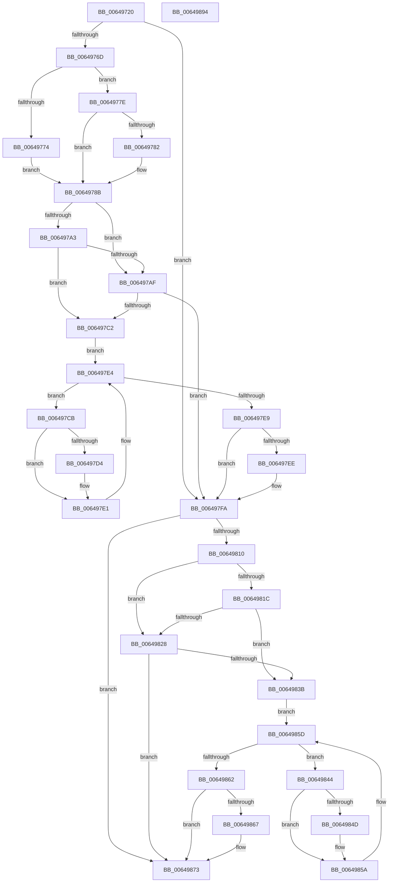

# DifZwRestoreKeyWrapper

- RVA: `0x00649720`–`0x00649895` (길이 `373` bytes)
- VA: `0x0000000140649720`
- 실행 섹션: `.text`
- PDB 이름 있음: `예`; PDB Function 태그: `아니요`
- unwind 정보 RVA: `0x000A9A64`
- 디코드: `108`개 명령, `373/373` bytes 표시
- 미해석 바이트: `0` (있으면 어셈블리에 `.byte`로 보존)

> 이 문서는 커널 이미지의 기계어와 PDB 기호를 분석해 생성했습니다. 4번과 5번은 함수 원형과 자료형을 바이너리 사용 방식에서 추정한 C 해석이며 원본 소스 복구 결과는 아닙니다.

## 1. Dependencies

- 직접 호출 지점: **9**; 고유 호출 대상: **6**
- 직접 호출자로 확인된 함수: **0**
- RIP 상대 이미지 참조: **3**

### Outgoing calls
- `0x0064975C` → [DifGetAPIThunkContextById](../49/DifGetAPIThunkContextById_function_00495A34.md) (function, `0x00495A34`)
- `0x00649782` → [DifGetReturnAddressForWrappers](../4D/DifGetReturnAddressForWrappers_function_004D3C08.md) (function, `0x004D3C08`)
- `0x006497B6` → [ExAcquireRundownProtection](../21/ExAcquireRundownProtection_function_00216620.md) (function, `0x00216620`)
- `0x006497DC` → [guard_dispatch_icall](../6B/guard_dispatch_icall_function_006BAAD0.md) (function, `0x006BAAD0`)
- `0x006497F5` → [ExReleaseRundownProtection](../34/ExReleaseRundownProtection_function_00349E80.md) (function, `0x00349E80`)
- `0x00649803` → [ZwRestoreKey](../6B/ZwRestoreKey_function_006B0210.md) (function, `0x006B0210`)
- `0x0064982F` → [ExAcquireRundownProtection](../21/ExAcquireRundownProtection_function_00216620.md) (function, `0x00216620`)
- `0x00649855` → [guard_dispatch_icall](../6B/guard_dispatch_icall_function_006BAAD0.md) (function, `0x006BAAD0`)
- `0x0064986E` → [ExReleaseRundownProtection](../34/ExReleaseRundownProtection_function_00349E80.md) (function, `0x00349E80`)

### Direct callers
- 이 함수 시작 RVA로 연결되는 직접 call은 확인되지 않았습니다. 간접 호출은 완전히 역산할 수 없습니다.

### Static image references
- `0x00649792` → RVA `0x00F048B8` (`.data`; read)
- `0x006497A3` → RVA `0x00F04980` (`.data`; read)
- `0x006497AF` → RVA `0x00F03E80` (`.data`; read)

## 2. Other-region calls and transfers

- 다른 실행 섹션으로 향하는 call: **0**
- 별도 외부 분기/꼬리 이동을 확인하지 못했습니다.

## 3. Assembly (complete function range)

```asm
00649720  48 89 5C 24 08                  mov qword ptr [rsp + 8], rbx
00649725  48 89 74 24 10                  mov qword ptr [rsp + 0x10], rsi
0064972A  48 89 7C 24 18                  mov qword ptr [rsp + 0x18], rdi
0064972F  55                              push rbp
00649730  41 54                           push r12
00649732  41 55                           push r13
00649734  41 56                           push r14
00649736  41 57                           push r15
00649738  48 8B EC                        mov rbp, rsp
0064973B  48 83 EC 50                     sub rsp, 0x50
0064973F  33 C0                           xor eax, eax
00649741  0F 57 C0                        xorps xmm0, xmm0
00649744  4C 8B E9                        mov r13, rcx
00649747  48 89 45 F0                     mov qword ptr [rbp - 0x10], rax
0064974B  45 8B F8                        mov r15d, r8d
0064974E  4C 8B E2                        mov r12, rdx
00649751  0F 11 45 D0                     movups xmmword ptr [rbp - 0x30], xmm0
00649755  8D 48 1A                        lea ecx, [rax + 0x1a]
00649758  0F 11 45 E0                     movups xmmword ptr [rbp - 0x20], xmm0
0064975C  E8 D3 C2 E4 FF                  call 0x140495a34
00649761  48 8B F0                        mov rsi, rax
00649764  48 85 C0                        test rax, rax
00649767  0F 84 8D 00 00 00               je 0x1406497fa
0064976D  8B 40 0C                        mov eax, dword ptr [rax + 0xc]
00649770  A8 18                           test al, 0x18
00649772  74 0A                           je 0x14064977e
00649774  48 8B 4D 28                     mov rcx, qword ptr [rbp + 0x28]
00649778  48 89 4D D0                     mov qword ptr [rbp - 0x30], rcx
0064977C  EB 0D                           jmp 0x14064978b
0064977E  A8 04                           test al, 4
00649780  74 09                           je 0x14064978b
00649782  E8 81 A4 E8 FF                  call 0x1404d3c08
00649787  48 89 45 D0                     mov qword ptr [rbp - 0x30], rax
0064978B  45 32 F6                        xor r14b, r14b
0064978E  4C 89 6D E8                     mov qword ptr [rbp - 0x18], r13
00649792  44 38 35 1F B1 8B 00            cmp byte ptr [rip + 0x8bb11f], r14b
00649799  4C 89 65 E0                     mov qword ptr [rbp - 0x20], r12
0064979D  44 89 7D D8                     mov dword ptr [rbp - 0x28], r15d
006497A1  75 0C                           jne 0x1406497af
006497A3  F7 05 D3 B1 8B 00 00 08 00 00   test dword ptr [rip + 0x8bb1d3], 0x800
006497AD  74 13                           je 0x1406497c2
006497AF  48 8D 0D CA A6 8B 00            lea rcx, [rip + 0x8ba6ca]
006497B6  E8 65 CE BC FF                  call 0x140216620
006497BB  44 8A F0                        mov r14b, al
006497BE  84 C0                           test al, al
006497C0  74 38                           je 0x1406497fa
006497C2  48 8D 7E 20                     lea rdi, [rsi + 0x20]
006497C6  48 8B 1F                        mov rbx, qword ptr [rdi]
006497C9  EB 19                           jmp 0x1406497e4
006497CB  48 8D 43 F0                     lea rax, [rbx - 0x10]
006497CF  48 85 C0                        test rax, rax
006497D2  74 0D                           je 0x1406497e1
006497D4  48 8B 40 08                     mov rax, qword ptr [rax + 8]
006497D8  48 8D 4D D0                     lea rcx, [rbp - 0x30]
006497DC  E8 EF 12 07 00                  call 0x1406baad0
006497E1  48 8B 1B                        mov rbx, qword ptr [rbx]
006497E4  48 3B DF                        cmp rbx, rdi
006497E7  75 E2                           jne 0x1406497cb
006497E9  45 84 F6                        test r14b, r14b
006497EC  74 0C                           je 0x1406497fa
006497EE  48 8D 0D 8B A6 8B 00            lea rcx, [rip + 0x8ba68b]
006497F5  E8 86 06 D0 FF                  call 0x140349e80
006497FA  45 8B C7                        mov r8d, r15d
006497FD  49 8B D4                        mov rdx, r12
00649800  49 8B CD                        mov rcx, r13
00649803  E8 08 6A 06 00                  call 0x1406b0210
00649808  89 45 F0                        mov dword ptr [rbp - 0x10], eax
0064980B  48 85 F6                        test rsi, rsi
0064980E  74 63                           je 0x140649873
00649810  40 32 FF                        xor dil, dil
00649813  40 38 3D 9E B0 8B 00            cmp byte ptr [rip + 0x8bb09e], dil
0064981A  75 0C                           jne 0x140649828
0064981C  F7 05 5A B1 8B 00 00 08 00 00   test dword ptr [rip + 0x8bb15a], 0x800
00649826  74 13                           je 0x14064983b
00649828  48 8D 0D 51 A6 8B 00            lea rcx, [rip + 0x8ba651]
0064982F  E8 EC CD BC FF                  call 0x140216620
00649834  40 8A F8                        mov dil, al
00649837  84 C0                           test al, al
00649839  74 38                           je 0x140649873
0064983B  48 83 C6 30                     add rsi, 0x30
0064983F  48 8B 1E                        mov rbx, qword ptr [rsi]
00649842  EB 19                           jmp 0x14064985d
00649844  48 8D 43 F0                     lea rax, [rbx - 0x10]
00649848  48 85 C0                        test rax, rax
0064984B  74 0D                           je 0x14064985a
0064984D  48 8B 40 08                     mov rax, qword ptr [rax + 8]
00649851  48 8D 4D D0                     lea rcx, [rbp - 0x30]
00649855  E8 76 12 07 00                  call 0x1406baad0
0064985A  48 8B 1B                        mov rbx, qword ptr [rbx]
0064985D  48 3B DE                        cmp rbx, rsi
00649860  75 E2                           jne 0x140649844
00649862  40 84 FF                        test dil, dil
00649865  74 0C                           je 0x140649873
00649867  48 8D 0D 12 A6 8B 00            lea rcx, [rip + 0x8ba612]
0064986E  E8 0D 06 D0 FF                  call 0x140349e80
00649873  8B 45 F0                        mov eax, dword ptr [rbp - 0x10]
00649876  4C 8D 5C 24 50                  lea r11, [rsp + 0x50]
0064987B  49 8B 5B 30                     mov rbx, qword ptr [r11 + 0x30]
0064987F  49 8B 73 38                     mov rsi, qword ptr [r11 + 0x38]
00649883  49 8B 7B 40                     mov rdi, qword ptr [r11 + 0x40]
00649887  49 8B E3                        mov rsp, r11
0064988A  41 5F                           pop r15
0064988C  41 5E                           pop r14
0064988E  41 5D                           pop r13
00649890  41 5C                           pop r12
00649892  5D                              pop rbp
00649893  C3                              ret
00649894  CC                              int3
```

## 4. C-style interpretation (structured pseudocode)

```c
__int64 __fastcall DifZwRestoreKeyWrapper(__int64 a1, __int64 a2, int a3)
{
    __int64 result;
    __int64 v_r14;
    __int64 v_rdi;
    __int64 v_rsi;
    __int64 v_rsp;
    unsigned __int64 v_stack_m28;
    unsigned __int64 v_stack_m38;
    unsigned __int64 v_stack_m40;
    unsigned __int64 v_stack_m48;
    unsigned int v_stack_m50;
    unsigned __int64 v_stack_m58;
    unsigned __int64 v_stack_p0;
    unsigned __int64 v_stack_p10;
    unsigned __int64 v_stack_p18;
    unsigned __int64 v_stack_p8;

    v_stack_p8 = v_rbx;
    v_stack_p10 = v_rsi;
    v_stack_p18 = v_rdi;
    v_rsp = (v_rsp) - (80);
    result = 0;
    v_stack_m38 = 0;
    v_stack_m58 = v_xmm0;
    v_stack_m48 = v_xmm0;
    result = DifGetAPIThunkContextById(result + 26, a2, a3, a4);
    if (result == 0) goto loc_006497FA;
    if ((((unsigned __int8)((unsigned int)(*(unsigned int *)(result + 12)))) & (24)) == 0) goto loc_0064977E;
    v_stack_m58 = v_stack_p0;
    goto loc_0064978B;
loc_0064977E:
    result = (unsigned int)(*(unsigned int *)(result + 12));
    if ((((unsigned __int8)((unsigned int)(*(unsigned int *)(result + 12)))) & (4)) != 0) {
        result = DifGetReturnAddressForWrappers(v_stack_p0, a2, a3, a4);
        v_stack_m58 = result;
    }
    v_r14 = 0;
    v_stack_m40 = a1;
    v_stack_m48 = a2;
    v_stack_m50 = (unsigned int)((unsigned int)(a3));
    if ((*(unsigned __int8 *)(v_rip + 9154847)) != 0) goto loc_006497AF;
    if (((*(unsigned int *)(v_rip + 9155027)) & (0x800ULL)) == 0) goto loc_006497C2;
loc_006497AF:
    result = ExAcquireRundownProtection(v_rip + 9152202, a2, a3, a4);
    if ((unsigned __int8)(result) == 0) goto loc_006497FA;
loc_006497C2:
    goto loc_006497E4;
loc_006497CB:
    result = *(unsigned __int64 *)(result + 32) - 16;
    if (*(unsigned __int64 *)(result + 32) - 16 != 0) {
        result = *(unsigned __int64 *)(*(unsigned __int64 *)(result + 32) - 16 + 8);
        a1 = v_stack_m58;
        result = guard_dispatch_icall(a1, a2, a3, a4);
    }
loc_006497E4:
    if ((*(unsigned __int64 *)(*(unsigned __int64 *)(result + 32))) != (result + 32)) goto loc_006497CB;
    if ((unsigned __int8)((unsigned __int8)(result)) != 0) {
        a1 = v_rip + 9152139;
        result = ExReleaseRundownProtection(a1, a2, a3, a4);
    }
    result = ZwRestoreKey(a1, a2, (unsigned int)((unsigned int)((unsigned int)(a3))), a4);
    v_stack_m38 = (unsigned int)(result);
    if (result == 0) goto loc_00649873;
    v_rdi = 0;
    if ((*(unsigned __int8 *)(v_rip + 9154718)) != 0) goto loc_00649828;
    if (((*(unsigned int *)(v_rip + 9154906)) & (0x800ULL)) == 0) goto loc_0064983B;
loc_00649828:
    result = ExAcquireRundownProtection(v_rip + 9152081, a2, (unsigned int)((unsigned int)((unsigned int)(a3))), a4);
    if ((unsigned __int8)(result) == 0) goto loc_00649873;
loc_0064983B:
    v_rsi = (result) + (48);
    goto loc_0064985D;
loc_00649844:
    result = *(unsigned __int64 *)(v_rsi) - 16;
    if (*(unsigned __int64 *)(v_rsi) - 16 != 0) {
        result = *(unsigned __int64 *)(*(unsigned __int64 *)(v_rsi) - 16 + 8);
        a1 = v_stack_m58;
        result = guard_dispatch_icall(a1, a2, (unsigned int)((unsigned int)((unsigned int)(a3))), a4);
    }
loc_0064985D:
    if ((*(unsigned __int64 *)(*(unsigned __int64 *)(v_rsi))) != v_rsi) goto loc_00649844;
    if ((unsigned __int8)((unsigned __int8)(result)) != 0) {
        a1 = v_rip + 9152018;
        result = ExReleaseRundownProtection(a1, a2, (unsigned int)((unsigned int)((unsigned int)(a3))), a4);
    }
    return (unsigned int)(v_stack_m38);
}
```

## 5. (Beta) C Style

```c
int64_t DifZwRestoreKeyWrapper(int64_t Arg1, int64_t Arg2, int32_t Arg3)
{
    int64_t result;
    int64_t local_r14;
    int64_t local_rdi;
    int64_t local_rsi;
    int64_t local_rsp;
    uint64_t v_stack_m28;
    uint64_t v_stack_m38;
    uint64_t v_stack_m40;
    uint64_t v_stack_m48;
    uint32_t v_stack_m50;
    uint64_t v_stack_m58;
    uint64_t v_stack_p0;
    uint64_t v_stack_p10;
    uint64_t v_stack_p18;
    uint64_t v_stack_p8;

    v_stack_p8 = local_rbx;
    v_stack_p10 = local_rsi;
    v_stack_p18 = local_rdi;
    local_rsp = (local_rsp) - (80);
    result = 0;
    v_stack_m38 = 0;
    v_stack_m58 = v_xmm0;
    v_stack_m48 = v_xmm0;
    result = DifGetAPIThunkContextById(result + 26, Arg2, Arg3, a4);
    if (result == 0) goto loc_006497FA;
    if ((((uint8_t)((uint32_t)(*(uint32_t *)(result + 0xC)))) & (24)) == 0) goto loc_0064977E;
    v_stack_m58 = v_stack_p0;
    goto loc_0064978B;
loc_0064977E:
    result = (uint32_t)(*(uint32_t *)(result + 0xC));
    if ((((uint8_t)((uint32_t)(*(uint32_t *)(result + 0xC)))) & (4)) != 0) {
        result = DifGetReturnAddressForWrappers(v_stack_p0, Arg2, Arg3, a4);
        v_stack_m58 = result;
    }
    local_r14 = 0;
    v_stack_m40 = Arg1;
    v_stack_m48 = Arg2;
    v_stack_m50 = (uint32_t)((uint32_t)(Arg3));
    if ((*(uint8_t *)(v_rip + 0x8BB11F)) != 0) goto loc_006497AF;
    if (((*(uint32_t *)(v_rip + 0x8BB1D3)) & (0x800ULL)) == 0) goto loc_006497C2;
loc_006497AF:
    result = ExAcquireRundownProtection(v_rip + 9152202, Arg2, Arg3, a4);
    if ((uint8_t)(result) == 0) goto loc_006497FA;
loc_006497C2:
    goto loc_006497E4;
loc_006497CB:
    result = *(uint64_t *)(result + 0x20) - 16;
    if (*(uint64_t *)(result + 0x20) - 16 != 0) {
        result = *(uint64_t *)(*(uint64_t *)(result + 0x20) - 0x10 + 0x8);
        Arg1 = v_stack_m58;
        result = guard_dispatch_icall(Arg1, Arg2, Arg3, a4);
    }
loc_006497E4:
    if ((*(uint64_t *)(*(uint64_t *)(result + 0x20))) != (result + 32)) goto loc_006497CB;
    if ((uint8_t)((uint8_t)(result)) != 0) {
        Arg1 = v_rip + 9152139;
        result = ExReleaseRundownProtection(Arg1, Arg2, Arg3, a4);
    }
    result = ZwRestoreKey(Arg1, Arg2, (uint32_t)((uint32_t)((uint32_t)(Arg3))), a4);
    v_stack_m38 = (uint32_t)(result);
    if (result == 0) goto loc_00649873;
    local_rdi = 0;
    if ((*(uint8_t *)(v_rip + 0x8BB09E)) != 0) goto loc_00649828;
    if (((*(uint32_t *)(v_rip + 0x8BB15A)) & (0x800ULL)) == 0) goto loc_0064983B;
loc_00649828:
    result = ExAcquireRundownProtection(v_rip + 9152081, Arg2, (uint32_t)((uint32_t)((uint32_t)(Arg3))), a4);
    if ((uint8_t)(result) == 0) goto loc_00649873;
loc_0064983B:
    local_rsi = (result) + (48);
    goto loc_0064985D;
loc_00649844:
    result = *(uint64_t *)(local_rsi) - 16;
    if (*(uint64_t *)(local_rsi) - 16 != 0) {
        result = *(uint64_t *)(*(uint64_t *)(local_rsi) - 0x10 + 0x8);
        Arg1 = v_stack_m58;
        result = guard_dispatch_icall(Arg1, Arg2, (uint32_t)((uint32_t)((uint32_t)(Arg3))), a4);
    }
loc_0064985D:
    if ((*(uint64_t *)(*(uint64_t *)(local_rsi))) != local_rsi) goto loc_00649844;
    if ((uint8_t)((uint8_t)(result)) != 0) {
        Arg1 = v_rip + 9152018;
        result = ExReleaseRundownProtection(Arg1, Arg2, (uint32_t)((uint32_t)((uint32_t)(Arg3))), a4);
    }
    return (uint32_t)(v_stack_m38);
}
```

## 6. Execution-region graph

[열기: 2D/3D 그래프와 함수 탐색 컨트롤 패널](../../../control-panel.html?section=text&rva=0x00649720&view=graph)

- 2D 그래프는 위에서 아래로 흐르고, 3D 그래프는 빈 공간을 드래그해 회전합니다. Shift+드래그는 이동, 휠은 확대·축소, 함수 노드 선택은 대상 보고서 이동입니다.

### Static fallback


