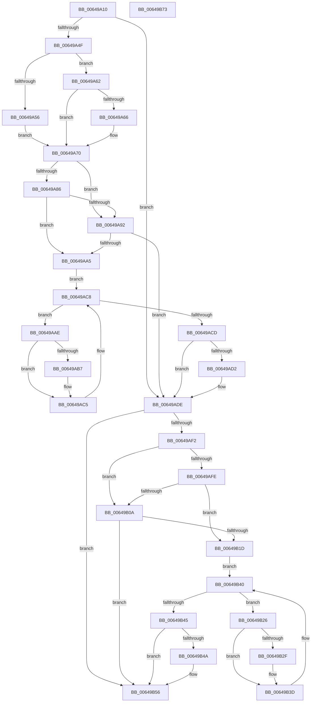

# DifZwSetBootEntryOrderWrapper

- RVA: `0x00649A10`–`0x00649B74` (길이 `356` bytes)
- VA: `0x0000000140649A10`
- 실행 섹션: `.text`
- PDB 이름 있음: `예`; PDB Function 태그: `아니요`
- unwind 정보 RVA: `0x00093E28`
- 디코드: `98`개 명령, `356/356` bytes 표시
- 미해석 바이트: `0` (있으면 어셈블리에 `.byte`로 보존)

> 이 문서는 커널 이미지의 기계어와 PDB 기호를 분석해 생성했습니다. 4번과 5번은 함수 원형과 자료형을 바이너리 사용 방식에서 추정한 C 해석이며 원본 소스 복구 결과는 아닙니다.

## 1. Dependencies

- 직접 호출 지점: **9**; 고유 호출 대상: **6**
- 직접 호출자로 확인된 함수: **0**
- RIP 상대 이미지 참조: **3**

### Outgoing calls
- `0x00649A3E` → [DifGetAPIThunkContextById](../49/DifGetAPIThunkContextById_function_00495A34.md) (function, `0x00495A34`)
- `0x00649A66` → [DifGetReturnAddressForWrappers](../4D/DifGetReturnAddressForWrappers_function_004D3C08.md) (function, `0x004D3C08`)
- `0x00649A99` → [ExAcquireRundownProtection](../21/ExAcquireRundownProtection_function_00216620.md) (function, `0x00216620`)
- `0x00649AC0` → [guard_dispatch_icall](../6B/guard_dispatch_icall_function_006BAAD0.md) (function, `0x006BAAD0`)
- `0x00649AD9` → [ExReleaseRundownProtection](../34/ExReleaseRundownProtection_function_00349E80.md) (function, `0x00349E80`)
- `0x00649AE4` → [ZwSetBootEntryOrder](../6B/ZwSetBootEntryOrder_function_006B03B0.md) (function, `0x006B03B0`)
- `0x00649B11` → [ExAcquireRundownProtection](../21/ExAcquireRundownProtection_function_00216620.md) (function, `0x00216620`)
- `0x00649B38` → [guard_dispatch_icall](../6B/guard_dispatch_icall_function_006BAAD0.md) (function, `0x006BAAD0`)
- `0x00649B51` → [ExReleaseRundownProtection](../34/ExReleaseRundownProtection_function_00349E80.md) (function, `0x00349E80`)

### Direct callers
- 이 함수 시작 RVA로 연결되는 직접 call은 확인되지 않았습니다. 간접 호출은 완전히 역산할 수 없습니다.

### Static image references
- `0x00649A78` → RVA `0x00F048B8` (`.data`; read)
- `0x00649A86` → RVA `0x00F04980` (`.data`; read)
- `0x00649A92` → RVA `0x00F03E80` (`.data`; read)

## 2. Other-region calls and transfers

- 다른 실행 섹션으로 향하는 call: **0**
- 별도 외부 분기/꼬리 이동을 확인하지 못했습니다.

## 3. Assembly (complete function range)

```asm
00649A10  48 8B C4                        mov rax, rsp
00649A13  48 89 58 08                     mov qword ptr [rax + 8], rbx
00649A17  48 89 68 10                     mov qword ptr [rax + 0x10], rbp
00649A1B  48 89 70 18                     mov qword ptr [rax + 0x18], rsi
00649A1F  57                              push rdi
00649A20  41 56                           push r14
00649A22  41 57                           push r15
00649A24  48 83 EC 40                     sub rsp, 0x40
00649A28  0F 57 C0                        xorps xmm0, xmm0
00649A2B  4C 8B F9                        mov r15, rcx
00649A2E  B9 18 00 00 00                  mov ecx, 0x18
00649A33  44 8B F2                        mov r14d, edx
00649A36  0F 11 40 C8                     movups xmmword ptr [rax - 0x38], xmm0
00649A3A  0F 11 40 D8                     movups xmmword ptr [rax - 0x28], xmm0
00649A3E  E8 F1 BF E4 FF                  call 0x140495a34
00649A43  48 8B F0                        mov rsi, rax
00649A46  48 85 C0                        test rax, rax
00649A49  0F 84 8F 00 00 00               je 0x140649ade
00649A4F  8B 40 0C                        mov eax, dword ptr [rax + 0xc]
00649A52  84 C1                           test cl, al
00649A54  74 0C                           je 0x140649a62
00649A56  48 8B 4C 24 58                  mov rcx, qword ptr [rsp + 0x58]
00649A5B  48 89 4C 24 20                  mov qword ptr [rsp + 0x20], rcx
00649A60  EB 0E                           jmp 0x140649a70
00649A62  A8 04                           test al, 4
00649A64  74 0A                           je 0x140649a70
00649A66  E8 9D A1 E8 FF                  call 0x1404d3c08
00649A6B  48 89 44 24 20                  mov qword ptr [rsp + 0x20], rax
00649A70  40 32 ED                        xor bpl, bpl
00649A73  4C 89 7C 24 30                  mov qword ptr [rsp + 0x30], r15
00649A78  40 38 2D 39 AE 8B 00            cmp byte ptr [rip + 0x8bae39], bpl
00649A7F  44 89 74 24 28                  mov dword ptr [rsp + 0x28], r14d
00649A84  75 0C                           jne 0x140649a92
00649A86  F7 05 F0 AE 8B 00 00 08 00 00   test dword ptr [rip + 0x8baef0], 0x800
00649A90  74 13                           je 0x140649aa5
00649A92  48 8D 0D E7 A3 8B 00            lea rcx, [rip + 0x8ba3e7]
00649A99  E8 82 CB BC FF                  call 0x140216620
00649A9E  40 8A E8                        mov bpl, al
00649AA1  84 C0                           test al, al
00649AA3  74 39                           je 0x140649ade
00649AA5  48 8D 7E 20                     lea rdi, [rsi + 0x20]
00649AA9  48 8B 1F                        mov rbx, qword ptr [rdi]
00649AAC  EB 1A                           jmp 0x140649ac8
00649AAE  48 8D 43 F0                     lea rax, [rbx - 0x10]
00649AB2  48 85 C0                        test rax, rax
00649AB5  74 0E                           je 0x140649ac5
00649AB7  48 8B 40 08                     mov rax, qword ptr [rax + 8]
00649ABB  48 8D 4C 24 20                  lea rcx, [rsp + 0x20]
00649AC0  E8 0B 10 07 00                  call 0x1406baad0
00649AC5  48 8B 1B                        mov rbx, qword ptr [rbx]
00649AC8  48 3B DF                        cmp rbx, rdi
00649ACB  75 E1                           jne 0x140649aae
00649ACD  40 84 ED                        test bpl, bpl
00649AD0  74 0C                           je 0x140649ade
00649AD2  48 8D 0D A7 A3 8B 00            lea rcx, [rip + 0x8ba3a7]
00649AD9  E8 A2 03 D0 FF                  call 0x140349e80
00649ADE  41 8B D6                        mov edx, r14d
00649AE1  49 8B CF                        mov rcx, r15
00649AE4  E8 C7 68 06 00                  call 0x1406b03b0
00649AE9  89 44 24 38                     mov dword ptr [rsp + 0x38], eax
00649AED  48 85 F6                        test rsi, rsi
00649AF0  74 64                           je 0x140649b56
00649AF2  40 32 FF                        xor dil, dil
00649AF5  40 38 3D BC AD 8B 00            cmp byte ptr [rip + 0x8badbc], dil
00649AFC  75 0C                           jne 0x140649b0a
00649AFE  F7 05 78 AE 8B 00 00 08 00 00   test dword ptr [rip + 0x8bae78], 0x800
00649B08  74 13                           je 0x140649b1d
00649B0A  48 8D 0D 6F A3 8B 00            lea rcx, [rip + 0x8ba36f]
00649B11  E8 0A CB BC FF                  call 0x140216620
00649B16  40 8A F8                        mov dil, al
00649B19  84 C0                           test al, al
00649B1B  74 39                           je 0x140649b56
00649B1D  48 83 C6 30                     add rsi, 0x30
00649B21  48 8B 1E                        mov rbx, qword ptr [rsi]
00649B24  EB 1A                           jmp 0x140649b40
00649B26  48 8D 43 F0                     lea rax, [rbx - 0x10]
00649B2A  48 85 C0                        test rax, rax
00649B2D  74 0E                           je 0x140649b3d
00649B2F  48 8B 40 08                     mov rax, qword ptr [rax + 8]
00649B33  48 8D 4C 24 20                  lea rcx, [rsp + 0x20]
00649B38  E8 93 0F 07 00                  call 0x1406baad0
00649B3D  48 8B 1B                        mov rbx, qword ptr [rbx]
00649B40  48 3B DE                        cmp rbx, rsi
00649B43  75 E1                           jne 0x140649b26
00649B45  40 84 FF                        test dil, dil
00649B48  74 0C                           je 0x140649b56
00649B4A  48 8D 0D 2F A3 8B 00            lea rcx, [rip + 0x8ba32f]
00649B51  E8 2A 03 D0 FF                  call 0x140349e80
00649B56  8B 44 24 38                     mov eax, dword ptr [rsp + 0x38]
00649B5A  48 8B 5C 24 60                  mov rbx, qword ptr [rsp + 0x60]
00649B5F  48 8B 6C 24 68                  mov rbp, qword ptr [rsp + 0x68]
00649B64  48 8B 74 24 70                  mov rsi, qword ptr [rsp + 0x70]
00649B69  48 83 C4 40                     add rsp, 0x40
00649B6D  41 5F                           pop r15
00649B6F  41 5E                           pop r14
00649B71  5F                              pop rdi
00649B72  C3                              ret
00649B73  CC                              int3
```

## 4. C-style interpretation (structured pseudocode)

```c
__int64 __fastcall DifZwSetBootEntryOrderWrapper(__int64 a1, int a2)
{
    __int64 result;
    __int64 v_rbp;
    __int64 v_rdi;
    __int64 v_rsi;
    __int64 v_rsp;
    unsigned int v_stack_m20;
    unsigned __int64 v_stack_m28;
    unsigned int v_stack_m30;
    unsigned __int64 v_stack_m38;
    unsigned __int64 v_stack_p0;
    unsigned __int64 v_stack_p10;
    unsigned __int64 v_stack_p18;
    unsigned __int64 v_stack_p8;

    *(unsigned __int64 *)(v_rsp + 8) = v_rbx;
    *(unsigned __int64 *)(v_rsp + 16) = v_rbp;
    *(unsigned __int64 *)(v_rsp + 24) = v_rsi;
    v_rsp = (v_rsp) - (64);
    *(unsigned __int64 *)(v_rsp - 56) = v_xmm0;
    *(unsigned __int64 *)(v_rsp - 40) = v_xmm0;
    result = DifGetAPIThunkContextById(24, a2, a3, a4);
    if (result == 0) goto loc_00649ADE;
    if (((24) & ((unsigned __int8)((unsigned int)(*(unsigned int *)(result + 12))))) == 0) goto loc_00649A62;
    v_stack_m38 = v_stack_p0;
    goto loc_00649A70;
loc_00649A62:
    result = (unsigned int)(*(unsigned int *)(result + 12));
    if ((((unsigned __int8)((unsigned int)(*(unsigned int *)(result + 12)))) & (4)) != 0) {
        result = DifGetReturnAddressForWrappers(v_stack_p0, a2, a3, a4);
        v_stack_m38 = result;
    }
    v_rbp = 0;
    v_stack_m28 = a1;
    v_stack_m30 = (unsigned int)((unsigned int)(a2));
    if ((*(unsigned __int8 *)(v_rip + 9154105)) != 0) goto loc_00649A92;
    if (((*(unsigned int *)(v_rip + 9154288)) & (0x800ULL)) == 0) goto loc_00649AA5;
loc_00649A92:
    result = ExAcquireRundownProtection(v_rip + 9151463, a2, a3, a4);
    if ((unsigned __int8)(result) == 0) goto loc_00649ADE;
loc_00649AA5:
    goto loc_00649AC8;
loc_00649AAE:
    result = *(unsigned __int64 *)(result + 32) - 16;
    if (*(unsigned __int64 *)(result + 32) - 16 != 0) {
        result = *(unsigned __int64 *)(*(unsigned __int64 *)(result + 32) - 16 + 8);
        a1 = v_stack_m38;
        result = guard_dispatch_icall(a1, a2, a3, a4);
    }
loc_00649AC8:
    if ((*(unsigned __int64 *)(*(unsigned __int64 *)(result + 32))) != (result + 32)) goto loc_00649AAE;
    if ((unsigned __int8)((unsigned __int8)(result)) != 0) {
        a1 = v_rip + 9151399;
        result = ExReleaseRundownProtection(a1, a2, a3, a4);
    }
    result = ZwSetBootEntryOrder(a1, (unsigned int)((unsigned int)((unsigned int)(a2))), a3, a4);
    v_stack_m20 = (unsigned int)(result);
    if (result == 0) goto loc_00649B56;
    v_rdi = 0;
    if ((*(unsigned __int8 *)(v_rip + 9153980)) != 0) goto loc_00649B0A;
    if (((*(unsigned int *)(v_rip + 9154168)) & (0x800ULL)) == 0) goto loc_00649B1D;
loc_00649B0A:
    result = ExAcquireRundownProtection(v_rip + 9151343, (unsigned int)((unsigned int)((unsigned int)(a2))), a3, a4);
    if ((unsigned __int8)(result) == 0) goto loc_00649B56;
loc_00649B1D:
    v_rsi = (result) + (48);
    goto loc_00649B40;
loc_00649B26:
    result = *(unsigned __int64 *)(v_rsi) - 16;
    if (*(unsigned __int64 *)(v_rsi) - 16 != 0) {
        result = *(unsigned __int64 *)(*(unsigned __int64 *)(v_rsi) - 16 + 8);
        a1 = v_stack_m38;
        result = guard_dispatch_icall(a1, (unsigned int)((unsigned int)((unsigned int)(a2))), a3, a4);
    }
loc_00649B40:
    if ((*(unsigned __int64 *)(*(unsigned __int64 *)(v_rsi))) != v_rsi) goto loc_00649B26;
    if ((unsigned __int8)((unsigned __int8)(result)) != 0) {
        a1 = v_rip + 9151279;
        result = ExReleaseRundownProtection(a1, (unsigned int)((unsigned int)((unsigned int)(a2))), a3, a4);
    }
    v_rsp = (v_rsp) + (64);
    return (unsigned int)(v_stack_m20);
}
```

## 5. (Beta) C Style

```c
int64_t DifZwSetBootEntryOrderWrapper(int64_t Arg1, int32_t Arg2)
{
    int64_t result;
    int64_t local_rbp;
    int64_t local_rdi;
    int64_t local_rsi;
    int64_t local_rsp;
    uint32_t v_stack_m20;
    uint64_t v_stack_m28;
    uint32_t v_stack_m30;
    uint64_t v_stack_m38;
    uint64_t v_stack_p0;
    uint64_t v_stack_p10;
    uint64_t v_stack_p18;
    uint64_t v_stack_p8;

    *(uint64_t *)(local_rsp + 0x8) = local_rbx;
    *(uint64_t *)(local_rsp + 0x10) = local_rbp;
    *(uint64_t *)(local_rsp + 0x18) = local_rsi;
    local_rsp = (local_rsp) - (64);
    *(uint64_t *)(local_rsp - 0x38) = v_xmm0;
    *(uint64_t *)(local_rsp - 0x28) = v_xmm0;
    result = DifGetAPIThunkContextById(24, Arg2, a3, a4);
    if (result == 0) goto loc_00649ADE;
    if (((24) & ((uint8_t)((uint32_t)(*(uint32_t *)(result + 0xC))))) == 0) goto loc_00649A62;
    v_stack_m38 = v_stack_p0;
    goto loc_00649A70;
loc_00649A62:
    result = (uint32_t)(*(uint32_t *)(result + 0xC));
    if ((((uint8_t)((uint32_t)(*(uint32_t *)(result + 0xC)))) & (4)) != 0) {
        result = DifGetReturnAddressForWrappers(v_stack_p0, Arg2, a3, a4);
        v_stack_m38 = result;
    }
    local_rbp = 0;
    v_stack_m28 = Arg1;
    v_stack_m30 = (uint32_t)((uint32_t)(Arg2));
    if ((*(uint8_t *)(v_rip + 0x8BAE39)) != 0) goto loc_00649A92;
    if (((*(uint32_t *)(v_rip + 0x8BAEF0)) & (0x800ULL)) == 0) goto loc_00649AA5;
loc_00649A92:
    result = ExAcquireRundownProtection(v_rip + 9151463, Arg2, a3, a4);
    if ((uint8_t)(result) == 0) goto loc_00649ADE;
loc_00649AA5:
    goto loc_00649AC8;
loc_00649AAE:
    result = *(uint64_t *)(result + 0x20) - 16;
    if (*(uint64_t *)(result + 0x20) - 16 != 0) {
        result = *(uint64_t *)(*(uint64_t *)(result + 0x20) - 0x10 + 0x8);
        Arg1 = v_stack_m38;
        result = guard_dispatch_icall(Arg1, Arg2, a3, a4);
    }
loc_00649AC8:
    if ((*(uint64_t *)(*(uint64_t *)(result + 0x20))) != (result + 32)) goto loc_00649AAE;
    if ((uint8_t)((uint8_t)(result)) != 0) {
        Arg1 = v_rip + 9151399;
        result = ExReleaseRundownProtection(Arg1, Arg2, a3, a4);
    }
    result = ZwSetBootEntryOrder(Arg1, (uint32_t)((uint32_t)((uint32_t)(Arg2))), a3, a4);
    v_stack_m20 = (uint32_t)(result);
    if (result == 0) goto loc_00649B56;
    local_rdi = 0;
    if ((*(uint8_t *)(v_rip + 0x8BADBC)) != 0) goto loc_00649B0A;
    if (((*(uint32_t *)(v_rip + 0x8BAE78)) & (0x800ULL)) == 0) goto loc_00649B1D;
loc_00649B0A:
    result = ExAcquireRundownProtection(v_rip + 9151343, (uint32_t)((uint32_t)((uint32_t)(Arg2))), a3, a4);
    if ((uint8_t)(result) == 0) goto loc_00649B56;
loc_00649B1D:
    local_rsi = (result) + (48);
    goto loc_00649B40;
loc_00649B26:
    result = *(uint64_t *)(local_rsi) - 16;
    if (*(uint64_t *)(local_rsi) - 16 != 0) {
        result = *(uint64_t *)(*(uint64_t *)(local_rsi) - 0x10 + 0x8);
        Arg1 = v_stack_m38;
        result = guard_dispatch_icall(Arg1, (uint32_t)((uint32_t)((uint32_t)(Arg2))), a3, a4);
    }
loc_00649B40:
    if ((*(uint64_t *)(*(uint64_t *)(local_rsi))) != local_rsi) goto loc_00649B26;
    if ((uint8_t)((uint8_t)(result)) != 0) {
        Arg1 = v_rip + 9151279;
        result = ExReleaseRundownProtection(Arg1, (uint32_t)((uint32_t)((uint32_t)(Arg2))), a3, a4);
    }
    local_rsp = (local_rsp) + (64);
    return (uint32_t)(v_stack_m20);
}
```

## 6. Execution-region graph

[열기: 2D/3D 그래프와 함수 탐색 컨트롤 패널](../../../control-panel.html?section=text&rva=0x00649A10&view=graph)

- 2D 그래프는 위에서 아래로 흐르고, 3D 그래프는 빈 공간을 드래그해 회전합니다. Shift+드래그는 이동, 휠은 확대·축소, 함수 노드 선택은 대상 보고서 이동입니다.

### Static fallback


