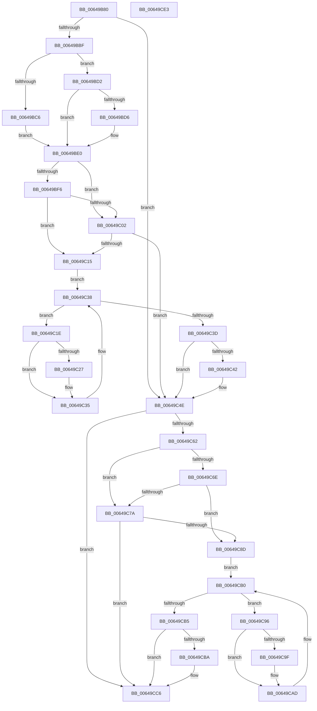

# DifZwSetBootOptionsWrapper

- RVA: `0x00649B80`–`0x00649CE4` (길이 `356` bytes)
- VA: `0x0000000140649B80`
- 실행 섹션: `.text`
- PDB 이름 있음: `예`; PDB Function 태그: `아니요`
- unwind 정보 RVA: `0x00093E28`
- 디코드: `98`개 명령, `356/356` bytes 표시
- 미해석 바이트: `0` (있으면 어셈블리에 `.byte`로 보존)

> 이 문서는 커널 이미지의 기계어와 PDB 기호를 분석해 생성했습니다. 4번과 5번은 함수 원형과 자료형을 바이너리 사용 방식에서 추정한 C 해석이며 원본 소스 복구 결과는 아닙니다.

## 1. Dependencies

- 직접 호출 지점: **9**; 고유 호출 대상: **6**
- 직접 호출자로 확인된 함수: **0**
- RIP 상대 이미지 참조: **3**

### Outgoing calls
- `0x00649BAE` → [DifGetAPIThunkContextById](../49/DifGetAPIThunkContextById_function_00495A34.md) (function, `0x00495A34`)
- `0x00649BD6` → [DifGetReturnAddressForWrappers](../4D/DifGetReturnAddressForWrappers_function_004D3C08.md) (function, `0x004D3C08`)
- `0x00649C09` → [ExAcquireRundownProtection](../21/ExAcquireRundownProtection_function_00216620.md) (function, `0x00216620`)
- `0x00649C30` → [guard_dispatch_icall](../6B/guard_dispatch_icall_function_006BAAD0.md) (function, `0x006BAAD0`)
- `0x00649C49` → [ExReleaseRundownProtection](../34/ExReleaseRundownProtection_function_00349E80.md) (function, `0x00349E80`)
- `0x00649C54` → [ZwSetBootOptions](../6B/ZwSetBootOptions_function_006B03D0.md) (function, `0x006B03D0`)
- `0x00649C81` → [ExAcquireRundownProtection](../21/ExAcquireRundownProtection_function_00216620.md) (function, `0x00216620`)
- `0x00649CA8` → [guard_dispatch_icall](../6B/guard_dispatch_icall_function_006BAAD0.md) (function, `0x006BAAD0`)
- `0x00649CC1` → [ExReleaseRundownProtection](../34/ExReleaseRundownProtection_function_00349E80.md) (function, `0x00349E80`)

### Direct callers
- 이 함수 시작 RVA로 연결되는 직접 call은 확인되지 않았습니다. 간접 호출은 완전히 역산할 수 없습니다.

### Static image references
- `0x00649BE8` → RVA `0x00F048B8` (`.data`; read)
- `0x00649BF6` → RVA `0x00F04980` (`.data`; read)
- `0x00649C02` → RVA `0x00F03E80` (`.data`; read)

## 2. Other-region calls and transfers

- 다른 실행 섹션으로 향하는 call: **0**
- 별도 외부 분기/꼬리 이동을 확인하지 못했습니다.

## 3. Assembly (complete function range)

```asm
00649B80  48 8B C4                        mov rax, rsp
00649B83  48 89 58 08                     mov qword ptr [rax + 8], rbx
00649B87  48 89 68 10                     mov qword ptr [rax + 0x10], rbp
00649B8B  48 89 70 18                     mov qword ptr [rax + 0x18], rsi
00649B8F  57                              push rdi
00649B90  41 56                           push r14
00649B92  41 57                           push r15
00649B94  48 83 EC 40                     sub rsp, 0x40
00649B98  0F 57 C0                        xorps xmm0, xmm0
00649B9B  4C 8B F9                        mov r15, rcx
00649B9E  B9 17 00 00 00                  mov ecx, 0x17
00649BA3  44 8B F2                        mov r14d, edx
00649BA6  0F 11 40 C8                     movups xmmword ptr [rax - 0x38], xmm0
00649BAA  0F 11 40 D8                     movups xmmword ptr [rax - 0x28], xmm0
00649BAE  E8 81 BE E4 FF                  call 0x140495a34
00649BB3  48 8B F0                        mov rsi, rax
00649BB6  48 85 C0                        test rax, rax
00649BB9  0F 84 8F 00 00 00               je 0x140649c4e
00649BBF  8B 40 0C                        mov eax, dword ptr [rax + 0xc]
00649BC2  A8 18                           test al, 0x18
00649BC4  74 0C                           je 0x140649bd2
00649BC6  48 8B 4C 24 58                  mov rcx, qword ptr [rsp + 0x58]
00649BCB  48 89 4C 24 20                  mov qword ptr [rsp + 0x20], rcx
00649BD0  EB 0E                           jmp 0x140649be0
00649BD2  A8 04                           test al, 4
00649BD4  74 0A                           je 0x140649be0
00649BD6  E8 2D A0 E8 FF                  call 0x1404d3c08
00649BDB  48 89 44 24 20                  mov qword ptr [rsp + 0x20], rax
00649BE0  40 32 ED                        xor bpl, bpl
00649BE3  4C 89 7C 24 30                  mov qword ptr [rsp + 0x30], r15
00649BE8  40 38 2D C9 AC 8B 00            cmp byte ptr [rip + 0x8bacc9], bpl
00649BEF  44 89 74 24 28                  mov dword ptr [rsp + 0x28], r14d
00649BF4  75 0C                           jne 0x140649c02
00649BF6  F7 05 80 AD 8B 00 00 08 00 00   test dword ptr [rip + 0x8bad80], 0x800
00649C00  74 13                           je 0x140649c15
00649C02  48 8D 0D 77 A2 8B 00            lea rcx, [rip + 0x8ba277]
00649C09  E8 12 CA BC FF                  call 0x140216620
00649C0E  40 8A E8                        mov bpl, al
00649C11  84 C0                           test al, al
00649C13  74 39                           je 0x140649c4e
00649C15  48 8D 7E 20                     lea rdi, [rsi + 0x20]
00649C19  48 8B 1F                        mov rbx, qword ptr [rdi]
00649C1C  EB 1A                           jmp 0x140649c38
00649C1E  48 8D 43 F0                     lea rax, [rbx - 0x10]
00649C22  48 85 C0                        test rax, rax
00649C25  74 0E                           je 0x140649c35
00649C27  48 8B 40 08                     mov rax, qword ptr [rax + 8]
00649C2B  48 8D 4C 24 20                  lea rcx, [rsp + 0x20]
00649C30  E8 9B 0E 07 00                  call 0x1406baad0
00649C35  48 8B 1B                        mov rbx, qword ptr [rbx]
00649C38  48 3B DF                        cmp rbx, rdi
00649C3B  75 E1                           jne 0x140649c1e
00649C3D  40 84 ED                        test bpl, bpl
00649C40  74 0C                           je 0x140649c4e
00649C42  48 8D 0D 37 A2 8B 00            lea rcx, [rip + 0x8ba237]
00649C49  E8 32 02 D0 FF                  call 0x140349e80
00649C4E  41 8B D6                        mov edx, r14d
00649C51  49 8B CF                        mov rcx, r15
00649C54  E8 77 67 06 00                  call 0x1406b03d0
00649C59  89 44 24 38                     mov dword ptr [rsp + 0x38], eax
00649C5D  48 85 F6                        test rsi, rsi
00649C60  74 64                           je 0x140649cc6
00649C62  40 32 FF                        xor dil, dil
00649C65  40 38 3D 4C AC 8B 00            cmp byte ptr [rip + 0x8bac4c], dil
00649C6C  75 0C                           jne 0x140649c7a
00649C6E  F7 05 08 AD 8B 00 00 08 00 00   test dword ptr [rip + 0x8bad08], 0x800
00649C78  74 13                           je 0x140649c8d
00649C7A  48 8D 0D FF A1 8B 00            lea rcx, [rip + 0x8ba1ff]
00649C81  E8 9A C9 BC FF                  call 0x140216620
00649C86  40 8A F8                        mov dil, al
00649C89  84 C0                           test al, al
00649C8B  74 39                           je 0x140649cc6
00649C8D  48 83 C6 30                     add rsi, 0x30
00649C91  48 8B 1E                        mov rbx, qword ptr [rsi]
00649C94  EB 1A                           jmp 0x140649cb0
00649C96  48 8D 43 F0                     lea rax, [rbx - 0x10]
00649C9A  48 85 C0                        test rax, rax
00649C9D  74 0E                           je 0x140649cad
00649C9F  48 8B 40 08                     mov rax, qword ptr [rax + 8]
00649CA3  48 8D 4C 24 20                  lea rcx, [rsp + 0x20]
00649CA8  E8 23 0E 07 00                  call 0x1406baad0
00649CAD  48 8B 1B                        mov rbx, qword ptr [rbx]
00649CB0  48 3B DE                        cmp rbx, rsi
00649CB3  75 E1                           jne 0x140649c96
00649CB5  40 84 FF                        test dil, dil
00649CB8  74 0C                           je 0x140649cc6
00649CBA  48 8D 0D BF A1 8B 00            lea rcx, [rip + 0x8ba1bf]
00649CC1  E8 BA 01 D0 FF                  call 0x140349e80
00649CC6  8B 44 24 38                     mov eax, dword ptr [rsp + 0x38]
00649CCA  48 8B 5C 24 60                  mov rbx, qword ptr [rsp + 0x60]
00649CCF  48 8B 6C 24 68                  mov rbp, qword ptr [rsp + 0x68]
00649CD4  48 8B 74 24 70                  mov rsi, qword ptr [rsp + 0x70]
00649CD9  48 83 C4 40                     add rsp, 0x40
00649CDD  41 5F                           pop r15
00649CDF  41 5E                           pop r14
00649CE1  5F                              pop rdi
00649CE2  C3                              ret
00649CE3  CC                              int3
```

## 4. C-style interpretation (structured pseudocode)

```c
__int64 __fastcall DifZwSetBootOptionsWrapper(__int64 a1, int a2)
{
    __int64 result;
    __int64 v_rbp;
    __int64 v_rdi;
    __int64 v_rsi;
    __int64 v_rsp;
    unsigned int v_stack_m20;
    unsigned __int64 v_stack_m28;
    unsigned int v_stack_m30;
    unsigned __int64 v_stack_m38;
    unsigned __int64 v_stack_p0;
    unsigned __int64 v_stack_p10;
    unsigned __int64 v_stack_p18;
    unsigned __int64 v_stack_p8;

    *(unsigned __int64 *)(v_rsp + 8) = v_rbx;
    *(unsigned __int64 *)(v_rsp + 16) = v_rbp;
    *(unsigned __int64 *)(v_rsp + 24) = v_rsi;
    v_rsp = (v_rsp) - (64);
    *(unsigned __int64 *)(v_rsp - 56) = v_xmm0;
    *(unsigned __int64 *)(v_rsp - 40) = v_xmm0;
    result = DifGetAPIThunkContextById(23, a2, a3, a4);
    if (result == 0) goto loc_00649C4E;
    if ((((unsigned __int8)((unsigned int)(*(unsigned int *)(result + 12)))) & (24)) == 0) goto loc_00649BD2;
    v_stack_m38 = v_stack_p0;
    goto loc_00649BE0;
loc_00649BD2:
    result = (unsigned int)(*(unsigned int *)(result + 12));
    if ((((unsigned __int8)((unsigned int)(*(unsigned int *)(result + 12)))) & (4)) != 0) {
        result = DifGetReturnAddressForWrappers(v_stack_p0, a2, a3, a4);
        v_stack_m38 = result;
    }
    v_rbp = 0;
    v_stack_m28 = a1;
    v_stack_m30 = (unsigned int)((unsigned int)(a2));
    if ((*(unsigned __int8 *)(v_rip + 9153737)) != 0) goto loc_00649C02;
    if (((*(unsigned int *)(v_rip + 9153920)) & (0x800ULL)) == 0) goto loc_00649C15;
loc_00649C02:
    result = ExAcquireRundownProtection(v_rip + 9151095, a2, a3, a4);
    if ((unsigned __int8)(result) == 0) goto loc_00649C4E;
loc_00649C15:
    goto loc_00649C38;
loc_00649C1E:
    result = *(unsigned __int64 *)(result + 32) - 16;
    if (*(unsigned __int64 *)(result + 32) - 16 != 0) {
        result = *(unsigned __int64 *)(*(unsigned __int64 *)(result + 32) - 16 + 8);
        a1 = v_stack_m38;
        result = guard_dispatch_icall(a1, a2, a3, a4);
    }
loc_00649C38:
    if ((*(unsigned __int64 *)(*(unsigned __int64 *)(result + 32))) != (result + 32)) goto loc_00649C1E;
    if ((unsigned __int8)((unsigned __int8)(result)) != 0) {
        a1 = v_rip + 9151031;
        result = ExReleaseRundownProtection(a1, a2, a3, a4);
    }
    result = ZwSetBootOptions(a1, (unsigned int)((unsigned int)((unsigned int)(a2))), a3, a4);
    v_stack_m20 = (unsigned int)(result);
    if (result == 0) goto loc_00649CC6;
    v_rdi = 0;
    if ((*(unsigned __int8 *)(v_rip + 9153612)) != 0) goto loc_00649C7A;
    if (((*(unsigned int *)(v_rip + 9153800)) & (0x800ULL)) == 0) goto loc_00649C8D;
loc_00649C7A:
    result = ExAcquireRundownProtection(v_rip + 9150975, (unsigned int)((unsigned int)((unsigned int)(a2))), a3, a4);
    if ((unsigned __int8)(result) == 0) goto loc_00649CC6;
loc_00649C8D:
    v_rsi = (result) + (48);
    goto loc_00649CB0;
loc_00649C96:
    result = *(unsigned __int64 *)(v_rsi) - 16;
    if (*(unsigned __int64 *)(v_rsi) - 16 != 0) {
        result = *(unsigned __int64 *)(*(unsigned __int64 *)(v_rsi) - 16 + 8);
        a1 = v_stack_m38;
        result = guard_dispatch_icall(a1, (unsigned int)((unsigned int)((unsigned int)(a2))), a3, a4);
    }
loc_00649CB0:
    if ((*(unsigned __int64 *)(*(unsigned __int64 *)(v_rsi))) != v_rsi) goto loc_00649C96;
    if ((unsigned __int8)((unsigned __int8)(result)) != 0) {
        a1 = v_rip + 9150911;
        result = ExReleaseRundownProtection(a1, (unsigned int)((unsigned int)((unsigned int)(a2))), a3, a4);
    }
    v_rsp = (v_rsp) + (64);
    return (unsigned int)(v_stack_m20);
}
```

## 5. (Beta) C Style

```c
int64_t DifZwSetBootOptionsWrapper(int64_t Arg1, int32_t Arg2)
{
    int64_t result;
    int64_t local_rbp;
    int64_t local_rdi;
    int64_t local_rsi;
    int64_t local_rsp;
    uint32_t v_stack_m20;
    uint64_t v_stack_m28;
    uint32_t v_stack_m30;
    uint64_t v_stack_m38;
    uint64_t v_stack_p0;
    uint64_t v_stack_p10;
    uint64_t v_stack_p18;
    uint64_t v_stack_p8;

    *(uint64_t *)(local_rsp + 0x8) = local_rbx;
    *(uint64_t *)(local_rsp + 0x10) = local_rbp;
    *(uint64_t *)(local_rsp + 0x18) = local_rsi;
    local_rsp = (local_rsp) - (64);
    *(uint64_t *)(local_rsp - 0x38) = v_xmm0;
    *(uint64_t *)(local_rsp - 0x28) = v_xmm0;
    result = DifGetAPIThunkContextById(23, Arg2, a3, a4);
    if (result == 0) goto loc_00649C4E;
    if ((((uint8_t)((uint32_t)(*(uint32_t *)(result + 0xC)))) & (24)) == 0) goto loc_00649BD2;
    v_stack_m38 = v_stack_p0;
    goto loc_00649BE0;
loc_00649BD2:
    result = (uint32_t)(*(uint32_t *)(result + 0xC));
    if ((((uint8_t)((uint32_t)(*(uint32_t *)(result + 0xC)))) & (4)) != 0) {
        result = DifGetReturnAddressForWrappers(v_stack_p0, Arg2, a3, a4);
        v_stack_m38 = result;
    }
    local_rbp = 0;
    v_stack_m28 = Arg1;
    v_stack_m30 = (uint32_t)((uint32_t)(Arg2));
    if ((*(uint8_t *)(v_rip + 0x8BACC9)) != 0) goto loc_00649C02;
    if (((*(uint32_t *)(v_rip + 0x8BAD80)) & (0x800ULL)) == 0) goto loc_00649C15;
loc_00649C02:
    result = ExAcquireRundownProtection(v_rip + 9151095, Arg2, a3, a4);
    if ((uint8_t)(result) == 0) goto loc_00649C4E;
loc_00649C15:
    goto loc_00649C38;
loc_00649C1E:
    result = *(uint64_t *)(result + 0x20) - 16;
    if (*(uint64_t *)(result + 0x20) - 16 != 0) {
        result = *(uint64_t *)(*(uint64_t *)(result + 0x20) - 0x10 + 0x8);
        Arg1 = v_stack_m38;
        result = guard_dispatch_icall(Arg1, Arg2, a3, a4);
    }
loc_00649C38:
    if ((*(uint64_t *)(*(uint64_t *)(result + 0x20))) != (result + 32)) goto loc_00649C1E;
    if ((uint8_t)((uint8_t)(result)) != 0) {
        Arg1 = v_rip + 9151031;
        result = ExReleaseRundownProtection(Arg1, Arg2, a3, a4);
    }
    result = ZwSetBootOptions(Arg1, (uint32_t)((uint32_t)((uint32_t)(Arg2))), a3, a4);
    v_stack_m20 = (uint32_t)(result);
    if (result == 0) goto loc_00649CC6;
    local_rdi = 0;
    if ((*(uint8_t *)(v_rip + 0x8BAC4C)) != 0) goto loc_00649C7A;
    if (((*(uint32_t *)(v_rip + 0x8BAD08)) & (0x800ULL)) == 0) goto loc_00649C8D;
loc_00649C7A:
    result = ExAcquireRundownProtection(v_rip + 9150975, (uint32_t)((uint32_t)((uint32_t)(Arg2))), a3, a4);
    if ((uint8_t)(result) == 0) goto loc_00649CC6;
loc_00649C8D:
    local_rsi = (result) + (48);
    goto loc_00649CB0;
loc_00649C96:
    result = *(uint64_t *)(local_rsi) - 16;
    if (*(uint64_t *)(local_rsi) - 16 != 0) {
        result = *(uint64_t *)(*(uint64_t *)(local_rsi) - 0x10 + 0x8);
        Arg1 = v_stack_m38;
        result = guard_dispatch_icall(Arg1, (uint32_t)((uint32_t)((uint32_t)(Arg2))), a3, a4);
    }
loc_00649CB0:
    if ((*(uint64_t *)(*(uint64_t *)(local_rsi))) != local_rsi) goto loc_00649C96;
    if ((uint8_t)((uint8_t)(result)) != 0) {
        Arg1 = v_rip + 9150911;
        result = ExReleaseRundownProtection(Arg1, (uint32_t)((uint32_t)((uint32_t)(Arg2))), a3, a4);
    }
    local_rsp = (local_rsp) + (64);
    return (uint32_t)(v_stack_m20);
}
```

## 6. Execution-region graph

[열기: 2D/3D 그래프와 함수 탐색 컨트롤 패널](../../../control-panel.html?section=text&rva=0x00649B80&view=graph)

- 2D 그래프는 위에서 아래로 흐르고, 3D 그래프는 빈 공간을 드래그해 회전합니다. Shift+드래그는 이동, 휠은 확대·축소, 함수 노드 선택은 대상 보고서 이동입니다.

### Static fallback


