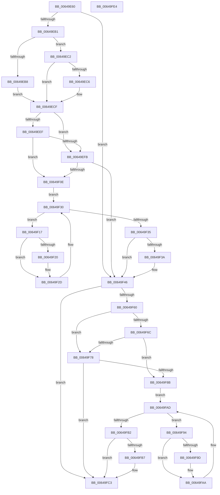

# DifZwSetEaFileWrapper

- RVA: `0x00649E60`–`0x00649FE5` (길이 `389` bytes)
- VA: `0x0000000140649E60`
- 실행 섹션: `.text`
- PDB 이름 있음: `예`; PDB Function 태그: `아니요`
- unwind 정보 RVA: `0x000D2B7C`
- 디코드: `112`개 명령, `389/389` bytes 표시
- 미해석 바이트: `0` (있으면 어셈블리에 `.byte`로 보존)

> 이 문서는 커널 이미지의 기계어와 PDB 기호를 분석해 생성했습니다. 4번과 5번은 함수 원형과 자료형을 바이너리 사용 방식에서 추정한 C 해석이며 원본 소스 복구 결과는 아닙니다.

## 1. Dependencies

- 직접 호출 지점: **9**; 고유 호출 대상: **6**
- 직접 호출자로 확인된 함수: **0**
- RIP 상대 이미지 참조: **3**

### Outgoing calls
- `0x00649EA0` → [DifGetAPIThunkContextById](../49/DifGetAPIThunkContextById_function_00495A34.md) (function, `0x00495A34`)
- `0x00649EC6` → [DifGetReturnAddressForWrappers](../4D/DifGetReturnAddressForWrappers_function_004D3C08.md) (function, `0x004D3C08`)
- `0x00649F02` → [ExAcquireRundownProtection](../21/ExAcquireRundownProtection_function_00216620.md) (function, `0x00216620`)
- `0x00649F28` → [guard_dispatch_icall](../6B/guard_dispatch_icall_function_006BAAD0.md) (function, `0x006BAAD0`)
- `0x00649F41` → [ExReleaseRundownProtection](../34/ExReleaseRundownProtection_function_00349E80.md) (function, `0x00349E80`)
- `0x00649F53` → [ZwSetEaFile](../6B/ZwSetEaFile_function_006B04F0.md) (function, `0x006B04F0`)
- `0x00649F7F` → [ExAcquireRundownProtection](../21/ExAcquireRundownProtection_function_00216620.md) (function, `0x00216620`)
- `0x00649FA5` → [guard_dispatch_icall](../6B/guard_dispatch_icall_function_006BAAD0.md) (function, `0x006BAAD0`)
- `0x00649FBE` → [ExReleaseRundownProtection](../34/ExReleaseRundownProtection_function_00349E80.md) (function, `0x00349E80`)

### Direct callers
- 이 함수 시작 RVA로 연결되는 직접 call은 확인되지 않았습니다. 간접 호출은 완전히 역산할 수 없습니다.

### Static image references
- `0x00649ED6` → RVA `0x00F048B8` (`.data`; read)
- `0x00649EEF` → RVA `0x00F04980` (`.data`; read)
- `0x00649EFB` → RVA `0x00F03E80` (`.data`; read)

## 2. Other-region calls and transfers

- 다른 실행 섹션으로 향하는 call: **0**
- 별도 외부 분기/꼬리 이동을 확인하지 못했습니다.

## 3. Assembly (complete function range)

```asm
00649E60  48 8B C4                        mov rax, rsp
00649E63  48 89 58 10                     mov qword ptr [rax + 0x10], rbx
00649E67  48 89 70 18                     mov qword ptr [rax + 0x18], rsi
00649E6B  48 89 78 20                     mov qword ptr [rax + 0x20], rdi
00649E6F  48 89 48 08                     mov qword ptr [rax + 8], rcx
00649E73  55                              push rbp
00649E74  41 54                           push r12
00649E76  41 55                           push r13
00649E78  41 56                           push r14
00649E7A  41 57                           push r15
00649E7C  48 8B EC                        mov rbp, rsp
00649E7F  48 83 EC 50                     sub rsp, 0x50
00649E83  0F 57 C0                        xorps xmm0, xmm0
00649E86  B9 15 00 00 00                  mov ecx, 0x15
00649E8B  0F 11 45 D0                     movups xmmword ptr [rbp - 0x30], xmm0
00649E8F  45 8B F9                        mov r15d, r9d
00649E92  4D 8B E0                        mov r12, r8
00649E95  0F 11 45 E0                     movups xmmword ptr [rbp - 0x20], xmm0
00649E99  4C 8B EA                        mov r13, rdx
00649E9C  0F 11 45 F0                     movups xmmword ptr [rbp - 0x10], xmm0
00649EA0  E8 8F BB E4 FF                  call 0x140495a34
00649EA5  48 8B F0                        mov rsi, rax
00649EA8  48 85 C0                        test rax, rax
00649EAB  0F 84 95 00 00 00               je 0x140649f46
00649EB1  8B 40 0C                        mov eax, dword ptr [rax + 0xc]
00649EB4  A8 18                           test al, 0x18
00649EB6  74 0A                           je 0x140649ec2
00649EB8  48 8B 4D 28                     mov rcx, qword ptr [rbp + 0x28]
00649EBC  48 89 4D D0                     mov qword ptr [rbp - 0x30], rcx
00649EC0  EB 0D                           jmp 0x140649ecf
00649EC2  A8 04                           test al, 4
00649EC4  74 09                           je 0x140649ecf
00649EC6  E8 3D 9D E8 FF                  call 0x1404d3c08
00649ECB  48 89 45 D0                     mov qword ptr [rbp - 0x30], rax
00649ECF  48 8B 45 30                     mov rax, qword ptr [rbp + 0x30]
00649ED3  45 32 F6                        xor r14b, r14b
00649ED6  44 38 35 DB A9 8B 00            cmp byte ptr [rip + 0x8ba9db], r14b
00649EDD  48 89 45 F0                     mov qword ptr [rbp - 0x10], rax
00649EE1  4C 89 6D E8                     mov qword ptr [rbp - 0x18], r13
00649EE5  4C 89 65 E0                     mov qword ptr [rbp - 0x20], r12
00649EE9  44 89 7D D8                     mov dword ptr [rbp - 0x28], r15d
00649EED  75 0C                           jne 0x140649efb
00649EEF  F7 05 87 AA 8B 00 00 08 00 00   test dword ptr [rip + 0x8baa87], 0x800
00649EF9  74 13                           je 0x140649f0e
00649EFB  48 8D 0D 7E 9F 8B 00            lea rcx, [rip + 0x8b9f7e]
00649F02  E8 19 C7 BC FF                  call 0x140216620
00649F07  44 8A F0                        mov r14b, al
00649F0A  84 C0                           test al, al
00649F0C  74 38                           je 0x140649f46
00649F0E  48 8D 7E 20                     lea rdi, [rsi + 0x20]
00649F12  48 8B 1F                        mov rbx, qword ptr [rdi]
00649F15  EB 19                           jmp 0x140649f30
00649F17  48 8D 43 F0                     lea rax, [rbx - 0x10]
00649F1B  48 85 C0                        test rax, rax
00649F1E  74 0D                           je 0x140649f2d
00649F20  48 8B 40 08                     mov rax, qword ptr [rax + 8]
00649F24  48 8D 4D D0                     lea rcx, [rbp - 0x30]
00649F28  E8 A3 0B 07 00                  call 0x1406baad0
00649F2D  48 8B 1B                        mov rbx, qword ptr [rbx]
00649F30  48 3B DF                        cmp rbx, rdi
00649F33  75 E2                           jne 0x140649f17
00649F35  45 84 F6                        test r14b, r14b
00649F38  74 0C                           je 0x140649f46
00649F3A  48 8D 0D 3F 9F 8B 00            lea rcx, [rip + 0x8b9f3f]
00649F41  E8 3A FF CF FF                  call 0x140349e80
00649F46  48 8B 4D 30                     mov rcx, qword ptr [rbp + 0x30]
00649F4A  45 8B CF                        mov r9d, r15d
00649F4D  4D 8B C4                        mov r8, r12
00649F50  49 8B D5                        mov rdx, r13
00649F53  E8 98 65 06 00                  call 0x1406b04f0
00649F58  89 45 F8                        mov dword ptr [rbp - 8], eax
00649F5B  48 85 F6                        test rsi, rsi
00649F5E  74 63                           je 0x140649fc3
00649F60  40 32 FF                        xor dil, dil
00649F63  40 38 3D 4E A9 8B 00            cmp byte ptr [rip + 0x8ba94e], dil
00649F6A  75 0C                           jne 0x140649f78
00649F6C  F7 05 0A AA 8B 00 00 08 00 00   test dword ptr [rip + 0x8baa0a], 0x800
00649F76  74 13                           je 0x140649f8b
00649F78  48 8D 0D 01 9F 8B 00            lea rcx, [rip + 0x8b9f01]
00649F7F  E8 9C C6 BC FF                  call 0x140216620
00649F84  40 8A F8                        mov dil, al
00649F87  84 C0                           test al, al
00649F89  74 38                           je 0x140649fc3
00649F8B  48 83 C6 30                     add rsi, 0x30
00649F8F  48 8B 1E                        mov rbx, qword ptr [rsi]
00649F92  EB 19                           jmp 0x140649fad
00649F94  48 8D 43 F0                     lea rax, [rbx - 0x10]
00649F98  48 85 C0                        test rax, rax
00649F9B  74 0D                           je 0x140649faa
00649F9D  48 8B 40 08                     mov rax, qword ptr [rax + 8]
00649FA1  48 8D 4D D0                     lea rcx, [rbp - 0x30]
00649FA5  E8 26 0B 07 00                  call 0x1406baad0
00649FAA  48 8B 1B                        mov rbx, qword ptr [rbx]
00649FAD  48 3B DE                        cmp rbx, rsi
00649FB0  75 E2                           jne 0x140649f94
00649FB2  40 84 FF                        test dil, dil
00649FB5  74 0C                           je 0x140649fc3
00649FB7  48 8D 0D C2 9E 8B 00            lea rcx, [rip + 0x8b9ec2]
00649FBE  E8 BD FE CF FF                  call 0x140349e80
00649FC3  8B 45 F8                        mov eax, dword ptr [rbp - 8]
00649FC6  4C 8D 5C 24 50                  lea r11, [rsp + 0x50]
00649FCB  49 8B 5B 38                     mov rbx, qword ptr [r11 + 0x38]
00649FCF  49 8B 73 40                     mov rsi, qword ptr [r11 + 0x40]
00649FD3  49 8B 7B 48                     mov rdi, qword ptr [r11 + 0x48]
00649FD7  49 8B E3                        mov rsp, r11
00649FDA  41 5F                           pop r15
00649FDC  41 5E                           pop r14
00649FDE  41 5D                           pop r13
00649FE0  41 5C                           pop r12
00649FE2  5D                              pop rbp
00649FE3  C3                              ret
00649FE4  CC                              int3
```

## 4. C-style interpretation (structured pseudocode)

```c
__int64 __fastcall DifZwSetEaFileWrapper(__int64 a1, __int64 a2, __int64 a3, int a4)
{
    __int64 result;
    __int64 v_r14;
    __int64 v_rdi;
    __int64 v_rsi;
    __int64 v_rsp;
    unsigned __int64 v_stack_m28;
    unsigned int v_stack_m30;
    unsigned __int64 v_stack_m38;
    unsigned __int64 v_stack_m40;
    unsigned __int64 v_stack_m48;
    unsigned int v_stack_m50;
    unsigned __int64 v_stack_m58;
    unsigned __int64 v_stack_p0;
    unsigned __int64 v_stack_p8;

    *(unsigned __int64 *)(v_rsp + 16) = v_rbx;
    *(unsigned __int64 *)(v_rsp + 24) = v_rsi;
    *(unsigned __int64 *)(v_rsp + 32) = v_rdi;
    *(unsigned __int64 *)(v_rsp + 8) = a1;
    v_rsp = (v_rsp) - (80);
    v_stack_m58 = v_xmm0;
    v_stack_m48 = v_xmm0;
    v_stack_m38 = v_xmm0;
    result = DifGetAPIThunkContextById(21, a2, a3, a4);
    if (result == 0) goto loc_00649F46;
    if ((((unsigned __int8)((unsigned int)(*(unsigned int *)(result + 12)))) & (24)) == 0) goto loc_00649EC2;
    v_stack_m58 = v_stack_p0;
    goto loc_00649ECF;
loc_00649EC2:
    result = (unsigned int)(*(unsigned int *)(result + 12));
    if ((((unsigned __int8)((unsigned int)(*(unsigned int *)(result + 12)))) & (4)) != 0) {
        result = DifGetReturnAddressForWrappers(v_stack_p0, a2, a3, a4);
        v_stack_m58 = result;
    }
    v_r14 = 0;
    v_stack_m38 = v_stack_p8;
    v_stack_m40 = a2;
    v_stack_m48 = a3;
    v_stack_m50 = (unsigned int)((unsigned int)(a4));
    if ((*(unsigned __int8 *)(v_rip + 9152987)) != 0) goto loc_00649EFB;
    if (((*(unsigned int *)(v_rip + 9153159)) & (0x800ULL)) == 0) goto loc_00649F0E;
loc_00649EFB:
    result = ExAcquireRundownProtection(v_rip + 9150334, a2, a3, a4);
    if ((unsigned __int8)(result) == 0) goto loc_00649F46;
loc_00649F0E:
    goto loc_00649F30;
loc_00649F17:
    result = *(unsigned __int64 *)(result + 32) - 16;
    if (*(unsigned __int64 *)(result + 32) - 16 != 0) {
        result = *(unsigned __int64 *)(*(unsigned __int64 *)(result + 32) - 16 + 8);
        a1 = v_stack_m58;
        result = guard_dispatch_icall(a1, a2, a3, a4);
    }
loc_00649F30:
    if ((*(unsigned __int64 *)(*(unsigned __int64 *)(result + 32))) != (result + 32)) goto loc_00649F17;
    if ((unsigned __int8)((unsigned __int8)(result)) != 0) {
        a1 = v_rip + 9150271;
        result = ExReleaseRundownProtection(a1, a2, a3, a4);
    }
    result = ZwSetEaFile(v_stack_p8, a2, a3, (unsigned int)((unsigned int)((unsigned int)(a4))));
    v_stack_m30 = (unsigned int)(result);
    if (result == 0) goto loc_00649FC3;
    v_rdi = 0;
    if ((*(unsigned __int8 *)(v_rip + 9152846)) != 0) goto loc_00649F78;
    if (((*(unsigned int *)(v_rip + 9153034)) & (0x800ULL)) == 0) goto loc_00649F8B;
loc_00649F78:
    result = ExAcquireRundownProtection(v_rip + 9150209, a2, a3, (unsigned int)((unsigned int)((unsigned int)(a4))));
    if ((unsigned __int8)(result) == 0) goto loc_00649FC3;
loc_00649F8B:
    v_rsi = (result) + (48);
    goto loc_00649FAD;
loc_00649F94:
    result = *(unsigned __int64 *)(v_rsi) - 16;
    if (*(unsigned __int64 *)(v_rsi) - 16 != 0) {
        result = *(unsigned __int64 *)(*(unsigned __int64 *)(v_rsi) - 16 + 8);
        a1 = v_stack_m58;
        result = guard_dispatch_icall(a1, a2, a3, (unsigned int)((unsigned int)((unsigned int)(a4))));
    }
loc_00649FAD:
    if ((*(unsigned __int64 *)(*(unsigned __int64 *)(v_rsi))) != v_rsi) goto loc_00649F94;
    if ((unsigned __int8)((unsigned __int8)(result)) != 0) {
        a1 = v_rip + 9150146;
        result = ExReleaseRundownProtection(a1, a2, a3, (unsigned int)((unsigned int)((unsigned int)(a4))));
    }
    return (unsigned int)(v_stack_m30);
}
```

## 5. (Beta) C Style

```c
int64_t DifZwSetEaFileWrapper(int64_t Arg1, int64_t Arg2, int64_t Arg3, int32_t Arg4)
{
    int64_t result;
    int64_t local_r14;
    int64_t local_rdi;
    int64_t local_rsi;
    int64_t local_rsp;
    uint64_t v_stack_m28;
    uint32_t v_stack_m30;
    uint64_t v_stack_m38;
    uint64_t v_stack_m40;
    uint64_t v_stack_m48;
    uint32_t v_stack_m50;
    uint64_t v_stack_m58;
    uint64_t v_stack_p0;
    uint64_t v_stack_p8;

    *(uint64_t *)(local_rsp + 0x10) = local_rbx;
    *(uint64_t *)(local_rsp + 0x18) = local_rsi;
    *(uint64_t *)(local_rsp + 0x20) = local_rdi;
    *(uint64_t *)(local_rsp + 0x8) = Arg1;
    local_rsp = (local_rsp) - (80);
    v_stack_m58 = v_xmm0;
    v_stack_m48 = v_xmm0;
    v_stack_m38 = v_xmm0;
    result = DifGetAPIThunkContextById(21, Arg2, Arg3, Arg4);
    if (result == 0) goto loc_00649F46;
    if ((((uint8_t)((uint32_t)(*(uint32_t *)(result + 0xC)))) & (24)) == 0) goto loc_00649EC2;
    v_stack_m58 = v_stack_p0;
    goto loc_00649ECF;
loc_00649EC2:
    result = (uint32_t)(*(uint32_t *)(result + 0xC));
    if ((((uint8_t)((uint32_t)(*(uint32_t *)(result + 0xC)))) & (4)) != 0) {
        result = DifGetReturnAddressForWrappers(v_stack_p0, Arg2, Arg3, Arg4);
        v_stack_m58 = result;
    }
    local_r14 = 0;
    v_stack_m38 = v_stack_p8;
    v_stack_m40 = Arg2;
    v_stack_m48 = Arg3;
    v_stack_m50 = (uint32_t)((uint32_t)(Arg4));
    if ((*(uint8_t *)(v_rip + 0x8BA9DB)) != 0) goto loc_00649EFB;
    if (((*(uint32_t *)(v_rip + 0x8BAA87)) & (0x800ULL)) == 0) goto loc_00649F0E;
loc_00649EFB:
    result = ExAcquireRundownProtection(v_rip + 9150334, Arg2, Arg3, Arg4);
    if ((uint8_t)(result) == 0) goto loc_00649F46;
loc_00649F0E:
    goto loc_00649F30;
loc_00649F17:
    result = *(uint64_t *)(result + 0x20) - 16;
    if (*(uint64_t *)(result + 0x20) - 16 != 0) {
        result = *(uint64_t *)(*(uint64_t *)(result + 0x20) - 0x10 + 0x8);
        Arg1 = v_stack_m58;
        result = guard_dispatch_icall(Arg1, Arg2, Arg3, Arg4);
    }
loc_00649F30:
    if ((*(uint64_t *)(*(uint64_t *)(result + 0x20))) != (result + 32)) goto loc_00649F17;
    if ((uint8_t)((uint8_t)(result)) != 0) {
        Arg1 = v_rip + 9150271;
        result = ExReleaseRundownProtection(Arg1, Arg2, Arg3, Arg4);
    }
    result = ZwSetEaFile(v_stack_p8, Arg2, Arg3, (uint32_t)((uint32_t)((uint32_t)(Arg4))));
    v_stack_m30 = (uint32_t)(result);
    if (result == 0) goto loc_00649FC3;
    local_rdi = 0;
    if ((*(uint8_t *)(v_rip + 0x8BA94E)) != 0) goto loc_00649F78;
    if (((*(uint32_t *)(v_rip + 0x8BAA0A)) & (0x800ULL)) == 0) goto loc_00649F8B;
loc_00649F78:
    result = ExAcquireRundownProtection(v_rip + 9150209, Arg2, Arg3, (uint32_t)((uint32_t)((uint32_t)(Arg4))));
    if ((uint8_t)(result) == 0) goto loc_00649FC3;
loc_00649F8B:
    local_rsi = (result) + (48);
    goto loc_00649FAD;
loc_00649F94:
    result = *(uint64_t *)(local_rsi) - 16;
    if (*(uint64_t *)(local_rsi) - 16 != 0) {
        result = *(uint64_t *)(*(uint64_t *)(local_rsi) - 0x10 + 0x8);
        Arg1 = v_stack_m58;
        result = guard_dispatch_icall(Arg1, Arg2, Arg3, (uint32_t)((uint32_t)((uint32_t)(Arg4))));
    }
loc_00649FAD:
    if ((*(uint64_t *)(*(uint64_t *)(local_rsi))) != local_rsi) goto loc_00649F94;
    if ((uint8_t)((uint8_t)(result)) != 0) {
        Arg1 = v_rip + 9150146;
        result = ExReleaseRundownProtection(Arg1, Arg2, Arg3, (uint32_t)((uint32_t)((uint32_t)(Arg4))));
    }
    return (uint32_t)(v_stack_m30);
}
```

## 6. Execution-region graph

[열기: 2D/3D 그래프와 함수 탐색 컨트롤 패널](../../../control-panel.html?section=text&rva=0x00649E60&view=graph)

- 2D 그래프는 위에서 아래로 흐르고, 3D 그래프는 빈 공간을 드래그해 회전합니다. Shift+드래그는 이동, 휠은 확대·축소, 함수 노드 선택은 대상 보고서 이동입니다.

### Static fallback


