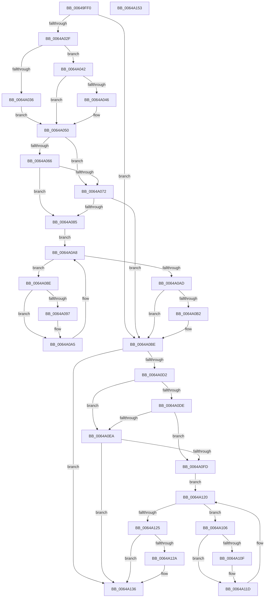

# DifZwSetEventWrapper

- RVA: `0x00649FF0`–`0x0064A154` (길이 `356` bytes)
- VA: `0x0000000140649FF0`
- 실행 섹션: `.text`
- PDB 이름 있음: `예`; PDB Function 태그: `아니요`
- unwind 정보 RVA: `0x00093E28`
- 디코드: `98`개 명령, `356/356` bytes 표시
- 미해석 바이트: `0` (있으면 어셈블리에 `.byte`로 보존)

> 이 문서는 커널 이미지의 기계어와 PDB 기호를 분석해 생성했습니다. 4번과 5번은 함수 원형과 자료형을 바이너리 사용 방식에서 추정한 C 해석이며 원본 소스 복구 결과는 아닙니다.

## 1. Dependencies

- 직접 호출 지점: **9**; 고유 호출 대상: **6**
- 직접 호출자로 확인된 함수: **0**
- RIP 상대 이미지 참조: **3**

### Outgoing calls
- `0x0064A01E` → [DifGetAPIThunkContextById](../49/DifGetAPIThunkContextById_function_00495A34.md) (function, `0x00495A34`)
- `0x0064A046` → [DifGetReturnAddressForWrappers](../4D/DifGetReturnAddressForWrappers_function_004D3C08.md) (function, `0x004D3C08`)
- `0x0064A079` → [ExAcquireRundownProtection](../21/ExAcquireRundownProtection_function_00216620.md) (function, `0x00216620`)
- `0x0064A0A0` → [guard_dispatch_icall](../6B/guard_dispatch_icall_function_006BAAD0.md) (function, `0x006BAAD0`)
- `0x0064A0B9` → [ExReleaseRundownProtection](../34/ExReleaseRundownProtection_function_00349E80.md) (function, `0x00349E80`)
- `0x0064A0C4` → [ZwSetEvent](../6A/ZwSetEvent_function_006AD290.md) (function, `0x006AD290`)
- `0x0064A0F1` → [ExAcquireRundownProtection](../21/ExAcquireRundownProtection_function_00216620.md) (function, `0x00216620`)
- `0x0064A118` → [guard_dispatch_icall](../6B/guard_dispatch_icall_function_006BAAD0.md) (function, `0x006BAAD0`)
- `0x0064A131` → [ExReleaseRundownProtection](../34/ExReleaseRundownProtection_function_00349E80.md) (function, `0x00349E80`)

### Direct callers
- 이 함수 시작 RVA로 연결되는 직접 call은 확인되지 않았습니다. 간접 호출은 완전히 역산할 수 없습니다.

### Static image references
- `0x0064A058` → RVA `0x00F048B8` (`.data`; read)
- `0x0064A066` → RVA `0x00F04980` (`.data`; read)
- `0x0064A072` → RVA `0x00F03E80` (`.data`; read)

## 2. Other-region calls and transfers

- 다른 실행 섹션으로 향하는 call: **0**
- 별도 외부 분기/꼬리 이동을 확인하지 못했습니다.

## 3. Assembly (complete function range)

```asm
00649FF0  48 8B C4                        mov rax, rsp
00649FF3  48 89 58 08                     mov qword ptr [rax + 8], rbx
00649FF7  48 89 68 10                     mov qword ptr [rax + 0x10], rbp
00649FFB  48 89 70 18                     mov qword ptr [rax + 0x18], rsi
00649FFF  57                              push rdi
0064A000  41 56                           push r14
0064A002  41 57                           push r15
0064A004  48 83 EC 40                     sub rsp, 0x40
0064A008  0F 57 C0                        xorps xmm0, xmm0
0064A00B  4C 8B F9                        mov r15, rcx
0064A00E  B9 14 00 00 00                  mov ecx, 0x14
0064A013  4C 8B F2                        mov r14, rdx
0064A016  0F 11 40 C8                     movups xmmword ptr [rax - 0x38], xmm0
0064A01A  0F 11 40 D8                     movups xmmword ptr [rax - 0x28], xmm0
0064A01E  E8 11 BA E4 FF                  call 0x140495a34
0064A023  48 8B F0                        mov rsi, rax
0064A026  48 85 C0                        test rax, rax
0064A029  0F 84 8F 00 00 00               je 0x14064a0be
0064A02F  8B 40 0C                        mov eax, dword ptr [rax + 0xc]
0064A032  A8 18                           test al, 0x18
0064A034  74 0C                           je 0x14064a042
0064A036  48 8B 4C 24 58                  mov rcx, qword ptr [rsp + 0x58]
0064A03B  48 89 4C 24 20                  mov qword ptr [rsp + 0x20], rcx
0064A040  EB 0E                           jmp 0x14064a050
0064A042  A8 04                           test al, 4
0064A044  74 0A                           je 0x14064a050
0064A046  E8 BD 9B E8 FF                  call 0x1404d3c08
0064A04B  48 89 44 24 20                  mov qword ptr [rsp + 0x20], rax
0064A050  40 32 ED                        xor bpl, bpl
0064A053  4C 89 7C 24 30                  mov qword ptr [rsp + 0x30], r15
0064A058  40 38 2D 59 A8 8B 00            cmp byte ptr [rip + 0x8ba859], bpl
0064A05F  4C 89 74 24 28                  mov qword ptr [rsp + 0x28], r14
0064A064  75 0C                           jne 0x14064a072
0064A066  F7 05 10 A9 8B 00 00 08 00 00   test dword ptr [rip + 0x8ba910], 0x800
0064A070  74 13                           je 0x14064a085
0064A072  48 8D 0D 07 9E 8B 00            lea rcx, [rip + 0x8b9e07]
0064A079  E8 A2 C5 BC FF                  call 0x140216620
0064A07E  40 8A E8                        mov bpl, al
0064A081  84 C0                           test al, al
0064A083  74 39                           je 0x14064a0be
0064A085  48 8D 7E 20                     lea rdi, [rsi + 0x20]
0064A089  48 8B 1F                        mov rbx, qword ptr [rdi]
0064A08C  EB 1A                           jmp 0x14064a0a8
0064A08E  48 8D 43 F0                     lea rax, [rbx - 0x10]
0064A092  48 85 C0                        test rax, rax
0064A095  74 0E                           je 0x14064a0a5
0064A097  48 8B 40 08                     mov rax, qword ptr [rax + 8]
0064A09B  48 8D 4C 24 20                  lea rcx, [rsp + 0x20]
0064A0A0  E8 2B 0A 07 00                  call 0x1406baad0
0064A0A5  48 8B 1B                        mov rbx, qword ptr [rbx]
0064A0A8  48 3B DF                        cmp rbx, rdi
0064A0AB  75 E1                           jne 0x14064a08e
0064A0AD  40 84 ED                        test bpl, bpl
0064A0B0  74 0C                           je 0x14064a0be
0064A0B2  48 8D 0D C7 9D 8B 00            lea rcx, [rip + 0x8b9dc7]
0064A0B9  E8 C2 FD CF FF                  call 0x140349e80
0064A0BE  49 8B D6                        mov rdx, r14
0064A0C1  49 8B CF                        mov rcx, r15
0064A0C4  E8 C7 31 06 00                  call 0x1406ad290
0064A0C9  89 44 24 38                     mov dword ptr [rsp + 0x38], eax
0064A0CD  48 85 F6                        test rsi, rsi
0064A0D0  74 64                           je 0x14064a136
0064A0D2  40 32 FF                        xor dil, dil
0064A0D5  40 38 3D DC A7 8B 00            cmp byte ptr [rip + 0x8ba7dc], dil
0064A0DC  75 0C                           jne 0x14064a0ea
0064A0DE  F7 05 98 A8 8B 00 00 08 00 00   test dword ptr [rip + 0x8ba898], 0x800
0064A0E8  74 13                           je 0x14064a0fd
0064A0EA  48 8D 0D 8F 9D 8B 00            lea rcx, [rip + 0x8b9d8f]
0064A0F1  E8 2A C5 BC FF                  call 0x140216620
0064A0F6  40 8A F8                        mov dil, al
0064A0F9  84 C0                           test al, al
0064A0FB  74 39                           je 0x14064a136
0064A0FD  48 83 C6 30                     add rsi, 0x30
0064A101  48 8B 1E                        mov rbx, qword ptr [rsi]
0064A104  EB 1A                           jmp 0x14064a120
0064A106  48 8D 43 F0                     lea rax, [rbx - 0x10]
0064A10A  48 85 C0                        test rax, rax
0064A10D  74 0E                           je 0x14064a11d
0064A10F  48 8B 40 08                     mov rax, qword ptr [rax + 8]
0064A113  48 8D 4C 24 20                  lea rcx, [rsp + 0x20]
0064A118  E8 B3 09 07 00                  call 0x1406baad0
0064A11D  48 8B 1B                        mov rbx, qword ptr [rbx]
0064A120  48 3B DE                        cmp rbx, rsi
0064A123  75 E1                           jne 0x14064a106
0064A125  40 84 FF                        test dil, dil
0064A128  74 0C                           je 0x14064a136
0064A12A  48 8D 0D 4F 9D 8B 00            lea rcx, [rip + 0x8b9d4f]
0064A131  E8 4A FD CF FF                  call 0x140349e80
0064A136  8B 44 24 38                     mov eax, dword ptr [rsp + 0x38]
0064A13A  48 8B 5C 24 60                  mov rbx, qword ptr [rsp + 0x60]
0064A13F  48 8B 6C 24 68                  mov rbp, qword ptr [rsp + 0x68]
0064A144  48 8B 74 24 70                  mov rsi, qword ptr [rsp + 0x70]
0064A149  48 83 C4 40                     add rsp, 0x40
0064A14D  41 5F                           pop r15
0064A14F  41 5E                           pop r14
0064A151  5F                              pop rdi
0064A152  C3                              ret
0064A153  CC                              int3
```

## 4. C-style interpretation (structured pseudocode)

```c
__int64 __fastcall DifZwSetEventWrapper(__int64 a1, __int64 a2)
{
    __int64 result;
    __int64 v_rbp;
    __int64 v_rdi;
    __int64 v_rsi;
    __int64 v_rsp;
    unsigned int v_stack_m20;
    unsigned __int64 v_stack_m28;
    unsigned __int64 v_stack_m30;
    unsigned __int64 v_stack_m38;
    unsigned __int64 v_stack_p0;
    unsigned __int64 v_stack_p10;
    unsigned __int64 v_stack_p18;
    unsigned __int64 v_stack_p8;

    *(unsigned __int64 *)(v_rsp + 8) = v_rbx;
    *(unsigned __int64 *)(v_rsp + 16) = v_rbp;
    *(unsigned __int64 *)(v_rsp + 24) = v_rsi;
    v_rsp = (v_rsp) - (64);
    *(unsigned __int64 *)(v_rsp - 56) = v_xmm0;
    *(unsigned __int64 *)(v_rsp - 40) = v_xmm0;
    result = DifGetAPIThunkContextById(20, a2, a3, a4);
    if (result == 0) goto loc_0064A0BE;
    if ((((unsigned __int8)((unsigned int)(*(unsigned int *)(result + 12)))) & (24)) == 0) goto loc_0064A042;
    v_stack_m38 = v_stack_p0;
    goto loc_0064A050;
loc_0064A042:
    result = (unsigned int)(*(unsigned int *)(result + 12));
    if ((((unsigned __int8)((unsigned int)(*(unsigned int *)(result + 12)))) & (4)) != 0) {
        result = DifGetReturnAddressForWrappers(v_stack_p0, a2, a3, a4);
        v_stack_m38 = result;
    }
    v_rbp = 0;
    v_stack_m28 = a1;
    v_stack_m30 = a2;
    if ((*(unsigned __int8 *)(v_rip + 9152601)) != 0) goto loc_0064A072;
    if (((*(unsigned int *)(v_rip + 9152784)) & (0x800ULL)) == 0) goto loc_0064A085;
loc_0064A072:
    result = ExAcquireRundownProtection(v_rip + 9149959, a2, a3, a4);
    if ((unsigned __int8)(result) == 0) goto loc_0064A0BE;
loc_0064A085:
    goto loc_0064A0A8;
loc_0064A08E:
    result = *(unsigned __int64 *)(result + 32) - 16;
    if (*(unsigned __int64 *)(result + 32) - 16 != 0) {
        result = *(unsigned __int64 *)(*(unsigned __int64 *)(result + 32) - 16 + 8);
        a1 = v_stack_m38;
        result = guard_dispatch_icall(a1, a2, a3, a4);
    }
loc_0064A0A8:
    if ((*(unsigned __int64 *)(*(unsigned __int64 *)(result + 32))) != (result + 32)) goto loc_0064A08E;
    if ((unsigned __int8)((unsigned __int8)(result)) != 0) {
        a1 = v_rip + 9149895;
        result = ExReleaseRundownProtection(a1, a2, a3, a4);
    }
    result = ZwSetEvent(a1, a2, a3, a4);
    v_stack_m20 = (unsigned int)(result);
    if (result == 0) goto loc_0064A136;
    v_rdi = 0;
    if ((*(unsigned __int8 *)(v_rip + 9152476)) != 0) goto loc_0064A0EA;
    if (((*(unsigned int *)(v_rip + 9152664)) & (0x800ULL)) == 0) goto loc_0064A0FD;
loc_0064A0EA:
    result = ExAcquireRundownProtection(v_rip + 9149839, a2, a3, a4);
    if ((unsigned __int8)(result) == 0) goto loc_0064A136;
loc_0064A0FD:
    v_rsi = (result) + (48);
    goto loc_0064A120;
loc_0064A106:
    result = *(unsigned __int64 *)(v_rsi) - 16;
    if (*(unsigned __int64 *)(v_rsi) - 16 != 0) {
        result = *(unsigned __int64 *)(*(unsigned __int64 *)(v_rsi) - 16 + 8);
        a1 = v_stack_m38;
        result = guard_dispatch_icall(a1, a2, a3, a4);
    }
loc_0064A120:
    if ((*(unsigned __int64 *)(*(unsigned __int64 *)(v_rsi))) != v_rsi) goto loc_0064A106;
    if ((unsigned __int8)((unsigned __int8)(result)) != 0) {
        a1 = v_rip + 9149775;
        result = ExReleaseRundownProtection(a1, a2, a3, a4);
    }
    v_rsp = (v_rsp) + (64);
    return (unsigned int)(v_stack_m20);
}
```

## 5. (Beta) C Style

```c
int64_t DifZwSetEventWrapper(int64_t Arg1, int64_t Arg2)
{
    int64_t result;
    int64_t local_rbp;
    int64_t local_rdi;
    int64_t local_rsi;
    int64_t local_rsp;
    uint32_t v_stack_m20;
    uint64_t v_stack_m28;
    uint64_t v_stack_m30;
    uint64_t v_stack_m38;
    uint64_t v_stack_p0;
    uint64_t v_stack_p10;
    uint64_t v_stack_p18;
    uint64_t v_stack_p8;

    *(uint64_t *)(local_rsp + 0x8) = local_rbx;
    *(uint64_t *)(local_rsp + 0x10) = local_rbp;
    *(uint64_t *)(local_rsp + 0x18) = local_rsi;
    local_rsp = (local_rsp) - (64);
    *(uint64_t *)(local_rsp - 0x38) = v_xmm0;
    *(uint64_t *)(local_rsp - 0x28) = v_xmm0;
    result = DifGetAPIThunkContextById(20, Arg2, a3, a4);
    if (result == 0) goto loc_0064A0BE;
    if ((((uint8_t)((uint32_t)(*(uint32_t *)(result + 0xC)))) & (24)) == 0) goto loc_0064A042;
    v_stack_m38 = v_stack_p0;
    goto loc_0064A050;
loc_0064A042:
    result = (uint32_t)(*(uint32_t *)(result + 0xC));
    if ((((uint8_t)((uint32_t)(*(uint32_t *)(result + 0xC)))) & (4)) != 0) {
        result = DifGetReturnAddressForWrappers(v_stack_p0, Arg2, a3, a4);
        v_stack_m38 = result;
    }
    local_rbp = 0;
    v_stack_m28 = Arg1;
    v_stack_m30 = Arg2;
    if ((*(uint8_t *)(v_rip + 0x8BA859)) != 0) goto loc_0064A072;
    if (((*(uint32_t *)(v_rip + 0x8BA910)) & (0x800ULL)) == 0) goto loc_0064A085;
loc_0064A072:
    result = ExAcquireRundownProtection(v_rip + 9149959, Arg2, a3, a4);
    if ((uint8_t)(result) == 0) goto loc_0064A0BE;
loc_0064A085:
    goto loc_0064A0A8;
loc_0064A08E:
    result = *(uint64_t *)(result + 0x20) - 16;
    if (*(uint64_t *)(result + 0x20) - 16 != 0) {
        result = *(uint64_t *)(*(uint64_t *)(result + 0x20) - 0x10 + 0x8);
        Arg1 = v_stack_m38;
        result = guard_dispatch_icall(Arg1, Arg2, a3, a4);
    }
loc_0064A0A8:
    if ((*(uint64_t *)(*(uint64_t *)(result + 0x20))) != (result + 32)) goto loc_0064A08E;
    if ((uint8_t)((uint8_t)(result)) != 0) {
        Arg1 = v_rip + 9149895;
        result = ExReleaseRundownProtection(Arg1, Arg2, a3, a4);
    }
    result = ZwSetEvent(Arg1, Arg2, a3, a4);
    v_stack_m20 = (uint32_t)(result);
    if (result == 0) goto loc_0064A136;
    local_rdi = 0;
    if ((*(uint8_t *)(v_rip + 0x8BA7DC)) != 0) goto loc_0064A0EA;
    if (((*(uint32_t *)(v_rip + 0x8BA898)) & (0x800ULL)) == 0) goto loc_0064A0FD;
loc_0064A0EA:
    result = ExAcquireRundownProtection(v_rip + 9149839, Arg2, a3, a4);
    if ((uint8_t)(result) == 0) goto loc_0064A136;
loc_0064A0FD:
    local_rsi = (result) + (48);
    goto loc_0064A120;
loc_0064A106:
    result = *(uint64_t *)(local_rsi) - 16;
    if (*(uint64_t *)(local_rsi) - 16 != 0) {
        result = *(uint64_t *)(*(uint64_t *)(local_rsi) - 0x10 + 0x8);
        Arg1 = v_stack_m38;
        result = guard_dispatch_icall(Arg1, Arg2, a3, a4);
    }
loc_0064A120:
    if ((*(uint64_t *)(*(uint64_t *)(local_rsi))) != local_rsi) goto loc_0064A106;
    if ((uint8_t)((uint8_t)(result)) != 0) {
        Arg1 = v_rip + 9149775;
        result = ExReleaseRundownProtection(Arg1, Arg2, a3, a4);
    }
    local_rsp = (local_rsp) + (64);
    return (uint32_t)(v_stack_m20);
}
```

## 6. Execution-region graph

[열기: 2D/3D 그래프와 함수 탐색 컨트롤 패널](../../../control-panel.html?section=text&rva=0x00649FF0&view=graph)

- 2D 그래프는 위에서 아래로 흐르고, 3D 그래프는 빈 공간을 드래그해 회전합니다. Shift+드래그는 이동, 휠은 확대·축소, 함수 노드 선택은 대상 보고서 이동입니다.

### Static fallback


