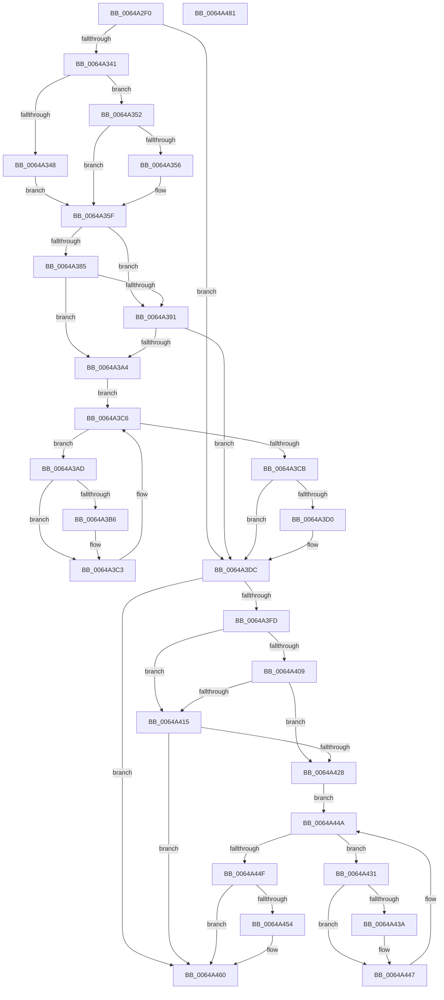

# DifZwSetInformationFileWrapper

- RVA: `0x0064A2F0`–`0x0064A482` (길이 `402` bytes)
- VA: `0x000000014064A2F0`
- 실행 섹션: `.text`
- PDB 이름 있음: `예`; PDB Function 태그: `아니요`
- unwind 정보 RVA: `0x000D2BBC`
- 디코드: `116`개 명령, `402/402` bytes 표시
- 미해석 바이트: `0` (있으면 어셈블리에 `.byte`로 보존)

> 이 문서는 커널 이미지의 기계어와 PDB 기호를 분석해 생성했습니다. 4번과 5번은 함수 원형과 자료형을 바이너리 사용 방식에서 추정한 C 해석이며 원본 소스 복구 결과는 아닙니다.

## 1. Dependencies

- 직접 호출 지점: **9**; 고유 호출 대상: **6**
- 직접 호출자로 확인된 함수: **0**
- RIP 상대 이미지 참조: **3**

### Outgoing calls
- `0x0064A330` → [DifGetAPIThunkContextById](../49/DifGetAPIThunkContextById_function_00495A34.md) (function, `0x00495A34`)
- `0x0064A356` → [DifGetReturnAddressForWrappers](../4D/DifGetReturnAddressForWrappers_function_004D3C08.md) (function, `0x004D3C08`)
- `0x0064A398` → [ExAcquireRundownProtection](../21/ExAcquireRundownProtection_function_00216620.md) (function, `0x00216620`)
- `0x0064A3BE` → [guard_dispatch_icall](../6B/guard_dispatch_icall_function_006BAAD0.md) (function, `0x006BAAD0`)
- `0x0064A3D7` → [ExReleaseRundownProtection](../34/ExReleaseRundownProtection_function_00349E80.md) (function, `0x00349E80`)
- `0x0064A3F0` → [ZwSetInformationFile](../6A/ZwSetInformationFile_function_006AD5B0.md) (function, `0x006AD5B0`)
- `0x0064A41C` → [ExAcquireRundownProtection](../21/ExAcquireRundownProtection_function_00216620.md) (function, `0x00216620`)
- `0x0064A442` → [guard_dispatch_icall](../6B/guard_dispatch_icall_function_006BAAD0.md) (function, `0x006BAAD0`)
- `0x0064A45B` → [ExReleaseRundownProtection](../34/ExReleaseRundownProtection_function_00349E80.md) (function, `0x00349E80`)

### Direct callers
- 이 함수 시작 RVA로 연결되는 직접 call은 확인되지 않았습니다. 간접 호출은 완전히 역산할 수 없습니다.

### Static image references
- `0x0064A366` → RVA `0x00F048B8` (`.data`; read)
- `0x0064A385` → RVA `0x00F04980` (`.data`; read)
- `0x0064A391` → RVA `0x00F03E80` (`.data`; read)

## 2. Other-region calls and transfers

- 다른 실행 섹션으로 향하는 call: **0**
- 별도 외부 분기/꼬리 이동을 확인하지 못했습니다.

## 3. Assembly (complete function range)

```asm
0064A2F0  48 8B C4                        mov rax, rsp
0064A2F3  48 89 58 10                     mov qword ptr [rax + 0x10], rbx
0064A2F7  48 89 70 18                     mov qword ptr [rax + 0x18], rsi
0064A2FB  48 89 78 20                     mov qword ptr [rax + 0x20], rdi
0064A2FF  48 89 48 08                     mov qword ptr [rax + 8], rcx
0064A303  55                              push rbp
0064A304  41 54                           push r12
0064A306  41 55                           push r13
0064A308  41 56                           push r14
0064A30A  41 57                           push r15
0064A30C  48 8B EC                        mov rbp, rsp
0064A30F  48 83 EC 60                     sub rsp, 0x60
0064A313  0F 57 C0                        xorps xmm0, xmm0
0064A316  B9 12 00 00 00                  mov ecx, 0x12
0064A31B  0F 11 45 D0                     movups xmmword ptr [rbp - 0x30], xmm0
0064A31F  45 8B F9                        mov r15d, r9d
0064A322  4D 8B E0                        mov r12, r8
0064A325  0F 11 45 E0                     movups xmmword ptr [rbp - 0x20], xmm0
0064A329  4C 8B EA                        mov r13, rdx
0064A32C  0F 11 45 F0                     movups xmmword ptr [rbp - 0x10], xmm0
0064A330  E8 FF B6 E4 FF                  call 0x140495a34
0064A335  48 8B F0                        mov rsi, rax
0064A338  48 85 C0                        test rax, rax
0064A33B  0F 84 9B 00 00 00               je 0x14064a3dc
0064A341  8B 40 0C                        mov eax, dword ptr [rax + 0xc]
0064A344  A8 18                           test al, 0x18
0064A346  74 0A                           je 0x14064a352
0064A348  48 8B 4D 28                     mov rcx, qword ptr [rbp + 0x28]
0064A34C  48 89 4D D0                     mov qword ptr [rbp - 0x30], rcx
0064A350  EB 0D                           jmp 0x14064a35f
0064A352  A8 04                           test al, 4
0064A354  74 09                           je 0x14064a35f
0064A356  E8 AD 98 E8 FF                  call 0x1404d3c08
0064A35B  48 89 45 D0                     mov qword ptr [rbp - 0x30], rax
0064A35F  48 8B 45 30                     mov rax, qword ptr [rbp + 0x30]
0064A363  45 32 F6                        xor r14b, r14b
0064A366  44 38 35 4B A5 8B 00            cmp byte ptr [rip + 0x8ba54b], r14b
0064A36D  48 89 45 F0                     mov qword ptr [rbp - 0x10], rax
0064A371  8B 45 50                        mov eax, dword ptr [rbp + 0x50]
0064A374  89 45 D8                        mov dword ptr [rbp - 0x28], eax
0064A377  4C 89 6D E8                     mov qword ptr [rbp - 0x18], r13
0064A37B  4C 89 65 E0                     mov qword ptr [rbp - 0x20], r12
0064A37F  44 89 7D DC                     mov dword ptr [rbp - 0x24], r15d
0064A383  75 0C                           jne 0x14064a391
0064A385  F7 05 F1 A5 8B 00 00 08 00 00   test dword ptr [rip + 0x8ba5f1], 0x800
0064A38F  74 13                           je 0x14064a3a4
0064A391  48 8D 0D E8 9A 8B 00            lea rcx, [rip + 0x8b9ae8]
0064A398  E8 83 C2 BC FF                  call 0x140216620
0064A39D  44 8A F0                        mov r14b, al
0064A3A0  84 C0                           test al, al
0064A3A2  74 38                           je 0x14064a3dc
0064A3A4  48 8D 7E 20                     lea rdi, [rsi + 0x20]
0064A3A8  48 8B 1F                        mov rbx, qword ptr [rdi]
0064A3AB  EB 19                           jmp 0x14064a3c6
0064A3AD  48 8D 43 F0                     lea rax, [rbx - 0x10]
0064A3B1  48 85 C0                        test rax, rax
0064A3B4  74 0D                           je 0x14064a3c3
0064A3B6  48 8B 40 08                     mov rax, qword ptr [rax + 8]
0064A3BA  48 8D 4D D0                     lea rcx, [rbp - 0x30]
0064A3BE  E8 0D 07 07 00                  call 0x1406baad0
0064A3C3  48 8B 1B                        mov rbx, qword ptr [rbx]
0064A3C6  48 3B DF                        cmp rbx, rdi
0064A3C9  75 E2                           jne 0x14064a3ad
0064A3CB  45 84 F6                        test r14b, r14b
0064A3CE  74 0C                           je 0x14064a3dc
0064A3D0  48 8D 0D A9 9A 8B 00            lea rcx, [rip + 0x8b9aa9]
0064A3D7  E8 A4 FA CF FF                  call 0x140349e80
0064A3DC  8B 45 50                        mov eax, dword ptr [rbp + 0x50]
0064A3DF  45 8B CF                        mov r9d, r15d
0064A3E2  48 8B 4D 30                     mov rcx, qword ptr [rbp + 0x30]
0064A3E6  4D 8B C4                        mov r8, r12
0064A3E9  49 8B D5                        mov rdx, r13
0064A3EC  89 44 24 20                     mov dword ptr [rsp + 0x20], eax
0064A3F0  E8 BB 31 06 00                  call 0x1406ad5b0
0064A3F5  89 45 F8                        mov dword ptr [rbp - 8], eax
0064A3F8  48 85 F6                        test rsi, rsi
0064A3FB  74 63                           je 0x14064a460
0064A3FD  40 32 FF                        xor dil, dil
0064A400  40 38 3D B1 A4 8B 00            cmp byte ptr [rip + 0x8ba4b1], dil
0064A407  75 0C                           jne 0x14064a415
0064A409  F7 05 6D A5 8B 00 00 08 00 00   test dword ptr [rip + 0x8ba56d], 0x800
0064A413  74 13                           je 0x14064a428
0064A415  48 8D 0D 64 9A 8B 00            lea rcx, [rip + 0x8b9a64]
0064A41C  E8 FF C1 BC FF                  call 0x140216620
0064A421  40 8A F8                        mov dil, al
0064A424  84 C0                           test al, al
0064A426  74 38                           je 0x14064a460
0064A428  48 83 C6 30                     add rsi, 0x30
0064A42C  48 8B 1E                        mov rbx, qword ptr [rsi]
0064A42F  EB 19                           jmp 0x14064a44a
0064A431  48 8D 43 F0                     lea rax, [rbx - 0x10]
0064A435  48 85 C0                        test rax, rax
0064A438  74 0D                           je 0x14064a447
0064A43A  48 8B 40 08                     mov rax, qword ptr [rax + 8]
0064A43E  48 8D 4D D0                     lea rcx, [rbp - 0x30]
0064A442  E8 89 06 07 00                  call 0x1406baad0
0064A447  48 8B 1B                        mov rbx, qword ptr [rbx]
0064A44A  48 3B DE                        cmp rbx, rsi
0064A44D  75 E2                           jne 0x14064a431
0064A44F  40 84 FF                        test dil, dil
0064A452  74 0C                           je 0x14064a460
0064A454  48 8D 0D 25 9A 8B 00            lea rcx, [rip + 0x8b9a25]
0064A45B  E8 20 FA CF FF                  call 0x140349e80
0064A460  8B 45 F8                        mov eax, dword ptr [rbp - 8]
0064A463  4C 8D 5C 24 60                  lea r11, [rsp + 0x60]
0064A468  49 8B 5B 38                     mov rbx, qword ptr [r11 + 0x38]
0064A46C  49 8B 73 40                     mov rsi, qword ptr [r11 + 0x40]
0064A470  49 8B 7B 48                     mov rdi, qword ptr [r11 + 0x48]
0064A474  49 8B E3                        mov rsp, r11
0064A477  41 5F                           pop r15
0064A479  41 5E                           pop r14
0064A47B  41 5D                           pop r13
0064A47D  41 5C                           pop r12
0064A47F  5D                              pop rbp
0064A480  C3                              ret
0064A481  CC                              int3
```

## 4. C-style interpretation (structured pseudocode)

```c
__int64 __fastcall DifZwSetInformationFileWrapper(__int64 a1, __int64 a2, __int64 a3, int a4, unsigned int a5)
{
    __int64 result;
    __int64 v_r14;
    __int64 v_rdi;
    __int64 v_rsi;
    __int64 v_rsp;
    unsigned __int64 v_stack_m28;
    unsigned int v_stack_m30;
    unsigned __int64 v_stack_m38;
    unsigned __int64 v_stack_m40;
    unsigned __int64 v_stack_m48;
    unsigned int v_stack_m4C;
    unsigned int v_stack_m50;
    unsigned __int64 v_stack_m58;
    unsigned int v_stack_m68;
    unsigned __int64 v_stack_p0;
    unsigned __int64 v_stack_p8;

    *(unsigned __int64 *)(v_rsp + 16) = v_rbx;
    *(unsigned __int64 *)(v_rsp + 24) = v_rsi;
    *(unsigned __int64 *)(v_rsp + 32) = v_rdi;
    *(unsigned __int64 *)(v_rsp + 8) = a1;
    v_rsp = (v_rsp) - (96);
    v_stack_m58 = v_xmm0;
    v_stack_m48 = v_xmm0;
    v_stack_m38 = v_xmm0;
    result = DifGetAPIThunkContextById(18, a2, a3, a4);
    if (result == 0) goto loc_0064A3DC;
    if ((((unsigned __int8)((unsigned int)(*(unsigned int *)(result + 12)))) & (24)) == 0) goto loc_0064A352;
    v_stack_m58 = v_stack_p0;
    goto loc_0064A35F;
loc_0064A352:
    result = (unsigned int)(*(unsigned int *)(result + 12));
    if ((((unsigned __int8)((unsigned int)(*(unsigned int *)(result + 12)))) & (4)) != 0) {
        result = DifGetReturnAddressForWrappers(v_stack_p0, a2, a3, a4);
        v_stack_m58 = result;
    }
    v_r14 = 0;
    v_stack_m38 = v_stack_p8;
    v_stack_m50 = (unsigned int)((unsigned int)(a5));
    v_stack_m40 = a2;
    v_stack_m48 = a3;
    v_stack_m4C = (unsigned int)((unsigned int)(a4));
    if ((*(unsigned __int8 *)(v_rip + 9151819)) != 0) goto loc_0064A391;
    if (((*(unsigned int *)(v_rip + 9151985)) & (0x800ULL)) == 0) goto loc_0064A3A4;
loc_0064A391:
    result = ExAcquireRundownProtection(v_rip + 9149160, a2, a3, a4);
    if ((unsigned __int8)(result) == 0) goto loc_0064A3DC;
loc_0064A3A4:
    goto loc_0064A3C6;
loc_0064A3AD:
    result = *(unsigned __int64 *)(result + 32) - 16;
    if (*(unsigned __int64 *)(result + 32) - 16 != 0) {
        result = *(unsigned __int64 *)(*(unsigned __int64 *)(result + 32) - 16 + 8);
        a1 = v_stack_m58;
        result = guard_dispatch_icall(a1, a2, a3, a4);
    }
loc_0064A3C6:
    if ((*(unsigned __int64 *)(*(unsigned __int64 *)(result + 32))) != (result + 32)) goto loc_0064A3AD;
    if ((unsigned __int8)((unsigned __int8)(result)) != 0) {
        a1 = v_rip + 9149097;
        result = ExReleaseRundownProtection(a1, a2, a3, a4);
    }
    v_stack_m68 = (unsigned int)((unsigned int)(a5));
    result = ZwSetInformationFile(v_stack_p8, a2, a3, (unsigned int)((unsigned int)((unsigned int)(a4))));
    v_stack_m30 = (unsigned int)(result);
    if (result == 0) goto loc_0064A460;
    v_rdi = 0;
    if ((*(unsigned __int8 *)(v_rip + 9151665)) != 0) goto loc_0064A415;
    if (((*(unsigned int *)(v_rip + 9151853)) & (0x800ULL)) == 0) goto loc_0064A428;
loc_0064A415:
    result = ExAcquireRundownProtection(v_rip + 9149028, a2, a3, (unsigned int)((unsigned int)((unsigned int)(a4))));
    if ((unsigned __int8)(result) == 0) goto loc_0064A460;
loc_0064A428:
    v_rsi = (result) + (48);
    goto loc_0064A44A;
loc_0064A431:
    result = *(unsigned __int64 *)(v_rsi) - 16;
    if (*(unsigned __int64 *)(v_rsi) - 16 != 0) {
        result = *(unsigned __int64 *)(*(unsigned __int64 *)(v_rsi) - 16 + 8);
        a1 = v_stack_m58;
        result = guard_dispatch_icall(a1, a2, a3, (unsigned int)((unsigned int)((unsigned int)(a4))));
    }
loc_0064A44A:
    if ((*(unsigned __int64 *)(*(unsigned __int64 *)(v_rsi))) != v_rsi) goto loc_0064A431;
    if ((unsigned __int8)((unsigned __int8)(result)) != 0) {
        a1 = v_rip + 9148965;
        result = ExReleaseRundownProtection(a1, a2, a3, (unsigned int)((unsigned int)((unsigned int)(a4))));
    }
    return (unsigned int)(v_stack_m30);
}
```

## 5. (Beta) C Style

```c
int64_t DifZwSetInformationFileWrapper(int64_t Arg1, int64_t Arg2, int64_t Arg3, int32_t Arg4, uint32_t Arg5)
{
    int64_t result;
    int64_t local_r14;
    int64_t local_rdi;
    int64_t local_rsi;
    int64_t local_rsp;
    uint64_t v_stack_m28;
    uint32_t v_stack_m30;
    uint64_t v_stack_m38;
    uint64_t v_stack_m40;
    uint64_t v_stack_m48;
    uint32_t v_stack_m4C;
    uint32_t v_stack_m50;
    uint64_t v_stack_m58;
    uint32_t v_stack_m68;
    uint64_t v_stack_p0;
    uint64_t v_stack_p8;

    *(uint64_t *)(local_rsp + 0x10) = local_rbx;
    *(uint64_t *)(local_rsp + 0x18) = local_rsi;
    *(uint64_t *)(local_rsp + 0x20) = local_rdi;
    *(uint64_t *)(local_rsp + 0x8) = Arg1;
    local_rsp = (local_rsp) - (96);
    v_stack_m58 = v_xmm0;
    v_stack_m48 = v_xmm0;
    v_stack_m38 = v_xmm0;
    result = DifGetAPIThunkContextById(18, Arg2, Arg3, Arg4);
    if (result == 0) goto loc_0064A3DC;
    if ((((uint8_t)((uint32_t)(*(uint32_t *)(result + 0xC)))) & (24)) == 0) goto loc_0064A352;
    v_stack_m58 = v_stack_p0;
    goto loc_0064A35F;
loc_0064A352:
    result = (uint32_t)(*(uint32_t *)(result + 0xC));
    if ((((uint8_t)((uint32_t)(*(uint32_t *)(result + 0xC)))) & (4)) != 0) {
        result = DifGetReturnAddressForWrappers(v_stack_p0, Arg2, Arg3, Arg4);
        v_stack_m58 = result;
    }
    local_r14 = 0;
    v_stack_m38 = v_stack_p8;
    v_stack_m50 = (uint32_t)((uint32_t)(Arg5));
    v_stack_m40 = Arg2;
    v_stack_m48 = Arg3;
    v_stack_m4C = (uint32_t)((uint32_t)(Arg4));
    if ((*(uint8_t *)(v_rip + 0x8BA54B)) != 0) goto loc_0064A391;
    if (((*(uint32_t *)(v_rip + 0x8BA5F1)) & (0x800ULL)) == 0) goto loc_0064A3A4;
loc_0064A391:
    result = ExAcquireRundownProtection(v_rip + 9149160, Arg2, Arg3, Arg4);
    if ((uint8_t)(result) == 0) goto loc_0064A3DC;
loc_0064A3A4:
    goto loc_0064A3C6;
loc_0064A3AD:
    result = *(uint64_t *)(result + 0x20) - 16;
    if (*(uint64_t *)(result + 0x20) - 16 != 0) {
        result = *(uint64_t *)(*(uint64_t *)(result + 0x20) - 0x10 + 0x8);
        Arg1 = v_stack_m58;
        result = guard_dispatch_icall(Arg1, Arg2, Arg3, Arg4);
    }
loc_0064A3C6:
    if ((*(uint64_t *)(*(uint64_t *)(result + 0x20))) != (result + 32)) goto loc_0064A3AD;
    if ((uint8_t)((uint8_t)(result)) != 0) {
        Arg1 = v_rip + 9149097;
        result = ExReleaseRundownProtection(Arg1, Arg2, Arg3, Arg4);
    }
    v_stack_m68 = (uint32_t)((uint32_t)(Arg5));
    result = ZwSetInformationFile(v_stack_p8, Arg2, Arg3, (uint32_t)((uint32_t)((uint32_t)(Arg4))));
    v_stack_m30 = (uint32_t)(result);
    if (result == 0) goto loc_0064A460;
    local_rdi = 0;
    if ((*(uint8_t *)(v_rip + 0x8BA4B1)) != 0) goto loc_0064A415;
    if (((*(uint32_t *)(v_rip + 0x8BA56D)) & (0x800ULL)) == 0) goto loc_0064A428;
loc_0064A415:
    result = ExAcquireRundownProtection(v_rip + 9149028, Arg2, Arg3, (uint32_t)((uint32_t)((uint32_t)(Arg4))));
    if ((uint8_t)(result) == 0) goto loc_0064A460;
loc_0064A428:
    local_rsi = (result) + (48);
    goto loc_0064A44A;
loc_0064A431:
    result = *(uint64_t *)(local_rsi) - 16;
    if (*(uint64_t *)(local_rsi) - 16 != 0) {
        result = *(uint64_t *)(*(uint64_t *)(local_rsi) - 0x10 + 0x8);
        Arg1 = v_stack_m58;
        result = guard_dispatch_icall(Arg1, Arg2, Arg3, (uint32_t)((uint32_t)((uint32_t)(Arg4))));
    }
loc_0064A44A:
    if ((*(uint64_t *)(*(uint64_t *)(local_rsi))) != local_rsi) goto loc_0064A431;
    if ((uint8_t)((uint8_t)(result)) != 0) {
        Arg1 = v_rip + 9148965;
        result = ExReleaseRundownProtection(Arg1, Arg2, Arg3, (uint32_t)((uint32_t)((uint32_t)(Arg4))));
    }
    return (uint32_t)(v_stack_m30);
}
```

## 6. Execution-region graph

[열기: 2D/3D 그래프와 함수 탐색 컨트롤 패널](../../../control-panel.html?section=text&rva=0x0064A2F0&view=graph)

- 2D 그래프는 위에서 아래로 흐르고, 3D 그래프는 빈 공간을 드래그해 회전합니다. Shift+드래그는 이동, 휠은 확대·축소, 함수 노드 선택은 대상 보고서 이동입니다.

### Static fallback


