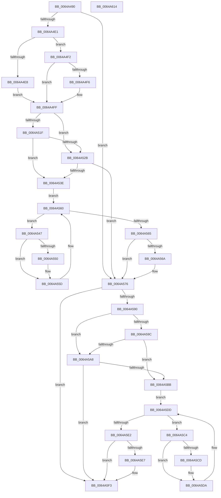

# DifZwSetInformationJobObjectWrapper

- RVA: `0x0064A490`–`0x0064A615` (길이 `389` bytes)
- VA: `0x000000014064A490`
- 실행 섹션: `.text`
- PDB 이름 있음: `예`; PDB Function 태그: `아니요`
- unwind 정보 RVA: `0x000D2B7C`
- 디코드: `112`개 명령, `389/389` bytes 표시
- 미해석 바이트: `0` (있으면 어셈블리에 `.byte`로 보존)

> 이 문서는 커널 이미지의 기계어와 PDB 기호를 분석해 생성했습니다. 4번과 5번은 함수 원형과 자료형을 바이너리 사용 방식에서 추정한 C 해석이며 원본 소스 복구 결과는 아닙니다.

## 1. Dependencies

- 직접 호출 지점: **9**; 고유 호출 대상: **6**
- 직접 호출자로 확인된 함수: **0**
- RIP 상대 이미지 참조: **3**

### Outgoing calls
- `0x0064A4D0` → [DifGetAPIThunkContextById](../49/DifGetAPIThunkContextById_function_00495A34.md) (function, `0x00495A34`)
- `0x0064A4F6` → [DifGetReturnAddressForWrappers](../4D/DifGetReturnAddressForWrappers_function_004D3C08.md) (function, `0x004D3C08`)
- `0x0064A532` → [ExAcquireRundownProtection](../21/ExAcquireRundownProtection_function_00216620.md) (function, `0x00216620`)
- `0x0064A558` → [guard_dispatch_icall](../6B/guard_dispatch_icall_function_006BAAD0.md) (function, `0x006BAAD0`)
- `0x0064A571` → [ExReleaseRundownProtection](../34/ExReleaseRundownProtection_function_00349E80.md) (function, `0x00349E80`)
- `0x0064A583` → [ZwSetInformationJobObject](../6B/ZwSetInformationJobObject_function_006B0610.md) (function, `0x006B0610`)
- `0x0064A5AF` → [ExAcquireRundownProtection](../21/ExAcquireRundownProtection_function_00216620.md) (function, `0x00216620`)
- `0x0064A5D5` → [guard_dispatch_icall](../6B/guard_dispatch_icall_function_006BAAD0.md) (function, `0x006BAAD0`)
- `0x0064A5EE` → [ExReleaseRundownProtection](../34/ExReleaseRundownProtection_function_00349E80.md) (function, `0x00349E80`)

### Direct callers
- 이 함수 시작 RVA로 연결되는 직접 call은 확인되지 않았습니다. 간접 호출은 완전히 역산할 수 없습니다.

### Static image references
- `0x0064A506` → RVA `0x00F048B8` (`.data`; read)
- `0x0064A51F` → RVA `0x00F04980` (`.data`; read)
- `0x0064A52B` → RVA `0x00F03E80` (`.data`; read)

## 2. Other-region calls and transfers

- 다른 실행 섹션으로 향하는 call: **0**
- 별도 외부 분기/꼬리 이동을 확인하지 못했습니다.

## 3. Assembly (complete function range)

```asm
0064A490  48 8B C4                        mov rax, rsp
0064A493  48 89 58 10                     mov qword ptr [rax + 0x10], rbx
0064A497  48 89 70 18                     mov qword ptr [rax + 0x18], rsi
0064A49B  48 89 78 20                     mov qword ptr [rax + 0x20], rdi
0064A49F  48 89 48 08                     mov qword ptr [rax + 8], rcx
0064A4A3  55                              push rbp
0064A4A4  41 54                           push r12
0064A4A6  41 55                           push r13
0064A4A8  41 56                           push r14
0064A4AA  41 57                           push r15
0064A4AC  48 8B EC                        mov rbp, rsp
0064A4AF  48 83 EC 50                     sub rsp, 0x50
0064A4B3  0F 57 C0                        xorps xmm0, xmm0
0064A4B6  B9 11 00 00 00                  mov ecx, 0x11
0064A4BB  0F 11 45 D0                     movups xmmword ptr [rbp - 0x30], xmm0
0064A4BF  45 8B F9                        mov r15d, r9d
0064A4C2  4D 8B E0                        mov r12, r8
0064A4C5  0F 11 45 E0                     movups xmmword ptr [rbp - 0x20], xmm0
0064A4C9  44 8B EA                        mov r13d, edx
0064A4CC  0F 11 45 F0                     movups xmmword ptr [rbp - 0x10], xmm0
0064A4D0  E8 5F B5 E4 FF                  call 0x140495a34
0064A4D5  48 8B F0                        mov rsi, rax
0064A4D8  48 85 C0                        test rax, rax
0064A4DB  0F 84 95 00 00 00               je 0x14064a576
0064A4E1  8B 40 0C                        mov eax, dword ptr [rax + 0xc]
0064A4E4  A8 18                           test al, 0x18
0064A4E6  74 0A                           je 0x14064a4f2
0064A4E8  48 8B 4D 28                     mov rcx, qword ptr [rbp + 0x28]
0064A4EC  48 89 4D D0                     mov qword ptr [rbp - 0x30], rcx
0064A4F0  EB 0D                           jmp 0x14064a4ff
0064A4F2  A8 04                           test al, 4
0064A4F4  74 09                           je 0x14064a4ff
0064A4F6  E8 0D 97 E8 FF                  call 0x1404d3c08
0064A4FB  48 89 45 D0                     mov qword ptr [rbp - 0x30], rax
0064A4FF  48 8B 45 30                     mov rax, qword ptr [rbp + 0x30]
0064A503  45 32 F6                        xor r14b, r14b
0064A506  44 38 35 AB A3 8B 00            cmp byte ptr [rip + 0x8ba3ab], r14b
0064A50D  48 89 45 F0                     mov qword ptr [rbp - 0x10], rax
0064A511  44 89 6D E8                     mov dword ptr [rbp - 0x18], r13d
0064A515  4C 89 65 E0                     mov qword ptr [rbp - 0x20], r12
0064A519  44 89 7D D8                     mov dword ptr [rbp - 0x28], r15d
0064A51D  75 0C                           jne 0x14064a52b
0064A51F  F7 05 57 A4 8B 00 00 08 00 00   test dword ptr [rip + 0x8ba457], 0x800
0064A529  74 13                           je 0x14064a53e
0064A52B  48 8D 0D 4E 99 8B 00            lea rcx, [rip + 0x8b994e]
0064A532  E8 E9 C0 BC FF                  call 0x140216620
0064A537  44 8A F0                        mov r14b, al
0064A53A  84 C0                           test al, al
0064A53C  74 38                           je 0x14064a576
0064A53E  48 8D 7E 20                     lea rdi, [rsi + 0x20]
0064A542  48 8B 1F                        mov rbx, qword ptr [rdi]
0064A545  EB 19                           jmp 0x14064a560
0064A547  48 8D 43 F0                     lea rax, [rbx - 0x10]
0064A54B  48 85 C0                        test rax, rax
0064A54E  74 0D                           je 0x14064a55d
0064A550  48 8B 40 08                     mov rax, qword ptr [rax + 8]
0064A554  48 8D 4D D0                     lea rcx, [rbp - 0x30]
0064A558  E8 73 05 07 00                  call 0x1406baad0
0064A55D  48 8B 1B                        mov rbx, qword ptr [rbx]
0064A560  48 3B DF                        cmp rbx, rdi
0064A563  75 E2                           jne 0x14064a547
0064A565  45 84 F6                        test r14b, r14b
0064A568  74 0C                           je 0x14064a576
0064A56A  48 8D 0D 0F 99 8B 00            lea rcx, [rip + 0x8b990f]
0064A571  E8 0A F9 CF FF                  call 0x140349e80
0064A576  48 8B 4D 30                     mov rcx, qword ptr [rbp + 0x30]
0064A57A  45 8B CF                        mov r9d, r15d
0064A57D  4D 8B C4                        mov r8, r12
0064A580  41 8B D5                        mov edx, r13d
0064A583  E8 88 60 06 00                  call 0x1406b0610
0064A588  89 45 F8                        mov dword ptr [rbp - 8], eax
0064A58B  48 85 F6                        test rsi, rsi
0064A58E  74 63                           je 0x14064a5f3
0064A590  40 32 FF                        xor dil, dil
0064A593  40 38 3D 1E A3 8B 00            cmp byte ptr [rip + 0x8ba31e], dil
0064A59A  75 0C                           jne 0x14064a5a8
0064A59C  F7 05 DA A3 8B 00 00 08 00 00   test dword ptr [rip + 0x8ba3da], 0x800
0064A5A6  74 13                           je 0x14064a5bb
0064A5A8  48 8D 0D D1 98 8B 00            lea rcx, [rip + 0x8b98d1]
0064A5AF  E8 6C C0 BC FF                  call 0x140216620
0064A5B4  40 8A F8                        mov dil, al
0064A5B7  84 C0                           test al, al
0064A5B9  74 38                           je 0x14064a5f3
0064A5BB  48 83 C6 30                     add rsi, 0x30
0064A5BF  48 8B 1E                        mov rbx, qword ptr [rsi]
0064A5C2  EB 19                           jmp 0x14064a5dd
0064A5C4  48 8D 43 F0                     lea rax, [rbx - 0x10]
0064A5C8  48 85 C0                        test rax, rax
0064A5CB  74 0D                           je 0x14064a5da
0064A5CD  48 8B 40 08                     mov rax, qword ptr [rax + 8]
0064A5D1  48 8D 4D D0                     lea rcx, [rbp - 0x30]
0064A5D5  E8 F6 04 07 00                  call 0x1406baad0
0064A5DA  48 8B 1B                        mov rbx, qword ptr [rbx]
0064A5DD  48 3B DE                        cmp rbx, rsi
0064A5E0  75 E2                           jne 0x14064a5c4
0064A5E2  40 84 FF                        test dil, dil
0064A5E5  74 0C                           je 0x14064a5f3
0064A5E7  48 8D 0D 92 98 8B 00            lea rcx, [rip + 0x8b9892]
0064A5EE  E8 8D F8 CF FF                  call 0x140349e80
0064A5F3  8B 45 F8                        mov eax, dword ptr [rbp - 8]
0064A5F6  4C 8D 5C 24 50                  lea r11, [rsp + 0x50]
0064A5FB  49 8B 5B 38                     mov rbx, qword ptr [r11 + 0x38]
0064A5FF  49 8B 73 40                     mov rsi, qword ptr [r11 + 0x40]
0064A603  49 8B 7B 48                     mov rdi, qword ptr [r11 + 0x48]
0064A607  49 8B E3                        mov rsp, r11
0064A60A  41 5F                           pop r15
0064A60C  41 5E                           pop r14
0064A60E  41 5D                           pop r13
0064A610  41 5C                           pop r12
0064A612  5D                              pop rbp
0064A613  C3                              ret
0064A614  CC                              int3
```

## 4. C-style interpretation (structured pseudocode)

```c
__int64 __fastcall DifZwSetInformationJobObjectWrapper(__int64 a1, int a2, __int64 a3, int a4)
{
    __int64 result;
    __int64 v_r14;
    __int64 v_rdi;
    __int64 v_rsi;
    __int64 v_rsp;
    unsigned __int64 v_stack_m28;
    unsigned int v_stack_m30;
    unsigned __int64 v_stack_m38;
    unsigned int v_stack_m40;
    unsigned __int64 v_stack_m48;
    unsigned int v_stack_m50;
    unsigned __int64 v_stack_m58;
    unsigned __int64 v_stack_p0;
    unsigned __int64 v_stack_p8;

    *(unsigned __int64 *)(v_rsp + 16) = v_rbx;
    *(unsigned __int64 *)(v_rsp + 24) = v_rsi;
    *(unsigned __int64 *)(v_rsp + 32) = v_rdi;
    *(unsigned __int64 *)(v_rsp + 8) = a1;
    v_rsp = (v_rsp) - (80);
    v_stack_m58 = v_xmm0;
    v_stack_m48 = v_xmm0;
    v_stack_m38 = v_xmm0;
    result = DifGetAPIThunkContextById(17, a2, a3, a4);
    if (result == 0) goto loc_0064A576;
    if ((((unsigned __int8)((unsigned int)(*(unsigned int *)(result + 12)))) & (24)) == 0) goto loc_0064A4F2;
    v_stack_m58 = v_stack_p0;
    goto loc_0064A4FF;
loc_0064A4F2:
    result = (unsigned int)(*(unsigned int *)(result + 12));
    if ((((unsigned __int8)((unsigned int)(*(unsigned int *)(result + 12)))) & (4)) != 0) {
        result = DifGetReturnAddressForWrappers(v_stack_p0, a2, a3, a4);
        v_stack_m58 = result;
    }
    v_r14 = 0;
    v_stack_m38 = v_stack_p8;
    v_stack_m40 = (unsigned int)((unsigned int)(a2));
    v_stack_m48 = a3;
    v_stack_m50 = (unsigned int)((unsigned int)(a4));
    if ((*(unsigned __int8 *)(v_rip + 9151403)) != 0) goto loc_0064A52B;
    if (((*(unsigned int *)(v_rip + 9151575)) & (0x800ULL)) == 0) goto loc_0064A53E;
loc_0064A52B:
    result = ExAcquireRundownProtection(v_rip + 9148750, a2, a3, a4);
    if ((unsigned __int8)(result) == 0) goto loc_0064A576;
loc_0064A53E:
    goto loc_0064A560;
loc_0064A547:
    result = *(unsigned __int64 *)(result + 32) - 16;
    if (*(unsigned __int64 *)(result + 32) - 16 != 0) {
        result = *(unsigned __int64 *)(*(unsigned __int64 *)(result + 32) - 16 + 8);
        a1 = v_stack_m58;
        result = guard_dispatch_icall(a1, a2, a3, a4);
    }
loc_0064A560:
    if ((*(unsigned __int64 *)(*(unsigned __int64 *)(result + 32))) != (result + 32)) goto loc_0064A547;
    if ((unsigned __int8)((unsigned __int8)(result)) != 0) {
        a1 = v_rip + 9148687;
        result = ExReleaseRundownProtection(a1, a2, a3, a4);
    }
    result = ZwSetInformationJobObject(v_stack_p8, (unsigned int)((unsigned int)((unsigned int)(a2))), a3, (unsigned int)((unsigned int)((unsigned int)(a4))));
    v_stack_m30 = (unsigned int)(result);
    if (result == 0) goto loc_0064A5F3;
    v_rdi = 0;
    if ((*(unsigned __int8 *)(v_rip + 9151262)) != 0) goto loc_0064A5A8;
    if (((*(unsigned int *)(v_rip + 9151450)) & (0x800ULL)) == 0) goto loc_0064A5BB;
loc_0064A5A8:
    result = ExAcquireRundownProtection(v_rip + 9148625, (unsigned int)((unsigned int)((unsigned int)(a2))), a3, (unsigned int)((unsigned int)((unsigned int)(a4))));
    if ((unsigned __int8)(result) == 0) goto loc_0064A5F3;
loc_0064A5BB:
    v_rsi = (result) + (48);
    goto loc_0064A5DD;
loc_0064A5C4:
    result = *(unsigned __int64 *)(v_rsi) - 16;
    if (*(unsigned __int64 *)(v_rsi) - 16 != 0) {
        result = *(unsigned __int64 *)(*(unsigned __int64 *)(v_rsi) - 16 + 8);
        a1 = v_stack_m58;
        result = guard_dispatch_icall(a1, (unsigned int)((unsigned int)((unsigned int)(a2))), a3, (unsigned int)((unsigned int)((unsigned int)(a4))));
    }
loc_0064A5DD:
    if ((*(unsigned __int64 *)(*(unsigned __int64 *)(v_rsi))) != v_rsi) goto loc_0064A5C4;
    if ((unsigned __int8)((unsigned __int8)(result)) != 0) {
        a1 = v_rip + 9148562;
        result = ExReleaseRundownProtection(a1, (unsigned int)((unsigned int)((unsigned int)(a2))), a3, (unsigned int)((unsigned int)((unsigned int)(a4))));
    }
    return (unsigned int)(v_stack_m30);
}
```

## 5. (Beta) C Style

```c
int64_t DifZwSetInformationJobObjectWrapper(int64_t Arg1, int32_t Arg2, int64_t Arg3, int32_t Arg4)
{
    int64_t result;
    int64_t local_r14;
    int64_t local_rdi;
    int64_t local_rsi;
    int64_t local_rsp;
    uint64_t v_stack_m28;
    uint32_t v_stack_m30;
    uint64_t v_stack_m38;
    uint32_t v_stack_m40;
    uint64_t v_stack_m48;
    uint32_t v_stack_m50;
    uint64_t v_stack_m58;
    uint64_t v_stack_p0;
    uint64_t v_stack_p8;

    *(uint64_t *)(local_rsp + 0x10) = local_rbx;
    *(uint64_t *)(local_rsp + 0x18) = local_rsi;
    *(uint64_t *)(local_rsp + 0x20) = local_rdi;
    *(uint64_t *)(local_rsp + 0x8) = Arg1;
    local_rsp = (local_rsp) - (80);
    v_stack_m58 = v_xmm0;
    v_stack_m48 = v_xmm0;
    v_stack_m38 = v_xmm0;
    result = DifGetAPIThunkContextById(17, Arg2, Arg3, Arg4);
    if (result == 0) goto loc_0064A576;
    if ((((uint8_t)((uint32_t)(*(uint32_t *)(result + 0xC)))) & (24)) == 0) goto loc_0064A4F2;
    v_stack_m58 = v_stack_p0;
    goto loc_0064A4FF;
loc_0064A4F2:
    result = (uint32_t)(*(uint32_t *)(result + 0xC));
    if ((((uint8_t)((uint32_t)(*(uint32_t *)(result + 0xC)))) & (4)) != 0) {
        result = DifGetReturnAddressForWrappers(v_stack_p0, Arg2, Arg3, Arg4);
        v_stack_m58 = result;
    }
    local_r14 = 0;
    v_stack_m38 = v_stack_p8;
    v_stack_m40 = (uint32_t)((uint32_t)(Arg2));
    v_stack_m48 = Arg3;
    v_stack_m50 = (uint32_t)((uint32_t)(Arg4));
    if ((*(uint8_t *)(v_rip + 0x8BA3AB)) != 0) goto loc_0064A52B;
    if (((*(uint32_t *)(v_rip + 0x8BA457)) & (0x800ULL)) == 0) goto loc_0064A53E;
loc_0064A52B:
    result = ExAcquireRundownProtection(v_rip + 9148750, Arg2, Arg3, Arg4);
    if ((uint8_t)(result) == 0) goto loc_0064A576;
loc_0064A53E:
    goto loc_0064A560;
loc_0064A547:
    result = *(uint64_t *)(result + 0x20) - 16;
    if (*(uint64_t *)(result + 0x20) - 16 != 0) {
        result = *(uint64_t *)(*(uint64_t *)(result + 0x20) - 0x10 + 0x8);
        Arg1 = v_stack_m58;
        result = guard_dispatch_icall(Arg1, Arg2, Arg3, Arg4);
    }
loc_0064A560:
    if ((*(uint64_t *)(*(uint64_t *)(result + 0x20))) != (result + 32)) goto loc_0064A547;
    if ((uint8_t)((uint8_t)(result)) != 0) {
        Arg1 = v_rip + 9148687;
        result = ExReleaseRundownProtection(Arg1, Arg2, Arg3, Arg4);
    }
    result = ZwSetInformationJobObject(v_stack_p8, (uint32_t)((uint32_t)((uint32_t)(Arg2))), Arg3, (uint32_t)((uint32_t)((uint32_t)(Arg4))));
    v_stack_m30 = (uint32_t)(result);
    if (result == 0) goto loc_0064A5F3;
    local_rdi = 0;
    if ((*(uint8_t *)(v_rip + 0x8BA31E)) != 0) goto loc_0064A5A8;
    if (((*(uint32_t *)(v_rip + 0x8BA3DA)) & (0x800ULL)) == 0) goto loc_0064A5BB;
loc_0064A5A8:
    result = ExAcquireRundownProtection(v_rip + 9148625, (uint32_t)((uint32_t)((uint32_t)(Arg2))), Arg3, (uint32_t)((uint32_t)((uint32_t)(Arg4))));
    if ((uint8_t)(result) == 0) goto loc_0064A5F3;
loc_0064A5BB:
    local_rsi = (result) + (48);
    goto loc_0064A5DD;
loc_0064A5C4:
    result = *(uint64_t *)(local_rsi) - 16;
    if (*(uint64_t *)(local_rsi) - 16 != 0) {
        result = *(uint64_t *)(*(uint64_t *)(local_rsi) - 0x10 + 0x8);
        Arg1 = v_stack_m58;
        result = guard_dispatch_icall(Arg1, (uint32_t)((uint32_t)((uint32_t)(Arg2))), Arg3, (uint32_t)((uint32_t)((uint32_t)(Arg4))));
    }
loc_0064A5DD:
    if ((*(uint64_t *)(*(uint64_t *)(local_rsi))) != local_rsi) goto loc_0064A5C4;
    if ((uint8_t)((uint8_t)(result)) != 0) {
        Arg1 = v_rip + 9148562;
        result = ExReleaseRundownProtection(Arg1, (uint32_t)((uint32_t)((uint32_t)(Arg2))), Arg3, (uint32_t)((uint32_t)((uint32_t)(Arg4))));
    }
    return (uint32_t)(v_stack_m30);
}
```

## 6. Execution-region graph

[열기: 2D/3D 그래프와 함수 탐색 컨트롤 패널](../../../control-panel.html?section=text&rva=0x0064A490&view=graph)

- 2D 그래프는 위에서 아래로 흐르고, 3D 그래프는 빈 공간을 드래그해 회전합니다. Shift+드래그는 이동, 휠은 확대·축소, 함수 노드 선택은 대상 보고서 이동입니다.

### Static fallback


