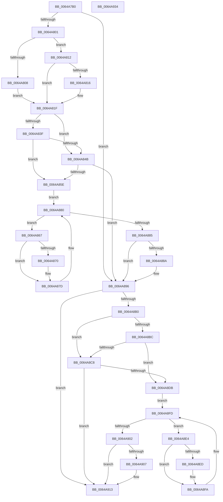

# DifZwSetInformationObjectWrapper

- RVA: `0x0064A7B0`–`0x0064A935` (길이 `389` bytes)
- VA: `0x000000014064A7B0`
- 실행 섹션: `.text`
- PDB 이름 있음: `예`; PDB Function 태그: `아니요`
- unwind 정보 RVA: `0x000D2B7C`
- 디코드: `112`개 명령, `389/389` bytes 표시
- 미해석 바이트: `0` (있으면 어셈블리에 `.byte`로 보존)

> 이 문서는 커널 이미지의 기계어와 PDB 기호를 분석해 생성했습니다. 4번과 5번은 함수 원형과 자료형을 바이너리 사용 방식에서 추정한 C 해석이며 원본 소스 복구 결과는 아닙니다.

## 1. Dependencies

- 직접 호출 지점: **9**; 고유 호출 대상: **6**
- 직접 호출자로 확인된 함수: **0**
- RIP 상대 이미지 참조: **3**

### Outgoing calls
- `0x0064A7F0` → [DifGetAPIThunkContextById](../49/DifGetAPIThunkContextById_function_00495A34.md) (function, `0x00495A34`)
- `0x0064A816` → [DifGetReturnAddressForWrappers](../4D/DifGetReturnAddressForWrappers_function_004D3C08.md) (function, `0x004D3C08`)
- `0x0064A852` → [ExAcquireRundownProtection](../21/ExAcquireRundownProtection_function_00216620.md) (function, `0x00216620`)
- `0x0064A878` → [guard_dispatch_icall](../6B/guard_dispatch_icall_function_006BAAD0.md) (function, `0x006BAAD0`)
- `0x0064A891` → [ExReleaseRundownProtection](../34/ExReleaseRundownProtection_function_00349E80.md) (function, `0x00349E80`)
- `0x0064A8A3` → [ZwSetInformationObject](../6A/ZwSetInformationObject_function_006ADC50.md) (function, `0x006ADC50`)
- `0x0064A8CF` → [ExAcquireRundownProtection](../21/ExAcquireRundownProtection_function_00216620.md) (function, `0x00216620`)
- `0x0064A8F5` → [guard_dispatch_icall](../6B/guard_dispatch_icall_function_006BAAD0.md) (function, `0x006BAAD0`)
- `0x0064A90E` → [ExReleaseRundownProtection](../34/ExReleaseRundownProtection_function_00349E80.md) (function, `0x00349E80`)

### Direct callers
- 이 함수 시작 RVA로 연결되는 직접 call은 확인되지 않았습니다. 간접 호출은 완전히 역산할 수 없습니다.

### Static image references
- `0x0064A826` → RVA `0x00F048B8` (`.data`; read)
- `0x0064A83F` → RVA `0x00F04980` (`.data`; read)
- `0x0064A84B` → RVA `0x00F03E80` (`.data`; read)

## 2. Other-region calls and transfers

- 다른 실행 섹션으로 향하는 call: **0**
- 별도 외부 분기/꼬리 이동을 확인하지 못했습니다.

## 3. Assembly (complete function range)

```asm
0064A7B0  48 8B C4                        mov rax, rsp
0064A7B3  48 89 58 10                     mov qword ptr [rax + 0x10], rbx
0064A7B7  48 89 70 18                     mov qword ptr [rax + 0x18], rsi
0064A7BB  48 89 78 20                     mov qword ptr [rax + 0x20], rdi
0064A7BF  48 89 48 08                     mov qword ptr [rax + 8], rcx
0064A7C3  55                              push rbp
0064A7C4  41 54                           push r12
0064A7C6  41 55                           push r13
0064A7C8  41 56                           push r14
0064A7CA  41 57                           push r15
0064A7CC  48 8B EC                        mov rbp, rsp
0064A7CF  48 83 EC 50                     sub rsp, 0x50
0064A7D3  0F 57 C0                        xorps xmm0, xmm0
0064A7D6  B9 0F 00 00 00                  mov ecx, 0xf
0064A7DB  0F 11 45 D0                     movups xmmword ptr [rbp - 0x30], xmm0
0064A7DF  45 8B F9                        mov r15d, r9d
0064A7E2  4D 8B E0                        mov r12, r8
0064A7E5  0F 11 45 E0                     movups xmmword ptr [rbp - 0x20], xmm0
0064A7E9  44 8B EA                        mov r13d, edx
0064A7EC  0F 11 45 F0                     movups xmmword ptr [rbp - 0x10], xmm0
0064A7F0  E8 3F B2 E4 FF                  call 0x140495a34
0064A7F5  48 8B F0                        mov rsi, rax
0064A7F8  48 85 C0                        test rax, rax
0064A7FB  0F 84 95 00 00 00               je 0x14064a896
0064A801  8B 40 0C                        mov eax, dword ptr [rax + 0xc]
0064A804  A8 18                           test al, 0x18
0064A806  74 0A                           je 0x14064a812
0064A808  48 8B 4D 28                     mov rcx, qword ptr [rbp + 0x28]
0064A80C  48 89 4D D0                     mov qword ptr [rbp - 0x30], rcx
0064A810  EB 0D                           jmp 0x14064a81f
0064A812  A8 04                           test al, 4
0064A814  74 09                           je 0x14064a81f
0064A816  E8 ED 93 E8 FF                  call 0x1404d3c08
0064A81B  48 89 45 D0                     mov qword ptr [rbp - 0x30], rax
0064A81F  48 8B 45 30                     mov rax, qword ptr [rbp + 0x30]
0064A823  45 32 F6                        xor r14b, r14b
0064A826  44 38 35 8B A0 8B 00            cmp byte ptr [rip + 0x8ba08b], r14b
0064A82D  48 89 45 F0                     mov qword ptr [rbp - 0x10], rax
0064A831  44 89 6D E8                     mov dword ptr [rbp - 0x18], r13d
0064A835  4C 89 65 E0                     mov qword ptr [rbp - 0x20], r12
0064A839  44 89 7D D8                     mov dword ptr [rbp - 0x28], r15d
0064A83D  75 0C                           jne 0x14064a84b
0064A83F  F7 05 37 A1 8B 00 00 08 00 00   test dword ptr [rip + 0x8ba137], 0x800
0064A849  74 13                           je 0x14064a85e
0064A84B  48 8D 0D 2E 96 8B 00            lea rcx, [rip + 0x8b962e]
0064A852  E8 C9 BD BC FF                  call 0x140216620
0064A857  44 8A F0                        mov r14b, al
0064A85A  84 C0                           test al, al
0064A85C  74 38                           je 0x14064a896
0064A85E  48 8D 7E 20                     lea rdi, [rsi + 0x20]
0064A862  48 8B 1F                        mov rbx, qword ptr [rdi]
0064A865  EB 19                           jmp 0x14064a880
0064A867  48 8D 43 F0                     lea rax, [rbx - 0x10]
0064A86B  48 85 C0                        test rax, rax
0064A86E  74 0D                           je 0x14064a87d
0064A870  48 8B 40 08                     mov rax, qword ptr [rax + 8]
0064A874  48 8D 4D D0                     lea rcx, [rbp - 0x30]
0064A878  E8 53 02 07 00                  call 0x1406baad0
0064A87D  48 8B 1B                        mov rbx, qword ptr [rbx]
0064A880  48 3B DF                        cmp rbx, rdi
0064A883  75 E2                           jne 0x14064a867
0064A885  45 84 F6                        test r14b, r14b
0064A888  74 0C                           je 0x14064a896
0064A88A  48 8D 0D EF 95 8B 00            lea rcx, [rip + 0x8b95ef]
0064A891  E8 EA F5 CF FF                  call 0x140349e80
0064A896  48 8B 4D 30                     mov rcx, qword ptr [rbp + 0x30]
0064A89A  45 8B CF                        mov r9d, r15d
0064A89D  4D 8B C4                        mov r8, r12
0064A8A0  41 8B D5                        mov edx, r13d
0064A8A3  E8 A8 33 06 00                  call 0x1406adc50
0064A8A8  89 45 F8                        mov dword ptr [rbp - 8], eax
0064A8AB  48 85 F6                        test rsi, rsi
0064A8AE  74 63                           je 0x14064a913
0064A8B0  40 32 FF                        xor dil, dil
0064A8B3  40 38 3D FE 9F 8B 00            cmp byte ptr [rip + 0x8b9ffe], dil
0064A8BA  75 0C                           jne 0x14064a8c8
0064A8BC  F7 05 BA A0 8B 00 00 08 00 00   test dword ptr [rip + 0x8ba0ba], 0x800
0064A8C6  74 13                           je 0x14064a8db
0064A8C8  48 8D 0D B1 95 8B 00            lea rcx, [rip + 0x8b95b1]
0064A8CF  E8 4C BD BC FF                  call 0x140216620
0064A8D4  40 8A F8                        mov dil, al
0064A8D7  84 C0                           test al, al
0064A8D9  74 38                           je 0x14064a913
0064A8DB  48 83 C6 30                     add rsi, 0x30
0064A8DF  48 8B 1E                        mov rbx, qword ptr [rsi]
0064A8E2  EB 19                           jmp 0x14064a8fd
0064A8E4  48 8D 43 F0                     lea rax, [rbx - 0x10]
0064A8E8  48 85 C0                        test rax, rax
0064A8EB  74 0D                           je 0x14064a8fa
0064A8ED  48 8B 40 08                     mov rax, qword ptr [rax + 8]
0064A8F1  48 8D 4D D0                     lea rcx, [rbp - 0x30]
0064A8F5  E8 D6 01 07 00                  call 0x1406baad0
0064A8FA  48 8B 1B                        mov rbx, qword ptr [rbx]
0064A8FD  48 3B DE                        cmp rbx, rsi
0064A900  75 E2                           jne 0x14064a8e4
0064A902  40 84 FF                        test dil, dil
0064A905  74 0C                           je 0x14064a913
0064A907  48 8D 0D 72 95 8B 00            lea rcx, [rip + 0x8b9572]
0064A90E  E8 6D F5 CF FF                  call 0x140349e80
0064A913  8B 45 F8                        mov eax, dword ptr [rbp - 8]
0064A916  4C 8D 5C 24 50                  lea r11, [rsp + 0x50]
0064A91B  49 8B 5B 38                     mov rbx, qword ptr [r11 + 0x38]
0064A91F  49 8B 73 40                     mov rsi, qword ptr [r11 + 0x40]
0064A923  49 8B 7B 48                     mov rdi, qword ptr [r11 + 0x48]
0064A927  49 8B E3                        mov rsp, r11
0064A92A  41 5F                           pop r15
0064A92C  41 5E                           pop r14
0064A92E  41 5D                           pop r13
0064A930  41 5C                           pop r12
0064A932  5D                              pop rbp
0064A933  C3                              ret
0064A934  CC                              int3
```

## 4. C-style interpretation (structured pseudocode)

```c
__int64 __fastcall DifZwSetInformationObjectWrapper(__int64 a1, int a2, __int64 a3, int a4)
{
    __int64 result;
    __int64 v_r14;
    __int64 v_rdi;
    __int64 v_rsi;
    __int64 v_rsp;
    unsigned __int64 v_stack_m28;
    unsigned int v_stack_m30;
    unsigned __int64 v_stack_m38;
    unsigned int v_stack_m40;
    unsigned __int64 v_stack_m48;
    unsigned int v_stack_m50;
    unsigned __int64 v_stack_m58;
    unsigned __int64 v_stack_p0;
    unsigned __int64 v_stack_p8;

    *(unsigned __int64 *)(v_rsp + 16) = v_rbx;
    *(unsigned __int64 *)(v_rsp + 24) = v_rsi;
    *(unsigned __int64 *)(v_rsp + 32) = v_rdi;
    *(unsigned __int64 *)(v_rsp + 8) = a1;
    v_rsp = (v_rsp) - (80);
    v_stack_m58 = v_xmm0;
    v_stack_m48 = v_xmm0;
    v_stack_m38 = v_xmm0;
    result = DifGetAPIThunkContextById(15, a2, a3, a4);
    if (result == 0) goto loc_0064A896;
    if ((((unsigned __int8)((unsigned int)(*(unsigned int *)(result + 12)))) & (24)) == 0) goto loc_0064A812;
    v_stack_m58 = v_stack_p0;
    goto loc_0064A81F;
loc_0064A812:
    result = (unsigned int)(*(unsigned int *)(result + 12));
    if ((((unsigned __int8)((unsigned int)(*(unsigned int *)(result + 12)))) & (4)) != 0) {
        result = DifGetReturnAddressForWrappers(v_stack_p0, a2, a3, a4);
        v_stack_m58 = result;
    }
    v_r14 = 0;
    v_stack_m38 = v_stack_p8;
    v_stack_m40 = (unsigned int)((unsigned int)(a2));
    v_stack_m48 = a3;
    v_stack_m50 = (unsigned int)((unsigned int)(a4));
    if ((*(unsigned __int8 *)(v_rip + 9150603)) != 0) goto loc_0064A84B;
    if (((*(unsigned int *)(v_rip + 9150775)) & (0x800ULL)) == 0) goto loc_0064A85E;
loc_0064A84B:
    result = ExAcquireRundownProtection(v_rip + 9147950, a2, a3, a4);
    if ((unsigned __int8)(result) == 0) goto loc_0064A896;
loc_0064A85E:
    goto loc_0064A880;
loc_0064A867:
    result = *(unsigned __int64 *)(result + 32) - 16;
    if (*(unsigned __int64 *)(result + 32) - 16 != 0) {
        result = *(unsigned __int64 *)(*(unsigned __int64 *)(result + 32) - 16 + 8);
        a1 = v_stack_m58;
        result = guard_dispatch_icall(a1, a2, a3, a4);
    }
loc_0064A880:
    if ((*(unsigned __int64 *)(*(unsigned __int64 *)(result + 32))) != (result + 32)) goto loc_0064A867;
    if ((unsigned __int8)((unsigned __int8)(result)) != 0) {
        a1 = v_rip + 9147887;
        result = ExReleaseRundownProtection(a1, a2, a3, a4);
    }
    result = ZwSetInformationObject(v_stack_p8, (unsigned int)((unsigned int)((unsigned int)(a2))), a3, (unsigned int)((unsigned int)((unsigned int)(a4))));
    v_stack_m30 = (unsigned int)(result);
    if (result == 0) goto loc_0064A913;
    v_rdi = 0;
    if ((*(unsigned __int8 *)(v_rip + 9150462)) != 0) goto loc_0064A8C8;
    if (((*(unsigned int *)(v_rip + 9150650)) & (0x800ULL)) == 0) goto loc_0064A8DB;
loc_0064A8C8:
    result = ExAcquireRundownProtection(v_rip + 9147825, (unsigned int)((unsigned int)((unsigned int)(a2))), a3, (unsigned int)((unsigned int)((unsigned int)(a4))));
    if ((unsigned __int8)(result) == 0) goto loc_0064A913;
loc_0064A8DB:
    v_rsi = (result) + (48);
    goto loc_0064A8FD;
loc_0064A8E4:
    result = *(unsigned __int64 *)(v_rsi) - 16;
    if (*(unsigned __int64 *)(v_rsi) - 16 != 0) {
        result = *(unsigned __int64 *)(*(unsigned __int64 *)(v_rsi) - 16 + 8);
        a1 = v_stack_m58;
        result = guard_dispatch_icall(a1, (unsigned int)((unsigned int)((unsigned int)(a2))), a3, (unsigned int)((unsigned int)((unsigned int)(a4))));
    }
loc_0064A8FD:
    if ((*(unsigned __int64 *)(*(unsigned __int64 *)(v_rsi))) != v_rsi) goto loc_0064A8E4;
    if ((unsigned __int8)((unsigned __int8)(result)) != 0) {
        a1 = v_rip + 9147762;
        result = ExReleaseRundownProtection(a1, (unsigned int)((unsigned int)((unsigned int)(a2))), a3, (unsigned int)((unsigned int)((unsigned int)(a4))));
    }
    return (unsigned int)(v_stack_m30);
}
```

## 5. (Beta) C Style

```c
int64_t DifZwSetInformationObjectWrapper(int64_t Arg1, int32_t Arg2, int64_t Arg3, int32_t Arg4)
{
    int64_t result;
    int64_t local_r14;
    int64_t local_rdi;
    int64_t local_rsi;
    int64_t local_rsp;
    uint64_t v_stack_m28;
    uint32_t v_stack_m30;
    uint64_t v_stack_m38;
    uint32_t v_stack_m40;
    uint64_t v_stack_m48;
    uint32_t v_stack_m50;
    uint64_t v_stack_m58;
    uint64_t v_stack_p0;
    uint64_t v_stack_p8;

    *(uint64_t *)(local_rsp + 0x10) = local_rbx;
    *(uint64_t *)(local_rsp + 0x18) = local_rsi;
    *(uint64_t *)(local_rsp + 0x20) = local_rdi;
    *(uint64_t *)(local_rsp + 0x8) = Arg1;
    local_rsp = (local_rsp) - (80);
    v_stack_m58 = v_xmm0;
    v_stack_m48 = v_xmm0;
    v_stack_m38 = v_xmm0;
    result = DifGetAPIThunkContextById(15, Arg2, Arg3, Arg4);
    if (result == 0) goto loc_0064A896;
    if ((((uint8_t)((uint32_t)(*(uint32_t *)(result + 0xC)))) & (24)) == 0) goto loc_0064A812;
    v_stack_m58 = v_stack_p0;
    goto loc_0064A81F;
loc_0064A812:
    result = (uint32_t)(*(uint32_t *)(result + 0xC));
    if ((((uint8_t)((uint32_t)(*(uint32_t *)(result + 0xC)))) & (4)) != 0) {
        result = DifGetReturnAddressForWrappers(v_stack_p0, Arg2, Arg3, Arg4);
        v_stack_m58 = result;
    }
    local_r14 = 0;
    v_stack_m38 = v_stack_p8;
    v_stack_m40 = (uint32_t)((uint32_t)(Arg2));
    v_stack_m48 = Arg3;
    v_stack_m50 = (uint32_t)((uint32_t)(Arg4));
    if ((*(uint8_t *)(v_rip + 0x8BA08B)) != 0) goto loc_0064A84B;
    if (((*(uint32_t *)(v_rip + 0x8BA137)) & (0x800ULL)) == 0) goto loc_0064A85E;
loc_0064A84B:
    result = ExAcquireRundownProtection(v_rip + 9147950, Arg2, Arg3, Arg4);
    if ((uint8_t)(result) == 0) goto loc_0064A896;
loc_0064A85E:
    goto loc_0064A880;
loc_0064A867:
    result = *(uint64_t *)(result + 0x20) - 16;
    if (*(uint64_t *)(result + 0x20) - 16 != 0) {
        result = *(uint64_t *)(*(uint64_t *)(result + 0x20) - 0x10 + 0x8);
        Arg1 = v_stack_m58;
        result = guard_dispatch_icall(Arg1, Arg2, Arg3, Arg4);
    }
loc_0064A880:
    if ((*(uint64_t *)(*(uint64_t *)(result + 0x20))) != (result + 32)) goto loc_0064A867;
    if ((uint8_t)((uint8_t)(result)) != 0) {
        Arg1 = v_rip + 9147887;
        result = ExReleaseRundownProtection(Arg1, Arg2, Arg3, Arg4);
    }
    result = ZwSetInformationObject(v_stack_p8, (uint32_t)((uint32_t)((uint32_t)(Arg2))), Arg3, (uint32_t)((uint32_t)((uint32_t)(Arg4))));
    v_stack_m30 = (uint32_t)(result);
    if (result == 0) goto loc_0064A913;
    local_rdi = 0;
    if ((*(uint8_t *)(v_rip + 0x8B9FFE)) != 0) goto loc_0064A8C8;
    if (((*(uint32_t *)(v_rip + 0x8BA0BA)) & (0x800ULL)) == 0) goto loc_0064A8DB;
loc_0064A8C8:
    result = ExAcquireRundownProtection(v_rip + 9147825, (uint32_t)((uint32_t)((uint32_t)(Arg2))), Arg3, (uint32_t)((uint32_t)((uint32_t)(Arg4))));
    if ((uint8_t)(result) == 0) goto loc_0064A913;
loc_0064A8DB:
    local_rsi = (result) + (48);
    goto loc_0064A8FD;
loc_0064A8E4:
    result = *(uint64_t *)(local_rsi) - 16;
    if (*(uint64_t *)(local_rsi) - 16 != 0) {
        result = *(uint64_t *)(*(uint64_t *)(local_rsi) - 0x10 + 0x8);
        Arg1 = v_stack_m58;
        result = guard_dispatch_icall(Arg1, (uint32_t)((uint32_t)((uint32_t)(Arg2))), Arg3, (uint32_t)((uint32_t)((uint32_t)(Arg4))));
    }
loc_0064A8FD:
    if ((*(uint64_t *)(*(uint64_t *)(local_rsi))) != local_rsi) goto loc_0064A8E4;
    if ((uint8_t)((uint8_t)(result)) != 0) {
        Arg1 = v_rip + 9147762;
        result = ExReleaseRundownProtection(Arg1, (uint32_t)((uint32_t)((uint32_t)(Arg2))), Arg3, (uint32_t)((uint32_t)((uint32_t)(Arg4))));
    }
    return (uint32_t)(v_stack_m30);
}
```

## 6. Execution-region graph

[열기: 2D/3D 그래프와 함수 탐색 컨트롤 패널](../../../control-panel.html?section=text&rva=0x0064A7B0&view=graph)

- 2D 그래프는 위에서 아래로 흐르고, 3D 그래프는 빈 공간을 드래그해 회전합니다. Shift+드래그는 이동, 휠은 확대·축소, 함수 노드 선택은 대상 보고서 이동입니다.

### Static fallback


