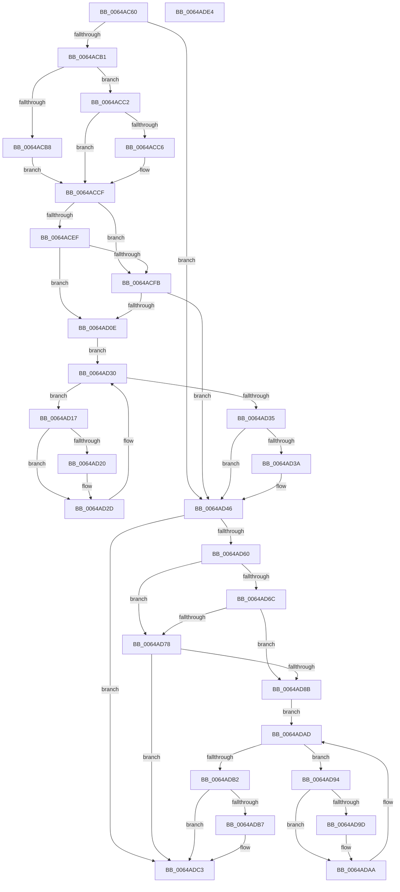

# DifZwSetInformationTransactionWrapper

- RVA: `0x0064AC60`–`0x0064ADE5` (길이 `389` bytes)
- VA: `0x000000014064AC60`
- 실행 섹션: `.text`
- PDB 이름 있음: `예`; PDB Function 태그: `아니요`
- unwind 정보 RVA: `0x000D2B7C`
- 디코드: `112`개 명령, `389/389` bytes 표시
- 미해석 바이트: `0` (있으면 어셈블리에 `.byte`로 보존)

> 이 문서는 커널 이미지의 기계어와 PDB 기호를 분석해 생성했습니다. 4번과 5번은 함수 원형과 자료형을 바이너리 사용 방식에서 추정한 C 해석이며 원본 소스 복구 결과는 아닙니다.

## 1. Dependencies

- 직접 호출 지점: **9**; 고유 호출 대상: **6**
- 직접 호출자로 확인된 함수: **0**
- RIP 상대 이미지 참조: **3**

### Outgoing calls
- `0x0064ACA0` → [DifGetAPIThunkContextById](../49/DifGetAPIThunkContextById_function_00495A34.md) (function, `0x00495A34`)
- `0x0064ACC6` → [DifGetReturnAddressForWrappers](../4D/DifGetReturnAddressForWrappers_function_004D3C08.md) (function, `0x004D3C08`)
- `0x0064AD02` → [ExAcquireRundownProtection](../21/ExAcquireRundownProtection_function_00216620.md) (function, `0x00216620`)
- `0x0064AD28` → [guard_dispatch_icall](../6B/guard_dispatch_icall_function_006BAAD0.md) (function, `0x006BAAD0`)
- `0x0064AD41` → [ExReleaseRundownProtection](../34/ExReleaseRundownProtection_function_00349E80.md) (function, `0x00349E80`)
- `0x0064AD53` → [ZwSetInformationTransaction](../6B/ZwSetInformationTransaction_function_006B06B0.md) (function, `0x006B06B0`)
- `0x0064AD7F` → [ExAcquireRundownProtection](../21/ExAcquireRundownProtection_function_00216620.md) (function, `0x00216620`)
- `0x0064ADA5` → [guard_dispatch_icall](../6B/guard_dispatch_icall_function_006BAAD0.md) (function, `0x006BAAD0`)
- `0x0064ADBE` → [ExReleaseRundownProtection](../34/ExReleaseRundownProtection_function_00349E80.md) (function, `0x00349E80`)

### Direct callers
- 이 함수 시작 RVA로 연결되는 직접 call은 확인되지 않았습니다. 간접 호출은 완전히 역산할 수 없습니다.

### Static image references
- `0x0064ACD6` → RVA `0x00F048B8` (`.data`; read)
- `0x0064ACEF` → RVA `0x00F04980` (`.data`; read)
- `0x0064ACFB` → RVA `0x00F03E80` (`.data`; read)

## 2. Other-region calls and transfers

- 다른 실행 섹션으로 향하는 call: **0**
- 별도 외부 분기/꼬리 이동을 확인하지 못했습니다.

## 3. Assembly (complete function range)

```asm
0064AC60  48 8B C4                        mov rax, rsp
0064AC63  48 89 58 10                     mov qword ptr [rax + 0x10], rbx
0064AC67  48 89 70 18                     mov qword ptr [rax + 0x18], rsi
0064AC6B  48 89 78 20                     mov qword ptr [rax + 0x20], rdi
0064AC6F  48 89 48 08                     mov qword ptr [rax + 8], rcx
0064AC73  55                              push rbp
0064AC74  41 54                           push r12
0064AC76  41 55                           push r13
0064AC78  41 56                           push r14
0064AC7A  41 57                           push r15
0064AC7C  48 8B EC                        mov rbp, rsp
0064AC7F  48 83 EC 50                     sub rsp, 0x50
0064AC83  0F 57 C0                        xorps xmm0, xmm0
0064AC86  B9 0C 00 00 00                  mov ecx, 0xc
0064AC8B  0F 11 45 D0                     movups xmmword ptr [rbp - 0x30], xmm0
0064AC8F  45 8B F9                        mov r15d, r9d
0064AC92  4D 8B E0                        mov r12, r8
0064AC95  0F 11 45 E0                     movups xmmword ptr [rbp - 0x20], xmm0
0064AC99  44 8B EA                        mov r13d, edx
0064AC9C  0F 11 45 F0                     movups xmmword ptr [rbp - 0x10], xmm0
0064ACA0  E8 8F AD E4 FF                  call 0x140495a34
0064ACA5  48 8B F0                        mov rsi, rax
0064ACA8  48 85 C0                        test rax, rax
0064ACAB  0F 84 95 00 00 00               je 0x14064ad46
0064ACB1  8B 40 0C                        mov eax, dword ptr [rax + 0xc]
0064ACB4  A8 18                           test al, 0x18
0064ACB6  74 0A                           je 0x14064acc2
0064ACB8  48 8B 4D 28                     mov rcx, qword ptr [rbp + 0x28]
0064ACBC  48 89 4D D0                     mov qword ptr [rbp - 0x30], rcx
0064ACC0  EB 0D                           jmp 0x14064accf
0064ACC2  A8 04                           test al, 4
0064ACC4  74 09                           je 0x14064accf
0064ACC6  E8 3D 8F E8 FF                  call 0x1404d3c08
0064ACCB  48 89 45 D0                     mov qword ptr [rbp - 0x30], rax
0064ACCF  48 8B 45 30                     mov rax, qword ptr [rbp + 0x30]
0064ACD3  45 32 F6                        xor r14b, r14b
0064ACD6  44 38 35 DB 9B 8B 00            cmp byte ptr [rip + 0x8b9bdb], r14b
0064ACDD  48 89 45 F0                     mov qword ptr [rbp - 0x10], rax
0064ACE1  44 89 6D E8                     mov dword ptr [rbp - 0x18], r13d
0064ACE5  4C 89 65 E0                     mov qword ptr [rbp - 0x20], r12
0064ACE9  44 89 7D D8                     mov dword ptr [rbp - 0x28], r15d
0064ACED  75 0C                           jne 0x14064acfb
0064ACEF  F7 05 87 9C 8B 00 00 08 00 00   test dword ptr [rip + 0x8b9c87], 0x800
0064ACF9  74 13                           je 0x14064ad0e
0064ACFB  48 8D 0D 7E 91 8B 00            lea rcx, [rip + 0x8b917e]
0064AD02  E8 19 B9 BC FF                  call 0x140216620
0064AD07  44 8A F0                        mov r14b, al
0064AD0A  84 C0                           test al, al
0064AD0C  74 38                           je 0x14064ad46
0064AD0E  48 8D 7E 20                     lea rdi, [rsi + 0x20]
0064AD12  48 8B 1F                        mov rbx, qword ptr [rdi]
0064AD15  EB 19                           jmp 0x14064ad30
0064AD17  48 8D 43 F0                     lea rax, [rbx - 0x10]
0064AD1B  48 85 C0                        test rax, rax
0064AD1E  74 0D                           je 0x14064ad2d
0064AD20  48 8B 40 08                     mov rax, qword ptr [rax + 8]
0064AD24  48 8D 4D D0                     lea rcx, [rbp - 0x30]
0064AD28  E8 A3 FD 06 00                  call 0x1406baad0
0064AD2D  48 8B 1B                        mov rbx, qword ptr [rbx]
0064AD30  48 3B DF                        cmp rbx, rdi
0064AD33  75 E2                           jne 0x14064ad17
0064AD35  45 84 F6                        test r14b, r14b
0064AD38  74 0C                           je 0x14064ad46
0064AD3A  48 8D 0D 3F 91 8B 00            lea rcx, [rip + 0x8b913f]
0064AD41  E8 3A F1 CF FF                  call 0x140349e80
0064AD46  48 8B 4D 30                     mov rcx, qword ptr [rbp + 0x30]
0064AD4A  45 8B CF                        mov r9d, r15d
0064AD4D  4D 8B C4                        mov r8, r12
0064AD50  41 8B D5                        mov edx, r13d
0064AD53  E8 58 59 06 00                  call 0x1406b06b0
0064AD58  89 45 F8                        mov dword ptr [rbp - 8], eax
0064AD5B  48 85 F6                        test rsi, rsi
0064AD5E  74 63                           je 0x14064adc3
0064AD60  40 32 FF                        xor dil, dil
0064AD63  40 38 3D 4E 9B 8B 00            cmp byte ptr [rip + 0x8b9b4e], dil
0064AD6A  75 0C                           jne 0x14064ad78
0064AD6C  F7 05 0A 9C 8B 00 00 08 00 00   test dword ptr [rip + 0x8b9c0a], 0x800
0064AD76  74 13                           je 0x14064ad8b
0064AD78  48 8D 0D 01 91 8B 00            lea rcx, [rip + 0x8b9101]
0064AD7F  E8 9C B8 BC FF                  call 0x140216620
0064AD84  40 8A F8                        mov dil, al
0064AD87  84 C0                           test al, al
0064AD89  74 38                           je 0x14064adc3
0064AD8B  48 83 C6 30                     add rsi, 0x30
0064AD8F  48 8B 1E                        mov rbx, qword ptr [rsi]
0064AD92  EB 19                           jmp 0x14064adad
0064AD94  48 8D 43 F0                     lea rax, [rbx - 0x10]
0064AD98  48 85 C0                        test rax, rax
0064AD9B  74 0D                           je 0x14064adaa
0064AD9D  48 8B 40 08                     mov rax, qword ptr [rax + 8]
0064ADA1  48 8D 4D D0                     lea rcx, [rbp - 0x30]
0064ADA5  E8 26 FD 06 00                  call 0x1406baad0
0064ADAA  48 8B 1B                        mov rbx, qword ptr [rbx]
0064ADAD  48 3B DE                        cmp rbx, rsi
0064ADB0  75 E2                           jne 0x14064ad94
0064ADB2  40 84 FF                        test dil, dil
0064ADB5  74 0C                           je 0x14064adc3
0064ADB7  48 8D 0D C2 90 8B 00            lea rcx, [rip + 0x8b90c2]
0064ADBE  E8 BD F0 CF FF                  call 0x140349e80
0064ADC3  8B 45 F8                        mov eax, dword ptr [rbp - 8]
0064ADC6  4C 8D 5C 24 50                  lea r11, [rsp + 0x50]
0064ADCB  49 8B 5B 38                     mov rbx, qword ptr [r11 + 0x38]
0064ADCF  49 8B 73 40                     mov rsi, qword ptr [r11 + 0x40]
0064ADD3  49 8B 7B 48                     mov rdi, qword ptr [r11 + 0x48]
0064ADD7  49 8B E3                        mov rsp, r11
0064ADDA  41 5F                           pop r15
0064ADDC  41 5E                           pop r14
0064ADDE  41 5D                           pop r13
0064ADE0  41 5C                           pop r12
0064ADE2  5D                              pop rbp
0064ADE3  C3                              ret
0064ADE4  CC                              int3
```

## 4. C-style interpretation (structured pseudocode)

```c
__int64 __fastcall DifZwSetInformationTransactionWrapper(__int64 a1, int a2, __int64 a3, int a4)
{
    __int64 result;
    __int64 v_r14;
    __int64 v_rdi;
    __int64 v_rsi;
    __int64 v_rsp;
    unsigned __int64 v_stack_m28;
    unsigned int v_stack_m30;
    unsigned __int64 v_stack_m38;
    unsigned int v_stack_m40;
    unsigned __int64 v_stack_m48;
    unsigned int v_stack_m50;
    unsigned __int64 v_stack_m58;
    unsigned __int64 v_stack_p0;
    unsigned __int64 v_stack_p8;

    *(unsigned __int64 *)(v_rsp + 16) = v_rbx;
    *(unsigned __int64 *)(v_rsp + 24) = v_rsi;
    *(unsigned __int64 *)(v_rsp + 32) = v_rdi;
    *(unsigned __int64 *)(v_rsp + 8) = a1;
    v_rsp = (v_rsp) - (80);
    v_stack_m58 = v_xmm0;
    v_stack_m48 = v_xmm0;
    v_stack_m38 = v_xmm0;
    result = DifGetAPIThunkContextById(12, a2, a3, a4);
    if (result == 0) goto loc_0064AD46;
    if ((((unsigned __int8)((unsigned int)(*(unsigned int *)(result + 12)))) & (24)) == 0) goto loc_0064ACC2;
    v_stack_m58 = v_stack_p0;
    goto loc_0064ACCF;
loc_0064ACC2:
    result = (unsigned int)(*(unsigned int *)(result + 12));
    if ((((unsigned __int8)((unsigned int)(*(unsigned int *)(result + 12)))) & (4)) != 0) {
        result = DifGetReturnAddressForWrappers(v_stack_p0, a2, a3, a4);
        v_stack_m58 = result;
    }
    v_r14 = 0;
    v_stack_m38 = v_stack_p8;
    v_stack_m40 = (unsigned int)((unsigned int)(a2));
    v_stack_m48 = a3;
    v_stack_m50 = (unsigned int)((unsigned int)(a4));
    if ((*(unsigned __int8 *)(v_rip + 9149403)) != 0) goto loc_0064ACFB;
    if (((*(unsigned int *)(v_rip + 9149575)) & (0x800ULL)) == 0) goto loc_0064AD0E;
loc_0064ACFB:
    result = ExAcquireRundownProtection(v_rip + 9146750, a2, a3, a4);
    if ((unsigned __int8)(result) == 0) goto loc_0064AD46;
loc_0064AD0E:
    goto loc_0064AD30;
loc_0064AD17:
    result = *(unsigned __int64 *)(result + 32) - 16;
    if (*(unsigned __int64 *)(result + 32) - 16 != 0) {
        result = *(unsigned __int64 *)(*(unsigned __int64 *)(result + 32) - 16 + 8);
        a1 = v_stack_m58;
        result = guard_dispatch_icall(a1, a2, a3, a4);
    }
loc_0064AD30:
    if ((*(unsigned __int64 *)(*(unsigned __int64 *)(result + 32))) != (result + 32)) goto loc_0064AD17;
    if ((unsigned __int8)((unsigned __int8)(result)) != 0) {
        a1 = v_rip + 9146687;
        result = ExReleaseRundownProtection(a1, a2, a3, a4);
    }
    result = ZwSetInformationTransaction(v_stack_p8, (unsigned int)((unsigned int)((unsigned int)(a2))), a3, (unsigned int)((unsigned int)((unsigned int)(a4))));
    v_stack_m30 = (unsigned int)(result);
    if (result == 0) goto loc_0064ADC3;
    v_rdi = 0;
    if ((*(unsigned __int8 *)(v_rip + 9149262)) != 0) goto loc_0064AD78;
    if (((*(unsigned int *)(v_rip + 9149450)) & (0x800ULL)) == 0) goto loc_0064AD8B;
loc_0064AD78:
    result = ExAcquireRundownProtection(v_rip + 9146625, (unsigned int)((unsigned int)((unsigned int)(a2))), a3, (unsigned int)((unsigned int)((unsigned int)(a4))));
    if ((unsigned __int8)(result) == 0) goto loc_0064ADC3;
loc_0064AD8B:
    v_rsi = (result) + (48);
    goto loc_0064ADAD;
loc_0064AD94:
    result = *(unsigned __int64 *)(v_rsi) - 16;
    if (*(unsigned __int64 *)(v_rsi) - 16 != 0) {
        result = *(unsigned __int64 *)(*(unsigned __int64 *)(v_rsi) - 16 + 8);
        a1 = v_stack_m58;
        result = guard_dispatch_icall(a1, (unsigned int)((unsigned int)((unsigned int)(a2))), a3, (unsigned int)((unsigned int)((unsigned int)(a4))));
    }
loc_0064ADAD:
    if ((*(unsigned __int64 *)(*(unsigned __int64 *)(v_rsi))) != v_rsi) goto loc_0064AD94;
    if ((unsigned __int8)((unsigned __int8)(result)) != 0) {
        a1 = v_rip + 9146562;
        result = ExReleaseRundownProtection(a1, (unsigned int)((unsigned int)((unsigned int)(a2))), a3, (unsigned int)((unsigned int)((unsigned int)(a4))));
    }
    return (unsigned int)(v_stack_m30);
}
```

## 5. (Beta) C Style

```c
int64_t DifZwSetInformationTransactionWrapper(int64_t Arg1, int32_t Arg2, int64_t Arg3, int32_t Arg4)
{
    int64_t result;
    int64_t local_r14;
    int64_t local_rdi;
    int64_t local_rsi;
    int64_t local_rsp;
    uint64_t v_stack_m28;
    uint32_t v_stack_m30;
    uint64_t v_stack_m38;
    uint32_t v_stack_m40;
    uint64_t v_stack_m48;
    uint32_t v_stack_m50;
    uint64_t v_stack_m58;
    uint64_t v_stack_p0;
    uint64_t v_stack_p8;

    *(uint64_t *)(local_rsp + 0x10) = local_rbx;
    *(uint64_t *)(local_rsp + 0x18) = local_rsi;
    *(uint64_t *)(local_rsp + 0x20) = local_rdi;
    *(uint64_t *)(local_rsp + 0x8) = Arg1;
    local_rsp = (local_rsp) - (80);
    v_stack_m58 = v_xmm0;
    v_stack_m48 = v_xmm0;
    v_stack_m38 = v_xmm0;
    result = DifGetAPIThunkContextById(12, Arg2, Arg3, Arg4);
    if (result == 0) goto loc_0064AD46;
    if ((((uint8_t)((uint32_t)(*(uint32_t *)(result + 0xC)))) & (24)) == 0) goto loc_0064ACC2;
    v_stack_m58 = v_stack_p0;
    goto loc_0064ACCF;
loc_0064ACC2:
    result = (uint32_t)(*(uint32_t *)(result + 0xC));
    if ((((uint8_t)((uint32_t)(*(uint32_t *)(result + 0xC)))) & (4)) != 0) {
        result = DifGetReturnAddressForWrappers(v_stack_p0, Arg2, Arg3, Arg4);
        v_stack_m58 = result;
    }
    local_r14 = 0;
    v_stack_m38 = v_stack_p8;
    v_stack_m40 = (uint32_t)((uint32_t)(Arg2));
    v_stack_m48 = Arg3;
    v_stack_m50 = (uint32_t)((uint32_t)(Arg4));
    if ((*(uint8_t *)(v_rip + 0x8B9BDB)) != 0) goto loc_0064ACFB;
    if (((*(uint32_t *)(v_rip + 0x8B9C87)) & (0x800ULL)) == 0) goto loc_0064AD0E;
loc_0064ACFB:
    result = ExAcquireRundownProtection(v_rip + 9146750, Arg2, Arg3, Arg4);
    if ((uint8_t)(result) == 0) goto loc_0064AD46;
loc_0064AD0E:
    goto loc_0064AD30;
loc_0064AD17:
    result = *(uint64_t *)(result + 0x20) - 16;
    if (*(uint64_t *)(result + 0x20) - 16 != 0) {
        result = *(uint64_t *)(*(uint64_t *)(result + 0x20) - 0x10 + 0x8);
        Arg1 = v_stack_m58;
        result = guard_dispatch_icall(Arg1, Arg2, Arg3, Arg4);
    }
loc_0064AD30:
    if ((*(uint64_t *)(*(uint64_t *)(result + 0x20))) != (result + 32)) goto loc_0064AD17;
    if ((uint8_t)((uint8_t)(result)) != 0) {
        Arg1 = v_rip + 9146687;
        result = ExReleaseRundownProtection(Arg1, Arg2, Arg3, Arg4);
    }
    result = ZwSetInformationTransaction(v_stack_p8, (uint32_t)((uint32_t)((uint32_t)(Arg2))), Arg3, (uint32_t)((uint32_t)((uint32_t)(Arg4))));
    v_stack_m30 = (uint32_t)(result);
    if (result == 0) goto loc_0064ADC3;
    local_rdi = 0;
    if ((*(uint8_t *)(v_rip + 0x8B9B4E)) != 0) goto loc_0064AD78;
    if (((*(uint32_t *)(v_rip + 0x8B9C0A)) & (0x800ULL)) == 0) goto loc_0064AD8B;
loc_0064AD78:
    result = ExAcquireRundownProtection(v_rip + 9146625, (uint32_t)((uint32_t)((uint32_t)(Arg2))), Arg3, (uint32_t)((uint32_t)((uint32_t)(Arg4))));
    if ((uint8_t)(result) == 0) goto loc_0064ADC3;
loc_0064AD8B:
    local_rsi = (result) + (48);
    goto loc_0064ADAD;
loc_0064AD94:
    result = *(uint64_t *)(local_rsi) - 16;
    if (*(uint64_t *)(local_rsi) - 16 != 0) {
        result = *(uint64_t *)(*(uint64_t *)(local_rsi) - 0x10 + 0x8);
        Arg1 = v_stack_m58;
        result = guard_dispatch_icall(Arg1, (uint32_t)((uint32_t)((uint32_t)(Arg2))), Arg3, (uint32_t)((uint32_t)((uint32_t)(Arg4))));
    }
loc_0064ADAD:
    if ((*(uint64_t *)(*(uint64_t *)(local_rsi))) != local_rsi) goto loc_0064AD94;
    if ((uint8_t)((uint8_t)(result)) != 0) {
        Arg1 = v_rip + 9146562;
        result = ExReleaseRundownProtection(Arg1, (uint32_t)((uint32_t)((uint32_t)(Arg2))), Arg3, (uint32_t)((uint32_t)((uint32_t)(Arg4))));
    }
    return (uint32_t)(v_stack_m30);
}
```

## 6. Execution-region graph

[열기: 2D/3D 그래프와 함수 탐색 컨트롤 패널](../../../control-panel.html?section=text&rva=0x0064AC60&view=graph)

- 2D 그래프는 위에서 아래로 흐르고, 3D 그래프는 빈 공간을 드래그해 회전합니다. Shift+드래그는 이동, 휠은 확대·축소, 함수 노드 선택은 대상 보고서 이동입니다.

### Static fallback


