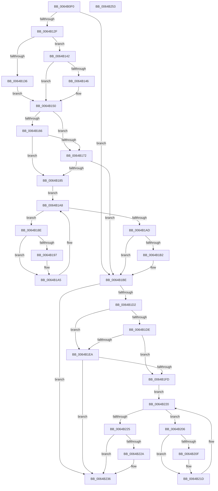

# DifZwSetSystemTimeWrapper

- RVA: `0x0064B0F0`–`0x0064B254` (길이 `356` bytes)
- VA: `0x000000014064B0F0`
- 실행 섹션: `.text`
- PDB 이름 있음: `예`; PDB Function 태그: `아니요`
- unwind 정보 RVA: `0x00093E28`
- 디코드: `98`개 명령, `356/356` bytes 표시
- 미해석 바이트: `0` (있으면 어셈블리에 `.byte`로 보존)

> 이 문서는 커널 이미지의 기계어와 PDB 기호를 분석해 생성했습니다. 4번과 5번은 함수 원형과 자료형을 바이너리 사용 방식에서 추정한 C 해석이며 원본 소스 복구 결과는 아닙니다.

## 1. Dependencies

- 직접 호출 지점: **9**; 고유 호출 대상: **6**
- 직접 호출자로 확인된 함수: **0**
- RIP 상대 이미지 참조: **3**

### Outgoing calls
- `0x0064B11E` → [DifGetAPIThunkContextById](../49/DifGetAPIThunkContextById_function_00495A34.md) (function, `0x00495A34`)
- `0x0064B146` → [DifGetReturnAddressForWrappers](../4D/DifGetReturnAddressForWrappers_function_004D3C08.md) (function, `0x004D3C08`)
- `0x0064B179` → [ExAcquireRundownProtection](../21/ExAcquireRundownProtection_function_00216620.md) (function, `0x00216620`)
- `0x0064B1A0` → [guard_dispatch_icall](../6B/guard_dispatch_icall_function_006BAAD0.md) (function, `0x006BAAD0`)
- `0x0064B1B9` → [ExReleaseRundownProtection](../34/ExReleaseRundownProtection_function_00349E80.md) (function, `0x00349E80`)
- `0x0064B1C4` → [ZwSetSystemTime](../6B/ZwSetSystemTime_function_006B08B0.md) (function, `0x006B08B0`)
- `0x0064B1F1` → [ExAcquireRundownProtection](../21/ExAcquireRundownProtection_function_00216620.md) (function, `0x00216620`)
- `0x0064B218` → [guard_dispatch_icall](../6B/guard_dispatch_icall_function_006BAAD0.md) (function, `0x006BAAD0`)
- `0x0064B231` → [ExReleaseRundownProtection](../34/ExReleaseRundownProtection_function_00349E80.md) (function, `0x00349E80`)

### Direct callers
- 이 함수 시작 RVA로 연결되는 직접 call은 확인되지 않았습니다. 간접 호출은 완전히 역산할 수 없습니다.

### Static image references
- `0x0064B158` → RVA `0x00F048B8` (`.data`; read)
- `0x0064B166` → RVA `0x00F04980` (`.data`; read)
- `0x0064B172` → RVA `0x00F03E80` (`.data`; read)

## 2. Other-region calls and transfers

- 다른 실행 섹션으로 향하는 call: **0**
- 별도 외부 분기/꼬리 이동을 확인하지 못했습니다.

## 3. Assembly (complete function range)

```asm
0064B0F0  48 8B C4                        mov rax, rsp
0064B0F3  48 89 58 08                     mov qword ptr [rax + 8], rbx
0064B0F7  48 89 68 10                     mov qword ptr [rax + 0x10], rbp
0064B0FB  48 89 70 18                     mov qword ptr [rax + 0x18], rsi
0064B0FF  57                              push rdi
0064B100  41 56                           push r14
0064B102  41 57                           push r15
0064B104  48 83 EC 40                     sub rsp, 0x40
0064B108  0F 57 C0                        xorps xmm0, xmm0
0064B10B  4C 8B F9                        mov r15, rcx
0064B10E  B9 09 00 00 00                  mov ecx, 9
0064B113  4C 8B F2                        mov r14, rdx
0064B116  0F 11 40 C8                     movups xmmword ptr [rax - 0x38], xmm0
0064B11A  0F 11 40 D8                     movups xmmword ptr [rax - 0x28], xmm0
0064B11E  E8 11 A9 E4 FF                  call 0x140495a34
0064B123  48 8B F0                        mov rsi, rax
0064B126  48 85 C0                        test rax, rax
0064B129  0F 84 8F 00 00 00               je 0x14064b1be
0064B12F  8B 40 0C                        mov eax, dword ptr [rax + 0xc]
0064B132  A8 18                           test al, 0x18
0064B134  74 0C                           je 0x14064b142
0064B136  48 8B 4C 24 58                  mov rcx, qword ptr [rsp + 0x58]
0064B13B  48 89 4C 24 20                  mov qword ptr [rsp + 0x20], rcx
0064B140  EB 0E                           jmp 0x14064b150
0064B142  A8 04                           test al, 4
0064B144  74 0A                           je 0x14064b150
0064B146  E8 BD 8A E8 FF                  call 0x1404d3c08
0064B14B  48 89 44 24 20                  mov qword ptr [rsp + 0x20], rax
0064B150  40 32 ED                        xor bpl, bpl
0064B153  4C 89 7C 24 30                  mov qword ptr [rsp + 0x30], r15
0064B158  40 38 2D 59 97 8B 00            cmp byte ptr [rip + 0x8b9759], bpl
0064B15F  4C 89 74 24 28                  mov qword ptr [rsp + 0x28], r14
0064B164  75 0C                           jne 0x14064b172
0064B166  F7 05 10 98 8B 00 00 08 00 00   test dword ptr [rip + 0x8b9810], 0x800
0064B170  74 13                           je 0x14064b185
0064B172  48 8D 0D 07 8D 8B 00            lea rcx, [rip + 0x8b8d07]
0064B179  E8 A2 B4 BC FF                  call 0x140216620
0064B17E  40 8A E8                        mov bpl, al
0064B181  84 C0                           test al, al
0064B183  74 39                           je 0x14064b1be
0064B185  48 8D 7E 20                     lea rdi, [rsi + 0x20]
0064B189  48 8B 1F                        mov rbx, qword ptr [rdi]
0064B18C  EB 1A                           jmp 0x14064b1a8
0064B18E  48 8D 43 F0                     lea rax, [rbx - 0x10]
0064B192  48 85 C0                        test rax, rax
0064B195  74 0E                           je 0x14064b1a5
0064B197  48 8B 40 08                     mov rax, qword ptr [rax + 8]
0064B19B  48 8D 4C 24 20                  lea rcx, [rsp + 0x20]
0064B1A0  E8 2B F9 06 00                  call 0x1406baad0
0064B1A5  48 8B 1B                        mov rbx, qword ptr [rbx]
0064B1A8  48 3B DF                        cmp rbx, rdi
0064B1AB  75 E1                           jne 0x14064b18e
0064B1AD  40 84 ED                        test bpl, bpl
0064B1B0  74 0C                           je 0x14064b1be
0064B1B2  48 8D 0D C7 8C 8B 00            lea rcx, [rip + 0x8b8cc7]
0064B1B9  E8 C2 EC CF FF                  call 0x140349e80
0064B1BE  49 8B D6                        mov rdx, r14
0064B1C1  49 8B CF                        mov rcx, r15
0064B1C4  E8 E7 56 06 00                  call 0x1406b08b0
0064B1C9  89 44 24 38                     mov dword ptr [rsp + 0x38], eax
0064B1CD  48 85 F6                        test rsi, rsi
0064B1D0  74 64                           je 0x14064b236
0064B1D2  40 32 FF                        xor dil, dil
0064B1D5  40 38 3D DC 96 8B 00            cmp byte ptr [rip + 0x8b96dc], dil
0064B1DC  75 0C                           jne 0x14064b1ea
0064B1DE  F7 05 98 97 8B 00 00 08 00 00   test dword ptr [rip + 0x8b9798], 0x800
0064B1E8  74 13                           je 0x14064b1fd
0064B1EA  48 8D 0D 8F 8C 8B 00            lea rcx, [rip + 0x8b8c8f]
0064B1F1  E8 2A B4 BC FF                  call 0x140216620
0064B1F6  40 8A F8                        mov dil, al
0064B1F9  84 C0                           test al, al
0064B1FB  74 39                           je 0x14064b236
0064B1FD  48 83 C6 30                     add rsi, 0x30
0064B201  48 8B 1E                        mov rbx, qword ptr [rsi]
0064B204  EB 1A                           jmp 0x14064b220
0064B206  48 8D 43 F0                     lea rax, [rbx - 0x10]
0064B20A  48 85 C0                        test rax, rax
0064B20D  74 0E                           je 0x14064b21d
0064B20F  48 8B 40 08                     mov rax, qword ptr [rax + 8]
0064B213  48 8D 4C 24 20                  lea rcx, [rsp + 0x20]
0064B218  E8 B3 F8 06 00                  call 0x1406baad0
0064B21D  48 8B 1B                        mov rbx, qword ptr [rbx]
0064B220  48 3B DE                        cmp rbx, rsi
0064B223  75 E1                           jne 0x14064b206
0064B225  40 84 FF                        test dil, dil
0064B228  74 0C                           je 0x14064b236
0064B22A  48 8D 0D 4F 8C 8B 00            lea rcx, [rip + 0x8b8c4f]
0064B231  E8 4A EC CF FF                  call 0x140349e80
0064B236  8B 44 24 38                     mov eax, dword ptr [rsp + 0x38]
0064B23A  48 8B 5C 24 60                  mov rbx, qword ptr [rsp + 0x60]
0064B23F  48 8B 6C 24 68                  mov rbp, qword ptr [rsp + 0x68]
0064B244  48 8B 74 24 70                  mov rsi, qword ptr [rsp + 0x70]
0064B249  48 83 C4 40                     add rsp, 0x40
0064B24D  41 5F                           pop r15
0064B24F  41 5E                           pop r14
0064B251  5F                              pop rdi
0064B252  C3                              ret
0064B253  CC                              int3
```

## 4. C-style interpretation (structured pseudocode)

```c
__int64 __fastcall DifZwSetSystemTimeWrapper(__int64 a1, __int64 a2)
{
    __int64 result;
    __int64 v_rbp;
    __int64 v_rdi;
    __int64 v_rsi;
    __int64 v_rsp;
    unsigned int v_stack_m20;
    unsigned __int64 v_stack_m28;
    unsigned __int64 v_stack_m30;
    unsigned __int64 v_stack_m38;
    unsigned __int64 v_stack_p0;
    unsigned __int64 v_stack_p10;
    unsigned __int64 v_stack_p18;
    unsigned __int64 v_stack_p8;

    *(unsigned __int64 *)(v_rsp + 8) = v_rbx;
    *(unsigned __int64 *)(v_rsp + 16) = v_rbp;
    *(unsigned __int64 *)(v_rsp + 24) = v_rsi;
    v_rsp = (v_rsp) - (64);
    *(unsigned __int64 *)(v_rsp - 56) = v_xmm0;
    *(unsigned __int64 *)(v_rsp - 40) = v_xmm0;
    result = DifGetAPIThunkContextById(9, a2, a3, a4);
    if (result == 0) goto loc_0064B1BE;
    if ((((unsigned __int8)((unsigned int)(*(unsigned int *)(result + 12)))) & (24)) == 0) goto loc_0064B142;
    v_stack_m38 = v_stack_p0;
    goto loc_0064B150;
loc_0064B142:
    result = (unsigned int)(*(unsigned int *)(result + 12));
    if ((((unsigned __int8)((unsigned int)(*(unsigned int *)(result + 12)))) & (4)) != 0) {
        result = DifGetReturnAddressForWrappers(v_stack_p0, a2, a3, a4);
        v_stack_m38 = result;
    }
    v_rbp = 0;
    v_stack_m28 = a1;
    v_stack_m30 = a2;
    if ((*(unsigned __int8 *)(v_rip + 9148249)) != 0) goto loc_0064B172;
    if (((*(unsigned int *)(v_rip + 9148432)) & (0x800ULL)) == 0) goto loc_0064B185;
loc_0064B172:
    result = ExAcquireRundownProtection(v_rip + 9145607, a2, a3, a4);
    if ((unsigned __int8)(result) == 0) goto loc_0064B1BE;
loc_0064B185:
    goto loc_0064B1A8;
loc_0064B18E:
    result = *(unsigned __int64 *)(result + 32) - 16;
    if (*(unsigned __int64 *)(result + 32) - 16 != 0) {
        result = *(unsigned __int64 *)(*(unsigned __int64 *)(result + 32) - 16 + 8);
        a1 = v_stack_m38;
        result = guard_dispatch_icall(a1, a2, a3, a4);
    }
loc_0064B1A8:
    if ((*(unsigned __int64 *)(*(unsigned __int64 *)(result + 32))) != (result + 32)) goto loc_0064B18E;
    if ((unsigned __int8)((unsigned __int8)(result)) != 0) {
        a1 = v_rip + 9145543;
        result = ExReleaseRundownProtection(a1, a2, a3, a4);
    }
    result = ZwSetSystemTime(a1, a2, a3, a4);
    v_stack_m20 = (unsigned int)(result);
    if (result == 0) goto loc_0064B236;
    v_rdi = 0;
    if ((*(unsigned __int8 *)(v_rip + 9148124)) != 0) goto loc_0064B1EA;
    if (((*(unsigned int *)(v_rip + 9148312)) & (0x800ULL)) == 0) goto loc_0064B1FD;
loc_0064B1EA:
    result = ExAcquireRundownProtection(v_rip + 9145487, a2, a3, a4);
    if ((unsigned __int8)(result) == 0) goto loc_0064B236;
loc_0064B1FD:
    v_rsi = (result) + (48);
    goto loc_0064B220;
loc_0064B206:
    result = *(unsigned __int64 *)(v_rsi) - 16;
    if (*(unsigned __int64 *)(v_rsi) - 16 != 0) {
        result = *(unsigned __int64 *)(*(unsigned __int64 *)(v_rsi) - 16 + 8);
        a1 = v_stack_m38;
        result = guard_dispatch_icall(a1, a2, a3, a4);
    }
loc_0064B220:
    if ((*(unsigned __int64 *)(*(unsigned __int64 *)(v_rsi))) != v_rsi) goto loc_0064B206;
    if ((unsigned __int8)((unsigned __int8)(result)) != 0) {
        a1 = v_rip + 9145423;
        result = ExReleaseRundownProtection(a1, a2, a3, a4);
    }
    v_rsp = (v_rsp) + (64);
    return (unsigned int)(v_stack_m20);
}
```

## 5. (Beta) C Style

```c
int64_t DifZwSetSystemTimeWrapper(int64_t Arg1, int64_t Arg2)
{
    int64_t result;
    int64_t local_rbp;
    int64_t local_rdi;
    int64_t local_rsi;
    int64_t local_rsp;
    uint32_t v_stack_m20;
    uint64_t v_stack_m28;
    uint64_t v_stack_m30;
    uint64_t v_stack_m38;
    uint64_t v_stack_p0;
    uint64_t v_stack_p10;
    uint64_t v_stack_p18;
    uint64_t v_stack_p8;

    *(uint64_t *)(local_rsp + 0x8) = local_rbx;
    *(uint64_t *)(local_rsp + 0x10) = local_rbp;
    *(uint64_t *)(local_rsp + 0x18) = local_rsi;
    local_rsp = (local_rsp) - (64);
    *(uint64_t *)(local_rsp - 0x38) = v_xmm0;
    *(uint64_t *)(local_rsp - 0x28) = v_xmm0;
    result = DifGetAPIThunkContextById(9, Arg2, a3, a4);
    if (result == 0) goto loc_0064B1BE;
    if ((((uint8_t)((uint32_t)(*(uint32_t *)(result + 0xC)))) & (24)) == 0) goto loc_0064B142;
    v_stack_m38 = v_stack_p0;
    goto loc_0064B150;
loc_0064B142:
    result = (uint32_t)(*(uint32_t *)(result + 0xC));
    if ((((uint8_t)((uint32_t)(*(uint32_t *)(result + 0xC)))) & (4)) != 0) {
        result = DifGetReturnAddressForWrappers(v_stack_p0, Arg2, a3, a4);
        v_stack_m38 = result;
    }
    local_rbp = 0;
    v_stack_m28 = Arg1;
    v_stack_m30 = Arg2;
    if ((*(uint8_t *)(v_rip + 0x8B9759)) != 0) goto loc_0064B172;
    if (((*(uint32_t *)(v_rip + 0x8B9810)) & (0x800ULL)) == 0) goto loc_0064B185;
loc_0064B172:
    result = ExAcquireRundownProtection(v_rip + 9145607, Arg2, a3, a4);
    if ((uint8_t)(result) == 0) goto loc_0064B1BE;
loc_0064B185:
    goto loc_0064B1A8;
loc_0064B18E:
    result = *(uint64_t *)(result + 0x20) - 16;
    if (*(uint64_t *)(result + 0x20) - 16 != 0) {
        result = *(uint64_t *)(*(uint64_t *)(result + 0x20) - 0x10 + 0x8);
        Arg1 = v_stack_m38;
        result = guard_dispatch_icall(Arg1, Arg2, a3, a4);
    }
loc_0064B1A8:
    if ((*(uint64_t *)(*(uint64_t *)(result + 0x20))) != (result + 32)) goto loc_0064B18E;
    if ((uint8_t)((uint8_t)(result)) != 0) {
        Arg1 = v_rip + 9145543;
        result = ExReleaseRundownProtection(Arg1, Arg2, a3, a4);
    }
    result = ZwSetSystemTime(Arg1, Arg2, a3, a4);
    v_stack_m20 = (uint32_t)(result);
    if (result == 0) goto loc_0064B236;
    local_rdi = 0;
    if ((*(uint8_t *)(v_rip + 0x8B96DC)) != 0) goto loc_0064B1EA;
    if (((*(uint32_t *)(v_rip + 0x8B9798)) & (0x800ULL)) == 0) goto loc_0064B1FD;
loc_0064B1EA:
    result = ExAcquireRundownProtection(v_rip + 9145487, Arg2, a3, a4);
    if ((uint8_t)(result) == 0) goto loc_0064B236;
loc_0064B1FD:
    local_rsi = (result) + (48);
    goto loc_0064B220;
loc_0064B206:
    result = *(uint64_t *)(local_rsi) - 16;
    if (*(uint64_t *)(local_rsi) - 16 != 0) {
        result = *(uint64_t *)(*(uint64_t *)(local_rsi) - 0x10 + 0x8);
        Arg1 = v_stack_m38;
        result = guard_dispatch_icall(Arg1, Arg2, a3, a4);
    }
loc_0064B220:
    if ((*(uint64_t *)(*(uint64_t *)(local_rsi))) != local_rsi) goto loc_0064B206;
    if ((uint8_t)((uint8_t)(result)) != 0) {
        Arg1 = v_rip + 9145423;
        result = ExReleaseRundownProtection(Arg1, Arg2, a3, a4);
    }
    local_rsp = (local_rsp) + (64);
    return (uint32_t)(v_stack_m20);
}
```

## 6. Execution-region graph

[열기: 2D/3D 그래프와 함수 탐색 컨트롤 패널](../../../control-panel.html?section=text&rva=0x0064B0F0&view=graph)

- 2D 그래프는 위에서 아래로 흐르고, 3D 그래프는 빈 공간을 드래그해 회전합니다. Shift+드래그는 이동, 휠은 확대·축소, 함수 노드 선택은 대상 보고서 이동입니다.

### Static fallback


