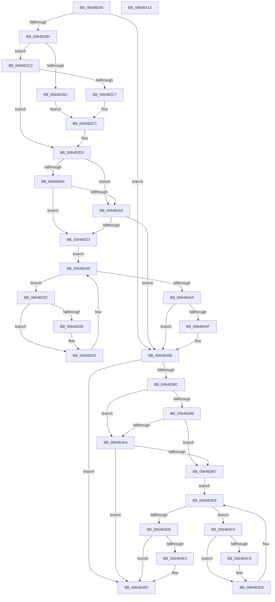

# DifZwSetTimerWrapper

- RVA: `0x0064B260`–`0x0064B414` (길이 `436` bytes)
- VA: `0x000000014064B260`
- 실행 섹션: `.text`
- PDB 이름 있음: `예`; PDB Function 태그: `아니요`
- unwind 정보 RVA: `0x000BC530`
- 디코드: `123`개 명령, `436/436` bytes 표시
- 미해석 바이트: `0` (있으면 어셈블리에 `.byte`로 보존)

> 이 문서는 커널 이미지의 기계어와 PDB 기호를 분석해 생성했습니다. 4번과 5번은 함수 원형과 자료형을 바이너리 사용 방식에서 추정한 C 해석이며 원본 소스 복구 결과는 아닙니다.

## 1. Dependencies

- 직접 호출 지점: **10**; 고유 호출 대상: **7**
- 직접 호출자로 확인된 함수: **0**
- RIP 상대 이미지 참조: **3**

### Outgoing calls
- `0x0064B299` → [memset](../6C/memset_function_006C6C40.md) (function, `0x006C6C40`)
- `0x0064B2A3` → [DifGetAPIThunkContextById](../49/DifGetAPIThunkContextById_function_00495A34.md) (function, `0x00495A34`)
- `0x0064B2C7` → [DifGetReturnAddressForWrappers](../4D/DifGetReturnAddressForWrappers_function_004D3C08.md) (function, `0x004D3C08`)
- `0x0064B317` → [ExAcquireRundownProtection](../21/ExAcquireRundownProtection_function_00216620.md) (function, `0x00216620`)
- `0x0064B33D` → [guard_dispatch_icall](../6B/guard_dispatch_icall_function_006BAAD0.md) (function, `0x006BAAD0`)
- `0x0064B356` → [ExReleaseRundownProtection](../34/ExReleaseRundownProtection_function_00349E80.md) (function, `0x00349E80`)
- `0x0064B37F` → [ZwSetTimer](../6A/ZwSetTimer_function_006ADD10.md) (function, `0x006ADD10`)
- `0x0064B3AB` → [ExAcquireRundownProtection](../21/ExAcquireRundownProtection_function_00216620.md) (function, `0x00216620`)
- `0x0064B3D1` → [guard_dispatch_icall](../6B/guard_dispatch_icall_function_006BAAD0.md) (function, `0x006BAAD0`)
- `0x0064B3EA` → [ExReleaseRundownProtection](../34/ExReleaseRundownProtection_function_00349E80.md) (function, `0x00349E80`)

### Direct callers
- 이 함수 시작 RVA로 연결되는 직접 call은 확인되지 않았습니다. 간접 호출은 완전히 역산할 수 없습니다.

### Static image references
- `0x0064B2D7` → RVA `0x00F048B8` (`.data`; read)
- `0x0064B304` → RVA `0x00F04980` (`.data`; read)
- `0x0064B310` → RVA `0x00F03E80` (`.data`; read)

## 2. Other-region calls and transfers

- 다른 실행 섹션으로 향하는 call: **0**
- 별도 외부 분기/꼬리 이동을 확인하지 못했습니다.

## 3. Assembly (complete function range)

```asm
0064B260  48 8B C4                        mov rax, rsp
0064B263  48 89 58 10                     mov qword ptr [rax + 0x10], rbx
0064B267  48 89 70 18                     mov qword ptr [rax + 0x18], rsi
0064B26B  48 89 78 20                     mov qword ptr [rax + 0x20], rdi
0064B26F  48 89 48 08                     mov qword ptr [rax + 8], rcx
0064B273  55                              push rbp
0064B274  41 54                           push r12
0064B276  41 55                           push r13
0064B278  41 56                           push r14
0064B27A  41 57                           push r15
0064B27C  48 8B EC                        mov rbp, rsp
0064B27F  48 81 EC 80 00 00 00            sub rsp, 0x80
0064B286  4C 8B EA                        mov r13, rdx
0064B289  48 8D 4D C0                     lea rcx, [rbp - 0x40]
0064B28D  33 D2                           xor edx, edx
0064B28F  4D 8B E0                        mov r12, r8
0064B292  4D 8B F9                        mov r15, r9
0064B295  44 8D 42 40                     lea r8d, [rdx + 0x40]
0064B299  E8 A2 B9 07 00                  call 0x1406c6c40
0064B29E  B9 08 00 00 00                  mov ecx, 8
0064B2A3  E8 8C A7 E4 FF                  call 0x140495a34
0064B2A8  4C 8B F0                        mov r14, rax
0064B2AB  48 85 C0                        test rax, rax
0064B2AE  0F 84 A7 00 00 00               je 0x14064b35b
0064B2B4  8B 48 0C                        mov ecx, dword ptr [rax + 0xc]
0064B2B7  F6 C1 18                        test cl, 0x18
0064B2BA  74 06                           je 0x14064b2c2
0064B2BC  48 8B 45 28                     mov rax, qword ptr [rbp + 0x28]
0064B2C0  EB 0A                           jmp 0x14064b2cc
0064B2C2  F6 C1 04                        test cl, 4
0064B2C5  74 09                           je 0x14064b2d0
0064B2C7  E8 3C 89 E8 FF                  call 0x1404d3c08
0064B2CC  48 89 45 C0                     mov qword ptr [rbp - 0x40], rax
0064B2D0  48 8B 45 30                     mov rax, qword ptr [rbp + 0x30]
0064B2D4  40 32 F6                        xor sil, sil
0064B2D7  40 38 35 DA 95 8B 00            cmp byte ptr [rip + 0x8b95da], sil
0064B2DE  48 89 45 F0                     mov qword ptr [rbp - 0x10], rax
0064B2E2  8A 45 50                        mov al, byte ptr [rbp + 0x50]
0064B2E5  88 45 D4                        mov byte ptr [rbp - 0x2c], al
0064B2E8  8B 45 58                        mov eax, dword ptr [rbp + 0x58]
0064B2EB  89 45 D0                        mov dword ptr [rbp - 0x30], eax
0064B2EE  48 8B 45 60                     mov rax, qword ptr [rbp + 0x60]
0064B2F2  48 89 45 C8                     mov qword ptr [rbp - 0x38], rax
0064B2F6  4C 89 6D E8                     mov qword ptr [rbp - 0x18], r13
0064B2FA  4C 89 65 E0                     mov qword ptr [rbp - 0x20], r12
0064B2FE  4C 89 7D D8                     mov qword ptr [rbp - 0x28], r15
0064B302  75 0C                           jne 0x14064b310
0064B304  F7 05 72 96 8B 00 00 08 00 00   test dword ptr [rip + 0x8b9672], 0x800
0064B30E  74 13                           je 0x14064b323
0064B310  48 8D 0D 69 8B 8B 00            lea rcx, [rip + 0x8b8b69]
0064B317  E8 04 B3 BC FF                  call 0x140216620
0064B31C  40 8A F0                        mov sil, al
0064B31F  84 C0                           test al, al
0064B321  74 38                           je 0x14064b35b
0064B323  49 8D 7E 20                     lea rdi, [r14 + 0x20]
0064B327  48 8B 1F                        mov rbx, qword ptr [rdi]
0064B32A  EB 19                           jmp 0x14064b345
0064B32C  48 8D 43 F0                     lea rax, [rbx - 0x10]
0064B330  48 85 C0                        test rax, rax
0064B333  74 0D                           je 0x14064b342
0064B335  48 8B 40 08                     mov rax, qword ptr [rax + 8]
0064B339  48 8D 4D C0                     lea rcx, [rbp - 0x40]
0064B33D  E8 8E F7 06 00                  call 0x1406baad0
0064B342  48 8B 1B                        mov rbx, qword ptr [rbx]
0064B345  48 3B DF                        cmp rbx, rdi
0064B348  75 E2                           jne 0x14064b32c
0064B34A  40 84 F6                        test sil, sil
0064B34D  74 0C                           je 0x14064b35b
0064B34F  48 8D 0D 2A 8B 8B 00            lea rcx, [rip + 0x8b8b2a]
0064B356  E8 25 EB CF FF                  call 0x140349e80
0064B35B  48 8B 45 60                     mov rax, qword ptr [rbp + 0x60]
0064B35F  4D 8B CF                        mov r9, r15
0064B362  48 8B 4D 30                     mov rcx, qword ptr [rbp + 0x30]
0064B366  4D 8B C4                        mov r8, r12
0064B369  48 89 44 24 30                  mov qword ptr [rsp + 0x30], rax
0064B36E  49 8B D5                        mov rdx, r13
0064B371  8B 45 58                        mov eax, dword ptr [rbp + 0x58]
0064B374  89 44 24 28                     mov dword ptr [rsp + 0x28], eax
0064B378  8A 45 50                        mov al, byte ptr [rbp + 0x50]
0064B37B  88 44 24 20                     mov byte ptr [rsp + 0x20], al
0064B37F  E8 8C 29 06 00                  call 0x1406add10
0064B384  89 45 F8                        mov dword ptr [rbp - 8], eax
0064B387  4D 85 F6                        test r14, r14
0064B38A  74 63                           je 0x14064b3ef
0064B38C  40 32 FF                        xor dil, dil
0064B38F  40 38 3D 22 95 8B 00            cmp byte ptr [rip + 0x8b9522], dil
0064B396  75 0C                           jne 0x14064b3a4
0064B398  F7 05 DE 95 8B 00 00 08 00 00   test dword ptr [rip + 0x8b95de], 0x800
0064B3A2  74 13                           je 0x14064b3b7
0064B3A4  48 8D 0D D5 8A 8B 00            lea rcx, [rip + 0x8b8ad5]
0064B3AB  E8 70 B2 BC FF                  call 0x140216620
0064B3B0  40 8A F8                        mov dil, al
0064B3B3  84 C0                           test al, al
0064B3B5  74 38                           je 0x14064b3ef
0064B3B7  49 8D 76 30                     lea rsi, [r14 + 0x30]
0064B3BB  48 8B 1E                        mov rbx, qword ptr [rsi]
0064B3BE  EB 19                           jmp 0x14064b3d9
0064B3C0  48 8D 43 F0                     lea rax, [rbx - 0x10]
0064B3C4  48 85 C0                        test rax, rax
0064B3C7  74 0D                           je 0x14064b3d6
0064B3C9  48 8B 40 08                     mov rax, qword ptr [rax + 8]
0064B3CD  48 8D 4D C0                     lea rcx, [rbp - 0x40]
0064B3D1  E8 FA F6 06 00                  call 0x1406baad0
0064B3D6  48 8B 1B                        mov rbx, qword ptr [rbx]
0064B3D9  48 3B DE                        cmp rbx, rsi
0064B3DC  75 E2                           jne 0x14064b3c0
0064B3DE  40 84 FF                        test dil, dil
0064B3E1  74 0C                           je 0x14064b3ef
0064B3E3  48 8D 0D 96 8A 8B 00            lea rcx, [rip + 0x8b8a96]
0064B3EA  E8 91 EA CF FF                  call 0x140349e80
0064B3EF  8B 45 F8                        mov eax, dword ptr [rbp - 8]
0064B3F2  4C 8D 9C 24 80 00 00 00         lea r11, [rsp + 0x80]
0064B3FA  49 8B 5B 38                     mov rbx, qword ptr [r11 + 0x38]
0064B3FE  49 8B 73 40                     mov rsi, qword ptr [r11 + 0x40]
0064B402  49 8B 7B 48                     mov rdi, qword ptr [r11 + 0x48]
0064B406  49 8B E3                        mov rsp, r11
0064B409  41 5F                           pop r15
0064B40B  41 5E                           pop r14
0064B40D  41 5D                           pop r13
0064B40F  41 5C                           pop r12
0064B411  5D                              pop rbp
0064B412  C3                              ret
0064B413  CC                              int3
```

## 4. C-style interpretation (structured pseudocode)

```c
__int64 __fastcall DifZwSetTimerWrapper(__int64 a1, __int64 a2, __int64 a3, __int64 a4, unsigned __int8 a5, unsigned int a6, __int64 a7)
{
    __int64 result;
    __int64 v_rdi;
    __int64 v_rsi;
    __int64 v_rsp;
    unsigned __int64 v_stack_m28;
    unsigned int v_stack_m30;
    unsigned __int64 v_stack_m38;
    unsigned __int64 v_stack_m40;
    unsigned __int64 v_stack_m48;
    unsigned __int64 v_stack_m50;
    unsigned __int8 v_stack_m54;
    unsigned int v_stack_m58;
    unsigned __int64 v_stack_m60;
    unsigned __int64 v_stack_m68;
    unsigned __int64 v_stack_m78;
    unsigned int v_stack_m80;
    unsigned __int8 v_stack_m88;
    unsigned __int64 v_stack_p0;
    unsigned __int64 v_stack_p8;

    *(unsigned __int64 *)(v_rsp + 16) = v_rbx;
    *(unsigned __int64 *)(v_rsp + 24) = v_rsi;
    *(unsigned __int64 *)(v_rsp + 32) = v_rdi;
    *(unsigned __int64 *)(v_rsp + 8) = a1;
    v_rsp = (v_rsp) - (128);
    a2 = 0;
    result = memset(v_stack_m68, a2, a2 + 64, a4);
    result = DifGetAPIThunkContextById(8, a2, a2 + 64, a4);
    if (result == 0) goto loc_0064B35B;
    if ((((unsigned __int8)((unsigned int)(*(unsigned int *)(result + 12)))) & (24)) == 0) goto loc_0064B2C2;
    goto loc_0064B2CC;
loc_0064B2C2:
    if ((((unsigned __int8)((unsigned int)(*(unsigned int *)(result + 12)))) & (4)) == 0) goto loc_0064B2D0;
    result = DifGetReturnAddressForWrappers((unsigned int)(*(unsigned int *)(result + 12)), a2, a2 + 64, a4);
loc_0064B2CC:
    v_stack_m68 = result;
loc_0064B2D0:
    v_rsi = 0;
    v_stack_m38 = v_stack_p8;
    v_stack_m54 = a5;
    v_stack_m58 = (unsigned int)((unsigned int)(a6));
    v_stack_m60 = a7;
    v_stack_m40 = 0;
    v_stack_m48 = a3;
    v_stack_m50 = a4;
    if ((*(unsigned __int8 *)(v_rip + 9147866)) != 0) goto loc_0064B310;
    if (((*(unsigned int *)(v_rip + 9148018)) & (0x800ULL)) == 0) goto loc_0064B323;
loc_0064B310:
    result = ExAcquireRundownProtection(v_rip + 9145193, a2, a2 + 64, a4);
    if ((unsigned __int8)(result) == 0) goto loc_0064B35B;
loc_0064B323:
    goto loc_0064B345;
loc_0064B32C:
    result = *(unsigned __int64 *)(result + 32) - 16;
    if (*(unsigned __int64 *)(result + 32) - 16 != 0) {
        result = *(unsigned __int64 *)(*(unsigned __int64 *)(result + 32) - 16 + 8);
        a1 = v_stack_m68;
        result = guard_dispatch_icall(a1, a2, a2 + 64, a4);
    }
loc_0064B345:
    if ((*(unsigned __int64 *)(*(unsigned __int64 *)(result + 32))) != (result + 32)) goto loc_0064B32C;
    if ((unsigned __int8)((unsigned __int8)(result)) != 0) {
        a1 = v_rip + 9145130;
        result = ExReleaseRundownProtection(a1, a2, a2 + 64, a4);
    }
    v_stack_m78 = a7;
    v_stack_m80 = (unsigned int)((unsigned int)(a6));
    v_stack_m88 = a5;
    result = ZwSetTimer(v_stack_p8, 0, a3, a4);
    v_stack_m30 = (unsigned int)(result);
    if (result == 0) goto loc_0064B3EF;
    v_rdi = 0;
    if ((*(unsigned __int8 *)(v_rip + 9147682)) != 0) goto loc_0064B3A4;
    if (((*(unsigned int *)(v_rip + 9147870)) & (0x800ULL)) == 0) goto loc_0064B3B7;
loc_0064B3A4:
    result = ExAcquireRundownProtection(v_rip + 9145045, 0, a3, a4);
    if ((unsigned __int8)(result) == 0) goto loc_0064B3EF;
loc_0064B3B7:
    goto loc_0064B3D9;
loc_0064B3C0:
    result = *(unsigned __int64 *)(result + 48) - 16;
    if (*(unsigned __int64 *)(result + 48) - 16 != 0) {
        result = *(unsigned __int64 *)(*(unsigned __int64 *)(result + 48) - 16 + 8);
        a1 = v_stack_m68;
        result = guard_dispatch_icall(a1, 0, a3, a4);
    }
loc_0064B3D9:
    if ((*(unsigned __int64 *)(*(unsigned __int64 *)(result + 48))) != (result + 48)) goto loc_0064B3C0;
    if ((unsigned __int8)((unsigned __int8)(result)) != 0) {
        a1 = v_rip + 9144982;
        result = ExReleaseRundownProtection(a1, 0, a3, a4);
    }
    return (unsigned int)(v_stack_m30);
}
```

## 5. (Beta) C Style

```c
int64_t DifZwSetTimerWrapper(int64_t Arg1, int64_t Arg2, int64_t Arg3, int64_t Arg4, uint8_t Arg5, uint32_t Arg6, int64_t Arg7)
{
    int64_t result;
    int64_t local_rdi;
    int64_t local_rsi;
    int64_t local_rsp;
    uint64_t v_stack_m28;
    uint32_t v_stack_m30;
    uint64_t v_stack_m38;
    uint64_t v_stack_m40;
    uint64_t v_stack_m48;
    uint64_t v_stack_m50;
    uint8_t v_stack_m54;
    uint32_t v_stack_m58;
    uint64_t v_stack_m60;
    uint64_t v_stack_m68;
    uint64_t v_stack_m78;
    uint32_t v_stack_m80;
    uint8_t v_stack_m88;
    uint64_t v_stack_p0;
    uint64_t v_stack_p8;

    *(uint64_t *)(local_rsp + 0x10) = local_rbx;
    *(uint64_t *)(local_rsp + 0x18) = local_rsi;
    *(uint64_t *)(local_rsp + 0x20) = local_rdi;
    *(uint64_t *)(local_rsp + 0x8) = Arg1;
    local_rsp = (local_rsp) - (128);
    Arg2 = 0;
    result = memset(v_stack_m68, Arg2, Arg2 + 64, Arg4);
    result = DifGetAPIThunkContextById(8, Arg2, Arg2 + 64, Arg4);
    if (result == 0) goto loc_0064B35B;
    if ((((uint8_t)((uint32_t)(*(uint32_t *)(result + 0xC)))) & (24)) == 0) goto loc_0064B2C2;
    goto loc_0064B2CC;
loc_0064B2C2:
    if ((((uint8_t)((uint32_t)(*(uint32_t *)(result + 0xC)))) & (4)) == 0) goto loc_0064B2D0;
    result = DifGetReturnAddressForWrappers((uint32_t)(*(uint32_t *)(result + 0xC)), Arg2, Arg2 + 64, Arg4);
loc_0064B2CC:
    v_stack_m68 = result;
loc_0064B2D0:
    local_rsi = 0;
    v_stack_m38 = v_stack_p8;
    v_stack_m54 = Arg5;
    v_stack_m58 = (uint32_t)((uint32_t)(Arg6));
    v_stack_m60 = Arg7;
    v_stack_m40 = 0;
    v_stack_m48 = Arg3;
    v_stack_m50 = Arg4;
    if ((*(uint8_t *)(v_rip + 0x8B95DA)) != 0) goto loc_0064B310;
    if (((*(uint32_t *)(v_rip + 0x8B9672)) & (0x800ULL)) == 0) goto loc_0064B323;
loc_0064B310:
    result = ExAcquireRundownProtection(v_rip + 9145193, Arg2, Arg2 + 64, Arg4);
    if ((uint8_t)(result) == 0) goto loc_0064B35B;
loc_0064B323:
    goto loc_0064B345;
loc_0064B32C:
    result = *(uint64_t *)(result + 0x20) - 16;
    if (*(uint64_t *)(result + 0x20) - 16 != 0) {
        result = *(uint64_t *)(*(uint64_t *)(result + 0x20) - 0x10 + 0x8);
        Arg1 = v_stack_m68;
        result = guard_dispatch_icall(Arg1, Arg2, Arg2 + 64, Arg4);
    }
loc_0064B345:
    if ((*(uint64_t *)(*(uint64_t *)(result + 0x20))) != (result + 32)) goto loc_0064B32C;
    if ((uint8_t)((uint8_t)(result)) != 0) {
        Arg1 = v_rip + 9145130;
        result = ExReleaseRundownProtection(Arg1, Arg2, Arg2 + 64, Arg4);
    }
    v_stack_m78 = Arg7;
    v_stack_m80 = (uint32_t)((uint32_t)(Arg6));
    v_stack_m88 = Arg5;
    result = ZwSetTimer(v_stack_p8, 0, Arg3, Arg4);
    v_stack_m30 = (uint32_t)(result);
    if (result == 0) goto loc_0064B3EF;
    local_rdi = 0;
    if ((*(uint8_t *)(v_rip + 0x8B9522)) != 0) goto loc_0064B3A4;
    if (((*(uint32_t *)(v_rip + 0x8B95DE)) & (0x800ULL)) == 0) goto loc_0064B3B7;
loc_0064B3A4:
    result = ExAcquireRundownProtection(v_rip + 9145045, 0, Arg3, Arg4);
    if ((uint8_t)(result) == 0) goto loc_0064B3EF;
loc_0064B3B7:
    goto loc_0064B3D9;
loc_0064B3C0:
    result = *(uint64_t *)(result + 0x30) - 16;
    if (*(uint64_t *)(result + 0x30) - 16 != 0) {
        result = *(uint64_t *)(*(uint64_t *)(result + 0x30) - 0x10 + 0x8);
        Arg1 = v_stack_m68;
        result = guard_dispatch_icall(Arg1, 0, Arg3, Arg4);
    }
loc_0064B3D9:
    if ((*(uint64_t *)(*(uint64_t *)(result + 0x30))) != (result + 48)) goto loc_0064B3C0;
    if ((uint8_t)((uint8_t)(result)) != 0) {
        Arg1 = v_rip + 9144982;
        result = ExReleaseRundownProtection(Arg1, 0, Arg3, Arg4);
    }
    return (uint32_t)(v_stack_m30);
}
```

## 6. Execution-region graph

[열기: 2D/3D 그래프와 함수 탐색 컨트롤 패널](../../../control-panel.html?section=text&rva=0x0064B260&view=graph)

- 2D 그래프는 위에서 아래로 흐르고, 3D 그래프는 빈 공간을 드래그해 회전합니다. Shift+드래그는 이동, 휠은 확대·축소, 함수 노드 선택은 대상 보고서 이동입니다.

### Static fallback


