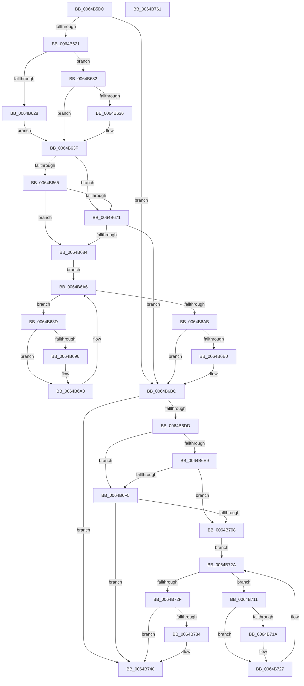

# DifZwSetVolumeInformationFileWrapper

- RVA: `0x0064B5D0`–`0x0064B762` (길이 `402` bytes)
- VA: `0x000000014064B5D0`
- 실행 섹션: `.text`
- PDB 이름 있음: `예`; PDB Function 태그: `아니요`
- unwind 정보 RVA: `0x000D2BBC`
- 디코드: `116`개 명령, `402/402` bytes 표시
- 미해석 바이트: `0` (있으면 어셈블리에 `.byte`로 보존)

> 이 문서는 커널 이미지의 기계어와 PDB 기호를 분석해 생성했습니다. 4번과 5번은 함수 원형과 자료형을 바이너리 사용 방식에서 추정한 C 해석이며 원본 소스 복구 결과는 아닙니다.

## 1. Dependencies

- 직접 호출 지점: **9**; 고유 호출 대상: **6**
- 직접 호출자로 확인된 함수: **0**
- RIP 상대 이미지 참조: **3**

### Outgoing calls
- `0x0064B610` → [DifGetAPIThunkContextById](../49/DifGetAPIThunkContextById_function_00495A34.md) (function, `0x00495A34`)
- `0x0064B636` → [DifGetReturnAddressForWrappers](../4D/DifGetReturnAddressForWrappers_function_004D3C08.md) (function, `0x004D3C08`)
- `0x0064B678` → [ExAcquireRundownProtection](../21/ExAcquireRundownProtection_function_00216620.md) (function, `0x00216620`)
- `0x0064B69E` → [guard_dispatch_icall](../6B/guard_dispatch_icall_function_006BAAD0.md) (function, `0x006BAAD0`)
- `0x0064B6B7` → [ExReleaseRundownProtection](../34/ExReleaseRundownProtection_function_00349E80.md) (function, `0x00349E80`)
- `0x0064B6D0` → [ZwSetVolumeInformationFile](../6B/ZwSetVolumeInformationFile_function_006B0970.md) (function, `0x006B0970`)
- `0x0064B6FC` → [ExAcquireRundownProtection](../21/ExAcquireRundownProtection_function_00216620.md) (function, `0x00216620`)
- `0x0064B722` → [guard_dispatch_icall](../6B/guard_dispatch_icall_function_006BAAD0.md) (function, `0x006BAAD0`)
- `0x0064B73B` → [ExReleaseRundownProtection](../34/ExReleaseRundownProtection_function_00349E80.md) (function, `0x00349E80`)

### Direct callers
- 이 함수 시작 RVA로 연결되는 직접 call은 확인되지 않았습니다. 간접 호출은 완전히 역산할 수 없습니다.

### Static image references
- `0x0064B646` → RVA `0x00F048B8` (`.data`; read)
- `0x0064B665` → RVA `0x00F04980` (`.data`; read)
- `0x0064B671` → RVA `0x00F03E80` (`.data`; read)

## 2. Other-region calls and transfers

- 다른 실행 섹션으로 향하는 call: **0**
- 별도 외부 분기/꼬리 이동을 확인하지 못했습니다.

## 3. Assembly (complete function range)

```asm
0064B5D0  48 8B C4                        mov rax, rsp
0064B5D3  48 89 58 10                     mov qword ptr [rax + 0x10], rbx
0064B5D7  48 89 70 18                     mov qword ptr [rax + 0x18], rsi
0064B5DB  48 89 78 20                     mov qword ptr [rax + 0x20], rdi
0064B5DF  48 89 48 08                     mov qword ptr [rax + 8], rcx
0064B5E3  55                              push rbp
0064B5E4  41 54                           push r12
0064B5E6  41 55                           push r13
0064B5E8  41 56                           push r14
0064B5EA  41 57                           push r15
0064B5EC  48 8B EC                        mov rbp, rsp
0064B5EF  48 83 EC 60                     sub rsp, 0x60
0064B5F3  0F 57 C0                        xorps xmm0, xmm0
0064B5F6  B9 06 00 00 00                  mov ecx, 6
0064B5FB  0F 11 45 D0                     movups xmmword ptr [rbp - 0x30], xmm0
0064B5FF  45 8B F9                        mov r15d, r9d
0064B602  4D 8B E0                        mov r12, r8
0064B605  0F 11 45 E0                     movups xmmword ptr [rbp - 0x20], xmm0
0064B609  4C 8B EA                        mov r13, rdx
0064B60C  0F 11 45 F0                     movups xmmword ptr [rbp - 0x10], xmm0
0064B610  E8 1F A4 E4 FF                  call 0x140495a34
0064B615  48 8B F0                        mov rsi, rax
0064B618  48 85 C0                        test rax, rax
0064B61B  0F 84 9B 00 00 00               je 0x14064b6bc
0064B621  8B 40 0C                        mov eax, dword ptr [rax + 0xc]
0064B624  A8 18                           test al, 0x18
0064B626  74 0A                           je 0x14064b632
0064B628  48 8B 4D 28                     mov rcx, qword ptr [rbp + 0x28]
0064B62C  48 89 4D D0                     mov qword ptr [rbp - 0x30], rcx
0064B630  EB 0D                           jmp 0x14064b63f
0064B632  A8 04                           test al, 4
0064B634  74 09                           je 0x14064b63f
0064B636  E8 CD 85 E8 FF                  call 0x1404d3c08
0064B63B  48 89 45 D0                     mov qword ptr [rbp - 0x30], rax
0064B63F  48 8B 45 30                     mov rax, qword ptr [rbp + 0x30]
0064B643  45 32 F6                        xor r14b, r14b
0064B646  44 38 35 6B 92 8B 00            cmp byte ptr [rip + 0x8b926b], r14b
0064B64D  48 89 45 F0                     mov qword ptr [rbp - 0x10], rax
0064B651  8B 45 50                        mov eax, dword ptr [rbp + 0x50]
0064B654  89 45 D8                        mov dword ptr [rbp - 0x28], eax
0064B657  4C 89 6D E8                     mov qword ptr [rbp - 0x18], r13
0064B65B  4C 89 65 E0                     mov qword ptr [rbp - 0x20], r12
0064B65F  44 89 7D DC                     mov dword ptr [rbp - 0x24], r15d
0064B663  75 0C                           jne 0x14064b671
0064B665  F7 05 11 93 8B 00 00 08 00 00   test dword ptr [rip + 0x8b9311], 0x800
0064B66F  74 13                           je 0x14064b684
0064B671  48 8D 0D 08 88 8B 00            lea rcx, [rip + 0x8b8808]
0064B678  E8 A3 AF BC FF                  call 0x140216620
0064B67D  44 8A F0                        mov r14b, al
0064B680  84 C0                           test al, al
0064B682  74 38                           je 0x14064b6bc
0064B684  48 8D 7E 20                     lea rdi, [rsi + 0x20]
0064B688  48 8B 1F                        mov rbx, qword ptr [rdi]
0064B68B  EB 19                           jmp 0x14064b6a6
0064B68D  48 8D 43 F0                     lea rax, [rbx - 0x10]
0064B691  48 85 C0                        test rax, rax
0064B694  74 0D                           je 0x14064b6a3
0064B696  48 8B 40 08                     mov rax, qword ptr [rax + 8]
0064B69A  48 8D 4D D0                     lea rcx, [rbp - 0x30]
0064B69E  E8 2D F4 06 00                  call 0x1406baad0
0064B6A3  48 8B 1B                        mov rbx, qword ptr [rbx]
0064B6A6  48 3B DF                        cmp rbx, rdi
0064B6A9  75 E2                           jne 0x14064b68d
0064B6AB  45 84 F6                        test r14b, r14b
0064B6AE  74 0C                           je 0x14064b6bc
0064B6B0  48 8D 0D C9 87 8B 00            lea rcx, [rip + 0x8b87c9]
0064B6B7  E8 C4 E7 CF FF                  call 0x140349e80
0064B6BC  8B 45 50                        mov eax, dword ptr [rbp + 0x50]
0064B6BF  45 8B CF                        mov r9d, r15d
0064B6C2  48 8B 4D 30                     mov rcx, qword ptr [rbp + 0x30]
0064B6C6  4D 8B C4                        mov r8, r12
0064B6C9  49 8B D5                        mov rdx, r13
0064B6CC  89 44 24 20                     mov dword ptr [rsp + 0x20], eax
0064B6D0  E8 9B 52 06 00                  call 0x1406b0970
0064B6D5  89 45 F8                        mov dword ptr [rbp - 8], eax
0064B6D8  48 85 F6                        test rsi, rsi
0064B6DB  74 63                           je 0x14064b740
0064B6DD  40 32 FF                        xor dil, dil
0064B6E0  40 38 3D D1 91 8B 00            cmp byte ptr [rip + 0x8b91d1], dil
0064B6E7  75 0C                           jne 0x14064b6f5
0064B6E9  F7 05 8D 92 8B 00 00 08 00 00   test dword ptr [rip + 0x8b928d], 0x800
0064B6F3  74 13                           je 0x14064b708
0064B6F5  48 8D 0D 84 87 8B 00            lea rcx, [rip + 0x8b8784]
0064B6FC  E8 1F AF BC FF                  call 0x140216620
0064B701  40 8A F8                        mov dil, al
0064B704  84 C0                           test al, al
0064B706  74 38                           je 0x14064b740
0064B708  48 83 C6 30                     add rsi, 0x30
0064B70C  48 8B 1E                        mov rbx, qword ptr [rsi]
0064B70F  EB 19                           jmp 0x14064b72a
0064B711  48 8D 43 F0                     lea rax, [rbx - 0x10]
0064B715  48 85 C0                        test rax, rax
0064B718  74 0D                           je 0x14064b727
0064B71A  48 8B 40 08                     mov rax, qword ptr [rax + 8]
0064B71E  48 8D 4D D0                     lea rcx, [rbp - 0x30]
0064B722  E8 A9 F3 06 00                  call 0x1406baad0
0064B727  48 8B 1B                        mov rbx, qword ptr [rbx]
0064B72A  48 3B DE                        cmp rbx, rsi
0064B72D  75 E2                           jne 0x14064b711
0064B72F  40 84 FF                        test dil, dil
0064B732  74 0C                           je 0x14064b740
0064B734  48 8D 0D 45 87 8B 00            lea rcx, [rip + 0x8b8745]
0064B73B  E8 40 E7 CF FF                  call 0x140349e80
0064B740  8B 45 F8                        mov eax, dword ptr [rbp - 8]
0064B743  4C 8D 5C 24 60                  lea r11, [rsp + 0x60]
0064B748  49 8B 5B 38                     mov rbx, qword ptr [r11 + 0x38]
0064B74C  49 8B 73 40                     mov rsi, qword ptr [r11 + 0x40]
0064B750  49 8B 7B 48                     mov rdi, qword ptr [r11 + 0x48]
0064B754  49 8B E3                        mov rsp, r11
0064B757  41 5F                           pop r15
0064B759  41 5E                           pop r14
0064B75B  41 5D                           pop r13
0064B75D  41 5C                           pop r12
0064B75F  5D                              pop rbp
0064B760  C3                              ret
0064B761  CC                              int3
```

## 4. C-style interpretation (structured pseudocode)

```c
__int64 __fastcall DifZwSetVolumeInformationFileWrapper(__int64 a1, __int64 a2, __int64 a3, int a4, unsigned int a5)
{
    __int64 result;
    __int64 v_r14;
    __int64 v_rdi;
    __int64 v_rsi;
    __int64 v_rsp;
    unsigned __int64 v_stack_m28;
    unsigned int v_stack_m30;
    unsigned __int64 v_stack_m38;
    unsigned __int64 v_stack_m40;
    unsigned __int64 v_stack_m48;
    unsigned int v_stack_m4C;
    unsigned int v_stack_m50;
    unsigned __int64 v_stack_m58;
    unsigned int v_stack_m68;
    unsigned __int64 v_stack_p0;
    unsigned __int64 v_stack_p8;

    *(unsigned __int64 *)(v_rsp + 16) = v_rbx;
    *(unsigned __int64 *)(v_rsp + 24) = v_rsi;
    *(unsigned __int64 *)(v_rsp + 32) = v_rdi;
    *(unsigned __int64 *)(v_rsp + 8) = a1;
    v_rsp = (v_rsp) - (96);
    v_stack_m58 = v_xmm0;
    v_stack_m48 = v_xmm0;
    v_stack_m38 = v_xmm0;
    result = DifGetAPIThunkContextById(6, a2, a3, a4);
    if (result == 0) goto loc_0064B6BC;
    if ((((unsigned __int8)((unsigned int)(*(unsigned int *)(result + 12)))) & (24)) == 0) goto loc_0064B632;
    v_stack_m58 = v_stack_p0;
    goto loc_0064B63F;
loc_0064B632:
    result = (unsigned int)(*(unsigned int *)(result + 12));
    if ((((unsigned __int8)((unsigned int)(*(unsigned int *)(result + 12)))) & (4)) != 0) {
        result = DifGetReturnAddressForWrappers(v_stack_p0, a2, a3, a4);
        v_stack_m58 = result;
    }
    v_r14 = 0;
    v_stack_m38 = v_stack_p8;
    v_stack_m50 = (unsigned int)((unsigned int)(a5));
    v_stack_m40 = a2;
    v_stack_m48 = a3;
    v_stack_m4C = (unsigned int)((unsigned int)(a4));
    if ((*(unsigned __int8 *)(v_rip + 9146987)) != 0) goto loc_0064B671;
    if (((*(unsigned int *)(v_rip + 9147153)) & (0x800ULL)) == 0) goto loc_0064B684;
loc_0064B671:
    result = ExAcquireRundownProtection(v_rip + 9144328, a2, a3, a4);
    if ((unsigned __int8)(result) == 0) goto loc_0064B6BC;
loc_0064B684:
    goto loc_0064B6A6;
loc_0064B68D:
    result = *(unsigned __int64 *)(result + 32) - 16;
    if (*(unsigned __int64 *)(result + 32) - 16 != 0) {
        result = *(unsigned __int64 *)(*(unsigned __int64 *)(result + 32) - 16 + 8);
        a1 = v_stack_m58;
        result = guard_dispatch_icall(a1, a2, a3, a4);
    }
loc_0064B6A6:
    if ((*(unsigned __int64 *)(*(unsigned __int64 *)(result + 32))) != (result + 32)) goto loc_0064B68D;
    if ((unsigned __int8)((unsigned __int8)(result)) != 0) {
        a1 = v_rip + 9144265;
        result = ExReleaseRundownProtection(a1, a2, a3, a4);
    }
    v_stack_m68 = (unsigned int)((unsigned int)(a5));
    result = ZwSetVolumeInformationFile(v_stack_p8, a2, a3, (unsigned int)((unsigned int)((unsigned int)(a4))));
    v_stack_m30 = (unsigned int)(result);
    if (result == 0) goto loc_0064B740;
    v_rdi = 0;
    if ((*(unsigned __int8 *)(v_rip + 9146833)) != 0) goto loc_0064B6F5;
    if (((*(unsigned int *)(v_rip + 9147021)) & (0x800ULL)) == 0) goto loc_0064B708;
loc_0064B6F5:
    result = ExAcquireRundownProtection(v_rip + 9144196, a2, a3, (unsigned int)((unsigned int)((unsigned int)(a4))));
    if ((unsigned __int8)(result) == 0) goto loc_0064B740;
loc_0064B708:
    v_rsi = (result) + (48);
    goto loc_0064B72A;
loc_0064B711:
    result = *(unsigned __int64 *)(v_rsi) - 16;
    if (*(unsigned __int64 *)(v_rsi) - 16 != 0) {
        result = *(unsigned __int64 *)(*(unsigned __int64 *)(v_rsi) - 16 + 8);
        a1 = v_stack_m58;
        result = guard_dispatch_icall(a1, a2, a3, (unsigned int)((unsigned int)((unsigned int)(a4))));
    }
loc_0064B72A:
    if ((*(unsigned __int64 *)(*(unsigned __int64 *)(v_rsi))) != v_rsi) goto loc_0064B711;
    if ((unsigned __int8)((unsigned __int8)(result)) != 0) {
        a1 = v_rip + 9144133;
        result = ExReleaseRundownProtection(a1, a2, a3, (unsigned int)((unsigned int)((unsigned int)(a4))));
    }
    return (unsigned int)(v_stack_m30);
}
```

## 5. (Beta) C Style

```c
int64_t DifZwSetVolumeInformationFileWrapper(int64_t Arg1, int64_t Arg2, int64_t Arg3, int32_t Arg4, uint32_t Arg5)
{
    int64_t result;
    int64_t local_r14;
    int64_t local_rdi;
    int64_t local_rsi;
    int64_t local_rsp;
    uint64_t v_stack_m28;
    uint32_t v_stack_m30;
    uint64_t v_stack_m38;
    uint64_t v_stack_m40;
    uint64_t v_stack_m48;
    uint32_t v_stack_m4C;
    uint32_t v_stack_m50;
    uint64_t v_stack_m58;
    uint32_t v_stack_m68;
    uint64_t v_stack_p0;
    uint64_t v_stack_p8;

    *(uint64_t *)(local_rsp + 0x10) = local_rbx;
    *(uint64_t *)(local_rsp + 0x18) = local_rsi;
    *(uint64_t *)(local_rsp + 0x20) = local_rdi;
    *(uint64_t *)(local_rsp + 0x8) = Arg1;
    local_rsp = (local_rsp) - (96);
    v_stack_m58 = v_xmm0;
    v_stack_m48 = v_xmm0;
    v_stack_m38 = v_xmm0;
    result = DifGetAPIThunkContextById(6, Arg2, Arg3, Arg4);
    if (result == 0) goto loc_0064B6BC;
    if ((((uint8_t)((uint32_t)(*(uint32_t *)(result + 0xC)))) & (24)) == 0) goto loc_0064B632;
    v_stack_m58 = v_stack_p0;
    goto loc_0064B63F;
loc_0064B632:
    result = (uint32_t)(*(uint32_t *)(result + 0xC));
    if ((((uint8_t)((uint32_t)(*(uint32_t *)(result + 0xC)))) & (4)) != 0) {
        result = DifGetReturnAddressForWrappers(v_stack_p0, Arg2, Arg3, Arg4);
        v_stack_m58 = result;
    }
    local_r14 = 0;
    v_stack_m38 = v_stack_p8;
    v_stack_m50 = (uint32_t)((uint32_t)(Arg5));
    v_stack_m40 = Arg2;
    v_stack_m48 = Arg3;
    v_stack_m4C = (uint32_t)((uint32_t)(Arg4));
    if ((*(uint8_t *)(v_rip + 0x8B926B)) != 0) goto loc_0064B671;
    if (((*(uint32_t *)(v_rip + 0x8B9311)) & (0x800ULL)) == 0) goto loc_0064B684;
loc_0064B671:
    result = ExAcquireRundownProtection(v_rip + 9144328, Arg2, Arg3, Arg4);
    if ((uint8_t)(result) == 0) goto loc_0064B6BC;
loc_0064B684:
    goto loc_0064B6A6;
loc_0064B68D:
    result = *(uint64_t *)(result + 0x20) - 16;
    if (*(uint64_t *)(result + 0x20) - 16 != 0) {
        result = *(uint64_t *)(*(uint64_t *)(result + 0x20) - 0x10 + 0x8);
        Arg1 = v_stack_m58;
        result = guard_dispatch_icall(Arg1, Arg2, Arg3, Arg4);
    }
loc_0064B6A6:
    if ((*(uint64_t *)(*(uint64_t *)(result + 0x20))) != (result + 32)) goto loc_0064B68D;
    if ((uint8_t)((uint8_t)(result)) != 0) {
        Arg1 = v_rip + 9144265;
        result = ExReleaseRundownProtection(Arg1, Arg2, Arg3, Arg4);
    }
    v_stack_m68 = (uint32_t)((uint32_t)(Arg5));
    result = ZwSetVolumeInformationFile(v_stack_p8, Arg2, Arg3, (uint32_t)((uint32_t)((uint32_t)(Arg4))));
    v_stack_m30 = (uint32_t)(result);
    if (result == 0) goto loc_0064B740;
    local_rdi = 0;
    if ((*(uint8_t *)(v_rip + 0x8B91D1)) != 0) goto loc_0064B6F5;
    if (((*(uint32_t *)(v_rip + 0x8B928D)) & (0x800ULL)) == 0) goto loc_0064B708;
loc_0064B6F5:
    result = ExAcquireRundownProtection(v_rip + 9144196, Arg2, Arg3, (uint32_t)((uint32_t)((uint32_t)(Arg4))));
    if ((uint8_t)(result) == 0) goto loc_0064B740;
loc_0064B708:
    local_rsi = (result) + (48);
    goto loc_0064B72A;
loc_0064B711:
    result = *(uint64_t *)(local_rsi) - 16;
    if (*(uint64_t *)(local_rsi) - 16 != 0) {
        result = *(uint64_t *)(*(uint64_t *)(local_rsi) - 0x10 + 0x8);
        Arg1 = v_stack_m58;
        result = guard_dispatch_icall(Arg1, Arg2, Arg3, (uint32_t)((uint32_t)((uint32_t)(Arg4))));
    }
loc_0064B72A:
    if ((*(uint64_t *)(*(uint64_t *)(local_rsi))) != local_rsi) goto loc_0064B711;
    if ((uint8_t)((uint8_t)(result)) != 0) {
        Arg1 = v_rip + 9144133;
        result = ExReleaseRundownProtection(Arg1, Arg2, Arg3, (uint32_t)((uint32_t)((uint32_t)(Arg4))));
    }
    return (uint32_t)(v_stack_m30);
}
```

## 6. Execution-region graph

[열기: 2D/3D 그래프와 함수 탐색 컨트롤 패널](../../../control-panel.html?section=text&rva=0x0064B5D0&view=graph)

- 2D 그래프는 위에서 아래로 흐르고, 3D 그래프는 빈 공간을 드래그해 회전합니다. Shift+드래그는 이동, 휠은 확대·축소, 함수 노드 선택은 대상 보고서 이동입니다.

### Static fallback


