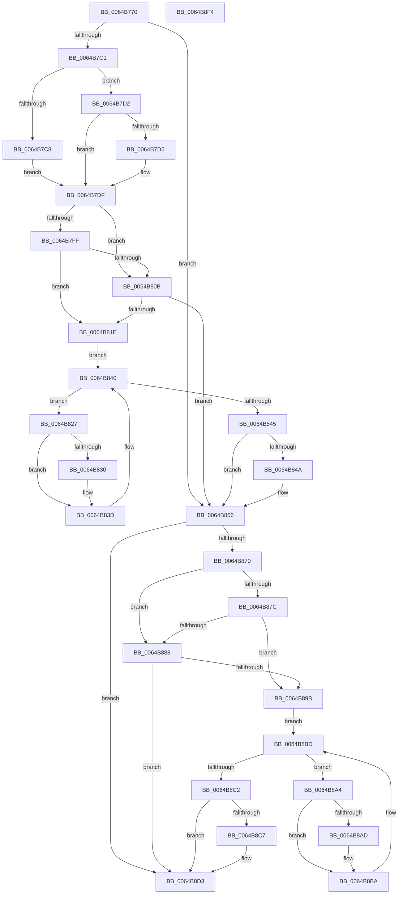

# DifZwTranslateFilePathWrapper

- RVA: `0x0064B770`–`0x0064B8F5` (길이 `389` bytes)
- VA: `0x000000014064B770`
- 실행 섹션: `.text`
- PDB 이름 있음: `예`; PDB Function 태그: `아니요`
- unwind 정보 RVA: `0x000D2B7C`
- 디코드: `112`개 명령, `389/389` bytes 표시
- 미해석 바이트: `0` (있으면 어셈블리에 `.byte`로 보존)

> 이 문서는 커널 이미지의 기계어와 PDB 기호를 분석해 생성했습니다. 4번과 5번은 함수 원형과 자료형을 바이너리 사용 방식에서 추정한 C 해석이며 원본 소스 복구 결과는 아닙니다.

## 1. Dependencies

- 직접 호출 지점: **9**; 고유 호출 대상: **6**
- 직접 호출자로 확인된 함수: **0**
- RIP 상대 이미지 참조: **3**

### Outgoing calls
- `0x0064B7B0` → [DifGetAPIThunkContextById](../49/DifGetAPIThunkContextById_function_00495A34.md) (function, `0x00495A34`)
- `0x0064B7D6` → [DifGetReturnAddressForWrappers](../4D/DifGetReturnAddressForWrappers_function_004D3C08.md) (function, `0x004D3C08`)
- `0x0064B812` → [ExAcquireRundownProtection](../21/ExAcquireRundownProtection_function_00216620.md) (function, `0x00216620`)
- `0x0064B838` → [guard_dispatch_icall](../6B/guard_dispatch_icall_function_006BAAD0.md) (function, `0x006BAAD0`)
- `0x0064B851` → [ExReleaseRundownProtection](../34/ExReleaseRundownProtection_function_00349E80.md) (function, `0x00349E80`)
- `0x0064B863` → [ZwTranslateFilePath](../6B/ZwTranslateFilePath_function_006B0BD0.md) (function, `0x006B0BD0`)
- `0x0064B88F` → [ExAcquireRundownProtection](../21/ExAcquireRundownProtection_function_00216620.md) (function, `0x00216620`)
- `0x0064B8B5` → [guard_dispatch_icall](../6B/guard_dispatch_icall_function_006BAAD0.md) (function, `0x006BAAD0`)
- `0x0064B8CE` → [ExReleaseRundownProtection](../34/ExReleaseRundownProtection_function_00349E80.md) (function, `0x00349E80`)

### Direct callers
- 이 함수 시작 RVA로 연결되는 직접 call은 확인되지 않았습니다. 간접 호출은 완전히 역산할 수 없습니다.

### Static image references
- `0x0064B7E6` → RVA `0x00F048B8` (`.data`; read)
- `0x0064B7FF` → RVA `0x00F04980` (`.data`; read)
- `0x0064B80B` → RVA `0x00F03E80` (`.data`; read)

## 2. Other-region calls and transfers

- 다른 실행 섹션으로 향하는 call: **0**
- 별도 외부 분기/꼬리 이동을 확인하지 못했습니다.

## 3. Assembly (complete function range)

```asm
0064B770  48 8B C4                        mov rax, rsp
0064B773  48 89 58 10                     mov qword ptr [rax + 0x10], rbx
0064B777  48 89 70 18                     mov qword ptr [rax + 0x18], rsi
0064B77B  48 89 78 20                     mov qword ptr [rax + 0x20], rdi
0064B77F  48 89 48 08                     mov qword ptr [rax + 8], rcx
0064B783  55                              push rbp
0064B784  41 54                           push r12
0064B786  41 55                           push r13
0064B788  41 56                           push r14
0064B78A  41 57                           push r15
0064B78C  48 8B EC                        mov rbp, rsp
0064B78F  48 83 EC 50                     sub rsp, 0x50
0064B793  0F 57 C0                        xorps xmm0, xmm0
0064B796  B9 05 00 00 00                  mov ecx, 5
0064B79B  0F 11 45 D0                     movups xmmword ptr [rbp - 0x30], xmm0
0064B79F  4D 8B F9                        mov r15, r9
0064B7A2  4D 8B E0                        mov r12, r8
0064B7A5  0F 11 45 E0                     movups xmmword ptr [rbp - 0x20], xmm0
0064B7A9  44 8B EA                        mov r13d, edx
0064B7AC  0F 11 45 F0                     movups xmmword ptr [rbp - 0x10], xmm0
0064B7B0  E8 7F A2 E4 FF                  call 0x140495a34
0064B7B5  48 8B F0                        mov rsi, rax
0064B7B8  48 85 C0                        test rax, rax
0064B7BB  0F 84 95 00 00 00               je 0x14064b856
0064B7C1  8B 40 0C                        mov eax, dword ptr [rax + 0xc]
0064B7C4  A8 18                           test al, 0x18
0064B7C6  74 0A                           je 0x14064b7d2
0064B7C8  48 8B 4D 28                     mov rcx, qword ptr [rbp + 0x28]
0064B7CC  48 89 4D D0                     mov qword ptr [rbp - 0x30], rcx
0064B7D0  EB 0D                           jmp 0x14064b7df
0064B7D2  A8 04                           test al, 4
0064B7D4  74 09                           je 0x14064b7df
0064B7D6  E8 2D 84 E8 FF                  call 0x1404d3c08
0064B7DB  48 89 45 D0                     mov qword ptr [rbp - 0x30], rax
0064B7DF  48 8B 45 30                     mov rax, qword ptr [rbp + 0x30]
0064B7E3  45 32 F6                        xor r14b, r14b
0064B7E6  44 38 35 CB 90 8B 00            cmp byte ptr [rip + 0x8b90cb], r14b
0064B7ED  48 89 45 F0                     mov qword ptr [rbp - 0x10], rax
0064B7F1  44 89 6D E8                     mov dword ptr [rbp - 0x18], r13d
0064B7F5  4C 89 65 E0                     mov qword ptr [rbp - 0x20], r12
0064B7F9  4C 89 7D D8                     mov qword ptr [rbp - 0x28], r15
0064B7FD  75 0C                           jne 0x14064b80b
0064B7FF  F7 05 77 91 8B 00 00 08 00 00   test dword ptr [rip + 0x8b9177], 0x800
0064B809  74 13                           je 0x14064b81e
0064B80B  48 8D 0D 6E 86 8B 00            lea rcx, [rip + 0x8b866e]
0064B812  E8 09 AE BC FF                  call 0x140216620
0064B817  44 8A F0                        mov r14b, al
0064B81A  84 C0                           test al, al
0064B81C  74 38                           je 0x14064b856
0064B81E  48 8D 7E 20                     lea rdi, [rsi + 0x20]
0064B822  48 8B 1F                        mov rbx, qword ptr [rdi]
0064B825  EB 19                           jmp 0x14064b840
0064B827  48 8D 43 F0                     lea rax, [rbx - 0x10]
0064B82B  48 85 C0                        test rax, rax
0064B82E  74 0D                           je 0x14064b83d
0064B830  48 8B 40 08                     mov rax, qword ptr [rax + 8]
0064B834  48 8D 4D D0                     lea rcx, [rbp - 0x30]
0064B838  E8 93 F2 06 00                  call 0x1406baad0
0064B83D  48 8B 1B                        mov rbx, qword ptr [rbx]
0064B840  48 3B DF                        cmp rbx, rdi
0064B843  75 E2                           jne 0x14064b827
0064B845  45 84 F6                        test r14b, r14b
0064B848  74 0C                           je 0x14064b856
0064B84A  48 8D 0D 2F 86 8B 00            lea rcx, [rip + 0x8b862f]
0064B851  E8 2A E6 CF FF                  call 0x140349e80
0064B856  48 8B 4D 30                     mov rcx, qword ptr [rbp + 0x30]
0064B85A  4D 8B CF                        mov r9, r15
0064B85D  4D 8B C4                        mov r8, r12
0064B860  41 8B D5                        mov edx, r13d
0064B863  E8 68 53 06 00                  call 0x1406b0bd0
0064B868  89 45 F8                        mov dword ptr [rbp - 8], eax
0064B86B  48 85 F6                        test rsi, rsi
0064B86E  74 63                           je 0x14064b8d3
0064B870  40 32 FF                        xor dil, dil
0064B873  40 38 3D 3E 90 8B 00            cmp byte ptr [rip + 0x8b903e], dil
0064B87A  75 0C                           jne 0x14064b888
0064B87C  F7 05 FA 90 8B 00 00 08 00 00   test dword ptr [rip + 0x8b90fa], 0x800
0064B886  74 13                           je 0x14064b89b
0064B888  48 8D 0D F1 85 8B 00            lea rcx, [rip + 0x8b85f1]
0064B88F  E8 8C AD BC FF                  call 0x140216620
0064B894  40 8A F8                        mov dil, al
0064B897  84 C0                           test al, al
0064B899  74 38                           je 0x14064b8d3
0064B89B  48 83 C6 30                     add rsi, 0x30
0064B89F  48 8B 1E                        mov rbx, qword ptr [rsi]
0064B8A2  EB 19                           jmp 0x14064b8bd
0064B8A4  48 8D 43 F0                     lea rax, [rbx - 0x10]
0064B8A8  48 85 C0                        test rax, rax
0064B8AB  74 0D                           je 0x14064b8ba
0064B8AD  48 8B 40 08                     mov rax, qword ptr [rax + 8]
0064B8B1  48 8D 4D D0                     lea rcx, [rbp - 0x30]
0064B8B5  E8 16 F2 06 00                  call 0x1406baad0
0064B8BA  48 8B 1B                        mov rbx, qword ptr [rbx]
0064B8BD  48 3B DE                        cmp rbx, rsi
0064B8C0  75 E2                           jne 0x14064b8a4
0064B8C2  40 84 FF                        test dil, dil
0064B8C5  74 0C                           je 0x14064b8d3
0064B8C7  48 8D 0D B2 85 8B 00            lea rcx, [rip + 0x8b85b2]
0064B8CE  E8 AD E5 CF FF                  call 0x140349e80
0064B8D3  8B 45 F8                        mov eax, dword ptr [rbp - 8]
0064B8D6  4C 8D 5C 24 50                  lea r11, [rsp + 0x50]
0064B8DB  49 8B 5B 38                     mov rbx, qword ptr [r11 + 0x38]
0064B8DF  49 8B 73 40                     mov rsi, qword ptr [r11 + 0x40]
0064B8E3  49 8B 7B 48                     mov rdi, qword ptr [r11 + 0x48]
0064B8E7  49 8B E3                        mov rsp, r11
0064B8EA  41 5F                           pop r15
0064B8EC  41 5E                           pop r14
0064B8EE  41 5D                           pop r13
0064B8F0  41 5C                           pop r12
0064B8F2  5D                              pop rbp
0064B8F3  C3                              ret
0064B8F4  CC                              int3
```

## 4. C-style interpretation (structured pseudocode)

```c
__int64 __fastcall DifZwTranslateFilePathWrapper(__int64 a1, int a2, __int64 a3, __int64 a4)
{
    __int64 result;
    __int64 v_r14;
    __int64 v_rdi;
    __int64 v_rsi;
    __int64 v_rsp;
    unsigned __int64 v_stack_m28;
    unsigned int v_stack_m30;
    unsigned __int64 v_stack_m38;
    unsigned int v_stack_m40;
    unsigned __int64 v_stack_m48;
    unsigned __int64 v_stack_m50;
    unsigned __int64 v_stack_m58;
    unsigned __int64 v_stack_p0;
    unsigned __int64 v_stack_p8;

    *(unsigned __int64 *)(v_rsp + 16) = v_rbx;
    *(unsigned __int64 *)(v_rsp + 24) = v_rsi;
    *(unsigned __int64 *)(v_rsp + 32) = v_rdi;
    *(unsigned __int64 *)(v_rsp + 8) = a1;
    v_rsp = (v_rsp) - (80);
    v_stack_m58 = v_xmm0;
    v_stack_m48 = v_xmm0;
    v_stack_m38 = v_xmm0;
    result = DifGetAPIThunkContextById(5, a2, a3, a4);
    if (result == 0) goto loc_0064B856;
    if ((((unsigned __int8)((unsigned int)(*(unsigned int *)(result + 12)))) & (24)) == 0) goto loc_0064B7D2;
    v_stack_m58 = v_stack_p0;
    goto loc_0064B7DF;
loc_0064B7D2:
    result = (unsigned int)(*(unsigned int *)(result + 12));
    if ((((unsigned __int8)((unsigned int)(*(unsigned int *)(result + 12)))) & (4)) != 0) {
        result = DifGetReturnAddressForWrappers(v_stack_p0, a2, a3, a4);
        v_stack_m58 = result;
    }
    v_r14 = 0;
    v_stack_m38 = v_stack_p8;
    v_stack_m40 = (unsigned int)((unsigned int)(a2));
    v_stack_m48 = a3;
    v_stack_m50 = a4;
    if ((*(unsigned __int8 *)(v_rip + 9146571)) != 0) goto loc_0064B80B;
    if (((*(unsigned int *)(v_rip + 9146743)) & (0x800ULL)) == 0) goto loc_0064B81E;
loc_0064B80B:
    result = ExAcquireRundownProtection(v_rip + 9143918, a2, a3, a4);
    if ((unsigned __int8)(result) == 0) goto loc_0064B856;
loc_0064B81E:
    goto loc_0064B840;
loc_0064B827:
    result = *(unsigned __int64 *)(result + 32) - 16;
    if (*(unsigned __int64 *)(result + 32) - 16 != 0) {
        result = *(unsigned __int64 *)(*(unsigned __int64 *)(result + 32) - 16 + 8);
        a1 = v_stack_m58;
        result = guard_dispatch_icall(a1, a2, a3, a4);
    }
loc_0064B840:
    if ((*(unsigned __int64 *)(*(unsigned __int64 *)(result + 32))) != (result + 32)) goto loc_0064B827;
    if ((unsigned __int8)((unsigned __int8)(result)) != 0) {
        a1 = v_rip + 9143855;
        result = ExReleaseRundownProtection(a1, a2, a3, a4);
    }
    result = ZwTranslateFilePath(v_stack_p8, (unsigned int)((unsigned int)((unsigned int)(a2))), a3, a4);
    v_stack_m30 = (unsigned int)(result);
    if (result == 0) goto loc_0064B8D3;
    v_rdi = 0;
    if ((*(unsigned __int8 *)(v_rip + 9146430)) != 0) goto loc_0064B888;
    if (((*(unsigned int *)(v_rip + 9146618)) & (0x800ULL)) == 0) goto loc_0064B89B;
loc_0064B888:
    result = ExAcquireRundownProtection(v_rip + 9143793, (unsigned int)((unsigned int)((unsigned int)(a2))), a3, a4);
    if ((unsigned __int8)(result) == 0) goto loc_0064B8D3;
loc_0064B89B:
    v_rsi = (result) + (48);
    goto loc_0064B8BD;
loc_0064B8A4:
    result = *(unsigned __int64 *)(v_rsi) - 16;
    if (*(unsigned __int64 *)(v_rsi) - 16 != 0) {
        result = *(unsigned __int64 *)(*(unsigned __int64 *)(v_rsi) - 16 + 8);
        a1 = v_stack_m58;
        result = guard_dispatch_icall(a1, (unsigned int)((unsigned int)((unsigned int)(a2))), a3, a4);
    }
loc_0064B8BD:
    if ((*(unsigned __int64 *)(*(unsigned __int64 *)(v_rsi))) != v_rsi) goto loc_0064B8A4;
    if ((unsigned __int8)((unsigned __int8)(result)) != 0) {
        a1 = v_rip + 9143730;
        result = ExReleaseRundownProtection(a1, (unsigned int)((unsigned int)((unsigned int)(a2))), a3, a4);
    }
    return (unsigned int)(v_stack_m30);
}
```

## 5. (Beta) C Style

```c
int64_t DifZwTranslateFilePathWrapper(int64_t Arg1, int32_t Arg2, int64_t Arg3, int64_t Arg4)
{
    int64_t result;
    int64_t local_r14;
    int64_t local_rdi;
    int64_t local_rsi;
    int64_t local_rsp;
    uint64_t v_stack_m28;
    uint32_t v_stack_m30;
    uint64_t v_stack_m38;
    uint32_t v_stack_m40;
    uint64_t v_stack_m48;
    uint64_t v_stack_m50;
    uint64_t v_stack_m58;
    uint64_t v_stack_p0;
    uint64_t v_stack_p8;

    *(uint64_t *)(local_rsp + 0x10) = local_rbx;
    *(uint64_t *)(local_rsp + 0x18) = local_rsi;
    *(uint64_t *)(local_rsp + 0x20) = local_rdi;
    *(uint64_t *)(local_rsp + 0x8) = Arg1;
    local_rsp = (local_rsp) - (80);
    v_stack_m58 = v_xmm0;
    v_stack_m48 = v_xmm0;
    v_stack_m38 = v_xmm0;
    result = DifGetAPIThunkContextById(5, Arg2, Arg3, Arg4);
    if (result == 0) goto loc_0064B856;
    if ((((uint8_t)((uint32_t)(*(uint32_t *)(result + 0xC)))) & (24)) == 0) goto loc_0064B7D2;
    v_stack_m58 = v_stack_p0;
    goto loc_0064B7DF;
loc_0064B7D2:
    result = (uint32_t)(*(uint32_t *)(result + 0xC));
    if ((((uint8_t)((uint32_t)(*(uint32_t *)(result + 0xC)))) & (4)) != 0) {
        result = DifGetReturnAddressForWrappers(v_stack_p0, Arg2, Arg3, Arg4);
        v_stack_m58 = result;
    }
    local_r14 = 0;
    v_stack_m38 = v_stack_p8;
    v_stack_m40 = (uint32_t)((uint32_t)(Arg2));
    v_stack_m48 = Arg3;
    v_stack_m50 = Arg4;
    if ((*(uint8_t *)(v_rip + 0x8B90CB)) != 0) goto loc_0064B80B;
    if (((*(uint32_t *)(v_rip + 0x8B9177)) & (0x800ULL)) == 0) goto loc_0064B81E;
loc_0064B80B:
    result = ExAcquireRundownProtection(v_rip + 9143918, Arg2, Arg3, Arg4);
    if ((uint8_t)(result) == 0) goto loc_0064B856;
loc_0064B81E:
    goto loc_0064B840;
loc_0064B827:
    result = *(uint64_t *)(result + 0x20) - 16;
    if (*(uint64_t *)(result + 0x20) - 16 != 0) {
        result = *(uint64_t *)(*(uint64_t *)(result + 0x20) - 0x10 + 0x8);
        Arg1 = v_stack_m58;
        result = guard_dispatch_icall(Arg1, Arg2, Arg3, Arg4);
    }
loc_0064B840:
    if ((*(uint64_t *)(*(uint64_t *)(result + 0x20))) != (result + 32)) goto loc_0064B827;
    if ((uint8_t)((uint8_t)(result)) != 0) {
        Arg1 = v_rip + 9143855;
        result = ExReleaseRundownProtection(Arg1, Arg2, Arg3, Arg4);
    }
    result = ZwTranslateFilePath(v_stack_p8, (uint32_t)((uint32_t)((uint32_t)(Arg2))), Arg3, Arg4);
    v_stack_m30 = (uint32_t)(result);
    if (result == 0) goto loc_0064B8D3;
    local_rdi = 0;
    if ((*(uint8_t *)(v_rip + 0x8B903E)) != 0) goto loc_0064B888;
    if (((*(uint32_t *)(v_rip + 0x8B90FA)) & (0x800ULL)) == 0) goto loc_0064B89B;
loc_0064B888:
    result = ExAcquireRundownProtection(v_rip + 9143793, (uint32_t)((uint32_t)((uint32_t)(Arg2))), Arg3, Arg4);
    if ((uint8_t)(result) == 0) goto loc_0064B8D3;
loc_0064B89B:
    local_rsi = (result) + (48);
    goto loc_0064B8BD;
loc_0064B8A4:
    result = *(uint64_t *)(local_rsi) - 16;
    if (*(uint64_t *)(local_rsi) - 16 != 0) {
        result = *(uint64_t *)(*(uint64_t *)(local_rsi) - 0x10 + 0x8);
        Arg1 = v_stack_m58;
        result = guard_dispatch_icall(Arg1, (uint32_t)((uint32_t)((uint32_t)(Arg2))), Arg3, Arg4);
    }
loc_0064B8BD:
    if ((*(uint64_t *)(*(uint64_t *)(local_rsi))) != local_rsi) goto loc_0064B8A4;
    if ((uint8_t)((uint8_t)(result)) != 0) {
        Arg1 = v_rip + 9143730;
        result = ExReleaseRundownProtection(Arg1, (uint32_t)((uint32_t)((uint32_t)(Arg2))), Arg3, Arg4);
    }
    return (uint32_t)(v_stack_m30);
}
```

## 6. Execution-region graph

[열기: 2D/3D 그래프와 함수 탐색 컨트롤 패널](../../../control-panel.html?section=text&rva=0x0064B770&view=graph)

- 2D 그래프는 위에서 아래로 흐르고, 3D 그래프는 빈 공간을 드래그해 회전합니다. Shift+드래그는 이동, 휠은 확대·축소, 함수 노드 선택은 대상 보고서 이동입니다.

### Static fallback


