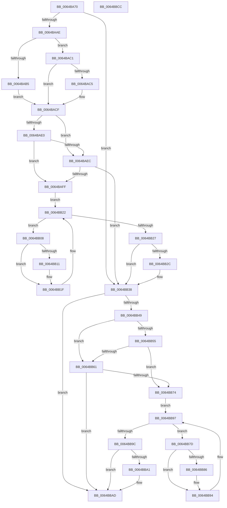

# DifZwUnloadKeyWrapper

- RVA: `0x0064BA70`–`0x0064BBCD` (길이 `349` bytes)
- VA: `0x000000014064BA70`
- 실행 섹션: `.text`
- PDB 이름 있음: `예`; PDB Function 태그: `아니요`
- unwind 정보 RVA: `0x00060130`
- 디코드: `94`개 명령, `349/349` bytes 표시
- 미해석 바이트: `0` (있으면 어셈블리에 `.byte`로 보존)

> 이 문서는 커널 이미지의 기계어와 PDB 기호를 분석해 생성했습니다. 4번과 5번은 함수 원형과 자료형을 바이너리 사용 방식에서 추정한 C 해석이며 원본 소스 복구 결과는 아닙니다.

## 1. Dependencies

- 직접 호출 지점: **9**; 고유 호출 대상: **6**
- 직접 호출자로 확인된 함수: **0**
- RIP 상대 이미지 참조: **3**

### Outgoing calls
- `0x0064BA9D` → [DifGetAPIThunkContextById](../49/DifGetAPIThunkContextById_function_00495A34.md) (function, `0x00495A34`)
- `0x0064BAC5` → [DifGetReturnAddressForWrappers](../4D/DifGetReturnAddressForWrappers_function_004D3C08.md) (function, `0x004D3C08`)
- `0x0064BAF3` → [ExAcquireRundownProtection](../21/ExAcquireRundownProtection_function_00216620.md) (function, `0x00216620`)
- `0x0064BB1A` → [guard_dispatch_icall](../6B/guard_dispatch_icall_function_006BAAD0.md) (function, `0x006BAAD0`)
- `0x0064BB33` → [ExReleaseRundownProtection](../34/ExReleaseRundownProtection_function_00349E80.md) (function, `0x00349E80`)
- `0x0064BB3B` → [ZwUnloadKey](../6B/ZwUnloadKey_function_006B0C30.md) (function, `0x006B0C30`)
- `0x0064BB68` → [ExAcquireRundownProtection](../21/ExAcquireRundownProtection_function_00216620.md) (function, `0x00216620`)
- `0x0064BB8F` → [guard_dispatch_icall](../6B/guard_dispatch_icall_function_006BAAD0.md) (function, `0x006BAAD0`)
- `0x0064BBA8` → [ExReleaseRundownProtection](../34/ExReleaseRundownProtection_function_00349E80.md) (function, `0x00349E80`)

### Direct callers
- 이 함수 시작 RVA로 연결되는 직접 call은 확인되지 않았습니다. 간접 호출은 완전히 역산할 수 없습니다.

### Static image references
- `0x0064BAD7` → RVA `0x00F048B8` (`.data`; read)
- `0x0064BAE0` → RVA `0x00F04980` (`.data`; read)
- `0x0064BAEC` → RVA `0x00F03E80` (`.data`; read)

## 2. Other-region calls and transfers

- 다른 실행 섹션으로 향하는 call: **0**
- 별도 외부 분기/꼬리 이동을 확인하지 못했습니다.

## 3. Assembly (complete function range)

```asm
0064BA70  4C 8B DC                        mov r11, rsp
0064BA73  49 89 5B 08                     mov qword ptr [r11 + 8], rbx
0064BA77  49 89 6B 10                     mov qword ptr [r11 + 0x10], rbp
0064BA7B  49 89 73 18                     mov qword ptr [r11 + 0x18], rsi
0064BA7F  49 89 7B 20                     mov qword ptr [r11 + 0x20], rdi
0064BA83  41 56                           push r14
0064BA85  48 83 EC 40                     sub rsp, 0x40
0064BA89  33 C0                           xor eax, eax
0064BA8B  0F 57 C0                        xorps xmm0, xmm0
0064BA8E  0F 11 44 24 20                  movups xmmword ptr [rsp + 0x20], xmm0
0064BA93  48 8B E9                        mov rbp, rcx
0064BA96  49 89 43 E8                     mov qword ptr [r11 - 0x18], rax
0064BA9A  8D 48 03                        lea ecx, [rax + 3]
0064BA9D  E8 92 9F E4 FF                  call 0x140495a34
0064BAA2  48 8B F0                        mov rsi, rax
0064BAA5  48 85 C0                        test rax, rax
0064BAA8  0F 84 8A 00 00 00               je 0x14064bb38
0064BAAE  8B 40 0C                        mov eax, dword ptr [rax + 0xc]
0064BAB1  A8 18                           test al, 0x18
0064BAB3  74 0C                           je 0x14064bac1
0064BAB5  48 8B 4C 24 48                  mov rcx, qword ptr [rsp + 0x48]
0064BABA  48 89 4C 24 20                  mov qword ptr [rsp + 0x20], rcx
0064BABF  EB 0E                           jmp 0x14064bacf
0064BAC1  A8 04                           test al, 4
0064BAC3  74 0A                           je 0x14064bacf
0064BAC5  E8 3E 81 E8 FF                  call 0x1404d3c08
0064BACA  48 89 44 24 20                  mov qword ptr [rsp + 0x20], rax
0064BACF  40 32 FF                        xor dil, dil
0064BAD2  48 89 6C 24 28                  mov qword ptr [rsp + 0x28], rbp
0064BAD7  40 38 3D DA 8D 8B 00            cmp byte ptr [rip + 0x8b8dda], dil
0064BADE  75 0C                           jne 0x14064baec
0064BAE0  F7 05 96 8E 8B 00 00 08 00 00   test dword ptr [rip + 0x8b8e96], 0x800
0064BAEA  74 13                           je 0x14064baff
0064BAEC  48 8D 0D 8D 83 8B 00            lea rcx, [rip + 0x8b838d]
0064BAF3  E8 28 AB BC FF                  call 0x140216620
0064BAF8  40 8A F8                        mov dil, al
0064BAFB  84 C0                           test al, al
0064BAFD  74 39                           je 0x14064bb38
0064BAFF  4C 8D 76 20                     lea r14, [rsi + 0x20]
0064BB03  49 8B 1E                        mov rbx, qword ptr [r14]
0064BB06  EB 1A                           jmp 0x14064bb22
0064BB08  48 8D 43 F0                     lea rax, [rbx - 0x10]
0064BB0C  48 85 C0                        test rax, rax
0064BB0F  74 0E                           je 0x14064bb1f
0064BB11  48 8B 40 08                     mov rax, qword ptr [rax + 8]
0064BB15  48 8D 4C 24 20                  lea rcx, [rsp + 0x20]
0064BB1A  E8 B1 EF 06 00                  call 0x1406baad0
0064BB1F  48 8B 1B                        mov rbx, qword ptr [rbx]
0064BB22  49 3B DE                        cmp rbx, r14
0064BB25  75 E1                           jne 0x14064bb08
0064BB27  40 84 FF                        test dil, dil
0064BB2A  74 0C                           je 0x14064bb38
0064BB2C  48 8D 0D 4D 83 8B 00            lea rcx, [rip + 0x8b834d]
0064BB33  E8 48 E3 CF FF                  call 0x140349e80
0064BB38  48 8B CD                        mov rcx, rbp
0064BB3B  E8 F0 50 06 00                  call 0x1406b0c30
0064BB40  89 44 24 30                     mov dword ptr [rsp + 0x30], eax
0064BB44  48 85 F6                        test rsi, rsi
0064BB47  74 64                           je 0x14064bbad
0064BB49  40 32 FF                        xor dil, dil
0064BB4C  40 38 3D 65 8D 8B 00            cmp byte ptr [rip + 0x8b8d65], dil
0064BB53  75 0C                           jne 0x14064bb61
0064BB55  F7 05 21 8E 8B 00 00 08 00 00   test dword ptr [rip + 0x8b8e21], 0x800
0064BB5F  74 13                           je 0x14064bb74
0064BB61  48 8D 0D 18 83 8B 00            lea rcx, [rip + 0x8b8318]
0064BB68  E8 B3 AA BC FF                  call 0x140216620
0064BB6D  40 8A F8                        mov dil, al
0064BB70  84 C0                           test al, al
0064BB72  74 39                           je 0x14064bbad
0064BB74  48 83 C6 30                     add rsi, 0x30
0064BB78  48 8B 1E                        mov rbx, qword ptr [rsi]
0064BB7B  EB 1A                           jmp 0x14064bb97
0064BB7D  48 8D 43 F0                     lea rax, [rbx - 0x10]
0064BB81  48 85 C0                        test rax, rax
0064BB84  74 0E                           je 0x14064bb94
0064BB86  48 8B 40 08                     mov rax, qword ptr [rax + 8]
0064BB8A  48 8D 4C 24 20                  lea rcx, [rsp + 0x20]
0064BB8F  E8 3C EF 06 00                  call 0x1406baad0
0064BB94  48 8B 1B                        mov rbx, qword ptr [rbx]
0064BB97  48 3B DE                        cmp rbx, rsi
0064BB9A  75 E1                           jne 0x14064bb7d
0064BB9C  40 84 FF                        test dil, dil
0064BB9F  74 0C                           je 0x14064bbad
0064BBA1  48 8D 0D D8 82 8B 00            lea rcx, [rip + 0x8b82d8]
0064BBA8  E8 D3 E2 CF FF                  call 0x140349e80
0064BBAD  8B 44 24 30                     mov eax, dword ptr [rsp + 0x30]
0064BBB1  48 8B 5C 24 50                  mov rbx, qword ptr [rsp + 0x50]
0064BBB6  48 8B 6C 24 58                  mov rbp, qword ptr [rsp + 0x58]
0064BBBB  48 8B 74 24 60                  mov rsi, qword ptr [rsp + 0x60]
0064BBC0  48 8B 7C 24 68                  mov rdi, qword ptr [rsp + 0x68]
0064BBC5  48 83 C4 40                     add rsp, 0x40
0064BBC9  41 5E                           pop r14
0064BBCB  C3                              ret
0064BBCC  CC                              int3
```

## 4. C-style interpretation (structured pseudocode)

```c
__int64 __fastcall DifZwUnloadKeyWrapper(__int64 a1)
{
    __int64 result;
    __int64 v_rdi;
    __int64 v_rsi;
    __int64 v_rsp;
    unsigned int v_stack_m18;
    unsigned __int64 v_stack_m20;
    unsigned __int64 v_stack_m28;
    unsigned __int64 v_stack_p0;
    unsigned __int64 v_stack_p10;
    unsigned __int64 v_stack_p18;
    unsigned __int64 v_stack_p20;
    unsigned __int64 v_stack_p8;

    *(unsigned __int64 *)(v_rsp + 8) = v_rbx;
    *(unsigned __int64 *)(v_rsp + 16) = v_rbp;
    *(unsigned __int64 *)(v_rsp + 24) = v_rsi;
    *(unsigned __int64 *)(v_rsp + 32) = v_rdi;
    v_rsp = (v_rsp) - (64);
    result = 0;
    v_stack_m28 = v_xmm0;
    *(unsigned __int64 *)(v_rsp - 24) = 0;
    result = DifGetAPIThunkContextById(result + 3, a2, a3, a4);
    if (result == 0) goto loc_0064BB38;
    if ((((unsigned __int8)((unsigned int)(*(unsigned int *)(result + 12)))) & (24)) == 0) goto loc_0064BAC1;
    v_stack_m28 = v_stack_p0;
    goto loc_0064BACF;
loc_0064BAC1:
    result = (unsigned int)(*(unsigned int *)(result + 12));
    if ((((unsigned __int8)((unsigned int)(*(unsigned int *)(result + 12)))) & (4)) != 0) {
        result = DifGetReturnAddressForWrappers(v_stack_p0, a2, a3, a4);
        v_stack_m28 = result;
    }
    v_rdi = 0;
    v_stack_m20 = a1;
    if ((*(unsigned __int8 *)(v_rip + 9145818)) != 0) goto loc_0064BAEC;
    if (((*(unsigned int *)(v_rip + 9146006)) & (0x800ULL)) == 0) goto loc_0064BAFF;
loc_0064BAEC:
    result = ExAcquireRundownProtection(v_rip + 9143181, a2, a3, a4);
    if ((unsigned __int8)(result) == 0) goto loc_0064BB38;
loc_0064BAFF:
    goto loc_0064BB22;
loc_0064BB08:
    result = *(unsigned __int64 *)(result + 32) - 16;
    if (*(unsigned __int64 *)(result + 32) - 16 != 0) {
        result = *(unsigned __int64 *)(*(unsigned __int64 *)(result + 32) - 16 + 8);
        a1 = v_stack_m28;
        result = guard_dispatch_icall(a1, a2, a3, a4);
    }
loc_0064BB22:
    if ((*(unsigned __int64 *)(*(unsigned __int64 *)(result + 32))) != (result + 32)) goto loc_0064BB08;
    if ((unsigned __int8)((unsigned __int8)(result)) != 0) {
        a1 = v_rip + 9143117;
        result = ExReleaseRundownProtection(a1, a2, a3, a4);
    }
    result = ZwUnloadKey(a1, a2, a3, a4);
    v_stack_m18 = (unsigned int)(result);
    if (result == 0) goto loc_0064BBAD;
    v_rdi = 0;
    if ((*(unsigned __int8 *)(v_rip + 9145701)) != 0) goto loc_0064BB61;
    if (((*(unsigned int *)(v_rip + 9145889)) & (0x800ULL)) == 0) goto loc_0064BB74;
loc_0064BB61:
    result = ExAcquireRundownProtection(v_rip + 9143064, a2, a3, a4);
    if ((unsigned __int8)(result) == 0) goto loc_0064BBAD;
loc_0064BB74:
    v_rsi = (result) + (48);
    goto loc_0064BB97;
loc_0064BB7D:
    result = *(unsigned __int64 *)(v_rsi) - 16;
    if (*(unsigned __int64 *)(v_rsi) - 16 != 0) {
        result = *(unsigned __int64 *)(*(unsigned __int64 *)(v_rsi) - 16 + 8);
        a1 = v_stack_m28;
        result = guard_dispatch_icall(a1, a2, a3, a4);
    }
loc_0064BB97:
    if ((*(unsigned __int64 *)(*(unsigned __int64 *)(v_rsi))) != v_rsi) goto loc_0064BB7D;
    if ((unsigned __int8)((unsigned __int8)(result)) != 0) {
        a1 = v_rip + 9143000;
        result = ExReleaseRundownProtection(a1, a2, a3, a4);
    }
    v_rsp = (v_rsp) + (64);
    return (unsigned int)(v_stack_m18);
}
```

## 5. (Beta) C Style

```c
int64_t DifZwUnloadKeyWrapper(int64_t Arg1)
{
    int64_t result;
    int64_t local_rdi;
    int64_t local_rsi;
    int64_t local_rsp;
    uint32_t v_stack_m18;
    uint64_t v_stack_m20;
    uint64_t v_stack_m28;
    uint64_t v_stack_p0;
    uint64_t v_stack_p10;
    uint64_t v_stack_p18;
    uint64_t v_stack_p20;
    uint64_t v_stack_p8;

    *(uint64_t *)(local_rsp + 0x8) = local_rbx;
    *(uint64_t *)(local_rsp + 0x10) = local_rbp;
    *(uint64_t *)(local_rsp + 0x18) = local_rsi;
    *(uint64_t *)(local_rsp + 0x20) = local_rdi;
    local_rsp = (local_rsp) - (64);
    result = 0;
    v_stack_m28 = v_xmm0;
    *(uint64_t *)(local_rsp - 0x18) = 0;
    result = DifGetAPIThunkContextById(result + 3, a2, a3, a4);
    if (result == 0) goto loc_0064BB38;
    if ((((uint8_t)((uint32_t)(*(uint32_t *)(result + 0xC)))) & (24)) == 0) goto loc_0064BAC1;
    v_stack_m28 = v_stack_p0;
    goto loc_0064BACF;
loc_0064BAC1:
    result = (uint32_t)(*(uint32_t *)(result + 0xC));
    if ((((uint8_t)((uint32_t)(*(uint32_t *)(result + 0xC)))) & (4)) != 0) {
        result = DifGetReturnAddressForWrappers(v_stack_p0, a2, a3, a4);
        v_stack_m28 = result;
    }
    local_rdi = 0;
    v_stack_m20 = Arg1;
    if ((*(uint8_t *)(v_rip + 0x8B8DDA)) != 0) goto loc_0064BAEC;
    if (((*(uint32_t *)(v_rip + 0x8B8E96)) & (0x800ULL)) == 0) goto loc_0064BAFF;
loc_0064BAEC:
    result = ExAcquireRundownProtection(v_rip + 9143181, a2, a3, a4);
    if ((uint8_t)(result) == 0) goto loc_0064BB38;
loc_0064BAFF:
    goto loc_0064BB22;
loc_0064BB08:
    result = *(uint64_t *)(result + 0x20) - 16;
    if (*(uint64_t *)(result + 0x20) - 16 != 0) {
        result = *(uint64_t *)(*(uint64_t *)(result + 0x20) - 0x10 + 0x8);
        Arg1 = v_stack_m28;
        result = guard_dispatch_icall(Arg1, a2, a3, a4);
    }
loc_0064BB22:
    if ((*(uint64_t *)(*(uint64_t *)(result + 0x20))) != (result + 32)) goto loc_0064BB08;
    if ((uint8_t)((uint8_t)(result)) != 0) {
        Arg1 = v_rip + 9143117;
        result = ExReleaseRundownProtection(Arg1, a2, a3, a4);
    }
    result = ZwUnloadKey(Arg1, a2, a3, a4);
    v_stack_m18 = (uint32_t)(result);
    if (result == 0) goto loc_0064BBAD;
    local_rdi = 0;
    if ((*(uint8_t *)(v_rip + 0x8B8D65)) != 0) goto loc_0064BB61;
    if (((*(uint32_t *)(v_rip + 0x8B8E21)) & (0x800ULL)) == 0) goto loc_0064BB74;
loc_0064BB61:
    result = ExAcquireRundownProtection(v_rip + 9143064, a2, a3, a4);
    if ((uint8_t)(result) == 0) goto loc_0064BBAD;
loc_0064BB74:
    local_rsi = (result) + (48);
    goto loc_0064BB97;
loc_0064BB7D:
    result = *(uint64_t *)(local_rsi) - 16;
    if (*(uint64_t *)(local_rsi) - 16 != 0) {
        result = *(uint64_t *)(*(uint64_t *)(local_rsi) - 0x10 + 0x8);
        Arg1 = v_stack_m28;
        result = guard_dispatch_icall(Arg1, a2, a3, a4);
    }
loc_0064BB97:
    if ((*(uint64_t *)(*(uint64_t *)(local_rsi))) != local_rsi) goto loc_0064BB7D;
    if ((uint8_t)((uint8_t)(result)) != 0) {
        Arg1 = v_rip + 9143000;
        result = ExReleaseRundownProtection(Arg1, a2, a3, a4);
    }
    local_rsp = (local_rsp) + (64);
    return (uint32_t)(v_stack_m18);
}
```

## 6. Execution-region graph

[열기: 2D/3D 그래프와 함수 탐색 컨트롤 패널](../../../control-panel.html?section=text&rva=0x0064BA70&view=graph)

- 2D 그래프는 위에서 아래로 흐르고, 3D 그래프는 빈 공간을 드래그해 회전합니다. Shift+드래그는 이동, 휠은 확대·축소, 함수 노드 선택은 대상 보고서 이동입니다.

### Static fallback


