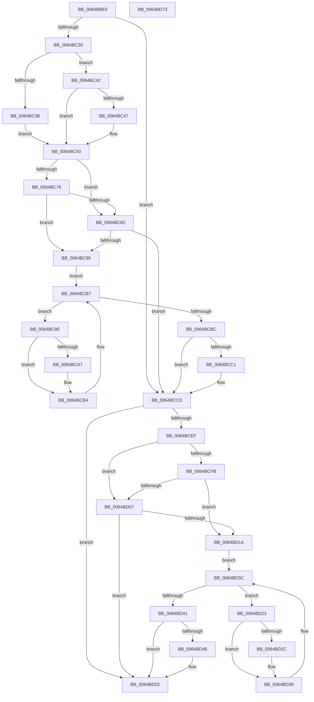

# DifZwWaitForMultipleObjectsWrapper

- RVA: `0x0064BBE0`–`0x0064BD74` (길이 `404` bytes)
- VA: `0x000000014064BBE0`
- 실행 섹션: `.text`
- PDB 이름 있음: `예`; PDB Function 태그: `아니요`
- unwind 정보 RVA: `0x000D2C24`
- 디코드: `117`개 명령, `404/404` bytes 표시
- 미해석 바이트: `0` (있으면 어셈블리에 `.byte`로 보존)

> 이 문서는 커널 이미지의 기계어와 PDB 기호를 분석해 생성했습니다. 4번과 5번은 함수 원형과 자료형을 바이너리 사용 방식에서 추정한 C 해석이며 원본 소스 복구 결과는 아닙니다.

## 1. Dependencies

- 직접 호출 지점: **9**; 고유 호출 대상: **6**
- 직접 호출자로 확인된 함수: **0**
- RIP 상대 이미지 참조: **3**

### Outgoing calls
- `0x0064BC1F` → [DifGetAPIThunkContextById](../49/DifGetAPIThunkContextById_function_00495A34.md) (function, `0x00495A34`)
- `0x0064BC47` → [DifGetReturnAddressForWrappers](../4D/DifGetReturnAddressForWrappers_function_004D3C08.md) (function, `0x004D3C08`)
- `0x0064BC89` → [ExAcquireRundownProtection](../21/ExAcquireRundownProtection_function_00216620.md) (function, `0x00216620`)
- `0x0064BCAF` → [guard_dispatch_icall](../6B/guard_dispatch_icall_function_006BAAD0.md) (function, `0x006BAAD0`)
- `0x0064BCC8` → [ExReleaseRundownProtection](../34/ExReleaseRundownProtection_function_00349E80.md) (function, `0x00349E80`)
- `0x0064BCE2` → [ZwWaitForMultipleObjects](../6A/ZwWaitForMultipleObjects_function_006ADC30.md) (function, `0x006ADC30`)
- `0x0064BD0E` → [ExAcquireRundownProtection](../21/ExAcquireRundownProtection_function_00216620.md) (function, `0x00216620`)
- `0x0064BD34` → [guard_dispatch_icall](../6B/guard_dispatch_icall_function_006BAAD0.md) (function, `0x006BAAD0`)
- `0x0064BD4D` → [ExReleaseRundownProtection](../34/ExReleaseRundownProtection_function_00349E80.md) (function, `0x00349E80`)

### Direct callers
- 이 함수 시작 RVA로 연결되는 직접 call은 확인되지 않았습니다. 간접 호출은 완전히 역산할 수 없습니다.

### Static image references
- `0x0064BC56` → RVA `0x00F048B8` (`.data`; read)
- `0x0064BC76` → RVA `0x00F04980` (`.data`; read)
- `0x0064BC82` → RVA `0x00F03E80` (`.data`; read)

## 2. Other-region calls and transfers

- 다른 실행 섹션으로 향하는 call: **0**
- 별도 외부 분기/꼬리 이동을 확인하지 못했습니다.

## 3. Assembly (complete function range)

```asm
0064BBE0  48 8B C4                        mov rax, rsp
0064BBE3  48 89 58 10                     mov qword ptr [rax + 0x10], rbx
0064BBE7  48 89 70 18                     mov qword ptr [rax + 0x18], rsi
0064BBEB  48 89 78 20                     mov qword ptr [rax + 0x20], rdi
0064BBEF  89 48 08                        mov dword ptr [rax + 8], ecx
0064BBF2  55                              push rbp
0064BBF3  41 54                           push r12
0064BBF5  41 55                           push r13
0064BBF7  41 56                           push r14
0064BBF9  41 57                           push r15
0064BBFB  48 8B EC                        mov rbp, rsp
0064BBFE  48 83 EC 60                     sub rsp, 0x60
0064BC02  33 C0                           xor eax, eax
0064BC04  0F 57 C0                        xorps xmm0, xmm0
0064BC07  45 8A F9                        mov r15b, r9b
0064BC0A  48 89 45 F0                     mov qword ptr [rbp - 0x10], rax
0064BC0E  45 8B E0                        mov r12d, r8d
0064BC11  4C 8B EA                        mov r13, rdx
0064BC14  0F 11 45 D0                     movups xmmword ptr [rbp - 0x30], xmm0
0064BC18  8D 48 02                        lea ecx, [rax + 2]
0064BC1B  0F 11 45 E0                     movups xmmword ptr [rbp - 0x20], xmm0
0064BC1F  E8 10 9E E4 FF                  call 0x140495a34
0064BC24  4C 8B F0                        mov r14, rax
0064BC27  48 85 C0                        test rax, rax
0064BC2A  0F 84 9D 00 00 00               je 0x14064bccd
0064BC30  8B 48 0C                        mov ecx, dword ptr [rax + 0xc]
0064BC33  F6 C1 18                        test cl, 0x18
0064BC36  74 0A                           je 0x14064bc42
0064BC38  48 8B 4D 28                     mov rcx, qword ptr [rbp + 0x28]
0064BC3C  48 89 4D D0                     mov qword ptr [rbp - 0x30], rcx
0064BC40  EB 0E                           jmp 0x14064bc50
0064BC42  F6 C1 04                        test cl, 4
0064BC45  74 09                           je 0x14064bc50
0064BC47  E8 BC 7F E8 FF                  call 0x1404d3c08
0064BC4C  48 89 45 D0                     mov qword ptr [rbp - 0x30], rax
0064BC50  8B 45 30                        mov eax, dword ptr [rbp + 0x30]
0064BC53  40 32 F6                        xor sil, sil
0064BC56  40 38 35 5B 8C 8B 00            cmp byte ptr [rip + 0x8b8c5b], sil
0064BC5D  89 45 F0                        mov dword ptr [rbp - 0x10], eax
0064BC60  48 8B 45 50                     mov rax, qword ptr [rbp + 0x50]
0064BC64  48 89 45 D8                     mov qword ptr [rbp - 0x28], rax
0064BC68  4C 89 6D E8                     mov qword ptr [rbp - 0x18], r13
0064BC6C  44 89 65 E4                     mov dword ptr [rbp - 0x1c], r12d
0064BC70  44 88 7D E0                     mov byte ptr [rbp - 0x20], r15b
0064BC74  75 0C                           jne 0x14064bc82
0064BC76  F7 05 00 8D 8B 00 00 08 00 00   test dword ptr [rip + 0x8b8d00], 0x800
0064BC80  74 13                           je 0x14064bc95
0064BC82  48 8D 0D F7 81 8B 00            lea rcx, [rip + 0x8b81f7]
0064BC89  E8 92 A9 BC FF                  call 0x140216620
0064BC8E  40 8A F0                        mov sil, al
0064BC91  84 C0                           test al, al
0064BC93  74 38                           je 0x14064bccd
0064BC95  49 8D 7E 20                     lea rdi, [r14 + 0x20]
0064BC99  48 8B 1F                        mov rbx, qword ptr [rdi]
0064BC9C  EB 19                           jmp 0x14064bcb7
0064BC9E  48 8D 43 F0                     lea rax, [rbx - 0x10]
0064BCA2  48 85 C0                        test rax, rax
0064BCA5  74 0D                           je 0x14064bcb4
0064BCA7  48 8B 40 08                     mov rax, qword ptr [rax + 8]
0064BCAB  48 8D 4D D0                     lea rcx, [rbp - 0x30]
0064BCAF  E8 1C EE 06 00                  call 0x1406baad0
0064BCB4  48 8B 1B                        mov rbx, qword ptr [rbx]
0064BCB7  48 3B DF                        cmp rbx, rdi
0064BCBA  75 E2                           jne 0x14064bc9e
0064BCBC  40 84 F6                        test sil, sil
0064BCBF  74 0C                           je 0x14064bccd
0064BCC1  48 8D 0D B8 81 8B 00            lea rcx, [rip + 0x8b81b8]
0064BCC8  E8 B3 E1 CF FF                  call 0x140349e80
0064BCCD  48 8B 45 50                     mov rax, qword ptr [rbp + 0x50]
0064BCD1  45 8A CF                        mov r9b, r15b
0064BCD4  8B 4D 30                        mov ecx, dword ptr [rbp + 0x30]
0064BCD7  45 8B C4                        mov r8d, r12d
0064BCDA  49 8B D5                        mov rdx, r13
0064BCDD  48 89 44 24 20                  mov qword ptr [rsp + 0x20], rax
0064BCE2  E8 49 1F 06 00                  call 0x1406adc30
0064BCE7  89 45 F4                        mov dword ptr [rbp - 0xc], eax
0064BCEA  4D 85 F6                        test r14, r14
0064BCED  74 63                           je 0x14064bd52
0064BCEF  40 32 FF                        xor dil, dil
0064BCF2  40 38 3D BF 8B 8B 00            cmp byte ptr [rip + 0x8b8bbf], dil
0064BCF9  75 0C                           jne 0x14064bd07
0064BCFB  F7 05 7B 8C 8B 00 00 08 00 00   test dword ptr [rip + 0x8b8c7b], 0x800
0064BD05  74 13                           je 0x14064bd1a
0064BD07  48 8D 0D 72 81 8B 00            lea rcx, [rip + 0x8b8172]
0064BD0E  E8 0D A9 BC FF                  call 0x140216620
0064BD13  40 8A F8                        mov dil, al
0064BD16  84 C0                           test al, al
0064BD18  74 38                           je 0x14064bd52
0064BD1A  49 8D 76 30                     lea rsi, [r14 + 0x30]
0064BD1E  48 8B 1E                        mov rbx, qword ptr [rsi]
0064BD21  EB 19                           jmp 0x14064bd3c
0064BD23  48 8D 43 F0                     lea rax, [rbx - 0x10]
0064BD27  48 85 C0                        test rax, rax
0064BD2A  74 0D                           je 0x14064bd39
0064BD2C  48 8B 40 08                     mov rax, qword ptr [rax + 8]
0064BD30  48 8D 4D D0                     lea rcx, [rbp - 0x30]
0064BD34  E8 97 ED 06 00                  call 0x1406baad0
0064BD39  48 8B 1B                        mov rbx, qword ptr [rbx]
0064BD3C  48 3B DE                        cmp rbx, rsi
0064BD3F  75 E2                           jne 0x14064bd23
0064BD41  40 84 FF                        test dil, dil
0064BD44  74 0C                           je 0x14064bd52
0064BD46  48 8D 0D 33 81 8B 00            lea rcx, [rip + 0x8b8133]
0064BD4D  E8 2E E1 CF FF                  call 0x140349e80
0064BD52  8B 45 F4                        mov eax, dword ptr [rbp - 0xc]
0064BD55  4C 8D 5C 24 60                  lea r11, [rsp + 0x60]
0064BD5A  49 8B 5B 38                     mov rbx, qword ptr [r11 + 0x38]
0064BD5E  49 8B 73 40                     mov rsi, qword ptr [r11 + 0x40]
0064BD62  49 8B 7B 48                     mov rdi, qword ptr [r11 + 0x48]
0064BD66  49 8B E3                        mov rsp, r11
0064BD69  41 5F                           pop r15
0064BD6B  41 5E                           pop r14
0064BD6D  41 5D                           pop r13
0064BD6F  41 5C                           pop r12
0064BD71  5D                              pop rbp
0064BD72  C3                              ret
0064BD73  CC                              int3
```

## 4. C-style interpretation (structured pseudocode)

```c
__int64 __fastcall DifZwWaitForMultipleObjectsWrapper(int a1, __int64 a2, int a3, unsigned __int8 a4, __int64 a5)
{
    __int64 result;
    __int64 v_rdi;
    __int64 v_rsi;
    __int64 v_rsp;
    unsigned __int64 v_stack_m28;
    unsigned int v_stack_m34;
    unsigned __int64 v_stack_m38;
    unsigned __int64 v_stack_m40;
    unsigned int v_stack_m44;
    unsigned __int64 v_stack_m48;
    unsigned __int64 v_stack_m50;
    unsigned __int64 v_stack_m58;
    unsigned __int64 v_stack_m68;
    unsigned __int64 v_stack_p0;
    unsigned int v_stack_p8;

    *(unsigned __int64 *)(v_rsp + 16) = v_rbx;
    *(unsigned __int64 *)(v_rsp + 24) = v_rsi;
    *(unsigned __int64 *)(v_rsp + 32) = v_rdi;
    *(unsigned int *)(v_rsp + 8) = a1;
    v_rsp = (v_rsp) - (96);
    result = 0;
    v_stack_m38 = 0;
    v_stack_m58 = v_xmm0;
    v_stack_m48 = v_xmm0;
    result = DifGetAPIThunkContextById(result + 2, a2, a3, a4);
    if (result == 0) goto loc_0064BCCD;
    if ((((unsigned __int8)((unsigned int)(*(unsigned int *)(result + 12)))) & (24)) == 0) goto loc_0064BC42;
    v_stack_m58 = v_stack_p0;
    goto loc_0064BC50;
loc_0064BC42:
    if ((((unsigned __int8)(v_stack_p0)) & (4)) != 0) {
        result = DifGetReturnAddressForWrappers(v_stack_p0, a2, a3, a4);
        v_stack_m58 = result;
    }
    v_rsi = 0;
    v_stack_m38 = (unsigned int)((unsigned int)(v_stack_p8));
    v_stack_m50 = a5;
    v_stack_m40 = a2;
    v_stack_m44 = (unsigned int)((unsigned int)(a3));
    v_stack_m48 = a4;
    if ((*(unsigned __int8 *)(v_rip + 9145435)) != 0) goto loc_0064BC82;
    if (((*(unsigned int *)(v_rip + 9145600)) & (0x800ULL)) == 0) goto loc_0064BC95;
loc_0064BC82:
    result = ExAcquireRundownProtection(v_rip + 9142775, a2, a3, a4);
    if ((unsigned __int8)(result) == 0) goto loc_0064BCCD;
loc_0064BC95:
    goto loc_0064BCB7;
loc_0064BC9E:
    result = *(unsigned __int64 *)(result + 32) - 16;
    if (*(unsigned __int64 *)(result + 32) - 16 != 0) {
        result = *(unsigned __int64 *)(*(unsigned __int64 *)(result + 32) - 16 + 8);
        a1 = v_stack_m58;
        result = guard_dispatch_icall(a1, a2, a3, a4);
    }
loc_0064BCB7:
    if ((*(unsigned __int64 *)(*(unsigned __int64 *)(result + 32))) != (result + 32)) goto loc_0064BC9E;
    if ((unsigned __int8)((unsigned __int8)(result)) != 0) {
        a1 = v_rip + 9142712;
        result = ExReleaseRundownProtection(a1, a2, a3, a4);
    }
    v_stack_m68 = a5;
    result = ZwWaitForMultipleObjects((unsigned int)(v_stack_p8), a2, (unsigned int)((unsigned int)((unsigned int)(a3))), a4);
    v_stack_m34 = (unsigned int)(result);
    if (result == 0) goto loc_0064BD52;
    v_rdi = 0;
    if ((*(unsigned __int8 *)(v_rip + 9145279)) != 0) goto loc_0064BD07;
    if (((*(unsigned int *)(v_rip + 9145467)) & (0x800ULL)) == 0) goto loc_0064BD1A;
loc_0064BD07:
    result = ExAcquireRundownProtection(v_rip + 9142642, a2, (unsigned int)((unsigned int)((unsigned int)(a3))), a4);
    if ((unsigned __int8)(result) == 0) goto loc_0064BD52;
loc_0064BD1A:
    goto loc_0064BD3C;
loc_0064BD23:
    result = *(unsigned __int64 *)(result + 48) - 16;
    if (*(unsigned __int64 *)(result + 48) - 16 != 0) {
        result = *(unsigned __int64 *)(*(unsigned __int64 *)(result + 48) - 16 + 8);
        a1 = v_stack_m58;
        result = guard_dispatch_icall(a1, a2, (unsigned int)((unsigned int)((unsigned int)(a3))), a4);
    }
loc_0064BD3C:
    if ((*(unsigned __int64 *)(*(unsigned __int64 *)(result + 48))) != (result + 48)) goto loc_0064BD23;
    if ((unsigned __int8)((unsigned __int8)(result)) != 0) {
        a1 = v_rip + 9142579;
        result = ExReleaseRundownProtection(a1, a2, (unsigned int)((unsigned int)((unsigned int)(a3))), a4);
    }
    return (unsigned int)(v_stack_m34);
}
```

## 5. (Beta) C Style

```c
int64_t DifZwWaitForMultipleObjectsWrapper(int32_t Arg1, int64_t Arg2, int32_t Arg3, uint8_t Arg4, int64_t Arg5)
{
    int64_t result;
    int64_t local_rdi;
    int64_t local_rsi;
    int64_t local_rsp;
    uint64_t v_stack_m28;
    uint32_t v_stack_m34;
    uint64_t v_stack_m38;
    uint64_t v_stack_m40;
    uint32_t v_stack_m44;
    uint64_t v_stack_m48;
    uint64_t v_stack_m50;
    uint64_t v_stack_m58;
    uint64_t v_stack_m68;
    uint64_t v_stack_p0;
    uint32_t v_stack_p8;

    *(uint64_t *)(local_rsp + 0x10) = local_rbx;
    *(uint64_t *)(local_rsp + 0x18) = local_rsi;
    *(uint64_t *)(local_rsp + 0x20) = local_rdi;
    *(uint32_t *)(local_rsp + 0x8) = Arg1;
    local_rsp = (local_rsp) - (96);
    result = 0;
    v_stack_m38 = 0;
    v_stack_m58 = v_xmm0;
    v_stack_m48 = v_xmm0;
    result = DifGetAPIThunkContextById(result + 2, Arg2, Arg3, Arg4);
    if (result == 0) goto loc_0064BCCD;
    if ((((uint8_t)((uint32_t)(*(uint32_t *)(result + 0xC)))) & (24)) == 0) goto loc_0064BC42;
    v_stack_m58 = v_stack_p0;
    goto loc_0064BC50;
loc_0064BC42:
    if ((((uint8_t)(v_stack_p0)) & (4)) != 0) {
        result = DifGetReturnAddressForWrappers(v_stack_p0, Arg2, Arg3, Arg4);
        v_stack_m58 = result;
    }
    local_rsi = 0;
    v_stack_m38 = (uint32_t)((uint32_t)(v_stack_p8));
    v_stack_m50 = Arg5;
    v_stack_m40 = Arg2;
    v_stack_m44 = (uint32_t)((uint32_t)(Arg3));
    v_stack_m48 = Arg4;
    if ((*(uint8_t *)(v_rip + 0x8B8C5B)) != 0) goto loc_0064BC82;
    if (((*(uint32_t *)(v_rip + 0x8B8D00)) & (0x800ULL)) == 0) goto loc_0064BC95;
loc_0064BC82:
    result = ExAcquireRundownProtection(v_rip + 9142775, Arg2, Arg3, Arg4);
    if ((uint8_t)(result) == 0) goto loc_0064BCCD;
loc_0064BC95:
    goto loc_0064BCB7;
loc_0064BC9E:
    result = *(uint64_t *)(result + 0x20) - 16;
    if (*(uint64_t *)(result + 0x20) - 16 != 0) {
        result = *(uint64_t *)(*(uint64_t *)(result + 0x20) - 0x10 + 0x8);
        Arg1 = v_stack_m58;
        result = guard_dispatch_icall(Arg1, Arg2, Arg3, Arg4);
    }
loc_0064BCB7:
    if ((*(uint64_t *)(*(uint64_t *)(result + 0x20))) != (result + 32)) goto loc_0064BC9E;
    if ((uint8_t)((uint8_t)(result)) != 0) {
        Arg1 = v_rip + 9142712;
        result = ExReleaseRundownProtection(Arg1, Arg2, Arg3, Arg4);
    }
    v_stack_m68 = Arg5;
    result = ZwWaitForMultipleObjects((uint32_t)(v_stack_p8), Arg2, (uint32_t)((uint32_t)((uint32_t)(Arg3))), Arg4);
    v_stack_m34 = (uint32_t)(result);
    if (result == 0) goto loc_0064BD52;
    local_rdi = 0;
    if ((*(uint8_t *)(v_rip + 0x8B8BBF)) != 0) goto loc_0064BD07;
    if (((*(uint32_t *)(v_rip + 0x8B8C7B)) & (0x800ULL)) == 0) goto loc_0064BD1A;
loc_0064BD07:
    result = ExAcquireRundownProtection(v_rip + 9142642, Arg2, (uint32_t)((uint32_t)((uint32_t)(Arg3))), Arg4);
    if ((uint8_t)(result) == 0) goto loc_0064BD52;
loc_0064BD1A:
    goto loc_0064BD3C;
loc_0064BD23:
    result = *(uint64_t *)(result + 0x30) - 16;
    if (*(uint64_t *)(result + 0x30) - 16 != 0) {
        result = *(uint64_t *)(*(uint64_t *)(result + 0x30) - 0x10 + 0x8);
        Arg1 = v_stack_m58;
        result = guard_dispatch_icall(Arg1, Arg2, (uint32_t)((uint32_t)((uint32_t)(Arg3))), Arg4);
    }
loc_0064BD3C:
    if ((*(uint64_t *)(*(uint64_t *)(result + 0x30))) != (result + 48)) goto loc_0064BD23;
    if ((uint8_t)((uint8_t)(result)) != 0) {
        Arg1 = v_rip + 9142579;
        result = ExReleaseRundownProtection(Arg1, Arg2, (uint32_t)((uint32_t)((uint32_t)(Arg3))), Arg4);
    }
    return (uint32_t)(v_stack_m34);
}
```

## 6. Execution-region graph

[열기: 2D/3D 그래프와 함수 탐색 컨트롤 패널](../../../control-panel.html?section=text&rva=0x0064BBE0&view=graph)

- 2D 그래프는 위에서 아래로 흐르고, 3D 그래프는 빈 공간을 드래그해 회전합니다. Shift+드래그는 이동, 휠은 확대·축소, 함수 노드 선택은 대상 보고서 이동입니다.

### Static fallback


