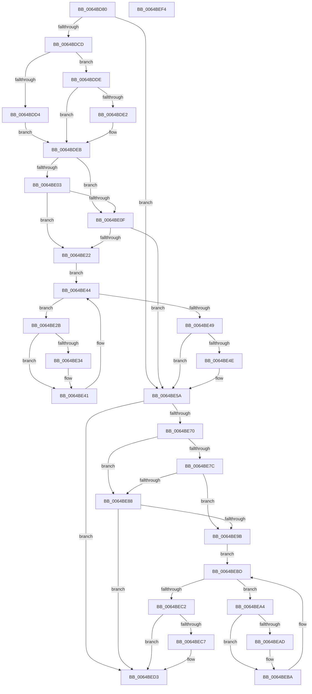

# DifZwWaitForSingleObjectWrapper

- RVA: `0x0064BD80`–`0x0064BEF5` (길이 `373` bytes)
- VA: `0x000000014064BD80`
- 실행 섹션: `.text`
- PDB 이름 있음: `예`; PDB Function 태그: `아니요`
- unwind 정보 RVA: `0x000A9A64`
- 디코드: `108`개 명령, `373/373` bytes 표시
- 미해석 바이트: `0` (있으면 어셈블리에 `.byte`로 보존)

> 이 문서는 커널 이미지의 기계어와 PDB 기호를 분석해 생성했습니다. 4번과 5번은 함수 원형과 자료형을 바이너리 사용 방식에서 추정한 C 해석이며 원본 소스 복구 결과는 아닙니다.

## 1. Dependencies

- 직접 호출 지점: **9**; 고유 호출 대상: **6**
- 직접 호출자로 확인된 함수: **0**
- RIP 상대 이미지 참조: **3**

### Outgoing calls
- `0x0064BDBC` → [DifGetAPIThunkContextById](../49/DifGetAPIThunkContextById_function_00495A34.md) (function, `0x00495A34`)
- `0x0064BDE2` → [DifGetReturnAddressForWrappers](../4D/DifGetReturnAddressForWrappers_function_004D3C08.md) (function, `0x004D3C08`)
- `0x0064BE16` → [ExAcquireRundownProtection](../21/ExAcquireRundownProtection_function_00216620.md) (function, `0x00216620`)
- `0x0064BE3C` → [guard_dispatch_icall](../6B/guard_dispatch_icall_function_006BAAD0.md) (function, `0x006BAAD0`)
- `0x0064BE55` → [ExReleaseRundownProtection](../34/ExReleaseRundownProtection_function_00349E80.md) (function, `0x00349E80`)
- `0x0064BE63` → [ZwWaitForSingleObject](../6A/ZwWaitForSingleObject_function_006AD150.md) (function, `0x006AD150`)
- `0x0064BE8F` → [ExAcquireRundownProtection](../21/ExAcquireRundownProtection_function_00216620.md) (function, `0x00216620`)
- `0x0064BEB5` → [guard_dispatch_icall](../6B/guard_dispatch_icall_function_006BAAD0.md) (function, `0x006BAAD0`)
- `0x0064BECE` → [ExReleaseRundownProtection](../34/ExReleaseRundownProtection_function_00349E80.md) (function, `0x00349E80`)

### Direct callers
- 이 함수 시작 RVA로 연결되는 직접 call은 확인되지 않았습니다. 간접 호출은 완전히 역산할 수 없습니다.

### Static image references
- `0x0064BDF2` → RVA `0x00F048B8` (`.data`; read)
- `0x0064BE03` → RVA `0x00F04980` (`.data`; read)
- `0x0064BE0F` → RVA `0x00F03E80` (`.data`; read)

## 2. Other-region calls and transfers

- 다른 실행 섹션으로 향하는 call: **0**
- 별도 외부 분기/꼬리 이동을 확인하지 못했습니다.

## 3. Assembly (complete function range)

```asm
0064BD80  48 89 5C 24 08                  mov qword ptr [rsp + 8], rbx
0064BD85  48 89 74 24 10                  mov qword ptr [rsp + 0x10], rsi
0064BD8A  48 89 7C 24 18                  mov qword ptr [rsp + 0x18], rdi
0064BD8F  55                              push rbp
0064BD90  41 54                           push r12
0064BD92  41 55                           push r13
0064BD94  41 56                           push r14
0064BD96  41 57                           push r15
0064BD98  48 8B EC                        mov rbp, rsp
0064BD9B  48 83 EC 50                     sub rsp, 0x50
0064BD9F  33 C0                           xor eax, eax
0064BDA1  0F 57 C0                        xorps xmm0, xmm0
0064BDA4  4C 8B E9                        mov r13, rcx
0064BDA7  48 89 45 F0                     mov qword ptr [rbp - 0x10], rax
0064BDAB  4D 8B F8                        mov r15, r8
0064BDAE  44 8A E2                        mov r12b, dl
0064BDB1  0F 11 45 D0                     movups xmmword ptr [rbp - 0x30], xmm0
0064BDB5  8D 48 01                        lea ecx, [rax + 1]
0064BDB8  0F 11 45 E0                     movups xmmword ptr [rbp - 0x20], xmm0
0064BDBC  E8 73 9C E4 FF                  call 0x140495a34
0064BDC1  48 8B F0                        mov rsi, rax
0064BDC4  48 85 C0                        test rax, rax
0064BDC7  0F 84 8D 00 00 00               je 0x14064be5a
0064BDCD  8B 40 0C                        mov eax, dword ptr [rax + 0xc]
0064BDD0  A8 18                           test al, 0x18
0064BDD2  74 0A                           je 0x14064bdde
0064BDD4  48 8B 4D 28                     mov rcx, qword ptr [rbp + 0x28]
0064BDD8  48 89 4D D0                     mov qword ptr [rbp - 0x30], rcx
0064BDDC  EB 0D                           jmp 0x14064bdeb
0064BDDE  A8 04                           test al, 4
0064BDE0  74 09                           je 0x14064bdeb
0064BDE2  E8 21 7E E8 FF                  call 0x1404d3c08
0064BDE7  48 89 45 D0                     mov qword ptr [rbp - 0x30], rax
0064BDEB  45 32 F6                        xor r14b, r14b
0064BDEE  4C 89 6D E8                     mov qword ptr [rbp - 0x18], r13
0064BDF2  44 38 35 BF 8A 8B 00            cmp byte ptr [rip + 0x8b8abf], r14b
0064BDF9  44 88 65 E0                     mov byte ptr [rbp - 0x20], r12b
0064BDFD  4C 89 7D D8                     mov qword ptr [rbp - 0x28], r15
0064BE01  75 0C                           jne 0x14064be0f
0064BE03  F7 05 73 8B 8B 00 00 08 00 00   test dword ptr [rip + 0x8b8b73], 0x800
0064BE0D  74 13                           je 0x14064be22
0064BE0F  48 8D 0D 6A 80 8B 00            lea rcx, [rip + 0x8b806a]
0064BE16  E8 05 A8 BC FF                  call 0x140216620
0064BE1B  44 8A F0                        mov r14b, al
0064BE1E  84 C0                           test al, al
0064BE20  74 38                           je 0x14064be5a
0064BE22  48 8D 7E 20                     lea rdi, [rsi + 0x20]
0064BE26  48 8B 1F                        mov rbx, qword ptr [rdi]
0064BE29  EB 19                           jmp 0x14064be44
0064BE2B  48 8D 43 F0                     lea rax, [rbx - 0x10]
0064BE2F  48 85 C0                        test rax, rax
0064BE32  74 0D                           je 0x14064be41
0064BE34  48 8B 40 08                     mov rax, qword ptr [rax + 8]
0064BE38  48 8D 4D D0                     lea rcx, [rbp - 0x30]
0064BE3C  E8 8F EC 06 00                  call 0x1406baad0
0064BE41  48 8B 1B                        mov rbx, qword ptr [rbx]
0064BE44  48 3B DF                        cmp rbx, rdi
0064BE47  75 E2                           jne 0x14064be2b
0064BE49  45 84 F6                        test r14b, r14b
0064BE4C  74 0C                           je 0x14064be5a
0064BE4E  48 8D 0D 2B 80 8B 00            lea rcx, [rip + 0x8b802b]
0064BE55  E8 26 E0 CF FF                  call 0x140349e80
0064BE5A  4D 8B C7                        mov r8, r15
0064BE5D  41 8A D4                        mov dl, r12b
0064BE60  49 8B CD                        mov rcx, r13
0064BE63  E8 E8 12 06 00                  call 0x1406ad150
0064BE68  89 45 F0                        mov dword ptr [rbp - 0x10], eax
0064BE6B  48 85 F6                        test rsi, rsi
0064BE6E  74 63                           je 0x14064bed3
0064BE70  40 32 FF                        xor dil, dil
0064BE73  40 38 3D 3E 8A 8B 00            cmp byte ptr [rip + 0x8b8a3e], dil
0064BE7A  75 0C                           jne 0x14064be88
0064BE7C  F7 05 FA 8A 8B 00 00 08 00 00   test dword ptr [rip + 0x8b8afa], 0x800
0064BE86  74 13                           je 0x14064be9b
0064BE88  48 8D 0D F1 7F 8B 00            lea rcx, [rip + 0x8b7ff1]
0064BE8F  E8 8C A7 BC FF                  call 0x140216620
0064BE94  40 8A F8                        mov dil, al
0064BE97  84 C0                           test al, al
0064BE99  74 38                           je 0x14064bed3
0064BE9B  48 83 C6 30                     add rsi, 0x30
0064BE9F  48 8B 1E                        mov rbx, qword ptr [rsi]
0064BEA2  EB 19                           jmp 0x14064bebd
0064BEA4  48 8D 43 F0                     lea rax, [rbx - 0x10]
0064BEA8  48 85 C0                        test rax, rax
0064BEAB  74 0D                           je 0x14064beba
0064BEAD  48 8B 40 08                     mov rax, qword ptr [rax + 8]
0064BEB1  48 8D 4D D0                     lea rcx, [rbp - 0x30]
0064BEB5  E8 16 EC 06 00                  call 0x1406baad0
0064BEBA  48 8B 1B                        mov rbx, qword ptr [rbx]
0064BEBD  48 3B DE                        cmp rbx, rsi
0064BEC0  75 E2                           jne 0x14064bea4
0064BEC2  40 84 FF                        test dil, dil
0064BEC5  74 0C                           je 0x14064bed3
0064BEC7  48 8D 0D B2 7F 8B 00            lea rcx, [rip + 0x8b7fb2]
0064BECE  E8 AD DF CF FF                  call 0x140349e80
0064BED3  8B 45 F0                        mov eax, dword ptr [rbp - 0x10]
0064BED6  4C 8D 5C 24 50                  lea r11, [rsp + 0x50]
0064BEDB  49 8B 5B 30                     mov rbx, qword ptr [r11 + 0x30]
0064BEDF  49 8B 73 38                     mov rsi, qword ptr [r11 + 0x38]
0064BEE3  49 8B 7B 40                     mov rdi, qword ptr [r11 + 0x40]
0064BEE7  49 8B E3                        mov rsp, r11
0064BEEA  41 5F                           pop r15
0064BEEC  41 5E                           pop r14
0064BEEE  41 5D                           pop r13
0064BEF0  41 5C                           pop r12
0064BEF2  5D                              pop rbp
0064BEF3  C3                              ret
0064BEF4  CC                              int3
```

## 4. C-style interpretation (structured pseudocode)

```c
__int64 __fastcall DifZwWaitForSingleObjectWrapper(__int64 a1, unsigned __int8 a2, __int64 a3)
{
    __int64 result;
    __int64 v_r14;
    __int64 v_rdi;
    __int64 v_rsi;
    __int64 v_rsp;
    unsigned __int64 v_stack_m28;
    unsigned __int64 v_stack_m38;
    unsigned __int64 v_stack_m40;
    unsigned __int64 v_stack_m48;
    unsigned __int64 v_stack_m50;
    unsigned __int64 v_stack_m58;
    unsigned __int64 v_stack_p0;
    unsigned __int64 v_stack_p10;
    unsigned __int64 v_stack_p18;
    unsigned __int64 v_stack_p8;

    v_stack_p8 = v_rbx;
    v_stack_p10 = v_rsi;
    v_stack_p18 = v_rdi;
    v_rsp = (v_rsp) - (80);
    result = 0;
    v_stack_m38 = 0;
    v_stack_m58 = v_xmm0;
    v_stack_m48 = v_xmm0;
    result = DifGetAPIThunkContextById(result + 1, a2, a3, a4);
    if (result == 0) goto loc_0064BE5A;
    if ((((unsigned __int8)((unsigned int)(*(unsigned int *)(result + 12)))) & (24)) == 0) goto loc_0064BDDE;
    v_stack_m58 = v_stack_p0;
    goto loc_0064BDEB;
loc_0064BDDE:
    result = (unsigned int)(*(unsigned int *)(result + 12));
    if ((((unsigned __int8)((unsigned int)(*(unsigned int *)(result + 12)))) & (4)) != 0) {
        result = DifGetReturnAddressForWrappers(v_stack_p0, a2, a3, a4);
        v_stack_m58 = result;
    }
    v_r14 = 0;
    v_stack_m40 = a1;
    v_stack_m48 = a2;
    v_stack_m50 = a3;
    if ((*(unsigned __int8 *)(v_rip + 9145023)) != 0) goto loc_0064BE0F;
    if (((*(unsigned int *)(v_rip + 9145203)) & (0x800ULL)) == 0) goto loc_0064BE22;
loc_0064BE0F:
    result = ExAcquireRundownProtection(v_rip + 9142378, a2, a3, a4);
    if ((unsigned __int8)(result) == 0) goto loc_0064BE5A;
loc_0064BE22:
    goto loc_0064BE44;
loc_0064BE2B:
    result = *(unsigned __int64 *)(result + 32) - 16;
    if (*(unsigned __int64 *)(result + 32) - 16 != 0) {
        result = *(unsigned __int64 *)(*(unsigned __int64 *)(result + 32) - 16 + 8);
        a1 = v_stack_m58;
        result = guard_dispatch_icall(a1, a2, a3, a4);
    }
loc_0064BE44:
    if ((*(unsigned __int64 *)(*(unsigned __int64 *)(result + 32))) != (result + 32)) goto loc_0064BE2B;
    if ((unsigned __int8)((unsigned __int8)(result)) != 0) {
        a1 = v_rip + 9142315;
        result = ExReleaseRundownProtection(a1, a2, a3, a4);
    }
    result = ZwWaitForSingleObject(a1, a2, a3, a4);
    v_stack_m38 = (unsigned int)(result);
    if (result == 0) goto loc_0064BED3;
    v_rdi = 0;
    if ((*(unsigned __int8 *)(v_rip + 9144894)) != 0) goto loc_0064BE88;
    if (((*(unsigned int *)(v_rip + 9145082)) & (0x800ULL)) == 0) goto loc_0064BE9B;
loc_0064BE88:
    result = ExAcquireRundownProtection(v_rip + 9142257, a2, a3, a4);
    if ((unsigned __int8)(result) == 0) goto loc_0064BED3;
loc_0064BE9B:
    v_rsi = (result) + (48);
    goto loc_0064BEBD;
loc_0064BEA4:
    result = *(unsigned __int64 *)(v_rsi) - 16;
    if (*(unsigned __int64 *)(v_rsi) - 16 != 0) {
        result = *(unsigned __int64 *)(*(unsigned __int64 *)(v_rsi) - 16 + 8);
        a1 = v_stack_m58;
        result = guard_dispatch_icall(a1, a2, a3, a4);
    }
loc_0064BEBD:
    if ((*(unsigned __int64 *)(*(unsigned __int64 *)(v_rsi))) != v_rsi) goto loc_0064BEA4;
    if ((unsigned __int8)((unsigned __int8)(result)) != 0) {
        a1 = v_rip + 9142194;
        result = ExReleaseRundownProtection(a1, a2, a3, a4);
    }
    return (unsigned int)(v_stack_m38);
}
```

## 5. (Beta) C Style

```c
int64_t DifZwWaitForSingleObjectWrapper(int64_t Arg1, uint8_t Arg2, int64_t Arg3)
{
    int64_t result;
    int64_t local_r14;
    int64_t local_rdi;
    int64_t local_rsi;
    int64_t local_rsp;
    uint64_t v_stack_m28;
    uint64_t v_stack_m38;
    uint64_t v_stack_m40;
    uint64_t v_stack_m48;
    uint64_t v_stack_m50;
    uint64_t v_stack_m58;
    uint64_t v_stack_p0;
    uint64_t v_stack_p10;
    uint64_t v_stack_p18;
    uint64_t v_stack_p8;

    v_stack_p8 = local_rbx;
    v_stack_p10 = local_rsi;
    v_stack_p18 = local_rdi;
    local_rsp = (local_rsp) - (80);
    result = 0;
    v_stack_m38 = 0;
    v_stack_m58 = v_xmm0;
    v_stack_m48 = v_xmm0;
    result = DifGetAPIThunkContextById(result + 1, Arg2, Arg3, a4);
    if (result == 0) goto loc_0064BE5A;
    if ((((uint8_t)((uint32_t)(*(uint32_t *)(result + 0xC)))) & (24)) == 0) goto loc_0064BDDE;
    v_stack_m58 = v_stack_p0;
    goto loc_0064BDEB;
loc_0064BDDE:
    result = (uint32_t)(*(uint32_t *)(result + 0xC));
    if ((((uint8_t)((uint32_t)(*(uint32_t *)(result + 0xC)))) & (4)) != 0) {
        result = DifGetReturnAddressForWrappers(v_stack_p0, Arg2, Arg3, a4);
        v_stack_m58 = result;
    }
    local_r14 = 0;
    v_stack_m40 = Arg1;
    v_stack_m48 = Arg2;
    v_stack_m50 = Arg3;
    if ((*(uint8_t *)(v_rip + 0x8B8ABF)) != 0) goto loc_0064BE0F;
    if (((*(uint32_t *)(v_rip + 0x8B8B73)) & (0x800ULL)) == 0) goto loc_0064BE22;
loc_0064BE0F:
    result = ExAcquireRundownProtection(v_rip + 9142378, Arg2, Arg3, a4);
    if ((uint8_t)(result) == 0) goto loc_0064BE5A;
loc_0064BE22:
    goto loc_0064BE44;
loc_0064BE2B:
    result = *(uint64_t *)(result + 0x20) - 16;
    if (*(uint64_t *)(result + 0x20) - 16 != 0) {
        result = *(uint64_t *)(*(uint64_t *)(result + 0x20) - 0x10 + 0x8);
        Arg1 = v_stack_m58;
        result = guard_dispatch_icall(Arg1, Arg2, Arg3, a4);
    }
loc_0064BE44:
    if ((*(uint64_t *)(*(uint64_t *)(result + 0x20))) != (result + 32)) goto loc_0064BE2B;
    if ((uint8_t)((uint8_t)(result)) != 0) {
        Arg1 = v_rip + 9142315;
        result = ExReleaseRundownProtection(Arg1, Arg2, Arg3, a4);
    }
    result = ZwWaitForSingleObject(Arg1, Arg2, Arg3, a4);
    v_stack_m38 = (uint32_t)(result);
    if (result == 0) goto loc_0064BED3;
    local_rdi = 0;
    if ((*(uint8_t *)(v_rip + 0x8B8A3E)) != 0) goto loc_0064BE88;
    if (((*(uint32_t *)(v_rip + 0x8B8AFA)) & (0x800ULL)) == 0) goto loc_0064BE9B;
loc_0064BE88:
    result = ExAcquireRundownProtection(v_rip + 9142257, Arg2, Arg3, a4);
    if ((uint8_t)(result) == 0) goto loc_0064BED3;
loc_0064BE9B:
    local_rsi = (result) + (48);
    goto loc_0064BEBD;
loc_0064BEA4:
    result = *(uint64_t *)(local_rsi) - 16;
    if (*(uint64_t *)(local_rsi) - 16 != 0) {
        result = *(uint64_t *)(*(uint64_t *)(local_rsi) - 0x10 + 0x8);
        Arg1 = v_stack_m58;
        result = guard_dispatch_icall(Arg1, Arg2, Arg3, a4);
    }
loc_0064BEBD:
    if ((*(uint64_t *)(*(uint64_t *)(local_rsi))) != local_rsi) goto loc_0064BEA4;
    if ((uint8_t)((uint8_t)(result)) != 0) {
        Arg1 = v_rip + 9142194;
        result = ExReleaseRundownProtection(Arg1, Arg2, Arg3, a4);
    }
    return (uint32_t)(v_stack_m38);
}
```

## 6. Execution-region graph

[열기: 2D/3D 그래프와 함수 탐색 컨트롤 패널](../../../control-panel.html?section=text&rva=0x0064BD80&view=graph)

- 2D 그래프는 위에서 아래로 흐르고, 3D 그래프는 빈 공간을 드래그해 회전합니다. Shift+드래그는 이동, 휠은 확대·축소, 함수 노드 선택은 대상 보고서 이동입니다.

### Static fallback


