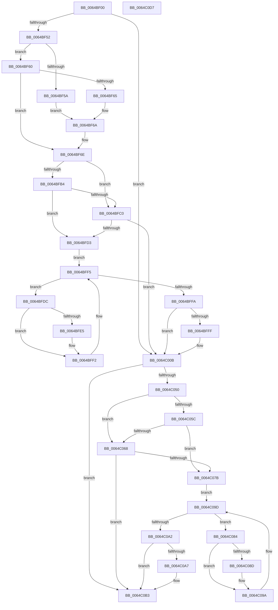

# DifZwWriteFileWrapper

- RVA: `0x0064BF00`–`0x0064C0D8` (길이 `472` bytes)
- VA: `0x000000014064BF00`
- 실행 섹션: `.text`
- PDB 이름 있음: `예`; PDB Function 태그: `아니요`
- unwind 정보 RVA: `0x000D2BDC`
- 디코드: `131`개 명령, `472/472` bytes 표시
- 미해석 바이트: `0` (있으면 어셈블리에 `.byte`로 보존)

> 이 문서는 커널 이미지의 기계어와 PDB 기호를 분석해 생성했습니다. 4번과 5번은 함수 원형과 자료형을 바이너리 사용 방식에서 추정한 C 해석이며 원본 소스 복구 결과는 아닙니다.

## 1. Dependencies

- 직접 호출 지점: **10**; 고유 호출 대상: **7**
- 직접 호출자로 확인된 함수: **0**
- RIP 상대 이미지 참조: **3**

### Outgoing calls
- `0x0064BF3A` → [memset](../6C/memset_function_006C6C40.md) (function, `0x006C6C40`)
- `0x0064BF41` → [DifGetAPIThunkContextById](../49/DifGetAPIThunkContextById_function_00495A34.md) (function, `0x00495A34`)
- `0x0064BF65` → [DifGetReturnAddressForWrappers](../4D/DifGetReturnAddressForWrappers_function_004D3C08.md) (function, `0x004D3C08`)
- `0x0064BFC7` → [ExAcquireRundownProtection](../21/ExAcquireRundownProtection_function_00216620.md) (function, `0x00216620`)
- `0x0064BFED` → [guard_dispatch_icall](../6B/guard_dispatch_icall_function_006BAAD0.md) (function, `0x006BAAD0`)
- `0x0064C006` → [ExReleaseRundownProtection](../34/ExReleaseRundownProtection_function_00349E80.md) (function, `0x00349E80`)
- `0x0064C043` → [ZwWriteFile](../6A/ZwWriteFile_function_006AD1D0.md) (function, `0x006AD1D0`)
- `0x0064C06F` → [ExAcquireRundownProtection](../21/ExAcquireRundownProtection_function_00216620.md) (function, `0x00216620`)
- `0x0064C095` → [guard_dispatch_icall](../6B/guard_dispatch_icall_function_006BAAD0.md) (function, `0x006BAAD0`)
- `0x0064C0AE` → [ExReleaseRundownProtection](../34/ExReleaseRundownProtection_function_00349E80.md) (function, `0x00349E80`)

### Direct callers
- 이 함수 시작 RVA로 연결되는 직접 call은 확인되지 않았습니다. 간접 호출은 완전히 역산할 수 없습니다.

### Static image references
- `0x0064BF75` → RVA `0x00F048B8` (`.data`; read)
- `0x0064BFB4` → RVA `0x00F04980` (`.data`; read)
- `0x0064BFC0` → RVA `0x00F03E80` (`.data`; read)

## 2. Other-region calls and transfers

- 다른 실행 섹션으로 향하는 call: **0**
- 별도 외부 분기/꼬리 이동을 확인하지 못했습니다.

## 3. Assembly (complete function range)

```asm
0064BF00  48 8B C4                        mov rax, rsp
0064BF03  48 89 58 10                     mov qword ptr [rax + 0x10], rbx
0064BF07  48 89 70 18                     mov qword ptr [rax + 0x18], rsi
0064BF0B  48 89 78 20                     mov qword ptr [rax + 0x20], rdi
0064BF0F  48 89 48 08                     mov qword ptr [rax + 8], rcx
0064BF13  55                              push rbp
0064BF14  41 54                           push r12
0064BF16  41 55                           push r13
0064BF18  41 56                           push r14
0064BF1A  41 57                           push r15
0064BF1C  48 8D 68 C9                     lea rbp, [rax - 0x37]
0064BF20  48 81 EC B0 00 00 00            sub rsp, 0xb0
0064BF27  4C 8B EA                        mov r13, rdx
0064BF2A  48 8D 4D AF                     lea rcx, [rbp - 0x51]
0064BF2E  33 D2                           xor edx, edx
0064BF30  4D 8B E0                        mov r12, r8
0064BF33  4D 8B F9                        mov r15, r9
0064BF36  44 8D 42 58                     lea r8d, [rdx + 0x58]
0064BF3A  E8 01 AD 07 00                  call 0x1406c6c40
0064BF3F  33 C9                           xor ecx, ecx
0064BF41  E8 EE 9A E4 FF                  call 0x140495a34
0064BF46  48 8B F0                        mov rsi, rax
0064BF49  48 85 C0                        test rax, rax
0064BF4C  0F 84 B9 00 00 00               je 0x14064c00b
0064BF52  8B 48 0C                        mov ecx, dword ptr [rax + 0xc]
0064BF55  F6 C1 18                        test cl, 0x18
0064BF58  74 06                           je 0x14064bf60
0064BF5A  48 8B 45 37                     mov rax, qword ptr [rbp + 0x37]
0064BF5E  EB 0A                           jmp 0x14064bf6a
0064BF60  F6 C1 04                        test cl, 4
0064BF63  74 09                           je 0x14064bf6e
0064BF65  E8 9E 7C E8 FF                  call 0x1404d3c08
0064BF6A  48 89 45 AF                     mov qword ptr [rbp - 0x51], rax
0064BF6E  48 8B 45 3F                     mov rax, qword ptr [rbp + 0x3f]
0064BF72  45 32 F6                        xor r14b, r14b
0064BF75  44 38 35 3C 89 8B 00            cmp byte ptr [rip + 0x8b893c], r14b
0064BF7C  48 89 45 F7                     mov qword ptr [rbp - 9], rax
0064BF80  48 8B 45 5F                     mov rax, qword ptr [rbp + 0x5f]
0064BF84  48 89 45 D7                     mov qword ptr [rbp - 0x29], rax
0064BF88  48 8B 45 67                     mov rax, qword ptr [rbp + 0x67]
0064BF8C  48 89 45 CF                     mov qword ptr [rbp - 0x31], rax
0064BF90  8B 45 6F                        mov eax, dword ptr [rbp + 0x6f]
0064BF93  89 45 C7                        mov dword ptr [rbp - 0x39], eax
0064BF96  48 8B 45 77                     mov rax, qword ptr [rbp + 0x77]
0064BF9A  48 89 45 BF                     mov qword ptr [rbp - 0x41], rax
0064BF9E  48 8B 45 7F                     mov rax, qword ptr [rbp + 0x7f]
0064BFA2  48 89 45 B7                     mov qword ptr [rbp - 0x49], rax
0064BFA6  4C 89 6D EF                     mov qword ptr [rbp - 0x11], r13
0064BFAA  4C 89 65 E7                     mov qword ptr [rbp - 0x19], r12
0064BFAE  4C 89 7D DF                     mov qword ptr [rbp - 0x21], r15
0064BFB2  75 0C                           jne 0x14064bfc0
0064BFB4  F7 05 C2 89 8B 00 00 08 00 00   test dword ptr [rip + 0x8b89c2], 0x800
0064BFBE  74 13                           je 0x14064bfd3
0064BFC0  48 8D 0D B9 7E 8B 00            lea rcx, [rip + 0x8b7eb9]
0064BFC7  E8 54 A6 BC FF                  call 0x140216620
0064BFCC  44 8A F0                        mov r14b, al
0064BFCF  84 C0                           test al, al
0064BFD1  74 38                           je 0x14064c00b
0064BFD3  48 8D 7E 20                     lea rdi, [rsi + 0x20]
0064BFD7  48 8B 1F                        mov rbx, qword ptr [rdi]
0064BFDA  EB 19                           jmp 0x14064bff5
0064BFDC  48 8D 43 F0                     lea rax, [rbx - 0x10]
0064BFE0  48 85 C0                        test rax, rax
0064BFE3  74 0D                           je 0x14064bff2
0064BFE5  48 8B 40 08                     mov rax, qword ptr [rax + 8]
0064BFE9  48 8D 4D AF                     lea rcx, [rbp - 0x51]
0064BFED  E8 DE EA 06 00                  call 0x1406baad0
0064BFF2  48 8B 1B                        mov rbx, qword ptr [rbx]
0064BFF5  48 3B DF                        cmp rbx, rdi
0064BFF8  75 E2                           jne 0x14064bfdc
0064BFFA  45 84 F6                        test r14b, r14b
0064BFFD  74 0C                           je 0x14064c00b
0064BFFF  48 8D 0D 7A 7E 8B 00            lea rcx, [rip + 0x8b7e7a]
0064C006  E8 75 DE CF FF                  call 0x140349e80
0064C00B  48 8B 45 7F                     mov rax, qword ptr [rbp + 0x7f]
0064C00F  4D 8B CF                        mov r9, r15
0064C012  48 8B 4D 3F                     mov rcx, qword ptr [rbp + 0x3f]
0064C016  4D 8B C4                        mov r8, r12
0064C019  48 89 44 24 40                  mov qword ptr [rsp + 0x40], rax
0064C01E  49 8B D5                        mov rdx, r13
0064C021  48 8B 45 77                     mov rax, qword ptr [rbp + 0x77]
0064C025  48 89 44 24 38                  mov qword ptr [rsp + 0x38], rax
0064C02A  8B 45 6F                        mov eax, dword ptr [rbp + 0x6f]
0064C02D  89 44 24 30                     mov dword ptr [rsp + 0x30], eax
0064C031  48 8B 45 67                     mov rax, qword ptr [rbp + 0x67]
0064C035  48 89 44 24 28                  mov qword ptr [rsp + 0x28], rax
0064C03A  48 8B 45 5F                     mov rax, qword ptr [rbp + 0x5f]
0064C03E  48 89 44 24 20                  mov qword ptr [rsp + 0x20], rax
0064C043  E8 88 11 06 00                  call 0x1406ad1d0
0064C048  89 45 FF                        mov dword ptr [rbp - 1], eax
0064C04B  48 85 F6                        test rsi, rsi
0064C04E  74 63                           je 0x14064c0b3
0064C050  40 32 FF                        xor dil, dil
0064C053  40 38 3D 5E 88 8B 00            cmp byte ptr [rip + 0x8b885e], dil
0064C05A  75 0C                           jne 0x14064c068
0064C05C  F7 05 1A 89 8B 00 00 08 00 00   test dword ptr [rip + 0x8b891a], 0x800
0064C066  74 13                           je 0x14064c07b
0064C068  48 8D 0D 11 7E 8B 00            lea rcx, [rip + 0x8b7e11]
0064C06F  E8 AC A5 BC FF                  call 0x140216620
0064C074  40 8A F8                        mov dil, al
0064C077  84 C0                           test al, al
0064C079  74 38                           je 0x14064c0b3
0064C07B  48 83 C6 30                     add rsi, 0x30
0064C07F  48 8B 1E                        mov rbx, qword ptr [rsi]
0064C082  EB 19                           jmp 0x14064c09d
0064C084  48 8D 43 F0                     lea rax, [rbx - 0x10]
0064C088  48 85 C0                        test rax, rax
0064C08B  74 0D                           je 0x14064c09a
0064C08D  48 8B 40 08                     mov rax, qword ptr [rax + 8]
0064C091  48 8D 4D AF                     lea rcx, [rbp - 0x51]
0064C095  E8 36 EA 06 00                  call 0x1406baad0
0064C09A  48 8B 1B                        mov rbx, qword ptr [rbx]
0064C09D  48 3B DE                        cmp rbx, rsi
0064C0A0  75 E2                           jne 0x14064c084
0064C0A2  40 84 FF                        test dil, dil
0064C0A5  74 0C                           je 0x14064c0b3
0064C0A7  48 8D 0D D2 7D 8B 00            lea rcx, [rip + 0x8b7dd2]
0064C0AE  E8 CD DD CF FF                  call 0x140349e80
0064C0B3  8B 45 FF                        mov eax, dword ptr [rbp - 1]
0064C0B6  4C 8D 9C 24 B0 00 00 00         lea r11, [rsp + 0xb0]
0064C0BE  49 8B 5B 38                     mov rbx, qword ptr [r11 + 0x38]
0064C0C2  49 8B 73 40                     mov rsi, qword ptr [r11 + 0x40]
0064C0C6  49 8B 7B 48                     mov rdi, qword ptr [r11 + 0x48]
0064C0CA  49 8B E3                        mov rsp, r11
0064C0CD  41 5F                           pop r15
0064C0CF  41 5E                           pop r14
0064C0D1  41 5D                           pop r13
0064C0D3  41 5C                           pop r12
0064C0D5  5D                              pop rbp
0064C0D6  C3                              ret
0064C0D7  CC                              int3
```

## 4. C-style interpretation (structured pseudocode)

```c
__int64 __fastcall DifZwWriteFileWrapper(__int64 a1, __int64 a2, __int64 a3, __int64 a4)
{
    __int64 result;
    __int64 v_r14;
    __int64 v_rdi;
    __int64 v_rsi;
    __int64 v_rsp;
    unsigned __int64 v_stack_m28;
    unsigned __int64 v_stack_m98;
    unsigned __int64 v_stack_mA0;
    unsigned int v_stack_mA8;
    unsigned __int64 v_stack_mB0;
    unsigned __int64 v_stack_mB8;

    *(unsigned __int64 *)(v_rsp + 16) = v_rbx;
    *(unsigned __int64 *)(v_rsp + 24) = v_rsi;
    *(unsigned __int64 *)(v_rsp + 32) = v_rdi;
    *(unsigned __int64 *)(v_rsp + 8) = a1;
    v_rsp = (v_rsp) - (176);
    a2 = 0;
    result = memset(v_rsp - 55 - 81, a2, a2 + 88, a4);
    a1 = 0;
    result = DifGetAPIThunkContextById(a1, a2, a2 + 88, a4);
    if (result == 0) goto loc_0064C00B;
    if ((((unsigned __int8)((unsigned int)(*(unsigned int *)(result + 12)))) & (24)) == 0) goto loc_0064BF60;
    goto loc_0064BF6A;
loc_0064BF60:
    if ((((unsigned __int8)((unsigned int)(*(unsigned int *)(result + 12)))) & (4)) == 0) goto loc_0064BF6E;
    result = DifGetReturnAddressForWrappers((unsigned int)(*(unsigned int *)(result + 12)), a2, a2 + 88, a4);
loc_0064BF6A:
    *(unsigned __int64 *)(v_rsp - 55 - 81) = result;
loc_0064BF6E:
    v_r14 = 0;
    *(unsigned __int64 *)(v_rsp - 55 - 9) = *(unsigned __int64 *)(v_rsp - 55 + 63);
    *(unsigned __int64 *)(v_rsp - 55 - 41) = *(unsigned __int64 *)(v_rsp - 55 + 95);
    *(unsigned __int64 *)(v_rsp - 55 - 49) = *(unsigned __int64 *)(v_rsp - 55 + 103);
    *(unsigned int *)(v_rsp - 55 - 57) = (unsigned int)((unsigned int)(*(unsigned int *)(v_rsp - 55 + 111)));
    *(unsigned __int64 *)(v_rsp - 55 - 65) = *(unsigned __int64 *)(v_rsp - 55 + 119);
    *(unsigned __int64 *)(v_rsp - 55 - 73) = *(unsigned __int64 *)(v_rsp - 55 + 127);
    *(unsigned __int64 *)(v_rsp - 55 - 17) = 0;
    *(unsigned __int64 *)(v_rsp - 55 - 25) = a3;
    *(unsigned __int64 *)(v_rsp - 55 - 33) = a4;
    if ((*(unsigned __int8 *)(v_rip + 9144636)) != 0) goto loc_0064BFC0;
    if (((*(unsigned int *)(v_rip + 9144770)) & (0x800ULL)) == 0) goto loc_0064BFD3;
loc_0064BFC0:
    result = ExAcquireRundownProtection(v_rip + 9141945, a2, a2 + 88, a4);
    if ((unsigned __int8)(result) == 0) goto loc_0064C00B;
loc_0064BFD3:
    goto loc_0064BFF5;
loc_0064BFDC:
    result = *(unsigned __int64 *)(result + 32) - 16;
    if (*(unsigned __int64 *)(result + 32) - 16 != 0) {
        result = *(unsigned __int64 *)(*(unsigned __int64 *)(result + 32) - 16 + 8);
        a1 = v_rsp - 55 - 81;
        result = guard_dispatch_icall(a1, a2, a2 + 88, a4);
    }
loc_0064BFF5:
    if ((*(unsigned __int64 *)(*(unsigned __int64 *)(result + 32))) != (result + 32)) goto loc_0064BFDC;
    if ((unsigned __int8)((unsigned __int8)(result)) != 0) {
        a1 = v_rip + 9141882;
        result = ExReleaseRundownProtection(a1, a2, a2 + 88, a4);
    }
    v_stack_m98 = *(unsigned __int64 *)(v_rsp - 55 + 127);
    v_stack_mA0 = *(unsigned __int64 *)(v_rsp - 55 + 119);
    v_stack_mA8 = (unsigned int)((unsigned int)(*(unsigned int *)(v_rsp - 55 + 111)));
    v_stack_mB0 = *(unsigned __int64 *)(v_rsp - 55 + 103);
    v_stack_mB8 = *(unsigned __int64 *)(v_rsp - 55 + 95);
    result = ZwWriteFile(*(unsigned __int64 *)(v_rsp - 55 + 63), 0, a3, a4);
    *(unsigned int *)(v_rsp - 55 - 1) = (unsigned int)(result);
    if (result == 0) goto loc_0064C0B3;
    v_rdi = 0;
    if ((*(unsigned __int8 *)(v_rip + 9144414)) != 0) goto loc_0064C068;
    if (((*(unsigned int *)(v_rip + 9144602)) & (0x800ULL)) == 0) goto loc_0064C07B;
loc_0064C068:
    result = ExAcquireRundownProtection(v_rip + 9141777, 0, a3, a4);
    if ((unsigned __int8)(result) == 0) goto loc_0064C0B3;
loc_0064C07B:
    v_rsi = (result) + (48);
    goto loc_0064C09D;
loc_0064C084:
    result = *(unsigned __int64 *)(v_rsi) - 16;
    if (*(unsigned __int64 *)(v_rsi) - 16 != 0) {
        result = *(unsigned __int64 *)(*(unsigned __int64 *)(v_rsi) - 16 + 8);
        a1 = v_rsp - 55 - 81;
        result = guard_dispatch_icall(a1, 0, a3, a4);
    }
loc_0064C09D:
    if ((*(unsigned __int64 *)(*(unsigned __int64 *)(v_rsi))) != v_rsi) goto loc_0064C084;
    if ((unsigned __int8)((unsigned __int8)(result)) != 0) {
        a1 = v_rip + 9141714;
        result = ExReleaseRundownProtection(a1, 0, a3, a4);
    }
    return (unsigned int)(*(unsigned int *)(v_rsp - 55 - 1));
}
```

## 5. (Beta) C Style

```c
int64_t DifZwWriteFileWrapper(int64_t Arg1, int64_t Arg2, int64_t Arg3, int64_t Arg4)
{
    int64_t result;
    int64_t local_r14;
    int64_t local_rdi;
    int64_t local_rsi;
    int64_t local_rsp;
    uint64_t v_stack_m28;
    uint64_t v_stack_m98;
    uint64_t v_stack_mA0;
    uint32_t v_stack_mA8;
    uint64_t v_stack_mB0;
    uint64_t v_stack_mB8;

    *(uint64_t *)(local_rsp + 0x10) = local_rbx;
    *(uint64_t *)(local_rsp + 0x18) = local_rsi;
    *(uint64_t *)(local_rsp + 0x20) = local_rdi;
    *(uint64_t *)(local_rsp + 0x8) = Arg1;
    local_rsp = (local_rsp) - (176);
    Arg2 = 0;
    result = memset(local_rsp - 55 - 81, Arg2, Arg2 + 88, Arg4);
    Arg1 = 0;
    result = DifGetAPIThunkContextById(Arg1, Arg2, Arg2 + 88, Arg4);
    if (result == 0) goto loc_0064C00B;
    if ((((uint8_t)((uint32_t)(*(uint32_t *)(result + 0xC)))) & (24)) == 0) goto loc_0064BF60;
    goto loc_0064BF6A;
loc_0064BF60:
    if ((((uint8_t)((uint32_t)(*(uint32_t *)(result + 0xC)))) & (4)) == 0) goto loc_0064BF6E;
    result = DifGetReturnAddressForWrappers((uint32_t)(*(uint32_t *)(result + 0xC)), Arg2, Arg2 + 88, Arg4);
loc_0064BF6A:
    *(uint64_t *)(local_rsp - 0x37 - 0x51) = result;
loc_0064BF6E:
    local_r14 = 0;
    *(uint64_t *)(local_rsp - 0x37 - 0x9) = *(uint64_t *)(local_rsp - 0x37 + 0x3F);
    *(uint64_t *)(local_rsp - 0x37 - 0x29) = *(uint64_t *)(local_rsp - 0x37 + 0x5F);
    *(uint64_t *)(local_rsp - 0x37 - 0x31) = *(uint64_t *)(local_rsp - 0x37 + 0x67);
    *(uint32_t *)(local_rsp - 0x37 - 0x39) = (uint32_t)((uint32_t)(*(uint32_t *)(local_rsp - 0x37 + 0x6F)));
    *(uint64_t *)(local_rsp - 0x37 - 0x41) = *(uint64_t *)(local_rsp - 0x37 + 0x77);
    *(uint64_t *)(local_rsp - 0x37 - 0x49) = *(uint64_t *)(local_rsp - 0x37 + 0x7F);
    *(uint64_t *)(local_rsp - 0x37 - 0x11) = 0;
    *(uint64_t *)(local_rsp - 0x37 - 0x19) = Arg3;
    *(uint64_t *)(local_rsp - 0x37 - 0x21) = Arg4;
    if ((*(uint8_t *)(v_rip + 0x8B893C)) != 0) goto loc_0064BFC0;
    if (((*(uint32_t *)(v_rip + 0x8B89C2)) & (0x800ULL)) == 0) goto loc_0064BFD3;
loc_0064BFC0:
    result = ExAcquireRundownProtection(v_rip + 9141945, Arg2, Arg2 + 88, Arg4);
    if ((uint8_t)(result) == 0) goto loc_0064C00B;
loc_0064BFD3:
    goto loc_0064BFF5;
loc_0064BFDC:
    result = *(uint64_t *)(result + 0x20) - 16;
    if (*(uint64_t *)(result + 0x20) - 16 != 0) {
        result = *(uint64_t *)(*(uint64_t *)(result + 0x20) - 0x10 + 0x8);
        Arg1 = local_rsp - 55 - 81;
        result = guard_dispatch_icall(Arg1, Arg2, Arg2 + 88, Arg4);
    }
loc_0064BFF5:
    if ((*(uint64_t *)(*(uint64_t *)(result + 0x20))) != (result + 32)) goto loc_0064BFDC;
    if ((uint8_t)((uint8_t)(result)) != 0) {
        Arg1 = v_rip + 9141882;
        result = ExReleaseRundownProtection(Arg1, Arg2, Arg2 + 88, Arg4);
    }
    v_stack_m98 = *(uint64_t *)(local_rsp - 0x37 + 0x7F);
    v_stack_mA0 = *(uint64_t *)(local_rsp - 0x37 + 0x77);
    v_stack_mA8 = (uint32_t)((uint32_t)(*(uint32_t *)(local_rsp - 0x37 + 0x6F)));
    v_stack_mB0 = *(uint64_t *)(local_rsp - 0x37 + 0x67);
    v_stack_mB8 = *(uint64_t *)(local_rsp - 0x37 + 0x5F);
    result = ZwWriteFile(*(uint64_t *)(local_rsp - 0x37 + 0x3F), 0, Arg3, Arg4);
    *(uint32_t *)(local_rsp - 0x37 - 0x1) = (uint32_t)(result);
    if (result == 0) goto loc_0064C0B3;
    local_rdi = 0;
    if ((*(uint8_t *)(v_rip + 0x8B885E)) != 0) goto loc_0064C068;
    if (((*(uint32_t *)(v_rip + 0x8B891A)) & (0x800ULL)) == 0) goto loc_0064C07B;
loc_0064C068:
    result = ExAcquireRundownProtection(v_rip + 9141777, 0, Arg3, Arg4);
    if ((uint8_t)(result) == 0) goto loc_0064C0B3;
loc_0064C07B:
    local_rsi = (result) + (48);
    goto loc_0064C09D;
loc_0064C084:
    result = *(uint64_t *)(local_rsi) - 16;
    if (*(uint64_t *)(local_rsi) - 16 != 0) {
        result = *(uint64_t *)(*(uint64_t *)(local_rsi) - 0x10 + 0x8);
        Arg1 = local_rsp - 55 - 81;
        result = guard_dispatch_icall(Arg1, 0, Arg3, Arg4);
    }
loc_0064C09D:
    if ((*(uint64_t *)(*(uint64_t *)(local_rsi))) != local_rsi) goto loc_0064C084;
    if ((uint8_t)((uint8_t)(result)) != 0) {
        Arg1 = v_rip + 9141714;
        result = ExReleaseRundownProtection(Arg1, 0, Arg3, Arg4);
    }
    return (uint32_t)(*(uint32_t *)(local_rsp - 0x37 - 0x1));
}
```

## 6. Execution-region graph

[열기: 2D/3D 그래프와 함수 탐색 컨트롤 패널](../../../control-panel.html?section=text&rva=0x0064BF00&view=graph)

- 2D 그래프는 위에서 아래로 흐르고, 3D 그래프는 빈 공간을 드래그해 회전합니다. Shift+드래그는 이동, 휠은 확대·축소, 함수 노드 선택은 대상 보고서 이동입니다.

### Static fallback


