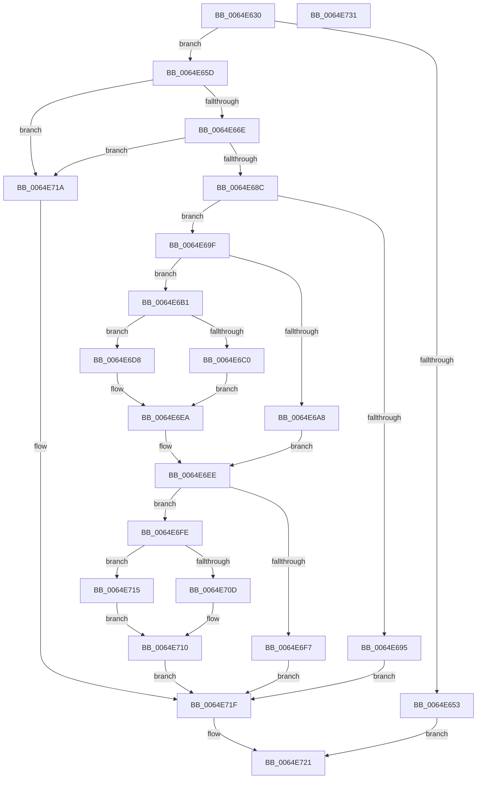

# EtwGetProcessorBuffer

- RVA: `0x0064E630`–`0x0064E732` (길이 `258` bytes)
- VA: `0x000000014064E630`
- 실행 섹션: `.text`
- PDB 이름 있음: `예`; PDB Function 태그: `아니요`
- unwind 정보 RVA: `0x00060BC4`
- 디코드: `67`개 명령, `258/258` bytes 표시
- 미해석 바이트: `0` (있으면 어셈블리에 `.byte`로 보존)

> 이 문서는 커널 이미지의 기계어와 PDB 기호를 분석해 생성했습니다. 4번과 5번은 함수 원형과 자료형을 바이너리 사용 방식에서 추정한 C 해석이며 원본 소스 복구 결과는 아닙니다.

## 1. Dependencies

- 직접 호출 지점: **1**; 고유 호출 대상: **1**
- 직접 호출자로 확인된 함수: **1**
- RIP 상대 이미지 참조: **2**

### Outgoing calls
- `0x0064E6C3` → [KeGetPrcb](../2D/KeGetPrcb_function_002D85D0.md) (function, `0x002D85D0`)

### Direct callers
- [KiSaveCurrentEtwTraceBuffer](../5B/KiSaveCurrentEtwTraceBuffer_function_005B5338.md) at `0x005B535A`
- [KiSaveCurrentEtwTraceBuffer](../5B/KiSaveCurrentEtwTraceBuffer_function_005B5338.md) at `0x005B53EA`

### Static image references
- `0x0064E644` → RVA `0x00EFF284` (`.data`; read)
- `0x0064E65D` → RVA `0x00FC6AA8` (`ALMOSTRO`; read)

## 2. Other-region calls and transfers

- 다른 실행 섹션으로 향하는 call: **0**
- 별도 외부 분기/꼬리 이동을 확인하지 못했습니다.

## 3. Assembly (complete function range)

```asm
0064E630  48 89 5C 24 08                  mov qword ptr [rsp + 8], rbx
0064E635  48 89 74 24 10                  mov qword ptr [rsp + 0x10], rsi
0064E63A  57                              push rdi
0064E63B  48 83 EC 20                     sub rsp, 0x20
0064E63F  33 DB                           xor ebx, ebx
0064E641  44 8B CA                        mov r9d, edx
0064E644  80 3D 39 0C 8B 00 01            cmp byte ptr [rip + 0x8b0c39], 1
0064E64B  49 8B F8                        mov rdi, r8
0064E64E  44 8B C1                        mov r8d, ecx
0064E651  77 0A                           ja 0x14064e65d
0064E653  B8 01 00 00 C0                  mov eax, 0xc0000001
0064E658  E9 C4 00 00 00                  jmp 0x14064e721
0064E65D  48 8B 05 44 84 97 00            mov rax, qword ptr [rip + 0x978444]
0064E664  44 3B 40 10                     cmp r8d, dword ptr [rax + 0x10]
0064E668  0F 83 AC 00 00 00               jae 0x14064e71a
0064E66E  0F AE E8                        lfence
0064E671  4C 8B 15 30 84 97 00            mov r10, qword ptr [rip + 0x978430]
0064E678  49 8B 82 C8 02 00 00            mov rax, qword ptr [r10 + 0x2c8]
0064E67F  4A 8B 14 C0                     mov rdx, qword ptr [rax + r8*8]
0064E683  F6 C2 01                        test dl, 1
0064E686  0F 85 8E 00 00 00               jne 0x14064e71a
0064E68C  83 BA 2C 01 00 00 01            cmp dword ptr [rdx + 0x12c], 1
0064E693  75 0A                           jne 0x14064e69f
0064E695  BB 0D 00 00 C0                  mov ebx, 0xc000000d
0064E69A  E9 80 00 00 00                  jmp 0x14064e71f
0064E69F  F7 42 0C 00 00 00 10            test dword ptr [rdx + 0xc], 0x10000000
0064E6A6  74 09                           je 0x14064e6b1
0064E6A8  48 8D 8A 80 00 00 00            lea rcx, [rdx + 0x80]
0064E6AF  EB 3D                           jmp 0x14064e6ee
0064E6B1  48 8B 82 50 05 00 00            mov rax, qword ptr [rdx + 0x550]
0064E6B8  49 8B F0                        mov rsi, r8
0064E6BB  49 3B C2                        cmp rax, r10
0064E6BE  75 18                           jne 0x14064e6d8
0064E6C0  41 8B C9                        mov ecx, r9d
0064E6C3  E8 08 9F C8 FF                  call 0x1402d85d0
0064E6C8  48 8B 88 A8 8B 00 00            mov rcx, qword ptr [rax + 0x8ba8]
0064E6CF  48 8B 81 40 01 00 00            mov rax, qword ptr [rcx + 0x140]
0064E6D6  EB 12                           jmp 0x14064e6ea
0064E6D8  48 8B 80 40 11 00 00            mov rax, qword ptr [rax + 0x1140]
0064E6DF  49 8B C9                        mov rcx, r9
0064E6E2  48 C1 E1 06                     shl rcx, 6
0064E6E6  48 8B 04 01                     mov rax, qword ptr [rcx + rax]
0064E6EA  48 8D 0C F0                     lea rcx, [rax + rsi*8]
0064E6EE  48 8B 09                        mov rcx, qword ptr [rcx]
0064E6F1  48 83 E1 F0                     and rcx, 0xfffffffffffffff0
0064E6F5  75 07                           jne 0x14064e6fe
0064E6F7  BB 01 00 00 C0                  mov ebx, 0xc0000001
0064E6FC  EB 21                           jmp 0x14064e71f
0064E6FE  8B 01                           mov eax, dword ptr [rcx]
0064E700  89 47 08                        mov dword ptr [rdi + 8], eax
0064E703  8B 41 08                        mov eax, dword ptr [rcx + 8]
0064E706  48 89 0F                        mov qword ptr [rdi], rcx
0064E709  3B 01                           cmp eax, dword ptr [rcx]
0064E70B  76 08                           jbe 0x14064e715
0064E70D  8B 41 04                        mov eax, dword ptr [rcx + 4]
0064E710  89 47 0C                        mov dword ptr [rdi + 0xc], eax
0064E713  EB 0A                           jmp 0x14064e71f
0064E715  8B 41 08                        mov eax, dword ptr [rcx + 8]
0064E718  EB F6                           jmp 0x14064e710
0064E71A  BB 08 00 00 C0                  mov ebx, 0xc0000008
0064E71F  8B C3                           mov eax, ebx
0064E721  48 8B 5C 24 30                  mov rbx, qword ptr [rsp + 0x30]
0064E726  48 8B 74 24 38                  mov rsi, qword ptr [rsp + 0x38]
0064E72B  48 83 C4 20                     add rsp, 0x20
0064E72F  5F                              pop rdi
0064E730  C3                              ret
0064E731  CC                              int3
```

## 4. C-style interpretation (structured pseudocode)

```c
__int64 __fastcall EtwGetProcessorBuffer(int a1, int a2, __int64 a3)
{
    __int64 result;
    __int64 v_rbx;
    __int64 v_rsp;
    unsigned __int64 v_stack_p10;
    unsigned __int64 v_stack_p8;

    v_stack_p8 = v_rbx;
    v_stack_p10 = v_rsi;
    v_rsp = (v_rsp) - (32);
    v_rbx = 0;
    if ((*(unsigned __int8 *)(v_rip + 9112633)) > 1) goto loc_0064E65D;
    goto loc_0064E721;
loc_0064E65D:
    if (((unsigned int)((unsigned int)(a1))) >= (*(unsigned int *)(*(unsigned __int64 *)(v_rip + 9929796) + 16))) goto loc_0064E71A;
    if ((((unsigned __int8)(*(unsigned __int64 *)(*(unsigned __int64 *)(*(unsigned __int64 *)(v_rip + 9929776) + 712) + (unsigned int)(a1) * 8))) & (1)) != 0) goto loc_0064E71A;
    if ((*(unsigned int *)(*(unsigned __int64 *)(*(unsigned __int64 *)(*(unsigned __int64 *)(v_rip + 9929776) + 712) + (unsigned int)(a1) * 8) + 300)) != 1) goto loc_0064E69F;
    goto loc_0064E71F;
loc_0064E69F:
    if (((*(unsigned int *)(*(unsigned __int64 *)(*(unsigned __int64 *)(*(unsigned __int64 *)(v_rip + 9929776) + 712) + (unsigned int)(a1) * 8) + 12)) & (0x10000000ULL)) == 0) goto loc_0064E6B1;
    goto loc_0064E6EE;
loc_0064E6B1:
    if ((*(unsigned __int64 *)(*(unsigned __int64 *)(*(unsigned __int64 *)(*(unsigned __int64 *)(v_rip + 9929776) + 712) + (unsigned int)(a1) * 8) + 1360)) != (*(unsigned __int64 *)(v_rip + 9929776))) goto loc_0064E6D8;
    result = KeGetPrcb((unsigned int)((unsigned int)((unsigned int)(a2))), *(unsigned __int64 *)(*(unsigned __int64 *)(*(unsigned __int64 *)(v_rip + 9929776) + 712) + (unsigned int)(a1) * 8), (unsigned int)(a1), (unsigned int)(a2));
    goto loc_0064E6EA;
loc_0064E6D8:
    a1 = ((unsigned int)(a2)) << (6);
loc_0064E6EA:
loc_0064E6EE:
    a1 = (*(unsigned __int64 *)(*(unsigned __int64 *)(a1 + *(unsigned __int64 *)(*(unsigned __int64 *)(*(unsigned __int64 *)(result + 35752) + 320) + 4416) * 1) + (unsigned int)(a1) * 8)) & (-16);
    if (condition_is_not_equal) goto loc_0064E6FE;
    goto loc_0064E71F;
loc_0064E6FE:
    *(unsigned int *)(a3 + 8) = (unsigned int)((unsigned int)(*(unsigned int *)(a1)));
    *(unsigned __int64 *)(a3) = a1;
    if (((unsigned int)((unsigned int)(*(unsigned int *)(a1 + 8)))) <= (*(unsigned int *)(a1))) goto loc_0064E715;
loc_0064E710:
    *(unsigned int *)(a3 + 12) = (unsigned int)((unsigned int)(*(unsigned int *)(a1 + 4)));
    goto loc_0064E71F;
loc_0064E715:
    goto loc_0064E710;
loc_0064E71A:
loc_0064E71F:
loc_0064E721:
    v_rsp = (v_rsp) + (32);
    return (unsigned int)((unsigned int)((unsigned int)(0xC0000008ULL)));
}
```

## 5. (Beta) C Style

```c
int64_t EtwGetProcessorBuffer(int32_t Arg1, int32_t Arg2, void *Arg3)
{
    uint8_t *arg3 = (uint8_t *)Arg3;

    int64_t result;
    int64_t local_rbx;
    int64_t local_rsp;
    uint64_t v_stack_p10;
    uint64_t v_stack_p8;

    v_stack_p8 = local_rbx;
    v_stack_p10 = local_rsi;
    local_rsp = (local_rsp) - (32);
    local_rbx = 0;
    if ((*(uint8_t *)(v_rip + 0x8B0C39)) > 1) goto loc_0064E65D;
    goto loc_0064E721;
loc_0064E65D:
    if (((uint32_t)((uint32_t)(Arg1))) >= (*(uint32_t *)(*(uint64_t *)(v_rip + 0x978444) + 0x10))) goto loc_0064E71A;
    if ((((uint8_t)(*(uint64_t *)(*(uint64_t *)(*(uint64_t *)(v_rip + 0x978430) + 0x2C8) + (uint32_t)(Arg1) * 8))) & (1)) != 0) goto loc_0064E71A;
    if ((*(uint32_t *)(*(uint64_t *)(*(uint64_t *)(*(uint64_t *)(v_rip + 0x978430) + 0x2C8) + (uint32_t)(Arg1) * 8) + 0x12C)) != 1) goto loc_0064E69F;
    goto loc_0064E71F;
loc_0064E69F:
    if (((*(uint32_t *)(*(uint64_t *)(*(uint64_t *)(*(uint64_t *)(v_rip + 0x978430) + 0x2C8) + (uint32_t)(Arg1) * 8) + 0xC)) & (0x10000000ULL)) == 0) goto loc_0064E6B1;
    goto loc_0064E6EE;
loc_0064E6B1:
    if ((*(uint64_t *)(*(uint64_t *)(*(uint64_t *)(*(uint64_t *)(v_rip + 0x978430) + 0x2C8) + (uint32_t)(Arg1) * 8) + 0x550)) != (*(uint64_t *)(v_rip + 0x978430))) goto loc_0064E6D8;
    result = KeGetPrcb((uint32_t)((uint32_t)((uint32_t)(Arg2))), *(uint64_t *)(*(uint64_t *)(*(uint64_t *)(v_rip + 0x978430) + 0x2C8) + (uint32_t)(Arg1) * 8), (uint32_t)(Arg1), (uint32_t)(Arg2));
    goto loc_0064E6EA;
loc_0064E6D8:
    Arg1 = ((uint32_t)(Arg2)) << (6);
loc_0064E6EA:
loc_0064E6EE:
    Arg1 = (*(uint64_t *)(*(uint64_t *)(Arg1 + *(uint64_t *)(*(uint64_t *)(*(uint64_t *)(result + 0x8BA8) + 0x140) + 0x1140) * 1) + (uint32_t)(Arg1) * 8)) & (-16);
    if (condition_is_not_equal) goto loc_0064E6FE;
    goto loc_0064E71F;
loc_0064E6FE:
    *(uint32_t *)(arg3 + 0x8) = (uint32_t)((uint32_t)(*(uint32_t *)(Arg1)));
    *(uint64_t *)(arg3) = Arg1;
    if (((uint32_t)((uint32_t)(*(uint32_t *)(Arg1 + 0x8)))) <= (*(uint32_t *)(Arg1))) goto loc_0064E715;
loc_0064E710:
    *(uint32_t *)(arg3 + 0xC) = (uint32_t)((uint32_t)(*(uint32_t *)(Arg1 + 0x4)));
    goto loc_0064E71F;
loc_0064E715:
    goto loc_0064E710;
loc_0064E71A:
loc_0064E71F:
loc_0064E721:
    local_rsp = (local_rsp) + (32);
    return (uint32_t)((uint32_t)((uint32_t)(0xC0000008ULL)));
}
```

### 관측된 메모리 오프셋

구조체 형식이 확인되지 않은 접근은 인자 기준의 오프셋으로만 기록했습니다.

| 기준 인자 | 오프셋 표현 | 폭 (bit) | 접근 |
|---|---:|---:|---|
| `Arg3` | `+ 0x0` | `64` | `W` |
| `Arg3` | `+ 0x8` | `32` | `W` |
| `Arg3` | `+ 0xC` | `32` | `W` |

## 6. Execution-region graph

[열기: 2D/3D 그래프와 함수 탐색 컨트롤 패널](../../../control-panel.html?section=text&rva=0x0064E630&view=graph)

- 2D 그래프는 위에서 아래로 흐르고, 3D 그래프는 빈 공간을 드래그해 회전합니다. Shift+드래그는 이동, 휠은 확대·축소, 함수 노드 선택은 대상 보고서 이동입니다.

### Static fallback


