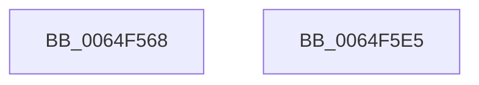

# EtwTraceAntiStarvationBoost

- RVA: `0x0064F568`–`0x0064F5E6` (길이 `126` bytes)
- VA: `0x000000014064F568`
- 실행 섹션: `.text`
- PDB 이름 있음: `예`; PDB Function 태그: `아니요`
- unwind 정보 RVA: `0x000B3A94`
- 디코드: `26`개 명령, `126/126` bytes 표시
- 미해석 바이트: `0` (있으면 어셈블리에 `.byte`로 보존)

> 이 문서는 커널 이미지의 기계어와 PDB 기호를 분석해 생성했습니다. 4번과 5번은 함수 원형과 자료형을 바이너리 사용 방식에서 추정한 C 해석이며 원본 소스 복구 결과는 아닙니다.

## 1. Dependencies

- 직접 호출 지점: **2**; 고유 호출 대상: **2**
- 직접 호출자로 확인된 함수: **3**
- RIP 상대 이미지 참조: **1**

### Outgoing calls
- `0x0064F5CE` → [EtwTraceKernelEvent](../23/EtwTraceKernelEvent_function_00235350.md) (function, `0x00235350`)
- `0x0064F5DB` → [_security_check_cookie](../6A/_security_check_cookie_function_006AC640.md) (function, `0x006AC640`)

### Direct callers
- [KiNormalPriorityReadyScan](../21/KiNormalPriorityReadyScan_function_0021B400.md) at `0x0021B758`
- [sub_0021C69D](../21/Unknown_function_0021C69D.md) at `0x0021C780`
- [KiScanSharedReadyThreads](../46/KiScanSharedReadyThreads_function_0046F120.md) at `0x0046F649`

### Static image references
- `0x0064F56C` → RVA `0x00E0A740` (`.data`; read)

## 2. Other-region calls and transfers

- 다른 실행 섹션으로 향하는 call: **0**
- 별도 외부 분기/꼬리 이동을 확인하지 못했습니다.

## 3. Assembly (complete function range)

```asm
0064F568  48 83 EC 58                     sub rsp, 0x58
0064F56C  48 8B 05 CD B1 7B 00            mov rax, qword ptr [rip + 0x7bb1cd]
0064F573  48 33 C4                        xor rax, rsp
0064F576  48 89 44 24 48                  mov qword ptr [rsp + 0x48], rax
0064F57B  8B 81 10 05 00 00               mov eax, dword ptr [rcx + 0x510]
0064F581  41 B9 3C 05 00 00               mov r9d, 0x53c
0064F587  89 44 24 30                     mov dword ptr [rsp + 0x30], eax
0064F58B  41 B8 01 00 00 40               mov r8d, 0x40000001
0064F591  8B 81 18 02 00 00               mov eax, dword ptr [rcx + 0x218]
0064F597  48 8D 4C 24 38                  lea rcx, [rsp + 0x38]
0064F59C  83 64 24 44 00                  and dword ptr [rsp + 0x44], 0
0064F5A1  66 89 44 24 34                  mov word ptr [rsp + 0x34], ax
0064F5A6  48 8D 44 24 30                  lea rax, [rsp + 0x30]
0064F5AB  88 54 24 36                     mov byte ptr [rsp + 0x36], dl
0064F5AF  BA 01 00 00 00                  mov edx, 1
0064F5B4  48 89 44 24 38                  mov qword ptr [rsp + 0x38], rax
0064F5B9  C6 44 24 37 00                  mov byte ptr [rsp + 0x37], 0
0064F5BE  C7 44 24 40 08 00 00 00         mov dword ptr [rsp + 0x40], 8
0064F5C6  C7 44 24 20 02 18 50 00         mov dword ptr [rsp + 0x20], 0x501802
0064F5CE  E8 7D 5D BE FF                  call 0x140235350
0064F5D3  48 8B 4C 24 48                  mov rcx, qword ptr [rsp + 0x48]
0064F5D8  48 33 CC                        xor rcx, rsp
0064F5DB  E8 60 D0 05 00                  call 0x1406ac640
0064F5E0  48 83 C4 58                     add rsp, 0x58
0064F5E4  C3                              ret
0064F5E5  CC                              int3
```

## 4. C-style interpretation (structured pseudocode)

```c
__int64 __fastcall EtwTraceAntiStarvationBoost(__int64 a1, unsigned __int8 a2)
{
    __int64 result;
    __int64 v_rsp;
    unsigned __int64 v_stack_m10;
    unsigned int v_stack_m14;
    unsigned int v_stack_m18;
    unsigned __int64 v_stack_m20;
    unsigned __int8 v_stack_m21;
    unsigned __int8 v_stack_m22;
    unsigned __int16 v_stack_m24;
    unsigned int v_stack_m28;
    unsigned int v_stack_m38;

    v_rsp = (v_rsp) - (88);
    result = (*(unsigned __int64 *)(v_rip + 8106445)) ^ (v_rsp);
    v_stack_m10 = result;
    v_stack_m28 = (unsigned int)((unsigned int)(*(unsigned int *)(a1 + 1296)));
    v_stack_m24 = (unsigned __int16)((unsigned int)(*(unsigned int *)(a1 + 536)));
    v_stack_m22 = a2;
    v_stack_m20 = v_stack_m28;
    v_stack_m21 = 0;
    v_stack_m18 = 8;
    v_stack_m38 = 0x501802ULL;
    result = EtwTraceKernelEvent(v_stack_m20, 1, (unsigned int)(0x40000001ULL), (unsigned int)(0x53CULL));
    a1 = (v_stack_m10) ^ (v_rsp);
    result = _security_check_cookie(a1, 1, (unsigned int)(0x40000001ULL), (unsigned int)(0x53CULL));
    v_rsp = (v_rsp) + (88);
    return result;
}
```

## 5. (Beta) C Style

```c
int64_t EtwTraceAntiStarvationBoost(void *Arg1, uint8_t Arg2)
{
    uint8_t *arg1 = (uint8_t *)Arg1;

    int64_t result;
    int64_t local_rsp;
    uint64_t v_stack_m10;
    uint32_t v_stack_m14;
    uint32_t v_stack_m18;
    uint64_t v_stack_m20;
    uint8_t v_stack_m21;
    uint8_t v_stack_m22;
    uint16_t v_stack_m24;
    uint32_t v_stack_m28;
    uint32_t v_stack_m38;

    local_rsp = (local_rsp) - (88);
    result = (*(uint64_t *)(v_rip + 0x7BB1CD)) ^ (local_rsp);
    v_stack_m10 = result;
    v_stack_m28 = (uint32_t)((uint32_t)(*(uint32_t *)(arg1 + 0x510)));
    v_stack_m24 = (uint16_t)((uint32_t)(*(uint32_t *)(arg1 + 0x218)));
    v_stack_m22 = Arg2;
    v_stack_m20 = v_stack_m28;
    v_stack_m21 = 0;
    v_stack_m18 = 8;
    v_stack_m38 = 0x501802ULL;
    result = EtwTraceKernelEvent(v_stack_m20, 1, (uint32_t)(0x40000001ULL), (uint32_t)(0x53CULL));
    Arg1 = (v_stack_m10) ^ (local_rsp);
    result = _security_check_cookie(Arg1, 1, (uint32_t)(0x40000001ULL), (uint32_t)(0x53CULL));
    local_rsp = (local_rsp) + (88);
    return result;
}
```

### 관측된 메모리 오프셋

구조체 형식이 확인되지 않은 접근은 인자 기준의 오프셋으로만 기록했습니다.

| 기준 인자 | 오프셋 표현 | 폭 (bit) | 접근 |
|---|---:|---:|---|
| `Arg1` | `+ 0x218` | `32` | `R` |
| `Arg1` | `+ 0x510` | `32` | `R` |

## 6. Execution-region graph

[열기: 2D/3D 그래프와 함수 탐색 컨트롤 패널](../../../control-panel.html?section=text&rva=0x0064F568&view=graph)

- 2D 그래프는 위에서 아래로 흐르고, 3D 그래프는 빈 공간을 드래그해 회전합니다. Shift+드래그는 이동, 휠은 확대·축소, 함수 노드 선택은 대상 보고서 이동입니다.

### Static fallback


